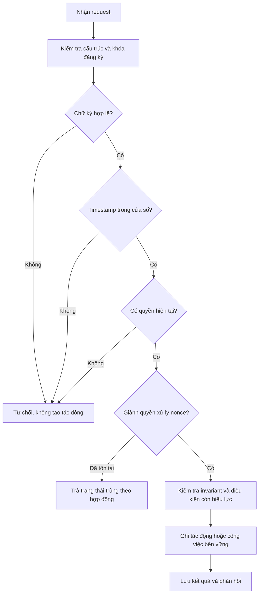

# Timestamp freshness

## 1. Vì sao yêu cầu có chữ ký vẫn cần kiểm tra thời gian?

Trong chương **Replay Protection** của module bảo vệ logic nghiệp vụ, một yêu cầu có chữ ký hợp lệ chưa chắc là một yêu cầu mới. Chữ ký giúp phát hiện việc sửa các thành phần đã được ký và chứng minh bên sở hữu khóa đã tạo thông điệp, nhưng thông điệp đó có thể đã được gửi từ trước.

Giả sử một yêu cầu phê duyệt thanh toán được ký hợp lệ. Một bản sao lọt vào log, công cụ chẩn đoán hoặc hệ thống trung gian. Sau nhiều giờ, bản sao được gửi lại. Nếu máy chủ chỉ kiểm tra chữ ký, yêu cầu vẫn có thể được chấp nhận dù bối cảnh nghiệp vụ và quyền của người gọi đã thay đổi.

**Timestamp freshness** là kiểm tra xem thời điểm được xác thực trong thông điệp có nằm trong cửa sổ thời gian mà bên nhận cho phép hay không. Nó giới hạn thời gian một thông điệp cũ còn có thể được chấp nhận.

Ví dụ hợp đồng:

```text
Thông điệp không được cũ hơn 5 phút so với đồng hồ bên nhận.
Thông điệp không được đi trước đồng hồ bên nhận quá 30 giây.
Timestamp phải được ràng buộc với nội dung bằng chữ ký hoặc MAC.
```

Kiểm tra này chỉ tạo ra một giới hạn thời gian. Trong 5 phút đó, cùng thông điệp vẫn có thể được gửi lại nhiều lần. Vì vậy, freshness cần kết hợp với nonce hoặc định danh thông điệp, kiểm tra quyền hiện tại, idempotency và business invariant.

Sau bài học, bạn có thể thiết kế cửa sổ freshness, xử lý clock skew, tính thời hạn giữ dấu vết chống replay và kiểm thử các trường hợp biên mà không nhầm timestamp với bằng chứng “chỉ dùng một lần”.

## 2. Freshness bảo vệ điều gì và có giới hạn nào?

Một chính sách freshness đúng giúp:

- Từ chối thông điệp đã quá cũ, kể cả khi chữ ký vẫn hợp lệ.
- Từ chối timestamp quá xa trong tương lai, tránh mở rộng thời gian sử dụng ngoài hợp đồng.
- Giới hạn khoảng thời gian cần nhận diện bản sao của một thông điệp truyền tải cụ thể.
- Phát hiện một số lỗi tích hợp như nhầm đơn vị thời gian hoặc đồng hồ bên gửi bị lệch.

Nó không tự bảo đảm:

- Thông điệp chưa từng được xử lý trong cửa sổ còn hiệu lực.
- Caller hiện tại còn quyền thao tác lên tài nguyên.
- Giá, hạn mức, trạng thái phê duyệt hoặc điều kiện nghiệp vụ vẫn hợp lệ.
- Một bên sở hữu khóa hợp lệ không tạo được thông điệp mới có timestamp mới.
- Timestamp do bên gửi cung cấp phản ánh chính xác thời điểm một sự kiện ngoài đời đã xảy ra.

| Lớp bảo vệ | Câu hỏi chính |
| --- | --- |
| Chữ ký hoặc MAC | Thông điệp có bị sửa và có được tạo bởi bên sở hữu khóa không? |
| Timestamp freshness | Thời điểm được xác thực có còn nằm trong cửa sổ được chấp nhận không? |
| Nonce hoặc message ID | Thông điệp này đã được sử dụng trong phạm vi chống replay chưa? |
| Idempotency | Cùng một ý định nghiệp vụ được gửi lại thì có tạo thêm tác động không? |
| Authorization | Chủ thể có quyền hiện tại đối với thao tác và đối tượng không? |
| Business invariant | Tác động có tuân thủ quy tắc nghiệp vụ dù caller đổi khóa hay thông điệp không? |

Một API hoàn tiền vẫn phải ngăn hoàn vượt số tiền được phép, kể cả khi mọi request đều có chữ ký đúng, timestamp mới và nonce chưa dùng.

## 3. Phân biệt các mốc thời gian

Một thông điệp có thể mang nhiều thời điểm với ý nghĩa khác nhau:

| Trường khái niệm | Ý nghĩa | Có nên dùng trực tiếp làm freshness? |
| --- | --- | --- |
| `signed_at` | Thời điểm bên gửi ký một lần giao thông điệp | Có thể, nếu được xác thực và giao thức quy định như vậy |
| `event_occurred_at` | Thời điểm sự kiện nghiệp vụ xảy ra | Không mặc định; một sự kiện cũ có thể được giao lại hợp lệ |
| `received_at` | Thời điểm hệ thống nhận ghi nhận request | Chỉ có giá trị khi do bên nhận tin cậy tạo và lưu |
| `expires_at` | Hạn chót được bên có thẩm quyền cấp | Cần xác thực và kiểm tra theo chính sách, không tin một giá trị tùy ý |
| `authorized_at` | Thời điểm quyết định cho phép thao tác được đưa ra | Không thay thế kiểm tra quyền và trạng thái ở bước tạo tác động |
| `processed_at` | Thời điểm thực thi hoặc hoàn tất xử lý | Phục vụ audit, độ trễ và chính sách thực thi |

Ví dụ webhook: một giao dịch xảy ra từ hôm qua, nhưng nhà cung cấp đang giao lại thông báo hôm nay. `event_occurred_at` có thể giữ nguyên từ hôm qua trong khi mỗi lần giao được ký mới bằng `signed_at` hiện tại, nếu đó là giao thức của bên gửi.

Nếu lấy thời điểm sự kiện để kiểm tra freshness của lần giao, máy chủ có thể từ chối thông báo hợp lệ. Ngược lại, thay `event_occurred_at` bằng giờ hiện tại để “làm mới” sự kiện làm sai lịch sử nghiệp vụ.

Cần tách rõ **tuổi của thông điệp truyền tải** với **tuổi hoặc hiệu lực của một quyết định nghiệp vụ**. Một yêu cầu vừa ký vẫn có thể tham chiếu tới báo giá đã hết hạn hoặc quyết định phê duyệt đã bị thu hồi.

## 4. Mô hình cửa sổ chấp nhận

Đặt:

```text
ts  = timestamp đã được xác thực trong request
now = thời gian hiện tại do bên nhận tin cậy lấy một lần cho phép kiểm tra
W   = tuổi tối đa được chấp nhận
F   = độ dung sai cho timestamp đi trước đồng hồ bên nhận
```

Một chính sách minh họa chấp nhận khi:

```text
now - W <= ts <= now + F
```

Tương đương:

```text
age = now - ts
-F <= age <= W
```

Ví dụ dùng số giây giả định để dễ tính:

```text
now = 10000
W   = 300 giây
F   = 30 giây

Khoảng được chấp nhận: [9700, 10030]
```

| Timestamp | Kết quả theo chính sách này |
| --- | --- |
| `9699` | Quá cũ |
| `9700` | Chấp nhận tại biên dưới |
| `9990` | Chấp nhận |
| `10000` | Chấp nhận |
| `10030` | Chấp nhận tại biên trên |
| `10031` | Quá xa trong tương lai |

Bài này chọn hai biên đều được chấp nhận. Giao thức khác có thể chọn biên mở; điều quan trọng là hợp đồng, code, thời hạn lưu nonce và kiểm thử phải nhất quán.

Không chỉ kiểm tra:

```text
now - ts <= W
```

Với timestamp rất xa trong tương lai, `now - ts` là số âm và vẫn nhỏ hơn `W`. Nếu thiếu biên tương lai, thông điệp có thể tiếp tục được chấp nhận trong thời gian dài ngoài dự kiến.

Không nên mặc định dùng `abs(now - ts) <= W`. Cách đó buộc dung sai tương lai bằng tuổi tối đa và có thể cho phép lệch tương lai rộng hơn nhu cầu. Hai tham số riêng giúp thể hiện chính sách rõ hơn.

## 5. Timestamp phải được ràng buộc với đúng request

### 5.1. Timestamp không được ký có thể bị làm mới

Thiết kế yếu:

```text
signature = MAC(secret, body)
timestamp = header không nằm trong MAC
```

Một người có bản sao body và signature có thể đổi timestamp thành giờ hiện tại rồi gửi lại. Chữ ký vẫn đúng vì timestamp chưa từng được bảo vệ.

Timestamp phải nằm trong dữ liệu được ký hoặc MAC, cùng các thành phần cần thiết để ngăn thông điệp bị chuyển sang một bối cảnh khác.

### 5.2. Những thành phần cần cân nhắc ràng buộc

Ví dụ mô hình thông điệp được xác thực:

```text
protocol_version
signer_identity hoặc ngữ cảnh ánh xạ khóa đã được xác minh
recipient hoặc audience
tenant/context được phép
operation và HTTP method
request target theo quy tắc giao thức
signed_at
nonce hoặc delivery_id
idempotency_key hoặc business_intent_id, nếu có
digest của body chính xác theo giao thức
```

Đây là mô hình minh họa, không phải định dạng chữ ký chuẩn có thể ghép tùy ý. Nếu tự xây dựng giao thức, encoding phải xác định ranh giới từng thành phần, có phiên bản và không nhập nhằng. Không nối chuỗi không có cấu trúc hoặc cho phép ký một cách, thực thi một cách khác.

Ví dụ HTTP khái niệm:

```http
POST /payment-attempts/pa-27/capture
X-Signed-At: <unix-seconds>
X-Delivery-Nonce: <random-nonce>
Idempotency-Key: <business-intent-key>
X-Key-Id: <registered-key-id>
X-Signature: <authentication-tag>
Content-Type: application/json

{"amountMinor":125000,"currency":"VND"}
```

Khóa xác minh phải được ánh xạ tới một chủ thể đã đăng ký. `X-Key-Id` là đầu vào tra cứu có kiểm soát, không phải quyền để client chọn tenant hoặc thuật toán tùy ý.

Nếu path, query hoặc body bị gateway chuẩn hóa, hai bên phải thống nhất chính xác biểu diễn nào được ký. Việc kiểm tra chữ ký trên một biểu diễn rồi chuyển một biểu diễn khác cho business service có thể tạo khoảng trống, dù timestamp mới hoàn toàn.

### 5.3. Nhiều timestamp hoặc timestamp mâu thuẫn

Nếu timestamp vừa có trong header vừa có trong body, cần quy định một nguồn có thẩm quyền hoặc yêu cầu chúng khớp nhau. Không xác minh chữ ký trên header nhưng dùng body để quyết định freshness.

Header lặp, số không đúng định dạng, timestamp vừa là giây ở một lớp vừa là mili giây ở lớp khác phải bị xử lý rõ ràng. Tránh âm thầm chọn “giá trị có vẻ hợp lý” vì các tầng có thể chọn khác nhau.

## 6. Định dạng và phép tính thời gian an toàn

Một hợp đồng đơn giản có thể dùng Unix time theo **số giây nguyên** trong UTC. Cần công bố:

- Đơn vị giây hay mili giây, không cho phép tự đoán theo số chữ số.
- Miền giá trị và độ dài được hỗ trợ.
- Có chấp nhận giá trị âm, số thập phân hoặc ký pháp khoa học hay không.
- Quy tắc xử lý trường thiếu, lặp hoặc không parse được.
- Cách diễn giải mốc hết hạn và biên của cửa sổ.

Không dùng chuỗi giờ địa phương không có offset như `2026-11-22 10:00:00` cho giao thức liên hệ thống. Hai máy có thể ở múi giờ khác nhau hoặc cấu hình khác nhau. UTC và kiểu biểu diễn xác định loại bỏ nhập nhằng múi giờ; chúng không tự làm đồng hồ chính xác hơn.

Khi xử lý số:

- Dùng kiểu đủ lớn cho epoch time và kiểm tra giới hạn trước khi chuyển đổi.
- Không nhân giây với `1000` trong kiểu số có thể tràn.
- Không lấy trị tuyệt đối một hiệu số chưa được kiểm soát miền giá trị.
- Không gộp lỗi parse thành timestamp `0` hoặc giờ hiện tại.
- Không tự chia một giá trị lớn cho `1000` để “sửa” client gửi sai đơn vị.

Ví dụ khung kiểm tra Java dưới đây chỉ thực hiện chính sách thời gian. Chữ ký, parser đầu vào, nonce và nghiệp vụ được xử lý ở các bước riêng.

```java
import java.time.Clock;
import java.time.Duration;
import java.time.Instant;
import java.util.Objects;

public final class FreshnessPolicy {
    public enum Result {
        FRESH,
        TOO_OLD,
        TOO_FAR_IN_FUTURE
    }

    private final Clock clock;
    private final Duration maxAge;
    private final Duration futureTolerance;

    public FreshnessPolicy(
            Clock clock,
            Duration maxAge,
            Duration futureTolerance) {
        this.clock = Objects.requireNonNull(clock);
        this.maxAge = Objects.requireNonNull(maxAge);
        this.futureTolerance = Objects.requireNonNull(futureTolerance);

        if (maxAge.isNegative() || maxAge.isZero()) {
            throw new IllegalArgumentException("maxAge must be positive");
        }
        if (futureTolerance.isNegative()) {
            throw new IllegalArgumentException(
                    "futureTolerance must not be negative");
        }
    }

    public Result evaluate(Instant authenticatedSignedAt) {
        Objects.requireNonNull(authenticatedSignedAt);
        Instant now = clock.instant();

        if (authenticatedSignedAt.isBefore(now.minus(maxAge))) {
            return Result.TOO_OLD;
        }
        if (authenticatedSignedAt.isAfter(now.plus(futureTolerance))) {
            return Result.TOO_FAR_IN_FUTURE;
        }
        return Result.FRESH;
    }
}
```

Ví dụ cấu hình minh họa:

```java
FreshnessPolicy policy = new FreshnessPolicy(
        Clock.systemUTC(),
        Duration.ofMinutes(5),
        Duration.ofSeconds(30));
```

Timestamp đã kiểm tra định dạng và miền giá trị có thể được chuyển thành `Instant` bằng `Instant.ofEpochSecond(...)`. Không gọi kết quả là `authenticatedSignedAt` cho đến khi giá trị đó đã được xác minh cùng thông điệp.

Cấu hình duration cũng phải có giới hạn hợp lý để tránh cửa sổ bị mở quá rộng hoặc phép tính vượt miền thời gian được hỗ trợ. Đoạn code không tự xác định 5 phút là mức an toàn cho mọi nghiệp vụ.

Việc lấy `now` một lần giúp phép kiểm tra dùng cùng một mốc. Inject `Clock` cho phép kiểm thử chính xác các biên mà không cần đợi thời gian thực trôi qua.

## 7. Chọn cửa sổ và xử lý clock skew

### 7.1. Cửa sổ là quyết định rủi ro và vận hành

`W` cần cân nhắc độ trễ mạng, độ trễ xử lý trước khi xác minh, cách retry của đối tác và mức độ nhạy cảm của thao tác. Cửa sổ quá ngắn làm tăng từ chối hợp lệ; cửa sổ quá dài kéo dài thời gian thông điệp bị thu thập có thể được sử dụng.

`F` dùng để dung sai cho việc đồng hồ bên gửi đi trước bên nhận trong giới hạn cho phép. Nó không phải giấy phép để client đặt một thời điểm tùy ý trong tương lai.

Nên tách chính sách theo giao thức hoặc mức rủi ro nếu có lý do rõ ràng, thay vì dùng một con số toàn hệ thống cho mọi thứ từ webhook đến phê duyệt nhạy cảm. Các giá trị phải do server quản lý; client không được gửi `allowedSkew` để tự mở cửa sổ.

### 7.2. Các thành phần của sai lệch

```text
Tuổi quan sát được của request có thể chịu ảnh hưởng bởi:
    độ trễ mạng
  + thời gian chờ trước bước kiểm tra
  + sai lệch đồng hồ bên gửi và bên nhận
  + sai số do độ phân giải timestamp
```

Nếu dùng timestamp độ phân giải giây nhưng so sánh bằng thời gian bên nhận có phần lẻ, các biên thực tế chịu ảnh hưởng của việc làm tròn. Cần quy định quy tắc này và tính vào dung sai vận hành, thay vì sửa bằng các khoảng cộng trừ tùy tiện rải rác trong code.

### 7.3. Đồng bộ và giám sát đồng hồ

Các node cần có cơ chế đồng bộ thời gian và theo dõi sai lệch, đặc biệt sau khi VM tạm dừng, máy khởi động lại hoặc hệ thống chuyển vùng.

Hai tình huống đáng chú ý:

- Đồng hồ nhảy về trước: request hợp lệ có thể bị coi là quá cũ.
- Đồng hồ nhảy lùi: request đã cũ có thể lại nằm trong cửa sổ freshness.

Dấu vết nonce còn tồn tại có thể ngăn một số replay khi đồng hồ nhảy lùi. Nhưng nếu dấu vết đã bị xóa hoặc đồng hồ lệch ngoài giới hạn thiết kế, không thể tiếp tục khẳng định chính sách thời gian vẫn giữ nguyên bảo đảm.

Với endpoint nhạy cảm, cần chính sách rõ khi độ tin cậy của đồng hồ không đạt ngưỡng: loại node khỏi đường xử lý, từ chối có kiểm soát hoặc chuyển sang cơ chế phục hồi phù hợp. Không tự mở cửa sổ vô hạn hoặc bỏ qua freshness để giảm lỗi vận hành.

### 7.4. Wall clock và monotonic clock

Timestamp giữa hai máy cần một thang thời gian chung như UTC. Đồng hồ monotonic như `System.nanoTime()` hữu ích để đo thời lượng nội bộ, nhưng giá trị của nó không phải epoch time và không thể so sánh trực tiếp với timestamp của máy khác.

Có thể dùng monotonic clock để đo timeout hoặc thời gian chờ nội bộ, đồng thời dùng wall clock đã được giám sát để đánh giá `signed_at`. Không suy ra rằng dùng monotonic clock sẽ tự giải quyết sai lệch thời gian liên hệ thống.

## 8. Kết hợp nonce và tính thời hạn lưu dấu vết

### 8.1. Fresh trong thời gian không có nghĩa chưa dùng

```text
10:00:00  Request được ký, nonce=N.
10:00:01  Server xác minh và thực hiện tác động.
10:00:02  Bản sao request được gửi lại.
```

Với cửa sổ 5 phút, bản sao tại `10:00:02` vẫn fresh. Cần lưu việc nonce N đã được nhận trong đúng phạm vi và kiểm tra nguyên tử.

Ví dụ scope của dấu vết chống replay:

```text
(stable_signer_id, tenant_id, recipient_id, operation_code, nonce)
```

Các chiều phải phù hợp với giao thức. Dùng ID chủ thể ổn định thay vì mặc định dùng từng credential ID nếu việc xoay khóa vẫn phải giữ cùng namespace thông điệp. Nonce phải được ràng buộc trong chữ ký và có định dạng, độ dài được kiểm soát.

Hai request đồng thời có cùng nonce phải được phân xử bằng unique constraint, thao tác nguyên tử hoặc cơ chế tương đương tại nơi có thẩm quyền. “Kiểm tra chưa thấy rồi ghi vào bộ nhớ của instance” không đủ khi chạy nhiều node.

### 8.2. Không xóa nonce trước khi thông điệp hết khả năng được chấp nhận

Với chính sách:

```text
now - W <= ts <= now + F
```

Một thông điệp có thể được chấp nhận lần đầu khi timestamp của nó đi trước đồng hồ bên nhận tới `F`. Sau đó, về lý thuyết nó còn có thể được chấp nhận cho đến khi đồng hồ bên nhận vượt `ts + W`.

Do đó, nếu tính TTL từ lần thấy đầu tiên, chỉ đặt `TTL = W` có thể là chưa đủ.

Ví dụ với đồng hồ ổn định:

```text
Lần nhận đầu: now = 10000
Timestamp:   ts  = 10030
W = 300, F = 30

Request được chấp nhận tại now=10000.
Request vẫn có thể được chấp nhận tới now=10330.
Nếu nonce hết TTL tại now=10300, còn khoảng thời gian có thể replay.
```

Một giới hạn bảo thủ cho TTL tính từ lần chấp nhận đầu có thể là:

```text
TTL >= W + F + margin
```

`margin` phải bao phủ sai lệch được cho phép giữa các node xác minh, đồng hồ hoặc cơ chế hết hạn của kho lưu trữ, độ phân giải và chính sách biên. Đây chỉ có ý nghĩa khi các sai lệch đó có giới hạn được thiết kế; không có TTL hữu hạn nào tự sửa được một đồng hồ có thể nhảy lùi tùy ý.

Nếu lưu thời điểm hết hạn tuyệt đối dựa trên `ts + W`, cần bổ sung khoảng bảo vệ tương ứng với clock skew và biên chấp nhận. Vì bài này chấp nhận tại đúng `ts + W`, không được dọn nonce đúng biên trong khi validator vẫn có thể nhận request đó.

Giữ record lâu hơn giới hạn tối thiểu thường ít nguy hiểm hơn xóa quá sớm, nhưng vẫn phải có quota, chính sách dữ liệu và cơ chế dọn phù hợp. TTL nonce cũng không nhất thiết là retention của kết quả nghiệp vụ: một payment attempt có thể cần được nhận diện lâu hơn rất nhiều.

### 8.3. Đã ghi nonce nhưng xử lý thất bại thì sao?

Nếu ghi “nonce đã dùng” rồi process chết trước khi ghi tác động, hệ thống có thể mất khả năng tiếp tục công việc. Nếu tạo tác động rồi mới ghi nonce ở một bước rời rạc, có thể có khoảng trống cho tác động trùng.

Với tác động trong cùng database, có thể ghi dấu nhận thông điệp, chuyển trạng thái nghiệp vụ và lưu kết quả trong một transaction phù hợp. Với công việc dài hoặc dịch vụ ngoài, cần inbox, trạng thái xử lý bền vững, idempotency và cơ chế phục hồi.

Thông điệp trùng có thể bị từ chối hoặc được trả trạng thái/kết quả đã ghi theo hợp đồng. Điều cốt lõi là không tạo thêm tác động và không xóa dấu vết chỉ để cho phép thử lại mù.

## 9. Thứ tự xác minh và điểm thực thi nghiệp vụ

Một luồng xử lý minh họa:

```text
1. Kiểm tra giới hạn kích thước và định dạng request.
2. Xác định khóa đã đăng ký và ngữ cảnh chủ thể phù hợp.
3. Xác minh chữ ký/MAC trên đúng timestamp và nội dung.
4. Lấy thời gian bên nhận và kiểm tra freshness.
5. Kiểm tra quyền hiện tại trên thao tác và đối tượng.
6. Giành quyền xử lý nonce/thông điệp bằng cơ chế nguyên tử.
7. Kiểm tra invariant, trạng thái và điều kiện nghiệp vụ còn hiệu lực.
8. Ghi tác động cùng kết quả hoặc công việc bền vững.
9. Trả phản hồi theo trạng thái đã được xác nhận.
```

Có thể parse và loại sớm timestamp rõ ràng sai để giảm chi phí, nhưng không coi trường đó là đã xác thực. Không ghi nonce hoặc tạo tác động dựa trên một timestamp chưa kiểm tra chữ ký; nếu không, attacker có thể chiếm hoặc làm đầy kho dấu vết bằng request giả.

Kiểm tra quyền trước bước giành quyền xử lý giúp tránh tiêu thụ nonce cho caller không được phép. Nếu quyền và trạng thái có thể thay đổi đồng thời, cần kiểm tra lại hoặc ràng buộc chúng ở bước chuyển trạng thái trong transaction.



Freshness được kiểm tra ở thời điểm nào cần được nói rõ. “Request fresh khi vào API” không đồng nghĩa “tác động luôn xảy ra trong 5 phút từ lúc ký”. Nếu request chờ lâu trước tác động không thể đảo ngược, phải có chính sách kiểm tra lại thời hạn nghiệp vụ hoặc deadline thực thi.

Không dùng thời điểm ký để quyết định thứ tự duy nhất của các lệnh. Hai request có thể cùng timestamp hoặc được giao sai thứ tự. Các quy tắc phê duyệt và state machine vẫn cần phiên bản, sequence hoặc chuyển trạng thái có điều kiện khi phù hợp.

## 10. Retry, idempotency và hàng đợi

### 10.1. Một lần gửi có thể hết freshness nhưng ý định vẫn cần tra cứu

Giả sử thanh toán đã hoàn tất nhưng response bị mất. Sau khi cửa sổ freshness kết thúc, client gửi lại nguyên gói request cũ.

Máy chủ có thể từ chối gói cũ vì timestamp hết hạn. Điều đó không chứng minh giao dịch ban đầu thất bại. Client phải tra cứu trạng thái hoặc tạo một lần giao mới được ký đúng theo giao thức.

Trong thiết kế tách lớp:

```text
Lần giao mới:
    signed_at mới
    delivery nonce mới
    cùng business intent / idempotency key
    cùng nội dung command
```

Lớp replay protection nhận diện đây là một thông điệp truyền tải mới hợp lệ. Lớp idempotency nhận diện cùng ý định và trả kết quả đã chốt, sau khi kiểm tra quyền. Đổi timestamp không được biến cùng payment attempt thành lần capture thứ hai.

Nếu cùng idempotency key nhưng command bị đổi, máy chủ phải báo xung đột theo hợp đồng thay vì cho phép payload mới chỉ vì lần ký mới hơn.

### 10.2. Hàng đợi nội bộ có thể chậm hơn cửa sổ giao nhận

Một webhook được xác minh hợp lệ tại ingress rồi được đưa vào hàng đợi bền vững. Consumer xử lý sau mười phút, trong khi cửa sổ giao nhận chỉ là năm phút.

Cần tách hai câu hỏi:

1. Thông điệp bên ngoài có hợp lệ khi được hệ thống chấp nhận không?
2. Tác động nghiệp vụ còn được phép thực hiện tại thời điểm consumer xử lý không?

Ingress có thể lưu bằng chứng xác minh, thời điểm nhận do server tạo và công việc trong inbox bền vững. Consumer dựa trên ranh giới tin cậy nội bộ đó, đồng thời kiểm tra deadline và invariant nghiệp vụ cần thiết.

Không nhận một header do caller tự gửi như `X-Already-Verified: true` rồi bỏ qua xác minh. Trạng thái xác minh phải do thành phần tin cậy tạo và được bảo vệ khi truyền nội bộ.

Nếu giao thức yêu cầu freshness ngay tại thời điểm thực thi, hệ thống phải kiểm tra lại hoặc từ chối công việc quá hạn theo thiết kế. Không âm thầm thay timestamp đã ký bằng giờ hiện tại trong consumer.

### 10.3. Webhook giao lại và event ID

Khi bên gửi hỗ trợ ký mới mỗi lần giao, timestamp dùng để đánh giá độ mới của lần giao. Event ID ổn định dùng để chống tác động trùng của cùng sự kiện qua nhiều lần giao có chữ ký mới.

Do đó, retention chống trùng theo event ID có thể dài hơn nhiều so với cửa sổ freshness. Không xóa event ID sau năm phút chỉ vì chữ ký của một lần giao cũ đã hết hạn: bên gửi có thể giao lại cùng sự kiện bằng một chữ ký mới hợp lệ.

## 11. Timestamp, thời điểm hết hạn và hiệu lực phê duyệt

Một số thông điệp có cả thời điểm phát hành và thời điểm hết hạn:

```text
issued_at  = thời điểm được cấp
expires_at = hạn chót được phép dùng
```

Nếu đây là các trường do bên có thẩm quyền cấp và được xác thực, bên nhận vẫn cần chính sách kiểm tra:

- Quan hệ giữa `issued_at` và `expires_at` có hợp lệ không.
- Thời gian sống được cấp có vượt giới hạn máy chủ cho phép không.
- Thời điểm hiện tại có đáp ứng điều kiện hết hạn theo giao thức không.
- Có cần thêm giới hạn tuổi tối đa và dung sai tương lai không.

Không tin một request tự khai `expires_at` rất xa rồi coi đó là quyền dùng lâu dài. Giới hạn phải đến từ chính sách của bên nhận và thẩm quyền của bên cấp.

Với nghiệp vụ phê duyệt, một authorization artifact có thể cần ràng buộc thêm:

```text
người phê duyệt
đối tượng và phiên bản đối tượng
loại quyết định
giá trị hoặc hạn mức được duyệt
thời hạn thực thi
định danh dùng một lần
```

Một request vừa ký không được dùng quyết định phê duyệt cho phiên bản cũ để thanh toán một số tiền mới. Freshness của lớp truyền tải, thời hạn của quyết định và tính toàn vẹn của đối tượng được duyệt là những điều kiện riêng.

Nếu token hoặc artifact dùng quy tắc hết hạn khác với cửa sổ minh họa của bài, cần theo đúng giao thức đó. Không sao chép tùy tiện điều kiện biên giữa các loại token và request.

## 12. Những cách vượt kiểm tra freshness thường gặp

### 12.1. Làm mới header timestamp nhưng giữ nguyên chữ ký

Điều kiện khai thác là timestamp không được ký hoặc verifier đọc timestamp khác business layer. Cần ràng buộc đúng trường và từ chối các biểu diễn mâu thuẫn.

### 12.2. Chọn timestamp rất xa trong tương lai

Nếu chỉ kiểm tra “không quá cũ”, thông điệp tương lai có thể đi qua. Cần biên tương lai rõ ràng và kiểm soát định dạng, miền giá trị trước phép tính.

### 12.3. Replay nhiều lần trong cửa sổ

Một request ký cách đây vài giây vẫn fresh dù đã được dùng mười lần. Nonce, inbox hoặc cơ chế chống trùng nguyên tử phải ngăn tác động lặp. Rate limit có thể giảm tốc độ lạm dụng nhưng không tạo bảo đảm chỉ dùng một lần.

### 12.4. Gửi cùng request đến nhiều node hoặc region

Nếu freshness được kiểm tra ở mọi node nhưng dấu vết nonce chỉ nằm trong bộ nhớ cục bộ, cùng request có thể được chấp nhận ở nhiều nơi.

Cần định tuyến cùng phạm vi về nơi có thẩm quyền, dùng kho chống replay có bảo đảm phù hợp hoặc bảo vệ tác động ở tầng nghiệp vụ dùng chung. Đồng bộ bất đồng bộ sau khi tác động đã xảy ra không tự hoàn tác được giao dịch trùng.

### 12.5. Lợi dụng cache nonce hết hạn sớm

Request có timestamp hơi đi trước được chấp nhận sớm. Nếu nonce chỉ giữ `W` từ lần nhận đầu, có thể có một đoạn cuối mà request vẫn fresh nhưng dấu vết đã mất. Phải tính cả dung sai tương lai và chênh lệch đồng hồ được phép.

### 12.6. Mở rộng cửa sổ khi thấy nhiều lỗi

Lỗi `TOO_OLD` tăng có thể đến từ sai đơn vị, signer chậm, queue sai vị trí hoặc đồng hồ lệch. Nâng cửa sổ từ vài phút lên nhiều giờ che mất nguyên nhân và tăng thời gian replay.

Cần phân loại nguyên nhân, xác minh số liệu và thay đổi chính sách có chủ đích. Client không được hướng dẫn sửa timestamp của một thông điệp đã ký mà không ký lại đúng quy trình.

### 12.7. Dùng timestamp làm nonce

Hai yêu cầu hợp lệ có thể có cùng timestamp độ phân giải giây. Một attacker có thể gửi cùng timestamp và nội dung nhiều lần. Timestamp không phải định danh duy nhất; cần nonce hoặc message ID riêng với phạm vi và quy tắc cấp phù hợp.

## 13. Ma trận kiểm thử freshness và replay

Giả định `W=300 giây`, `F=30 giây`, hai biên được chấp nhận và timestamp nằm trong chữ ký.

| Ca kiểm thử | Kết quả cần quan sát |
| --- | --- |
| `ts = now` và chữ ký đúng | Qua freshness, tiếp tục các bước bảo vệ khác |
| `ts = now - 300s` | Qua tại biên dưới theo hợp đồng |
| `ts = now - 300s - 1ns` trong kiểm thử policy bằng `Instant` | Bị coi là quá cũ |
| `ts = now + 30s` | Qua tại biên trên |
| `ts = now + 30s + 1ns` trong kiểm thử policy | Bị coi là quá xa trong tương lai |
| Timestamp thiếu, lặp hoặc không parse được | Từ chối có kiểm soát, không ghi nonce hay tác động |
| Client gửi mili giây trong trường quy định giây | Từ chối, không tự sửa đơn vị |
| Timestamp cực lớn hoặc ngoài miền hỗ trợ | Từ chối trước phép tính có nguy cơ lỗi hoặc tràn |
| Thay timestamp của request đã ký | Chữ ký không hợp lệ |
| Thay body, method, đích nhận hoặc target đã được ký | Không qua xác minh |
| Request fresh nhưng thiếu quyền trên đối tượng | Không tạo tác động |
| Request fresh nhưng báo giá hoặc phê duyệt đã hết hạn | Bị chặn bởi quy tắc nghiệp vụ tương ứng |
| Cùng request được gửi hai lần trong cửa sổ | Tối đa một tác động; phản hồi trùng theo hợp đồng |
| Cùng request đồng thời qua nhiều instance | Giành quyền nonce nguyên tử, không tạo hai tác động |
| Nonce giữ lâu `W` nhưng request được nhận sớm `F` | Test phải tái hiện khoảng trống nếu cấu hình TTL sai |
| Đồng hồ các node lệch trong giới hạn thiết kế | Cửa sổ và TTL vẫn phối hợp đúng |
| Đồng hồ một node lệch ngoài giới hạn thiết kế | Node xử lý theo chính sách mất tin cậy thời gian |
| Đồng hồ nhảy lùi sau khi request đã xử lý | Không được dựa vào freshness đơn lẻ để cho phép tác động lặp |
| Đổi múi giờ hệ điều hành nhưng giữ cùng instant | Quyết định không đổi khi dùng epoch/UTC đúng |
| Ingress xác minh xong, consumer nhận sau cửa sổ | Xử lý theo hợp đồng ingress và deadline nghiệp vụ, không thay timestamp |
| Ký mới cùng event ID hoặc business intent | Freshness có thể qua; chống trùng nghiệp vụ vẫn chặn tác động lặp |
| Retry nguyên gói cũ sau cửa sổ khi lần đầu đã commit | Có thể bị từ chối về freshness; kết quả cũ vẫn phải tra cứu được theo hợp đồng |
| Xoay credential nhưng cùng principal và ý định | Không vô tình tạo namespace chống trùng mới trái hợp đồng |

Với giao thức chỉ chấp nhận giây nguyên, kiểm thử parser và HTTP nên dùng các giá trị giây đúng đơn vị. Các ca `1ns` dành cho policy nội bộ dùng `Instant` để kiểm tra toán tử biên; không có nghĩa API phải nhận timestamp nanosecond.

Ví dụ thời gian cố định để kiểm thử Java:

```java
Instant now = Instant.parse("2026-11-22T03:00:00Z");
Clock fixedClock = Clock.fixed(now, java.time.ZoneOffset.UTC);

FreshnessPolicy policy = new FreshnessPolicy(
        fixedClock,
        Duration.ofSeconds(300),
        Duration.ofSeconds(30));

FreshnessPolicy.Result atLowerBoundary =
        policy.evaluate(now.minusSeconds(300));

FreshnessPolicy.Result beforeLowerBoundary =
        policy.evaluate(now.minusSeconds(300).minusNanos(1));
```

Không dùng `sleep` để đợi đến đúng ranh giới. Ngoài kiểm thử policy, cần kiểm thử có chữ ký, nonce đồng thời và tác động bền vững; chỉ kiểm tra một mã HTTP không chứng minh nghiệp vụ đã được bảo vệ.

## 14. Quan sát vận hành và phản hồi lỗi

Những tín hiệu nên theo dõi gồm:

- Số request quá cũ, quá xa trong tương lai, lỗi định dạng và chữ ký sai.
- Phân bố tuổi request đã được xác thực theo signer hoặc nhóm tích hợp có kiểm soát cardinality.
- Sai lệch đồng hồ, tình trạng đồng bộ và các lần điều chỉnh bất thường trên node.
- Số nonce trùng, xung đột khi giành quyền xử lý và độ trễ của kho chống replay.
- Độ trễ từ ingress đến consumer, thời gian tới điểm tạo tác động và số công việc quá deadline.
- Số trường hợp invariant chặn tác động dù request có freshness hợp lệ.

Số liệu tuổi request từ timestamp chưa xác thực chỉ nên được coi là dữ liệu không tin cậy. Không để attacker tự tạo phân bố “clock skew của đối tác” bằng các request chữ ký sai.

Thông báo cho client cần đủ để phân biệt lỗi cần đồng bộ đồng hồ, lỗi chữ ký và trạng thái cần tra cứu theo hợp đồng. Không trả secret, canonical string chứa dữ liệu nhạy cảm hoặc payload giao dịch trong lỗi.

Nếu trả giờ máy chủ làm gợi ý chẩn đoán, client phải nhận nó qua kênh được xác thực phù hợp. Gợi ý đó không cho phép client bỏ xác minh server, tự tăng cửa sổ hoặc sửa một thông điệp đã ký mà không ký lại.

Không ghi access token, khóa ký, toàn bộ signature request hoặc dữ liệu thanh toán vào log chỉ để điều tra freshness. Dùng request ID, record ID và thông tin thời gian tối thiểu cần thiết, với quyền truy cập và retention rõ ràng.

## 15. Mẫu chính sách áp dụng và các điểm cần nhớ

Một hợp đồng minh họa cho API tạo tác động nhạy cảm:

```text
Định dạng:
  signed_at là Unix seconds nguyên, theo miền giá trị đã công bố.
  Header lặp hoặc biểu diễn sai bị từ chối.

Xác thực:
  Timestamp, nonce, recipient, operation và nội dung liên quan được ký.
  Khóa ánh xạ đến principal được đăng ký và đang được phép sử dụng.

Freshness:
  now - W <= signed_at <= now + F.
  W và F do server cấu hình, có giới hạn và theo dõi đồng hồ.

Chống replay:
  Nonce được ghi nhận nguyên tử trong scope đã công bố.
  Retention bao phủ toàn bộ thời gian request còn được chấp nhận,
  kể cả dung sai tương lai, sai lệch đồng hồ và chính sách biên.

Nghiệp vụ:
  Kiểm tra quyền hiện tại, state machine và invariant ở nơi tạo tác động.
  Một lần giao mới không tạo ý định mới nếu business intent không đổi.

Phục hồi:
  Có đường tra cứu kết quả sau timeout hoặc hết freshness.
  Công việc chưa xác định kết quả được đối soát, không thực thi lại mù.

Vận hành:
  Phát hiện clock skew ngoài giới hạn và xử lý node không đáng tin.
  Không bỏ kiểm tra freshness hoặc nới cửa sổ vô hạn khi có lỗi.
```

Timestamp freshness trả lời câu hỏi **“thông điệp được xác thực có còn đủ mới để được tiếp nhận không?”**. Nonce trả lời việc thông điệp đã được dùng chưa; idempotency và invariant quyết định một ý định có được tạo thêm tác động hay không. Kết hợp đúng các lớp này mới bảo vệ được quy tắc nghiệp vụ khi request bị lưu lại, gửi chậm hoặc phát lại có chủ đích.
