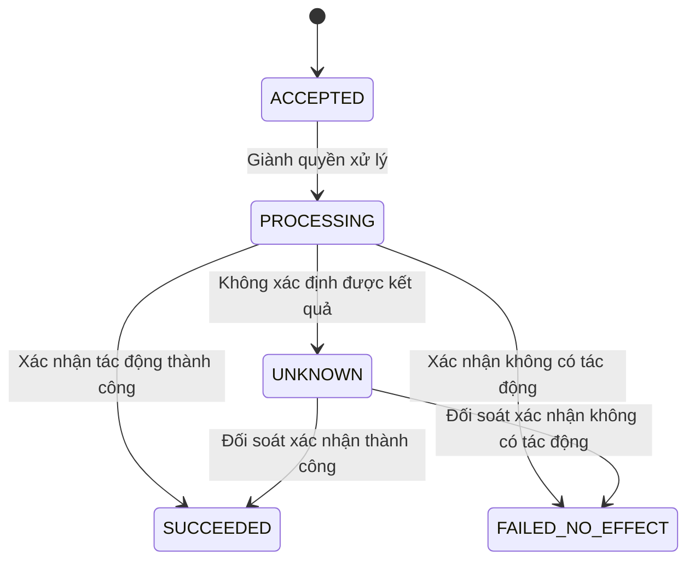

# Replay detection storage

## 1. Vì sao cần lưu dấu vết chống phát lại?

Một yêu cầu từng hợp lệ vẫn có thể gây hại khi được gửi lại. Ví dụ, một nhân viên đã được phê duyệt cấp phiếu ưu đãi cho khách hàng. Nếu cùng bằng chứng phê duyệt bị phát lại nhiều lần, hệ thống có thể cấp thêm phiếu dù chữ ký, tài khoản và dữ liệu yêu cầu đều hợp lệ.

**Replay detection storage** là nơi giữ bằng chứng rằng một nonce, thông điệp hoặc thao tác đã được tiếp nhận hay xử lý. Nó giúp máy chủ phân biệt một yêu cầu mới với một yêu cầu từng xuất hiện, kể cả khi request đến một tiến trình khác hoặc quay lại sau sự cố.

Chữ ký xác nhận tính toàn vẹn và nguồn gốc theo mô hình xác thực; nó không tự ghi nhớ số lần sử dụng. Timestamp giới hạn thời gian chấp nhận; nó không tự ngăn hai lần gửi trong cùng cửa sổ. Một nonce duy nhất chỉ có tác dụng dùng một lần khi máy chủ có cơ chế ghi nhận và phân xử việc sử dụng nó.

Ví dụ xuyên suốt: máy chủ cấp một yêu cầu xác nhận có `approval_id`, `operation_id`, nonce và thời hạn. Khi thực hiện, hệ thống phải bảo đảm một phê duyệt chỉ cấp đúng số phiếu được phép, người gọi còn quyền trên đối tượng và việc retry không tạo thêm tác động.

Bài này tập trung vào thiết kế kho lưu và giao thức sử dụng kho. Kiểm tra chữ ký, quyền và quy tắc nghiệp vụ vẫn phải được thực hiện ở ranh giới phù hợp; một bảng nonce không thay thế các bước đó.

## 2. Xác định bảo đảm cần có trước khi chọn công nghệ

### 2.1. Phân biệt ba mục tiêu

| Mục tiêu | Điều cần bảo đảm | Kho lưu phải hỗ trợ gì? |
|---|---|---|
| Chống sử dụng lại bằng chứng một lần | Cùng bằng chứng không được mở thêm lần thực hiện mới | Phân xử nguyên tử việc tiếp nhận theo định danh tin cậy |
| Xử lý retry hợp lệ | Client có thể nhận lại kết quả hoặc tiến độ của thao tác cũ | Liên kết dấu vết với thao tác và trạng thái bền vững |
| Giữ invariant nghiệp vụ | Một phê duyệt không cấp thêm phiếu ngoài phạm vi cho phép | Ràng buộc nghiệp vụ và giao thức thực thi, không chỉ đánh dấu nonce |

Từ chối mọi request lặp có thể đúng với một loại bằng chứng dùng một lần, nhưng không phải lúc nào cũng là trải nghiệm tốt cho client mất phản hồi. Có thể phát lại kết quả của thao tác cũ cho người còn quyền mà không cho phép thực hiện tác động lần hai.

Ngược lại, một người có thể gửi nhiều nonce khác nhau cho cùng phê duyệt. Nếu nghiệp vụ chỉ cho phê duyệt đó được dùng một lần, cần ràng buộc theo `approval_id` hoặc ý định nghiệp vụ, không chỉ theo nonce.

### 2.2. Các invariant minh họa

1. Trong phạm vi đã định nghĩa, một nonce chỉ được tiếp nhận theo một nội dung xác định.
2. Một `operation_id` chỉ có một tiến trình xử lý hợp lệ tại ranh giới ghi được kiểm soát.
3. Tác động cấp phiếu không được tăng chỉ vì request hoặc thông điệp bị gửi lại.
4. Dấu vết còn phải bảo vệ trong toàn bộ khoảng yêu cầu cũ vẫn có thể được chấp nhận.
5. Không tìm thấy dấu vết sau mất dữ liệu không đủ chứng minh thao tác chưa diễn ra.
6. Truy vấn kết quả cũ vẫn phải kiểm tra tenant, chủ thể và quyền trên đối tượng.
7. Khi không xác định được kết quả, hệ thống phải đối soát thay vì tự tạo lần thực hiện mới.

## 3. Thiết kế định danh và phạm vi lưu

### 3.1. Khóa phải có namespace rõ ràng

Một khóa logic có thể là:

```text
(tenant_id, replay_scope, nonce_digest)
```

Trong đó `replay_scope` biểu diễn miền chống phát lại đã được xác định, chẳng hạn một issuer và một loại hành động tại một audience. Không có một tổ hợp trường duy nhất phù hợp cho mọi giao thức; điều cần thiết là phạm vi phải khớp với ý nghĩa dùng một lần của bằng chứng.

Các thành phần phạm vi phải đến từ ngữ cảnh tin cậy hoặc nội dung đã được xác thực. Nếu client tự thay `tenant_id`, loại thao tác hoặc audience mà những trường đó không được ràng buộc với bằng chứng, nó có thể làm cùng nonce xuất hiện dưới nhiều khóa khác nhau.

Tránh chia namespace quá nhỏ một cách vô ý. Ví dụ, nếu cùng bằng chứng còn hợp lệ qua nhiều endpoint tương đương hoặc nhiều khóa ký trong giai đoạn xoay khóa, đổi endpoint hay `key_id` không được mở thêm lần sử dụng ngoài chính sách. Xoay khóa ký không mặc nhiên là khởi tạo lại lịch sử đã dùng của nghiệp vụ.

### 3.2. Nonce, fingerprint và định danh nghiệp vụ có vai trò khác nhau

- **Nonce:** định danh của bằng chứng hoặc lần yêu cầu cần phát hiện phát lại.
- **Fingerprint:** dấu vết của nội dung có ý nghĩa, giúp phát hiện cùng nonce bị gắn với nội dung khác.
- **Operation ID:** liên kết request với một thao tác đang chạy hoặc đã có kết quả.
- **Định danh nghiệp vụ:** biểu diễn phê duyệt, lệnh hoặc ý định mà invariant yêu cầu bảo vệ.

Fingerprint cần bao phủ những trường có ảnh hưởng đến tác động như đối tượng, số lượng, loại hành động và phiên bản phê duyệt. Cách chuẩn hóa phải nhất quán. Chỉ băm nguyên văn JSON có thể coi hai biểu diễn tương đương là khác nhau; ngược lại, chuẩn hóa làm mất trường quan trọng có thể gộp hai yêu cầu khác nghĩa.

Nếu nonce đóng vai trò thông tin nhạy cảm hoặc khả năng truy cập, không ghi nguyên nonce vào log. Kho có thể lưu digest hoặc giá trị dẫn xuất theo thiết kế bảo mật. Việc băm không tự ẩn được mọi liên kết đến người dùng, và vẫn cần kiểm soát quyền đọc kho.

Nonce khó đoán giúp chống đoán hoặc sử dụng trước trong những giao thức cần thuộc tính đó. Tuy nhiên, độ ngẫu nhiên không thay thế việc ghi nhận đã dùng: một nonce rất dài vẫn có thể bị phát lại nguyên vẹn nếu bị lấy được.

### 3.3. Mô hình bản ghi tối thiểu

```text
replay_guard
    tenant_id
    replay_scope
    nonce_digest
    request_fingerprint
    operation_id
    accepted_at
    retain_until
    revision

business_operation
    tenant_id
    operation_id
    approval_id
    state
    owner_epoch
    lease_until
    result_reference
```

Kho chống phát lại không nhất thiết chứa toàn bộ dữ liệu nghiệp vụ. Nhưng nó phải có đủ liên kết để phân biệt “đã nhận”, “đang xử lý”, “đã hoàn tất” và “chưa rõ kết quả” nếu hợp đồng hỗ trợ các tình huống đó. Đánh dấu một cột `used=true` rồi quên toàn bộ tiến độ sẽ làm việc phục hồi sau lỗi rất khó.

## 4. Chọn nơi lưu theo bảo đảm cần thiết

| Nơi lưu | Điểm mạnh | Giới hạn cần xem xét |
|---|---|---|
| Bộ nhớ của một tiến trình | Đơn giản, truy cập nhanh | Mất khi khởi động lại; tiến trình khác không thấy; không đủ cho nhiều worker độc lập |
| Cache dùng chung | Có thể hỗ trợ ghi có điều kiện và thời hạn tự dọn | Eviction, failover và mất dữ liệu có thể làm quên dấu vết; không cùng transaction với dữ liệu nghiệp vụ ở nơi khác |
| Cơ sở dữ liệu có ràng buộc duy nhất | Có thể phân xử cạnh tranh và ghi cùng transaction với nghiệp vụ cục bộ | Cần thiết kế chỉ mục, dung lượng, dọn dữ liệu và phân vùng |
| Kho key-value bền vững có thao tác có điều kiện | Phù hợp với mẫu tra cứu theo khóa ở quy mô lớn | Phải kiểm tra nhất quán, độ bền và hành vi khi phân vùng hoặc failover |
| Bộ lọc xác suất | Tiết kiệm bộ nhớ, có thể giảm một số truy vấn trong thiết kế phù hợp | Không thay thế nguồn quyết định chính xác và phân xử nguyên tử |

Không thể chọn chỉ bằng độ trễ của một lần đọc. Với nghiệp vụ cấp quyền, duyệt lệnh hoặc cấp tài nguyên có giá trị, việc mất một dấu vết có thể trực tiếp mở lại thao tác trái phép.

Cache vẫn hữu ích để tăng tốc tra cứu, nhưng khi cache miss, đường ghi phải đi qua nguồn có thẩm quyền hoặc một rào chắn nghiệp vụ tương đương. Nếu cơ sở dữ liệu có bằng chứng mà cache chưa đồng bộ, không được thực hiện lại chỉ vì cache trả về rỗng.

Với bộ lọc như Bloom filter, kết quả dương tính có thể là dương tính giả và cần được xác minh nếu không muốn từ chối nhầm. Kết quả âm tính từ một bản sao cũ cũng không chứng minh thao tác chưa từng xuất hiện. Ngay cả với dữ liệu bộ lọc đầy đủ, hai request đồng thời vẫn cần được phân xử tại nguồn có thẩm quyền.

## 5. Tiếp nhận phải là thao tác nguyên tử

### 5.1. Vì sao đọc rồi ghi không đủ?

Một cách triển khai dễ sai:

```text
nếu không thấy nonce:
    thực hiện nghiệp vụ
    lưu nonce là đã dùng
```

Hai request có thể cùng không thấy nonce và cùng thực hiện tác động. Chuyển bước lưu nonce lên trước tác động vẫn chưa giải quyết đầy đủ việc crash và liên kết với transaction nghiệp vụ.

Điều cần thiết là một điểm phân xử nguyên tử: chỉ một request được xác lập thao tác cho khóa logic đó. Ví dụ, ràng buộc duy nhất có thể là:

```sql
UNIQUE (tenant_id, replay_scope, nonce_digest)
```

Chỉ một lần insert cho cùng khóa được chấp nhận theo giao thức của cơ sở dữ liệu. Request thua không được đổi nonce rồi tự tiếp tục như một thao tác mới. Nó phải được xử lý theo chính sách request lặp hoặc xung đột.

### 5.2. Xác thực trước khi cấp phát dấu vết

Trước khi ghi dấu vết có thẩm quyền, cần xác minh định dạng, kích thước, bằng chứng xác thực, phạm vi và cửa sổ thời gian cần thiết. Nếu bất kỳ ai cũng ghi được một nonce chưa được xác thực, kẻ tấn công có thể chiếm trước nonce hoặc làm đầy kho.

Sau đó, việc kiểm tra quyền hiện tại, trạng thái phê duyệt và invariant liên quan phải được phối hợp với ranh giới áp dụng. Kiểm tra sớm giúp giảm tải; nó không loại bỏ kiểm tra các điều kiện có thể thay đổi trước commit.

Các lỗi trùng khóa cũng phải được xử lý theo cơ chế transaction của hệ quản trị đang dùng. Không giả định có thể bắt lỗi insert rồi tiếp tục mọi truy vấn trong cùng một transaction đã bị đánh dấu thất bại.

## 6. Gắn dấu vết với transaction và trạng thái thao tác

### 6.1. Nghiệp vụ hoàn toàn trong cùng cơ sở dữ liệu

Với một thao tác ngắn chỉ ghi dữ liệu cục bộ, có thể dùng một transaction để ghi dấu vết và tác động cùng nhau:

```text
xác thực request, kiểm tra phạm vi và cửa sổ thời gian

bắt đầu transaction
    xác lập replay_guard bằng khóa duy nhất
    kiểm tra quyền và trạng thái phê duyệt tại ranh giới áp dụng
    xác lập thao tác theo định danh nghiệp vụ
    ghi tác động với ràng buộc duy nhất tương ứng
    ghi kết quả và outbox nếu cần
commit
```

Nếu transaction được xác nhận rollback và không có tác động bên ngoài, dấu vết được ghi trong transaction đó cũng bị rollback. Chính sách có thể cho phép thử lại vì nghiệp vụ chưa được thực hiện. Nếu chính sách an ninh yêu cầu một bằng chứng bị tiêu thụ ngay khi đã tiếp nhận, kể cả khi nghiệp vụ thất bại, cần mô hình tiếp nhận riêng và lưu kết quả thất bại; không được vô tình chọn chính sách chỉ bằng vị trí đặt lệnh insert.

Không gọi dịch vụ bên ngoài rồi dựa vào rollback transaction này để thu hồi tác động. Ranh giới transaction cục bộ không bao trùm tác động bên ngoài.

### 6.2. Tiếp nhận lệnh bền vững rồi xử lý nền

Với thao tác dài, có thể commit việc tiếp nhận trước:

1. Trong một transaction, ghi dấu vết, tạo thao tác hoặc lệnh bền vững và ghi ý định đưa việc vào hàng đợi nếu cần.
2. Worker giành quyền xử lý thao tác theo trạng thái và phiên bản.
3. Worker ghi tác động, checkpoint và trạng thái bằng ranh giới transaction phù hợp.
4. Retry tra cứu cùng thao tác; không tạo thêm lệnh cho cùng bằng chứng.

Bản ghi “đã nhận” lúc này phải trỏ tới công việc có thể phục hồi. Nếu chỉ ghi dấu vết rồi crash trước khi tạo lệnh, mọi retry có thể bị từ chối trong khi nghiệp vụ chưa từng được thực hiện. Ghi dấu vết và lệnh cùng transaction tránh khoảng trống cục bộ đó.

Ràng buộc duy nhất trên thao tác chưa đủ ngăn một worker thực thi nó hai lần. Các bước gây tác động cũng cần định danh, quyền sở hữu xử lý và ràng buộc hoặc kiểm tra có điều kiện tương ứng.

### 6.3. Nonce do máy chủ cấp trước

Nếu máy chủ đã lưu nonce lúc cấp bằng chứng, bước sử dụng có thể là một cập nhật có điều kiện:

```sql
UPDATE issued_action
SET state = 'ACCEPTED',
    operation_id = :operation_id,
    revision = revision + 1
WHERE tenant_id = :trusted_tenant
  AND action_id = :verified_action_id
  AND state = 'ISSUED'
  AND expires_at > :authoritative_now;
```

Đây là SQL minh họa. Các điều kiện về chủ thể, đối tượng, fingerprint và quyền cũng phải được bảo đảm theo thiết kế. Số dòng cập nhật khác 1 không cho phép thực hiện tác động; cần phân biệt bằng chứng đã dùng, đã hết hạn, không tồn tại hoặc không thuộc quyền mà không làm lộ thông tin không được phép.

Nếu dùng luồng tiếp nhận bền vững, việc tạo thao tác phải cùng transaction với chuyển trạng thái này. Nếu dùng transaction trực tiếp, tác động cục bộ và việc tiêu thụ nonce phải được phối hợp trong cùng ranh giới đã chọn.

## 7. Hai kho lưu tạo ra những khoảng lỗi nào?

Giả sử cache giữ nonce còn cơ sở dữ liệu khác giữ việc cấp phiếu. Hai lệnh riêng không tự trở thành một transaction chung.

| Thứ tự và điểm lỗi | Hậu quả có thể xảy ra |
|---|---|
| Ghi cache đã dùng, rồi crash trước khi ghi nghiệp vụ | Retry bị chặn dù phiếu chưa được cấp |
| Commit nghiệp vụ, rồi crash trước khi ghi cache | Retry không thấy dấu vết và cấp thêm phiếu |
| Ghi cache, thực hiện nghiệp vụ lâu hơn TTL | Cache hết hạn trong khi tác động vẫn đang xử lý; request khác bắt đầu lại |
| Cache failover làm mất bản ghi đã xác nhận | Request cũ trông giống request mới |
| Xóa cache khi worker báo timeout | Tác động có thể đã commit hoặc đang xảy ra ở nơi khác |

Một thao tác kiểu “chỉ tạo khóa nếu chưa tồn tại, kèm TTL” có thể là điểm phân xử tốt trong kho đó, nhưng không chứng minh dữ liệu nghiệp vụ ở kho khác có cùng số phận.

Có thể giải quyết bằng cách đưa dấu vết có thẩm quyền và lệnh/tác động cục bộ vào cùng một cơ sở dữ liệu; hoặc dùng một giao thức xử lý lệnh bền vững, định danh tác động và đối soát được thiết kế đầy đủ. Không cần cố tạo bảo đảm mạnh từ một khóa cache tạm nếu mô hình nghiệp vụ đã có thể phân xử ở sổ thao tác.

Nếu dùng lease để điều phối worker, hết lease chỉ cho phép xem xét chuyển quyền xử lý. Worker cũ có thể còn chạy. Cần kiểm tra số thứ tự quyền xử lý tăng dần hoặc cơ chế tương đương tại các điểm ghi liên quan. Cơ chế đó chỉ bảo vệ những nơi thực sự kiểm tra nó, không thu hồi một lời gọi bên ngoài đã gửi.

## 8. Trạng thái và xử lý request lặp

Một state machine minh họa cho thao tác đã tiếp nhận:



Đây là trạng thái của thao tác, không phải các quyền chuyển trạng thái do client tự gửi. Bằng chứng cũ không được làm `SUCCEEDED` quay về `ACCEPTED`.

Khi gặp cùng khóa logic:

| Điều kiện | Cách xử lý |
|---|---|
| Fingerprint khác | Từ chối xung đột; không thực hiện nội dung mới |
| Cùng nội dung, đang xử lý | Trả tiến độ/tham chiếu hoặc từ chối request lặp theo hợp đồng |
| Cùng nội dung, đã thành công | Có thể phát lại kết quả cho người còn quyền; không thực thi lại |
| Chưa rõ kết quả | Đưa vào tra cứu hoặc đối soát, không coi là chưa xảy ra |
| Thất bại đã xác nhận không có tác động | Áp dụng chính sách đã chọn: giữ kết quả hoặc cho retry có kiểm soát |
| Dấu vết có nhưng dữ liệu kết quả thiếu | Xử lý như vấn đề phục hồi; không xóa dấu vết để thử lại tùy tiện |

Lỗi mạng sau commit là ví dụ điển hình của kết quả chưa rõ với phía gọi. Ghi log “timeout” không chứng minh transaction đã rollback. Tương tự, worker báo thất bại không được ghi đè trạng thái thành công do một lần xử lý hợp lệ khác đã xác lập.

## 9. Retention: giữ dấu vết đến khi nào?

### 9.1. Liên hệ với cửa sổ chấp nhận bằng chứng

Nếu bằng chứng có `expires_at` được xác thực và mọi nơi chấp nhận nó đều kiểm tra thời hạn, dấu vết phải tồn tại ít nhất đến sau thời điểm cuối cùng bằng chứng cũ còn có thể được chấp nhận theo chính sách.

Ví dụ định tính:

```text
mốc cuối có thể tiếp nhận
    = thời hạn của bằng chứng
      + khoảng dung sai thời gian được giao thức cho phép

mốc đủ điều kiện dọn dấu vết
    phải nằm sau mốc tiếp nhận cuối
    và thỏa các điều kiện lưu trạng thái thao tác, hàng đợi và phục hồi
```

Không gán một con số TTL mặc định cho mọi nonce. Cần tính từ mốc mà giao thức thực sự dùng, kể cả trường hợp nonce được cấp từ trước và đến rất muộn mới sử dụng.

Nếu không có thời hạn tiếp nhận đáng tin cậy, xóa toàn bộ dấu vết sau một TTL hữu hạn sẽ mở khả năng phát lại muộn. Khi đó cần định danh nghiệp vụ còn được bảo vệ hoặc một chính sách tiếp nhận khác. Timestamp không được xác thực do client tự thay không tạo được giới hạn an toàn.

### 9.2. Tiếp nhận khác với thực thi qua hàng đợi

Một request có thể được tiếp nhận trước hạn rồi được worker xử lý sau hạn. Nếu chính sách cho phép điều đó, worker phải xử lý lệnh đã được xác lập, không tái coi nó là một request mới chưa từng xuất hiện.

Giữ bằng chứng tiếp nhận có thể chưa đủ cho toàn bộ thời gian retry nội bộ. Còn phải giữ trạng thái thao tác hoặc định danh tác động trong khoảng hàng đợi có thể phát lại. Nếu người vận hành có thể chạy lại công việc sau nhiều ngày, tuổi của request ở cổng API không giới hạn được tuổi của thông điệp nội bộ.

### 9.3. Dọn phản hồi và dọn dấu vết là hai việc

Có thể xóa phần thân phản hồi trước để giảm dung lượng hoặc dữ liệu nhạy cảm, nhưng vẫn giữ bản ghi tối thiểu liên kết nonce với thao tác. Bản ghi tối thiểu này thường được gọi là tombstone.

Không xóa thao tác đang xử lý hoặc chưa rõ kết quả chỉ vì đã cũ. Tuổi cao có thể là tín hiệu cần đối soát. Trạng thái terminal, thời hạn tiếp nhận, thời gian phát lại nội bộ và yêu cầu phục hồi đều cần được xem xét trước khi dọn bằng chứng cuối cùng.

Cleanup cũng phải kiểm tra lại điều kiện khi xóa. Một danh sách ứng viên được đọc trước có thể đã lỗi thời vì request khác gia hạn hoặc chuyển trạng thái. Dùng điều kiện phiên bản/trạng thái phù hợp và phối hợp với giao thức ghi; không xóa vô điều kiện theo danh sách ID cũ.

## 10. Nhiều tiến trình, nhiều vùng và phục hồi sau sự cố

### 10.1. Mọi nơi có quyền chấp nhận phải cùng được phân xử

Nếu hai máy chủ đều có quyền chấp nhận cùng bằng chứng nhưng mỗi nơi dùng một tập nonce cục bộ, hai request gửi đồng thời có thể cùng qua được. Đồng bộ tập nonce sau đó không xóa được tác động đã xảy ra.

Với nhiều vùng, chỉ sao chép dấu vết theo cơ chế eventual consistency có thể không đáp ứng yêu cầu một lần tiếp nhận toàn cục. Cần lựa chọn phù hợp, chẳng hạn định tuyến một phạm vi tới nơi có quyền ghi duy nhất hoặc dùng kho có khả năng phân xử nhất quán đáp ứng cam kết. Tên gọi “distributed cache” không tự xác định bảo đảm này.

### 10.2. Không tìm thấy sau phục hồi không phải chưa từng dùng

Một bản sao lưu có thể được tạo trước khi phiếu được cấp. Nếu phục hồi dấu vết về thời điểm đó trong khi hệ thống bên ngoài vẫn giữ phiếu, request cũ có thể bị nhận lại.

Kế hoạch phục hồi cần giữ hoặc đối soát được sổ thao tác, định danh tác động, outbox/inbox và dấu vết chống phát lại liên quan. Khi không xác định được độ đầy đủ của dữ liệu phục hồi, có thể cần tạm chặn hành động nhạy cảm trong phạm vi ảnh hưởng cho đến khi xác lập được trạng thái an toàn.

Việc thu hồi hoặc xoay khóa xác thực có thể giới hạn một số bằng chứng cũ, nhưng không tự đối soát các lệnh đã được tiếp nhận hoặc tác động đã gửi ra ngoài. Cần xử lý từng ranh giới thay vì coi thay khóa là xóa mọi rủi ro phát lại.

## 11. Kho lưu lỗi, quá tải và rò rỉ thông tin

### 11.1. Không thể phân xử thì xử lý thế nào?

Với hành động nhạy cảm như cấp quyền, dùng phê duyệt một lần hoặc cấp phiếu có giá trị, nếu không truy cập được nguồn phân xử có thẩm quyền thì không được âm thầm bỏ qua chống phát lại. Có thể tạm từ chối, yêu cầu thử lại hoặc tiếp nhận vào một nơi bền vững khác chỉ khi chính nơi đó giữ được các invariant cần thiết.

Nếu còn truy cập được cơ sở dữ liệu nghiệp vụ có ràng buộc và trạng thái đủ mạnh, cache lỗi không nhất thiết buộc toàn bộ hệ thống dừng. Nhưng đó là chuyển sang một cơ chế bảo vệ tương đương đã thiết kế, không phải cho mọi request đi qua không kiểm tra.

Lỗi đọc kho phải được phân biệt với kết quả “không có bản ghi”. Biến exception kết nối thành giá trị rỗng có thể trực tiếp làm các yêu cầu cũ được thực hiện lại.

### 11.2. Không để người gọi làm đầy kho

Kẻ tấn công có thể gửi nhiều nonce khác nhau để chiếm dung lượng, kể cả khi từng request không phải replay. Cần giới hạn kích thước request, độ dài nonce, tốc độ tạo thao tác, số công việc đang chờ và tài nguyên theo tenant hoặc chủ thể phù hợp.

Không chỉ dựa vào TTL ngắn để giải quyết quá tải: giảm TTL dưới cửa sổ cần bảo vệ có thể biến sự cố dung lượng thành lỗi bảo mật logic. Có thể từ chối nhận thêm công việc trước khi cấp phát tốn kém, dọn phản hồi lớn trước hoặc phân bổ quota theo chính sách.

Nếu máy chủ cấp nonce trước, cũng cần hạn chế lượng nonce chưa dùng được cấp ra. Chỉ cấp nonce không gây tác động vẫn có thể làm đầy bảng `issued_action`.

### 11.3. Dữ liệu quan sát và quyền truy cập

Có thể theo dõi số lần trùng, xung đột fingerprint, thao tác chưa rõ kết quả, độ trễ kho, lỗi phân xử, backlog cleanup và số bản ghi vượt tuổi dự kiến. Không dùng nonce, token hoặc thông tin cá nhân làm nhãn metric có số lượng giá trị không giới hạn.

Log nên ưu tiên `operation_id`, định danh phạm vi phù hợp và mã kết quả. Không ghi nguyên bằng chứng phê duyệt hoặc thông tin bí mật. API phản hồi request lặp phải lọc theo quyền; không cho phép dò một nonce để biết giao dịch hay đối tượng của tenant khác có tồn tại.

## 12. Chống phát lại qua thông điệp và dịch vụ bên ngoài

### 12.1. Inbox và tác động cùng transaction

Khi consumer nhận thông điệp, một mẫu thường dùng là ghi inbox theo định danh sự kiện và ghi tác động cục bộ trong cùng transaction:

```text
bắt đầu transaction
    xác lập inbox theo nguồn tin cậy và event_id
    kiểm tra phiên bản, trạng thái và quy tắc nghiệp vụ
    ghi tác động cục bộ
    ghi outbox cho bước tiếp theo nếu có
commit

xác nhận thông điệp sau khi biết kết quả commit
```

Nếu consumer commit rồi chết trước khi xác nhận thông điệp, broker có thể giao lại. Inbox giúp lần giao sau nhận diện kết quả cũ. Nếu chỉ xác nhận thông điệp trước rồi mới commit, crash có thể làm mất công việc.

Định danh sự kiện phải được ràng buộc với nguồn đáng tin cậy và nội dung theo hợp đồng. Nếu bên gửi giữ nguyên sự kiện nhưng tạo `event_id` mới mỗi lần retry, consumer còn cần định danh nghiệp vụ để ngăn cùng ý định tạo thêm tác động.

### 12.2. Outbox không thu hồi tác động đã gửi

Outbox giúp lưu ý định gửi cùng transaction cục bộ, nhưng dispatcher có thể gửi thành công rồi chết trước khi ghi nhận đã gửi. Bên nhận vẫn phải xử lý được thông điệp lặp.

Thời hạn giữ inbox hoặc khóa ở bên nhận phải phù hợp với khoảng phát lại từ bên gửi. Nếu bên nhận đã quên khóa, gửi lại cùng định danh cũng có thể gây tác động mới tùy hợp đồng của nó. Với kết quả chưa rõ, cần tra cứu theo tham chiếu nghiệp vụ hoặc chuyển đối soát; không tự tạo định danh mới để thử lại.

Nếu bên ngoài không hỗ trợ các cơ chế cần thiết để chứng minh một tác động chỉ xảy ra theo ý định, hệ thống không được hứa bảo đảm đó chỉ dựa vào kho nonce cục bộ. Cần xác định giới hạn, trì hoãn tác động hoặc có quy trình bù trừ phù hợp.

## 13. Những lỗi thiết kế dễ bị khai thác

| Lỗi | Kịch bản tấn công hoặc sự cố | Cách kiểm soát |
|---|---|---|
| Lưu nonce trong bộ nhớ từng máy | Gửi cùng request sang hai máy chủ | Dùng nguồn phân xử chung hoặc định tuyến quyền chấp nhận nhất quán |
| Đọc rồi ghi không nguyên tử | Gửi hai request cùng lúc | Dùng thao tác có điều kiện hoặc ràng buộc duy nhất |
| Chỉ đánh dấu sau tác động | Crash sau cấp phiếu trước ghi nonce | Gắn dấu vết và tác động/lệnh trong ranh giới bền vững phù hợp |
| Đánh dấu trước nhưng không có lệnh phục hồi | Crash sau đánh dấu làm mọi retry bị chặn | Ghi dấu vết và công việc cùng transaction |
| Cache miss được coi là chưa thực hiện | Eviction hoặc failover xóa dấu vết | Tra cứu nguồn có thẩm quyền và ràng buộc nghiệp vụ |
| Xóa dấu vết khi timeout | Phát lại một tác động đã commit | Giữ trạng thái chưa rõ kết quả và đối soát |
| Chỉ chống trùng nonce | Dùng nhiều nonce cho cùng phê duyệt một lần | Bảo vệ cả định danh phê duyệt hoặc ý định nghiệp vụ |
| Namespace do client tùy chọn | Đổi tenant, audience hoặc loại hành động để né bản ghi | Ràng buộc phạm vi vào ngữ cảnh tin cậy và bằng chứng |
| TTL ngắn hơn cửa sổ chấp nhận | Chờ dấu vết hết hạn rồi gửi lại bằng chứng còn hợp lệ | Phối hợp thời hạn bằng chứng, retention và đường xử lý |
| Cho qua khi kho mất kết nối | Gây quá tải kho rồi phát lại request | Phân biệt lỗi với không tồn tại; duy trì cơ chế bảo vệ tương đương |
| Phát lại kết quả không kiểm tra quyền | Dùng khóa cũ sau khi bị thu hồi quyền | Kiểm tra quyền hiện tại trước khi trả dữ liệu |

## 14. Kiểm thử kho chống phát lại

Kiểm thử phải tạo được các lịch chạy cụ thể, không chỉ gửi tuần tự hai request. Có thể đặt điểm dừng trước insert, sau ghi dấu vết, trước commit, sau commit trước phản hồi và trước xác nhận thông điệp.

| Kịch bản | Điều cần xác nhận |
|---|---|
| Hai request cùng nonce đến đồng thời | Chỉ một lần tiếp nhận mới theo phạm vi đã định nghĩa |
| Cùng nonce, khác nội dung | Không thực hiện nội dung thứ hai; báo xung đột theo quyền |
| Cùng nonce qua endpoint tương đương | Không mở thêm lần dùng ngoài phạm vi giao thức |
| Khác nonce, cùng phê duyệt một lần | Invariant nghiệp vụ vẫn ngăn cấp vượt số lượng |
| Hai tiến trình hoặc hai vùng cùng nhận | Không dựa vào tập nonce riêng hoặc bản sao chưa đồng bộ để cùng chấp nhận |
| Crash sau ghi dấu vết, trước tạo lệnh | Không tồn tại trạng thái chặn retry vĩnh viễn mà không có công việc phục hồi |
| Crash sau commit, trước trả lời | Retry nhận diện thao tác cũ; số phiếu không tăng |
| Worker cũ chạy tiếp sau hết lease | Không ghi trái quyền và không lặp tác động ngoài kiểm soát |
| Cache bị eviction | Nguồn có thẩm quyền vẫn chặn thao tác trùng |
| Kho mất kết nối | Không biến lỗi thành không tìm thấy rồi tiếp tục thực hiện |
| Dấu vết sát mốc dọn | Bằng chứng còn có thể được chấp nhận vẫn được bảo vệ |
| Cleanup cạnh tranh cập nhật | Không xóa theo phiên bản hoặc trạng thái đã lỗi thời |
| Phát lại từ hàng đợi rất muộn | Định danh thao tác hoặc tác động vẫn được xử lý theo hợp đồng |
| Khôi phục bản sao lưu cũ | Không tự kết luận các tác động còn ở nơi khác chưa từng xảy ra |
| Thu hồi quyền rồi phát lại | Không làm lộ kết quả hoặc cho tiếp tục trái quyền |
| Gửi nhiều nonce chưa hợp lệ | Không chiếm trước nonce tin cậy hoặc tạo lượng bản ghi không giới hạn |
| Xoay khóa trong thời gian chồng lấn | Cùng nghiệp vụ không được dùng thêm lần vì đổi khóa xác minh |

Các khẳng định nên dựa trên số tác động có hiệu lực, liên kết phê duyệt, trạng thái thao tác, inbox/outbox và dữ liệu còn lại sau crash. Hai request nhận mã lỗi khác nhau không đủ chứng minh invariant được giữ.

## 15. Các quyết định cần chốt khi triển khai

- Phạm vi dùng một lần được định nghĩa theo nonce, phê duyệt, ý định hay kết hợp nào?
- Nơi nào có thẩm quyền phân xử và mọi nút có quyền chấp nhận có sử dụng nó không?
- Dấu vết được ghi cùng tác động hay cùng một lệnh bền vững có thể phục hồi?
- Sau timeout, dữ liệu nào cho biết thành công, không có tác động hoặc cần đối soát?
- Bằng chứng còn được tiếp nhận đến khi nào và dấu vết được giữ tương ứng ra sao?
- Khi cache mất dữ liệu hoặc kho không truy cập được, invariant nào vẫn được bảo vệ?
- Request lặp được từ chối hay trả kết quả cũ, và quyền đọc được kiểm tra ở đâu?
- Hàng đợi, dịch vụ bên ngoài và quy trình phục hồi có giữ định danh nghiệp vụ không?
- Cleanup có kiểm tra lại điều kiện và tránh xóa rào chắn của công việc chưa kết thúc không?

Kho chống phát lại đáng tin cậy cần kết hợp định danh đúng, phân xử nguyên tử, độ bền phù hợp và liên kết với vòng đời nghiệp vụ. Việc lưu một tập nonce chỉ là một phần; bảo đảm cuối cùng phải được chứng minh tại nơi tiếp nhận và nơi tạo tác động.
