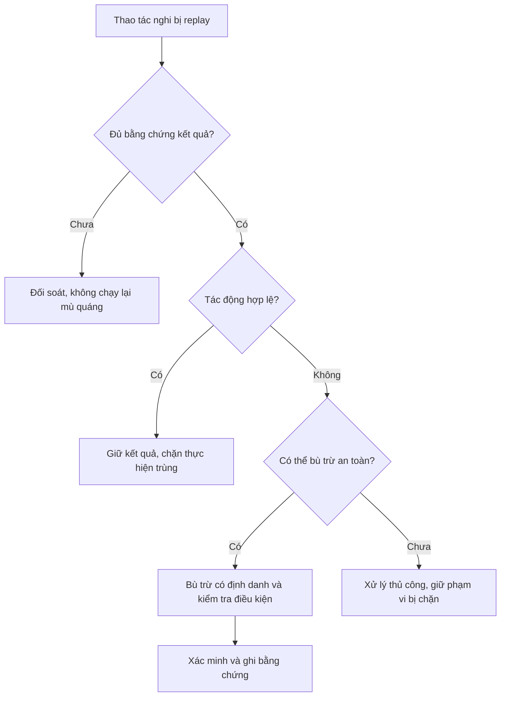

# Replay incident handling

## 1. Sự cố replay là gì?

Replay xảy ra khi một request, thông điệp hoặc bằng chứng từng được gửi được sử dụng lại. Không phải mọi lần gửi lặp đều là tấn công: client có thể retry sau timeout, broker có thể giao lại thông điệp hoặc người vận hành có thể phát lại một công việc. **Sự cố replay** cần được xử lý khi việc phát lại vượt qua giới hạn chấp nhận, làm lộ dữ liệu hoặc phá vỡ invariant nghiệp vụ.

Trong bảo mật logic nghiệp vụ, câu hỏi quyết định không chỉ là “có bao nhiêu request trùng”, mà là “các request đó đã tạo thêm tác động gì và điều gì còn chưa xác định”.

Ví dụ xuyên suốt: một phê duyệt chỉ cho phép cấp một phiếu ưu đãi. Hệ thống nhận 12 request cùng tham chiếu phê duyệt; sau một đợt failover, xuất hiện ba phiếu thay vì một. Một phiếu đã được sử dụng, hai phiếu còn lại chưa sử dụng. Sự cố cần chặn việc cấp tiếp, bảo toàn dấu vết và xử lý hai phiếu phát sinh sai mà không làm hỏng giao dịch hợp lệ.

Bài này mô tả cách ứng phó ở cấp ứng dụng và nghiệp vụ. Nó không mặc định rằng tài khoản đã bị chiếm đoạt hoặc khóa ký đã rò rỉ: request hợp lệ bị phát lại cũng có thể khai thác lỗi lưu dấu vết, race condition hoặc quy trình retry.

## 2. Phân loại tín hiệu trước khi kết luận

| Tín hiệu | Có thể là gì? | Điều cần kiểm tra tiếp |
|---|---|---|
| Nhiều request cùng khóa hoặc nonce | Retry hợp lệ, client lỗi hoặc phát lại có chủ ý | Liên kết với thao tác, trạng thái và tác động thực tế |
| Nhiều request nhưng một tác động đúng | Cơ chế chống trùng đang hoạt động | Nguồn tăng tải, khả năng lộ bằng chứng và ảnh hưởng khả dụng |
| Cùng nonce nhưng nội dung khác | Lỗi client, lỗi chuẩn hóa hoặc sửa nội dung để lạm dụng | Ràng buộc chữ ký, fingerprint và phạm vi thao tác |
| Nhiều nonce cho cùng phê duyệt một lần | Bỏ qua ràng buộc nghiệp vụ hoặc người gọi thử nhiều lần | Sổ thao tác và giới hạn theo `approval_id` |
| Một request nhưng nhiều tác động | Worker chạy lại, callback trùng hoặc lỗi điều phối | Lịch thực thi, lease, checkpoint và dịch vụ bên ngoài |
| Request đã hết hạn vẫn được tiếp nhận | Lỗi kiểm tra thời gian hoặc đường đi bỏ qua kiểm tra | Nguồn thời gian, bằng chứng đã xác thực và mọi endpoint liên quan |
| Không có phản hồi nhưng có tác động | Mất kết nối sau commit hoặc tác động ngoài chưa rõ | Trạng thái bền vững và khả năng đối soát |

Không kết luận một người dùng có ý đồ xấu chỉ dựa vào số lần retry. Đồng thời, không bỏ qua sự cố chỉ vì chữ ký hợp lệ: chữ ký không chứng minh bằng chứng chỉ được dùng một lần.

Cần tách hai số đo: **số lần gửi** và **số tác động có hiệu lực**. Một hệ thống có thể nhận hàng nghìn request lặp nhưng vẫn giữ invariant; ngược lại, chỉ hai request cũng đủ gây cấp quyền hoặc cấp phiếu trái phép.

## 3. Chốt invariant, phạm vi và mức ảnh hưởng

### 3.1. Phát biểu điều bị vi phạm bằng ngôn ngữ nghiệp vụ

Với ví dụ cấp phiếu:

- Mỗi phê duyệt chỉ cho phép một lần cấp phiếu theo phạm vi đã xác định.
- Mọi phiếu phải thuộc tenant và đối tượng được phê duyệt.
- Retry không được tăng số phiếu hoặc thay đổi người hưởng lợi.
- Thao tác khắc phục không được hủy một phiếu hợp lệ hoặc tạo thêm tác động bù trừ trùng.
- Bằng chứng về cấp phiếu, sử dụng phiếu và khắc phục phải còn để đối soát.

Việc viết rõ invariant giúp tránh xử lý theo triệu chứng. Chặn một nonce không đủ nếu người gọi có thể lấy nonce mới cho cùng phê duyệt đã dùng.

### 3.2. Đánh giá theo tác động, không chỉ theo lượng request

| Yếu tố | Câu hỏi đánh giá |
|---|---|
| Quyền và dữ liệu | Có cấp thêm quyền, lộ kết quả hoặc truy cập chéo tenant không? |
| Tác động nghiệp vụ | Có cấp phiếu, trừ điểm, tạo đơn hoặc thay đổi trạng thái vượt quy tắc không? |
| Khả năng tiếp diễn | Đường khai thác còn mở, hàng đợi còn phát lại hoặc worker cũ còn chạy không? |
| Độ chắc chắn | Đã xác nhận tác động hay chỉ biết một lời gọi bị timeout? |
| Khả năng đảo ngược | Tác động còn chưa được sử dụng, đã có phụ thuộc hay đã ra hệ thống ngoài? |
| Bề rộng | Một thao tác, một tenant, một endpoint hay nhiều luồng có chung cơ chế? |

Phạm vi ban đầu có thể được thu hẹp hoặc mở rộng khi có bằng chứng. Ghi rõ giả định và độ đầy đủ của dữ liệu; không dùng thời điểm cảnh báo đầu tiên làm bằng chứng rằng sự cố chỉ bắt đầu từ lúc đó.

## 4. Hành động đầu tiên: hạn chế tác động và giữ bằng chứng

Một trình tự ứng phó ở cấp ứng dụng có thể gồm:

1. Ghi nhận tín hiệu, thời gian, invariant nghi bị vi phạm và phạm vi ban đầu.
2. Xác định đường đang tạo tác động và áp dụng biện pháp chặn phù hợp tại phía máy chủ.
3. Giữ bằng chứng cần thiết trước khi cleanup, thay cấu hình hoặc khởi động lại làm mất dữ liệu.
4. Tách các thao tác đã xác nhận thành công, chưa thực hiện và chưa rõ kết quả.
5. Phân công điều tra kỹ thuật, đối soát nghiệp vụ và quyết định khôi phục.

Các bước có thể diễn ra song song khi có người phụ trách rõ ràng. Nếu tác động đang tiếp tục, không chờ điều tra hoàn chỉnh mới chặn; đồng thời phải ghi lại biện pháp đã áp dụng để phục vụ đối soát.

### 4.1. Chặn theo phạm vi tạo tác động

Có thể tạm dừng xác nhận phê duyệt bị ảnh hưởng, ngừng cấp mới cho một loại thao tác, tạm dừng một nhóm consumer hoặc chuyển hành động nhạy cảm sang xét duyệt thủ công. Điểm chặn phải nằm ở đường ghi có thẩm quyền, không chỉ ẩn nút giao diện.

Nếu một worker đã nhận việc trước khi cấu hình chặn thay đổi, nó có thể vẫn tiếp tục. Cần kiểm tra trạng thái và quyền xử lý ở ranh giới ghi thích hợp, đồng thời xác định các lời gọi bên ngoài đang chạy. Tạm dừng tiếp nhận không thu hồi được request đã gửi ra ngoài.

Cần giữ những đường tra cứu được phép để client và người vận hành xác định kết quả. Chặn mọi callback hoặc endpoint một cách mù quáng có thể làm mất kênh đối soát và tăng số thao tác chưa rõ kết quả.

### 4.2. Những hành động có thể làm sự cố nặng hơn

- Xóa toàn bộ cache nonce để “làm sạch trạng thái”.
- Reset mọi job về trạng thái chưa chạy rồi cho worker xử lý lại.
- Đổi khóa idempotency để vượt qua lỗi trùng mà chưa xác định kết quả cũ.
- Gán `FAILED` cho mọi request timeout dù tác động có thể đã commit.
- Xóa phiếu hoặc bản ghi giao dịch trước khi lưu bằng chứng và kiểm tra phụ thuộc.
- Khôi phục cả cơ sở dữ liệu về bản sao cũ mà không xét tác động còn tồn tại ở nơi khác.

Các thao tác này có thể mở lại bằng chứng đã dùng, phá mất liên kết điều tra hoặc tạo thêm tác động trùng.

## 5. Thu thập bằng chứng đủ để dựng lại chuỗi tác động

### 5.1. Liên kết request với thao tác và tác động

Một hồ sơ điều tra thường cần các nhóm dữ liệu sau:

| Nhóm | Dữ liệu hữu ích |
|---|---|
| Request hoặc sự kiện | Request ID, event ID, nguồn tin cậy, thời điểm nhận, endpoint, digest nonce, fingerprint |
| Ngữ cảnh quyền | Tenant, chủ thể, đối tượng, loại hành động, định danh phê duyệt và phiên bản liên quan |
| Tiếp nhận và xử lý | Operation ID, trạng thái, revision, worker, lease/epoch, checkpoint |
| Tác động cục bộ | Định danh phiếu hoặc bút toán, transaction/tham chiếu commit nếu có, trạng thái hiện tại |
| Tác động liên hệ thống | Outbox, inbox, lần gửi, xác nhận, tham chiếu ở bên nhận và kết quả tra cứu |
| Hạ tầng và thay đổi | Failover, eviction, khởi động lại, triển khai, thay TTL, đổi cấu hình hoặc xoay khóa |

Không cần sao chép toàn bộ request chứa bí mật vào hồ sơ. Nên giữ các định danh và bằng chứng tối thiểu trong nơi có quyền truy cập phù hợp; bảo vệ token, nonce nhạy cảm và dữ liệu cá nhân.

Nếu cần giữ dữ liệu lâu hơn thời gian cleanup thông thường để điều tra, phải quản lý phạm vi và thời hạn giữ theo quy trình của hệ thống. Không tắt mọi cơ chế dọn dữ liệu vô thời hạn mà không biết dung lượng và dữ liệu nào đang được giữ.

### 5.2. Phân biệt thời gian trong log với thứ tự nghiệp vụ

Timestamp giữa các máy có thể lệch. Dòng log “bắt đầu xử lý” không chứng minh commit thành công, và dòng log đến sớm hơn không nhất thiết là tác động hợp lệ đầu tiên.

Ưu tiên các liên kết bền vững, revision, trạng thái và bằng chứng commit khi dựng thứ tự. Ghi rõ nguồn thời gian và độ không chắc chắn. Việc chọn bản ghi hợp lệ cần dựa vào phê duyệt và chuỗi nghiệp vụ, không chỉ chọn dòng có timestamp nhỏ nhất.

### 5.3. Bằng chứng bị thiếu cũng là một phát hiện

Nếu kho chống phát lại đã bị eviction hoặc được phục hồi từ bản sao cũ, cần ghi nhận việc không thể chứng minh dữ liệu còn đầy đủ. “Không có trong kho” khi đó không đồng nghĩa “chưa từng thực hiện”.

Đối chiếu thêm sổ thao tác, dữ liệu nghiệp vụ, hàng đợi và tham chiếu bên ngoài. Khi vẫn không đủ bằng chứng, giữ trạng thái cần đối soát hoặc xử lý thủ công; không tự suy diễn kết quả thuận tiện để đóng sự cố.

## 6. Khoanh vùng và đối soát trước khi sửa dữ liệu

### 6.1. Điều tra theo nhiều trục định danh

Không chỉ tìm các dòng có cùng nonce. Cần đối chiếu theo:

- Nonce hoặc khóa request trong phạm vi đã xác thực.
- Operation ID và định danh ý định nghiệp vụ.
- Phê duyệt, đối tượng hưởng lợi và số lượng được phép.
- Định danh sự kiện hoặc tác động bên ngoài.
- Tenant, phiên bản triển khai và nơi xử lý có cùng cơ chế lỗi.

Điều này giúp phát hiện trường hợp kẻ tấn công đổi nonce, wrapper thông điệp hoặc endpoint nhưng vẫn dùng cùng một phê duyệt. Nó cũng giúp phân biệt hai ý định hợp lệ khác nhau có nội dung giống nhau.

### 6.2. Lập bảng đối soát theo tác động

| Thao tác/ý định | Quyền được thực hiện | Tác động xác nhận | Tác động chưa rõ | Quyết định tạm thời |
|---|---|---|---|---|
| Phê duyệt A | Một phiếu cho khách hàng X | Ba phiếu, một đã dùng | Không | Chặn cấp tiếp; kiểm tra hai phiếu còn lại |
| Phê duyệt B | Một phiếu cho khách hàng Y | Một phiếu | Một lời gọi ngoài bị timeout | Dừng gửi lại; tra cứu bên nhận |
| Phê duyệt C | Một phiếu cho khách hàng Z | Chưa thấy tác động | Chưa có bằng chứng chắc chắn | Kiểm tra transaction, inbox/outbox và trạng thái tiếp nhận |

Bảng này là minh họa. Một hàng “chưa thấy tác động” chưa đủ điều kiện để chạy lại, nhất là khi có dịch vụ ngoài hoặc dữ liệu sau phục hồi chưa đầy đủ.

Có thể dùng truy vấn chỉ đọc để tìm ứng viên vượt invariant. Ví dụ mô hình cho mỗi phê duyệt có `allowed_quantity` và phiếu đang có hiệu lực:

```sql
SELECT a.tenant_id, a.approval_id, a.allowed_quantity,
       COUNT(v.voucher_id) AS active_voucher_count
FROM approval a
JOIN voucher v
  ON v.tenant_id = a.tenant_id
 AND v.approval_id = a.approval_id
WHERE a.tenant_id = :authorized_tenant
  AND v.state IN ('ISSUED', 'REDEEMED')
GROUP BY a.tenant_id, a.approval_id, a.allowed_quantity
HAVING COUNT(v.voucher_id) > a.allowed_quantity;
```

Đây là SQL minh họa trên một mô hình giả định. Cần dùng đúng định nghĩa “có hiệu lực” và số lượng được phép của hệ thống thực tế. Kết quả chỉ là danh sách cần điều tra: không tự xóa bản ghi thừa từ truy vấn tổng hợp, không coi mọi bảng đều có quan hệ một dòng tương ứng một tác động và không bỏ qua các tác động chưa đồng bộ về cục bộ.

### 6.3. Xác định khoảng thời gian có thể bị ảnh hưởng

Điểm bắt đầu có thể là lúc triển khai lỗi, TTL bị giảm, failover mất dấu vết hoặc một đường API mới được mở. Điểm kết thúc không phải lúc phát hành bản vá nếu worker cũ, hàng đợi hoặc yêu cầu đang chạy vẫn có thể gây tác động.

Cần theo dõi cả thời điểm nhận yêu cầu, lúc tiếp nhận bền vững và lúc phát sinh tác động. Một thông điệp cũ được phát lại sau khi vá vẫn có thể thuộc phạm vi đối soát.

## 7. Tìm nguyên nhân gốc theo chuỗi kiểm soát

| Lớp kiểm soát | Ví dụ nguyên nhân | Bằng chứng nên tìm |
|---|---|---|
| Bằng chứng và phạm vi | Chữ ký không ràng buộc đúng đối tượng, audience hoặc loại hành động | Nội dung được xác thực, quy tắc canonicalization và đường xác minh |
| Thời gian | Request hết hạn vẫn được chấp nhận, timestamp do client tự sửa | Mốc chấp nhận, nguồn thời gian, cấu hình dung sai |
| Lưu dấu vết | Dùng bộ nhớ cục bộ, cache mất dữ liệu hoặc TTL ngắn | Cấu hình lưu, failover, eviction và bản ghi còn lại |
| Cạnh tranh | Đọc rồi ghi nonce, hai worker cùng thực hiện | Lịch request, ràng buộc duy nhất, transaction và quyền worker |
| Ranh giới commit | Tác động commit trước khi ghi dấu vết | Sổ thao tác, trạng thái commit và khoảng lỗi có thể tái tạo |
| Nghiệp vụ | Một phê duyệt được dùng qua nhiều nonce | Quan hệ phê duyệt với thao tác và tác động |
| Liên hệ thống | Bên nhận quên khóa, consumer không có inbox đủ bền | Hợp đồng chống trùng, lịch gửi và thời gian phát lại |
| Vận hành | Phát lại bằng ID mới, reset trạng thái hoặc khôi phục dữ liệu thiếu | Lịch thay đổi, thao tác thủ công và hồ sơ phục hồi |

Một sự cố có thể có nhiều nguyên nhân phối hợp. Ví dụ, failover làm mất cache chỉ gây cấp trùng vì đường ghi nghiệp vụ cũng thiếu ràng buộc theo phê duyệt. Vá failover mà không sửa ràng buộc sẽ để lại một đường lạm dụng bằng cách đổi nonce.

Nếu có bằng chứng token, khóa hoặc tài khoản bị lộ, cần thu hồi hoặc xoay tương ứng và kiểm tra mọi đường còn chấp nhận bằng chứng cũ. Tuy nhiên, xoay khóa không xóa tác động đã commit và không tự dừng các lệnh đã được tiếp nhận. Đây là một phần xử lý khi mô hình tin cậy bị ảnh hưởng, không phải phương án thay thế đối soát.

## 8. Quản lý trạng thái ứng phó và kết quả chưa xác định

Có thể dùng hai lớp trạng thái riêng:

- **Trạng thái sự cố:** đang khoanh vùng, đang đối soát, đang khắc phục, đang giám sát hoặc đã đóng theo tiêu chí.
- **Trạng thái từng thao tác/tác động:** đã xác nhận thành công, đã xác nhận không có tác động, chưa rõ kết quả, cần bù trừ, đã bù trừ hoặc cần xử lý thủ công.

Không thay trạng thái nghiệp vụ hàng loạt chỉ để làm bảng theo dõi sự cố trông hoàn chỉnh.



Timeout không phải bằng chứng không có tác động. Nếu bên ngoài hỗ trợ tra cứu theo tham chiếu gốc, dùng chức năng đó trước khi quyết định gửi lại. Nếu không thể tra cứu đủ tin cậy, giữ kết quả chưa xác định và quy trình xử lý phù hợp; không tự tạo khóa mới để tìm một phản hồi thành công.

Trạng thái cuối cần phản ánh điều đã xác minh. “Đã chặn cấp mới” không có nghĩa “đã khắc phục mọi phiếu sai”. “Đã bù trừ cục bộ” cũng không có nghĩa “mọi hệ thống bên ngoài đã hoàn tất bù trừ”.

## 9. Khắc phục bằng thao tác bù trừ có kiểm soát

### 9.1. Xác định tác động nào phải giữ, tác động nào phải sửa

Với ba phiếu từ một phê duyệt, cần xác minh chuỗi cấp hợp lệ, người hưởng lợi và việc sử dụng. Không mặc định giữ phiếu có ID nhỏ nhất hoặc hủy phiếu được tạo muộn nhất chỉ từ timestamp.

Nếu hai phiếu dư chưa sử dụng, chưa được giữ chỗ và không có phụ thuộc ngăn cản, nghiệp vụ có thể cho phép vô hiệu hóa chúng. Nếu một phiếu dư đã được sử dụng, xóa phiếu không tự đảo ngược đơn hàng hoặc lợi ích đã nhận. Cần đánh giá điều chỉnh liên quan và phê duyệt theo quy trình nghiệp vụ.

Nếu replay đã cấp quyền, việc thu hồi cần xét quyền hiện tại có còn nguồn cấp hợp lệ khác không. Không phục hồi nguyên bản ghi người dùng cũ rồi vô tình xóa các quyền được cấp hợp lệ sau đó.

### 9.2. Mỗi hành động khắc phục cũng cần chống trùng

Một bản ghi xử lý có thể gồm:

```text
incident_id
original_operation_id
original_effect_id
compensation_operation_id
compensation_kind
expected_revision
approval_reference
state
result_reference
```

Ràng buộc chống bù trừ trùng phải bám vào tác động gốc và ý nghĩa bù trừ. Chỉ đặt duy nhất theo `(incident_id, original_effect_id)` có thể chưa đủ nếu cùng tác động xuất hiện trong hai hồ sơ sự cố khác nhau. Mô hình cần ngăn một tác động bị đảo ngược nhiều lần ngoài điều kiện nghiệp vụ, đồng thời cho phép những loại điều chỉnh khác nhau nếu chúng thực sự hợp lệ.

Luồng khái niệm cho dữ liệu cục bộ:

```text
bắt đầu transaction
    kiểm tra quyền và phê duyệt khắc phục
    xác lập thao tác bù trừ theo định danh tác động gốc
    kiểm tra trạng thái, revision và các phụ thuộc hiện tại
    áp dụng thay đổi nghiệp vụ được phép
    ghi bằng chứng bù trừ và outbox nếu cần
commit
```

Nếu revision hoặc trạng thái đã đổi, dừng phần xung đột để đánh giá lại. Không bỏ điều kiện kiểm tra để ép thao tác chạy thành công. Nếu chạy theo lô, lưu checkpoint và kết quả từng phần để retry không đảo ngược cùng tác động lần hai.

### 9.3. Giữ dấu vết, không sửa lịch sử để che lỗi

Vô hiệu hóa phiếu, ghi bút toán điều chỉnh hoặc thu hồi một quyền nên để lại liên kết với tác động gốc và quyết định xử lý. Không xóa dấu vết cấp trùng chỉ để số dòng cuối cùng khớp mong đợi.

Bù trừ sau commit là một nghiệp vụ mới. Nó có thể phát sinh sự kiện hoặc ảnh hưởng hệ thống khác. Nếu cần gửi ra ngoài, ghi ý định gửi bền vững và xử lý được việc gửi lặp, sai thứ tự hoặc chưa rõ kết quả. Rollback transaction cục bộ không thu hồi được một thông báo hay hành động đã được bên ngoài xử lý.

## 10. Retry và phát lại công việc trong giai đoạn phục hồi

Mục tiêu là hoàn tất đúng những công việc còn thiếu, không chạy lại mọi thứ đã đi qua đường lỗi.

| Nhóm công việc | Cách phục hồi |
|---|---|
| Đã có kết quả hợp lệ | Giữ kết quả; cập nhật hoặc phục hồi liên kết chống trùng từ bằng chứng tin cậy nếu cần |
| Đã xác nhận không có tác động | Có thể tiếp tục theo state machine, quyền và điều kiện còn hợp lệ |
| Chưa rõ kết quả | Đối soát trước; không tạo định danh mới để thử lại |
| Có tác động sai | Khắc phục theo tác động cụ thể và kiểm tra phụ thuộc |
| Thông điệp trùng của tác động đã xử lý | Consumer nhận diện qua inbox hoặc sổ thao tác, không thực hiện lại |
| Ý định đã hết hạn chưa từng được tiếp nhận | Từ chối hoặc yêu cầu quy trình tạo ý định mới, không kéo dài bằng cách sửa timestamp |

Giữ định danh ý định và tác động gốc qua các lần truyền. Nếu công cụ phát lại buộc tạo một định danh thông điệp mới, vẫn phải mang tham chiếu nghiệp vụ cần thiết để hệ thống nhận diện tác động cũ.

Trước khi mở lại một lô, có thể chạy đối chiếu chỉ đọc để dự kiến danh sách và quyết định cho từng loại. Sau đó xử lý một phạm vi nhỏ có quan sát, xác minh kết quả rồi mới tăng dần. Không dùng việc thay ID hoặc xóa trạng thái hoàn tất làm cơ chế phục hồi.

Một lệnh đã được tiếp nhận hợp lệ trước khi bằng chứng hết hạn có thể được xử lý tiếp nếu hợp đồng cho phép. Cần dựa vào bằng chứng tiếp nhận bền vững và điều kiện thực thi của nghiệp vụ, không tự coi bằng chứng hết hạn là còn mới hoặc dùng nó cho một ý định khác.

## 11. Điều kiện mở lại và xác minh sau bản vá

Một bản vá triển khai thành công chưa chứng minh đường replay đã đóng. Cần kiểm tra cả điểm tiếp nhận, nơi tạo tác động, worker cũ, đường hàng đợi và hệ thống bên ngoài trong phạm vi ảnh hưởng.

Các điều kiện mở lại nên gắn với bằng chứng cụ thể:

- Điểm phân xử nguyên tử đã hoạt động ở mọi đường có quyền tiếp nhận cùng loại bằng chứng.
- Ràng buộc theo phê duyệt hoặc ý định nghiệp vụ không thể bị né chỉ bằng nonce hoặc khóa mới.
- Đường ghi còn lại không phụ thuộc vào cache thiếu dữ liệu để kết luận chưa thực hiện.
- Cửa sổ chấp nhận và thời gian giữ dấu vết đã được kiểm tra tương thích.
- Công việc đang chạy, hết lease hoặc chưa rõ kết quả đã có cách tiếp tục/đối soát an toàn.
- Dữ liệu còn cần giữ cho điều tra và phục hồi không bị cleanup xóa mất.
- Kiểm thử tình huống gây sự cố và các lịch chạy cạnh tranh liên quan đạt kết quả mong đợi.

Không nhất thiết chờ mọi điều chỉnh nghiệp vụ hoàn tất mới mở lại mọi chức năng nếu phần còn lại đã được cô lập và có quyết định xử lý rõ. Tuy nhiên, phải phân biệt phạm vi đã an toàn để hoạt động với các tác động vẫn đang chờ giải quyết; không báo toàn bộ sự cố đã hoàn tất chỉ vì request mới không còn tạo trùng.

Có thể mở lại theo tenant, loại thao tác hoặc nhóm worker phù hợp với cơ chế đã có. Trong giai đoạn đầu, theo dõi số tác động trên mỗi ý định, lỗi xung đột, trạng thái chưa rõ kết quả và tốc độ hàng đợi. Số lần replay bị chặn có thể tăng sau bản vá; điều đó không tự chứng minh hệ thống vẫn tạo tác động sai.

Nếu cần quay lui bản vá vì lỗi mới, kế hoạch quay lui phải giữ biện pháp chặn nghiệp vụ tương ứng. Không khôi phục nguyên đường có lỗ hổng rồi coi việc rollback triển khai là đã đưa hệ thống về trạng thái an toàn.

## 12. Diễn tập: ba phiếu cho một phê duyệt

### 12.1. Tín hiệu và khoanh vùng

Cảnh báo phát hiện ba phiếu cùng liên kết một phê duyệt chỉ cho phép một phiếu. Log có 12 request lặp, nhưng dữ liệu quyết định là ba tác động cấp phiếu có hiệu lực.

Đội vận hành tạm chặn cấp mới qua loại phê duyệt bị ảnh hưởng ở đường ghi. Đường tra cứu vẫn hoạt động theo quyền. Consumer liên quan được dừng có kiểm soát, đồng thời xác định các lời gọi đã ra ngoài. Dấu vết và sổ thao tác được giữ trước khi cleanup tiếp tục.

### 12.2. Đối soát và nguyên nhân

Điều tra xác nhận phiếu A thuộc thao tác gốc hợp lệ và đã được dùng. Phiếu B và C phát sinh từ việc cùng ý định được tiếp nhận lại sau khi cache mất dữ liệu; cả hai chưa sử dụng, chưa có giữ chỗ hay phụ thuộc ngăn cản việc vô hiệu hóa theo chính sách. Đường ghi thiếu ràng buộc theo phê duyệt nên cache miss đã dẫn tới cấp mới.

Nếu chưa chứng minh được trạng thái B hoặc C, phải giữ chúng trong nhóm cần đối soát. Ví dụ này chỉ tiến hành bù trừ sau khi các điều kiện đã được xác minh.

### 12.3. Khắc phục

Một kế hoạch được phê duyệt giữ phiếu A và vô hiệu hóa B, C bằng hai thao tác khắc phục có định danh, kiểm tra trạng thái và revision. Mỗi kết quả được ghi cùng thay đổi cục bộ. Những sự kiện cần đồng bộ được đưa vào outbox và theo dõi đến khi có kết quả đủ tin cậy.

Nếu công cụ xử lý dừng sau khi B đã commit, chạy lại phải nhận ra B đã được khắc phục và chỉ tiếp tục phần còn thiếu. Không vô hiệu hóa A để đưa số lượng về một theo cách tùy ý.

### 12.4. Mở lại và kiểm tra

Bản vá bổ sung điểm phân xử bền vững và ràng buộc cho ý định được phê duyệt, thay vì chỉ kéo dài TTL cache. Kiểm thử đồng thời, cache miss, crash sau commit và phát lại từ hàng đợi xác nhận không tạo thêm phiếu.

Sau khi xác minh phạm vi ảnh hưởng, trạng thái đồng bộ và các điều kiện mở lại, hệ thống được mở theo phạm vi kiểm soát. Hồ sơ sự cố giữ liên kết từ phê duyệt đến A, B, C và các thao tác khắc phục; dữ liệu không bị xóa để làm mất dấu vết.

## 13. Ghi nhận và phối hợp xử lý

Một bản ghi sự cố hữu ích cần tách điều đã biết khỏi giả thuyết và phần chưa xác định. Có thể dùng mẫu:

```text
Incident ID:
Người phụ trách và phạm vi quyết định:
Invariant bị vi phạm hoặc nghi bị vi phạm:
Tenant/luồng nghiệp vụ/thời gian có thể ảnh hưởng:

Bằng chứng đã xác nhận:
Giả thuyết đang kiểm tra:
Dữ liệu còn thiếu hoặc kết quả chưa xác định:

Biện pháp chặn, thời điểm và phạm vi hiệu lực:
Công việc đang chạy hoặc lời gọi ngoài còn cần theo dõi:
Danh sách thao tác/tác động cần đối soát:
Kế hoạch khắc phục, định danh và phê duyệt:

Tiêu chí mở lại:
Tiêu chí đóng sự cố:
Đầu việc phòng ngừa, người chịu trách nhiệm và bằng chứng hoàn tất:
```

Thông tin gửi cho các bên liên quan nên mô tả chức năng nào bị ảnh hưởng, điều gì đã được xác nhận và hành động cần thiết theo vai trò của họ. Không đưa nonce, token, dữ liệu cá nhân hoặc chi tiết đối tượng ngoài phạm vi người nhận vào thông báo.

Nếu cần người dùng tránh retry hoặc sử dụng đường tra cứu, chỉ dẫn phải cụ thể và khớp hành vi API. Không khuyên “đổi khóa rồi thử lại” khi kết quả gốc còn chưa rõ. Tránh hứa đã khôi phục mọi tác động trước khi đối soát xong các hệ thống liên quan.

## 14. Kiểm thử ứng phó và phục hồi

Kiểm thử không chỉ nhắm vào bộ chặn replay. Cần kiểm tra các công cụ, quy trình và hành động khắc phục có giữ invariant khi gặp lỗi tiếp hay không.

| Tình huống diễn tập | Kết quả cần xác nhận |
|---|---|
| Retry hợp lệ sau mất phản hồi | Không bị coi là tác động mới; người có quyền tra cứu được kết quả |
| Hai request đồng thời dùng cùng phê duyệt | Chỉ số tác động được phép xuất hiện, dù nonce có giống hay khác |
| Cache mất bản ghi sau failover | Nguồn có thẩm quyền vẫn chặn tác động trùng |
| Request timeout sau commit | Không reset về chưa chạy hoặc đổi khóa để thực hiện lại |
| Kho chống phát lại không truy cập được | Không coi lỗi là cache miss và tiếp tục hành động nhạy cảm không bảo vệ |
| Kích hoạt điểm chặn khi worker đang chạy | Xác định đúng công việc còn có thể commit và lời gọi đã gửi |
| Lease hết nhưng worker cũ còn sống | Không có hai chủ thể cùng ghi tác động trái giao thức |
| Phát lại dead-letter message bằng wrapper mới | Định danh nghiệp vụ gốc vẫn ngăn thực hiện trùng |
| Bên nhận đã hết hạn chống trùng | Phục hồi chuyển sang tra cứu/đối soát thay vì gửi lại mù quáng |
| Chạy lại cùng kế hoạch bù trừ | Không bù trừ một tác động hai lần |
| Hai hồ sơ sự cố cùng nhắm một tác động | Ràng buộc theo tác động gốc vẫn ngăn đảo ngược trùng |
| Dữ liệu đổi trong lúc khắc phục | Điều kiện revision/trạng thái chặn ghi đè thay đổi mới |
| Phiếu dư đã có phụ thuộc | Không xóa hoặc vô hiệu hóa trái quy tắc; chuyển quyết định nghiệp vụ phù hợp |
| Cleanup chạy giữa lúc điều tra | Bằng chứng cần thiết vẫn được giữ theo phạm vi đã xác định |
| Tài khoản bị thu hồi quyền | Không đọc được kết quả cũ hoặc thực hiện khắc phục vượt quyền |
| Khôi phục bản sao dữ liệu cũ | Tác động ngoài còn tồn tại được đối soát, không phát lại toàn bộ tự động |
| Mở lại một phần rồi phát hiện lỗi mới | Có thể chặn lại phạm vi cần thiết mà vẫn giữ dấu vết và tiến độ |

Các chỉ dấu xác nhận gồm số tác động có hiệu lực theo ý định, dữ liệu phụ thuộc, trạng thái bù trừ, inbox/outbox và bằng chứng từ hệ thống ngoài. Kiểm tra cả trạng thái trung gian nếu trong lúc khắc phục người dùng vẫn có thể sử dụng tài nguyên bị ảnh hưởng.

Không dùng tải thử hoặc phát lại request có tác động thật ngoài phạm vi kiểm soát chỉ để chứng minh lỗi đã tồn tại. Môi trường diễn tập cần dữ liệu và giới hạn phù hợp; việc đối soát trên hệ thống thật ưu tiên các truy vấn chỉ đọc và hành động khắc phục đã được cho phép.

## 15. Rút kinh nghiệm theo invariant và khoảng lỗi

Báo cáo sau sự cố nên trả lời:

- Bằng chứng nào bị dùng lại và invariant nào thực sự bị phá vỡ?
- Điểm nào đã chấp nhận thêm một thao tác hoặc tạo thêm tác động?
- Vì sao ràng buộc nghiệp vụ không ngăn được ngay cả khi dấu vết nonce bị mất?
- Những khoảng lỗi nào giữa ghi dấu vết, commit, phát thông điệp và xác nhận đã góp phần?
- TTL, failover, nhiều vùng hoặc thao tác vận hành đã làm thay đổi bảo đảm ra sao?
- Cảnh báo có phân biệt request lặp với tác động trùng không?
- Công cụ khắc phục có định danh, kiểm tra quyền và khả năng tiếp tục sau crash không?
- Những đường khác dùng chung cơ chế có được kiểm tra trong phạm vi đã xác định không?

Đầu việc phòng ngừa cần có kết quả kiểm chứng được. Ví dụ: thêm ràng buộc theo ý định, gắn dấu vết với lệnh bền vững, giữ trạng thái chưa rõ kết quả, kiểm thử crash sau commit và sửa công cụ phát lại để không làm mất định danh nghiệp vụ.

“Đào tạo mọi người đừng retry” không thay thế cơ chế chịu được retry. “Tăng TTL” cũng không sửa lỗi phân xử không nguyên tử, namespace sai hoặc thiếu ràng buộc nghiệp vụ.

## 16. Bảng kiểm kết thúc xử lý

Trước khi kết luận hoàn tất, cần trả lời rõ:

- Đường tạo tác động sai đã được chặn hoặc sửa tại nơi có thẩm quyền chưa?
- Phạm vi đã xác định đến đâu, dữ liệu nào còn thiếu và phần chưa rõ được giao xử lý thế nào?
- Tác động hợp lệ có được giữ nguyên theo bằng chứng, thay vì chọn tùy ý từ các bản ghi trùng không?
- Mọi bù trừ đã hoàn tất hoặc có quyết định xử lý phần còn lại với trạng thái rõ ràng chưa?
- Các hệ thống ngoài, hàng đợi và worker cũ còn có thể tạo thêm tác động không?
- Retry và công cụ phát lại có giữ định danh, quyền và điều kiện nghiệp vụ không?
- Bằng chứng điều tra, lịch sử thay đổi và kết quả khắc phục đã được bảo vệ chưa?
- Tiêu chí mở lại, giám sát và người chịu trách nhiệm cho các đầu việc còn lại đã rõ chưa?

Xử lý sự cố replay cần đi từ bằng chứng về tác động đến quyết định nghiệp vụ. Khoanh vùng sớm, giữ trạng thái chưa xác định, khắc phục có định danh và xác minh mọi ranh giới gây tác động sẽ giúp quá trình phục hồi không trở thành một nguồn replay mới.
