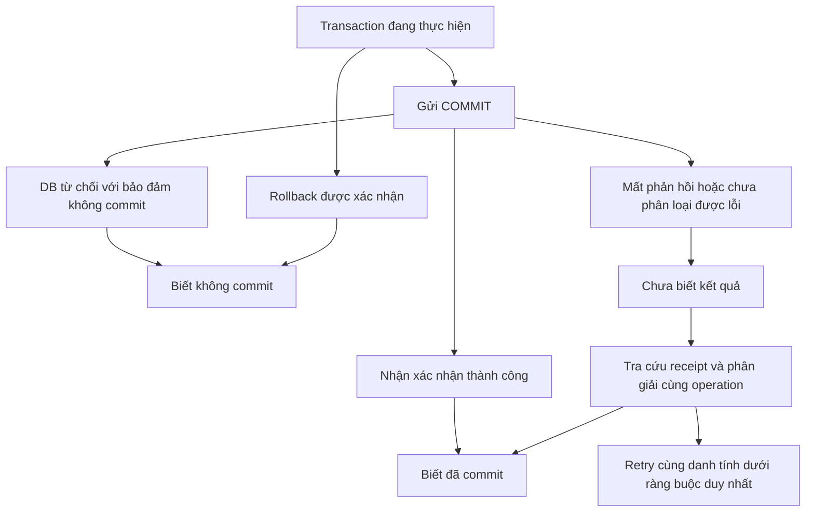
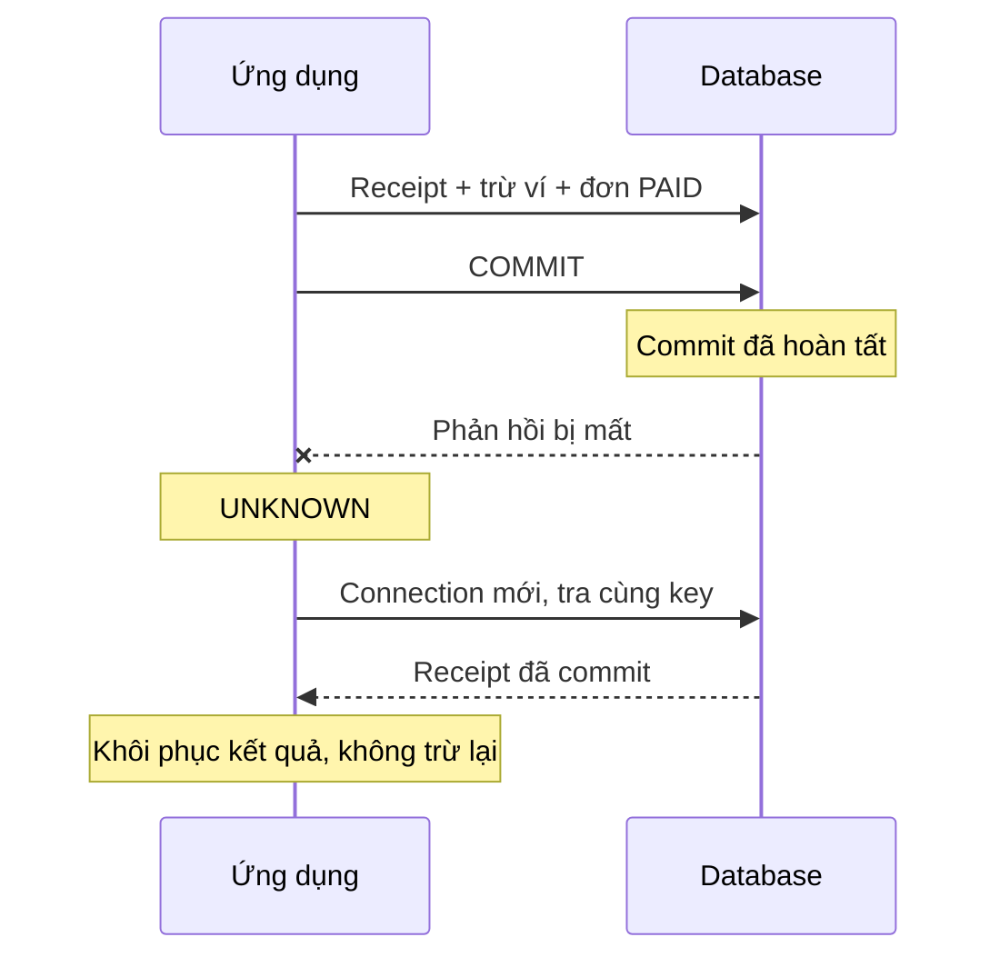

# Commit failure behavior: xử lý khi chưa biết giao dịch đã commit hay chưa

## 1. Vì sao lỗi commit là vấn đề bảo mật nghiệp vụ?

Trong chương **Transactions**, commit là bước chốt các thay đổi của một giao dịch. Một API có thể kiểm tra đúng quyền, tính đúng giá và cập nhật đúng số dư, nhưng vẫn gây trừ tiền hai lần nếu diễn giải mọi lỗi tại `commit()` thành “chưa có thay đổi nào”.

Xét một lần mua bằng ví nội bộ:

1. Máy chủ kiểm tra đơn đủ điều kiện và số tiền phải trả là 100.000 đơn vị tiền đã quy ước.
2. Trong một transaction, dịch vụ trừ ví, chuyển đơn sang `PAID` và lưu receipt của thao tác.
3. Ứng dụng gửi `COMMIT`.
4. Cơ sở dữ liệu commit thành công, nhưng kết nối đứt trước khi ứng dụng nhận phản hồi.
5. Ứng dụng thấy exception. Nếu tự tạo một thao tác mới và trừ lại ví, khách có thể bị trừ hai lần cho cùng lần mua.

Trong phạm vi module `SECURITY_APPLICATION_SECURITY_BUSINESS_LOGIC_SECURITY`, lỗi này liên quan trực tiếp đến bất biến nghiệp vụ, state machine, quyền theo đối tượng và idempotency. Người dùng không cần khai thác SQL injection: gửi lại yêu cầu, gây tải hoặc tận dụng những lần timeout có thể làm lộ một quy trình xử lý lỗi thiếu an toàn.

Mục tiêu của bài là xác định được **điều gì đã biết**, **điều gì chưa biết**, và cách để retry hội tụ về một kết quả nghiệp vụ mà không tạo thêm tác động.

## 2. Tách trạng thái thật của DB khỏi điều ứng dụng quan sát

Ở mức dữ liệu, một transaction có thể đã commit hoặc đã rollback. Khi mất kết nối đúng lúc commit, ứng dụng có thể chưa biết kết quả nào đã xảy ra.

| Kết quả quan sát | Điều có thể khẳng định | Hành động chính |
| --- | --- | --- |
| `COMMITTED` | Đã nhận xác nhận commit thành công, hoặc đọc được receipt đã commit theo giao thức của hệ thống | Trả hoặc khôi phục kết quả đã lưu |
| `NOT_COMMITTED` | Có bằng chứng đáng tin cậy rằng giao dịch không commit, chẳng hạn rollback đã được xác nhận trước khi có commit | Có thể kết thúc thất bại hoặc retry nếu lỗi cho phép |
| `UNKNOWN` | Chưa đủ bằng chứng để kết luận commit hay rollback | Tra cứu và phân giải bằng cùng danh tính thao tác |

`UNKNOWN` là trạng thái hiểu biết của ứng dụng, không phải một nửa transaction được DB commit. Nếu mọi thay đổi đều nằm trong cùng một transaction đúng nghĩa, chúng vẫn cùng commit hoặc cùng rollback; bên gọi chỉ đang thiếu thông tin về kết quả đó.



Sơ đồ mô tả góc nhìn ứng dụng. Không có cạnh trực tiếp từ “không tìm thấy receipt ở một lần đọc” sang “chắc chắn rollback”, vì transaction đầu có thể còn đang xử lý hoặc nguồn đọc chưa phản ánh dữ liệu mới.

Các bảo đảm trong bài giả định mọi bảng liên quan hỗ trợ transaction, dùng cùng một transaction cục bộ và không có tác động ngoài giao dịch bị che giấu. Autocommit, connection riêng hoặc lời gọi đến dịch vụ khác làm thay đổi phạm vi cần phân tích.

## 3. Phân loại lỗi theo thời điểm và bằng chứng

### 3.1. Ma trận kết quả

| Điểm lỗi | Ví dụ | Cách diễn giải an toàn |
| --- | --- | --- |
| Trước khi ghi dữ liệu | Sai quyền, trạng thái đơn không cho phép | Không bắt đầu tác động; trả lỗi nghiệp vụ phù hợp |
| Trong transaction, trước commit | Một câu SQL thất bại, ứng dụng rollback và nhận xác nhận | Giao dịch đã rollback; không còn tác động của lần thử trong transaction đó |
| Tại commit, DB từ chối rõ ràng | Một ràng buộc được kiểm tra cuối giao dịch hoặc xung đột bị engine hủy | Chỉ kết luận không commit theo bảo đảm cụ thể của DB và driver |
| Tại commit, mất kết nối | DB có thể đã xử lý commit nhưng phản hồi không tới | Kết quả chưa rõ; không tự tạo thao tác mới |
| Timeout hoặc hủy ở phía gọi | Request hết hạn trong khi phía DB có thể còn chạy | Timeout không tự chứng minh giao dịch đã rollback |
| Sau commit thành công | Lỗi dựng JSON, lỗi ghi log hoặc lỗi gửi HTTP | Giao dịch nghiệp vụ vẫn đã commit |
| Sau commit khi gửi sự kiện | Publish hoặc gọi dịch vụ khác thất bại | Phải phục hồi bước sau commit; không mặc định hoàn tác dữ liệu đã commit |

Một số engine có thể báo lỗi serialization, constraint hoặc các lỗi khác tại ranh giới commit. Cần dùng tài liệu và phân loại lỗi của engine/driver đang triển khai. Không suy từ một chuỗi thông báo có chữ “commit failed” rằng mọi loại lỗi đều có cùng kết quả.

SQLState, mã lỗi của nhà cung cấp và loại exception là dữ liệu để phân loại. Chúng chỉ trở thành bằng chứng kết quả khi gắn với bảo đảm đã biết của hệ quản trị. Một nhãn “transient” hoặc một exception về kết nối không tự chứng minh thao tác chưa từng được chốt.

### 3.2. Rollback sau lỗi commit không xóa được quá khứ

Sau khi `commit()` ném exception, ứng dụng thường thử `rollback()` để giải phóng transaction còn mở. Đó có thể là bước dọn dẹp hợp lý theo trạng thái connection, nhưng không phải phép kiểm chứng kết quả.

Nếu commit thật sự đã thành công ở DB, rollback sau đó không thể đảo ngược transaction đã kết thúc. Ngay cả khi lời gọi rollback trả về bình thường, nó không biến giao dịch trước thành “chưa commit”. Nếu rollback cũng lỗi, ứng dụng càng không có thêm bằng chứng về kết quả trước đó.

Tương tự, đóng connection hoặc đánh dấu connection lỗi không chứng minh giao dịch chưa commit. Mục tiêu dọn tài nguyên và mục tiêu xác định kết quả nghiệp vụ là hai việc riêng.

## 4. Mẫu xử lý lỗi dễ tạo tác động trùng

Đoạn mã giả sau đánh đồng kết quả không rõ với thất bại đã được chứng minh:

```java
try {
    debitWallet();
    markPurchasePaid();
    connection.commit();
} catch (SQLException failure) {
    connection.rollback();
    retryPurchaseWithANewOperationId();
}
```

Các vấn đề nằm ở hành vi sau exception:

- Lần commit đầu có thể đã thành công.
- Operation ID mới khiến lần retry trông như một nghiệp vụ độc lập.
- Nếu đơn hoặc khoản trừ không có ràng buộc nghiệp vụ, ví có thể bị trừ lại.
- Lỗi rollback có thể che mất exception gốc và làm việc điều tra khó hơn.
- Nếu khối `try` còn chứa thao tác sau commit, exception của thao tác đó có thể bị diễn giải nhầm thành lỗi transaction.

Một cách sửa thiếu an toàn khác là tự cộng lại ví ngay khi `commit()` lỗi. Nếu lần đầu thật sự rollback, phép cộng bù sẽ tạo thêm tiền trong mô hình; nếu lần đầu commit nhưng tiến trình xử lý bù lặp, vẫn có thể cộng nhiều lần.

Bù trừ chỉ được thực hiện sau khi xác định đúng tác động cần bù, bằng một nghiệp vụ riêng có quyền, điều kiện trạng thái và khóa chống trùng. Không dùng bù trừ để thay thế việc tìm hiểu một kết quả còn chưa biết.

## 5. Thiết kế receipt cùng bất biến nghiệp vụ

### 5.1. Bất biến cho một lần mua bằng ví

Trong ví dụ, một đơn được trả toàn bộ bằng một ví, không có chia kỳ thanh toán hoặc hoàn tiền trong cùng luồng. Cần bảo vệ:

```text
Số dư ví không âm.
Một purchase chỉ có một receipt trừ ví thành công.
Receipt, số dư ví và trạng thái PAID của đơn cùng commit hoặc cùng rollback.
Cùng idempotency key nhưng khác nội dung yêu cầu không được dùng lại.
Chỉ chủ thể có quyền trên đơn và ví mới được thực hiện hoặc tra cứu kết quả.
Số tiền và loại tiền lấy từ dữ liệu đơn có thẩm quyền.
```

Khóa idempotency định danh yêu cầu gửi lại. Khóa nghiệp vụ của đơn bảo vệ trường hợp client đổi key để yêu cầu thanh toán lại cùng purchase. Cần cả hai, vì một key mới không tạo ra quyền trừ tiền lần nữa.

### 5.2. Schema minh họa

```sql
CREATE TABLE wallet (
    tenant_id VARCHAR(64) NOT NULL,
    wallet_id VARCHAR(64) NOT NULL,
    owner_id VARCHAR(64) NOT NULL,
    currency VARCHAR(3) NOT NULL,
    balance_minor BIGINT NOT NULL,
    PRIMARY KEY (tenant_id, wallet_id),
    CHECK (balance_minor >= 0)
);

CREATE TABLE purchase_order (
    tenant_id VARCHAR(64) NOT NULL,
    purchase_id VARCHAR(64) NOT NULL,
    buyer_id VARCHAR(64) NOT NULL,
    wallet_id VARCHAR(64) NOT NULL,
    total_minor BIGINT NOT NULL,
    currency VARCHAR(3) NOT NULL,
    status VARCHAR(16) NOT NULL,
    version BIGINT NOT NULL,
    PRIMARY KEY (tenant_id, purchase_id),
    FOREIGN KEY (tenant_id, wallet_id)
        REFERENCES wallet (tenant_id, wallet_id),
    CHECK (total_minor > 0),
    CHECK (version >= 0),
    CHECK (status IN ('OPEN', 'PAID', 'CANCELLED'))
);

CREATE TABLE wallet_debit_receipt (
    operation_id VARCHAR(64) PRIMARY KEY,
    tenant_id VARCHAR(64) NOT NULL,
    actor_id VARCHAR(64) NOT NULL,
    idempotency_key VARCHAR(128) NOT NULL,
    request_hash VARCHAR(64) NOT NULL,
    purchase_id VARCHAR(64) NOT NULL,
    wallet_id VARCHAR(64) NOT NULL,
    amount_minor BIGINT NOT NULL,
    currency VARCHAR(3) NOT NULL,
    recorded_at TIMESTAMP NOT NULL,
    UNIQUE (tenant_id, actor_id, idempotency_key),
    UNIQUE (tenant_id, purchase_id),
    FOREIGN KEY (tenant_id, purchase_id)
        REFERENCES purchase_order (tenant_id, purchase_id),
    FOREIGN KEY (tenant_id, wallet_id)
        REFERENCES wallet (tenant_id, wallet_id),
    CHECK (amount_minor > 0)
);
```

`balance_minor` và `amount_minor` biểu diễn lượng tiền nguyên theo đơn vị nhỏ nhất mà hệ thống đã quy định cho loại tiền tương ứng. Việc chuyển đổi, làm tròn và giới hạn phải được định nghĩa trước; không dùng số thực nhị phân để suy ra số tiền thanh toán.

Receipt là bằng chứng thành công đã commit, không phải một dòng `PENDING` được ghi riêng trước khi bắt đầu trừ ví. Dòng receipt có thể được insert sớm trong transaction để giành khóa duy nhất, nhưng không được commit nếu các bước trừ ví hoặc đổi trạng thái đơn chưa thành công.

`request_hash` được tính từ nội dung yêu cầu đã chuẩn hóa, chẳng hạn purchase ID, phiên bản được yêu cầu và loại thao tác. Danh tính actor/tenant lấy từ ngữ cảnh xác thực. Hash giúp phát hiện dùng lại key cho yêu cầu khác; hash không cấp quyền và không thay thế kiểm tra giá ở nguồn có thẩm quyền.

Ví dụ chỉ lưu receipt thành công. Nếu sản phẩm muốn replay cả kết quả từ chối ban đầu, cần một mô hình lưu kết quả idempotency rộng hơn. Không tạo receipt trừ tiền thành công cho một yêu cầu bị từ chối vì thiếu số dư.

## 6. Luồng thanh toán trong một transaction

### 6.1. Kiểm tra kết quả cũ trước điều kiện của một lần mua mới

Luồng dưới đây là mã giả. Các hàm ghi dữ liệu đều dùng cùng connection và transaction; việc khóa dòng hoặc kiểm tra phiên bản cần phù hợp với DB đang dùng.

```text
authenticate_request()
validate_key_and_request_shape()
canonical_hash = hash_normalized_request()

BEGIN TRANSACTION

  purchase = lock_purchase(tenant_id, purchase_id)
  verify_object_permission(actor_id, purchase)

  old_result = find_receipt(tenant_id, actor_id, idempotency_key)
  if old_result exists:
      verify_same_request_hash(old_result, canonical_hash)
      verify_permission_to_read_saved_result(old_result)
      finish_read_path()
      return saved_result(old_result)

  purchase_receipt = find_receipt_by_purchase(tenant_id, purchase_id)
  if purchase_receipt exists:
      finish_read_path()
      return already_paid_result_allowed_by_api_contract

  require purchase.status == OPEN
  require purchase.version == requested_version
  amount = purchase.total_minor
  currency = purchase.currency

  INSERT wallet_debit_receipt(
      operation_id, tenant_id, actor_id, idempotency_key,
      canonical_hash, purchase_id, purchase.wallet_id,
      amount, currency, db_time
  )

  affected = conditional_wallet_debit(purchase.wallet_id, actor_id, amount)
  if affected != 1:
      ROLLBACK
      return classified_rejection

  affected = transition_purchase_OPEN_to_PAID_with_expected_version()
  if affected != 1:
      ROLLBACK
      return state_conflict

  INSERT outbox_if_required(operation_id)

COMMIT
return persisted_success_result
```

`finish_read_path()` kết thúc transaction đọc theo cơ chế ứng dụng. Một receipt đã đọc và xác minh là dữ liệu của transaction trước đã commit; lỗi dọn connection hiện tại không làm transaction trước biến thành thất bại.

Không kiểm tra “đơn phải còn `OPEN`” trước khi tìm kết quả cùng key, vì lần thử đầu thành công đã chuyển đơn sang `PAID`. Replay phải có khả năng nhận lại kết quả của lần thử đó. Dù vậy, quyền truy cập kết quả vẫn phải được kiểm tra ở hiện tại.

`purchase_receipt` bảo vệ đường dùng key khác trên cùng đơn. API có thể trả kết quả đã thanh toán hoặc một xung đột nghiệp vụ phù hợp, nhưng không trừ thêm ví. Không tạo một receipt thanh toán mới chỉ để phục vụ key mới.

### 6.2. Trừ ví bằng điều kiện trên dữ liệu hiện tại

```sql
UPDATE wallet
SET balance_minor = balance_minor - :amount_minor
WHERE tenant_id = :tenant_id
  AND wallet_id = :wallet_id
  AND owner_id = :actor_id
  AND currency = :currency
  AND :amount_minor > 0
  AND balance_minor >= :amount_minor;
```

Ví dụ chỉ cho chủ ví trực tiếp trả tiền. Nếu có ủy quyền hoặc tài khoản dịch vụ, cần mô hình quyền tương ứng; không bỏ điều kiện quyền mà không có một cơ chế thay thế.

Ứng dụng phải kiểm tra đúng một dòng được cập nhật. Không đọc số dư trước rồi ghi một số dư mới đã tính từ snapshot cũ. Nhiều đơn khác nhau vẫn có thể cùng chi từ một ví, nên idempotency của từng đơn không tự bảo vệ quy tắc số dư không âm.

Chuyển trạng thái đơn cũng có điều kiện:

```sql
UPDATE purchase_order
SET status = 'PAID',
    version = version + 1
WHERE tenant_id = :tenant_id
  AND purchase_id = :purchase_id
  AND buyer_id = :actor_id
  AND status = 'OPEN'
  AND version = :expected_version;
```

Nếu phép chuyển không thành công, rollback cả receipt lẫn khoản trừ. Atomicity chỉ bao phủ các bước thực sự nằm trong transaction đó. Một repository tự mở connection khác hoặc tự commit sẽ phá vỡ giả định của luồng.

### 6.3. Xung đột unique không phải lỗi có thể bỏ qua

Tra cứu receipt trước khi insert giúp phục vụ replay, nhưng unique constraint mới là chốt cuối khi hai request cạnh tranh. Khi gặp đúng xung đột trên khóa receipt, rollback transaction hiện tại rồi đọc kết quả đã commit trong transaction mới.

Phải phân biệt xung đột cùng key với xung đột cùng purchase. Cùng key nhưng hash khác là lỗi dùng lại danh tính yêu cầu; cùng purchase đã trả tiền là một tác động đã tồn tại. Các lỗi foreign key, lỗi kết nối hoặc unique constraint không liên quan không được coi như “đã thanh toán”.

## 7. Quan sát commit trong Java mà không đoán kết quả

Helper Java 17 sau chủ động bảo thủ: nếu không có phân loại đặc thù đã được kiểm chứng cho DB/driver, mọi `SQLException` từ commit được xem là chưa rõ kết quả.

```java
import java.sql.Connection;
import java.sql.SQLException;

public final class CommitObserver {
    private CommitObserver() {}

    public enum Observation {
        ACKNOWLEDGED,
        UNKNOWN
    }

    public record Result(
            Observation observation,
            SQLException failure) {}

    public static Result commitConservatively(Connection transaction) {
        try {
            transaction.commit();
            return new Result(Observation.ACKNOWLEDGED, null);
        } catch (SQLException failure) {
            return new Result(Observation.UNKNOWN, failure);
        }
    }
}
```

Đây là helper quan sát ranh giới commit, không phải implementation đầy đủ của payment service. Nó giả định connection đã ở chế độ transaction tường minh và toàn bộ thao tác nghiệp vụ trước đó đã hoàn tất hợp lệ. Tầng điều phối còn phải quản lý rollback cho lỗi trước commit, đóng hoặc loại bỏ connection lỗi theo chính sách driver/pool, phân giải kết quả và trả phản hồi.

Nếu hệ thống có bộ phân loại lỗi chứng minh được một trường hợp commit bị DB hủy, có thể bổ sung kết quả `NOT_COMMITTED` cho đúng trường hợp đó. Không đánh dấu cả một nhóm lỗi kết nối là không commit chỉ để tự động retry nhanh hơn.

Khi `UNKNOWN`:

- Giữ nguyên operation ID, key và request hash của lần thử.
- Không trả trạng thái thành công nếu chưa có bằng chứng thành công.
- Không trả một kết quả khẳng định “chưa trừ tiền” khi chưa có bằng chứng đó.
- Dọn tài nguyên theo chính sách mà không làm mất exception gốc hoặc đổi trạng thái quan sát.
- Chuyển sang tra cứu hoặc retry cùng thao tác dưới bảo vệ của receipt và khóa nghiệp vụ.

Lỗi đóng connection sau một commit đã được xác nhận cần được ghi nhận như lỗi dọn tài nguyên. Nó không được ghi đè sự thật nghiệp vụ thành “thanh toán thất bại”. Cấu trúc `try`/`catch` và tầng quản lý transaction phải giữ được sự phân biệt này.

## 8. Phân giải kết quả commit chưa rõ

### 8.1. Đọc receipt bằng connection mới

Không dùng connection vừa hỏng để xác nhận một kết quả mà chính nó không quan sát được. Mở một đường đọc mới có bảo đảm nhất quán phù hợp đến nguồn có thẩm quyền, tra theo `(tenant_id, actor_id, idempotency_key)` và kiểm tra hash.

| Kết quả tra cứu | Hành động |
| --- | --- |
| Có receipt phù hợp | Khôi phục kết quả thành công đã lưu; không trừ lại |
| Có receipt nhưng hash hoặc đối tượng xung đột | Từ chối dùng lại key, ghi nhận bất thường |
| Không thấy receipt nhưng có receipt của purchase | Không thanh toán thêm; xác minh và trả trạng thái đơn theo quyền |
| Chưa thấy receipt nào | Chưa đủ chứng minh rollback; tiếp tục phân giải hoặc retry cùng danh tính |
| Nguồn đọc không khả dụng | Giữ trạng thái chưa rõ; không tự suy ra thất bại nghiệp vụ |

Một read replica chậm có thể chưa thấy receipt đã commit. Ngay cả trên nguồn có thẩm quyền, một lần đọc không thấy cũng có thể xảy ra khi transaction đầu chưa kết thúc. Vì vậy, “not found” là kết quả quan sát tại thời điểm đọc, không tự là bằng chứng “chưa từng trừ”.

### 8.2. Retry cùng danh tính để DB phân định

Khi retry cùng key và cùng purchase:

1. Nếu transaction đầu đã commit, receipt hoặc khóa nghiệp vụ đưa lần sau vào đường trả kết quả cũ.
2. Nếu transaction đầu rollback, lần thử mới có thể thực hiện tác động.
3. Nếu transaction đầu còn giữ khóa, lần thử mới có thể phải chờ hoặc gặp timeout/xung đột.
4. Nếu lần thử mới cũng không xác định được kết quả, tiếp tục giữ cùng danh tính và trạng thái chưa rõ theo chính sách giới hạn.

Không có nhu cầu “thử một ID mới cho chắc”. ID mới chỉ làm khó việc nhận diện một tác động đã xảy ra. Unique constraint và transaction biến nhiều lần thử cùng nghiệp vụ thành tối đa một khoản trừ đã commit trong mô hình này.



### 8.3. Phản hồi HTTP và trạng thái đang phân giải

Nếu hợp đồng API có cơ chế theo dõi, có thể biểu diễn kết quả chưa rõ như:

```json
{
  "purchaseId": "PUR-2048",
  "status": "RESOLVING",
  "statusUrl": "/purchases/PUR-2048/payment-status"
}
```

Ví dụ này không khẳng định đã trả tiền hay chưa trả tiền. Endpoint tra cứu phải xác thực, kiểm tra quyền theo purchase và trả trạng thái từ bằng chứng đã lưu. Nếu dùng HTTP `202`, cần có cơ chế phân giải và theo dõi thực sự, không chỉ trả `202` rồi bỏ mặc thao tác.

Với API dùng một mã lỗi tạm thời thay vì `202`, phản hồi và hướng dẫn retry vẫn phải nêu đúng hợp đồng: kết quả có thể đã được áp dụng, cần dùng cùng key hoặc tra cứu. Không hướng client tạo một lần thanh toán mới.

Một trạng thái điều phối `RESOLVING` có thể được quản lý trong hệ thống theo dõi thao tác. Nếu ghi nó ở kho riêng, phải hiểu rằng đó là trạng thái điều phối, không phải bằng chứng transaction ví đã commit. Thiết kế một operation registry bền vững còn cần quy tắc giành quyền xử lý và phục hồi riêng.

## 9. Retry theo loại lỗi, không retry mọi thứ

| Nhóm kết quả | Chính sách phù hợp |
| --- | --- |
| Sai quyền, sai giá/phiên bản hoặc trạng thái cấm | Từ chối theo nghiệp vụ; không tự bỏ kiểm tra để retry |
| Thiếu số dư đã được xác định và transaction đã rollback | Trả kết quả thiếu số dư; retry chỉ khi người dùng hoặc điều kiện đã thay đổi theo hợp đồng |
| Deadlock hoặc serialization failure được DB xác nhận hủy | Retry toàn bộ transaction bằng connection/trạng thái mới phù hợp |
| Cùng key, cùng nội dung và có receipt | Trả kết quả cũ |
| Cùng key, khác nội dung | Từ chối xung đột; không dùng kết quả của thao tác khác |
| Lỗi commit chưa rõ | Phân giải hoặc retry cùng thao tác có bảo vệ, không retry như một nghiệp vụ mới |
| Lỗi cấu trúc dữ liệu hoặc constraint ngoài dự kiến | Điều tra và phân loại; không lặp vô hạn |

Retry cần giới hạn số lần, thời gian tổng và thời gian chờ. Chọn cách chờ phù hợp để tránh nhiều worker cùng dồn trở lại một bản ghi nóng. Khi vượt giới hạn, giữ khả năng tra cứu và chuyển xử lý vận hành; hết thời gian retry không tự biến `UNKNOWN` thành `NOT_COMMITTED`.

Khi DB đã hủy transaction do xung đột, phải chạy lại cả phần đọc trạng thái, kiểm tra quyền thay đổi được và quyết định nghiệp vụ. Không chỉ chạy lại câu SQL cuối trên một transaction đã lỗi hoặc dùng lại snapshot giá, số dư cũ.

## 10. Commit cục bộ không bao phủ tác động ngoài DB

### 10.1. Lỗi publish sau commit

Giả sử transaction ví đã commit nhưng dịch vụ không publish được `PurchasePaid`. Nếu ứng dụng báo thất bại rồi trả ví ngay, nó có thể tạo một lần hoàn không đúng quy trình trong khi đơn đã được thanh toán.

Một cách tổ chức là ghi outbox trong cùng transaction với receipt, khoản trừ và trạng thái đơn. Sau commit, relay gửi sự kiện với danh tính ổn định dẫn xuất từ operation đã lưu. Nếu relay gửi lại, phía nhận cần inbox hoặc khóa nghiệp vụ để tránh giao hàng hay cấp quyền hai lần.

```text
Transaction cục bộ:
  receipt + debit wallet + purchase PAID + outbox
  COMMIT

Sau commit:
  relay publish theo operation_id đã lưu
  retry publish nếu cần
  consumer nhận xử lý trùng theo quy tắc riêng
```

Outbox là phần mở rộng khi cần phát sự kiện, không nằm trong ba bảng tối thiểu của ví dụ. Nó bảo vệ việc lưu ý định phát cùng dữ liệu nghiệp vụ. Nó không tự bảo đảm một hệ thống ngoài chỉ nhận message một lần.

### 10.2. Lời gọi thanh toán hoặc giao hàng bên ngoài

Nếu transaction của DB còn gọi một cổng thanh toán bên ngoài, rollback DB không tự rollback khoản thu ở cổng đó. Tình huống chưa rõ kết quả còn có thể xảy ra riêng tại lời gọi mạng bên ngoài.

Mỗi ranh giới cần danh tính thao tác ổn định, cách tra cứu kết quả và cơ chế bù phù hợp. Không đặt lời gọi ngoài không có khả năng xử lý trùng vào thân transaction sẽ bị retry, rồi cho rằng retry DB không tạo thêm tác động.

Nếu ví, đơn hàng và receipt nằm ở các cơ sở dữ liệu khác nhau, luồng transaction cục bộ trong bài không còn áp dụng nguyên trạng. Cần một thiết kế phối hợp phù hợp, với trạng thái trung gian, thông điệp bền vững và quy tắc bù. Hai lệnh `commit()` tuần tự trên hai connection không tạo thành một commit nguyên tử cho cả hai.

### 10.3. Bù trừ là một nghiệp vụ mới

Khi đã xác định cần hoàn một khoản trừ đã commit, giao dịch hoàn phải tham chiếu operation gốc, kiểm tra quyền và trạng thái, có khóa duy nhất chống hoàn lặp, đồng thời cập nhật sổ và số dư nguyên tử.

Không xóa receipt cũ để “làm như giao dịch chưa xảy ra”. Receipt gốc và bằng chứng bù giúp phân biệt một lần thanh toán đã thành công rồi được hoàn với một lần chưa bao giờ thanh toán. Hai lịch sử có thể có cùng số dư cuối nhưng quyền giao hàng, audit và xử lý replay khác nhau.

## 11. Trạng thái lỗi và quyền của người gọi

### 11.1. Timeout không cho phép bỏ qua state machine

Một request bị timeout không tạo ra cạnh mới từ `PAID` về `OPEN`, không cấp quyền sửa giá và không cho phép bỏ qua bước duyệt. Khi retry, hệ thống vẫn phải kiểm tra trạng thái có thẩm quyền và trả kết quả cũ nếu thao tác đã hoàn tất.

Nếu người dùng đổi ý khi kết quả thanh toán đang phân giải, luồng hủy phải chờ hoặc phối hợp với chính thao tác đó theo state machine. Không cùng lúc để một worker tiếp tục chốt đơn còn worker khác tự cộng lại ví vì thấy timeout.

Tương tự, không cho phép client gửi `forceCommit`, `skipIdempotency` hoặc một trạng thái thành công tùy ý để đi vòng điều kiện. Quyền “thử lại request” không đồng nghĩa quyền tạo thêm tác động trên cùng purchase.

### 11.2. Tra cứu kết quả cũng là truy cập đối tượng

Endpoint theo dõi cần giới hạn theo tenant và người gọi có quyền trên đơn. Biết operation ID hoặc key không tự cho phép đọc receipt của người khác. Không trả lại receipt chỉ vì tìm thấy một key trong không gian toàn cục.

Request hash phải được kiểm tra trước khi trả kết quả cùng key, tránh trường hợp dùng một key thành công cũ cho đơn mới rồi nhận phản hồi không tương ứng. Cùng key và cùng nội dung trả kết quả cũ; cùng key nhưng khác nội dung là xung đột, không phải một phương án retry.

Khi client gửi lại giá hoặc số tiền khác, máy chủ không được lấy đó làm số tiền cần trừ mới. Giá và phiên bản đơn phải được xác lập theo quy tắc của hệ thống. Nếu giá đổi hợp lệ, cần một thao tác chấp thuận phiên bản mới; không sửa nội dung của thao tác đang chưa rõ kết quả.

### 11.3. Bảo đảm còn phụ thuộc chính sách lưu trữ và khôi phục

Receipt phải còn tồn tại trong khoảng thời gian mà hệ thống chấp nhận gửi lại thao tác. Nếu dọn receipt, cần giữ được dấu nghiệp vụ hoặc một cơ chế chống lặp tương đương; không chỉ dựa vào TTL tùy ý trong cache.

Số dư, trạng thái đơn và receipt phải được sao lưu, phục hồi theo một điểm nhất quán. Khôi phục receipt về thời điểm cũ nhưng giữ số dư ở thời điểm mới có thể khiến thao tác đã trừ tiền trông như chưa từng xảy ra.

Bảo đảm “đã commit và tồn tại bền vững” còn gắn với chính sách durability, failover và phục hồi của DB. Nếu hệ thống cho phép mất dữ liệu đã xác nhận trong một tình huống khôi phục cụ thể, cần đưa giới hạn đó vào thiết kế đối soát và phục hồi. Không hứa bảo đảm vô hạn chỉ từ việc method `commit()` từng trả về thành công.

## 12. Kiểm thử ở ranh giới commit

### 12.1. Ma trận tình huống cần bao phủ

| Tình huống | Cách tạo điều kiện | Kết quả cần kiểm tra |
| --- | --- | --- |
| Thành công bình thường | Commit và phản hồi đều tới | Một receipt, đơn `PAID`, trừ đúng một lần |
| Lỗi trước commit | Gây lỗi sau trừ ví, trước khi gửi commit; rollback được xác nhận | Không còn receipt, ví và đơn trở về trạng thái trước transaction |
| Commit bị DB từ chối | Dùng một lỗi mà engine bảo đảm transaction không commit | Không có tác động; retry theo đúng phân loại lỗi |
| Commit thành công nhưng mất phản hồi | Cho DB commit rồi làm ứng dụng không nhận được kết quả | Ban đầu `UNKNOWN`; tra cứu hoặc retry cùng key khôi phục thành công, không trừ thêm |
| Rollback sau lỗi commit vẫn trả về | Mô phỏng lần commit thực tế đã xong rồi mới báo lỗi | Không coi rollback sau đó là bằng chứng chưa trừ tiền |
| Lỗi đóng connection sau commit | Commit được xác nhận, cleanup ném lỗi | Kết quả nghiệp vụ vẫn là đã commit |
| Lỗi dựng HTTP sau commit | Ném lỗi khi tạo hoặc gửi response | Replay cùng key trả receipt cũ |
| Mất kết nối trong lúc tra cứu | Resolver chưa đọc được DB | Giữ chưa rõ kết quả; không tự hoàn hoặc tạo key mới |
| Đọc replica chưa theo kịp | Receipt có ở nguồn ghi nhưng chưa có ở nguồn đọc chậm | Không suy ra rollback từ việc không thấy receipt |
| Hai lần retry cùng key | Hai worker cạnh tranh sau timeout | Chỉ một receipt và một khoản trừ được commit |
| Đổi key trên cùng purchase | Gửi lại cùng đơn dưới key mới | Không trừ ví lần hai |
| Dùng lại key với nội dung khác | Đổi purchase hoặc phiên bản yêu cầu | Bị từ chối xung đột, không thay đổi kết quả cũ |
| Sai quyền khi tra cứu | Dùng ID hoặc key của người khác | Không lộ receipt và không thay đổi dữ liệu |
| Hai đơn dùng chung ví | Ví có 150.000, hai đơn mỗi đơn 100.000 tranh nhau | Không âm ví; chỉ một đơn được thanh toán trong fixture này |
| Publish lỗi sau commit | Outbox còn, relay chưa gửi thành công | Không trừ lại ví; relay phục hồi bằng operation đã lưu |

Các bài có số tiền giả định cùng một loại tiền và đơn vị đã được cấu hình. Không trộn loại tiền hoặc phép quy đổi vào một assertion cộng trừ đơn giản.

### 12.2. Tạo đúng tình huống “đã commit nhưng app không biết”

Một test chỉ làm `commit()` ném exception trước khi DB nhận lệnh mới kiểm tra nhánh không commit, chưa kiểm tra kết quả chưa rõ sau commit.

Có thể dùng connection wrapper dành riêng cho kiểm thử để cho connection thật commit trước, sau đó ném lỗi mô phỏng mất phản hồi:

```text
fault_injected_commit():
    real_connection.commit()
    throw simulated_connection_exception
```

Sau đó gọi lại service bằng cùng idempotency key và cùng purchase. Cần kiểm tra dữ liệu DB thực, thay vì chỉ mock repository và đếm số lần gọi method.

Ví dụ fixture:

```text
Ví ban đầu:                 1.000.000
Đơn cần trả:                  100.000
Sau commit bị mất phản hồi:    900.000
Sau tra cứu và nhiều retry:    900.000
Số receipt của purchase:             1
Trạng thái đơn:                   PAID
```

Wrapper chỉ mô phỏng cách ứng dụng nhìn thấy lỗi. Kiểm thử với proxy mạng hoặc điểm gây lỗi thực tế có thể bổ sung để xác minh cấu hình driver, timeout và hành vi kết nối của môi trường triển khai. Cần biết rõ điểm gây lỗi nằm trước hay sau khi DB xử lý commit; ngắt mạng ngẫu nhiên rồi giả định kết quả sẽ làm assertion sai.

### 12.3. Ép cạnh tranh và kiểm tra toàn bộ bất biến

Để kiểm tra hai retry đồng thời, dùng hai connection và hai worker riêng, đưa cả hai đến barrier trước bước khóa hoặc giành danh tính thao tác. Chờ từng transaction có kết quả rồi đọc lại bằng nguồn có thẩm quyền.

Không dùng một connection pool chỉ cho phép một connection rồi kết luận đã kiểm tra được cạnh tranh. Cũng không dựa riêng vào `sleep` để hy vọng chạm đúng cửa sổ lỗi. Barrier, điểm gây lỗi và timeout cho phép mô tả rõ lịch thực thi đang kiểm tra.

Các assertion cần đồng thời xác minh:

- Receipt thuộc đúng tenant, actor, purchase, ví và số tiền.
- Chỉ có một receipt nghiệp vụ cho purchase.
- Số dư thay đổi đúng bằng tổng các khoản trừ đã commit trong fixture.
- Trạng thái đơn khớp với receipt; không có `PAID` do một transaction chỉ cập nhật được một phần.
- Retry hoặc lỗi phản hồi không tạo một operation trừ mới cho cùng purchase.
- Kết quả API phân biệt được lỗi nghiệp vụ đã xác định với trạng thái đang phân giải.

Với các bài rollback, cần chờ DB xác định transaction đã kết thúc trước khi kết luận dữ liệu sau lỗi. Việc tiến trình ứng dụng đã ngừng không chứng minh ngay rằng mọi khóa đã được DB giải phóng.

## 13. Quan sát và phục hồi khi vận hành

Nhật ký nên liên kết được tenant, actor, purchase, operation ID, dấu nhận diện key phù hợp, request hash, thời điểm gửi commit, kết quả quan sát, mã lỗi DB/driver và kết quả phân giải. Không ghi token, thông tin xác thực hoặc dữ liệu nhạy cảm ngoài nhu cầu điều tra.

Tách các chỉ số sau thay vì gộp mọi exception thành “payment failed”:

- Số transaction rollback đã được xác nhận.
- Số commit được xác nhận thành công.
- Số lần kết quả commit chưa rõ và thời gian đến khi phân giải.
- Số replay trả receipt cũ, xung đột key/hash và yêu cầu thanh toán lại purchase đã trả.
- Số deadlock, serialization failure, thời gian chờ khóa và lần retry.
- Số lỗi sau commit: cleanup, response, outbox relay hoặc thông báo.

Một thao tác ở trạng thái chưa rõ quá lâu cần được điều tra dựa trên receipt, trạng thái đơn và sổ số dư. Không đánh dấu thành thất bại chỉ để làm hàng đợi theo dõi bớt tồn đọng.

Đối soát cần đọc dữ liệu theo snapshot nhất quán. Trong fixture chỉ có trừ ví và số dư đầu đã biết:

```text
số dư hiện tại
  = số dư đầu
  - tổng amount_minor của receipt đã commit thuộc ví
```

Hệ thống có nạp tiền, hoàn hoặc điều chỉnh phải dùng toàn bộ sổ tác động tương ứng. Không áp dụng công thức chỉ trừ receipt cho một số dư bao gồm nhiều nghiệp vụ khác.

Khi có sai lệch, xác định transaction hoặc đường ghi nào phá vỡ giả định trước khi sửa dữ liệu. Một lần cộng bù thủ công không tham chiếu operation gốc có thể che lỗi và khiến lần đối soát sau tiếp tục bù trùng.

## 14. Checklist áp dụng

- [ ] Đã phân biệt trạng thái DB với kết quả mà ứng dụng quan sát được.
- [ ] Không diễn giải mọi exception từ commit thành “chưa có tác động”.
- [ ] Rollback hoặc đóng connection sau lỗi commit không được dùng để phủ định một commit trước đó.
- [ ] Có receipt bền vững cùng transaction với dữ liệu và trạng thái nghiệp vụ.
- [ ] Có cả khóa idempotency và ràng buộc chống tác động trùng trên đối tượng nghiệp vụ.
- [ ] Request hash, quyền theo tenant/đối tượng, giá và phiên bản vẫn được kiểm tra khi retry.
- [ ] Có đường tra cứu bằng nguồn nhất quán phù hợp và không coi một lần không thấy receipt là bằng chứng rollback.
- [ ] Retry giữ cùng danh tính thao tác, có giới hạn và phân loại lỗi rõ ràng.
- [ ] Lỗi cleanup hoặc phản hồi sau commit không làm mất kết quả thành công đã biết.
- [ ] Tác động ngoài DB có outbox, idempotency hoặc quy trình phối hợp phù hợp.
- [ ] Có kiểm thử commit thật thành công nhưng ứng dụng nhận lỗi, cùng kiểm thử retry đồng thời.
- [ ] Có theo dõi thao tác chưa rõ kết quả, đối soát và quy trình bù có tham chiếu.

Một lỗi tại commit cần được xử lý theo bằng chứng về kết quả giao dịch. Receipt, danh tính thao tác ổn định và ràng buộc nghiệp vụ giúp hệ thống phục hồi qua nhiều lần thử mà vẫn giữ đúng số tiền, quyền và trạng thái của lần mua.
