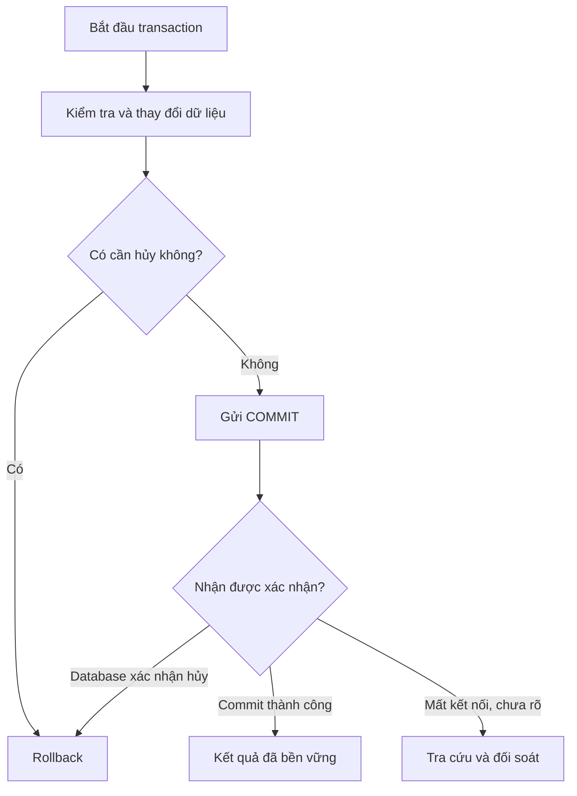

# Rollback semantics

## 1. Rollback có ý nghĩa gì đối với bảo mật nghiệp vụ?

Rollback là việc hủy các thay đổi chưa commit trong phạm vi một transaction, hoặc hủy một phần thay đổi kể từ savepoint nếu hệ quản trị hỗ trợ. Đối với dữ liệu transactional thuộc phạm vi đó, mục tiêu là không để một thao tác thất bại lưu lại các thay đổi một phần trái với hợp đồng nghiệp vụ.

Ví dụ, xác nhận hoàn tiền có thể gồm cập nhật tổng tiền đã hoàn, tạo giao dịch hoàn tiền, tiêu thụ bằng chứng xác nhận và lưu kết quả idempotency. Nếu bước tạo giao dịch thất bại, hệ thống không được giữ lại tổng tiền đã hoàn tăng lên hoặc một response thành công không có giao dịch tương ứng.

Trong bảo mật logic nghiệp vụ, rollback giúp bảo vệ các bất biến như:

- Không có giao dịch chỉ ghi nợ mà không ghi có khi hai thay đổi phải nguyên tử.
- Không báo hoàn tiền thành công nếu dữ liệu tài chính cần thiết chưa được lưu đầy đủ.
- Không tiêu thụ quyền thực thi theo một mô hình rồi vô tình mở lại tác dụng đã xảy ra ở nơi khác.
- Không để nhánh lỗi bỏ qua phê duyệt, quyền theo đối tượng hoặc giới hạn số tiền.
- Không biến retry sau lỗi thành một lần thực thi mới không được kiểm soát.

Tuy nhiên, rollback chỉ có hiệu lực trong ranh giới mà transaction thực sự quản lý. Nó không phải một nút hoàn tác cho mọi hành động mà method Java đã thực hiện.

## 2. Định nghĩa chính xác phạm vi được hoàn tác

Một database transaction thường quản lý những thay đổi được thực hiện qua connection hoặc ngữ cảnh transaction tham gia vào nó, trên các đối tượng có hỗ trợ transaction của hệ quản trị đó.

```text
BEGIN
  UPDATE dữ liệu A
  INSERT dữ liệu B
  DELETE dữ liệu C
ROLLBACK
```

Nếu cả ba thay đổi thuộc cùng transaction và chưa commit, rollback hủy chúng theo bảo đảm của database. Nếu thao tác B chạy bằng connection khác đã tự commit, rollback ở connection A không hủy được B.

| Thay đổi hoặc tác dụng | Rollback database có tự hoàn tác không? |
|---|---|
| Cập nhật bảng transactional trong cùng transaction chưa commit | Có, theo bảo đảm của hệ quản trị |
| Thay đổi đã commit ở transaction trước | Không |
| Thay đổi của transaction độc lập trên connection khác | Không |
| Gọi API thanh toán bên ngoài | Không |
| Email hoặc thông điệp đã gửi qua kênh không tham gia transaction | Không |
| File hoặc đối tượng đã ghi vào kho riêng | Không |
| Biến Java, cache cục bộ hoặc object đã bị thay đổi | Không tự khôi phục |
| Số đã cấp từ sequence hoặc cơ chế sinh ID | Không mặc định được thu hồi; phụ thuộc cơ chế cụ thể |
| DDL và tài nguyên đặc thù | Phải kiểm tra ngữ nghĩa của hệ quản trị, không suy rộng từ DML |

Một khoảng trống trong dãy ID không chứng minh mất dữ liệu. Ví dụ, PostgreSQL sequence có thể đã cấp một số rồi transaction dùng số đó rollback. Không dùng giả định “ID phải liên tục” làm bất biến tài chính hoặc căn cứ kết luận transaction đã commit.

Các ví dụ SQL trong bài minh họa dữ liệu transactional. Với nhiều database, nhiều dịch vụ hoặc tài nguyên khác loại, cần một thiết kế phối hợp riêng; không giả định chúng tham gia cùng transaction chỉ vì được gọi từ một method.

## 3. Rollback khác với isolation và kiểm tra quyền

Rollback bảo vệ việc hủy thay đổi trong một transaction thất bại. Nó không tự bảo đảm rằng một transaction được phép commit đã đưa ra quyết định đúng trong điều kiện đồng thời.

Ví dụ hai request cùng đọc “đã hoàn 0 trên tổng 150.000”, mỗi request quyết định hoàn 100.000 rồi đều commit. Không có exception để kích hoạt rollback, nhưng tổng tiền hoàn có thể vượt giới hạn nếu thiết kế đồng bộ sai.

Cần phối hợp với khóa, cập nhật có điều kiện, ràng buộc dữ liệu hoặc isolation phù hợp. Tương tự, transaction có thể nguyên tử nhưng vẫn thực hiện một hành động trái quyền nếu không kiểm tra quyền theo đối tượng.

```text
Atomicity:    các thay đổi thuộc một đơn vị có cùng commit hay bị hủy không?
Isolation:   các transaction đồng thời quan sát và ảnh hưởng nhau thế nào?
Authorization: người gọi có được phép thực hiện thay đổi đó không?
Invariants:  trạng thái kết quả có thỏa quy tắc nghiệp vụ không?
```

Một thiết kế bảo mật cần trả lời cả bốn câu hỏi. Không dùng việc “có transaction” thay cho kiểm tra giá, phê duyệt, đối tượng sở hữu hoặc trạng thái hợp lệ.

## 4. Vòng đời transaction và ý nghĩa của từng điểm lỗi



### 4.1. Trước khi gửi commit

Nếu transaction được hủy và toàn bộ tác dụng cần xét nằm bên trong nó, các thay đổi đó không trở thành một kết quả đã commit. Có thể cân nhắc thực hiện lại sau khi transaction cũ kết thúc, nhưng lần thử mới vẫn phải kiểm tra quyền, trạng thái và giới hạn nghiệp vụ hiện tại.

Nếu process chết trong lúc transaction còn mở, database sẽ xử lý transaction chưa kết thúc khi phát hiện connection mất theo cơ chế của nó. Không mặc định khóa được giải phóng ngay lập tức chỉ vì client đã timeout; transaction có thể còn tồn tại một thời gian.

### 4.2. Sau khi commit thành công

Rollback không hủy ngược lại các thay đổi đã commit. Gọi `rollback()` sau đó có thể không làm gì đối với transaction cũ hoặc tác động đến một transaction khác theo trạng thái connection, nhưng không phải bằng chứng giao dịch trước đã được hoàn tác.

Nếu cần thay đổi kết quả đã commit, phải dùng một nghiệp vụ mới, có điều kiện và dấu vết riêng, chẳng hạn hủy đơn hoặc tạo giao dịch bù.

### 4.3. Khi kết quả commit chưa xác định

Ứng dụng gửi `COMMIT`, database có thể đã commit, nhưng xác nhận bị mất trên đường truyền. Một exception ở ứng dụng không đủ để kết luận dữ liệu chưa thay đổi.

Trong trường hợp này, phải tra cứu bằng định danh operation hoặc idempotency key ổn định trên nguồn có thẩm quyền. Nếu chưa thể phân biệt đã commit với chưa commit, giữ trạng thái chưa xác định và đối soát; không tạo một lệnh mới bằng key khác.

Ngay cả một lời gọi rollback tiếp theo không báo lỗi cũng không tự chứng minh commit trước đó chưa xảy ra. Phải phân biệt kết quả transaction gốc với trạng thái hiện tại của connection.

## 5. Ví dụ hoàn tiền: đơn vị nào cần cùng commit?

Giả sử một ý định hoàn tiền đã được phê duyệt và có số tiền hợp lệ. Thao tác xác nhận cần thực hiện:

1. Nhận quyền xử lý cùng một ý định hoặc request.
2. Kiểm tra quyền theo đối tượng, phiên bản ý định và phê duyệt.
3. Tiêu thụ bằng chứng xác nhận theo chính sách.
4. Tăng tổng tiền đã hoàn mà không vượt tổng tiền được phép.
5. Tạo giao dịch hoàn tiền có định danh ổn định.
6. Chuyển trạng thái ý định và lưu kết quả để retry tra cứu.

Nếu các dữ liệu trên nằm trong một database và hợp đồng yêu cầu nguyên tử, chúng cần nằm trong cùng transaction. Khi bước 5 thất bại, không được giữ riêng bước 3 hoặc 4 đã commit ở một transaction khác rồi vẫn mô tả thao tác là nguyên tử.

Ví dụ cập nhật có điều kiện:

```sql
UPDATE order_refund_totals
SET refunded_minor = refunded_minor + :amount_minor
WHERE tenant_id = :tenant_id
  AND order_id = :order_id
  AND :amount_minor > 0
  AND refunded_minor <= paid_minor - :amount_minor;
```

Ví dụ giả định các giá trị tiền nằm trong miền số nguyên phù hợp và các cột được ràng buộc không âm. Ứng dụng phải yêu cầu đúng một dòng cập nhật. Không có dòng nào cập nhật nghĩa là không được tiếp tục tạo một giao dịch thành công trong luồng này.

Trong PostgreSQL ở `READ COMMITTED`, cập nhật đồng thời trên cùng dòng sẽ được đồng bộ và điều kiện được kiểm tra lại trên phiên bản dòng thích hợp sau khi chờ. Tuy nhiên, quy tắc nhiều dòng hoặc nhiều đối tượng vẫn cần phân tích riêng; không suy ra một câu cập nhật này bảo vệ mọi bất biến của hệ thống.

Sau cập nhật, nếu insert giao dịch hoặc lưu trạng thái thất bại, rollback transaction chung sẽ hủy thay đổi tổng tiền. Nếu cùng operation đã tồn tại, cần xử lý đúng ràng buộc duy nhất và luồng idempotency; không coi mọi lỗi duplicate đều là thành công.

## 6. Exception trong Java không đồng nghĩa với rollback

Một exception là sự kiện điều khiển luồng trong chương trình. Nó chỉ dẫn tới rollback nếu transaction manager hoặc mã ứng dụng thực sự yêu cầu hủy transaction theo quy tắc đã cấu hình.

### 6.1. JDBC và autocommit

Connection JDBC thường mặc định ở chế độ autocommit khi mới được tạo. Connection pool có thể đặt lại hoặc cấu hình khác; cần biết trạng thái thực tế thay vì giả định.

Nếu autocommit đang bật, mỗi statement có thể hoàn tất như một transaction riêng theo ngữ nghĩa JDBC và driver. Method chạy ba câu SQL rồi ném exception ở câu thứ ba không có nghĩa hai câu đầu cùng rollback.

```text
autocommit = true
UPDATE tổng tiền     → có thể đã commit riêng
INSERT giao dịch     → lỗi
throw exception      → không hoàn tác UPDATE đã commit
```

Với transaction do ứng dụng tự quản lý, phải tắt autocommit trước khi bắt đầu đơn vị nghiệp vụ, dùng đúng connection cho các câu lệnh tham gia và quản lý commit/rollback rõ ràng.

### 6.2. Mẫu phân tách lỗi trước commit và lỗi commit

Mã giả Java sau nhấn mạnh hai loại kết quả khác nhau:

```java
RefundResult executeRefund(OperationId operationId, Command command) {
    Connection connection = acquireConnection();
    try {
        connection.setAutoCommit(false);

        RefundResult result;
        try {
            result = applyAllDatabaseChanges(
                connection, operationId, command
            );
        } catch (Exception failureBeforeCommit) {
            rollbackWithoutMaskingOriginalFailure(
                connection, failureBeforeCommit
            );
            throw translateBeforeCommitFailure(failureBeforeCommit);
        }

        try {
            connection.commit();
        } catch (SQLException commitFailure) {
            throw new CommitOutcomeNeedsResolution(
                operationId, commitFailure
            );
        }

        return result;
    } finally {
        releaseConnectionWithOutcomeAwareHandling(connection);
    }
}
```

Đây là mã giả, không phải một transaction utility đầy đủ. Việc lấy connection, xử lý lỗi khi cấu hình, phân loại lỗi database, đóng/trả connection và exception khi cleanup cần được triển khai theo driver, pool và framework đang dùng.

Các điểm cần giữ là:

- Lỗi nghiệp vụ trước commit phải làm hủy toàn bộ đơn vị cần nguyên tử.
- Nếu rollback cũng lỗi, không che mất nguyên nhân ban đầu; giữ nguyên nhân phụ và ghi nhận việc cleanup chưa được xác nhận.
- Lỗi commit cần được phân loại theo bằng chứng; ví dụ này đưa vào nhánh cần xác định kết quả thay vì khẳng định rollback.
- Nếu lỗi trả connection xảy ra sau commit đã xác nhận, không được suy ra nghiệp vụ thất bại và chạy lại mù quáng.
- Không phát response thành công trước khi commit được xác nhận.

Khi commit thất bại vì một nguyên nhân database xác nhận transaction đã bị hủy, có thể có kết luận mạnh hơn trường hợp mất kết nối. Không phải mọi exception từ `commit()` đều mang cùng mức độ chưa chắc chắn.

## 7. Quy tắc rollback trong Spring cần được hiểu rõ

Trong mô hình Spring transaction khai báo thông dụng, mặc định rollback thường áp dụng với `RuntimeException` và `Error`, còn checked exception không mặc nhiên có cùng quy tắc. Cấu hình ứng dụng, annotation và transaction manager có thể thay đổi hành vi này.

Vì vậy, nếu lỗi nghiệp vụ được biểu diễn bằng checked exception mà cần hủy toàn bộ thay đổi, phải cấu hình phù hợp và kiểm tra hành vi thực tế. Ví dụ minh họa một quy tắc có chủ đích:

```java
@Transactional(rollbackFor = RefundValidationException.class)
public RefundResult confirmRefund(RefundCommand command)
        throws RefundValidationException {
    return applyRefundWithAllRequiredChecks(command);
}
```

Không thêm hoặc loại trừ rollback chỉ để tránh báo lỗi mà chưa xác định dữ liệu nào sẽ còn được commit. Một `noRollbackFor` không làm thay đổi nghiệp vụ trở nên an toàn; nó cho phép transaction tiếp tục theo cấu hình và điều kiện thực tế.

### 7.1. Bắt lỗi rồi trả về bình thường

Mẫu nguy hiểm:

```java
@Transactional
public ApiResponse confirmRefund(Command command) {
    increaseRefundedTotal(command);
    try {
        createRefundRecord(command);
    } catch (BusinessException failure) {
        return ApiResponse.error("Cannot create refund");
    }
    return ApiResponse.success();
}
```

Nếu exception bị bắt trước khi transaction interceptor thấy nó và transaction chưa bị đánh dấu rollback-only, method có thể trả về bình thường rồi commit thay đổi trước đó. Client nhận response lỗi nhưng dữ liệu đã bị thay đổi một phần.

Nếu lỗi đến từ database hoặc một interceptor bên trong đã đánh dấu rollback-only, kết quả lại có thể là rollback khi kết thúc. Không dựa vào một trong hai khả năng theo cảm tính. Cần thiết kế rõ: ném lỗi phù hợp ra ranh giới transaction, đánh dấu rollback-only bằng cơ chế framework khi cần, hoặc biểu diễn từ chối nghiệp vụ trước khi thực hiện các thay đổi phải hủy.

### 7.2. Annotation phải thật sự được áp dụng

Trong cấu hình dựa trên proxy, lời gọi nội bộ từ một method sang method khác trên cùng object thường không đi qua proxy như một lời gọi bên ngoài. Nếu thiết kế phụ thuộc vào annotation ở method được gọi nội bộ, transaction có thể không được tạo hoặc propagation không được áp dụng như mong đợi.

Cần xác định đường gọi thực tế và ranh giới transaction hiệu lực. Một method có `@Transactional` trong mã nguồn chưa đủ chứng minh các thao tác database đang ở đúng transaction.

Transaction cũng không tự đi theo một tác vụ bất đồng bộ chỉ vì tác vụ được tạo bên trong method đang có transaction. Thread hoặc tác vụ mới cần có ranh giới và cơ chế truyền thông tin phù hợp; không chia sẻ connection tùy tiện giữa các thread.

## 8. Rollback-only và transaction tham gia chung

Với propagation kiểu tham gia transaction hiện có, nhiều method có thể cùng thuộc một transaction vật lý. Một method bên trong đánh dấu rollback-only có thể khiến toàn bộ transaction bị hủy khi method ngoài kết thúc.

```text
Outer bắt đầu transaction
  Inner tham gia cùng transaction
  Inner gặp lỗi và đánh dấu rollback-only
  Outer bắt exception và tiếp tục
Outer yêu cầu commit
  → transaction không còn được phép commit
```

Bắt exception không xóa trạng thái rollback-only. Trong một số luồng Spring, outer có thể gặp `UnexpectedRollbackException` ở thời điểm kết thúc. Điều cần hiểu là method ngoài trả về bình thường chưa đồng nghĩa dữ liệu đã commit.

Không cố lưu response thành công trong bộ nhớ hoặc gửi sự kiện ra ngoài sau khi biết transaction chung đã bị đánh dấu hủy. Nếu cần ghi log sự cố, tách rõ log quan sát với dữ liệu nghiệp vụ và không tuyên bố thành công trước khi transaction kết thúc.

Không mặc định mỗi method `@Transactional` là một transaction độc lập. Phải kiểm tra propagation, transaction manager và connection thực tế.

## 9. Savepoint: hoàn tác một phần có điều kiện

Savepoint đánh dấu một vị trí trong transaction. Khi rollback về savepoint, database hủy những thay đổi thuộc phạm vi được hỗ trợ sau vị trí đó, còn transaction bên ngoài có thể tiếp tục nếu lỗi và hệ quản trị cho phép.

```sql
BEGIN;

INSERT INTO import_batches (batch_id, state)
VALUES (:batch_id, 'PROCESSING');

SAVEPOINT before_optional_note;

-- Thực hiện một phần việc được phép thất bại độc lập.
INSERT INTO optional_import_notes (batch_id, note)
VALUES (:batch_id, :note);

-- Nhánh xử lý khi phần việc đó thất bại:
ROLLBACK TO SAVEPOINT before_optional_note;

-- Các thay đổi hợp lệ khác của transaction vẫn có thể được thực hiện.
UPDATE import_batches
SET state = 'READY'
WHERE batch_id = :batch_id;

COMMIT;
```

Đây là minh họa cho một nhánh điều khiển: ứng dụng chỉ chạy rollback về savepoint khi cần. Không phải một script bắt buộc luôn hủy việc insert ghi chú.

Savepoint chỉ phù hợp khi hợp đồng nghiệp vụ cho phép bỏ phần đó mà vẫn commit phần còn lại. Không dùng savepoint để bỏ qua lỗi kiểm tra phê duyệt, lỗi ghi sổ tài chính bắt buộc hoặc lỗi xác minh quyền rồi vẫn commit phần tác động đến tiền.

### 9.1. Savepoint không phải commit trung gian

Những thay đổi trước savepoint vẫn chưa bền vững độc lập nếu transaction ngoài chưa commit. Rollback toàn bộ transaction sẽ hủy cả chúng.

Trong JDBC, savepoint yêu cầu trạng thái transaction phù hợp và sự hỗ trợ của driver/database. Với ORM, rollback về savepoint không mặc nhiên đưa toàn bộ object trong persistence context về đúng trạng thái tương ứng; cần kiểm tra khả năng tích hợp thực tế.

Một lỗi SQL cũng có thể khiến transaction không còn chạy tiếp bình thường. Ví dụ ở PostgreSQL, sau nhiều loại lỗi statement, phải rollback transaction hoặc rollback về savepoint hợp lệ đã tạo trước lỗi để tiếp tục. Bắt `SQLException` rồi chạy câu tiếp theo mà không xử lý trạng thái transaction có thể thất bại tiếp.

Không suy ra mọi lỗi đều phục hồi được bằng savepoint. Lỗi kết nối hoặc sự cố khiến transaction kết thúc cần một quy trình khác.

## 10. Transaction lồng nhau và transaction độc lập

Hai cách tổ chức thường dễ bị nhầm là một phạm vi lồng dùng savepoint và một transaction độc lập.

| Cách tổ chức | Quan hệ với transaction ngoài | Khi outer rollback |
|---|---|---|
| Tham gia transaction hiện có, ví dụ `REQUIRED` trong ngữ cảnh phù hợp | Cùng transaction vật lý | Thay đổi tham gia cùng bị hủy |
| Phạm vi lồng bằng savepoint, ví dụ `NESTED` khi được hỗ trợ | Một phần của transaction ngoài | Phần bên trong vẫn bị hủy theo outer |
| Transaction độc lập, ví dụ `REQUIRES_NEW` khi có hiệu lực | Có commit/rollback riêng | Thay đổi inner đã commit có thể còn tồn tại |

Tên propagation không thay thế việc kiểm tra transaction manager có hỗ trợ ngữ nghĩa đó hay không. Đặc biệt, hỗ trợ savepoint ở JDBC không đồng nghĩa mọi transaction manager hoặc mọi thao tác ORM đều có cùng hành vi lồng nhau.

### 10.1. Khi nào transaction độc lập gây sai lệch?

```text
Outer: kiểm tra và xử lý hoàn tiền
  Inner độc lập: ghi "hoàn tiền thành công" rồi commit
Outer: lỗi ghi sổ → rollback
```

Kết quả là tồn tại một bản ghi tuyên bố thành công nhưng không có dữ liệu nghiệp vụ tương ứng. Nếu client hoặc worker dùng bản ghi đó làm nguồn thẩm quyền, hệ thống có thể trả kết quả sai hoặc mất khả năng phục hồi.

Ngược lại, nếu inner độc lập thực sự tạo tác dụng tài chính rồi outer rollback dữ liệu chống lặp, retry có thể gây tác dụng thêm lần nữa.

Không đưa các thay đổi bắt buộc nguyên tử sang transaction độc lập chỉ để chúng “vẫn lưu được khi có lỗi”. Với audit thất bại, có thể cần lưu độc lập, nhưng nội dung phải là “đã nhận yêu cầu” hoặc “đã ghi nhận lỗi” theo bằng chứng, không phải thành công nghiệp vụ chưa commit.

Transaction độc lập còn có thể cần connection bổ sung và bị chặn bởi khóa mà outer đang giữ. Nếu outer chờ inner hoàn tất còn inner chờ dữ liệu bị outer khóa, thiết kế có thể tự gây nghẽn hoặc timeout. Không dùng propagation như một cách tự động giải quyết mọi vấn đề khóa.

## 11. Flush, bộ nhớ và cache không có cùng ngữ nghĩa với commit

### 11.1. Flush không phải commit

Trong ORM, flush có thể đẩy các thay đổi đang chờ thành SQL và làm lỗi ràng buộc xuất hiện sớm. Nếu transaction vẫn chưa commit, những thay đổi transactional đó vẫn có thể bị rollback.

```text
Sửa entity
  → flush: SQL được gửi xuống database
  → transaction vẫn đang mở
  → rollback: dữ liệu transactional bị hủy
```

Ngược lại, không gọi flush tường minh không có nghĩa database chưa nhận SQL; framework có thể tự flush trước query hoặc lúc commit theo cơ chế của nó.

### 11.2. Object Java không tự quay về trạng thái cũ

```java
order.setState(OrderState.REFUNDED);
entityManager.flush();
// Một bước bắt buộc phía sau thất bại và transaction rollback.
```

Database có thể trở về trạng thái trước transaction, nhưng một tham chiếu Java đang giữ không nên được giả định đã tự trở về đúng trạng thái đó. Không lấy entity bị ảnh hưởng bởi transaction thất bại làm nguồn quyết định cho lần retry.

Theo vòng đời và cơ chế ORM đang dùng, cần kết thúc ngữ cảnh lỗi, làm sạch hoặc tạo persistence context mới rồi đọc lại dữ liệu cần thiết. Không tái sử dụng session/transaction đã lỗi như thể chỉ cần bắt exception là đủ.

### 11.3. Cache và sự kiện thành công

Nếu cập nhật cache thành “đã hoàn tiền” trước commit rồi transaction rollback, cache có thể giữ trạng thái sai. Nếu xóa cache trước commit, một request khác có thể nạp lại dữ liệu cũ và làm cache tiếp tục lỗi sau commit.

Cần chiến lược nhất quán giữa commit và cache, chẳng hạn invalidation sau commit kèm cơ chế phục hồi phù hợp. Callback sau commit giúp tránh phát thông báo thành công trước commit, nhưng process có thể chết sau commit và trước callback. Khi cần bảo đảm thông báo cuối cùng vẫn được gửi, transactional outbox là một lựa chọn thiết kế.

Không dùng dữ liệu cache lỗi thời làm căn cứ duy nhất cho quyền theo đối tượng hoặc giới hạn tài chính nếu điều đó có thể phá bất biến.

## 12. Tác dụng ngoài database không rollback cùng method

Mẫu sau không tạo một đơn vị nguyên tử giữa hai hệ thống:

```text
BEGIN database transaction
  cập nhật trạng thái nội bộ
  gọi nhà cung cấp hoàn tiền → thành công
  insert ghi sổ nội bộ → lỗi
ROLLBACK database
```

Tiền có thể đã được hoàn ở nhà cung cấp, còn database trở về trạng thái cũ. Nếu request được gửi lại như một ý định mới, tiền có thể bị hoàn thêm lần nữa.

Giữ transaction database mở trong lúc gọi HTTP không làm API ngoài hệ thống tham gia rollback. Nó còn kéo dài thời gian giữ khóa và sử dụng connection.

### 12.1. Tiếp nhận ý định và transactional outbox

Một cách tổ chức là:

1. Trong transaction nội bộ, xác minh quyền, phê duyệt và ý định.
2. Ghi operation cùng outbox event và trạng thái tiếp nhận cần thiết.
3. Commit rồi trả định danh operation.
4. Worker gửi lệnh ra ngoài với định danh chống lặp ổn định.
5. Lưu kết quả hoặc đối soát khi phản hồi bị mất.

Outbox giải quyết khoảng trống giữa commit dữ liệu nội bộ và việc có một ý định phát thông điệp bền vững. Nó không ngăn worker phát lặp khi đã gửi nhưng chưa đánh dấu xong. Phía nhận hoặc consumer vẫn cần cơ chế chống lặp phù hợp.

Nếu tác dụng bên ngoài chưa rõ kết quả, không rollback logic bằng cách xóa operation rồi gửi lệnh mới. Cần giữ dấu vết và tra cứu bằng định danh ổn định.

### 12.2. Bù là nghiệp vụ mới, không phải rollback database

Nếu một giao dịch đã commit hoặc đã tạo tác dụng ngoài database, muốn đảo ngược cần một thao tác bù có quyền, điều kiện và lịch sử riêng.

Ví dụ, hủy một khoản thu đã thành công có thể cần tạo giao dịch hoàn tiền. Khoản thu gốc vẫn tồn tại trong lịch sử; không xóa nó để giả vờ chưa từng xảy ra.

Lệnh bù cũng có thể timeout, bị từ chối hoặc cần phê duyệt. Nó cần idempotency và đối soát riêng. Trong một saga, từng bước và từng lệnh bù phải có trạng thái rõ; không coi mọi bước đã xảy ra đều biến mất khi một bước sau thất bại.

## 13. Rollback, nonce và idempotency

### 13.1. Cùng rollback khi tác dụng nằm trong cùng transaction

Nếu nonce được tiêu thụ để xác nhận một thay đổi nội bộ và chính sách cho phép thử lại khi transaction chưa commit, có thể đặt tiêu thụ nonce, thay đổi nghiệp vụ và kết quả idempotency trong cùng transaction.

Nếu rollback được xác nhận, nonce chưa bị tiêu thụ bền vững, tác dụng nội bộ chưa commit và bản ghi nhận quyền trong transaction đó cũng không còn. Lần sau vẫn phải kiểm tra nonce còn hạn, ý định không thay đổi và quyền còn hợp lệ.

Một giao thức cố ý đốt nonce ở lần thử có chính sách khác. Khi đó phải thiết kế cấp lại và phục hồi, không vừa commit tiêu thụ nonce riêng vừa tuyên bố mọi thứ sẽ quay về khi transaction nghiệp vụ rollback.

### 13.2. Không lưu thành công tách khỏi dữ liệu nghiệp vụ

```text
Transaction A: lưu idempotency = SUCCESS rồi commit
Transaction B: cập nhật nghiệp vụ rồi rollback
```

Retry có thể nhận một thành công không tồn tại. Ngược lại, commit nghiệp vụ rồi lỗi trước khi lưu idempotency ở transaction khác có thể khiến retry không nhận ra tác dụng đã xảy ra.

Khi có thể, ghi kết quả chống lặp và dữ liệu nghiệp vụ trong cùng transaction. Khi không thể, phải có định danh nghiệp vụ ổn định, ràng buộc dữ liệu và quy trình phục hồi có chủ đích.

### 13.3. Phân biệt lỗi nghiệp vụ cuối và lỗi cần thử lại

Một từ chối nghiệp vụ không nhất thiết phải ném exception rồi xóa mọi dấu vết. Hệ thống có thể chủ động lưu kết quả từ chối theo hợp đồng idempotency, với điều kiện không commit những thay đổi trái bất biến.

Ví dụ, lệnh bị từ chối vì chưa đủ phê duyệt có thể lưu một kết quả cuối cho ý định đó nếu API công bố như vậy. Khi phê duyệt thay đổi và client muốn một ý định mới, cần một luồng đúng quy tắc; không tự sửa kết quả cũ thành thành công.

Lỗi hạ tầng với rollback chắc chắn và kết quả commit chưa rõ lại có chính sách khác. Không dùng một field `FAILED` chung để cho mọi trường hợp thực thi lại.

## 14. Retry sau rollback: điều kiện nào mới an toàn?

Retry không phải hệ quả tự động của việc bắt được exception. Trước khi chạy lại, cần xác định:

- Transaction cũ đã kết thúc hay còn có thể commit?
- Tác dụng cần xét có hoàn toàn thuộc transaction bị hủy không?
- Có lệnh ngoài database, transaction độc lập hoặc callback nào đã tạo tác dụng không?
- Cùng ý định có được nhận diện bằng operation ID và key ổn định không?
- Lần thử mới có kiểm tra lại quyền, phê duyệt và dữ liệu hiện tại không?

Deadlock hoặc serialization failure có thể cho phép thử lại toàn bộ transaction khi database xác nhận transaction đó đã bị hủy. Lần thử mới phải bắt đầu từ ranh giới đúng, không chỉ chạy lại câu SQL cuối bằng dữ liệu đã đọc từ transaction thất bại.

Không tự động retry toàn bộ một method vừa cập nhật database vừa gọi API bên ngoài nếu việc phát lệnh ra ngoài chưa có chống lặp thích hợp.

### 14.1. Giới hạn retry

Đặt số lần thử, deadline và backoff phù hợp; có thể thêm jitter để nhiều request không cùng lao vào một khóa. Giải phóng transaction và connection trước khi chờ lần thử kế tiếp.

Deadline phía client hết không chứng minh server đã dừng. Nếu request đầu còn xử lý, request mới phải chịu cùng cơ chế nhận quyền và ràng buộc dữ liệu, không được đi vào nhánh bỏ qua kiểm tra chỉ vì “đây là retry”.

Đối với commit chưa rõ kết quả, ưu tiên tra cứu hoặc gửi lại cùng ý định qua luồng idempotency đúng. Một lần đọc không thấy trên replica có độ trễ không đủ chứng minh có thể thực thi mới.

## 15. Những đường lỗi có thể bị khai thác

| Điểm yếu | Cách bị lợi dụng | Hướng bảo vệ |
|---|---|---|
| Autocommit ngoài dự kiến | Gây lỗi ở bước sau để giữ lại thay đổi bước trước | Xác định transaction thực tế và dùng cùng connection/ngữ cảnh |
| Bắt exception rồi trả response lỗi | Dữ liệu đã thay đổi nhưng transaction vẫn commit | Thiết kế rollback rule và đường điều khiển rõ ràng |
| Checked exception không có quy tắc phù hợp | Lỗi nghiệp vụ không hủy thay đổi bắt buộc | Cấu hình theo loại lỗi và kiểm tra hành vi |
| Savepoint bỏ qua kiểm tra bắt buộc | Vẫn commit tác dụng tài chính sau khi phê duyệt thất bại | Chỉ cho partial success khi hợp đồng cho phép |
| Transaction độc lập ghi thành công sớm | Trạng thái kết quả lệch với dữ liệu thật | Giữ thay đổi nguyên tử cùng transaction hoặc mô hình hóa riêng |
| Coi timeout là rollback | Gửi lại một lệnh đã commit | Tra cứu bằng định danh ổn định và idempotency |
| Gọi nhà cung cấp rồi rollback database | Tác dụng ngoài còn tồn tại nhưng dấu vết bị mất | Operation bền vững, chống lặp và đối soát |
| Tái sử dụng entity sau rollback | Quyết định dựa trên trạng thái bộ nhớ sai | Kết thúc ngữ cảnh lỗi, đọc lại trong transaction phù hợp |
| Nhiều request đều commit dữ liệu hợp lệ cục bộ | Phá giới hạn tổng hoặc quy tắc nhiều dòng | Đồng bộ và ràng buộc bất biến, không chỉ dựa vào rollback |

Kẻ tấn công không cần điều khiển database để khai thác những lỗi này. Chỉ cần tạo request đúng thời điểm, gây một lỗi có thể dự đoán hoặc gửi lại lệnh khi server đang chưa xác định được kết quả.

## 16. Kiểm thử rollback theo tác dụng và bất biến

### 16.1. Chèn lỗi ở từng ranh giới bắt buộc

Với luồng hoàn tiền, chèn sự cố sau mỗi thay đổi: nhận quyền, tiêu thụ nonce, cập nhật tổng tiền, tạo giao dịch, chuyển trạng thái ý định và lưu response.

Sau khi transaction thất bại đã kết thúc, dùng connection hoặc transaction độc lập để đọc trạng thái thật và xác nhận các thay đổi cần nguyên tử không còn tồn tại một phần. Không dùng chính persistence context đang giữ entity đã sửa để suy ra trạng thái database.

| Tình huống | Điều cần xác nhận |
|---|---|
| Lỗi sau cập nhật tổng tiền nhưng trước insert giao dịch | Tổng tiền không tăng bền vững nếu transaction bị hủy |
| Lỗi sau tiêu thụ nonce trong mô hình rollback chung | Nonce và nghiệp vụ cùng rollback theo chính sách |
| Lỗi trước commit | Không có kết quả thành công bền vững nếu transaction đã bị hủy |
| Mất response sau commit | Retry không tạo giao dịch thứ hai |
| Mất xác nhận commit | Luồng xác định kết quả không tự kết luận thất bại |
| Lỗi nhà cung cấp sau tiếp nhận | Operation không bị xóa để mở một lệnh mới |

Một exception được ném trước khi gửi `COMMIT` chỉ kiểm tra lỗi trước commit. Nó không đại diện đầy đủ cho trường hợp database đã commit nhưng xác nhận bị mất; cần kịch bản mô phỏng hoặc hạ tầng kiểm thử phù hợp với tình huống đó.

### 16.2. Kiểm thử framework và propagation

Thử riêng runtime exception, checked exception, exception bị bắt, transaction đã đánh dấu rollback-only, lời gọi nội bộ không qua proxy và lời gọi sang bean khác. Xác nhận kết quả thực tế phù hợp với cấu hình mà luồng nghiệp vụ dựa vào.

Thử outer rollback sau khi inner đã commit độc lập; thử inner rollback về savepoint rồi outer commit; thử outer rollback toàn bộ sau một phạm vi lồng. Những kiểm tra này làm rõ thay đổi nào tồn tại, thay đổi nào bị hủy.

Không dùng một test vốn đã bao toàn bộ thao tác trong transaction tự rollback rồi kết luận production có cùng ranh giới. Test có thể che lỗi autocommit hoặc khiến không bao giờ quan sát thời điểm commit thật. Chỉ rõ test nào kiểm tra commit thực tế và đọc kết quả bằng ngữ cảnh độc lập.

### 16.3. Kiểm thử đồng thời và quyền

Gửi hai yêu cầu hoàn tiền đồng thời để xác nhận giới hạn tổng được giữ khi cả hai đều không gặp lỗi lập trình. Sau đó gây lỗi cho một request và cho request kia tiếp tục để kiểm tra khóa, rollback và dữ liệu kết quả.

Thay đổi quyền hoặc phê duyệt trong lúc request chờ và xác nhận quy tắc thời điểm áp dụng quyền của hệ thống. Retry phải kiểm tra điều kiện phù hợp, không tái sử dụng một kết luận cấp quyền đã lỗi thời ngoài chính sách.

### 16.4. Kiểm tra cả ngoài database

Quan sát mock hoặc môi trường kiểm thử của email, hàng đợi và nhà cung cấp. Một test chỉ thấy bảng đã rollback chưa chứng minh không có tác dụng ngoài database bị thực hiện.

Đếm giao dịch nghiệp vụ, tổng số tiền, operation và sự kiện được gửi. Không chỉ kiểm tra HTTP status, số exception hoặc một cờ trạng thái duy nhất.

## 17. Quan sát và xử lý sự cố

Theo dõi số transaction rollback theo nhóm nguyên nhân, deadlock, serialization failure, thời gian giữ transaction và lỗi commit chưa xác định. Kết hợp với số operation chờ đối soát và sai lệch giữa dữ liệu kết quả với dữ liệu nghiệp vụ.

Log nên liên kết được operation, lần thử và ranh giới transaction nhưng không chứa token, nonce thô hoặc toàn bộ dữ liệu thanh toán. Một thông điệp “method threw exception” không nên được ghi thành “giao dịch chắc chắn đã hủy” nếu chưa có bằng chứng tương ứng.

Khi gặp sự cố:

1. Xác định transaction nào thực sự chứa từng thay đổi và có transaction độc lập hay không.
2. Tìm bằng chứng commit/rollback và kiểm tra transaction cũ còn hoạt động không.
3. Tra cứu dữ liệu nghiệp vụ bằng định danh ổn định trên nguồn phù hợp.
4. Kiểm tra tác dụng bên ngoài, outbox, inbox và các lần gửi liên quan.
5. Chọn phát lại, đối soát, thử lại có điều kiện hoặc tạo lệnh bù có quyền.
6. Giữ dấu vết quyết định và nguồn bằng chứng; không xóa key hoặc sửa trạng thái chỉ để chạy lại.

Nếu đã có tác dụng sai, việc sửa dữ liệu phải theo một phương án nghiệp vụ có thể kiểm tra và đối chiếu. Không giả vờ một thao tác sửa thủ công sau commit là rollback của transaction gốc.

## 18. Câu hỏi tự kiểm tra

1. Những thay đổi nào thật sự dùng chung transaction, connection và transaction manager?
2. Exception nào kích hoạt rollback, exception nào bị bắt hoặc có quy tắc khác?
3. Nếu method trả về bình thường nhưng transaction đã rollback-only, client sẽ nhận gì?
4. Savepoint có đang bỏ qua một bước bắt buộc của bất biến nghiệp vụ không?
5. Inner transaction độc lập đã commit có còn tồn tại khi outer rollback không?
6. Sau rollback, entity, cache hoặc sự kiện nào có thể đang phản ánh dữ liệu chưa commit?
7. Nếu mất xác nhận commit, định danh nào giúp tìm kết quả mà không tạo tác dụng mới?
8. Tác dụng ngoài database được chống lặp, đối soát hoặc bù như thế nào?

Rollback semantics cần được mô tả bằng phạm vi thay đổi và bằng chứng kết thúc transaction, không chỉ bằng việc method có ném exception. Bảo vệ logic nghiệp vụ đòi hỏi ranh giới nguyên tử đúng, kiểm tra quyền và bất biến đầy đủ, cùng một cách phục hồi an toàn cho những tác dụng đã commit hoặc chưa xác định kết quả.
