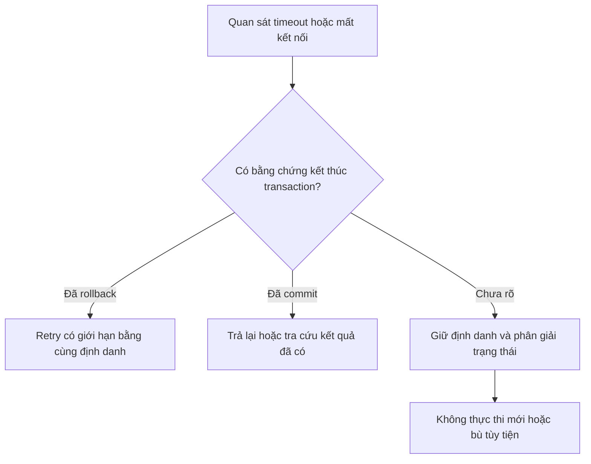

# Transaction timeout và bảo vệ kết quả nghiệp vụ khi hết thời gian chờ

## 1. Timeout không phải là một kết quả nghiệp vụ

Timeout cho biết một thành phần đã chờ quá giới hạn thời gian của nó. Thông tin đó chưa đủ để kết luận thao tác nghiệp vụ đã thất bại, transaction đã rollback hoặc hệ thống bên ngoài chưa tạo tác động.

Ví dụ, một request hoàn tiền có thể bị gateway trả lỗi hết thời gian chờ trong khi backend vẫn tiếp tục chạy. Transaction sau đó commit, ví khách hàng được cộng tiền, nhưng client chỉ nhìn thấy lỗi. Nếu client tạo một yêu cầu mới để thử lại và server thiếu bảo vệ, khách hàng có thể được cộng tiền hai lần.

**Transaction timeout cần được thiết kế cùng cơ chế kết thúc transaction, phân giải kết quả và retry an toàn.** Một giới hạn thời gian chỉ giúp hệ thống giữ đúng quy tắc nghiệp vụ khi ứng dụng biết nó đang giới hạn điều gì và xử lý được các trạng thái sau khi giới hạn bị vượt.

Trong Business Logic Security, chủ đề này liên quan trực tiếp đến hạn mức tiền, trạng thái phê duyệt, quyền theo đối tượng, idempotency và khả năng chịu request đồng thời. Kẻ tấn công có thể tận dụng thời gian chờ khóa, gửi request lặp hoặc gây chậm để mở rộng khoảng không chắc chắn giữa phản hồi HTTP và tác động thật.

Bài này thuộc chủ đề Transactions, tập trung vào việc giữ invariant khi xử lý bị chậm hoặc kết quả chưa rõ, thay vì chỉ điều chỉnh một tham số thời gian.

## 2. Kịch bản: client thấy timeout nhưng hoàn tiền đã thành công

Giả sử hệ thống hoàn 250.000 đồng về ví nội bộ. Payment, yêu cầu hoàn tiền, sổ cái, số dư ví và bản ghi idempotency cùng nằm trong một cơ sở dữ liệu.

Một lịch thực thi minh họa:

| Thời điểm | Diễn biến |
|---|---|
| 0,0 giây | Client gửi yêu cầu thực hiện hoàn tiền `rr_17`, idempotency key `K` |
| 0,2 giây | Backend bắt đầu transaction, chờ khóa payment |
| 2,0 giây | Gateway hết thời gian chờ và trả lỗi cho client |
| 2,5 giây | Backend lấy được khóa và tiếp tục xử lý |
| 3,0 giây | Refund, sổ cái, số dư, trạng thái và kết quả của `K` cùng commit |
| 3,1 giây | Backend không gửi được response thành công qua kết nối đã đóng |

Các thời gian này chỉ là số liệu giả định để phân tích. Điểm quan trọng là deadline của gateway không tự dừng transaction tại cơ sở dữ liệu.

Client gửi lại cùng key `K` phải được liên kết với kết quả đã commit, không thực hiện hoàn tiền mới. Nếu lần thử đầu vẫn đang chạy, cơ chế đăng ký key nguyên tử phải phối hợp các lần thử thay vì cho cả hai cùng tạo tác động.

Ngoài chống trùng theo key, invariant “mỗi yêu cầu hoàn tiền chỉ được thực hiện thành công một lần” phải tiếp tục bảo vệ khi client hoặc kẻ tấn công đổi key.

## 3. Những timeout khác nhau trong cùng một request

Không nên dùng từ “transaction timeout” để chỉ mọi lỗi chờ quá lâu. Mỗi giới hạn có phạm vi riêng:

| Giới hạn thời gian | Thành phần thường quan sát | Điều nó giới hạn | Điều không được tự suy ra |
|---|---|---|---|
| Client timeout | Ứng dụng gọi API | Thời gian client chờ response | Backend đã dừng hoặc rollback |
| Gateway/request timeout | Proxy hoặc tầng HTTP | Thời gian phục vụ hoặc chờ request | Công việc phía sau đã bị hủy |
| Connection acquisition timeout | Pool kết nối | Thời gian chờ lấy một connection | Có transaction mới đã bắt đầu hoặc có tác động đã commit |
| Lock timeout | Cơ sở dữ liệu | Thời gian chờ một khóa theo cấu hình | Mọi thay đổi trước đó trong transaction đã bị rollback |
| Statement timeout | Driver hoặc cơ sở dữ liệu | Thời gian một câu lệnh hoặc lời gọi được chạy/chờ | Toàn bộ transaction đã kết thúc |
| Transaction timeout | Cơ chế quản lý transaction hoặc cơ sở dữ liệu | Vòng đời hoặc thời gian thực thi transaction theo cơ chế đó | Mọi tầng đều nhận cùng tín hiệu và cùng hủy tức thì |
| Socket/read timeout | Kết nối đến cơ sở dữ liệu hoặc dịch vụ khác | Thời gian chờ dữ liệu trên kết nối | Bên nhận chưa thực hiện hoặc chưa commit |
| Worker lease timeout | Bộ điều phối công việc | Thời hạn sở hữu công việc | Worker cũ đã ngừng tạo tác động |

Hành vi cụ thể phụ thuộc cơ sở dữ liệu, driver và cơ chế quản lý transaction. Có hệ thống chỉ hủy câu lệnh; có hệ thống làm transaction hiện tại không còn sử dụng được cho đến khi rollback; có giới hạn được phát hiện ở một điểm kiểm tra thay vì ngắt ngay công việc đang chạy.

Khi triển khai, phải kiểm chứng timeout thực sự tác động ở đâu. Một cấu hình có tên “timeout” không tự chứng minh thời điểm hủy, trạng thái connection hay kết quả rollback.

## 4. Phân biệt ba kết quả quan trọng sau sự cố

### 4.1. Đã xác nhận rollback

Với tác động hoàn toàn nằm trong transaction nội bộ, nếu đã có bằng chứng transaction rollback, các thay đổi chưa commit của transaction đó không được tồn tại như một phần kết quả thành công.

Có thể retry cùng ý định theo chính sách, nhưng vẫn phải đọc lại và kiểm tra quyền, phê duyệt, trạng thái cùng hạn mức. Trong thời gian chờ, các transaction khác có thể đã tiêu phần hạn mức còn lại.

### 4.2. Đã xác nhận commit

Nếu refund, sổ cái, số dư và kết quả idempotency đã commit, timeout ở tầng HTTP không làm những dữ liệu đó biến mất. Cần trả lại hoặc cho tra cứu kết quả đã có.

Không ghi thêm một trạng thái “hoàn tiền thất bại” chỉ vì client không nhận response. Không chạy tác động bù hoặc hoàn tiền lần nữa để giải quyết một lỗi truyền tải.

### 4.3. Chưa xác định commit hay rollback

Nếu kết nối bị mất trong lúc commit, phía ứng dụng có thể không nhận được xác nhận. Đây là trạng thái chưa rõ kết quả, không phải một cách gọi khác của thất bại.



Lệnh yêu cầu rollback không thể thu hồi một commit đã hoàn tất. Nếu không biết commit có xảy ra không, việc cố gọi rollback sau đó không tự tạo ra bằng chứng rằng tác động chưa từng tồn tại.

## 5. Các invariant phải sống sót qua timeout

Trong ví dụ hoàn tiền nội bộ, hệ thống cần giữ:

```text
0 <= refunded_minor <= captured_minor

Mỗi refund_request_id chỉ có tối đa một lần thực thi thành công.

Mỗi khoản hoàn thành công có bút toán và biến động ví tương ứng.

Kết quả idempotency thành công phải trỏ đến thao tác đã commit.

Không thực thi yêu cầu chưa được phê duyệt hoặc ngoài quyền actor.
```

Timeout không được tạo một đường đi tắt bỏ qua các invariant này. Ví dụ, nếu kho idempotency chậm, không được tiếp tục hoàn tiền mà không chống trùng. Nếu cập nhật hạn mức không thành công, không được coi đó là lỗi phụ rồi vẫn cộng ví.

Các thay đổi phải được ghi cùng transaction khi cùng nằm trong một cơ sở dữ liệu: chiếm hạn mức, chuyển yêu cầu sang đã thực hiện, tạo refund, ghi sổ cái, cập nhật ví và lưu kết quả có thể replay. Nếu một phần thất bại trước commit, phần còn lại chưa commit phải rollback.

Unique constraint theo yêu cầu nghiệp vụ, cập nhật có điều kiện và cơ chế khóa hoặc version phù hợp vẫn cần thiết. Hai request dùng hai key khác nhau có thể cùng gặp timeout rồi cạnh tranh lại; timeout không phải cơ chế tuần tự hóa.

## 6. Thiết kế ngân sách thời gian cho toàn bộ đường xử lý

Một request phải chia thời gian cho chờ connection, chờ khóa, chạy câu lệnh, commit và gửi phản hồi. Đặt từng timeout độc lập mà không xét tổng thời gian có thể khiến transaction kéo dài hơn deadline bên ngoài rất nhiều.

Ví dụ ngân sách giả định cho một API nội bộ:

| Khoản thời gian | Giới hạn minh họa |
|---|---|
| Deadline xử lý tại tầng dịch vụ | 5 giây |
| Chờ lấy connection | Tối đa 300 mili giây và không vượt ngân sách còn lại |
| Ngân sách transaction dự kiến | Tối đa 3 giây và nằm trong deadline dịch vụ |
| Chờ khóa cho một bước nhạy cảm | Tối đa 200 mili giây và không vượt ngân sách còn lại |
| Câu lệnh | Giới hạn theo loại thao tác và ngân sách còn lại |
| Khoảng dự phòng | Dành cho kết thúc transaction và phản hồi |

Các số trên không phải khuyến nghị cấu hình cho mọi hệ thống. Cần đo độ trễ thực tế, yêu cầu sản phẩm và hành vi timeout của nền tảng trước khi chọn.

### 6.1. Giới hạn lồng nhau không cộng đơn giản

Nếu có nhiều câu lệnh, mỗi câu được chạy tối đa hai giây, tổng thời gian vẫn có thể vượt xa hai giây. Thời gian chờ khóa cũng có thể nằm trong thời gian của câu lệnh, tùy cơ chế; không nên cộng hoặc trừ máy móc những bộ đếm khác phạm vi.

Một nguyên tắc triển khai là giữ deadline tổng và tính lại ngân sách còn lại trước mỗi bước:

```text
remaining = deadline - monotonic_now
effective_step_timeout = min(configured_step_limit, remaining - safety_margin)

Nếu không còn đủ ngân sách:
    không bắt đầu thêm bước ghi mới;
    kết thúc transaction đang mở theo cơ chế quản lý của hệ thống.
```

Dùng nguồn đo thời gian phù hợp cho khoảng thời gian trong một tiến trình. Không dùng đồng hồ có thể nhảy giờ để đo một khoảng chờ nếu môi trường có nguồn thời gian đơn điệu. Khi truyền ngân sách qua dịch vụ khác, cần quy ước deadline hoặc thời gian còn lại phù hợp; không gửi giá trị đồng hồ đơn điệu cục bộ rồi coi nó có cùng ý nghĩa ở máy khác.

### 6.2. Deadline không phải cam kết commit kịp giờ tuyệt đối

Ngay cả khi chừa thời gian cho commit, lỗi mạng hoặc cơ sở dữ liệu vẫn có thể khiến kết quả chưa rõ. Kiểm tra deadline trước commit giảm việc tiếp tục công việc đã quá muộn, nhưng không loại bỏ khoảng không chắc chắn khi xác nhận commit.

Không bắt đầu một transaction ghi mới khi request đã hết ngân sách mà không có mô hình tiếp nhận bất đồng bộ rõ ràng. Nếu công việc cần chạy lâu hơn request, nên lưu bền thao tác và trả trạng thái tiếp nhận theo hợp đồng, rồi xử lý tiếp bằng worker.

Deadline do caller cung cấp cần được giới hạn theo chính sách của server. Caller không được tự cấp thời gian chờ vô hạn để giữ khóa hoặc chiếm tài nguyên.

## 7. Hủy công việc và dọn transaction đúng cách

Khi request bị ngắt hoặc hết deadline, ứng dụng nên truyền tín hiệu hủy đến những thành phần có hỗ trợ và yêu cầu kết thúc transaction đang mở theo cơ chế phù hợp. Tuy nhiên, yêu cầu hủy chỉ là tín hiệu; không mặc định mọi câu lệnh hay tác động bên ngoài đã dừng.

Đối với transaction chưa commit, cần kiểm tra kết quả kết thúc qua transaction manager hoặc cơ sở dữ liệu. Một lỗi statement có thể để connection còn transaction mở và còn giữ khóa. Nếu chỉ trả lỗi HTTP rồi quên rollback, các request khác có thể tiếp tục bị chặn.

Connection chỉ được trả về pool khi trạng thái đủ rõ và đã được dọn đúng quy tắc. Nếu trạng thái giao thức hoặc transaction không còn an toàn để tái sử dụng, cần loại bỏ connection theo cơ chế của pool/driver. Không cho request kế tiếp dùng nhầm transaction hoặc trạng thái lỗi của request trước.

Không tiếp tục chạy câu lệnh ghi mới trên một transaction đã bị đánh dấu hủy, hoặc thử nhiều câu lệnh tùy ý trên connection đang có kết quả chưa xác định. Phải xử lý theo trạng thái và quy tắc thực tế của hệ quản trị cùng driver.

Các thao tác dọn tài nguyên không được ghi đè sự thật nghiệp vụ. Ví dụ, không có một khối xử lý lỗi chung luôn xóa key, đặt refund thành `FAILED` hoặc giải phóng hạn mức chỉ vì exception có tên timeout.

## 8. Retry bằng cùng định danh, không đoán trạng thái từ exception

### 8.1. Idempotency phải cùng đi với tác động

Một phạm vi key minh họa:

```text
identity = (trusted_tenant, authenticated_subject, operation_name, key)
```

Server còn lưu fingerprint của ý định, bao gồm payment, yêu cầu hoàn tiền và những trường quyết định tác động. Không đưa trace ID hoặc token thay đổi qua retry vào định nghĩa ý định.

Với mô hình đồng bộ trong cùng cơ sở dữ liệu, đăng ký key nguyên tử, tác động và kết quả có thể replay được chốt cùng transaction. Nếu đã commit nhưng mất response, lần gửi lại cùng key lấy kết quả cũ. Nếu rollback đã được xác nhận, lần thử mới bằng cùng key vẫn phải đánh giá lại nghiệp vụ.

### 8.2. Không thấy bản ghi chưa chứng minh thao tác chưa chạy

Trong khi transaction đầu còn mở, bản ghi key của nó có thể chưa đọc được từ transaction khác. Đọc không thấy rồi suy ra “có thể tạo một thao tác mới” là sai.

Ràng buộc duy nhất phải phối hợp bước đăng ký key: lần gửi lại có thể phải chờ chủ sở hữu trước kết thúc hoặc nhận trạng thái có thể retry. Không bỏ ràng buộc vì việc chờ lại gây timeout.

Một lần đọc từ replica chậm hoặc từ snapshot cũ cũng có thể chưa thấy kết quả đã commit. Việc phân giải cần dùng nguồn dữ liệu có thẩm quyền và cách đọc phù hợp; kết quả âm tính phải được hiểu trong bối cảnh có thể còn transaction đang chạy.

### 8.3. Retry không được lặp vô hạn

Chỉ retry tự động khi loại lỗi và trạng thái thao tác cho phép. Mỗi lần thử cần transaction mới, ngân sách phù hợp, số lần giới hạn và khoảng chờ có điều chỉnh để tránh mọi request cùng dồn lại.

Nếu một lần thử đã hết deadline chung, không bắt đầu thêm nhiều lần thử bên trong cùng request. Có thể trả thông tin tra cứu hoặc lỗi có thể retry theo hợp đồng, để client tiếp tục bằng cùng định danh.

Retry do xung đột hoặc rollback phải đọc lại dữ liệu cần thiết. Không chỉ chạy lại câu lệnh cuối nếu quyền, phê duyệt hoặc hạn mức đã được quyết định từ một snapshot cũ.

## 9. Luồng xử lý minh họa cho hoàn tiền nội bộ

Đoạn dưới là mã giả mô tả trách nhiệm, không phải mã Java hoặc API chuẩn của một transaction manager:

```text
actor = authenticate(request)
command = parseAndValidateIntent(request)
deadline = createBoundedServerDeadline(request)

try:
    receipt = inDatabaseTransactionWithBudget(deadline):
        idem = reserveOrFindKeyAtomically(trustedScope(actor), command)

        if idem has a completed result:
            requireSameIntent(idem, command)
            requireCurrentPermissionToReceiveResult(actor, idem.target)
            return idem.savedReceipt

        # Nếu mô hình có IN_PROGRESS/UNKNOWN đã lưu riêng,
        # phân giải trạng thái đó, không coi là quyền thực thi mới.

        requireEnoughBudgetForNextStep(deadline)
        payment = loadPaymentForUpdate(command.paymentId)
        approval = loadRefundApprovalForUpdate(command.refundRequestId)

        requireCurrentObjectPermission(actor, payment, approval)
        requireApprovedIntentMatches(payment, approval, command)
        requireNotAlreadyExecuted(approval)

        requireEnoughBudgetForNextStep(deadline)
        consumeRefundBudgetConditionally(payment, approval.amount)
        refund = createRefundWithBusinessUniqueness(approval)
        creditWalletAndWriteLedgerAtomically(refund)
        markApprovalExecuted(approval, refund)
        writeOutboxWithStableIdentity(refund)

        result = buildStableReceipt(refund)
        saveCompletedIdempotencyResult(idem, result)
        return result

    # Cơ chế transaction đã xác nhận commit trước nhánh này.
    return success(receipt)

catch timeout_or_connection_error:
    requestCancellationAndRollbackIfTransactionStillOpen()
    completion = obtainTransactionCompletionEvidence()

    if completion == CONFIRMED_ROLLBACK_WITHOUT_EXTERNAL_EFFECT:
        return retryableOutcomeUsingSameIntent()

    if completion == CONFIRMED_COMMIT:
        return resolveCommittedResultUsingSameIntent()

    return unresolvedOutcomeWithoutClaimingBusinessFailure()

finally:
    releaseOrDiscardResourcesAccordingToVerifiedState()
```

Các hàm ghi phải kiểm tra số dòng cập nhật, lỗi ràng buộc và điều kiện trạng thái. Chẳng hạn, `consumeRefundBudgetConditionally` không được bỏ qua kết quả không có dòng phù hợp rồi vẫn cộng ví.

Nhánh bắt lỗi không tự có quyền kết luận trạng thái; nó phải dựa vào bằng chứng từ cơ chế transaction và dữ liệu bền vững. Có thể chưa phân giải ngay trong thời gian request, nên hợp đồng cần cho phép thể hiện kết quả chưa rõ mà không khởi tạo thao tác mới.

Không ghi một response thành công giả vào idempotency chỉ để mọi retry nhận cùng kết quả. Kết quả thành công phải gắn với tác động đã commit đúng quy tắc.

## 10. Hợp đồng API và trạng thái phục hồi

Phản hồi kỹ thuật và trạng thái nghiệp vụ cần được phân biệt:

| Trạng thái có bằng chứng | Hành vi API có thể chọn |
|---|---|
| Thành công đã commit | Trả hoặc replay biên nhận của cùng thao tác |
| Từ chối nghiệp vụ đã được chốt | Trả kết quả từ chối theo hợp đồng |
| Rollback đã xác nhận, chưa có tác động ngoài | Báo có thể retry bằng cùng key theo chính sách |
| Đã tiếp nhận bền vững, công việc còn chạy | Trả mã thao tác và cách tra cứu trạng thái |
| Kết quả chưa xác định | Thông báo chưa phân giải, hướng dẫn giữ định danh và tra cứu/retry theo hợp đồng |

Mã HTTP như `503`, `504` hoặc `202` chỉ có ý nghĩa trong hợp đồng đã công bố; chúng không tự chứng minh trạng thái tài chính. Một proxy có thể tạo `504` mà backend vẫn commit sau đó.

Chỉ trả `202 Accepted` với ý nghĩa đã tiếp nhận khi có cơ sở tiếp nhận bền vững và đường xử lý tiếp theo. Không đổi mọi timeout thành `202` nếu chưa hề lưu được công việc. Chỉ cung cấp mã thao tác hoặc URL tra cứu khi có định danh cùng cơ chế tra cứu thực sự tương ứng.

Endpoint tra cứu vẫn cần xác thực và quyền theo đối tượng. Người biết một key hoặc operation ID không tự có quyền xem kết quả của tenant khác.

Nếu dùng một bản ghi điều phối được tiếp nhận riêng, các trạng thái có thể gồm đang chạy, thành công, từ chối, rollback đã xác nhận hoặc chưa xác định. Chuyển trạng thái cần có điều kiện và phiên bản/sở hữu phù hợp. Không để một worker xử lý timeout đến muộn ghi đè `SUCCEEDED` thành `FAILED` sau khi worker thực thi đã commit.

## 11. Timeout kỹ thuật khác với hết hạn nghiệp vụ

Giới hạn ba giây cho transaction là chính sách tài nguyên. Một báo giá chỉ có hiệu lực đến thời điểm nhất định hoặc một quyết định phê duyệt bị thu hồi là chính sách nghiệp vụ. Hai loại thời hạn không thể thay thế nhau.

Ví dụ, request đọc báo giá còn hiệu lực rồi chờ khóa lâu. Khi đến bước tạo thanh toán, không được mặc định báo giá vẫn hợp lệ chỉ vì transaction chưa timeout. Cần kiểm tra hiệu lực tại điểm quyết định được chính sách quy định, bằng nguồn thời gian tin cậy và trạng thái được bảo vệ.

Ngược lại, request HTTP hết thời gian chờ không tự thu hồi quyết định phê duyệt hoặc hủy khoản hoàn đã commit. Nếu người dùng muốn hủy một thao tác, đó là một lệnh nghiệp vụ có quyền, điều kiện trạng thái và xử lý cạnh tranh riêng.

Cần xác định rõ thời điểm hiệu lực: tại lúc tiếp nhận, lúc giữ hạn mức, lúc chuyển sang thực thi hay một điểm khác. Kiểm tra thời gian ở đầu request không đủ để hứa “thao tác chắc chắn commit trước thời hạn” nếu hệ thống không có cơ chế bảo đảm tương ứng.

Đường thu hồi, hủy và thực thi phải phối hợp trên cùng dữ liệu điều phối hoặc cơ chế tương đương. Không dùng một cờ trong bộ nhớ của tiến trình nhận timeout để đại diện cho việc hủy đã có hiệu lực toàn hệ thống.

## 12. Gọi cổng thanh toán: timeout còn có thêm một ranh giới

Nếu tác động là hoàn tiền qua một hệ thống ngoài, rollback nội bộ không hoàn tác khoản tiền mà bên ngoài đã xử lý. Một HTTP read timeout chỉ cho biết chưa nhận được response kịp thời; nhà cung cấp có thể đã hoàn tiền.

Thiết kế phục hồi thường cần:

1. Tạo mã thao tác ổn định và giữ phần hạn mức cần dùng trong transaction nội bộ.
2. Ghi công việc outbox cùng transaction, rồi xử lý ngoài request nếu cần.
3. Gửi lệnh ra ngoài với cùng định danh và idempotency key phía nhà cung cấp khi được hỗ trợ.
4. Nếu timeout, giữ trạng thái chưa rõ và tra cứu bằng định danh đã kiểm chứng hoặc đối soát.
5. Chỉ giải phóng hạn mức hay thực hiện tác động bù khi có bằng chứng và điều kiện nghiệp vụ phù hợp.

Không đánh dấu thất bại và trả hạn mức ngay sau timeout. Nếu bên ngoài đã hoàn tiền mà hạn mức được cấp cho một yêu cầu khác, tổng tiền thực tế có thể vượt giới hạn.

Outbox giúp không mất công việc sau commit nội bộ, nhưng công việc có thể được gửi lại. Cơ chế chống trùng phía nhận, webhook kết quả, chuyển trạng thái có điều kiện và đối soát vẫn cần thiết. Không suy ra xử lý “exactly once” trên toàn luồng từ một timeout hoặc một transaction cục bộ.

Worker hết lease cũng không chứng minh lệnh ngoài trước đó chưa có tác động. Một worker cũ bị chậm có thể tiếp tục sau khi worker mới tiếp quản. Cần cơ chế sở hữu/fencing thích hợp với phạm vi được bảo vệ, cùng định danh ổn định cho tác động ngoài; không chỉ đổi cờ `RUNNING` sang `READY` rồi gửi một lệnh mới.

## 13. Các cách xử lý timeout dễ tạo lỗ hổng

| Cách xử lý sai | Rủi ro |
|---|---|
| Mọi timeout đều đặt thao tác thành `FAILED` | Ghi sai kết quả đã commit hoặc đè trạng thái thành công đến muộn |
| Xóa idempotency key khi không nhận response | Mở đường thực thi lại cùng ý định |
| Tạo key mới cho mỗi lần retry | Biến một kết quả chưa rõ thành nhiều thao tác độc lập |
| Bắt lỗi statement rồi tiếp tục commit các phần còn lại | Tạo dữ liệu nửa chừng hoặc vi phạm quy tắc transaction của hệ quản trị |
| Trả connection đang có transaction mở về pool | Giữ khóa, lẫn trạng thái hoặc gây lỗi cho request sau |
| Bỏ qua kiểm tra hạn mức vì kho dữ liệu đang chậm | Tạo đường vượt invariant khi hệ thống chịu tải |
| Tăng timeout lên rất lớn để hết lỗi | Có thể kéo dài khóa, chiếm pool và làm hậu quả lan rộng |
| Retry ngay và không giới hạn | Khuếch đại tranh chấp, gây bão retry và chiếm tài nguyên |
| Giải phóng giữ chỗ sau timeout gọi ngoài | Cho phép tiêu lại hạn mức dù tác động ngoài đã xảy ra |
| Hoàn tác hoặc bù ngay khi client thấy lỗi | Tạo thêm tác động nghiệp vụ khi trạng thái gốc chưa được xác định |

Tăng timeout đôi khi phù hợp với độ trễ hợp lệ của công việc, nhưng phải dựa trên nguyên nhân và ngân sách toàn luồng. Nó không sửa được transaction giữ khóa sai phạm vi, truy vấn chậm hay thiếu idempotency.

Trong tình huống lạm dụng, kẻ tấn công có thể dùng nhiều request tranh chấp trên cùng đối tượng để giữ khóa và kích hoạt retry. Giới hạn số request đồng thời, rate limit, giới hạn công việc chờ và kiểm tra quyền sớm giúp bảo vệ tài nguyên. Các biện pháp đó bổ sung cho invariant ở cơ sở dữ liệu, không thay thế nó.

## 14. Kiểm thử bằng lịch chờ và điểm lỗi chủ động

Kiểm thử cần tạo được timeout ở những ranh giới khác nhau. Chỉ đặt một độ trễ ở controller rồi kiểm tra response không chứng minh transaction được dọn hoặc retry an toàn.

| Tình huống kiểm thử | Kết quả cần kiểm chứng |
|---|---|
| Hết thời gian chờ lấy connection trước khi transaction mới bắt đầu | Không có tác động từ lần thử đó; không báo thành công giả |
| Một transaction khác giữ khóa payment quá giới hạn | Request bị giới hạn đúng phạm vi; không cộng ví hoặc tiêu hạn mức dở dang |
| Statement bị timeout sau một số cập nhật chưa commit | Transaction được kết thúc theo thiết kế; không commit một phần kết quả |
| Gateway timeout nhưng backend tiếp tục rồi commit | Retry cùng key lấy đúng kết quả, không tạo refund mới |
| Client ngắt kết nối khi backend đang chờ khóa | Tài nguyên được kết thúc hoặc công việc tiếp tục theo hợp đồng rõ ràng; không bị bỏ quên |
| Mất kết nối lúc xác nhận commit | Trạng thái chưa rõ được phân giải bằng cùng định danh |
| Retry khi lần đầu còn transaction chưa commit | Đăng ký key nguyên tử phối hợp các lần thử, không thực thi song song trái quy tắc |
| Đọc status qua nguồn chậm chưa thấy kết quả | Không suy ra chắc chắn thao tác chưa chạy rồi tạo một ý định mới |
| Nhiều key khác nhau cạnh tranh cùng yêu cầu hoàn tiền | Unique nghiệp vụ vẫn giới hạn một lần thực thi thành công |
| Nhiều yêu cầu khác nhau tranh phần hạn mức cuối | Tổng tiền hoàn không vượt tiền đã thu |
| Retry sau khi quyền hoặc phê duyệt thay đổi | Lần thực thi mới đánh giá lại chính sách; replay chỉ trả dữ liệu được phép |
| Connection vừa timeout được tái sử dụng | Không còn transaction mở hoặc trạng thái lỗi bị truyền sang request sau |
| Bộ xử lý timeout ghi trạng thái sau khi thao tác đã thành công | Không ghi đè kết quả thành công bằng một thất bại suy đoán |
| Worker cũ chạy lại sau khi lease hết hạn | Không có tác động trùng hoặc chuyển trạng thái sai |
| Nhà cung cấp đã hoàn tiền nhưng response bị mất | Không gửi lệnh mới tùy tiện hoặc giải phóng hạn mức sớm |
| Hàng loạt request cùng retry sau timeout | Retry có giới hạn, tài nguyên và invariant tiếp tục được bảo vệ |

Các khẳng định quan trọng gồm số refund, số bút toán, tổng biến động ví, hạn mức còn lại, trạng thái yêu cầu và liên kết với kết quả idempotency. Đồng thời quan sát connection, khóa và công việc đang chạy để phát hiện transaction bị bỏ quên dù dữ liệu cuối cùng tạm thời chưa sai.

## 15. Quan sát và xử lý nguyên nhân gốc

Nên phân loại timeout theo giai đoạn: chờ connection, chờ khóa, chạy câu lệnh, commit, chờ dịch vụ ngoài hoặc chờ response. Nếu mọi lỗi đều được ghi chung là “transaction failed”, việc phân giải tác động và sửa nguyên nhân sẽ khó hơn.

Các chỉ số hữu ích gồm thời gian giữ transaction, thời gian chờ khóa, số connection đang dùng/chờ, tỷ lệ rollback đã xác nhận, số kết quả chưa xác định, tỷ lệ replay và số lần retry trên mỗi thao tác. Theo dõi công việc tồn đọng và thời gian chưa phân giải giúp tránh trạng thái chưa rõ bị bỏ quên.

Log cần liên kết được request, lần thử, mã thao tác nghiệp vụ và transaction theo khả năng của hệ thống. Không ghi token, secret hoặc toàn bộ payload nhạy cảm. Không đưa key hoặc mã thao tác có số lượng giá trị rất lớn vào nhãn metric.

Khi độ trễ tăng, cần tìm transaction dài, truy vấn hoặc chỉ mục chưa phù hợp, đường gọi mạng trong lúc giữ khóa, đối tượng quá nóng và bão retry. Sau khi biết nguyên nhân mới điều chỉnh ngân sách, cách điều phối hoặc kiến trúc xử lý.

## 16. Câu hỏi tự kiểm tra

1. Vì sao gateway timeout không chứng minh transaction đã rollback?
2. Statement timeout có luôn kết thúc toàn bộ transaction và giải phóng khóa không?
3. Khi mất kết nối lúc commit, bằng chứng nào cần có trước khi gọi thao tác là thất bại?
4. Vì sao không thấy key từ một lần đọc chưa đủ để kết luận có thể thực thi mới?
5. Khi retry sau rollback, những điều kiện nghiệp vụ nào phải được đánh giá lại?
6. Vì sao timeout gọi cổng thanh toán không cho phép giải phóng ngay hạn mức giữ chỗ?
7. Deadline kỹ thuật khác gì với thời hạn hiệu lực của phê duyệt hoặc báo giá?

Một thiết kế timeout an toàn phải giới hạn tài nguyên, kết thúc hoặc tiếp tục công việc theo hợp đồng rõ ràng và giữ được định danh để phân giải kết quả. Nhờ đó, sự cố chờ quá lâu không trở thành cơ hội hoàn tiền trùng, vượt hạn mức hoặc bỏ qua bước phê duyệt.
