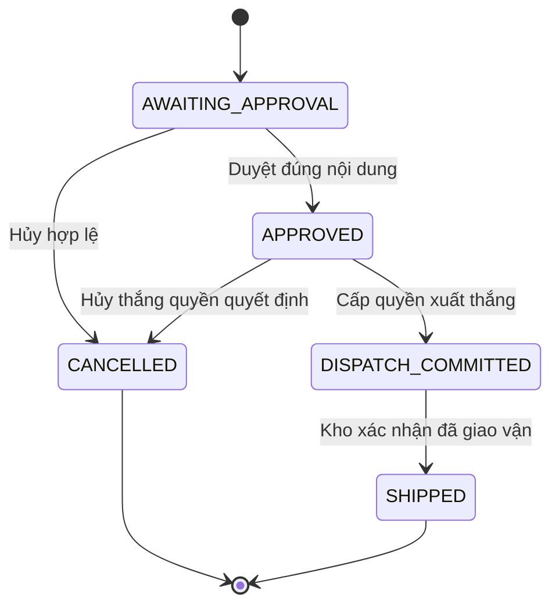

# Eventual consistency risk: khi dữ liệu cũ cấp quyền thực hiện nghiệp vụ

## 1. Eventual consistency ảnh hưởng đến bảo mật nghiệp vụ thế nào?

Trong chương **Distributed Consistency**, eventual consistency mô tả một dạng bảo đảm mà các bản sao có thể khác nhau tạm thời, rồi hội tụ theo giao thức khi các điều kiện đồng bộ được đáp ứng. Điều đó không tự bảo đảm rằng mọi lần đọc đều là mới nhất, mọi sự kiện đến đúng thứ tự, hoặc dữ liệu sẽ đồng bộ trong một khoảng thời gian cố định.

Rủi ro bảo mật xuất hiện khi một bản sao cũ được dùng để cho phép hành động không còn hợp lệ: xuất hàng sau khi đơn đã hủy, đọc tài liệu sau khi quyền đã bị thu hồi, sử dụng voucher quá số lần cho phép hoặc áp dụng giá đã hết hiệu lực.

Trong phạm vi module `SECURITY_APPLICATION_SECURITY_BUSINESS_LOGIC_SECURITY`, câu hỏi trọng tâm là:

> Một quyết định đang dựa trên dữ liệu có độ trễ có thể phá vỡ bất biến nghiệp vụ nào, và dịch vụ nào có quyền chốt quyết định đó?

Một trang thống kê hiển thị chậm vài giây có thể chấp nhận được. Một API dùng chính bản sao đó để cấp quyền thanh toán hoặc giao hàng cần một hợp đồng khác. Độ trễ hiển thị và quyền thực hiện tác động là hai yêu cầu phải được xác định riêng.

## 2. Hội tụ dữ liệu chưa đủ bảo vệ bất biến

### 2.1. Safety và liveness

Hai tính chất cần phân biệt:

| Tính chất | Câu hỏi | Ví dụ |
| --- | --- | --- |
| An toàn, hay safety | Có xảy ra một hành động bị cấm không? | Có xuất hàng cho đơn mà thao tác hủy đã thắng quyền quyết định không? |
| Tiến triển, hay liveness | Một thao tác hợp lệ có đi đến kết quả không? | Đơn đã được chấp nhận có thoát khỏi trạng thái chờ khi hệ thống phục hồi không? |

Một hệ thống có thể hội tụ về trạng thái `CANCELLED` ở mọi màn hình nhưng đã gửi kiện hàng trước đó. Dữ liệu cuối cùng giống nhau không đảo ngược được tác động ngoài đời. Tương tự, hai vùng cùng cấp một quyền lợi “mỗi người một lần” rồi hợp nhất thành cờ `used = true` vẫn không xóa được hai quyền lợi đã cấp.

Ngược lại, từ chối mọi hành động khi thiếu thông tin có thể giữ an toàn nhưng khiến thao tác không tiến triển. Thiết kế phải nêu rõ trường hợp nào được chờ, trường hợp nào bị từ chối và cách phục hồi sau lỗi.

### 2.2. Không mặc định có một giới hạn độ trễ

Độ trễ thường quan sát được là 100 ms không có nghĩa mọi bản sao đều mới trong 100 ms. Message có thể bị retry, nằm trong hàng lỗi, bị xử lý sai thứ tự hoặc dừng ở một consumer không khỏe. Khi mạng bị phân đoạn, độ trễ có thể kéo dài hơn nhiều.

Nếu nghiệp vụ yêu cầu một giới hạn cứng, hệ thống phải có cơ chế chứng minh điều kiện đó và cách xử lý khi không chứng minh được. Một biểu đồ độ trễ trung bình không phải bằng chứng dữ liệu của một đối tượng cụ thể đã đủ mới cho thao tác hiện tại.

## 3. Kịch bản: đơn đã hủy nhưng phía kho vẫn thấy được duyệt

Giả sử dịch vụ đơn hàng sở hữu trạng thái đơn. Dịch vụ kho giữ một projection để tìm các đơn cần xử lý:

| Mốc | Nguồn trạng thái đơn có thẩm quyền | Projection tại kho |
| --- | --- | --- |
| T0 | `APPROVED`, phiên bản 17 | `APPROVED`, phiên bản 17 |
| T1 | Yêu cầu hủy hợp lệ commit: `CANCELLED`, phiên bản 18 | Chưa nhận sự kiện, vẫn ở phiên bản 17 |
| T2 | Vẫn `CANCELLED` | Worker đọc `APPROVED` và gọi bên vận chuyển |
| T3 | `CANCELLED` | Nhận phiên bản 18, đổi thành `CANCELLED` |

Ở T3, hai nơi đã hội tụ nhưng quy tắc “đơn hủy thành công không được cấp quyền xuất hàng mới” đã bị phá vỡ.

Một đoạn xử lý dễ mắc lỗi:

```text
order = fulfillment_projection.find(order_id)
if order.status == APPROVED:
    carrier.create_shipment(order)
```

Thêm chữ ký vào sự kiện `OrderApproved` không giải quyết độ mới. Sự kiện đó có thể thật và từng đúng, nhưng quyền suy ra từ nó đã không còn phù hợp tại T2.

Ngay cả việc gọi API đọc trạng thái mới nhất rồi mới gọi bên vận chuyển vẫn có cửa sổ TOCTOU: hủy có thể commit giữa lần đọc và hành động. Cần một bước **giành quyền xuất hàng** cạnh tranh nguyên tử với hủy, thay vì một lần đọc đơn thuần.

## 4. Xác định chủ sở hữu của từng bất biến

Không nên giải quyết mọi vấn đề bằng một yêu cầu chung chung là “đọc dữ liệu mới hơn”. Trước hết cần gắn từng quy tắc với điểm có thẩm quyền:

| Bất biến | Nơi chốt quyết định | Vai trò phù hợp của dữ liệu bất đồng bộ |
| --- | --- | --- |
| Hủy và cấp quyền xuất là hai kết quả loại trừ nhau | Chủ sở hữu trạng thái điều khiển đơn | Kho tìm ứng viên cần xử lý, giao diện hiển thị tiến độ |
| Không giữ vượt tồn của một kho/SKU | Chủ sở hữu tồn kho hoặc lượng quyền tồn đã phân bổ | Trang sản phẩm và báo cáo tồn gần đúng |
| Một khách chỉ nhận một quyền lợi trong một kỳ | Chủ sở hữu hạn mức/quyền lợi | Danh sách khuyến mại và thống kê |
| Tác động phải dùng đúng nội dung đã duyệt | Chủ sở hữu nội dung và quyết định duyệt | Bản sao phục vụ tìm kiếm hoặc xem lịch sử |
| Quyền đã thu hồi không còn được sử dụng theo hợp đồng | Điểm phân quyền có thẩm quyền hoặc giao thức cấp quyền được định nghĩa rõ | Cache quyền theo giới hạn và chính sách đã công bố |

Chủ sở hữu ở đây là một điểm điều phối logic, không nhất thiết là một process duy nhất. Nhiều instance vẫn cần cùng ràng buộc dữ liệu hoặc giao thức điều phối để bảo vệ quyết định cạnh tranh.

Các bất biến cứng nên được chốt nơi có khả năng thực thi chúng nguyên tử, hoặc bằng một giao thức chứng minh quyền đã được phân bổ. Nếu một quy tắc chỉ được kiểm tra trên các bản sao độc lập, cần chứng minh vì sao hai quyết định cùng lúc vẫn không vi phạm quy tắc đó.

## 5. Cấp quyền xuất hàng tại nguồn có thẩm quyền

### 5.1. Định nghĩa điểm thắng giữa hủy và xuất

Một state machine minh họa:



Trong mô hình này, `DISPATCH_COMMITTED` nghĩa là quyền xuất đã được cấp bền vững; chưa khẳng định kiện hàng đã rời kho. Sau mốc đó, hủy nếu được hỗ trợ phải đi qua quy trình chặn giao hoặc hoàn trả riêng, không tự chuyển về `CANCELLED` như thể quyền xuất chưa từng được cấp.

“Hủy thành công” được định nghĩa bằng giao dịch chuyển trạng thái tại nguồn, không phải lúc người dùng bấm nút hoặc lúc request bắt đầu đi qua mạng. Điều này giúp xác định rõ kết quả khi hai yêu cầu cạnh tranh.

### 5.2. Gắn kiểm tra với phép chuyển trạng thái

Một câu SQL minh họa tại dịch vụ sở hữu trạng thái:

```sql
UPDATE order_control
SET status = 'DISPATCH_COMMITTED',
    version = version + 1
WHERE tenant_id = :tenant_id
  AND order_id = :order_id
  AND status = 'APPROVED'
  AND version = :expected_version
  AND approved_content_version IS NOT NULL
  AND approved_content_version = content_version;
```

Các cột được hiểu như sau: `version` là phiên bản trạng thái điều khiển đơn; `content_version` là phiên bản nội dung cần duyệt; `approved_content_version` ghi nhận nội dung đã được duyệt. Nội dung bao gồm các trường có ý nghĩa như mặt hàng, số lượng, giá và địa chỉ theo chính sách sản phẩm. Sửa nội dung không được phép tiếp tục dùng quyết định duyệt của phiên bản cũ.

Nguồn phải kiểm tra quyền của caller trên tenant và đơn trước khi cấp quyền xuất. Những điều kiện quyền có thể thay đổi phải được bảo vệ tại điểm quyết định theo mô hình phân quyền tương ứng; chỉ kiểm tra một lần ở gateway không tự giữ ổn định mọi nguồn quyền.

Phép chuyển hủy cạnh tranh trên cùng trạng thái nguồn. Theo mô hình khóa và transaction của DB, chỉ một nhánh hợp lệ được commit. Khi cập nhật 0 dòng hoặc engine báo xung đột, caller phải đọc lại kết quả hoặc retry theo chính sách; không tiếp tục xuất dựa trên projection cũ.

### 5.3. Permit, receipt và outbox cùng commit

Luồng cấp quyền tại nguồn:

```text
xác thực caller và chuẩn hóa yêu cầu

BEGIN TRANSACTION
  khóa và đọc order_control
  kiểm tra quyền theo đối tượng

  nếu có receipt cho cùng request key:
      kiểm tra cùng fingerprint
      trả permit đã lưu theo quyền hiện tại

  thử chuyển APPROVED -> DISPATCH_COMMITTED với điều kiện phiên bản/nội dung
  yêu cầu đúng một dòng thành công
  tạo dispatch_permit và lưu receipt ổn định
  ghi outbox để chuyển permit sang kho
COMMIT

trả permit đã commit
```

Permit cần định danh ổn định và ràng buộc nghiệp vụ để một đơn không được cấp nhiều quyền xuất độc lập. Ví dụ ràng buộc duy nhất `(tenant_id, order_id)` phù hợp khi mỗi đơn chỉ có một lần xuất logic. Nếu cho phép giao nhiều đợt, cần một kế hoạch đợt giao và khóa riêng được nguồn quản lý; không dùng mỗi event ID mới làm một đợt giao mới.

Receipt, permit, trạng thái đơn và outbox phải cùng giao dịch cục bộ. Nếu mất phản hồi sau commit, retry cùng key khôi phục permit cũ. Nếu DB chưa cấp quyền hoặc kết quả chưa rõ, phía kho chờ hoặc phân giải, không coi lỗi mạng là một quyền xuất ngầm định.

Kho tiếp nhận permit qua kênh được xác thực, kiểm tra tenant, đích nhận và phạm vi hành động, rồi tạo công việc xuất với inbox và khóa nghiệp vụ cục bộ. Relay có thể gửi trùng; nhận được hai message không có nghĩa được tạo hai kiện hàng. Lời gọi bên vận chuyển cũng cần danh tính thao tác ổn định và cách tra cứu nếu kết quả chưa rõ.

## 6. Chọn chính sách độ mới theo tác động

Không phải mọi endpoint cần cùng một mức nhất quán, nhưng mỗi endpoint cần một hợp đồng rõ ràng:

| Tác vụ | Cách dùng dữ liệu có độ trễ | Khi thiếu bằng chứng đủ mới |
| --- | --- | --- |
| Hiển thị số đơn theo ngày | Cho phép bản sao và ghi rõ độ cập nhật khi cần | Có thể hiển thị dữ liệu cũ theo hợp đồng |
| Liệt kê sản phẩm có thể còn hàng | Dùng để tìm kiếm, chưa hứa giữ hàng | Kiểm tra và chiếm tồn tại chủ sở hữu khi đặt |
| Đọc tài liệu cần quyền đang có hiệu lực | Theo chính sách phân quyền và thu hồi đã định nghĩa | Từ chối hoặc chờ nếu không chứng minh được quyền theo yêu cầu |
| Cấp quyền xuất hàng | Giành permit tại nguồn, không chỉ đọc trạng thái | Giữ chờ hoặc phân giải; không tự xuất |
| Chốt giá hoặc duyệt nội dung | Kiểm tra đúng phiên bản tại điểm chốt | Yêu cầu xác nhận lại hoặc trả xung đột phiên bản |
| Gửi tác động ra ngoài | Dựa trên ý định nghiệp vụ đã commit và quyền đã cấp | Không suy quyền từ message cũ hoặc lỗi mạng |

Với các quyết định nhạy cảm, thiếu thông tin không được tự biến thành cho phép. Chờ xử lý là một lựa chọn nghiệp vụ hợp lệ khi hệ thống chưa có đủ bằng chứng. Cần phân biệt trạng thái “đang xác minh” với “đã chấp nhận” để client không hành động tiếp dựa trên một kết quả chưa tồn tại.

Token hoặc permit có chữ ký chứng minh nội dung do nguồn tương ứng cấp theo giao thức. Nó không tự chứng minh quyền chưa bị thu hồi, chưa hết hạn hay chưa bị sử dụng. Cần kiểm tra đúng chủ thể, tenant, đối tượng, loại tác động, đích nhận, thời hạn nếu có và quy tắc sử dụng lại.

Đối với permit xuất ở phần trước, quyền đã được giao tại trạng thái `DISPATCH_COMMITTED`; chính sách hủy sau mốc đó phải phối hợp với quyền đang tồn tại. Không vừa hứa permit có thể thực hiện độc lập khi nguồn mất kết nối, vừa hứa mọi thay đổi thu hồi ở nguồn có hiệu lực tức thì tại mọi nơi mà không có giao thức bổ sung.

## 7. Giữ projection khỏi đi lùi hoặc mất cập nhật

### 7.1. Outbox và inbox bảo vệ quá trình truyền, không thay thế quy tắc

Nguồn có thể ghi thay đổi trạng thái và outbox trong cùng transaction, rồi relay phát sự kiện. Consumer ghi inbox cùng transaction với cập nhật projection, ack sau khi có kết quả bền vững. Các bước này giúp phục hồi khi process chết hoặc broker giao lại.

Tuy nhiên:

- Outbox không bảo đảm consumer đã cập nhật ngay khi nguồn commit.
- Inbox chặn cùng danh tính sự kiện bị xử lý lặp, không tự chặn một sự kiện cũ có ID khác.
- Giao nhận thành công không chứng minh trạng thái trong message vẫn cấp quyền thực hiện tác động.
- Message bị kẹt trong hàng lỗi có thể làm projection ngừng tiến triển dù các message khác vẫn chạy.

Vì vậy projection cần quản lý phiên bản và nguồn dữ liệu, ngoài cơ chế giao nhận.

### 7.2. Sự kiện snapshot đầy đủ

Giả sử sự kiện chứa toàn bộ trạng thái cần thay thế của một đơn và có phiên bản tăng theo nguồn cho chính đơn đó:

```json
{
  "eventId": "evt-order-18",
  "tenantId": "tenant-a",
  "orderId": "ORD-2048",
  "aggregateVersion": 18,
  "status": "CANCELLED",
  "contentVersion": 4,
  "deleted": false
}
```

Một phép cập nhật projection có điều kiện:

```sql
UPDATE order_projection
SET status = :status,
    content_version = :content_version,
    deleted = :deleted,
    source_version = :incoming_version
WHERE tenant_id = :tenant_id
  AND order_id = :order_id
  AND source_version < :incoming_version;
```

Nếu phiên bản 18 đã được áp dụng, snapshot phiên bản 17 đến sau không được ghi đè nó. Nếu chưa có dòng, cần đường insert với khóa duy nhất `(tenant_id, order_id)` và cách xử lý cạnh tranh phù hợp với DB; cập nhật 0 dòng không luôn có nghĩa đã nhận một bản cũ.

Điều kiện này chỉ bảo vệ projection theo giả định: cùng nguồn hợp lệ, phiên bản có ý nghĩa cho cùng aggregate, và snapshot thực sự chứa đủ dữ liệu cần thay thế. Nó không làm phiên bản 18 chắc chắn là trạng thái mới nhất hiện tại ở nguồn; nguồn có thể đã lên 19.

Quyền phát snapshot cũng phải bị giới hạn. Nếu một nguồn không có thẩm quyền được tự gửi phiên bản cực lớn hoặc đổi tenant, nó có thể làm projection bị đầu độc. Version là bằng chứng thứ tự trong giao thức tin cậy, không phải một quyền có thể nhận tùy ý từ body.

### 7.3. Sự kiện delta cần xử lý khoảng trống

Không áp dụng máy móc quy tắc “nhận version lớn hơn thì bỏ version nhỏ hơn” cho mọi loại sự kiện.

```text
Phiên bản 11: cộng 100 đơn vị vào một bộ đếm
Phiên bản 12: trừ 10 đơn vị
```

Nếu 12 đến trước rồi 11 bị bỏ vì cũ, bộ đếm có thể thiếu phép cộng 100. Đối với delta phụ thuộc chuỗi, cần phát hiện version kỳ vọng tiếp theo, lưu chờ hoặc phục hồi phần thiếu, hoặc tái dựng từ snapshot có thẩm quyền. Những phép toán có giao thức hợp nhất riêng phải chứng minh tính đúng của giao thức đó và cơ chế nhận diện thao tác trùng.

Không ghi receipt “đã hoàn tất” cho một delta chưa áp dụng chỉ vì nó đến sớm. Việc chờ, retry hay đưa vào vùng lưu tạm cần có trạng thái bền vững phù hợp, để message không biến mất khỏi quy trình phục hồi.

### 7.4. Tombstone và dữ liệu bị xóa

Nếu xóa hẳn dòng projection mà không giữ dấu phiên bản xóa, một sự kiện tạo/cập nhật cũ đến muộn có thể làm đối tượng xuất hiện lại. Một tombstone lưu danh tính và phiên bản xóa giúp nhận diện trường hợp đó theo giao thức lưu dữ liệu đã chọn.

Tombstone cũng có thời gian lưu và quy tắc khôi phục. Xóa dấu lịch sử trong khi vẫn cho phép replay sự kiện cũ có thể mở lại khả năng phục sinh dữ liệu hoặc quyền đã bị loại bỏ. Việc này cần được thiết kế cùng retention và backfill, không chỉ như một job dọn bảng.

## 8. Quyền, giá và phê duyệt có nhiều nguồn phụ thuộc

### 8.1. Một phiên bản không đại diện cho mọi nguồn

Một quyết định có thể phụ thuộc đồng thời vào:

```text
order: ORD-2048, phiên bản 18
approval: APR-71, nội dung đã duyệt phiên bản 4
price: PRICE-25, phiên bản 6
policy: tenant-a, phiên bản 12
inventory: reservation RSV-91 còn quyền sử dụng
```

Không so sánh trực tiếp “policy 12 lớn hơn price 6” để kết luận một bản mới hơn bản kia. Các phiên bản thuộc các miền khác nhau. Điều cần kiểm chứng là đúng quan hệ phụ thuộc: quyết định duyệt áp dụng cho nội dung nào, giá được chấp nhận tại phiên bản nào, quyền giữ tồn thuộc reservation nào và chính sách nào cấp quyền thực hiện.

Đọc tuần tự nhiều API “mới nhất” cũng không tự tạo một snapshot nguyên tử chung. Một nguồn có thể thay đổi sau khi đã được đọc. Với bất biến cứng trải trên nhiều nguồn, cần giao thức cấp quyền/reservation, một điểm chốt quyết định phù hợp hoặc một cách tổ chức lại dữ liệu để bảo vệ điều kiện.

### 8.2. Thu hồi quyền và partition

Giả sử người dùng bị thu hồi quyền ở dịch vụ phân quyền, nhưng một API đang giữ cache cũ vẫn cho thao tác. Dữ liệu cuối cùng có thể đồng bộ sau đó, song thông tin đã bị lộ hoặc thay đổi đã được thực hiện.

Nếu hợp đồng yêu cầu mọi thao tác mới sau điểm thu hồi đều bị chặn, điểm cấp quyền và điểm thu hồi phải được điều phối theo hợp đồng đó. Khi không liên lạc được nơi xác minh, không thể tự biết một quyền còn hiệu lực hay đã bị thu hồi ở phía bị cô lập.

Một hệ thống có thể chọn quyền được cấp theo thời hạn hoặc một lease với quy tắc rõ ràng. Khi đó phải chấp nhận và mô tả đúng khoảng quyền còn hiệu lực theo thiết kế, cùng điều kiện đồng hồ và thu hồi. Đặt TTL cho cache không tự biến nó thành một giao thức thu hồi tức thì.

### 8.3. Phê duyệt gắn với nội dung

Ví dụ một đơn được duyệt khi tổng tiền là 1 triệu, sau đó bị sửa thành 10 triệu trong khi projection vẫn hiển thị `approved = true`. Một cờ boolean không chứng minh nội dung mới đã được duyệt.

Nguồn phải lưu mối liên hệ giữa phê duyệt và phiên bản hoặc fingerprint nội dung được duyệt, rồi kiểm chứng tại điểm chốt. Nếu nội dung thay đổi, chuyển về trạng thái cần duyệt lại theo chính sách. Sự kiện `Approved` cũ không được tái cấp quyền cho một nội dung mới chỉ vì có cùng order ID.

Tương tự, giá hoặc hạn mức ở cache có thể hỗ trợ hiển thị, nhưng số tiền và quyền hưởng ưu đãi khi chốt phải được xác lập bởi nguồn có thẩm quyền hoặc một báo giá/quyền lợi đã được cấp với phạm vi rõ ràng.

## 9. Các kỹ thuật giảm độ trễ và giới hạn của chúng

| Kỹ thuật | Giúp được gì? | Không tự bảo đảm điều gì? |
| --- | --- | --- |
| Đọc từ nguồn có thẩm quyền | Tránh phụ thuộc một replica chậm cho lần đọc đó | Điều kiện không thay đổi giữa đọc và ghi |
| Read-your-writes | Phiên người dùng quan sát được kết quả viết của mình theo giao thức | Đã thấy các cập nhật của chủ thể khác hoặc mọi thay đổi quyền |
| Chờ tối thiểu một version | Projection đã áp dụng tới mốc được yêu cầu cho đối tượng/phạm vi đó | Mốc đó vẫn là trạng thái mới nhất khi ra quyết định |
| Sticky session | Có thể giảm việc đọc qua các bản sao khác nhau | Nhất quán khi failover hoặc khi dữ liệu được người khác cập nhật |
| TTL và invalidation cache | Giảm khoảng thời gian thường gặp của dữ liệu cũ | Giới hạn cứng cho mọi lỗi, thứ tự message hoặc race ghi lại cache |
| Dùng transaction và cập nhật có điều kiện tại nguồn | Gắn kiểm tra với tác động thuộc phạm vi nguồn đó | Nguyên tử xuyên nhiều DB hoặc tác động ngoài hệ thống |

Khi dùng mốc phiên bản, cần ghi rõ mốc thuộc aggregate, partition hoặc nguồn nào. Một watermark đã xử lý của partition không đại diện cho mọi partition; một con số “lag toàn hệ thống bằng 0” không tự chứng minh mọi phụ thuộc của một đơn đã hiện diện đúng.

`last_synced_at` mới cũng chưa đủ nếu một message cụ thể bị kẹt hoặc bị bỏ. Ngược lại, một đối tượng lâu không cập nhật có timestamp cũ nhưng vẫn có thể đang chính xác. Cần theo dõi cả đường đi và phiên bản có ý nghĩa, không chỉ tuổi của một dòng dữ liệu.

Timestamp từ nhiều máy có thể lệch nhau và không tự tạo thứ tự nhân quả. Chọn bản ghi “mới nhất” bằng đồng hồ không phải cách thay thế cho state machine, phiên bản nguồn hoặc giao thức hợp nhất đã được chứng minh.

## 10. Hạn mức nhiều vùng: điều phối hoặc phân bổ quyền trước

### 10.1. Hai bản sao cùng thấy còn hạn mức

Giả sử một chương trình còn đúng một voucher. Vùng A và B đều đang thấy `remaining = 1`. Nếu mỗi vùng cấp một voucher độc lập rồi mới gửi cập nhật sang nhau, tổng đã cấp là 2. Hợp nhất bộ đếm sau đó không thể làm hai mã voucher chưa từng được cấp.

Một lựa chọn là định tuyến mọi quyết định cho cùng hạn mức về một chủ sở hữu có khả năng cập nhật nguyên tử. Chủ sở hữu có thể được chia theo tenant, chương trình hoặc khóa nghiệp vụ, nhưng cách định tuyến phải do hệ thống kiểm soát. Client không được tự chọn vùng hoặc shard khác để nhận lại cùng quyền lợi.

Khi nguồn quyết định không khả dụng, thao tác có thể phải chờ. Không tự cho cả hai vùng trở thành chủ sở hữu độc lập của cùng một quyền chưa được phân bổ.

### 10.2. Phân bổ trước lượng quyền không chồng lấn

Với một số tài nguyên đếm được, có thể phân chia quyền tiêu thụ trước:

```text
Tổng quyền Q = 100
Cấp cho vùng A: qA = 60
Cấp cho vùng B: qB = 40

Mỗi vùng bảo vệ nguyên tử:
  0 <= cA <= qA
  0 <= cB <= qB

Suy ra:
  cA + cB <= qA + qB = 100
```

Cách này chỉ đúng nếu quyền được phân bổ thực sự không bị đếm hai lần, mỗi vùng chặn tiêu vượt phần mình và mọi đường cấp đều tuân thủ giao thức. Việc chuyển quyền giữa hai vùng cũng cần trạng thái và bằng chứng bền vững; không để cùng một lượng vừa còn được dùng ở nơi gửi vừa đã được dùng ở nơi nhận.

Phân chia tổng lượng bảo vệ giới hạn tổng, chưa tự bảo vệ quy tắc “mỗi người chỉ một lần”. Một người vẫn có thể nhận ở hai vùng nếu danh tính tác động theo người dùng không được điều phối. Mỗi bất biến cần một lập luận riêng.

### 10.3. Đổi chủ sở hữu và worker cũ

Khi chuyển chủ hoặc phục hồi sau partition, worker cũ có thể vẫn đang chạy. Một lease hết hạn ở dịch vụ khóa không tự khiến process cũ ngừng tác động.

Nếu dùng fencing token, nơi thực sự nhận lệnh phải kiểm tra và từ chối token cũ theo giao thức. Chỉ đính kèm một số tăng dần trong log mà DB hoặc dịch vụ đích không cưỡng chế thì không chặn được stale worker. Với dịch vụ ngoài không hỗ trợ cơ chế đó, cần một thiết kế cấp quyền và idempotency phù hợp ở ranh giới có thể kiểm soát.

Phân bổ quyền, điều phối chủ sở hữu và quyết định chờ đều là những lựa chọn có điều kiện. Không có một cache hoặc khóa cục bộ đơn lẻ tự giải quyết mọi bất biến xuyên vùng.

## 11. Phục hồi và bù trừ không được hợp thức hóa tác động sai

### 11.1. Trạng thái chờ phải có đường thoát

Các trạng thái như `PENDING_VALIDATION`, `WAITING_FOR_VERSION` hoặc `RESOLVING` cần có điều kiện vào/ra, giới hạn retry, nơi lưu tiến độ và khả năng theo dõi. Không đánh dấu thành công chỉ để giải phóng hàng đợi khi nguồn chưa cấp quyền.

Khi phụ thuộc phục hồi, worker phải đọc lại trạng thái và dùng cùng danh tính thao tác. Điều kiện lúc retry có thể đã thay đổi: đơn đã hủy, quyền đã thu hồi hoặc báo giá đã hết hạn. Không tiếp tục dùng một quyết định cũ chỉ vì lần thử đầu từng đi đến bước đó.

Nếu thiếu một version, hệ thống có thể yêu cầu phát lại phần thiếu hoặc lấy snapshot có thẩm quyền theo giao thức. Nếu message sai schema nằm trong hàng lỗi, cần xử lý nó hoặc có đường phục hồi tương đương; một cam kết “eventually consistent” không làm message lỗi tự biến thành đúng.

### 11.2. Saga không phải rollback tức thì

Saga tổ chức nhiều giao dịch cục bộ và các bước bù cho một quy trình phân tán. Nó giúp quản lý kết quả dở dang nhưng không tự bảo đảm mọi trạng thái trung gian đều được phép thực hiện mọi tác động.

Nếu tiền đã thu nhưng quyền xuất chưa được cấp, hệ thống có thể cần chờ, hủy ủy quyền hoặc hoàn theo chính sách. Nếu kiện hàng đã rời kho, bước bù không giống việc rollback một dòng DB. Nếu thông tin đã bị lộ sau thu hồi quyền, một message bù không thể khiến người nhận chưa từng thấy thông tin.

Vì vậy cần chặn tác động không được phép trước điểm khó đảo ngược. Các bước bù phải tham chiếu tác động gốc, có quyền và idempotency riêng; không tạo một khoản hoàn chỉ vì một read model tạm thời hiển thị trạng thái chưa cập nhật.

### 11.3. Đối soát và backfill

Đối soát nên so nguồn điều khiển, permit đã cấp và công việc phía kho theo các danh tính nghiệp vụ liên quan. Cần phân biệt độ trễ bình thường với trạng thái không thể hợp lệ, chẳng hạn một công việc xuất không có permit nguồn.

Do mỗi dịch vụ có thể được đọc ở thời điểm khác nhau, một lần chụp rời rạc có thể tạo cảnh báo lệch tạm thời. Dùng các mốc phiên bản, receipt, thời điểm xử lý và bước xác minh tiếp theo để kết luận. Không vì thấy hai giá trị khác nhau mà tự sao chép một phía đè lên phía còn lại.

Backfill projection nên ghi vào đích và chế độ phù hợp với mục đích tái dựng. Phát lại lịch sử không được vô tình cấp permit, tạo giao hàng hoặc gửi hoàn tiền thật. Quyền thực hiện các tác động đó vẫn phải do luồng nghiệp vụ hiện tại quyết định.

## 12. Kiểm thử rủi ro bằng lịch giao nhận có kiểm soát

### 12.1. Ma trận tình huống

| Tình huống | Cách tạo điều kiện | Bất biến cần kiểm tra |
| --- | --- | --- |
| Projection kho chậm | Giữ lại `OrderCancelled`, để kho còn thấy `APPROVED` | Không tạo công việc xuất mới nếu nguồn đã hủy trước khi cấp permit |
| Hủy đua với cấp permit | Hai transaction cạnh tranh tại nguồn | Chỉ một kết quả thắng theo state machine |
| Snapshot đến ngược thứ tự | Giao version 18 trước 17 | Projection không đi lùi về 17 |
| Delta bị thiếu | Giao delta 12 khi 11 chưa có | Phát hiện khoảng trống; không bỏ mất tác động 11 |
| Message giao trùng | Relay hoặc broker gửi lại permit | Một công việc xuất logic theo khóa nghiệp vụ |
| Mất phản hồi cấp permit | Nguồn commit rồi ngắt response | Retry cùng key khôi phục permit cũ |
| Quyền bị thu hồi | Giữ cache quyền cũ, thao tác tiếp sau điểm thu hồi | Kết quả tuân thủ đúng hợp đồng thu hồi đã chọn |
| Sửa nội dung sau duyệt | Thay số lượng, giá hoặc địa chỉ thuộc phạm vi duyệt | Quyết định duyệt cũ không cấp quyền cho nội dung mới |
| Nguồn không khả dụng | Cắt kết nối tới điểm chốt quyết định | Chờ hoặc từ chối theo chính sách, không tự cho phép |
| Sai nguồn hoặc tenant | Gửi snapshot/permit từ principal không được phép | Không đầu độc projection và không thực hiện tác động |
| Xóa rồi replay sự kiện cũ | Xóa tại version mới, giao update version cũ | Không phục sinh đối tượng trái quy tắc tombstone |
| Hai vùng tranh cùng hạn mức | Mỗi vùng đang thấy cùng một lượng còn lại | Tổng tiêu không vượt quyền đã được điều phối/phân bổ |
| Đổi chủ sở hữu | Cho worker cũ gửi lệnh sau khi quyền đã chuyển | Nơi nhận cưỡng chế giao thức chặn lệnh cũ |
| Hàng lỗi không tiến triển | Giữ một message phụ thuộc trong DLQ | Phát hiện chờ kéo dài và không coi đối tượng đã đủ mới |
| Replay để dựng báo cáo | Chạy lại lịch sử vào projection thử nghiệm | Không tạo tác động thật ở kho, thanh toán hoặc quyền lợi |

### 12.2. Tái hiện kịch bản hủy trước, kho đọc cũ sau

Một fixture xác định được thứ tự:

```text
1. Nguồn và projection cùng có APPROVED, version 17.
2. Dừng giao sự kiện từ nguồn sang projection.
3. Thực hiện hủy tại nguồn và chờ commit CANCELLED, version 18.
4. Xác minh projection vẫn đang là APPROVED, version 17.
5. Chạy worker kho theo luồng sản xuất.
6. Worker phải yêu cầu permit tại nguồn và bị từ chối theo trạng thái.
7. Kiểm tra không có permit mới và không có công việc xuất của lần thử.
8. Mở giao sự kiện và kiểm tra projection hội tụ về CANCELLED.
```

Nếu bài chỉ đợi projection cập nhật xong rồi mới chạy worker, nó đã bỏ qua chính cửa sổ rủi ro cần kiểm tra. Không chỉ assertion trạng thái cuối; cần assertion cả số ý định xuất và tác động đã được tạo trong khoảng chậm.

### 12.3. Tái hiện cuộc đua hủy và cấp quyền

Dùng hai connection và hai worker riêng, đưa chúng đến barrier trước phép chuyển trạng thái tại nguồn. Sau khi cả hai kết thúc hoặc retry theo chính sách:

```text
Nếu hủy được xác nhận thắng:
  trạng thái nguồn = CANCELLED
  không có dispatch permit của lần cấp quyền cạnh tranh
  không có công việc xuất được tạo từ lần đó

Nếu cấp quyền xuất được xác nhận thắng:
  có đúng một permit nghiệp vụ đã commit
  hủy không được báo thành công theo nhánh trước xuất
  giao lại permit không tạo công việc xuất logic thứ hai
```

Không yêu cầu cùng một bên luôn thắng mọi lịch chạy. Điều phải luôn đúng là hệ thống không đồng thời báo hủy thành công theo nhánh này và cấp quyền xuất mới cho cùng phạm vi.

### 12.4. Kiểm tra cả an toàn lẫn tiến triển

Sau khi khôi phục đường truyền, cần kiểm tra thao tác hợp lệ không bị chờ mãi và projection đạt mốc mong đợi. Dùng polling có deadline theo hợp đồng của bài kiểm thử, thay vì một lần `sleep` rồi giả định mọi môi trường đều đã đồng bộ.

Deadline kiểm thử giúp phát hiện không tiến triển; nó không tự tạo ra một bảo đảm độ trễ cho sản phẩm. Bài kiểm thử cần cả trường hợp chậm hơn thông thường, message lặp, đổi thứ tự và mất phản hồi ở điểm commit.

Với bên vận chuyển hoặc dịch vụ ngoài, kiểm tra tác động theo hợp đồng idempotency thực tế của ranh giới đó. Một inbox trong kho chưa đủ chứng minh bên ngoài không tạo trùng nếu adapter dùng ID mới mỗi lần retry.

## 13. Quan sát theo đối tượng và theo điểm quyết định

Nhật ký nên liên kết được tenant, order, request key ở dạng phù hợp, phiên bản nguồn được quan sát, phiên bản nội dung đã duyệt, permit ID, message ID, kết quả cấp quyền và mã tương quan. Không ghi secret ký, token đầy đủ hoặc dữ liệu nhạy cảm vượt nhu cầu điều tra.

Những chỉ số có ý nghĩa gồm:

- Khoảng cách phiên bản hoặc mốc xử lý theo nguồn/phạm vi, không chỉ lag trung bình.
- Số yêu cầu bị từ chối vì projection hoặc phiên bản nội dung đã cũ.
- Số thao tác đang chờ nguồn xác minh và thời gian chờ theo loại phụ thuộc.
- Số lần cấp permit, replay trả permit cũ và xung đột fingerprint.
- Số khoảng trống delta, sự kiện sai thứ tự, tombstone bị replay và message trong hàng lỗi.
- Số công việc không có bằng chứng quyền nguồn, cùng kết quả đối soát.
- Phần quyền đã phân bổ, đã tiêu và đang chuyển giữa các vùng nếu dùng mô hình phân bổ.

Một dashboard xanh theo độ trễ trung bình không thay thế được bằng chứng cho một hành động cụ thể. Khi điều tra một đơn, cần biết dịch vụ nào quyết định, dựa trên phiên bản nào, quyền nào đã được cấp và tác động nào đã commit.

Định nghĩa cảnh báo cho trạng thái chờ quá lâu và sai lệch bất biến riêng. Độ trễ cao cần phục hồi luồng đồng bộ; một giao hàng không có permit cần điều tra đường đi đã bỏ qua kiểm soát. Hai vấn đề đó không nên bị gộp thành cùng một lỗi “cache chậm”.

## 14. Checklist áp dụng

- [ ] Đã phân biệt dữ liệu hiển thị với dữ liệu có quyền cấp tác động nghiệp vụ.
- [ ] Mỗi bất biến có một chủ sở hữu hoặc một giao thức phân bổ/điều phối được xác định.
- [ ] Hủy, xuất, thanh toán và phê duyệt có điểm quyết định cùng quy tắc cạnh tranh rõ ràng.
- [ ] Kiểm tra quyền và phiên bản gắn với thao tác có hiệu lực, không chỉ với một lần đọc trước đó.
- [ ] Permit hoặc reservation có phạm vi, danh tính, thời hạn nếu cần và cách xử lý trùng.
- [ ] Projection chống đi lùi; snapshot và delta có chính sách xử lý khoảng trống khác nhau.
- [ ] Phiên bản và watermark được hiểu trong đúng phạm vi nguồn/aggregate/partition.
- [ ] Thu hồi quyền, thay đổi giá và sửa nội dung đã duyệt có hợp đồng độ mới cụ thể.
- [ ] Mất kết nối tới nguồn không tự biến thành cho phép tác động nhạy cảm.
- [ ] Outbox, inbox, retry và DLQ có đường phục hồi bền vững.
- [ ] Hạn mức nhiều vùng có chứng minh không cấp trùng quyền, kể cả khi đổi chủ sở hữu.
- [ ] Bù trừ không được dùng để bỏ qua kiểm soát trước tác động khó đảo ngược.
- [ ] Có kiểm thử giữ lại sự kiện, sai thứ tự, replay và cuộc đua tại nguồn.
- [ ] Có quan sát và đối soát theo đối tượng, bằng chứng quyền và phiên bản.

Eventual consistency có thể phù hợp với nhiều luồng đọc và trao đổi dữ liệu, nhưng quyền thực hiện tác động phải có cơ sở rõ ràng. Bảo vệ bất biến ngay tại điểm cấp quyền giúp hệ thống tiếp tục an toàn trong khoảng các bản sao chưa đồng bộ, thay vì chỉ hy vọng trạng thái cuối sẽ sửa được hậu quả.
