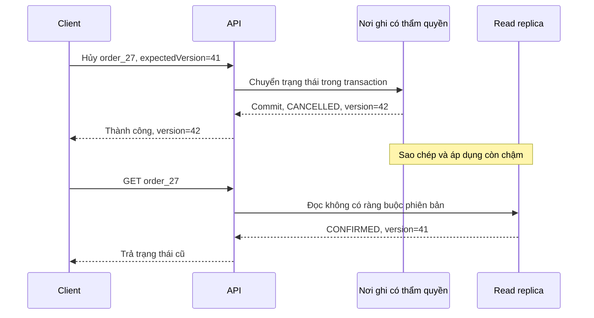

# Read after write behavior

## 1. Khi vừa ghi thành công nhưng lại đọc thấy trạng thái cũ

Trong chương **Distributed Consistency** của module bảo vệ logic nghiệp vụ, hành vi đọc sau khi ghi ảnh hưởng trực tiếp đến cách người dùng và dịch vụ quyết định bước tiếp theo.

Giả sử người dùng hủy một đơn hàng. API ghi xác nhận đơn đã chuyển sang `CANCELLED`, nhưng lần GET ngay sau đó được đưa đến một replica chưa nhận thay đổi và vẫn trả `CONFIRMED`. Người dùng có thể bấm hủy thêm lần nữa, nhân viên có thể tiếp tục xử lý đơn, hoặc một dịch vụ khác có thể quyết định giao hàng từ dữ liệu đã cũ.

Một màn hình sai trạng thái có thể chỉ gây khó hiểu. Nhưng nếu hệ thống dùng chính dữ liệu cũ đó để cho phép một tác động mới, vấn đề trở thành lỗ hổng logic nghiệp vụ.

**Read after write behavior** là cách hệ thống xử lý các lần đọc xảy ra sau một lần ghi, đặc biệt khi lần ghi đã được xác nhận thành công nhưng dữ liệu chưa đồng bộ tới mọi nơi đọc.

Bài học giúp bạn:

- Phân biệt read-your-writes với tính nhất quán mạnh hơn và với kiểm tra invariant.
- Xác định replica, cache, snapshot và read model nào có thể trả dữ liệu cũ.
- Thiết kế phản hồi ghi, routing đọc và version token để giữ hợp đồng đọc sau ghi.
- Bảo vệ thao tác nhạy cảm ngay cả khi giao diện hoặc projection còn chậm.
- Kiểm thử mất kết nối, failover, cache đảo thứ tự và đọc từ nhiều phiên.

## 2. Định nghĩa hợp đồng trước khi chọn giải pháp

“Read after write” có thể chỉ một thứ tự gọi API. Nó chưa tự mô tả hệ thống bảo đảm gì. Một hợp đồng cụ thể phải nói rõ người đọc nào, tài nguyên nào và điều kiện nào được áp dụng.

Một dạng phổ biến là **read-your-writes**:

> Sau khi một lần ghi được xác nhận theo hợp đồng, các lần đọc thuộc phạm vi được bảo đảm phải phản ánh lần ghi đó hoặc một trạng thái mới hơn tương thích với lịch sử có thẩm quyền.

Ví dụ:

```text
Ghi: order_27 chuyển thành CANCELLED, version=42.
Đọc có bảo đảm: không trả bản order_27 version=41 như trạng thái hiện hành.
```

Read-your-writes không yêu cầu lần đọc phải trả đúng nguyên snapshot version 42. Nếu một thao tác hợp lệ khác tạo version 43, kết quả mới hơn có thể là câu trả lời đúng.

Cũng không thể suy ra rằng mọi người dùng và mọi dịch vụ đều lập tức thấy lần ghi. Một bảo đảm theo phiên chỉ áp dụng khi ngữ cảnh phiên hoặc dấu vết phiên bản được truyền đúng.

| Khái niệm | Ý nghĩa chính | Điều không tự suy ra |
| --- | --- | --- |
| Eventual consistency | Các bản sao có thể hội tụ khi các thay đổi được truyền và xử lý | Một lần GET cụ thể đã thấy lần ghi vừa xong |
| Read-your-writes | Người đọc trong phạm vi bảo đảm thấy các lần ghi của mình | Mọi phiên khác thấy ngay cùng trạng thái |
| Monotonic reads | Chuỗi lần đọc trong phạm vi bảo đảm không lùi về lịch sử cũ hơn đã quan sát | Người đọc đã thấy tất cả các lần ghi mới nhất |
| Causal consistency | Các quan hệ nhân quả được bảo toàn theo mô hình hệ thống | Mọi thao tác có một thứ tự toàn cục theo thời gian thực |
| Linearizability | Thao tác có thể được xem như xảy ra tại một điểm giữa lúc gọi và lúc trả, tôn trọng thứ tự thời gian thực | Mọi invariant nghiệp vụ được viết đúng hoặc mọi dịch vụ cùng thuộc một transaction |

Các khái niệm trên áp dụng trong phạm vi hệ thống và dữ liệu được giao thức bảo vệ. Một cột `version` riêng lẻ không tự tạo ra tất cả những bảo đảm này.

## 3. Lần ghi được xác nhận ở mốc nào?

Trước khi yêu cầu “đọc thấy điều vừa ghi”, cần biết phản hồi ghi thực sự xác nhận điều gì.

| Mốc | Ví dụ | Có thể cam kết đọc thấy gì? |
| --- | --- | --- |
| Request mới vào bộ nhớ | API đã nhận body nhưng chưa lưu bền vững | Chưa thể coi thay đổi nghiệp vụ đã được lưu |
| Command đã được nhận bền vững | Công việc được ghi vào inbox hoặc hàng đợi theo hợp đồng | Trạng thái tiếp nhận của command, chưa chắc kết quả cuối |
| Transaction nghiệp vụ đã commit | Trạng thái đơn và kết quả lệnh được lưu cùng transaction | Thay đổi đã commit ở nguồn có thẩm quyền, trong giới hạn durability đã cam kết |
| Projection đã xử lý sự kiện | Read model cập nhật đến một mốc cụ thể | Dữ liệu projection tại hoặc sau mốc đó |
| Tác động bên ngoài đã xác nhận | Nhà cung cấp xác nhận thanh toán hoặc hoàn tiền | Kết quả bên ngoài đã biết theo giao thức đối soát |

Không nên trả “đã hoàn tiền” nếu mới chỉ ghi nhận một yêu cầu hoàn tiền để worker xử lý. Một phản hồi như `202 Accepted` có thể phù hợp với công việc bất đồng bộ, kèm command ID và nơi tra cứu trạng thái. Mã HTTP là một phần hợp đồng, không thay thế định nghĩa trạng thái nghiệp vụ.

Tương tự, “transaction đã commit” không tự bảo đảm mọi replica, search index hoặc cache đã cập nhật. Nếu hệ thống yêu cầu điều đó, phải có cơ chế cụ thể thay vì dựa vào thời gian chờ cảm tính.

Trong bài này, ví dụ chính giả định API ghi chỉ xác nhận thay đổi đơn hàng sau khi transaction ở nơi có thẩm quyền đã commit. Các tác động phụ như gửi email hay xử lý hoàn tiền có trạng thái riêng.

## 4. Những nơi có thể tạo ra lần đọc cũ

### 4.1. Replica chưa áp dụng thay đổi



Ứng dụng có thể xử lý nhiều request mỗi giây trong khoảng trễ sao chép. Caller có thể cố ý tận dụng khoảng trễ đó thay vì chỉ vô tình gặp phải.

### 4.2. Cache chưa được làm mới hoặc bị điền lại sai thứ tự

Xóa cache sau lần ghi không tự giải quyết mọi race:

```text
1. Request đọc A lấy version=41 từ nguồn đọc chậm.
2. Request ghi B commit version=42.
3. B xóa cache.
4. A hoàn tất muộn và điền version=41 trở lại cache.
```

Cache lại chứa dữ liệu cũ dù thao tác invalidation đã chạy. Sự kiện cập nhật cache cũng có thể đến đảo thứ tự: event version 42 được xử lý trước event version 41.

Có thể dùng cập nhật cache theo phiên bản, cơ chế fencing giữ mốc tối thiểu hoặc bỏ qua cache khi yêu cầu freshness cao. Chỉ so sánh phiên bản với entry đang tồn tại chưa đủ nếu việc xóa entry cũng xóa luôn mốc bảo vệ và một lần đọc cũ có thể điền vào chỗ trống.

### 4.3. Read model và search index chưa xử lý sự kiện

Trong CQRS hoặc hệ thống dùng outbox, command có thể đã commit nhưng projection vẫn ở phiên bản trước. Trang chi tiết đơn và danh sách tìm kiếm có thể đi qua hai mô hình đọc khác nhau nên nhìn thấy tiến độ khác nhau.

Read model chậm không tự có nghĩa transaction gốc thất bại. Không tạo lại đơn hay thanh toán mới chỉ vì tìm kiếm chưa thấy kết quả.

### 4.4. Snapshot và cache trong chính tiến trình ứng dụng

Ngay cả khi đọc đúng primary, một transaction dài dùng snapshot cũ vẫn có thể không thấy thay đổi mới. ORM, cache cục bộ hoặc một đối tượng đã được nạp trước đó cũng có thể trả dữ liệu cũ mà không phát sinh truy vấn mới.

“Đọc primary” chỉ có ý nghĩa khi lần đọc thực sự đi tới đúng nơi có thẩm quyền và sử dụng ngữ cảnh đọc đủ mới theo hợp đồng.

### 4.5. Failover và nhiều nơi ghi

Sau failover, một node được gọi là primary chưa chắc đã chứa mọi lần ghi từng được xác nhận nếu cấu hình replication và failover cho phép mất dữ liệu đã acknowledge. Đây là giới hạn về durability và lịch sử dữ liệu, không chỉ là chờ một replica bắt kịp.

Trong mô hình nhiều nơi ghi, số phiên bản cục bộ giống nhau cũng có thể đại diện cho hai lịch sử khác nhau. Không so sánh số version như một thứ tự chung nếu giao thức không bảo đảm chúng thuộc cùng lịch sử có thẩm quyền.

## 5. Phân biệt lỗi hiển thị với lỗi cấp phép tác động

Một danh sách đơn hàng cũ có thể gây khó hiểu. Một quyết định giao hàng, sửa giá hoặc cấp quyền từ dữ liệu cũ có thể phá invariant.

| Dữ liệu cũ được dùng để làm gì? | Rủi ro | Hàng rào cần có |
| --- | --- | --- |
| Hiển thị tên vừa sửa | Người dùng tưởng lưu thất bại | Phản hồi ghi rõ ràng và đọc có floor phiên bản khi cần |
| Hiển thị đơn vừa tạo trong tìm kiếm | Người dùng tạo lại vì tưởng chưa có | Command ID, trạng thái xử lý, idempotency và đường tra cứu phù hợp |
| Quyết định giao đơn vừa hủy | Tạo tác động không còn được phép | Kiểm tra trạng thái tại nơi có thẩm quyền trước khi cấp lệnh giao |
| Chấp nhận giá do màn hình cũ gửi | Bán theo giá hoặc báo giá hết hiệu lực | Server kiểm tra giá, quote và phiên bản theo nghiệp vụ |
| Kiểm tra quyền sau thu hồi | Cho phép thao tác bằng quyền cũ | Chính sách revocation và nguồn quyết định quyền phù hợp |
| Kiểm tra còn đủ hạn mức | Vượt tổng hạn mức bằng nhiều request | Cập nhật nguyên tử, transaction và invariant trên nguồn có thẩm quyền |

Cải thiện read-your-writes cho giao diện không đủ để bảo vệ các tác động của phiên khác hoặc service khác. Ngược lại, bảo vệ invariant đúng không tự làm giao diện hết nhấp nháy trạng thái. Cần thiết kế cả hai lớp theo mục đích của chúng.

## 6. Phản hồi ghi nên mang theo bằng chứng tiến độ

Sau commit, API có thể trả tài nguyên hoặc kết quả nghiệp vụ đã ghi, kèm định danh và phiên bản:

```http
HTTP/1.1 200 OK
Content-Type: application/json

{
  "orderId": "ord-27",
  "state": "CANCELLED",
  "version": 42,
  "commandId": "cmd-801",
  "readToken": "<opaque-consistency-receipt>"
}
```

Đây là ví dụ hợp đồng, không phải bộ trường bắt buộc cho mọi API.

Client có thể dùng kết quả này để cập nhật giao diện ngay và gửi yêu cầu đọc tiếp với một mốc tối thiểu. Không cần bắt client đoán replica đã đồng bộ chưa hoặc tự thêm một khoảng `sleep` cố định.

Những lưu ý:

- Phiên bản và snapshot phải đến từ kết quả đã commit, không phải giá trị dự tính trước transaction.
- Nếu một lần ghi khác đã tạo version 43 trước lần GET, có thể trả version 43 hợp lệ thay vì ép lại version 42.
- Nếu API mới tiếp nhận command, phản hồi phải phản ánh trạng thái tiếp nhận, không bịa ra phiên bản kết quả cuối.
- Business intent và command ID giúp tra cứu khi mất response; chúng không phải quyền truy cập tài nguyên.
- Một phản hồi ghi không nên đòi gọi tiếp một replica có thể trả cũ rồi dùng kết quả cũ đó làm “xác nhận cuối”.

Giao diện có thể tạm giữ snapshot đã xác nhận thay vì tự lùi về version thấp hơn. Tuy nhiên, việc giữ dữ liệu ở client không thay thế bảo đảm backend và không được che giấu một trạng thái mới hợp lệ như tài nguyên đã bị xóa.

## 7. Các chiến lược cung cấp read-your-writes

### 7.1. Đọc ở nơi có thẩm quyền

Một lựa chọn đơn giản là đưa các lần đọc sau ghi đến đúng primary hoặc leader của tài nguyên đó.

Điều kiện áp dụng:

- Lần ghi đã được xác nhận commit theo hợp đồng.
- Routing xác định đúng shard, tenant và nơi có thẩm quyền hiện tại.
- Không bị chặn bởi cache hoặc snapshot cũ ở tầng ứng dụng.
- Cấu hình failover giữ được các lần ghi đã cam kết trong phạm vi bảo đảm.

Đổi lại, primary chịu thêm tải đọc. Không phải mọi truy vấn phân tích hoặc danh sách dài đều cần cùng mức bảo đảm như trang trạng thái giao dịch vừa thay đổi.

### 7.2. Ghim đọc về primary trong một khoảng thời gian

Sau ghi, session được ghim về primary trong một khoảng ngắn. Đây có thể là tối ưu hữu ích, nhưng nếu không có giới hạn replication lag được bảo đảm, hết thời gian ghim không chứng minh replica đã bắt kịp.

Ghim vào cùng instance ứng dụng cũng không đủ nếu instance đó vẫn đọc replica chậm. Ghim theo session có thể mất khi đổi thiết bị, mất cookie, chuyển region hoặc chuyển sang background job.

Nếu dùng cách này làm một phần hợp đồng chặt, cần có thêm mốc tiến độ, fallback hoặc giới hạn staleness thực sự được thực thi. Một con số TTL dựa trên độ trễ trung bình chỉ là heuristic.

### 7.3. Đọc với phiên bản tối thiểu

Client hoặc service truyền yêu cầu:

```text
Đọc order_27, yêu cầu ít nhất version=42.
```

Tầng đọc chỉ trả dữ liệu đáp ứng mốc đó trong cùng lịch sử tài nguyên. Nếu cache hoặc replica chưa đạt mốc, hệ thống đợi có giới hạn, chuyển sang nguồn phù hợp hoặc báo chưa thể đáp ứng.

```text
cache version=41     -> không đủ, bỏ qua
replica version=41   -> chưa đủ
primary version=42   -> đủ
replica version=43   -> đủ nếu thuộc cùng lịch sử hợp lệ
```

Đây là một **floor** của tiến độ đọc, không phải yêu cầu phiên bản chính xác. Nó cũng không bảo đảm đã thấy mọi thay đổi mới nhất trên toàn hệ thống.

### 7.4. Chờ replica hoặc projection đạt mốc

Một hệ thống có thể trả marker tiến độ replication hoặc projection sau ghi. Tầng đọc chỉ dùng một nơi đọc khi xác nhận nơi đó đã áp dụng ít nhất marker tương ứng.

Marker theo log, shard hoặc partition không giống version của một resource. Không so sánh các marker thuộc hai log khác nhau như các số nguyên chung. Nếu một thao tác liên quan nhiều phạm vi, cần một token hoặc cơ chế mô tả đầy đủ các phụ thuộc cần bảo đảm.

Chờ phải có deadline và giới hạn tài nguyên. Nếu marker không thể được đáp ứng do failover hoặc gián đoạn, không được âm thầm trả dữ liệu cũ như thể hợp đồng đã đạt.

### 7.5. Trả trạng thái đang đồng bộ một cách trung thực

Nếu chưa thể đáp ứng floor và không có nguồn fallback phù hợp, API có thể trả lỗi tạm thời hoặc trạng thái chưa sẵn sàng theo hợp đồng, kèm hướng tra cứu lại.

Điều này không có nghĩa lần ghi thất bại. Thông báo cần phân biệt “chưa đọc được đến mốc yêu cầu” với “command đã bị từ chối”. Client không nên tự tạo ý định mới để xử lý một lỗi đọc.

## 8. Thiết kế version token và read receipt an toàn

### 8.1. Phân biệt ba định danh dễ bị nhầm

| Giá trị | Mục đích |
| --- | --- |
| `expectedVersion` | Điều kiện để thực hiện một thay đổi dựa trên phiên bản đã biết |
| `minVersion` | Mốc tối thiểu mà kết quả đọc phải đáp ứng |
| `idempotencyKey` hoặc business intent ID | Nhận diện các lần gửi lại của cùng ý định nghiệp vụ |

Không dùng `minVersion=42` như bằng chứng người gọi được phép sửa tài nguyên version 42. Không dùng idempotency key như một marker tiến độ sao chép nếu hệ thống không định nghĩa như vậy.

### 8.2. Token phải gắn với đúng phạm vi

Một read receipt có thể biểu diễn các trường khái niệm:

```text
token_version
tenant_id
resource_type và resource_id
authoritative_history hoặc routing epoch, nếu mô hình cần
minimum_resource_version hoặc replication marker
principal/session binding, theo hợp đồng
audience
issued_at và expires_at
```

Token có thể là dữ liệu được bảo vệ tính toàn vẹn hoặc một tham chiếu ngẫu nhiên đến record phía server. Không đặt dữ liệu nhạy cảm vào token chỉ vì client không cần hiểu nó; encoding như Base64 không phải mã hóa.

Máy chủ vẫn phải xác thực và kiểm tra quyền hiện tại trước khi trả dữ liệu. Token do server cấp không tự miễn authorization, không cho phép đổi tenant và không phải capability truy cập trừ khi hệ thống có thiết kế capability riêng rõ ràng.

### 8.3. Không cho client tạo yêu cầu chờ vô hạn

Nếu nhận `minVersion` tùy ý từ query, attacker có thể yêu cầu một giá trị rất xa để buộc primary fallback, polling hoặc giữ connection lâu.

Cần giới hạn:

- Định dạng, kích thước và miền giá trị token.
- Phạm vi tài nguyên và lịch sử mà token được áp dụng.
- Tính hợp lệ hoặc nguồn gốc marker theo hợp đồng.
- Deadline đọc, số lần polling và chi phí fallback.
- Quota và quyền của caller.

Một token hợp lệ hết hạn không chứng minh lần ghi cũ biến mất. Có thể yêu cầu đọc có thẩm quyền, tra cứu theo command hoặc cấp receipt mới sau xác minh. Không tự thực thi lại command chỉ vì không dùng được read token cũ.

### 8.4. Nhiều resource cần nhiều mốc hoặc một mốc chung thực sự

Version 42 của đơn hàng không thể so sánh với version 42 của ví tiền. Nếu một màn hình cần cả trạng thái đơn và khoản giữ tiền, đáp ứng floor của đơn chưa chứng minh ví đã phản ánh thay đổi liên quan.

Cần truyền các phụ thuộc cần thiết, dùng một snapshot phù hợp ở nơi có thẩm quyền hoặc chấp nhận và mô tả rõ các phần có thể cập nhật khác nhau. Một phép `max(version)` trên các tài nguyên độc lập không tạo causal consistency.

Ngay cả với một resource, so sánh số version chỉ có ý nghĩa nếu tất cả các thay đổi liên quan tăng version đúng và các phiên bản thuộc cùng lịch sử có thẩm quyền. Nhánh dữ liệu cũ sau failover không được coi là mới chỉ vì có một số đếm lớn.

## 9. Luồng đọc có floor phiên bản

Một luồng khái niệm:

```text
readOrder(request, authenticatedContext):
    receipt = parseAndValidateReadRequirement(request)
    resource = identifyRequestedResource(request)
    authorizeRead(authenticatedContext, resource)
    bindReceiptToAuthorizedScope(receipt, resource, authenticatedContext)

    deadline = boundedReadDeadline()
    floor = requiredProgress(receipt)

    cached = loadScopedCache(resource)
    if cached proves progress >= floor in the right history:
        return authorizedRepresentation(cached)

    candidate = readEligibleReplica(resource, deadline)
    if candidate proves progress >= floor in the right history:
        return authorizedRepresentation(candidate)

    if policyAllowsAuthoritativeFallback:
        current = readAuthoritativeSourceInFreshContext(resource, deadline)
        if current proves progress >= floor:
            return authorizedRepresentation(current)

    return readRequirementNotCurrentlySatisfied
```

Đây là pseudocode. Hệ thống thực tế phải xử lý trường hợp không có token, receipt hết hạn, tài nguyên bị xóa, thay đổi quyền và deadline bị vượt.

Nếu có chờ replica, việc chờ nên dựa trên tiến độ được quan sát và ngân sách thời gian, không phải chỉ `sleep 500ms` rồi mặc định dữ liệu đã mới.

Không nhất thiết phải thử đủ mọi tầng cho mỗi request. Với thao tác quan trọng, routing trực tiếp về nguồn có thẩm quyền có thể đơn giản và dễ kiểm chứng hơn một chuỗi cache–replica–fallback phức tạp.

### 9.1. `404` cũng cần được diễn giải đúng

Sau khi tạo tài nguyên thành công, một replica chưa thấy tài nguyên có thể trả `404`. Kết quả “chưa thấy” đó không chứng minh tài nguyên chưa tồn tại ở nơi có thẩm quyền.

Khi có floor hoặc receipt tạo tài nguyên, không dùng negative cache hoặc absence ở replica làm câu trả lời cuối nếu không chứng minh được nguồn đọc đã đạt mốc yêu cầu.

Ngược lại, tài nguyên có thể thực sự bị xóa sau lần ghi. Một tombstone hoặc bằng chứng tiến độ phù hợp ở nguồn có thẩm quyền có thể cho biết lịch sử đã đi qua mốc yêu cầu và tài nguyên hiện không còn. Khi đó phản hồi không tìm thấy theo hợp đồng có thể đúng.

Không bắt mọi lần đọc sau tạo phải trả tài nguyên mãi mãi. Cũng không để tombstone hoặc lỗi receipt làm lộ sự tồn tại của tài nguyên mà caller không được phép biết.

## 10. Nơi quyết định nghiệp vụ phải có hàng rào riêng

Giả sử fulfillment đọc replica và thấy đơn còn `CONFIRMED`, trong khi người dùng đã hủy ở version 42. Việc đọc sai không được phép dẫn thẳng tới lệnh giao hàng bên ngoài.

Một bước chuyển trạng thái có điều kiện ở nơi có thẩm quyền có thể phân xử:

```sql
BEGIN;

UPDATE purchase_order
SET state = 'SHIP_PENDING',
    version = version + 1
WHERE tenant_id = :tenantId
  AND id = :orderId
  AND state = 'CONFIRMED'
  AND version = :expectedVersion
RETURNING id, state, version;

-- Chỉ nếu UPDATE trả đúng một hàng:
-- ghi command giao hàng vào outbox trong cùng transaction.
-- Nếu không trả hàng, không cấp lệnh giao từ dữ liệu đã đọc cũ.

COMMIT;
```

Ví dụ chỉ minh họa hàng rào chuyển trạng thái. Hệ thống còn phải kiểm tra quyền service, điều kiện thanh toán, địa chỉ, hạn mức và các invariant cần thiết theo nghiệp vụ.

Nếu đơn đã ở `CANCELLED` version 42, một lệnh dựa trên `CONFIRMED` version 41 không được cập nhật thành công. Đây là điều bảo vệ tác động ngay cả khi caller chưa có read-your-writes.

Sau khi command giao hàng đã được nhận, việc hủy tiếp theo phải tuân theo state machine và cơ chế phối hợp của hệ thống. Outbox không tự thu hồi một kiện hàng đã giao; các tác động bên ngoài vẫn cần idempotency, đối soát và chính sách bù trừ phù hợp.

### 10.1. Thu hồi quyền là bài toán vượt ra ngoài phiên của người sửa

Một quản trị viên vừa thu hồi quyền và đọc thấy cấu hình mới không chứng minh request ở phiên khác đã ngừng dùng quyền cũ. Read-your-writes của quản trị viên không phải bảo đảm revocation toàn hệ thống.

Nếu nghiệp vụ yêu cầu quyền bị thu hồi có hiệu lực trước một bước tạo tác động, đường cấp phép phải dùng nguồn và giao thức đáp ứng yêu cầu đó. Nếu cho phép cache quyền với độ trễ hữu hạn, giới hạn và tác động của độ trễ phải là chính sách rõ ràng, không phải hệ quả vô tình của replication lag.

### 10.2. Giá và phê duyệt phải gắn với phiên bản phù hợp

Một màn hình vừa đọc thấy giá mới không ngăn request khác gửi giá cũ. Backend cần lấy giá có thẩm quyền hoặc xác minh quote, thời hạn và phiên bản được phê duyệt.

Tương tự, một quyết định duyệt cho nội dung cũ không được áp dụng sang một yêu cầu đã đổi số tiền chỉ vì projection vẫn hiển thị `APPROVED`. Invariant phải gắn quyết định với đúng đối tượng và phiên bản nghiệp vụ.

## 11. Retry, mất response và tiến trình bất đồng bộ

### 11.1. Không dùng một lần đọc cũ để kết luận lần ghi thất bại

```text
1. Command tạo đơn commit thành công.
2. Response bị mất.
3. Client tìm đơn trên search index còn chậm và không thấy.
4. Client tạo command mới với intent mới.
```

Nếu không có invariant hoặc idempotency, hai đơn có thể được tạo. Cách an toàn là giữ định danh ý định ban đầu, retry theo hợp đồng hoặc tra cứu trên đường có thẩm quyền.

Kết quả tìm kiếm âm tính và timeout không phải bằng chứng transaction đã rollback.

### 11.2. Theo dõi command thay vì đoán kết quả từ projection

Với workflow bất đồng bộ, có thể cung cấp command status:

```text
ACCEPTED -> PROCESSING -> COMPLETED
                       -> REJECTED
                       -> UNKNOWN / RECONCILING, nếu chưa xác định kết quả
```

Trạng thái command và trạng thái resource liên quan phải có ý nghĩa rõ. Một command được tiếp nhận chưa có nghĩa một cổng thanh toán đã capture; một projection thiếu event chưa có nghĩa command bị từ chối.

Command status cũng cần hợp đồng đọc đủ tin cậy. Nếu chính endpoint trạng thái dùng replica quá cũ mà không có floor hoặc fallback, nó có thể lặp lại cùng vấn đề.

### 11.3. Giao sự kiện nhiều lần và đảo thứ tự

Worker cập nhật projection cần nhận diện event trùng, giữ thứ tự phù hợp trong cùng aggregate hoặc xử lý phiên bản theo giao thức. Gán trạng thái từ mọi event đến sau mà không kiểm tra version có thể làm projection lùi từ `CANCELLED` về `CONFIRMED`.

Không phải mọi event đều có thể bỏ qua khi thấy version thấp hơn. Với event mang delta, bỏ một event tùy ý có thể làm sai tổng; cần cơ chế phát hiện khoảng trống, replay hoặc dựng lại phù hợp. Phân biệt event mang snapshot với event mang thay đổi cộng dồn trước khi chọn thuật toán cập nhật.

Một floor đọc không sửa nội dung projection bị tính sai. Tiến độ version chỉ có giá trị khi pipeline bảo đảm đã áp dụng đầy đủ và đúng các thay đổi tương ứng.

## 12. Chọn bảo đảm theo loại đường đọc

| Đường đọc | Bảo đảm có thể cần | Lý do |
| --- | --- | --- |
| Trang chi tiết ngay sau khi sửa tài nguyên | Read-your-writes hoặc floor phiên bản | Tránh phản hồi thành công rồi hiển thị lùi |
| Tra cứu kết quả thanh toán sau timeout | Nguồn có thẩm quyền hoặc trạng thái command đáp ứng receipt | Tránh tạo lại tác động do hiểu nhầm chưa thành công |
| Danh sách tìm kiếm ít nhạy cảm | Eventual consistency có thể chấp nhận | Cần công bố độ trễ phù hợp, không dùng làm hàng rào cấp phép |
| Báo cáo phân tích | Snapshot hoặc độ trễ được công bố theo yêu cầu báo cáo | Không mặc định dữ liệu thời gian thực |
| Quyết định trừ tiền, giữ chỗ, giao hàng | Kiểm tra có thẩm quyền và invariant tại bước tạo tác động | Dữ liệu hiển thị mới chưa đủ chống cạnh tranh |
| Cấp phép sau thu hồi quyền | Chính sách nhất quán quyền đáp ứng rủi ro cụ thể | RYW của người thu hồi không bao phủ các phiên khác |
| Màn hình gồm nhiều aggregate phụ thuộc | Bằng chứng tiến độ cho đủ phụ thuộc hoặc snapshot phù hợp | Một version riêng không chứng minh toàn bộ màn hình nhất quán |

Không cần bắt mọi GET đi primary nếu nghiệp vụ cho phép dữ liệu chậm. Cũng không nên áp dụng eventual consistency cho một kiểm tra cấp phép nhạy cảm chỉ vì endpoint có HTTP method GET.

Lựa chọn phải dựa trên tác động của dữ liệu đọc, phạm vi bảo đảm và hành vi khi chưa đáp ứng được. “Thường replica chỉ chậm vài mili giây” là quan sát vận hành, không phải invariant an ninh.

## 13. Ma trận kiểm thử đọc sau ghi

Giả định tài nguyên có version tăng theo một lịch sử có thẩm quyền và phản hồi ghi trả receipt cho mốc đã commit:

| Ca kiểm thử | Kết quả cần quan sát |
| --- | --- |
| Ghi version 42 rồi đọc từ replica còn 41 | Không trả 41 như đáp ứng floor 42 |
| Cache 41, replica 42 | Bỏ cache cũ và trả nguồn đủ mới |
| Cache 43 thuộc cùng lịch sử, floor 42 | Có thể trả 43 hợp lệ |
| Cùng số version nhưng token thuộc resource khác | Không dùng sai floor hay đọc nhầm tài nguyên |
| Token tenant khác hoặc caller không có quyền | Từ chối theo chính sách, không lộ dữ liệu |
| Client tự đặt minVersion rất lớn | Không chờ vô hạn hoặc tạo fallback không kiểm soát |
| Chờ replica hết deadline | Trả trạng thái chưa đáp ứng hoặc fallback theo hợp đồng; không giả vờ thành công với bản cũ |
| Cache bị điền version 41 sau invalidation của 42 | Không phá bảo đảm đọc có floor; cơ chế cache xử lý race đúng thiết kế |
| Event snapshot 42 đến trước snapshot 41 | Projection không lùi về 41 |
| Event delta bị trùng hoặc có khoảng trống | Tổng không bị cộng hai lần hoặc bỏ mất thay đổi |
| Tạo mới xong, replica trả không tồn tại | Không coi absence chưa đạt mốc là bằng chứng tạo thất bại |
| Tài nguyên bị xóa hợp lệ ở version mới hơn | Có thể trả không tìm thấy với bằng chứng tiến độ và chính sách quyền phù hợp |
| Đổi instance ứng dụng hoặc region sau ghi | Receipt và routing vẫn giữ phạm vi bảo đảm đã cam kết |
| Đổi thiết bị nhưng hợp đồng chỉ bảo đảm theo phiên | Không gán nhầm bảo đảm toàn cục; có đường tra cứu có thẩm quyền khi cần |
| Đọc primary trong transaction snapshot cũ | Test phát hiện trường hợp không đáp ứng floor và mở ngữ cảnh đọc đúng |
| Failover sau khi ghi đã xác nhận | Hành vi phù hợp durability và lịch sử được cam kết; không so version mù |
| Mất response ghi rồi tìm kiếm không thấy | Retry cùng ý định hoặc tra cứu, không tạo tác động thứ hai |
| Fulfillment đọc trạng thái trước khi hủy | Cập nhật có điều kiện tại nguồn có thẩm quyền chặn lệnh giao sai |
| Thu hồi quyền rồi request từ phiên khác tới | Đúng chính sách revocation, không dựa riêng vào RYW của quản trị viên |
| Receipt hết hạn nhưng command đã commit | Không thực thi lại command như ý định mới |
| Một lần ghi khác tạo version 43 trước GET | Trả trạng thái mới hợp lệ, không ép quay lại 42 |
| Màn hình đọc đơn đạt floor nhưng ví chưa cập nhật | Không tuyên bố toàn bộ phụ thuộc đã nhất quán nếu chưa có bằng chứng |

Test nên chủ động giữ replication, projection hoặc consumer ở một mốc để tái hiện độ trễ. Dùng điểm đồng bộ cho race cache và cạnh tranh thao tác, thay vì chờ một khoảng ngẫu nhiên rồi hy vọng gặp dữ liệu cũ.

Cần kiểm tra cả response, nguồn đọc được chọn, version đã trả, số tác động bền vững và invariant cuối cùng. Một màn hình đúng sau vài giây không chứng minh chưa có giao dịch sai trong khoảng chậm đó.

## 14. Quan sát vận hành và quản lý chi phí

Các tín hiệu hữu ích:

- Độ trễ replication và projection theo phạm vi thực sự có ý nghĩa với routing.
- Số lần cache hoặc replica không đạt floor.
- Tỷ lệ fallback về nguồn có thẩm quyền và độ trễ đọc có receipt.
- Số lần timeout khi chờ tiến độ, receipt hết hạn hoặc marker không còn dùng được.
- Lần đọc bị phát hiện lùi phiên bản trong cùng session hoặc aggregate.
- Số conflict ở bước chuyển trạng thái do caller dùng dữ liệu cũ.
- Số retry command và invariant chặn tác động trùng sau lỗi đọc.

Không đặt từng token, order ID hay session ID thành metric label có cardinality không giới hạn. Log cần liên kết được request, command và tiến độ mà không lưu token truy cập hoặc payload nhạy cảm không cần thiết.

Fallback dồn về primary có thể làm quá tải khi replica chậm. Cần deadline, quota, giới hạn concurrency và chiến lược giảm tải phù hợp. Đối với yêu cầu đã cam kết floor, cách giảm tải không được là âm thầm trả phiên bản thấp hơn; có thể trả lỗi tạm thời rõ ràng hoặc ưu tiên các đường đọc nhạy cảm theo chính sách.

Chính sách đọc và chi phí phải được theo dõi cùng nhau. Chỉ nhìn thời gian đáp ứng trung bình có thể che các lần fallback rất chậm hoặc những request bị phục vụ sai mức nhất quán.

## 15. Mẫu hợp đồng và các điểm cần nhớ

Một hợp đồng minh họa cho trang chi tiết đơn sau command:

```text
Xác nhận ghi:
  Chỉ trả kết quả thay đổi đơn sau commit ở nơi có thẩm quyền.
  Phản hồi gồm command ID, trạng thái và version đã ghi.

Phạm vi đọc sau ghi:
  Áp dụng cho đúng tenant và đơn hàng khi gửi read receipt hợp lệ.
  Caller vẫn phải có quyền hiện tại.

Yêu cầu đọc:
  Không trả bản thấp hơn mốc trong receipt như kết quả đáp ứng hợp đồng.
  Có thể trả trạng thái mới hơn trong cùng lịch sử có thẩm quyền.

Routing:
  Dùng cache/replica khi chứng minh đã đạt mốc.
  Chờ có giới hạn hoặc fallback về nguồn phù hợp.

Chưa đáp ứng:
  Phân biệt lỗi đọc chưa bắt kịp với command thất bại.
  Không yêu cầu client tạo lại ý định nghiệp vụ.

Tác động nhạy cảm:
  Kiểm tra quyền, trạng thái, version và invariant tại nơi cấp tác động.
  Không cấp lệnh từ một projection chưa đủ tin cậy.

Phục hồi:
  Retry dùng cùng ý định; có đường tra cứu khi mất response.
  Failover, xóa tài nguyên và hết hạn receipt có chính sách rõ ràng.
```

Read-your-writes giúp hệ thống không phủ nhận ngay thay đổi mà nó vừa xác nhận với người dùng. Nhưng bảo vệ logic nghiệp vụ cần thêm một nguyên tắc: **dữ liệu đọc cũ không được trở thành quyền tạo tác động mới**. Kết hợp hợp đồng xác nhận ghi, bằng chứng tiến độ đọc và hàng rào invariant tại nơi có thẩm quyền để replica hoặc cache chậm không biến thành đường lạm dụng nghiệp vụ.
