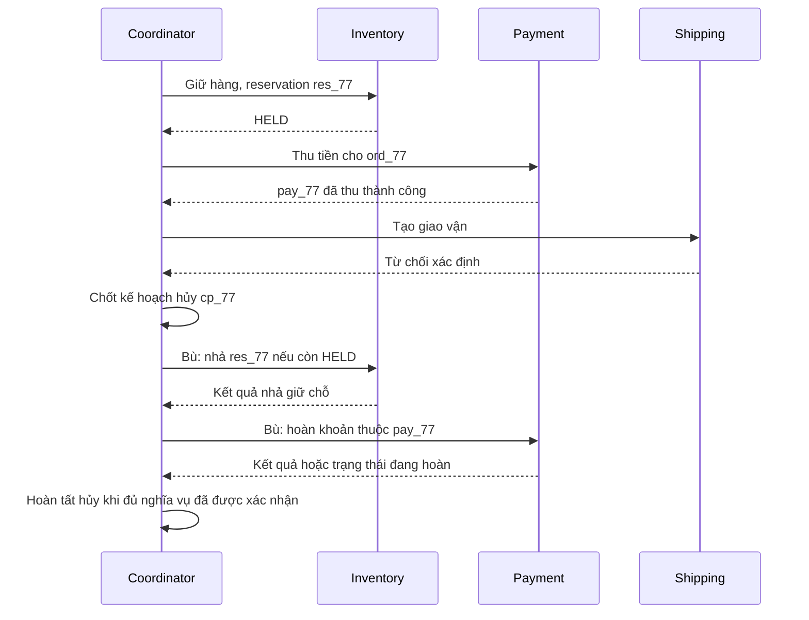

# Compensation action: hành động bù trong quy trình nghiệp vụ phân tán

## 1. Khi nhiều transaction cục bộ không thể rollback cùng nhau

Một quy trình đặt hàng có thể đi qua nhiều dịch vụ: đơn hàng, kho, thanh toán và giao vận. Mỗi dịch vụ commit dữ liệu của mình trong một transaction riêng. Nếu bước cuối thất bại, transaction đã commit ở những dịch vụ trước không tự rollback theo.

Ví dụ, hệ thống đã giữ hai sản phẩm và thu 600.000 đồng, nhưng giao vận xác nhận từ chối tạo chuyến giao. Muốn hủy đơn đúng quy tắc, hệ thống cần xử lý khoản tiền đã thu và phần tồn kho đã giữ.

**Compensation action là một thao tác nghiệp vụ mới nhằm xử lý hoặc bù lại tác động của một thao tác trước đó đã xảy ra.** Hoàn tiền cho khoản đã thu và nhả một reservation còn hiệu lực là hai ví dụ. Hành động bù có transaction, điều kiện, quyền thực hiện và khả năng thất bại riêng.

Trong Business Logic Security, đường bù cũng là bề mặt bị lạm dụng. Kẻ tấn công có thể yêu cầu hoàn tiền hai lần, nhả tồn kho đã dùng, đổi người nhận tiền hoặc lợi dụng timeout để kích hoạt bù cho một thao tác vẫn đang tiếp tục.

Vì vậy, chủ đề Distributed Consistency cần được tiếp cận bằng business invariants, state machine, quyền theo đối tượng, transaction cục bộ và idempotency. Mục tiêu là đưa quy trình về trạng thái hợp lệ hoặc một trạng thái ngoại lệ được quản lý rõ ràng, không chỉ gọi các hàm có tên “undo”.

## 2. Phân biệt compensation với rollback và retry

| Khái niệm | Ý nghĩa | Giới hạn |
|---|---|---|
| Rollback transaction | Hủy những thay đổi chưa commit trong phạm vi transaction được quản lý | Không thu hồi một khoản tiền mà hệ thống ngoài đã xử lý |
| Retry thao tác tiến | Thử lại cùng ý định để hoàn thành bước còn thiếu hoặc lấy kết quả | Không được tạo tác động mới cho mỗi lần thử |
| Compensation action | Tạo một tác động nghiệp vụ mới để xử lý tác động đã có | Có thể thất bại, cần điều kiện hiện tại và không luôn khôi phục nguyên trạng |
| Đối soát | Xác định sự thật khi trạng thái các bên chưa khớp hoặc kết quả chưa rõ | Không tự thực hiện thay mọi hành động sửa sai |

Nếu transaction cộng ví chưa commit và đã rollback, không có khoản cộng ví đó để phải tạo một khoản trừ bù. Nếu khoản thu ở cổng thanh toán đã thành công, rollback cơ sở dữ liệu nội bộ không làm khách hàng nhận lại tiền; cần một luồng hoàn tiền hợp lệ.

Compensation không nhất thiết là phép đảo toán học. Một khoản thu và một khoản hoàn có thể có thời điểm, phí và điều kiện xử lý khác nhau. Email đã gửi không thể “chưa từng được gửi”; hàng đã giao không trở về kho chỉ bằng cách tăng bộ đếm. Tác động không thể đảo trực tiếp có thể cần quy trình trả hàng, điều chỉnh hoặc xử lý ngoại lệ.

Không xóa lịch sử tác động gốc để giả vờ nó chưa xảy ra. Dữ liệu bù nên tham chiếu được tác động gốc, nguyên nhân và chủ thể hoặc chính sách đã cho phép bù.

## 3. Ví dụ xuyên suốt: hủy đơn sau khi giao vận từ chối

Quy trình giả định:

1. Order Service tạo đơn `ord_77`, chốt tổng tiền 600.000 đồng.
2. Inventory Service tạo reservation `res_77` cho hai sản phẩm.
3. Payment Service thu tiền, ghi nhận khoản thanh toán `pay_77`.
4. Shipping Service từ chối bước giao vận với kết quả xác định theo hợp đồng.
5. Bộ điều phối bắt đầu kế hoạch hủy và bù `cp_77`.

Trong kịch bản chính, đã có bằng chứng bước giao vận bị từ chối và không có chuyến giao cần giữ lại. Nếu chỉ timeout, cần phân giải trạng thái giao vận trước hoặc xử lý theo một chính sách rủi ro được phê duyệt; không được tự đồng nhất timeout với từ chối.



Thứ tự nhả giữ chỗ rồi hoàn tiền trong sơ đồ chỉ minh họa một kế hoạch. Thiết kế thực tế phải xét phụ thuộc và chính sách: có thể cần xác nhận hủy giao vận trước, hoặc ưu tiên hoàn tiền theo cam kết khách hàng. Không có quy tắc phổ quát rằng luôn gọi bù ngược thứ tự là an toàn.

Nếu hai hành động độc lập theo invariant đã thiết kế, có thể xử lý song song. Nếu một hành động phụ thuộc kết quả của hành động khác, kế hoạch phải giữ quan hệ đó, kể cả qua retry.

## 4. Viết quy tắc trước khi viết hàm bù

Với ví dụ trên, các invariant quan trọng gồm:

```text
Tiền hoàn thành công + hạn mức đang giữ cho các lệnh hoàn chưa rõ kết quả
    <= số tiền thực sự được phép hoàn của khoản thanh toán.

Chỉ nhả số lượng thuộc reservation của đúng đơn, tenant và sản phẩm.

Một reservation không được vừa tiêu thụ để giao hàng
vừa được nhả như hàng còn giữ chỗ.

Một hành động bù logic không được tạo tác động nhiều lần do retry.

Đơn chỉ được đánh dấu đã hủy và hoàn tất nghĩa vụ
khi các điều kiện cuối tương ứng thực sự được xác nhận.
```

Giới hạn tiền phải xét đúng loại nghiệp vụ. Nếu hệ thống có nhiều loại hoàn một phần, điều chỉnh hoặc tranh chấp, cần mô hình tổng và hạn mức tương ứng, không gộp mọi biến động thành một phép cộng tùy ý.

Điều kiện quyền cũng phải rõ: ai được yêu cầu hủy, bộ điều phối nào được phát lệnh bù, service nào có quyền thực hiện và đối tượng nào được phép thay đổi. Một message đến từ service tin cậy chưa đủ chứng minh mọi số tiền hay ID trong message đều hợp lệ.

Những giá trị như số tiền đã thu, tiền tệ, người thụ hưởng và số lượng reservation phải được lấy hoặc đối chiếu với dữ liệu tin cậy của tác động gốc. Không tính lại giá đơn theo bảng giá hiện tại rồi dùng giá đó để hoàn khoản cũ.

## 5. Mỗi hành động bù cần một hợp đồng nghiệp vụ

Một hợp đồng bù nên xác định:

| Thành phần | Câu hỏi cần trả lời |
|---|---|
| Tác động gốc | Đang bù khoản thu, reservation hoặc quyết định cụ thể nào? |
| Điều kiện cho phép | Trạng thái nào, quyền nào và nguyên nhân nào cho phép bù? |
| Phạm vi | Thuộc tenant, đơn, khách hàng, tài khoản tích hợp và môi trường nào? |
| Tác động mới | Chính xác dữ liệu hoặc hệ thống ngoài nào sẽ thay đổi? |
| Định danh chống trùng | Retry nào được xem là cùng một hành động? |
| Kết quả cuối | Bằng chứng nào xác nhận đã bù xong hoặc không cần bù? |
| Trạng thái chưa rõ | Khi nào phải tra cứu, chờ hoặc đối soát? |
| Ngoại lệ | Nếu không thể bù theo kế hoạch thì ai xử lý, theo quy trình nào? |

Ví dụ, `releaseReservation(res_77)` không có nghĩa luôn tăng tồn kho hai đơn vị. Nó có nghĩa kiểm tra reservation cụ thể và chỉ tạo tác động nhả nếu phần giữ chỗ đó còn được phép nhả.

Tương tự, `refundPayment(pay_77)` không có nghĩa chuyển 600.000 đồng đến một tài khoản do caller chọn. Nó phải xác định khoản nào còn được hoàn, theo kế hoạch được phép và về người thụ hưởng được quy tắc của khoản thanh toán chấp nhận. Mọi ngoại lệ đổi nơi nhận cần quy trình kiểm soát riêng.

Nếu khoản thanh toán mới được giữ tiền chứ chưa thu, tác động phù hợp có thể là hủy giữ tiền thay vì hoàn một khoản đã thu. Hợp đồng bù phải phân biệt các trạng thái này theo cơ chế thanh toán thực tế.

## 6. Định danh: một hành động logic, nhiều lần thử

Một kế hoạch có thể có:

```text
saga_id = saga_77
compensation_plan_id = cp_77

inventory_action_id = ca_release_77
payment_action_id = ca_refund_77

attempt_id = thay đổi theo từng lần thử
```

`payment_action_id` giữ nguyên khi timeout hoặc worker chạy lại. `attempt_id` chỉ phục vụ truy vết lần thử, không được dùng làm định danh duy nhất của tác động hoàn tiền.

Bản ghi hành động có thể gồm:

```text
CompensationAction
  tenant_id
  action_id
  saga_id
  plan_id
  action_type
  original_effect_id
  intent_fingerprint
  authorization_reference
  processing_state
  business_result_id
  created_at
  updated_at
```

Fingerprint bao gồm những trường quyết định ý định, chẳng hạn tác động gốc, loại bù, số tiền, tiền tệ và phần phân bổ được phép. Cùng action ID nhưng khác fingerprint phải là xung đột; không ghi đè action cũ rồi chạy nội dung mới.

Ràng buộc duy nhất theo action ID trong đúng tenant ngăn retry cùng hành động bị lặp. Vẫn cần ràng buộc hoặc hạn mức theo tác động gốc: kẻ tấn công có thể đổi action ID để gửi lại yêu cầu bù.

Nếu mỗi reservation chỉ có một tác động nhả, có thể ràng buộc theo reservation cùng loại tác động. Nếu một payment cho phép nhiều lần hoàn một phần hợp lệ, không được dùng uniqueness “mỗi payment một refund” một cách máy móc. Khi đó cần định danh từng phân bổ hoàn tiền đã được phép và bảo vệ tổng số tiền.

Event ID của message cũng không thay thế action ID. Hai message khác nhau có thể cùng yêu cầu thực hiện `ca_refund_77`; inbox chống trùng message và ràng buộc chống trùng tác động xử lý hai trách nhiệm khác nhau.

## 7. Bảo vệ nhả tồn kho bằng chuyển trạng thái nguyên tử

Trong mô hình đơn giản này, giữ chỗ làm giảm lượng `available`; nhả giữ chỗ làm tăng lại `available`, không tạo thêm hàng vật lý.

Một luồng bù an toàn có thể là:

```text
BEGIN TRANSACTION

action = reserveOrFindCompensationActionAtomically(command)
if action already completed:
    verifySameIntentAndCurrentAccess(action, command)
    return savedResult(action)

reservation = loadReservationForUpdate(command.reservationId)
requireTrustedCancellationAuthorization(command, reservation)
requireSameTenantOrderAndReservation(command, reservation)

if reservation.state == HELD:
    quantity = reservation.trustedQuantity
    changeStateConditionally(HELD, RELEASED)
    increaseAvailableStockAtomically(reservation.sku, quantity)
    recordReleaseEffectWithBusinessUniqueness(reservation)
    markCompensationCompleted(action)

else:
    classifyExistingReservationOutcomeWithoutIncreasingStock()

COMMIT
```

Đây là mã giả, không phải API chuẩn hoặc SQL có thể chạy trực tiếp. Bước chuyển trạng thái, số lượng khả dụng, bản ghi tác động và kết quả hành động phải được ghi cùng transaction nếu chúng cùng cơ sở dữ liệu.

Nếu reservation đã nhả trước đó và dữ liệu xác nhận đúng tác động, retry có thể nhận kết quả không cần tạo tác động mới. Nếu reservation đã được tiêu thụ cho giao hàng, không được tăng `available` như thể hàng vẫn ở kho. Phải chuyển sang quy trình hủy giao, trả hàng hoặc xử lý ngoại lệ theo thực trạng.

Đường reservation tự hết hạn và đường hủy đơn cũng cần dùng cùng invariant. Nếu cả hai cùng nhả, chỉ một bên được chuyển phần giữ chỗ còn hiệu lực sang trạng thái đã giải phóng và cập nhật lượng khả dụng tương ứng. Trạng thái, số lượng và bằng chứng tác động phải nhất quán; không chỉ nhìn tên trạng thái rồi bỏ qua sai lệch dữ liệu.

## 8. Hoàn tiền bù phải bảo vệ cùng lúc quyền, hạn mức và sổ cái

Với ví nội bộ và sổ cái cùng cơ sở dữ liệu, hành động hoàn tiền có thể được chốt trong một transaction cục bộ:

```text
actor = authenticateCallingServiceOrUser(command)
intent = parseAndNormalizeCompensationIntent(command)

result = inDatabaseTransaction:
    action = reserveOrFindActionWithUniqueConstraint(intent)

    if action has a completed result:
        requireSameFingerprint(action, intent)
        requireCurrentPermissionToReceiveResult(actor, action)
        return action.savedResult

    payment = loadOriginalPaymentForUpdate(intent.originalPaymentId)
    authorization = loadTrustedCompensationAuthorization(intent.planId)

    requireObjectPermission(actor, payment, authorization)
    requireAuthorizedPlanMatchesPaymentAndIntent(authorization, payment, intent)
    requireRefundStillAllowed(payment, authorization)

    amount = trustedAuthorizedRefundAllocation(authorization, payment)
    recipient = trustedRefundRecipient(payment)

    consumeRefundBudgetConditionally(payment, amount)
    refund = createRefundWithAuthorizedAllocationUniqueness(payment, authorization)
    creditRecipientAndWriteLedger(refund, recipient, amount)
    recordCompensationAudit(actor, authorization, payment, refund)
    appendOutboxWithStableIdentity(refund)
    saveCompletedActionResult(action, refund)

    return refund.receipt

# Chỉ trả thành công sau khi transaction đã commit.
return result
```

Mọi điều kiện cập nhật phải được kiểm tra; không có dòng phù hợp hoặc lỗi ràng buộc phải ngăn nhánh thành công commit. Nếu ghi sổ cái hoặc cộng ví thất bại, thay đổi hạn mức và kết quả thành công chưa commit cũng phải rollback.

`loadTrustedCompensationAuthorization` không có nghĩa tin nguyên body của message. Service cần dữ liệu cho phép bù đã được xác lập theo chính sách, gắn với đúng kế hoạch, đối tượng và phiên bản cần thiết. Nếu quyền cho phép nằm ở service khác, phải thiết kế cơ chế ủy quyền và phối hợp rõ ràng; transaction cục bộ không tự làm mọi thay đổi quyền từ xa có hiệu lực tức thì.

Đường bù không được bỏ qua bước phê duyệt chỉ vì được gọi bởi một worker. Có thể áp dụng một chính sách bù tự động đã được phê duyệt thay cho phê duyệt từng lần, nhưng điều kiện, phạm vi và bằng chứng sử dụng chính sách vẫn phải được kiểm tra và lưu.

## 9. Bù qua nhà cung cấp bên ngoài và kết quả chưa xác định

Nếu refund được thực hiện ở cổng thanh toán, transaction nội bộ không bao trùm lời gọi HTTP đó. Cần mô hình nhiều bước:

1. Trong transaction nội bộ, tạo hành động hoàn tiền, giữ hạn mức cho khoản đang xử lý và ghi outbox.
2. Worker gửi refund với định danh ổn định và key phía nhà cung cấp khi được hỗ trợ.
3. Khi có kết quả xác định, cập nhật khoản refund, hạn mức và hành động bù theo điều kiện.
4. Nếu timeout hoặc mất response, giữ trạng thái chưa rõ, tra cứu bằng định danh đã kiểm chứng hoặc đối soát.
5. Chỉ giải phóng hạn mức đang giữ khi đủ bằng chứng và đúng quy tắc kết thúc.

Không tạo action ID hoặc key mới chỉ vì lần gọi trước timeout. Không hoàn thêm một lần để “chắc chắn khách hàng được nhận”. Nhà cung cấp có thể đã xử lý lần đầu.

Một trạng thái `REFUND_REQUESTED` hoặc một response tiếp nhận không chứng minh khách hàng đã nhận tiền. Trạng thái đơn hàng và thông tin cho người dùng phải phản ánh đúng điều đã biết, chẳng hạn “đã hủy, đang xử lý hoàn tiền”, nếu chính sách của sản phẩm cho phép tách hai mốc đó.

Nếu nhà cung cấp không hỗ trợ đủ cơ chế chống trùng hoặc tra cứu, vẫn có khoảng lỗi không thể xóa bằng một bảng action nội bộ. Cần giữ ngoại lệ để đối soát, không tuyên bố đã bù đúng một lần trên toàn luồng khi chưa có cơ sở.

## 10. Không bù chỉ vì một bước tiến bị timeout

Giả sử yêu cầu tạo giao vận timeout. Có ít nhất ba khả năng:

| Trạng thái thực tế của bước tiến | Hệ quả đối với kế hoạch bù |
|---|---|
| Chưa tạo giao vận, đã có kết quả từ chối xác định | Có thể xét hủy và bù theo chính sách |
| Đã tạo giao vận nhưng response bị mất | Phải tính đến tác động giao vận; không nhả hàng như chưa có chuyến giao |
| Chưa xác định, yêu cầu còn có thể hoàn tất | Cần phân giải hoặc phối hợp hủy; không coi timeout là bằng chứng không có tác động |

Một lần truy vấn “chưa thấy” cũng chưa luôn chứng minh không có tác động đang bay hoặc đang chờ commit. Cần hiểu nguồn dữ liệu, tính nhất quán và giao thức của bên thực hiện.

Kế hoạch hủy phải xử lý khả năng bước tiến hoàn tất muộn. Ví dụ, bộ điều phối đã chuyển sang `CANCELLING`, nhưng một worker cũ vẫn giữ lệnh tạo giao vận. Chỉ sửa trạng thái ở database của bộ điều phối không tự ngăn service giao vận nhận lệnh đó.

Các bên cần kiểm tra trạng thái được phép, phiên bản kế hoạch, quyền sở hữu hoặc fencing phù hợp tại điểm tạo tác động. Một token phiên bản chỉ có tác dụng nếu bên nhận kiểm chứng nguồn, lưu và so sánh nó theo giao thức. Không tin một số phiên bản lớn tùy ý do caller gửi.

Nếu vẫn có tác động đến muộn, phải ghi nhận và đưa vào quy trình giải quyết, không bỏ qua event thành công chỉ vì saga đã được đánh dấu đang hủy. Bỏ qua sự thật bên ngoài có thể để hàng tiếp tục giao trong khi khách hàng đã nhận hoàn tiền.

## 11. State machine cho hành động và toàn quy trình

Một state machine hành động bù minh họa:

```text
PENDING -> RUNNING -> SUCCEEDED
                  -> RETRY_WAIT
                  -> UNKNOWN
                  -> MANUAL_REVIEW

RETRY_WAIT -> RUNNING
UNKNOWN -> SUCCEEDED / RETRY_WAIT / MANUAL_REVIEW
```

Những đường chuyển này chỉ được dùng khi có bằng chứng tương ứng. `UNKNOWN -> RETRY_WAIT` không được xảy ra chỉ vì đã chờ đủ lâu; cần xác định việc retry có an toàn và giữ nguyên định danh tác động.

Với một kế hoạch hủy có nhiều hành động:

```text
ACTIVE -> CANCELLING -> COMPENSATING -> COMPENSATED
                                     -> COMPENSATION_PENDING
                                     -> MANUAL_REVIEW
```

Tên trạng thái là minh họa. Điều quan trọng là không gộp “đã yêu cầu bù”, “đã tiếp nhận bù”, “đã bù thành công” và “không xác định được kết quả” thành một giá trị `CANCELLED` duy nhất nếu chúng có nghĩa khác nhau đối với nghĩa vụ của hệ thống.

Một kế hoạch có thể nhả tồn kho thành công nhưng hoàn tiền vẫn chưa xong. Phần đã bù không cần tự động làm lại; phần còn thiếu cần tiếp tục phục hồi. Việc hoàn tất saga phải dựa trên các điều kiện cuối được định nghĩa theo nghiệp vụ, không chỉ số lượng message đã gửi.

Nếu bù tự động thất bại quá nhiều lần hoặc gặp điều kiện không thể tự giải quyết, chuyển sang xử lý ngoại lệ với dữ liệu đầy đủ. Không đánh dấu thành công chỉ để hết cảnh báo hoặc dọn hàng đợi.

## 12. Retry, transaction cục bộ, inbox và outbox

Trong mỗi participant, tác động cục bộ và bản ghi hoàn tất hành động nên cùng transaction khi cùng cơ sở dữ liệu. Nếu commit thành công nhưng response hoặc ACK bị mất, lần giao lại lấy kết quả đã có thay vì áp dụng lại.

Inbox giúp nhận diện message đã tiếp nhận. Outbox giúp ghi bền công việc hoặc sự kiện cần gửi cùng dữ liệu nghiệp vụ. Cả hai vẫn có thể dẫn đến giao lại thông điệp; chúng cần phối hợp với action ID, uniqueness nghiệp vụ và chuyển trạng thái có điều kiện.

Nếu worker chết trước commit, các thay đổi chưa commit phải rollback. Nếu chết sau commit nhưng trước ACK, retry không được tạo thêm tác động. Nếu mất kết nối lúc commit, giữ cùng định danh để phân giải thay vì đoán thất bại.

Retry cần có giới hạn, khoảng chờ phù hợp và phân loại lỗi. Lỗi tạm thời có thể thử lại; quyền không hợp lệ, tiền tệ không khớp hoặc reservation đã tiêu thụ thường cần xử lý theo nguyên nhân, không gửi lại liên tục cùng một lệnh sai.

Lease hết hạn không chứng minh worker cũ đã dừng. Cần cơ chế sở hữu và kiểm soát cạnh tranh phù hợp tại nơi ghi; với tác động ngoài, còn cần định danh ổn định và phục hồi kết quả bên ngoài. Không chỉ dựa vào một cờ trong cache để quyết định ai được hoàn tiền.

## 13. Những cách lạm dụng đường compensation

| Tình huống lạm dụng | Lớp bảo vệ cần có |
|---|---|
| Gửi lại cùng lệnh bù nhiều lần | Action ID ổn định, đăng ký nguyên tử và replay kết quả |
| Đổi action ID để hoàn lại cùng khoản | Hạn mức cùng ràng buộc theo tác động hoặc phân bổ được phép |
| Sửa số tiền bù hoặc tiền tệ | Đối chiếu dữ liệu gốc và kế hoạch đã được cho phép |
| Thay payment hoặc reservation của tenant khác | Quyền theo đối tượng và ánh xạ tenant tin cậy |
| Đổi người nhận khoản hoàn | Người thụ hưởng từ liên kết gốc hoặc quy trình ngoại lệ có kiểm soát |
| Gây timeout rồi yêu cầu bù trong khi bước tiến vẫn chạy | Phân giải kết quả, phối hợp hủy và kiểm soát tác động đến muộn |
| Phát lại lệnh nhả sau khi hàng đã được giao | State machine và quy trình trả hàng thay vì tăng tồn kho tùy tiện |
| Gửi cùng action ID với nội dung khác | Fingerprint và từ chối xung đột, không ghi đè |
| Dùng service có quyền kỹ thuật để bỏ phê duyệt nghiệp vụ | Chính sách bù rõ ràng, kiểm tra phạm vi và audit |
| Phát lại event cũ để khởi tạo kế hoạch bù mới | Kiểm tra nguồn, chống trùng và điều kiện chuyển trạng thái hiện tại |

Thông điệp được xác thực vẫn có thể cũ hoặc không còn phù hợp trạng thái. Quyền của service, tính toàn vẹn message và quyền thực hiện tác động cụ thể phải được kiểm tra như các điều kiện riêng.

## 14. Đối soát và audit: biết điều gì còn chưa hoàn tất

Một bản ghi bù cần liên kết được kế hoạch, tác động gốc, hành động bù, các lần thử và kết quả từ hệ thống bên ngoài. Nhờ đó có thể trả lời khoản nào đã thu, khoản nào đã hoàn, reservation nào đã nhả và nghĩa vụ nào còn mở.

Đối soát nên dựa trên dữ liệu có thẩm quyền: sổ cái, bản ghi payment/refund, reservation, trạng thái giao vận và nguồn bên ngoài theo giao thức đáng tin. Không chỉ nhìn một cờ của coordinator khi participant có thể đã commit nhưng chưa gửi được thông báo.

Khi phát hiện sai lệch, tạo hoặc tiếp tục một hành động sửa được cho phép với định danh rõ ràng. Không sửa số dư trực tiếp, xóa lịch sử hoặc tạo một lệnh bù mới không liên kết để làm báo cáo trông cân bằng.

Các chỉ số hữu ích gồm số hành động bù tồn đọng, tuổi của trạng thái chưa rõ, số tiền đang giữ chờ phân giải, số xung đột fingerprint và số tác động đến muộn sau khi bắt đầu hủy. Log không nên chứa secret hay toàn bộ dữ liệu nhạy cảm; không dùng action ID có số lượng giá trị lớn trực tiếp làm nhãn metric.

Thời gian giữ dữ liệu chống trùng phải phù hợp với retry, message đến muộn, thao tác phục hồi và vòng đời nghĩa vụ. Xóa bản ghi action không làm tác động gốc hoặc tác động bù biến mất; invariant và tham chiếu nghiệp vụ bền vững phải tiếp tục ngăn bù trùng.

## 15. Ma trận kiểm thử tình huống bù

Kiểm thử cần kiểm tra trạng thái cùng tác động thật, không chỉ response của coordinator.

| Tình huống | Kết quả cần khẳng định |
|---|---|
| Giao vận từ chối xác định sau giữ hàng và thu tiền | Kế hoạch bù đúng reservation và khoản thanh toán |
| Gửi tuần tự hoặc đồng thời nhiều lần cùng action ID | Chỉ một tác động cho hành động logic |
| Message ID khác nhưng cùng action ID | Không hoàn tiền hoặc nhả giữ chỗ thêm |
| Action ID khác cho cùng phân bổ hoàn tiền | Ràng buộc nghiệp vụ vẫn chặn hoàn dư |
| Cùng action ID nhưng đổi số tiền hoặc đối tượng | Từ chối xung đột, giữ nguyên kết quả gốc |
| Actor gửi ID thuộc tenant khác | Không đọc hoặc thay đổi tác động của tenant đó trái quyền |
| Client sửa người nhận hoặc giá hiện tại | Khoản bù vẫn bị ràng buộc bởi dữ liệu gốc và kế hoạch được phép |
| Nhả reservation cạnh tranh với tự hết hạn | Lượng khả dụng chỉ tăng đúng một lần tương ứng phần giữ chỗ |
| Nhả reservation cạnh tranh với tiêu thụ để giao hàng | Có thứ tự hợp lệ; không vừa giao vừa nhả cùng lượng hàng |
| Worker chết trước commit cục bộ | Không có thay đổi dở dang đã được coi là bù thành công |
| Worker chết sau commit nhưng trước ACK | Retry lấy kết quả, không lặp tác động |
| Nhà cung cấp đã refund nhưng response bị mất | Giữ cùng định danh, tra cứu hoặc đối soát; không refund mới tùy tiện |
| Nhả hàng xong nhưng hoàn tiền chưa rõ | Trạng thái kế hoạch phản ánh nghĩa vụ còn mở |
| Bước tiến hoàn tất muộn sau lệnh hủy | Ghi nhận và xử lý tác động đến muộn, không bỏ qua sự thật nghiệp vụ |
| Worker cũ tiếp tục sau khi lease hết hạn | Không vượt giao thức sở hữu hoặc tạo tác động trùng |
| Quyền bù bị thu hồi hoặc kế hoạch bị thay đổi | Thực thi mới tuân thủ chính sách và phiên bản tương ứng |
| Bản ghi chống trùng hết hạn rồi lệnh cũ xuất hiện | Invariant và dữ liệu gốc vẫn ngăn bù dư |
| Bù không thể tự hoàn tất | Ngoại lệ có đường xử lý, không bị đánh dấu thành công giả |

Với ví dụ đơn hàng, cần đối chiếu lượng reservation còn giữ, số lượng đã tiêu thụ, tổng tiền thu và hoàn, hạn mức đang giữ cùng trạng thái giao vận. Một saga ở trạng thái hoàn tất chỉ đáng tin khi những dữ liệu đó thỏa điều kiện cuối của chính sách đã chọn.

## 16. Câu hỏi tự kiểm tra

1. Vì sao compensation không phải rollback của transaction đã commit?
2. Khi bước tiến timeout, bằng chứng nào còn thiếu trước khi quyết định bù?
3. Vì sao mỗi lần thử bù phải giữ action ID nhưng có thể có attempt ID mới?
4. Cơ chế nào tiếp tục bảo vệ nếu caller đổi action ID?
5. Vì sao một reservation đã tiêu thụ không được bù bằng cách tăng tồn kho trực tiếp?
6. Khi hoàn tiền bên ngoài chưa rõ kết quả, vì sao phải giữ hạn mức tương ứng?
7. Khi một phần kế hoạch đã bù xong, phần còn lại thất bại, hệ thống cần thể hiện nghĩa vụ thế nào?

Thiết kế compensation an toàn cần biết chính xác đang bù tác động nào, ai cho phép, điều kiện hiện tại có còn phù hợp và bằng chứng nào xác nhận hoàn tất. Hành động bù được thực hiện như một nghiệp vụ đầy đủ mới có thể khôi phục tính nhất quán mà không mở thêm đường hoàn tiền trùng, cấp lại tài nguyên hoặc bỏ qua phê duyệt.
