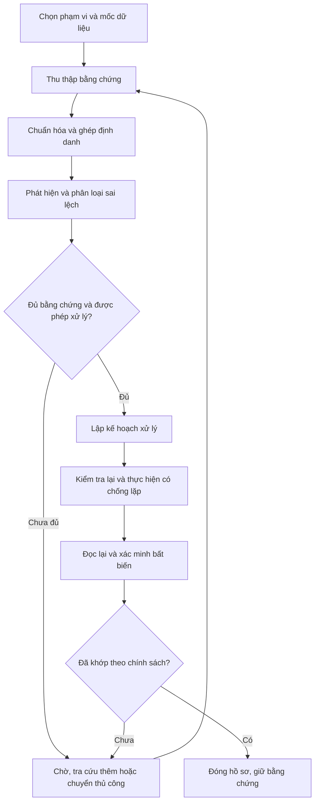

# Reconciliation process

## 1. Đối soát là gì trong hệ thống phân tán?

Reconciliation, hay đối soát, là quy trình thu thập và so sánh bằng chứng từ những thành phần có liên quan để phát hiện sai lệch, xác định trạng thái nghiệp vụ và đưa hệ thống về trạng thái phù hợp theo một chính sách có kiểm soát.

Ví dụ, một dịch vụ ghi nhận hoàn tiền đang chờ xử lý nhưng nhà cung cấp thanh toán đã hoàn tiền thành công. Sai lệch có thể do callback bị mất, consumer chưa xử lý, transaction cập nhật trạng thái thất bại hoặc thông tin được đọc từ một nguồn có độ trễ. Đối soát cần tìm ra điều đã xảy ra trước khi quyết định cập nhật dữ liệu hoặc gửi thêm lệnh.

Trong bảo mật logic nghiệp vụ, mục tiêu không chỉ là làm hai màn hình hiển thị giống nhau. Quy trình phải tiếp tục bảo vệ các bất biến:

- Không hoàn tiền thêm lần nữa cho một ý định đã thực hiện.
- Không chấp nhận số tiền, loại tiền hoặc đối tượng nhận khác với ý định được duyệt.
- Không biến đường sửa dữ liệu thành cách bỏ qua phê duyệt hoặc quyền theo đối tượng.
- Không xóa lịch sử để che một giao dịch hoặc một sai lệch.
- Không coi thiếu phản hồi là bằng chứng tác dụng chưa xảy ra.

Đối soát là một phần của thiết kế vận hành bình thường cho hệ thống phân tán. Nó cũng là một đường thực thi có quyền nhạy cảm, cần được bảo vệ như API nghiệp vụ.

## 2. Phân biệt đối soát với retry, đồng bộ và lệnh bù

| Cơ chế | Câu hỏi chính | Rủi ro nếu dùng thay đối soát |
|---|---|---|
| Retry | Có thể thử lại một hành động nào theo hợp đồng không? | Gửi thêm lệnh khi lần trước có thể đã thành công |
| Đồng bộ projection | Làm bản đọc phản ánh các thay đổi nguồn như thế nào? | Làm bản đọc trông đúng trong khi dữ liệu tài chính hoặc quyền vẫn sai |
| Đối soát | Bằng chứng nào khớp, lệch hoặc chưa đủ, và được phép xử lý ra sao? | Cần được thực hiện như một quy trình riêng, không chỉ gán trạng thái |
| Sửa dữ liệu | Thay đổi cụ thể nào sẽ khôi phục một quy tắc đã xác định? | Sửa nhầm nguồn hoặc ghi đè dữ liệu hợp lệ |
| Lệnh bù | Nghiệp vụ mới nào điều chỉnh một tác dụng đã xảy ra? | Vô tình đảo tiền hoặc hủy quyền mà không có phê duyệt |

Một kết luận đối soát có thể dẫn đến không làm gì, chờ thêm bằng chứng, sửa dữ liệu nội bộ, phát lại thông điệp đã có, tạo lệnh nghiệp vụ mới hoặc chuyển xử lý thủ công. Không phải mọi sai lệch đều cần một thao tác ghi ngay.

“Chạy lại toàn bộ luồng” không phải một chiến lược đối soát. Một số bước có thể đã commit hoặc tạo tác dụng bên ngoài, còn những bước khác chưa có kết quả.

## 3. Bắt đầu từ bất biến và mô hình nguồn có thẩm quyền

### 3.1. Xác định điều gì phải khớp

Với một operation hoàn tiền, có thể cần kiểm tra:

```text
tenant và tài khoản nhà cung cấp
operation_id và định danh ý định
đơn hàng/giao dịch gốc
số tiền và loại tiền
phiên bản ý định được phê duyệt
định danh hoàn tiền phía nhận
trạng thái thực thi và bút toán nội bộ
```

Mỗi trường trả lời một câu hỏi khác nhau. Hai giao dịch cùng số tiền không đương nhiên là cùng một giao dịch. Một provider reference có thể chỉ duy nhất trong một tài khoản nhà cung cấp, không phải trên mọi tenant và tài khoản.

Đối với tiền, so sánh bằng đơn vị nhỏ nhất hoặc biểu diễn thập phân chính xác theo loại tiền. Không dùng số thực nhị phân hoặc tự quy đổi tiền tệ để che một sai lệch amount/currency.

### 3.2. Không có một nguồn đúng cho mọi loại dữ liệu

| Loại thông tin | Nguồn có thẩm quyền theo thiết kế có thể là |
|---|---|
| Người nào được phép yêu cầu hoàn tiền | Dữ liệu quyền và chính sách nội bộ |
| Ý định, số tiền và phiên bản được duyệt | Bản ghi ý định/phê duyệt được giữ phiên bản |
| Nhà cung cấp đã thực hiện lệnh nào | API tra cứu hoặc báo cáo có thẩm quyền của nhà cung cấp trong đúng tài khoản |
| Bút toán nội bộ đã được ghi nhận | Sổ giao dịch nội bộ |
| Thông điệp đã được tiếp nhận ở consumer | Inbox hoặc bằng chứng xử lý tương ứng |
| Tiền đã được quyết toán theo kỳ | Nguồn quyết toán phù hợp với giai đoạn nghiệp vụ đó |

Nhà cung cấp xác nhận đã hoàn tiền không tự chứng minh người khởi tạo có quyền hoàn tiền. Dữ liệu nội bộ nói “đã gửi” cũng không chứng minh phía nhận đã thực hiện.

Chính sách đối soát phải xác định nguồn nào quyết định từng thuộc tính và cách xử lý khi các nguồn có thẩm quyền trả bằng chứng mâu thuẫn. Không dùng quy tắc “timestamp mới nhất luôn thắng” cho mọi dữ liệu.

## 4. Giữ định danh xuyên các hệ thống

Một chuỗi định danh có thể là:

```text
client idempotency key
  → internal operation_id
  → refund_intent_id
  → outbox message_id
  → provider request key
  → provider refund reference
  → ledger entry reference
```

Không nhất thiết dùng cùng một chuỗi ở mọi nơi, nhưng phải có quan hệ liên kết ổn định và được lưu trước hoặc cùng thời điểm cần thiết. Không chỉ giữ provider reference trong bộ nhớ của worker.

Mỗi lần retry truyền tải có thể có `attempt_id` mới, còn operation và key chống lặp ở phía nhận phải giữ đúng ý nghĩa ban đầu. Sinh key mới cho mỗi lần HTTP timeout sẽ làm đối soát khó hơn và có thể tạo tác dụng lặp.

Phạm vi tra cứu cần bao gồm tenant, tài khoản nhà cung cấp, loại operation và những thành phần định danh có ý nghĩa. Không đối chiếu chỉ bằng số tiền, thời gian gần nhau hoặc tên khách hàng.

Nếu không tìm được liên kết chắc chắn, phân loại là chưa ghép được bằng chứng hoặc dữ liệu mồ côi. Không tự gán giao dịch cho một tenant hay đơn hàng chỉ vì vài thuộc tính trông giống nhau.

## 5. Quy trình tổng thể: phát hiện đến xác minh



Một quy trình cụ thể nên tách các bước phát hiện, quyết định và thực thi. Nhờ đó có thể xem một kế hoạch sửa sẽ tác động gì trước khi chạy, đặt quyền phê duyệt phù hợp và kiểm tra lại dữ liệu ở thời điểm áp dụng.

Đối soát có thể chạy theo sự kiện cho operation chưa xác định, theo lịch cho tập dữ liệu gần đây hoặc theo kỳ để kiểm tra toàn bộ. Các cách chạy bổ trợ nhau: luồng thời gian thực có thể bỏ sót một đường sửa dữ liệu mà đợt kiểm tra định kỳ phát hiện.

## 6. Chọn phạm vi dữ liệu và xử lý độ trễ

### 6.1. So sánh các tập dữ liệu có mốc rõ ràng

Hai hệ thống có thể được đọc tại thời điểm khác nhau. Nếu operation vừa chuyển trạng thái trong khi quét, kết quả so sánh có thể tạo một sai lệch giả.

Mỗi lần chạy cần ghi nhận phạm vi tenant/tài khoản, thời gian quét, cursor hoặc watermark của từng nguồn và điều kiện chọn dữ liệu. Khi nguồn hỗ trợ snapshot hoặc bản báo cáo theo mốc, có thể dùng chúng để tăng khả năng tái lập.

Watermark của hai hệ thống không nhất thiết có thể so sánh trực tiếp. Một offset sự kiện của dịch vụ A không tự tương đương với một timestamp báo cáo của nhà cung cấp B. Cần biết mỗi mốc chứng minh nguồn đã bao phủ tới đâu.

Với tập sự kiện bất biến, có thể dùng cursor ổn định theo một thứ tự đã xác định. Với bảng operation đang thay đổi, một lượt phân trang theo `updated_at` có thể bỏ sót hoặc đọc lặp khi dòng bị sửa trong lúc quét. Cần snapshot, quét chồng khoảng thời gian, dấu vết đã xử lý hoặc cơ chế khác phù hợp với nguồn.

### 6.2. Phân biệt chậm cập nhật với sai lệch thực sự

Một operation mới được nhà cung cấp chấp nhận có thể chưa xuất hiện ngay trong báo cáo hoặc replica. Quy trình có thể dành một khoảng chờ dựa trên hợp đồng độ trễ và mức rủi ro, sau đó thu thập lại bằng chứng.

Khoảng chờ không phải chứng minh toán học rằng mọi thông điệp cũ đã biến mất. Hết thời gian chờ cũng không tự chứng minh tác dụng chưa xảy ra. Khi cần gửi một lệnh tài chính mới, điều kiện an toàn phải mạnh hơn “đã chờ đủ lâu”.

Phân biệt thời điểm sự kiện xảy ra, thời điểm được nguồn ghi nhận và thời điểm hệ thống đối soát quan sát. Nhầm ba mốc này có thể làm một kết quả đến muộn bị xem là giao dịch mới.

## 7. Thu thập và chuẩn hóa bằng chứng

Một observation phục vụ đối soát có thể gồm:

| Nhóm | Dữ liệu minh họa |
|---|---|
| Nguồn | Hệ thống, tài khoản, adapter và loại API/báo cáo |
| Định danh | Tenant, operation, ý định, provider reference |
| Nội dung | Trạng thái, số tiền, loại tiền, đối tượng liên quan |
| Phiên bản | Phiên bản operation, event sequence hoặc phiên bản nguồn nếu có |
| Thời gian | Thời điểm nguồn ghi nhận và thời điểm quan sát |
| Chất lượng bằng chứng | Kết quả tra cứu, mức độ đầy đủ, lỗi hoặc giới hạn dữ liệu |
| Liên kết kiểm chứng | Tham chiếu bản ghi/báo cáo và digest khi cần kiểm tra toàn vẹn |

Không biến lỗi kết nối thành một observation “không có giao dịch”. Không biến lỗi parse, response thiếu trường hoặc sai tài khoản thành kết quả âm tính hợp lệ.

Dữ liệu từ nhà cung cấp phải được lấy bằng adapter và thông tin xác thực đúng phạm vi. Callback cần được xác minh theo giao thức, rồi liên kết với operation thật. Một giá trị `provider_reference` do người dùng gửi không đủ để hệ thống tin rằng giao dịch đó thuộc về họ.

Chuẩn hóa chỉ để so sánh đúng ý nghĩa, không được làm mất dấu hiệu sai lệch. Ví dụ `SUCCEEDED` ở API tiếp nhận có thể chỉ có nghĩa lệnh đã được tiếp nhận, trong khi thành công tài chính là một trạng thái khác. Mapping trạng thái phải được xác định cho từng nguồn.

Lưu đủ bằng chứng để tái kiểm tra quyết định, nhưng tránh sao chép toàn bộ dữ liệu nhạy cảm không cần thiết. Hash của một observation giúp kiểm tra nội dung có đổi không theo thiết kế; nó không tự chứng minh nguồn ban đầu đáng tin cậy.

## 8. Phân loại sai lệch trước khi sửa

| Loại sai lệch | Ví dụ | Hướng điều tra ban đầu |
|---|---|---|
| Thiếu cập nhật nội bộ | Provider thành công, operation nội bộ còn chờ | Kiểm tra callback, inbox, ledger và transaction cập nhật |
| Thiếu bằng chứng bên ngoài | Nội bộ ghi đã gửi, provider chưa tìm thấy | Kiểm tra đúng tài khoản/key, độ trễ và request cũ còn xử lý |
| Khác dữ liệu có ý nghĩa | Khác amount, currency, đơn hàng hoặc người nhận | Giữ bằng chứng, hạn chế xử lý tự động và điều tra |
| Trùng tác dụng | Nhiều giao dịch phía nhận cho một ý định | Phân biệt retry truyền tải với nhiều giao dịch thật |
| Dữ liệu mồ côi | Provider có giao dịch nhưng không ghép được operation | Xác minh nguồn, phạm vi và lịch sử khôi phục/import |
| Khác trạng thái do độ trễ | Event còn trong outbox hoặc consumer đang chậm | Theo dõi backlog và thu thập lại theo chính sách |
| Kết quả mâu thuẫn | Có cả bằng chứng thành công và thất bại cho cùng bước | Kiểm tra phiên bản, loại sự kiện và khả năng có điều chỉnh sau đó |

Một giao dịch đã hoàn tiền rồi có điều chỉnh tài chính về sau không nhất thiết là “trạng thái cũ sai”. Có thể đó là một nghiệp vụ mới cần bút toán và sự kiện riêng. Không gán ngược mọi lịch sử thành thất bại để làm khớp trạng thái cuối.

Đặc biệt, `NOT_FOUND` phải được hiểu theo hợp đồng nguồn. Nó có thể là chưa đồng bộ, sai định danh, sai tài khoản hoặc thật sự không có dữ liệu; không mặc định là quyền phát một lệnh mới.

## 9. Hồ sơ đối soát và kế hoạch xử lý

Nên quản lý sai lệch như một hồ sơ có vòng đời, thay vì một dòng log rồi chạy sửa ngay. Hồ sơ có thể chứa:

```text
case_id
tenant_id, operation_id, discrepancy_type
state, case_version
first_detected_at, last_observed_at
evidence_references và phiên bản observation
decision_policy_version
proposed_action, risk_level
owner hoặc assignment
repair_id và kết quả xác minh
```

Trạng thái hồ sơ cần tách khỏi trạng thái hoàn tiền. Hồ sơ `CLOSED` có nghĩa sai lệch đã được xử lý theo kết luận được lưu, không đồng nghĩa operation hoàn tiền luôn thành công.

Một vòng đời có thể gồm `DETECTED`, `WAITING_EVIDENCE`, `MANUAL_REVIEW`, `REPAIR_READY`, `REPAIRING`, `VERIFIED` và `CLOSED`. Quy tắc chuyển trạng thái phải ngăn worker tự coi “đã chạy lệnh sửa” là “đã xác minh”.

### 9.1. Chống tạo nhiều hồ sơ cạnh tranh

Cần một định danh chống trùng phù hợp, chẳng hạn liên kết tenant, operation và loại sai lệch. Nếu dùng một hồ sơ cho mỗi loại sai lệch trong suốt vòng đời operation, có thể giữ unique trên bộ đó và ghi thêm các lần xuất hiện, kết luận cùng lịch sử mở lại.

Nếu cần nhiều hồ sơ theo từng giai đoạn, phải có cơ chế ngăn hai hồ sơ cùng cấp quyền cho một hành động sửa đang hoạt động. Chỉ đổi `case_id` không được làm mất chống lặp ở tầng tác dụng.

### 9.2. Kế hoạch phải cụ thể và có điều kiện

Ví dụ một kế hoạch sửa nội bộ cần nêu:

- Operation nào, tenant nào và phiên bản hiện tại dự kiến.
- Bằng chứng provider nào đã được xác minh, với amount/currency nào.
- Trường dữ liệu hoặc bút toán nào sẽ được cập nhật.
- Những bất biến nào sẽ được kiểm tra lại.
- Hành động có tạo tác dụng bên ngoài hay chỉ ghi nhận tác dụng đã có.
- Quyền, phê duyệt và định danh chống lặp nào được áp dụng.
- Tiêu chí xác minh và điều kiện phải dừng/chuyển thủ công.

Không lập một kế hoạch chung “đặt trạng thái thành công” mà thiếu liên kết bút toán, nguồn bằng chứng hoặc điều kiện trạng thái. Kế hoạch đã được xem xét vẫn cần kiểm tra lại dữ liệu khi thực thi vì operation có thể đã thay đổi.

## 10. Chính sách quyết định: khi nào được tự động xử lý?

| Bằng chứng đã có | Hành động có thể phù hợp | Điều không được suy ra |
|---|---|---|
| Provider xác nhận thành công, đúng định danh/số tiền/loại tiền; nội bộ còn chờ | Ghi nhận kết quả và bút toán còn thiếu theo quy tắc chống lặp | Không cần gửi thêm lệnh hoàn tiền |
| Operation và ledger đã đúng; projection đọc bị chậm | Rebuild hoặc cập nhật projection từ nguồn đáng tin cậy | Không sửa sổ giao dịch chỉ để làm giống projection |
| Outbox còn event chưa gửi, chưa có kết quả phía nhận | Tiếp tục phát theo hợp đồng với cùng định danh chống lặp | Không sinh một ý định hoặc provider key mới tùy tiện |
| Provider đang xử lý | Theo dõi và lên lịch kiểm tra lại | Không kết luận thất bại vì deadline client đã hết |
| Provider trả không tìm thấy, request cũ có thể còn xử lý | Thu thập thêm bằng chứng, giữ trạng thái chưa xác định | Không cấp quyền tạo tác dụng mới ngay |
| Amount/currency/đối tượng không khớp | Chuyển điều tra, hạn chế hành động có thể làm tăng thiệt hại | Không tự ghi đè ý định được duyệt bằng dữ liệu khác |
| Phát hiện hai giao dịch hoàn tiền thật | Ghi nhận sự cố và xét nghiệp vụ điều chỉnh/bù có quyền | Không xóa một giao dịch để làm lịch sử trông hợp lệ |
| Không ghép được nguồn với operation | Giữ dữ liệu ở diện cần xác minh | Không tạo operation thuộc một tenant được đoán từ nội dung |

Chính sách sửa tự động cần được giới hạn theo loại sai lệch và mức rủi ro. Việc đánh dấu một sửa đổi là “kỹ thuật” không làm nó hết ảnh hưởng đến tiền, quyền hoặc trạng thái nghiệp vụ.

Nếu phát hiện một tác dụng ngoài hệ thống đã xảy ra nhưng không có phê duyệt hợp lệ, không được tạo phê duyệt hồi tố để hợp thức hóa. Có thể vẫn cần ghi nhận sự thật tài chính theo mô hình sổ giao dịch và đồng thời mở sự cố quyền/phê duyệt; đây là quyết định có chính sách riêng, không phải nhánh tự xác nhận một ý định hợp lệ.

Việc tạo lệnh thanh toán/hoàn tiền mới hoặc lệnh bù phải đi qua quyền, phê duyệt, hạn mức và chống lặp dành cho chính hành động đó. Kết luận “bản ghi đang thiếu” chưa đủ làm căn cứ phát lệnh.

## 11. Thực thi sửa nội bộ nguyên tử và có chống lặp

Giả sử provider đã xác nhận một lần hoàn tiền đúng với ý định được phê duyệt, còn nội bộ thiếu kết quả. Một thao tác sửa có thể cần cùng commit:

- Bút toán ghi nhận lần hoàn tiền đã xảy ra, nếu chưa có.
- Trạng thái và liên kết provider reference của operation.
- Audit của quyết định đối soát.
- Kết quả thực thi của repair và ý định phát thông báo liên quan.

Mã giả Java:

```java
RepairResult importConfirmedRefund(RepairPlan plan, RecoveryContext recovery) {
    VerifiedEvidence evidence = evidenceService.loadVerified(plan.evidenceId());

    return transactions.runAndCommit(() -> {
        RepairClaim claim = repairs.claimOrReadResult(plan.repairId());
        if (claim.alreadyCompleted()) {
            recoveryAuthorization.requireCanRead(recovery, claim);
            return claim.result();
        }

        RefundOperation operation = operations.findForUpdate(
            plan.tenantId(), plan.operationId()
        );

        recoveryAuthorization.requireAllowedRepair(recovery, plan, operation);
        policy.requireCurrentAndApplicable(plan, operation, evidence);
        evidence.requireMatchesTenantAccountAndIntent(operation);
        evidence.requireConfirmedSuccess();

        LedgerEntry entry = ledger.recordOnceAndVerifySame(
            operation, evidence.providerEffectIdentity(), evidence.amount()
        );
        operations.confirmProviderResultIfAllowed(operation, evidence, entry);
        audit.appendReconciliationApplied(plan, operation, evidence, entry);
        outbox.appendResultNotification(operation.id());

        return repairs.complete(claim, entry.id());
    });
}
```

Đây là mã giả về ranh giới. `claimOrReadResult` phải xử lý cả trạng thái đang chạy, quyền sở hữu và nội dung kế hoạch; không chỉ tìm theo một repair ID rồi cho thực thi. `requireCurrentAndApplicable` cần kiểm tra lại phiên bản operation và các điều kiện của chính sách ở lúc áp dụng.

`recordOnceAndVerifySame` không được coi mọi lỗi unique là thành công. Nếu bút toán đã tồn tại, phải xác minh nó tương ứng với cùng tác dụng, amount, currency và các liên kết có ý nghĩa. Một xung đột khác dữ liệu cần dừng và điều tra.

Ví dụ khóa chống ghi nhận trùng một tác dụng có thể gồm:

```text
UNIQUE(
  tenant_id,
  provider_account_id,
  provider_refund_reference,
  ledger_entry_kind
)
```

Ràng buộc này phải phù hợp với mô hình bút toán thật: một tác dụng có thể cần nhiều dòng hạch toán hợp lệ trong một nhóm bút toán. Khi đó áp dụng chống lặp ở định danh nhóm hoặc cấu trúc tương ứng, không tùy tiện cấm mọi dòng dùng cùng reference.

Sửa dữ liệu nội bộ không phát thêm lệnh hoàn tiền ra ngoài trong ví dụ này. Nếu kế hoạch cần tác dụng bên ngoài, phải ghi nhận lệnh bền vững và dùng cơ chế thực thi/chống lặp riêng; transaction database không bao trùm một HTTP request.

## 12. Đồng thời, quyền sở hữu và kế hoạch lỗi thời

Hai worker đối soát có thể cùng thấy sai lệch, hoặc một worker chạy cùng lúc callback chính thức cập nhật operation. Vì vậy, kết luận từ bước phát hiện không tự cấp quyền sửa về sau.

Cần phối hợp nhận quyền cho repair, khóa hoặc kiểm tra phiên bản operation, ràng buộc trên bút toán và cập nhật có điều kiện. Nếu callback đã hoàn tất đúng dữ liệu, worker có thể xác minh rằng mục tiêu đã đạt và không tạo lại tác dụng.

Ví dụ kiểm tra phiên bản khi cập nhật:

```sql
UPDATE refund_operations
SET execution_state = 'SUCCEEDED',
    provider_refund_reference = :provider_reference,
    version = version + 1
WHERE tenant_id = :tenant_id
  AND operation_id = :operation_id
  AND version = :expected_version
  AND execution_state IN ('SUBMITTED', 'RECONCILING');
```

Phải kiểm tra số dòng cập nhật. Không có dòng nào được cập nhật nghĩa là kế hoạch cần được xem xét lại, không phải lý do để bỏ điều kiện phiên bản rồi ghi đè.

Đoạn SQL chỉ minh họa kiểm soát đồng thời trên trạng thái. Những kiểm tra định danh, bằng chứng, bút toán và quyền vẫn phải thực hiện trong luồng tương ứng.

### 12.1. Lease không ngăn mọi tác dụng từ worker cũ

Worker hết lease có thể hoạt động trở lại sau khi worker khác tiếp quản. Token/thế hệ cần được kiểm tra khi cập nhật hồ sơ và kết quả repair; nơi tạo tác dụng cũng cần bảo vệ tương ứng.

Một fencing token không có tác dụng với thành phần không kiểm tra nó. Chỉ ngăn worker cũ ghi trạng thái hồ sơ chưa đủ để ngăn nó gọi nhà cung cấp lần nữa.

Khi bằng chứng bên ngoài thay đổi, không phải lúc nào cũng có một transaction xuyên hệ thống để khóa cả hai nguồn. Nếu nguồn có phiên bản hoặc trạng thái cuối có ý nghĩa rõ ràng, dùng chúng theo hợp đồng. Nếu vẫn có khả năng thay đổi liên quan, kế hoạch phải dự kiến quan sát tiếp hoặc một nghiệp vụ điều chỉnh sau đó thay vì tuyên bố đã loại bỏ mọi cuộc đua.

## 13. Timeout, không tìm thấy và lỗi khi sửa

### 13.1. Không biết request cũ đã gây tác dụng chưa

Trước khi cho gửi một lệnh mới, phải xét cả khả năng request cũ còn trên đường truyền, trong hàng đợi, trong worker tạm dừng hoặc đang được provider thực hiện.

Nếu provider có cơ chế chống lặp phù hợp và vẫn còn trong thời hạn bảo vệ, gửi lại cùng định danh có thể là một cách tiếp tục operation. Nếu không có bảo đảm đó, cần bằng chứng đủ mạnh rằng tác dụng cũ không thể xuất hiện tiếp, hoặc chuyển xử lý thủ công theo chính sách.

Một lần `NOT_FOUND`, lease hết hạn hoặc mất kết nối không tự cung cấp bằng chứng này. Không dựa vào số lần lookup đã chạy để biến sự thiếu bằng chứng thành bằng chứng không có tác dụng.

### 13.2. Mất xác nhận commit của repair

Repair nội bộ cũng có thể commit thành công nhưng worker không nhận được xác nhận. Dùng `repair_id`, operation và định danh bút toán ổn định để tra cứu lại; không tạo repair mới với tác dụng tương đương chỉ vì lần gọi trước báo lỗi.

Nếu transaction xác nhận rollback và chưa có tác dụng ngoài phạm vi đó, có thể thử lại theo chính sách. Nếu kết quả chưa rõ, giữ trạng thái cần xác định thay vì đánh dấu thất bại rồi cấp quyền chạy mới.

### 13.3. Hết thời gian hoặc số lần thử tự động

Giới hạn retry, dùng backoff và dành ngân sách riêng cho lookup/đối soát. Không giữ transaction database mở trong lúc ngủ chờ hoặc gọi nhiều API chậm.

Đạt ngưỡng tự động có thể chuyển hồ sơ sang `MANUAL_REVIEW` hoặc chờ thay đổi từ nguồn, không có nghĩa nghiệp vụ đã thất bại. Tác vụ chưa xác định vẫn cần được nhìn thấy trong backlog và có chủ thể chịu trách nhiệm.

## 14. Quyền và phê duyệt trên đường đối soát

Service đối soát thường có quyền rộng hơn người dùng thông thường. Nếu không giới hạn, nó có thể trở thành đường vượt quyền để sửa amount, đặt trạng thái thành công hoặc tạo giao dịch mới.

Phải phân biệt:

- **Ghi nhận sự thật đã xảy ra:** nhập một kết quả ngoài hệ thống đã được xác minh vào đúng mô hình dữ liệu.
- **Tiếp tục operation đã được ủy quyền:** thực hiện bước còn thiếu theo phạm vi ủy quyền bền vững và chính sách hiện tại.
- **Tạo tác dụng mới hoặc điều chỉnh:** một hành động nghiệp vụ cần quyền và phê duyệt riêng theo mức rủi ro.

Không dùng nguyên token cũ của người dùng như bằng chứng quyền vẫn còn hiệu lực vô thời hạn. Cũng không tự cho rằng quyền hiện tại của người dùng luôn quyết định mọi bước phục hồi. Cần chính sách rõ về ủy quyền bền vững, việc thu hồi và những trường hợp phải dừng hoặc xin phê duyệt lại.

Với kế hoạch rủi ro cao, có thể cần tách người lập và người duyệt, giới hạn số tiền/số operation hoặc yêu cầu bằng chứng bổ sung. Các giới hạn phải do server thực thi, không chỉ được ghi trong ghi chú hồ sơ.

Mọi truy vấn, xuất bằng chứng và thao tác sửa phải giữ đúng tenant/tài khoản. Người có quyền xem một hồ sơ không mặc nhiên có quyền thực thi repair cho hồ sơ đó.

Không nhận một action tùy ý từ nội dung hồ sơ rồi chạy như lệnh quản trị. Kế hoạch phải thuộc tập hành động được định nghĩa, có kiểm tra tham số và điều kiện rõ ràng.

## 15. Xác minh sau xử lý và điều kiện đóng hồ sơ

“Câu lệnh sửa không báo lỗi” chưa đủ để đóng hồ sơ. Cần đọc lại bằng ngữ cảnh phù hợp sau khi transaction kết thúc và kiểm tra mục tiêu cùng các bất biến liên quan.

Với nhập kết quả hoàn tiền, có thể cần xác nhận:

1. Operation liên kết đúng ý định, tenant và tài khoản provider.
2. Kết quả được ghi nhận có amount/currency đúng với bằng chứng đã xác minh.
3. Nhóm bút toán tương ứng chỉ được ghi nhận một lần theo mô hình sổ giao dịch.
4. Tổng tiền hoàn và các giới hạn nghiệp vụ vẫn hợp lệ.
5. Audit và kết quả repair đã commit cùng thay đổi cần nguyên tử.
6. Sự kiện tiếp theo đã được ghi vào outbox hoặc có trạng thái theo dõi rõ ràng.

Nếu phạm vi hồ sơ chỉ là sửa dữ liệu nguồn, projection bên ngoài có thể còn cập nhật sau. Phải ghi rõ phần nào đã được xác minh và phần nào đang chờ. Nếu mục tiêu hồ sơ bao gồm cả projection hoặc thông báo cuối, không đóng sớm chỉ vì transaction nguồn đã commit.

Khi đóng, giữ kết luận, hành động đã chạy, bằng chứng, phiên bản chính sách, người/tiến trình thực hiện và thời điểm xác minh. “Đóng vì bằng chứng cho thấy không có sai lệch” khác với “đóng vì đã sửa xong”.

Nếu bằng chứng mới xuất hiện sau đó, mở lại hoặc tạo hồ sơ liên kết theo quy tắc, giữ lịch sử kết luận cũ. Không sửa âm thầm kết luận trước để làm mất dấu một quyết định sai hoặc thiếu dữ liệu.

## 16. Kiểm thử quy trình đối soát

### 16.1. Ma trận tình huống phân tán

| Kịch bản | Kết quả cần đạt |
|---|---|
| Provider thành công nhưng callback mất | Ghi nhận đúng kết quả, không gửi thêm lệnh hoàn tiền |
| Callback và worker đối soát cùng cập nhật | Chỉ có một tác dụng nội bộ hợp lệ; dữ liệu cuối nhất quán |
| Provider trả `NOT_FOUND` tạm thời | Không tự tạo một ý định/lệnh mới |
| Khác amount hoặc currency | Không ghi đè ý định để che lệch; có hồ sơ điều tra |
| Hai worker áp dụng cùng repair | Bút toán và thay đổi nghiệp vụ không bị nhân đôi |
| Kế hoạch được duyệt nhưng operation đã đổi phiên bản | Dừng, đọc lại và đánh giá lại; không bỏ điều kiện đồng thời |
| Repair commit rồi mất response | Tra cứu cùng repair, không tạo tác dụng mới |
| Dữ liệu provider không ghép được tenant/operation | Giữ ở diện cần xác minh, không tự gán chủ sở hữu |

### 16.2. Kiểm thử tác dụng tại nguồn thật

Đếm số giao dịch bên provider, số nhóm bút toán, tổng tiền hoàn và trạng thái ý định. Không chỉ đếm hồ sơ đã đóng hoặc số repair trả thành công.

Thử gửi hai key khác nhau cho cùng ý định, sự kiện trùng, callback đến muộn và worker cũ quay lại sau khi mất lease. Những tình huống này kiểm tra cả ràng buộc nghiệp vụ lẫn cơ chế điều phối.

### 16.3. Kiểm thử dữ liệu và mốc quét

Thay đổi operation trong lúc phân trang, đưa event đến trễ, cho một nguồn có độ trễ và chạy lại cùng phạm vi quét. Xác nhận không bỏ sót vĩnh viễn và không biến bản sao observation thành tác dụng mới.

Thử mapping trạng thái khác nhau giữa API tiếp nhận, API tra cứu và báo cáo quyết toán. Kiểm tra số tiền chính xác, loại tiền và phạm vi định danh provider reference.

### 16.4. Kiểm thử quyền và phục hồi

Thử đọc/sửa chéo tenant, bằng chứng giả, kế hoạch sửa ngoài danh sách cho phép, phê duyệt sai phiên bản và service identity không có quyền thực thi.

Khôi phục database về mốc cũ trong khi bằng chứng ngoài vẫn mới hơn. Xác nhận hệ thống đối soát được bằng định danh ổn định và không tự phát lại mọi lệnh sau mốc khôi phục.

Nếu có thao tác bù hoặc lệnh tài chính mới, kiểm thử riêng quyền, idempotency, timeout và tác dụng của chính thao tác đó. Không suy ra rằng quy trình phát hiện sai lệch đã làm các bước bù an toàn.

## 17. Vận hành, audit và đo hiệu quả

Các chỉ số có ích gồm:

- Số operation được bao phủ và phạm vi dữ liệu chưa quét.
- Số sai lệch theo loại, mức rủi ro và tuổi hồ sơ.
- Thời gian từ khi có thể phát hiện đến lúc phát hiện thực tế.
- Thời gian chờ bằng chứng, chờ phê duyệt và chờ xác minh.
- Tỷ lệ sửa tự động thành công, sửa không còn áp dụng và hồ sơ mở lại.
- Số tác vụ chưa rõ kết quả, lỗi lookup và độ trễ nguồn.

Không đánh giá chất lượng chỉ bằng tỷ lệ đóng hồ sơ. Đóng sai một hồ sơ thiếu bằng chứng có thể làm chỉ số đẹp hơn trong khi tăng rủi ro nghiệp vụ.

Audit của quy trình cần liên kết case, observation, repair, operation, chính sách và chủ thể. Ghi rõ đâu là bằng chứng nguồn, đâu là suy luận hoặc quyết định của hệ thống, và điều kiện nào đã được kiểm tra khi chạy sửa.

Giới hạn dữ liệu nhạy cảm, quyền đọc bằng chứng và thời hạn lưu. Không đưa provider secret, token, thông tin thanh toán bí mật hoặc toàn bộ response vào log theo mặc định. Không dùng operation/case ID làm nhãn metric có số lượng giá trị không giới hạn.

Khi backlog tăng, ưu tiên theo mức rủi ro, tuổi và loại tác dụng, đồng thời tôn trọng hạn mức provider. Một lỗi adapter diện rộng không nên tạo hàng loạt lệnh sửa dựa trên cùng một diễn giải sai về trạng thái.

Cần có khả năng tạm dừng một loại sửa tự động khi phát hiện chính sách hoặc adapter có vấn đề, trong khi vẫn giữ bằng chứng và danh sách operation cần xử lý. Việc tạm dừng sửa không được làm biến mất trạng thái chưa xác định khỏi theo dõi.

## 18. Câu hỏi tự kiểm tra

1. Mỗi thuộc tính nghiệp vụ lấy nguồn có thẩm quyền từ đâu, trong phạm vi tenant/tài khoản nào?
2. Có định danh ổn định nào nối request, operation, provider và bút toán không?
3. Một kết quả không tìm thấy có thật sự chứng minh chưa có tác dụng hay chỉ thiếu bằng chứng?
4. Điều gì ngăn worker, callback và thao tác thủ công cùng sửa một sai lệch hai lần?
5. Kế hoạch lỗi thời được phát hiện bằng phiên bản và điều kiện nào?
6. Hành động đối soát nào chỉ ghi nhận sự thật, hành động nào tiếp tục hoặc tạo nghiệp vụ cần quyền riêng?
7. Sau sửa, những nguồn và bất biến nào phải được xác minh trước khi đóng hồ sơ?
8. Nếu bằng chứng mới xuất hiện hoặc database được khôi phục từ backup, lịch sử kết luận và chống lặp còn sử dụng được không?

Reconciliation process cần biến dữ liệu phân tán thành bằng chứng có thể kiểm tra, rồi áp dụng quyết định có quyền, có điều kiện và có chống lặp. Đối soát an toàn giữ được sự khác biệt giữa đã xảy ra, chưa xảy ra và chưa đủ bằng chứng, đồng thời bảo vệ các bất biến nghiệp vụ trong cả phát hiện, sửa chữa và xác minh.
