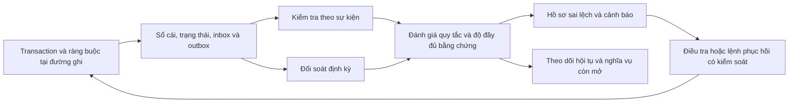

# Consistency monitoring: giám sát tính nhất quán của nghiệp vụ phân tán

## 1. Giám sát điều gì khi từng dịch vụ đều báo thành công?

Một đơn hàng có thể đi qua Order Service, Payment Service, Inventory Service và Shipping Service. Mỗi dịch vụ có dữ liệu, transaction và thời điểm cập nhật riêng. Những thành phần đó đều đang hoạt động không có nghĩa toàn bộ quy trình đang giữ đúng quy tắc nghiệp vụ.

Ví dụ, dịch vụ thanh toán đã hoàn tiền cho một đơn hủy trước giao hàng, nhưng một worker giao vận cũ vẫn phát lệnh xuất hàng. Hoặc cùng một thao tác hoàn tiền bị ghi hai tác động sổ cái dù mọi lời gọi HTTP đều trả thành công.

**Consistency monitoring là việc quan sát trạng thái và bằng chứng nghiệp vụ ở những nơi liên quan, đối chiếu chúng với các quy tắc đã định nghĩa, rồi phát hiện và theo dõi sai lệch đến khi được phân giải.** Nó cần trả lời được đối tượng nào bị ảnh hưởng, quy tắc nào không được thỏa, dữ liệu quan sát có đủ mới không và hệ thống còn nghĩa vụ gì chưa hoàn tất.

Trong Business Logic Security, hoạt động này giúp phát hiện hậu quả của request trùng, thao tác sai quyền, bỏ qua phê duyệt, sửa giá hoặc chạy sai state machine. Một cảnh báo nhất quán chưa tự chứng minh có tấn công; nhưng nó chỉ ra nơi cần kiểm tra tác động và chuỗi quyết định.

Giám sát thuộc lớp phát hiện và phục hồi. Transaction, ràng buộc dữ liệu, idempotency và quyền theo đối tượng vẫn phải ngăn vi phạm ngay tại đường ghi. Không được cho phép hoàn tiền vượt hạn mức rồi xem cảnh báo sau đó là biện pháp bảo vệ tương đương.

## 2. Tình huống xuyên suốt: một đơn hàng đang được hủy

Giả sử đơn `ord_88` có giá trị đã chốt 600.000 đồng và đã thu tiền. Khách hàng yêu cầu hủy trước khi hàng được giao. Quy trình cần xác nhận dừng giao vận, xử lý reservation và hoàn tiền theo chính sách.

Dữ liệu liên quan có thể nằm ở các nguồn sau:

| Dịch vụ hoặc nguồn | Dữ liệu có thẩm quyền trong ví dụ |
|---|---|
| Order Service | Đơn hàng, quyết định chấp nhận hủy, phiên bản kế hoạch hủy |
| Payment Service | Khoản thu, khoản hoàn, phần hạn mức đang giữ và liên kết giao dịch |
| Sổ cái | Các tác động tiền đã được ghi nhận theo mô hình nội bộ |
| Inventory Service | Reservation, phần còn giữ, đã nhả hoặc đã tiêu thụ |
| Shipping Service | Trạng thái và bằng chứng tạo, hủy, xuất hàng |
| Inbox/outbox | Sự kiện đã ghi bền, đã tiếp nhận hoặc đã áp dụng theo hợp đồng |
| Nhà cung cấp bên ngoài | Kết quả xử lý bên ngoài được tra cứu hoặc đối soát theo giao thức |

Nguồn có thẩm quyền phải được xác định theo từng loại dữ liệu. Bản sao trạng thái thanh toán trong Order Service là projection; nó không tự thay thế dữ liệu payment hoặc bằng chứng từ bên thực hiện khoản hoàn.

Một trường `PAID` trên đơn hàng và một khoản hoàn đã thành công chưa đủ để kết luận có lỗi. Đó có thể là projection đang trễ, hoặc `PAID` chỉ ghi lịch sử đã thanh toán theo mô hình sản phẩm. Quy tắc giám sát phải dựa trên ý nghĩa trạng thái cụ thể, không chỉ so sánh tên trường giữa các dịch vụ.

## 3. Chuyển invariant thành quy tắc có thể quan sát

Một quy tắc giám sát nên nêu rõ điều kiện áp dụng, dữ liệu cần có, thời gian cho phép và bằng chứng vi phạm.

### 3.1. Quy tắc an toàn

Đây là những điều không được sai tại điểm tác động được bảo vệ, chẳng hạn:

```text
Tổng tiền hoàn thành công + hạn mức giữ cho các khoản hoàn chưa kết thúc
    <= số tiền được phép hoàn của cùng khoản thanh toán.

Một yêu cầu hoàn tiền đã phê duyệt
    không có nhiều hơn một lần thực thi thành công.

Một reservation không vừa được nhả như chưa sử dụng
    vừa được tiêu thụ cho cùng phần hàng đã xuất.

Không tạo lệnh giao hàng mới trái quyết định hủy đã có hiệu lực
    theo giao thức của bước giao vận.
```

Các tổng tiền phải cùng payment, cùng tiền tệ và cùng cách phân loại trạng thái. Không cộng lẫn tiền đã hoàn với một bản ghi dự kiến chưa tạo tác động, rồi báo sai rằng đã hoàn dư. Cũng không bỏ qua khoản đang giữ khi đánh giá hạn mức còn có thể tiêu tiếp.

Giám sát không được tự cấp một khoảng “được phép vi phạm” cho invariant tiền chỉ vì hệ thống dùng eventual consistency. Nếu chưa có đủ bằng chứng để khẳng định tổng, phải đánh dấu dữ liệu chưa đầy đủ thay vì kết luận an toàn hoặc kết luận vi phạm bằng phép cộng sai.

### 3.2. Quy tắc tiến triển và hội tụ

Đây là những nghĩa vụ cần hoàn thành trong khoảng thời gian được xác định, chẳng hạn:

- Một yêu cầu hủy đã tiếp nhận bền vững phải đi tới kết quả hoặc trạng thái ngoại lệ được quản lý.
- Một sự kiện bắt buộc cho projection phải được áp dụng trong thời gian mục tiêu.
- Một khoản hoàn ở trạng thái chưa xác định phải được tra cứu hoặc đối soát, không bị bỏ quên.
- Một reservation không còn được phép giữ phải được giải phóng qua đúng quy trình.

Ví dụ học tập có thể đặt mục tiêu cập nhật projection trong hai phút và phân giải bước hoàn tiền trong mười lăm phút. Đây là số giả định cho bài học; hệ thống thực tế cần mục tiêu theo hợp đồng nghiệp vụ và cơ chế tích hợp.

Hết mục tiêu thời gian là một sự kiện cần xử lý, nhưng không tự chứng minh tác động bên ngoài đã thất bại. Một refund quá hạn vẫn có thể đang được nhà cung cấp xử lý.

### 3.3. Mẫu định nghĩa quy tắc

```text
rule_id: REFUND_REQUEST_EXECUTED_ONCE
applies_to: yêu cầu hoàn tiền đã có lần thực thi thành công
scope: tenant + approved_refund_request_id
evidence: các bản ghi refund thành công và liên kết sổ cái có thẩm quyền
condition: số lần thực thi thành công <= 1
time_policy: invariant an toàn, không có cửa sổ cho phép thực thi trùng
on_incomplete_evidence: đánh dấu chưa đủ dữ liệu, không kết luận đã đạt
response: tạo hồ sơ sai lệch và kiểm tra phạm vi ảnh hưởng
```

Mẫu này minh họa đặc tả, không phải định dạng cấu hình bắt buộc của một công cụ.

## 4. Phân biệt độ trễ hợp lệ với vi phạm đã được xác nhận

Giả sử Payment Service đã ghi refund thành công nhưng Order Service chưa áp dụng sự kiện kết quả. Nếu nghiệp vụ cho phép cập nhật bản sao sau một độ trễ, đây có thể là trạng thái đang hội tụ.

Ngược lại, nếu sổ cái có hai khoản cộng ví cho cùng một lần thực thi được phép, độ trễ projection không giải thích được việc đã tạo tác động tiền hai lần.

| Phân loại | Ý nghĩa | Hành động phù hợp |
|---|---|---|
| `CONSISTENT` | Bằng chứng đủ và quy tắc đang được thỏa trong phạm vi quan sát | Ghi nhận kết quả kiểm tra và tiếp tục theo dõi |
| `PENDING_CONVERGENCE` | Có bước chưa hội tụ nhưng vẫn trong cửa sổ được hợp đồng cho phép | Theo dõi tuổi và tiến triển, không tự thực thi lại nghiệp vụ |
| `CONFIRMED_VIOLATION` | Bằng chứng đủ cho thấy quy tắc bị vi phạm | Cảnh báo theo mức ảnh hưởng và mở quy trình xử lý |
| `OBSERVATION_INCOMPLETE` | Nguồn thiếu, dữ liệu quá cũ, quét chưa đầy đủ hoặc chưa có ranh giới đối chiếu phù hợp | Khôi phục khả năng quan sát, giữ trạng thái chưa rõ |
| `NEEDS_REVIEW` | Dữ liệu mâu thuẫn hoặc ngoại lệ không thể phân loại tự động an toàn | Lưu bằng chứng và chuyển kiểm tra nghiệp vụ |

Các tên trên là minh họa. Điểm quan trọng là một truy vấn lỗi không được biến thành “không có khoản hoàn” hoặc “mọi thứ đã nhất quán”. Không có dữ liệu khác với không có tác động.

Một sai lệch đang chờ hội tụ cần được nâng mức khi vượt mục tiêu hoặc có bằng chứng mới. Không được kéo dài cửa sổ mãi bằng cách lấy thời điểm poll gần nhất làm thời điểm bắt đầu chờ.

## 5. Đối chiếu đúng thao tác và đúng phiên bản

### 5.1. Định danh liên kết

Một bộ dữ liệu liên kết có thể gồm:

```text
tenant_id
order_id
workflow_id
cancellation_plan_id
payment_id
refund_request_id
refund_operation_id
reservation_id
shipment_operation_id
event_id
```

Các ID phục vụ những trách nhiệm khác nhau. Event ID giúp theo dõi giao sự kiện; operation ID giúp xác định tác động logic; attempt ID chỉ theo dõi lần thử. Hai event ID khác nhau vẫn có thể yêu cầu cùng một khoản hoàn.

Không ghép dữ liệu chỉ theo tên khách hàng, số tiền hoặc thời gian gần nhau. Hai giao dịch hợp lệ có thể cùng số tiền; hai tenant có thể dùng cùng một mã đơn ngắn. Scope và liên kết phải xuất phát từ dữ liệu tin cậy của quy trình.

### 5.2. Phiên bản của cùng một đối tượng

Nếu Order Service đã chuyển kế hoạch hủy từ phiên bản 17 sang 18, một consumer đang giữ phiên bản 17 có thể đang trễ. Tuy nhiên, không được so sánh version của payment với version của order như thể chúng là một số thứ tự chung.

Version hoặc sequence chỉ có ý nghĩa trong phạm vi và hợp đồng đã xác định. Nếu một projection chỉ nhận một số loại event, việc không thấy một số thứ tự có thể không phải mất message. Muốn kiểm tra khoảng trống phải biết chuỗi nào được cam kết đầy đủ cho projection đó.

### 5.3. Bằng chứng áp dụng khác với bằng chứng giao nhận

Broker đã ACK, message đã được consumer nhận hoặc một log “bắt đầu xử lý” không nhất thiết chứng minh tác động nghiệp vụ đã commit.

Theo thiết kế phù hợp, inbox ở trạng thái đã áp dụng cần được ghi cùng tác động cục bộ. Nếu checkpoint được ghi trước tác động, giám sát chỉ nhìn checkpoint có thể báo hội tụ dù dữ liệu nghiệp vụ còn thiếu.

Khi cần kết luận một nghĩa vụ đã hoàn tất, hãy đối chiếu trạng thái và dữ liệu tác động tương ứng, không chỉ số message đã đi qua hàng đợi.

## 6. Tính nhất quán của chính dữ liệu quan sát

Một monitor có thể đọc payment lúc 10:00:00, đọc đơn hàng lúc 10:00:05 và đọc sổ cái từ bản sao chậm đến 09:59:30. Những kết quả đó không tạo thành một snapshot toàn cục chỉ vì được thu thập trong cùng vòng lặp.

### 6.1. Lưu độ mới và nguồn của từng bằng chứng

Mỗi quan sát nên có đủ thông tin như:

```text
source
entity_id
source_version hoặc mốc tiến độ phù hợp
observed_at
source_recorded_at nếu có ý nghĩa theo hợp đồng
read_freshness/completeness
evidence_reference
```

Phân biệt thời điểm sự kiện xảy ra, thời điểm nguồn ghi nhận và thời điểm monitor nhìn thấy. Đồng hồ giữa các hệ thống có thể lệch; không sắp xếp mọi chuyển trạng thái chỉ bằng timestamp rồi coi đó là thứ tự nhân quả chắc chắn.

### 6.2. Không giả định có global snapshot

Có thể đối chiếu quanh một operation cụ thể, dùng dữ liệu bất biến như biên nhận và bút toán, cùng phiên bản hoặc mốc áp dụng đã được cam kết. Nếu các nguồn chưa đủ để tạo một kết luận nhất quán, monitor có thể đọc lại có giới hạn hoặc chờ thêm bằng chứng.

Một mốc tiến độ chỉ chứng minh những gì hợp đồng của nó thực sự bảo đảm. “Đã poll đến hiện tại” không chứng minh mọi bản ghi đến muộn đã được thấy. “Đã đọc sequence 100” cũng không chứng minh mọi tác động trước đó đã commit nếu giao thức không có bảo đảm ấy.

Không khóa mọi cơ sở dữ liệu chỉ để tạo một lần kiểm tra toàn cục thuận tiện. Monitor cần mô hình bằng chứng phù hợp với ranh giới phân tán và tải vận hành.

### 6.3. Kết quả âm tính cần thận trọng

Không thấy refund trong một replica chậm không chứng minh nhà cung cấp chưa refund. Không thấy một operation trong khi transaction gốc còn có thể đang chạy cũng chưa cho phép phát một lệnh mới.

Các nguồn thiếu hoặc quá cũ phải được phản ánh vào mức tin cậy của kết luận. Với quy tắc quan trọng, cần dữ liệu có thẩm quyền và điều kiện đủ rõ trước khi kích hoạt sửa tự động.

## 7. Kiến trúc giám sát gồm nhiều lớp bổ sung nhau



### 7.1. Kiểm tra theo sự kiện

Một event như `RefundSucceeded` có thể kích hoạt đối chiếu operation, sổ cái và quy trình hủy liên quan. Cách này giúp phát hiện nhanh, nhưng sự kiện có thể mất trên đường quan sát, đến trùng hoặc sai thứ tự. Bản thân monitor cũng phải xử lý idempotent và dùng dữ liệu gốc khi cần xác nhận.

### 7.2. Đối soát định kỳ

Một công việc định kỳ tìm các nghĩa vụ chưa kết thúc, đối chiếu tổng và kiểm tra lại dữ liệu sau phục hồi. Nó giúp phát hiện trường hợp đường event bị bỏ sót hoặc một công việc đã nằm im quá lâu.

Quét định kỳ cần phạm vi bao phủ rõ ràng, phân trang ổn định và checkpoint. Với dữ liệu cập nhật hoặc đến muộn, phải có chiến lược quét chồng lấn, nhìn lại hoặc đối soát bổ sung phù hợp. Không để việc tăng cursor làm bỏ qua vĩnh viễn các thay đổi xuất hiện sau đó ở một đối tượng cũ.

### 7.3. Lấy mẫu và kiểm tra đầy đủ

Lấy mẫu có thể giảm chi phí và hỗ trợ phát hiện xu hướng, nhưng không chứng minh mọi khoản tiền hay mọi đơn hàng đều đã nhất quán. Những invariant có yêu cầu bao phủ đầy đủ cần cơ chế kiểm tra hoặc bằng chứng tương ứng.

Quy mô kiểm tra nên theo rủi ro và tải: chia partition, giới hạn tốc độ và tránh làm monitor trở thành nguồn giữ khóa hoặc gây quá tải cho dịch vụ đang gặp sự cố.

## 8. Luồng đánh giá một quy trình hủy

Đoạn dưới là mã giả, không phải API chuẩn hoặc mã Java có thể chạy trực tiếp:

```text
candidate = readDurableWorkflowCandidate(tenant, workflowId)
ruleSet = loadApplicableRuleVersion(candidate.policyVersion)

evidence = collectAuthorizedEvidence(
    candidate.orderId,
    candidate.cancellationPlanId,
    candidate.linkedOperations
)

if evidence is unavailable, too stale or incomplete for the rule:
    recordObservationIncomplete(candidate, evidence)
    preserveExistingOpenIssues()
    return

if evidence belongs to incompatible plan versions or observation boundaries:
    requestBoundedRefreshOrClassifyForReview(candidate, evidence)
    return

findings = evaluateBusinessRules(ruleSet, evidence)

for finding in findings:
    caseKey = stableCaseIdentity(
        finding.ruleId,
        tenant,
        finding.businessOperationId,
        finding.violationKind
    )

    if finding is a confirmed safety violation:
        upsertOpenCaseWithoutResettingOriginalAge(caseKey, finding.evidence)
        routeAccordingToImpactAndPolicy(caseKey)

    else if finding is permitted convergence still within target:
        trackOutstandingObligation(caseKey, originalStartTime)

    else if finding exceeds its progress target:
        openOrUpdateOverdueCase(caseKey, finding.evidence)

resolvePreviouslyOpenCaseOnlyWithSufficientNewEvidence()
```

Từng rule phải có điều kiện bằng chứng riêng. Có thể đủ bằng chứng khẳng định một refund bị thực thi trùng từ dữ liệu cục bộ dù trạng thái shipping đang không đọc được. Không cần trì hoãn mọi kết luận chỉ vì một nguồn không liên quan bị thiếu; cũng không dùng bộ dữ liệu thiếu cho một rule cần chính nguồn đó.

Monitor nên lưu tham chiếu và phiên bản dữ liệu khiến kết luận được tạo ra. Một cảnh báo “đơn sai trạng thái” không có ID quy tắc, phạm vi hay bằng chứng sẽ khó điều tra và dễ dẫn tới sửa nhầm.

## 9. Cảnh báo phải gắn với tác động và vòng đời xử lý

### 9.1. Tránh tạo một cảnh báo mới ở mỗi lần poll

Dùng định danh ổn định theo quy tắc, tenant và đối tượng hoặc operation bị ảnh hưởng. Cập nhật cùng hồ sơ khi có bằng chứng mới, thay vì tạo hàng nghìn bản sao che khuất một sai lệch duy nhất.

Giữ thời điểm bắt đầu nghĩa vụ và thời điểm phát hiện đầu tiên. Hai thời điểm này có thể khác nhau. Khởi động lại monitor hoặc nhận lại một event không được tự đặt lại tuổi của một khoản hoàn đang chờ.

### 9.2. Phân mức theo ý nghĩa nghiệp vụ

Một projection trễ ngắn khác với đã cộng ví hai lần. Có thể xét tính chất invariant, số đối tượng, số tiền theo từng tiền tệ, khả năng tiếp tục tạo tác động và mức chắc chắn của bằng chứng.

Không cộng tiền của nhiều tiền tệ thành một con số “rủi ro” nếu chưa có quy tắc quy đổi được xác định. Không đếm cùng một khoản tiền nhiều lần chỉ vì nó vi phạm nhiều rule có liên quan.

### 9.3. Xác nhận cảnh báo không có nghĩa đã sửa xong

Một vòng đời có thể gồm `OPEN`, `ACKNOWLEDGED`, `INVESTIGATING`, `MITIGATED`, `RESOLVED`. Tên gọi tùy hệ thống; cần phân biệt đã có người nhận xử lý với đã có bằng chứng invariant được phục hồi hoặc nghĩa vụ đã hoàn tất.

Không đóng cảnh báo vì lần poll sau lỗi, không còn truy cập được nguồn hoặc dữ liệu bị xóa khỏi một projection. Có thể cần trạng thái chưa quan sát được, nhưng vấn đề cũ vẫn còn cho đến khi được phân giải bằng bằng chứng phù hợp.

Cơ chế giảm cảnh báo dao động có thể hữu ích cho độ trễ hội tụ, nhưng không được che một tác động tiền trùng đã được xác nhận. Thay đổi phiên bản rule cũng cần giữ lịch sử giải thích, không âm thầm làm biến mất các hồ sơ đang mở.

## 10. Phục hồi có kiểm soát, không sửa dữ liệu tùy tiện

Một kết luận giám sát là đầu vào cho quyết định xử lý, không tự là giấy phép ghi vào mọi hệ thống.

| Phát hiện | Hướng xử lý có thể phù hợp |
|---|---|
| Outbox đã ghi nhưng chưa được phát | Tiếp tục công việc qua đường outbox với cùng định danh |
| Consumer tiếp nhận nhưng chưa áp dụng | Khôi phục xử lý qua handler có chống trùng và kiểm tra trạng thái |
| Refund bên ngoài chưa rõ kết quả | Tra cứu hoặc đối soát bằng operation ổn định |
| Reservation có vẻ bị giữ quá lâu | Đánh giá lại điều kiện nhả tại Inventory Service rồi thực hiện lệnh được phép |
| Hai tác động tiền cho cùng yêu cầu | Khoanh vùng ảnh hưởng, ngăn tác động mới trái quy tắc và xử lý điều chỉnh có audit |
| Lệnh giao vận đến muộn sau hủy | Kiểm tra trạng thái thật và xử lý qua quy trình giao vận/hủy tương ứng |

Trước khi tạo tác động sửa, service có thẩm quyền phải đọc lại trạng thái hiện tại và kiểm tra quyền, phiên bản, hạn mức cùng điều kiện nghiệp vụ. Một snapshot cảnh báo có thể đã cũ khi lệnh sửa đến nơi.

Hành động phục hồi cần định danh ổn định và chống trùng riêng. Hai monitor hoặc hai người cùng xử lý một hồ sơ không được tạo hai khoản hoàn. Kết quả phục hồi cũng phải được giám sát và đối soát.

Không sửa một bộ đếm cho bằng con số mong muốn nếu chưa giải thích được chênh lệch sổ cái. Không phát lại toàn bộ event một cách mù quáng, hoàn tiền mới sau timeout hoặc tăng tồn kho cho hàng thực tế đã xuất. Những cách này có thể tạo thêm lỗi bảo mật logic.

Nếu cần chặn bước tiếp theo để giảm thiệt hại, biện pháp chặn phải được thực thi ở nơi có thẩm quyền với phạm vi, điều kiện và quyền rõ ràng. Một cờ trong monitor không tự dừng worker đang chạy ở dịch vụ khác.

## 11. Bảo vệ chính hệ thống giám sát

Monitor có thể nhìn thấy dữ liệu xuyên dịch vụ, nên quyền đọc cần giới hạn theo mục đích, phạm vi tenant và mức nhạy cảm. Bằng chứng nên có tham chiếu truy cập được kiểm soát thay vì sao chép toàn bộ payload thanh toán vào cảnh báo.

Một service account dùng để đọc và đánh giá không mặc nhiên cần quyền hoàn tiền hoặc sửa số dư. Nếu có phục hồi tự động, sử dụng danh tính và đường lệnh phù hợp, cùng giới hạn đối tượng và audit cho hành động đó.

Không để người dùng gửi một message “đã phát hiện sai lệch” rồi kích hoạt hoàn tiền hoặc khóa tài khoản tùy ý. Nguồn quan sát cần được xác thực; nội dung vẫn phải được đối chiếu với dữ liệu nghiệp vụ có thẩm quyền trước khi tạo tác động.

Thông tin trạng thái và hồ sơ điều tra cũng có quyền theo đối tượng. Biết order ID hoặc operation ID không cho phép người dùng tenant khác xem khoản tiền, người thụ hưởng hoặc bằng chứng nội bộ.

Trong phân tích bảo mật, có thể liên kết sai lệch với lịch sử đổi giá, lần phê duyệt, actor, request trùng hoặc lần truy cập bị từ chối. Các tương quan này hỗ trợ điều tra; không nên kết luận một actor có ý đồ tấn công chỉ từ việc hai sự kiện xảy ra gần nhau.

## 12. Giám sát khả năng quan sát và độ bao phủ

Một monitor chạy bình thường nhưng không đọc được Payment Service có thể tạo ra cảm giác an toàn sai. Cần theo dõi riêng sức khỏe của quá trình kiểm tra:

- Lần quét đầy đủ gần nhất cho từng partition hoặc phạm vi.
- Độ cũ của dữ liệu từng nguồn và số rule chưa đủ bằng chứng.
- Số đối tượng đang chờ kiểm tra cùng tuổi tồn đọng.
- Lỗi truy cập nguồn, giới hạn tốc độ và tiến độ checkpoint.
- Thời gian từ khi nghĩa vụ phát sinh đến khi có kết luận đủ bằng chứng.

Heartbeat chỉ chứng minh tiến trình còn hoạt động, không chứng minh mọi partition được quét hoặc mọi rule đã được đánh giá. Tương tự, một lần poll thành công không thay thế mốc hoàn tất đối soát của toàn phạm vi.

Khởi động lại, khôi phục backup hoặc đổi nguồn dữ liệu có thể làm mất checkpoint hoặc khiến phiên bản quan sát không còn tiếp tục như trước. Cần giữ thông tin nguồn và đợt xử lý phù hợp để phát hiện việc lùi dữ liệu, quét lại và chống trùng kết quả kiểm tra.

Metric nên dùng nhãn có số lượng giá trị được kiểm soát, như nhóm rule và loại kết luận. Order ID, key và operation ID phù hợp hơn trong hồ sơ chi tiết hoặc log được bảo vệ, không phải nhãn metric có số lượng giá trị rất lớn.

## 13. Kiểm thử rule, quan sát và quy trình phản ứng

Kiểm thử cần bao gồm dữ liệu thiếu và độ trễ bình thường, không chỉ những trạng thái chắc chắn sai. Nếu không, monitor có thể tạo quá nhiều cảnh báo giả hoặc kích hoạt sửa tự động nguy hiểm.

| Tình huống | Kết quả cần kiểm chứng |
|---|---|
| Refund thành công, projection còn trong thời gian cập nhật cho phép | Phân loại chờ hội tụ đúng rule, không hoàn tiền thêm |
| Projection vượt mục tiêu và không tiến triển | Hồ sơ quá hạn giữ đúng tuổi và bằng chứng |
| Hai refund thành công cho cùng yêu cầu chỉ được phép thực hiện một lần | Phát hiện vi phạm dù event ID khác nhau |
| Cùng một event được nhận nhiều lần | Không nhân đôi tổng tiền hoặc hồ sơ cảnh báo |
| Có refund đang giữ hạn mức nhưng chưa hoàn tất | Tổng hạn mức xét đúng trạng thái, không bỏ sót hoặc tính hai lần |
| Nguồn payment không truy cập được | Không xem tập rỗng là không có khoản hoàn |
| Replica hoặc dữ liệu sổ cái chậm | Không khẳng định một sai lệch xuyên nguồn khi bằng chứng chưa phù hợp |
| Đọc hai phiên bản kế hoạch hủy khác nhau | Đọc lại có giới hạn hoặc đưa vào phân loại cần kiểm tra |
| Event sai thứ tự hoặc sequence không toàn cục | Không suy diễn thứ tự ngoài hợp đồng của nguồn |
| Broker đã ACK nhưng tác động chưa commit | Không kết luận nghĩa vụ đã hoàn tất chỉ từ ACK |
| Nhiều tenant có cùng mã đơn ngắn | Không ghép dữ liệu hoặc lộ bằng chứng chéo tenant |
| Hai giao dịch cùng số tiền và thời gian gần nhau | Không bị ghép nhầm thành cùng một tác động |
| Monitor khởi động lại hoặc nhận lại candidate | Tuổi vấn đề và định danh hồ sơ không bị đặt lại |
| Một cảnh báo đang mở rồi nguồn dữ liệu lỗi | Không tự đánh dấu đã sửa xong |
| Hai tiến trình cùng yêu cầu phục hồi | Chỉ tạo tác động phục hồi theo cùng định danh và invariant |
| Worker làm thay đổi trạng thái sau khi monitor đọc | Đường sửa kiểm tra lại điều kiện, không áp dụng snapshot cũ mù quáng |
| Quét theo cursor gặp dữ liệu đến muộn hoặc cập nhật đối tượng cũ | Cơ chế nhìn lại/đối soát phù hợp không bỏ sót vĩnh viễn |
| Một partition không được quét dù tiến trình còn heartbeat | Phát hiện thiếu độ bao phủ |
| Dữ liệu tiền ở nhiều currency | Không cộng lẫn hoặc so sánh sai đơn vị |
| Thay phiên bản rule trong khi hồ sơ còn mở | Giữ lịch sử và lý do phân loại, không xóa dấu vết |

Với ví dụ đơn hàng, cần khẳng định cả độ đúng của kết luận lẫn hành động sau đó: không hoàn tiền trùng, không nhả hàng đã tiêu thụ và không đánh dấu hoàn tất khi còn nghĩa vụ chưa phân giải.

## 14. Câu hỏi tự kiểm tra

1. Vì sao các dịch vụ đều trả thành công vẫn có thể có vi phạm nghiệp vụ xuyên hệ thống?
2. Invariant an toàn khác gì với mục tiêu thời gian hội tụ?
3. Khi một nguồn dữ liệu lỗi, vì sao không được dùng giá trị rỗng để kết luận nhất quán?
4. Vì sao version của order không thể so sánh trực tiếp với version của payment?
5. ACK của message có chứng minh tác động nghiệp vụ đã commit không?
6. Trước khi sửa một sai lệch được phát hiện từ snapshot cũ, cần kiểm tra lại điều gì?
7. Vì sao heartbeat không đủ chứng minh monitor đã bao phủ mọi đối tượng?

Giám sát nhất quán có giá trị khi biến dữ liệu phân tán thành kết luận có phạm vi, bằng chứng và mức tin cậy rõ ràng, rồi theo dõi nghĩa vụ đến khi được xử lý. Kết hợp với cơ chế ngăn vi phạm tại đường ghi, nó giúp phát hiện và giải quyết hậu quả của thao tác trùng, sai quyền hoặc sai quy trình mà không tạo thêm tác động nghiệp vụ ngoài dự kiến.
