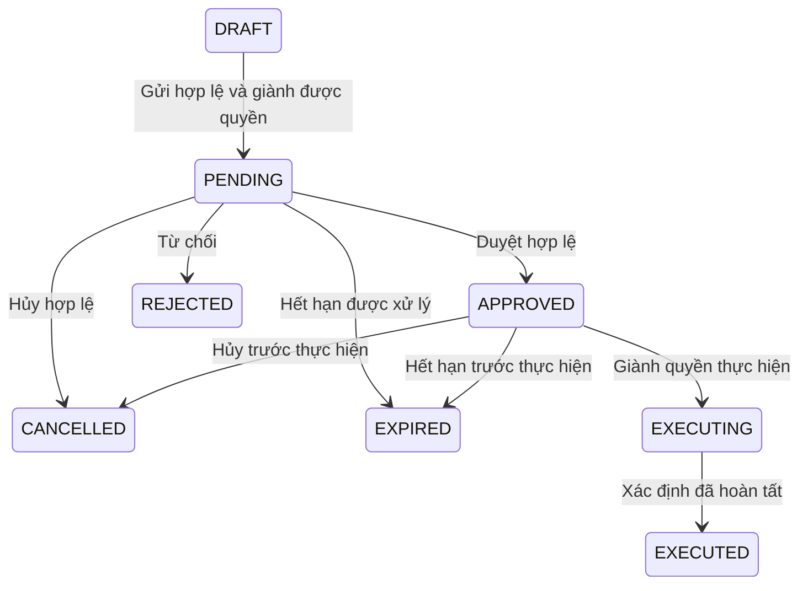

# Conditional uniqueness: tính duy nhất theo điều kiện nghiệp vụ

## 1. Bài toán không phải lúc nào cũng là “không được trùng”

Trong chương **Database Constraints**, conditional uniqueness là quy tắc một khóa nghiệp vụ chỉ được xuất hiện tối đa một lần trong tập bản ghi thỏa một điều kiện. Những bản ghi ngoài tập đó vẫn có thể cùng mang khóa này để lưu lịch sử.

Ví dụ: với mỗi tenant, đối tượng và loại thao tác, chỉ có một yêu cầu phê duyệt đang hoạt động. Sau khi yêu cầu bị từ chối hoặc đã thực hiện xong, hệ thống vẫn giữ bản ghi lịch sử và cho phép tạo yêu cầu mới.

Trong phạm vi module `SECURITY_APPLICATION_SECURITY_BUSINESS_LOGIC_SECURITY`, quy tắc này giúp ngăn nhiều yêu cầu cạnh tranh cùng chiếm một quyền nghiệp vụ, chẳng hạn hai luồng sửa giá cùng chờ duyệt trên một sản phẩm. Nó bổ sung cho quyền theo đối tượng, state machine, transaction và idempotency; mỗi cơ chế bảo vệ một điều kiện khác nhau.

Các ví dụ partial unique index trong bài dùng cú pháp PostgreSQL 18. Câu SQL có tham số `:name` là cách trình bày để tầng truy cập dữ liệu bind giá trị, không phải nội suy chuỗi. Phần bảng giữ chỗ trình bày một mô hình thay thế khi cần tránh phụ thuộc vào partial index của một engine cụ thể.

## 2. Tình huống lạm dụng: hai yêu cầu đang hoạt động cho cùng đối tượng

Giả sử người dùng gửi hai yêu cầu thay đổi giá cho sản phẩm `PRODUCT-42`. Dịch vụ chỉ kiểm tra trước khi insert:

```text
if not exists_live_request(tenant, product, CHANGE_PRICE):
    insert_request(status = PENDING)
```

Hai instance có thể cùng thấy chưa tồn tại rồi đều insert:

| Thứ tự | Request A | Request B |
| --- | --- | --- |
| 1 | Kiểm tra: chưa có yêu cầu đang hoạt động | |
| 2 | | Kiểm tra: chưa có yêu cầu đang hoạt động |
| 3 | Insert yêu cầu A | |
| 4 | | Insert yêu cầu B |

Sau đó một người duyệt A, người khác duyệt B; worker có thể áp dụng giá theo thứ tự bất ngờ hoặc dùng một quyết định duyệt đã không còn khớp dữ liệu hiện tại. Gửi request đồng thời biến một thiếu sót về tính toàn vẹn thành cửa lạm dụng logic.

Transaction bao quanh một lần đọc thường và một lần insert không tự tạo ra quy tắc duy nhất giữa các giao dịch. Kiểm tra trước có ích cho phản hồi sớm, nhưng chốt cuối phải là một cơ chế giành quyền có thể chịu cạnh tranh.

## 3. Viết rõ khóa và tập trạng thái được bảo vệ

Quy tắc của ví dụ:

```text
key = (tenant_id, resource_id, action_code)
live = status thuộc {PENDING, APPROVED, EXECUTING}

Với mọi key:
  số bản ghi cùng key và live = true không vượt quá 1
```

Đây là yêu cầu **tối đa một**, không phải **luôn có đúng một**. Nó không bảo đảm hệ thống đã tạo yêu cầu khi cần, cũng không bảo đảm yêu cầu sẽ được xử lý đến kết thúc.

| Trạng thái | Thuộc tập live? | Lý do |
| --- | --- | --- |
| `DRAFT` | Không | Chưa chiếm quyền xử lý; ví dụ cho phép nhiều bản nháp |
| `PENDING` | Có | Đang chờ duyệt cho thao tác này |
| `APPROVED` | Có | Đã duyệt nhưng quyền thực hiện vẫn đang được giữ |
| `EXECUTING` | Có | Tác động đang thực hiện hoặc cần phân giải kết quả |
| `EXECUTED` | Không | Tác động đã hoàn tất theo hợp đồng |
| `REJECTED` | Không | Đã kết thúc bằng từ chối |
| `CANCELLED` | Không | Đã hủy hợp lệ và không còn quyền thực hiện |
| `EXPIRED` | Không | Quyền đã được kết thúc theo quy trình hết hạn |

Nếu chỉ đưa `PENDING` vào điều kiện, một yêu cầu chuyển sang `APPROVED` sẽ nhả chỗ quá sớm. Yêu cầu thứ hai được tạo trong khi yêu cầu đầu vẫn có quyền thực hiện.

Không thêm `requested_by` vào khóa nếu quy tắc áp dụng cho toàn đối tượng: hai người dùng khác nhau vẫn tranh cùng một quyền sửa giá. Không thêm `target_version` chỉ để tránh xung đột nếu các yêu cầu ở hai phiên bản vẫn không được phép xử lý đồng thời.

`action_code` chỉ nên chia khóa khi các loại thao tác thật sự có quyền cùng tồn tại. Nếu mọi thao tác trên một đối tượng phải loại trừ nhau, bỏ cột này khỏi khóa duy nhất. Giá trị action phải do tuyến nghiệp vụ có thẩm quyền xác định, không để client tùy đặt một mã mới nhằm tránh khóa.

## 4. Mô hình PostgreSQL với partial unique index

### 4.1. Schema minh họa

```sql
CREATE TABLE business_resource (
    tenant_id VARCHAR(64) NOT NULL,
    resource_id VARCHAR(64) NOT NULL,
    owner_id VARCHAR(64) NOT NULL,
    current_version BIGINT NOT NULL,
    PRIMARY KEY (tenant_id, resource_id),
    CHECK (current_version >= 0)
);

CREATE TABLE approval_request (
    request_id VARCHAR(64) PRIMARY KEY,
    tenant_id VARCHAR(64) NOT NULL,
    resource_id VARCHAR(64) NOT NULL,
    action_code VARCHAR(32) NOT NULL,
    requested_by VARCHAR(64) NOT NULL,
    approved_by VARCHAR(64),
    target_version BIGINT NOT NULL,
    proposed_payload TEXT NOT NULL,
    payload_hash VARCHAR(64) NOT NULL,
    idempotency_key VARCHAR(128) NOT NULL,
    status VARCHAR(16) NOT NULL,
    created_at TIMESTAMPTZ NOT NULL,
    expires_at TIMESTAMPTZ NOT NULL,
    FOREIGN KEY (tenant_id, resource_id)
        REFERENCES business_resource (tenant_id, resource_id),
    CONSTRAINT uq_approval_idempotency
        UNIQUE (tenant_id, requested_by, idempotency_key),
    CHECK (target_version >= 0),
    CHECK (expires_at > created_at),
    CHECK (action_code IN ('CHANGE_PRICE', 'PUBLISH_CONTENT')),
    CHECK (status IN (
        'DRAFT', 'PENDING', 'APPROVED', 'EXECUTING',
        'EXECUTED', 'REJECTED', 'CANCELLED', 'EXPIRED'
    )),
    CHECK (
        status NOT IN ('APPROVED', 'EXECUTING', 'EXECUTED')
        OR (
            approved_by IS NOT NULL
            AND approved_by <> requested_by
        )
    )
);

CREATE UNIQUE INDEX uq_approval_request_live
ON approval_request (tenant_id, resource_id, action_code)
WHERE status IN ('PENDING', 'APPROVED', 'EXECUTING');
```

Index chỉ giới hạn các dòng thỏa predicate, nên nhiều dòng lịch sử `REJECTED` hoặc `EXECUTED` vẫn được phép. Đây là cách PostgreSQL biểu diễn tính duy nhất trên một tập con. [PostgreSQL 18: Partial Indexes](https://www.postgresql.org/docs/18/indexes-partial.html).

`proposed_payload` là nội dung đề xuất đã được máy chủ xác thực và chuẩn hóa; `payload_hash` được tính theo quy tắc của ứng dụng. Bài không coi một chuỗi hash là bằng chứng nội dung an toàn. Trước khi thực hiện, worker phải dùng đúng payload đã duyệt và kiểm tra phiên bản đối tượng.

Điều kiện `approved_by` minh họa yêu cầu có người duyệt khác người đề nghị ở các trạng thái đã duyệt. DB chỉ kiểm tra quan hệ giữa các giá trị lưu; ứng dụng vẫn phải chứng minh danh tính và quyền người duyệt. Cho client tự gửi một `approved_by` khác không đáp ứng quy tắc phê duyệt.

### 4.2. Những lớp bảo vệ có vai trò khác nhau

| Thành phần | Bảo vệ điều gì? |
| --- | --- |
| `NOT NULL` trên khóa và trạng thái | Không cho giá trị thiếu làm thay đổi phạm vi so sánh hoặc rơi khỏi predicate |
| `CHECK` tập trạng thái/action | Không nhận mã ngoài miền nghiệp vụ đã định nghĩa |
| Foreign key có tenant | Không liên kết yêu cầu với đối tượng của tenant khác chỉ vì trùng resource ID |
| `uq_approval_request_live` | Tối đa một yêu cầu trong toàn tập trạng thái live cho cùng khóa |
| `uq_approval_idempotency` | Một key của người gọi không được tạo nhiều yêu cầu, kể cả sau khi yêu cầu cũ kết thúc |
| Kiểm tra quyền và chuyển trạng thái | Chỉ chủ thể được phép mới tạo, duyệt hoặc thực hiện hành động hợp lệ |

Các cột quan trọng không nên dựa riêng vào `CHECK` để loại `NULL`: trong PostgreSQL, biểu thức check cho kết quả null không bị coi là vi phạm. Dùng `NOT NULL` hoặc nhánh kiểm tra tường minh phù hợp. [PostgreSQL: Check Constraints](https://www.postgresql.org/docs/current/ddl-constraints.html#DDL-CONSTRAINTS-CHECK-CONSTRAINTS).

## 5. Những thiết kế trông tương đương nhưng sai quy tắc

| Thiết kế | Sai khác so với yêu cầu |
| --- | --- |
| `UNIQUE (tenant_id, resource_id, action_code)` cho mọi dòng | Chặn cả việc lưu nhiều lần xử lý lịch sử |
| `UNIQUE (..., status)` | Cho phép một dòng `PENDING` và một dòng `APPROVED` cùng lúc |
| Ba unique index riêng cho ba trạng thái | Mỗi trạng thái có thể có một dòng, tổng cộng vẫn có ba dòng live |
| `UNIQUE (..., is_active)` với boolean không null | Đồng thời giới hạn nhóm `false`, khiến nhiều bản ghi lịch sử cũng bị chặn |
| Predicate chỉ có `status = 'PENDING'` | Nhả quyền khi duyệt, dù tác động chưa hoàn tất |
| Khóa chứa `requested_by` ngoài ý nghĩa nghiệp vụ | Mỗi người tạo được một yêu cầu live cho cùng đối tượng |
| Chỉ kiểm tra `NOT EXISTS` trong ứng dụng | Hai transaction có thể cùng vượt kiểm tra |

Một kỹ thuật khác là dùng marker có giá trị ở dòng live và `NULL` ở dòng lịch sử. Cách này phụ thuộc semantics `NULL`, kiểu index và cấu hình engine; không phải công thức di động mặc định. Ví dụ đang xét dùng cột khóa không null và predicate tường minh để tránh dựa vào mẹo đó.

Conditional uniqueness cũng không biểu diễn giới hạn “tối đa hai người đang giữ” hoặc “tổng lượng không vượt 100”. Những quy tắc đó cần bộ đếm, phân bổ quyền, mô hình slot hoặc giao thức khác phù hợp; không thể đổi tên một unique index để có hạn mức tùy ý.

## 6. Constraint bảo vệ cả insert lẫn chuyển trạng thái

### 6.1. Tạo yêu cầu đang hoạt động

Một luồng tạo `PENDING` có thể tổ chức như sau:

```text
xác thực người gọi, xác định tenant và action từ tuyến nghiệp vụ
kiểm tra hình dạng request, chuẩn hóa payload và tính fingerprint

BEGIN TRANSACTION
  khóa/đọc business_resource theo tenant và resource
  kiểm tra quyền tạo yêu cầu trên đối tượng

  tìm yêu cầu cũ theo key idempotency của người gọi
  nếu có:
      xác minh cùng fingerprint và quyền đọc kết quả
      kết thúc đường đọc, trả yêu cầu đã lưu

  kiểm tra target_version khớp current_version
  kiểm tra điều kiện của nội dung đề xuất
  INSERT approval_request với status = PENDING
  ghi audit/outbox nếu cần
COMMIT

trả yêu cầu đã commit
```

Khóa đối tượng cha là một cách giữ ổn định phiên bản và một phần dữ liệu kiểm tra trong giao dịch. Mọi luồng sửa nội dung liên quan cần phối hợp theo cùng cơ chế hoặc dùng cập nhật có phiên bản tương đương. Unique index vẫn cần thiết để bảo vệ tập yêu cầu trước cạnh tranh và các đường ghi khác.

Nếu insert vi phạm `uq_approval_request_live`, rollback transaction rồi trả xung đột nghiệp vụ hoặc đọc lại kết quả hợp lệ theo quyền. Không commit audit/outbox mô tả một yêu cầu mới thành công trong khi yêu cầu đó chưa được tạo.

### 6.2. Đưa bản nháp vào tập live

Nhiều bản nháp có thể cùng tồn tại, nhưng chỉ một bản được vào tập live:

```sql
UPDATE approval_request
SET status = 'PENDING'
WHERE tenant_id = :tenant_id
  AND request_id = :request_id
  AND requested_by = :actor_id
  AND status = 'DRAFT';
```

Ví dụ này là bước cập nhật trong transaction đã kiểm tra quyền, phiên bản và payload. Nếu có một yêu cầu live khác cùng khóa, unique index chặn chính lần cập nhật. Không chỉ kiểm thử đường insert rồi mặc định mọi đường update đều an toàn.

Các thay đổi `resource_id`, `action_code` hoặc tenant của dòng đang live cũng có thể tạo xung đột. Với mô hình này, danh tính đối tượng và action nên được giữ bất biến sau khi gửi, thay vì cung cấp một API đổi khóa để né quy tắc.

### 6.3. Giữ quyền đến đúng điểm kết thúc



`PENDING -> APPROVED -> EXECUTING` vẫn nằm trong cùng tập duy nhất. Chỉ một chuyển trạng thái kết thúc hợp lệ mới nhả quyền cho yêu cầu khác. Không chuyển tạm sang `DRAFT`, xóa dòng hoặc đổi action để nhường chỗ khi tác động cũ vẫn đang thực hiện.

Nhả quyền và tạo yêu cầu thay thế nếu được phép nên nằm trong cùng transaction với các kiểm tra cần thiết. Transaction khác không được dựa vào thay đổi chưa commit; nếu giao dịch thay thế rollback, yêu cầu cũ vẫn giữ trạng thái đã commit trước đó.

## 7. Xử lý conflict có chủ đích

### 7.1. Không coi mọi lỗi DB là “đã có yêu cầu”

Tầng truy cập dữ liệu cần phân biệt:

| Kết quả | Cách xử lý |
| --- | --- |
| Xung đột đúng `uq_approval_request_live` | Không tạo quyền thứ hai; trả hoặc phân giải xung đột đang xử lý |
| Xung đột `uq_approval_idempotency` | Đọc lại trong transaction mới, kiểm tra fingerprint và quyền |
| Vi phạm check hoặc foreign key | Lỗi dữ liệu/miền giá trị/quan hệ; không trả thành công giả |
| Deadlock hoặc serialization failure | Rollback, retry toàn transaction nếu chính sách cho phép |
| Lỗi kết nối hoặc kết quả commit chưa rõ | Tra cứu cùng danh tính thao tác, không suy là chưa từng ghi |

Trong PostgreSQL, sau lỗi làm transaction rơi vào trạng thái lỗi, không tiếp tục xử lý như thể insert chỉ trả `false`. Luồng minh họa dùng rollback toàn transaction rồi đọc lại bằng transaction mới. Chỉ nhận diện lỗi theo loại và tên constraint/index dự kiến; không bắt mọi `SQLException` rồi trả “duplicate”.

Không lộ request ID, nội dung đề xuất hoặc người duyệt của một yêu cầu khác nếu người gọi không có quyền đọc. Phản hồi “đã có yêu cầu đang xử lý” không bắt buộc phải kèm toàn bộ bản ghi gây xung đột.

### 7.2. `ON CONFLICT` với predicate tương ứng

Có thể dùng PostgreSQL `ON CONFLICT` để không insert khi chạm khóa live:

```sql
INSERT INTO approval_request (
    request_id, tenant_id, resource_id, action_code,
    requested_by, target_version, proposed_payload,
    payload_hash, idempotency_key, status,
    created_at, expires_at
)
VALUES (
    :request_id, :tenant_id, :resource_id, :action_code,
    :actor_id, :target_version, :proposed_payload,
    :payload_hash, :idempotency_key, 'PENDING',
    :db_now, :expires_at
)
ON CONFLICT (tenant_id, resource_id, action_code)
WHERE status IN ('PENDING', 'APPROVED', 'EXECUTING')
DO NOTHING
RETURNING request_id;
```

Predicate ở conflict target phục vụ suy luận index, không phải lệnh duyệt hoặc kiểm tra quyền. Có dòng `RETURNING` mới chứng minh câu lệnh này đã insert. Không có dòng nghĩa là chưa tạo bản ghi mới theo nhánh đó; chưa thể kết luận đó là replay cùng nội dung. [PostgreSQL 18: INSERT và ON CONFLICT](https://www.postgresql.org/docs/18/sql-insert.html#SQL-ON-CONFLICT).

`uq_approval_request_live` là tên của index được tạo bằng `CREATE UNIQUE INDEX`; không mặc định dùng tên đó ở `ON CONFLICT ON CONSTRAINT`. Ví dụ chỉ rõ cột và predicate để suy luận partial index. Những xung đột khác, gồm key idempotency hoặc request ID, vẫn cần xử lý phù hợp.

Sau `DO NOTHING`, việc tra bản ghi đang live là một bước đọc riêng và vẫn có thể gặp cạnh tranh: bản ghi thắng có thể vừa kết thúc hoặc snapshot đọc chưa phù hợp. Nếu không thấy, không trả một request ID do mình chưa insert. Đọc lại hoặc retry có giới hạn bằng transaction thích hợp và kiểm chứng lại điều kiện.

Tránh `DO UPDATE` để tự thay payload, người đề nghị hoặc người duyệt của dòng đang chiếm quyền. Điều đó có thể biến một yêu cầu gây xung đột thành sửa trái phép nội dung đã duyệt. Unique conflict không cấp quyền ghi đè bản ghi thắng.

## 8. Conditional uniqueness và idempotency khác nhau

Partial index trả lời: “hiện có yêu cầu nào đang chiếm quyền cho đối tượng và action này không?”. Key idempotency trả lời: “người gọi đã tạo yêu cầu nào cho lần gửi logic này chưa?”.

| Tình huống | Hành vi mong đợi |
| --- | --- |
| Cùng key, cùng nội dung, yêu cầu vẫn live | Trả yêu cầu cũ, không tạo mới |
| Cùng key, cùng nội dung, yêu cầu đã `EXECUTED` | Vẫn nhận diện yêu cầu cũ; không tạo yêu cầu mới chỉ vì index live đã nhả |
| Cùng key, khác nội dung | Từ chối xung đột danh tính yêu cầu |
| Key mới, cùng đối tượng/action đang live | Bị chặn bởi unique có điều kiện |
| Key mới sau khi yêu cầu cũ kết thúc hợp lệ | Có thể tạo vòng đời mới nếu quyền, phiên bản và chính sách cho phép |

Key trong schema thuộc thao tác tạo yêu cầu. Các thao tác duyệt hoặc thực hiện có state machine và danh tính thao tác riêng khi cần; không mặc định một key tạo yêu cầu điều khiển mọi lần chuyển trạng thái.

Unique live cũng không bảo đảm “mỗi request chỉ áp dụng tác động một lần”. Khi đã sang `EXECUTED`, dòng không còn ở index live; một callback cũ vẫn phải bị chặn bởi điều kiện trạng thái và một receipt thực thi có khóa duy nhất theo request nếu nghiệp vụ cần.

Với tác động cục bộ, cập nhật đối tượng theo `target_version`, receipt thực thi, trạng thái kết thúc và outbox cần cùng transaction. Với dịch vụ ngoài, không ghi `EXECUTED` chỉ vì đã gửi request qua mạng; cần xử lý kết quả chưa rõ và retry bằng cùng mã tác động. Nhả quyền quá sớm có thể cho tác động mới cạnh tranh với tác động cũ chưa biết kết quả.

## 9. Hết hạn, xóa mềm và predicate thay đổi theo thời gian

### 9.1. Không dùng đồng hồ chạy trong predicate

Thiết kế sau không phù hợp và không được PostgreSQL chấp nhận như một predicate index hợp lệ:

```sql
-- Ví dụ sai: không dùng cho thiết kế này.
CREATE UNIQUE INDEX uq_request_not_expired
ON approval_request (tenant_id, resource_id, action_code)
WHERE expires_at > now();
```

PostgreSQL yêu cầu hàm trong định nghĩa index là immutable; thời gian hiện tại không đáp ứng điều kiện đó. Predicate cũng không được tùy đọc bảng khác hoặc dùng truy vấn con. [PostgreSQL 18: CREATE INDEX](https://www.postgresql.org/docs/18/sql-createindex.html).

Quan trọng về mô hình: thời gian trôi qua không phải một giao dịch đổi trạng thái nghiệp vụ. Cần chuyển trạng thái qua một bước được kiểm soát, thay vì mong index tự nhả quyền theo đồng hồ.

### 9.2. Chuyển sang `EXPIRED` một cách tường minh

Ví dụ xử lý những yêu cầu chưa bắt đầu thực hiện:

```sql
UPDATE approval_request
SET status = 'EXPIRED'
WHERE tenant_id = :tenant_id
  AND request_id = :request_id
  AND status IN ('PENDING', 'APPROVED')
  AND expires_at <= :db_now;
```

`:db_now` là thời điểm có thẩm quyền theo chính sách và semantics thời gian của DB. Luồng nhận thực hiện phải cạnh tranh bằng chuyển `APPROVED -> EXECUTING` có điều kiện trạng thái và hạn. Chỉ bên chuyển thành công mới được tiếp tục tác động tương ứng.

Một yêu cầu đã quá hạn nhưng còn mang trạng thái live vẫn chiếm quyền cho đến khi giao dịch hết hạn commit. Nếu worker hết hạn chậm, hệ thống có thể chậm nhận yêu cầu mới; không giải quyết bằng cách bỏ index hoặc bỏ qua xung đột.

Không tự kết thúc `EXECUTING` chỉ vì một timer đã qua nếu tác động ngoài hệ thống còn chưa rõ. Cần phân giải, hủy có phối hợp hoặc bù theo state machine trước khi cho phép một vòng đời mới.

### 9.3. Xóa mềm không thay thế kết thúc nghiệp vụ

Nếu thêm predicate `deleted_at IS NULL`, việc đánh dấu xóa có thể nhả quyền dù tác động vẫn đang chạy. Chỉ dùng quy tắc đó khi “xóa” thật sự làm hết quyền và mọi worker cũ bị chặn theo hợp đồng.

Tương tự, không đổi status từ `EXECUTING` về `DRAFT` để ẩn một yêu cầu lỗi. UI có thể không hiển thị nhưng quyền nghiệp vụ và tác động đang chờ phải tiếp tục được quản lý rõ ràng.

## 10. Phương án thay thế: bảng giữ chỗ có khóa chính

Khi không dùng partial unique index, có thể biểu diễn quyền đang được chiếm thành một dòng riêng. Đây là phương án thay thế cho `uq_approval_request_live`, không phải yêu cầu cài cả hai mô hình cùng lúc.

Giữ bảng lịch sử `approval_request`, bổ sung khóa tham chiếu và bảng slot:

```sql
ALTER TABLE approval_request
ADD CONSTRAINT uq_approval_slot_target
UNIQUE (tenant_id, resource_id, action_code, request_id);

CREATE TABLE live_approval_slot (
    tenant_id VARCHAR(64) NOT NULL,
    resource_id VARCHAR(64) NOT NULL,
    action_code VARCHAR(32) NOT NULL,
    request_id VARCHAR(64) NOT NULL,
    PRIMARY KEY (tenant_id, resource_id, action_code),
    UNIQUE (request_id),
    FOREIGN KEY (tenant_id, resource_id, action_code, request_id)
        REFERENCES approval_request (
            tenant_id, resource_id, action_code, request_id
        )
);
```

Khóa chính của slot bảo vệ tối đa một chủ thể giữ quyền theo khóa nghiệp vụ. Foreign key ghép bảo đảm slot tham chiếu đúng yêu cầu thuộc cùng tenant, đối tượng và action, không chỉ một request ID có tồn tại.

Quy trình tạo quyền:

```text
BEGIN TRANSACTION
  kiểm tra quyền, đối tượng và phiên bản
  tạo yêu cầu hoặc chuyển bản nháp sang PENDING
  INSERT live_approval_slot cho request đó
  nếu slot xung đột: rollback toàn bộ
COMMIT
```

Quy trình kết thúc:

```text
BEGIN TRANSACTION
  kiểm tra và chuyển request sang trạng thái kết thúc hợp lệ
  DELETE slot WHERE tenant/resource/action khớp
                    AND request_id = request đang kết thúc
  kiểm tra kết quả theo giao thức
COMMIT
```

Điều kiện `request_id` khi xóa rất quan trọng. Một callback cũ không được xóa slot chỉ theo đối tượng/action, vì slot đó có thể đã thuộc yêu cầu mới. Không xóa được dòng không tự cấp quyền xóa một chủ sở hữu khác.

Bảng slot không tự tạo đẳng thức “mọi request live đều có đúng một slot tương ứng”. Cần tất cả đường ghi tuân thủ transaction, hạn chế cập nhật trực tiếp, và kiểm tra slot khi giành quyền thực hiện. Foreign key cũng không tự chứng minh trạng thái request đang live. Vì vậy đây là một mô hình sở hữu cần giao thức đầy đủ, không phải cách chuyển toàn bộ logic sang một primary key.

Nếu dùng cột sinh, index biểu thức hoặc filtered index của engine khác, phải kiểm tra khả năng predicate, semantics null, collation và cách xử lý cạnh tranh của chính engine đó. Không sao chép cú pháp `CREATE INDEX ... WHERE` rồi giả định mọi DB đều thực thi cùng nghĩa.

## 11. Thêm constraint vào dữ liệu đang chạy

### 11.1. Kiểm kê vi phạm trước khi tạo index

Một truy vấn tìm khóa đang có nhiều dòng live:

```sql
SELECT tenant_id, resource_id, action_code, COUNT(*) AS live_count
FROM approval_request
WHERE status IN ('PENDING', 'APPROVED', 'EXECUTING')
GROUP BY tenant_id, resource_id, action_code
HAVING COUNT(*) > 1;
```

Ngoài dòng trùng, cần kiểm tra null ở khóa, mã action khác cách viết, trạng thái ngoài miền và yêu cầu `EXECUTING` chưa biết kết quả. Không sửa bằng cách giữ tùy ý dòng có thời gian mới nhất rồi xóa phần còn lại; một dòng cũ có thể đã được duyệt hoặc đã tạo tác động bên ngoài.

Mỗi xung đột cần được xác định chủ sở hữu quyền thực sự và xử lý các yêu cầu còn lại theo state machine, audit và quy tắc bù nếu cần.

### 11.2. Đóng cửa sổ tạo vi phạm mới

Một lần kiểm kê cho kết quả rỗng chưa ngăn writer tạo thêm dòng trùng ngay sau đó. Kế hoạch migration cần kiểm soát writer và cách build index phù hợp với môi trường. Cần đánh giá khả năng khóa ghi, lỗi build và cách xác minh index hoạt động trước khi coi bất biến đã được bảo vệ.

Không dùng việc index có đúng tên làm bằng chứng định nghĩa đúng: PostgreSQL lưu ý `IF NOT EXISTS` không chứng minh index sẵn có tương đương với index muốn tạo. Cần kiểm tra khóa, predicate và trạng thái hợp lệ của index. [PostgreSQL 18: CREATE INDEX](https://www.postgresql.org/docs/18/sql-createindex.html).

Đồng thời triển khai cách xử lý unique conflict ở API, worker, import, job sửa dữ liệu và các đường quản trị. Một đường ghi quên xử lý lỗi có thể làm thao tác thất bại; một đường ghi có quyền tắt hoặc bỏ constraint có thể làm mất bảo đảm.

### 11.3. Thay đổi tập live là thay đổi chính sách

Nếu thêm trạng thái như `WAITING_EXTERNAL`, phải quyết định nó có tiếp tục giữ quyền hay không. Nếu có, index và các luồng xử lý phải được mở rộng an toàn trước khi writer sử dụng trạng thái đó. Không thêm một trạng thái vào code rồi quên rằng DB đang xem nó là ngoài tập được bảo vệ.

Với schema thay đổi qua nhiều phiên bản ứng dụng, giữ bảo vệ liên tục trong suốt rollout. Không drop index cũ trước rồi để một khoảng thời gian không có cơ chế bảo vệ tương đương.

Unique trong một DB hoặc một phạm vi phân vùng không tự là unique xuyên mọi shard và vùng độc lập. Nếu cùng khóa nghiệp vụ có thể được ghi tại nhiều nơi, cần một chủ sở hữu hoặc giao thức điều phối phù hợp. Với bảng partitioned, kiểm tra các hạn chế cụ thể của engine khi thiết kế khóa và phạm vi index.

## 12. Kiểm thử theo trạng thái và cạnh tranh

### 12.1. Ma trận tình huống

| Tình huống | Thiết lập | Kết quả mong đợi |
| --- | --- | --- |
| Hai insert cùng khóa | Hai transaction cùng tạo `PENDING` | Tối đa một yêu cầu live commit |
| Khác người đề nghị | Hai actor cùng đối tượng/action | Vẫn chỉ một yêu cầu live |
| Trạng thái live khác nhau | Có `APPROVED`, thử tạo `PENDING` | Bị chặn dù status không giống nhau |
| Đang thực hiện | Có `EXECUTING`, thử tạo yêu cầu mới | Bị chặn cho đến khi tác động cũ kết thúc hợp lệ |
| Nhiều lịch sử | Tạo nhiều dòng `REJECTED` hoặc `EXECUTED` hợp lệ | Được phép, không bị giới hạn thành một dòng lịch sử |
| Bản nháp gửi đồng thời | Hai `DRAFT` cùng chuyển sang `PENDING` | Chỉ một dòng vào tập live |
| Đổi khóa của dòng live | Thử chuyển sang khóa đã bị chiếm | Constraint chặn; API còn phải áp dụng quy tắc bất biến danh tính |
| Thiếu tenant/action/status | Gửi null hoặc giá trị không được phép | Bị từ chối, không đi vòng predicate |
| Khác tenant hợp lệ | Cùng resource ID/action trong hai tenant riêng | Không xung đột ngoài phạm vi; không cho tham chiếu chéo tenant |
| Replay cùng key | Cùng actor, key và fingerprint | Trả request đã lưu, không tạo vòng đời mới |
| Key cũ sau kết thúc | Yêu cầu cũ đã `EXECUTED`, gửi lại cùng key | Vẫn nhận diện request cũ |
| Key mới khi đang live | Đổi key nhưng giữ đối tượng/action | Bị unique live chặn |
| Cùng key, nội dung khác | Đổi payload hoặc target version | Bị từ chối xung đột |
| Quá hạn chưa xử lý | `expires_at` đã qua nhưng status vẫn live | Vẫn giữ quyền theo mô hình |
| Hết hạn đua với thực hiện | Hai transaction tranh `APPROVED` | Chỉ một chuyển trạng thái hợp lệ thắng |
| Rollback khi nhả quyền | Đổi trạng thái kết thúc rồi gây lỗi trước commit | Quyền cũ vẫn được giữ sau rollback |
| Mất phản hồi sau commit | Commit tạo request thành công rồi ngắt response | Retry cùng key tìm request cũ |
| Callback cũ trong mô hình slot | Slot đã thuộc request mới, callback cũ nhả | Không xóa slot của request mới |

Khi kiểm tra xung đột giữa các trạng thái, các giá trị khác phải hợp lệ, gồm `approved_by` cho trạng thái đã duyệt. Một test thất bại vì check người duyệt không chứng minh unique live đang hoạt động.

### 12.2. Ép hai transaction cùng tranh quyền

Dùng hai connection độc lập và barrier ngay trước insert hoặc cập nhật vào tập live. Không để pool một connection biến bài kiểm thử thành tuần tự.

```text
chuẩn bị resource hợp lệ và chưa có yêu cầu live
commit dữ liệu chuẩn bị

worker A: chuẩn bị request A với key riêng, chờ barrier
worker B: chuẩn bị request B với key riêng, chờ barrier
mở barrier
chờ cả hai transaction commit, rollback hoặc retry theo chính sách

assert COUNT(live requests cho cùng key nghiệp vụ) = 1
assert không có outbox/audit thành công cho request đã rollback
assert phản hồi của bên không tạo được request không nhận ID giả
```

Dùng key riêng để kiểm tra unique nghiệp vụ, rồi có bài riêng với cùng key để kiểm tra idempotency. Hai bài tranh chấp ở hai ràng buộc khác nhau.

Nên có bài kiểm tra trực tiếp insert/update qua hai transaction DB, ngoài bài đi qua service. Một khóa đối tượng cha trong service có thể tuần tự hóa các thao tác và che việc migration đã thiếu partial unique index.

### 12.3. Kiểm tra cả điều được phép

Không chỉ assertion yêu cầu sai bị từ chối. Cần chứng minh có thể lưu nhiều lịch sử, có thể tạo yêu cầu mới sau khi kết thúc hợp lệ, và một request chuyển `PENDING -> APPROVED -> EXECUTING` không tự đánh mất quyền.

Đặc biệt, một request `EXECUTED` không được quay lại `EXECUTING` chỉ vì hiện không còn dòng live khác. Partial index có thể không tạo xung đột trong trường hợp đó; state machine vẫn phải từ chối.

Kiểm thử bằng engine mục tiêu để bao phủ predicate, null, khóa và metadata lỗi thực tế. Một DB thay thế hoặc mock chỉ có thể chứng minh một phần luồng ứng dụng, chưa chứng minh constraint sản xuất đã đúng.

## 13. Theo dõi và vận hành

Nhật ký nên liên kết tenant, đối tượng, action, request ID, actor đã xác thực, trạng thái cũ/mới, target version và tên constraint gặp xung đột. Không cần ghi nguyên nội dung nhạy cảm hoặc token để giải thích một unique conflict.

Theo dõi riêng:

- Xung đột live do request cạnh tranh, tách khỏi replay cùng key.
- Xung đột key nhưng fingerprint khác.
- Yêu cầu live quá hạn chưa được xử lý.
- Yêu cầu `EXECUTING` chưa xác định được kết quả trong thời gian dự kiến.
- Lỗi chuyển trạng thái, lỗi phiên bản đối tượng và lỗi quyền theo đối tượng.
- Với mô hình slot, dòng live thiếu slot hoặc slot giữ bởi request không còn hợp lệ.

Một unique conflict dự kiến không phải lý do tắt constraint. Nó cho biết hai luồng đang tranh cùng quyền hoặc có một yêu cầu chưa được kết thúc. Cần trả kết quả phù hợp và điều tra tình trạng kẹt nếu có, thay vì tự hủy bản ghi thắng.

Truy vấn kiểm kê số dòng live có thể dùng trong migration và đối soát. Nếu phát hiện nhiều dòng vi phạm ở nguồn được cho là đã có index hợp lệ, kiểm tra đúng DB/schema, định nghĩa predicate, trạng thái index và phạm vi shard. Bất biến không nên phụ thuộc vào việc một job đối soát sẽ xóa bớt dòng sau này.

Tài khoản ứng dụng và các công cụ quản trị cần quyền phù hợp với vai trò. Constraint không bảo vệ được trước một đường vận hành có thể tùy ý gỡ index hoặc thay đổi dữ liệu điều khiển mà không theo quy trình nghiệp vụ.

## 14. Checklist áp dụng

- [ ] Đã diễn đạt quy tắc “tối đa một” cùng phạm vi khóa nghiệp vụ cụ thể.
- [ ] Tenant, đối tượng và action phản ánh đúng miền tranh quyền, không chứa trường làm tách khóa ngoài ý muốn.
- [ ] Tập live bao gồm mọi trạng thái vẫn giữ quyền, kể cả đã duyệt hoặc đang thực hiện.
- [ ] Các cột khóa và predicate có nullability cùng miền giá trị rõ ràng.
- [ ] Có cơ chế DB thực sự cưỡng chế cạnh tranh, không chỉ `NOT EXISTS` trong code.
- [ ] Đã kiểm thử cả insert, update vào tập live và đổi khóa.
- [ ] Unique conflict được phân loại đúng; không biến mọi lỗi SQL thành replay thành công.
- [ ] Idempotency của tạo yêu cầu độc lập với thời gian yêu cầu nằm trong tập live.
- [ ] Quyền theo đối tượng, phiên bản nội dung và state machine vẫn được kiểm tra tại điểm có hiệu lực.
- [ ] Hết hạn và xóa không nhả quyền khi tác động cũ còn chưa rõ.
- [ ] Mô hình slot nếu dùng có giao thức giành/nhả nguyên tử và kiểm tra đúng request sở hữu.
- [ ] Migration kiểm tra dữ liệu cũ, writer cạnh tranh và định nghĩa index thực tế.
- [ ] Phạm vi partition/shard không làm mất tính duy nhất mà nghiệp vụ yêu cầu.
- [ ] Có theo dõi xung đột, yêu cầu kẹt và các đường vận hành có thể thay đổi bảo vệ.

Conditional uniqueness biến một quyền nghiệp vụ có điều kiện thành giới hạn dữ liệu chịu được cạnh tranh. Chọn đúng khóa, đúng tập trạng thái và đúng điểm nhả quyền giúp giữ lịch sử đầy đủ mà vẫn ngăn nhiều luồng cùng chiếm một quyền đang có hiệu lực.
