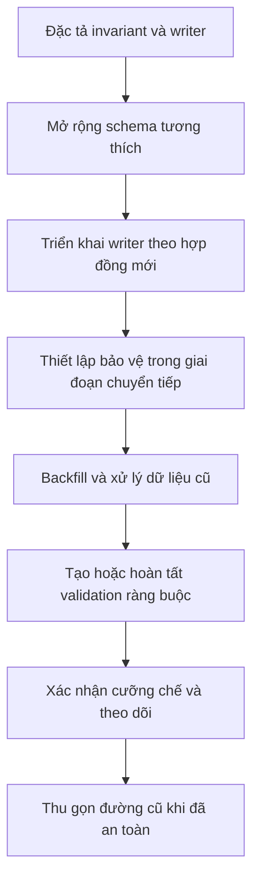

# Constraint migration: bổ sung ràng buộc dữ liệu mà vẫn giữ an toàn nghiệp vụ

## 1. Migration ràng buộc là một thay đổi về quyền tạo dữ liệu

Một hệ thống có thể đã kiểm tra quy tắc ở tầng ứng dụng nhưng chưa có ràng buộc tương ứng trong cơ sở dữ liệu. Khi thêm unique constraint, foreign key, check constraint hoặc `NOT NULL`, hệ thống thay đổi tập trạng thái mà các đường ghi được phép tạo ra.

Ví dụ, quy tắc “một yêu cầu hoàn tiền đã phê duyệt chỉ được thực hiện thành công một lần” có thể đang được kiểm tra bằng cách đọc trước khi insert. Hai request đồng thời vẫn có thể vượt qua kiểm tra đó. Bổ sung uniqueness theo đúng định danh nghiệp vụ giúp cơ sở dữ liệu từ chối trạng thái trùng, kể cả khi request đến qua worker hoặc webhook.

Tuy nhiên, dữ liệu cũ có thể đã trùng, ứng dụng phiên bản cũ vẫn đang ghi và quá trình tạo ràng buộc có thể chưa hoàn tất. Một migration thiếu kế hoạch có thể gây gián đoạn hoặc tạo ra khoảng thời gian mà hệ thống tưởng đã được bảo vệ nhưng thực tế vẫn có thể bị lạm dụng.

**Constraint migration là quá trình đưa một invariant vào cơ chế cưỡng chế của cơ sở dữ liệu, xử lý dữ liệu hiện có và chuyển các writer sang hợp đồng mới một cách có kiểm soát.** Trong Business Logic Security, mục tiêu gồm ngăn hoàn tiền trùng, liên kết sai tenant, dữ liệu giá không hợp lệ và các đường ghi bỏ qua điều kiện nghiệp vụ.

Bài này thuộc chủ đề Database Constraints, tập trung vào quá trình chuyển đổi và bằng chứng hoàn tất. Các ví dụ SQL mô tả ý tưởng; cú pháp DDL, khóa, validation và khả năng triển khai trực tuyến phải được kiểm tra theo hệ quản trị cùng phiên bản thực tế.

## 2. Ví dụ: đưa invariant hoàn tiền vào cơ sở dữ liệu

Giả sử bảng `refund` chỉ chứa các khoản hoàn tiền nội bộ đã được thực hiện thành công. Lịch sử lần thử thất bại nằm ở nơi khác. Mỗi dòng phải liên kết với một yêu cầu hoàn tiền đã phê duyệt và một payment thuộc cùng tenant.

Trạng thái đích cần bảo vệ:

```text
tenant_id, refund_request_id, payment_id, amount_minor, currency không rỗng.

amount_minor > 0.

Một cặp (tenant_id, refund_request_id)
    có tối đa một refund thành công.

Refund chỉ tham chiếu payment thuộc cùng tenant.
```

Các ràng buộc minh họa trên những bảng phù hợp:

```sql
CONSTRAINT uq_refund_request
    UNIQUE (tenant_id, refund_request_id)

CONSTRAINT ck_refund_amount_positive
    CHECK (amount_minor > 0)

CONSTRAINT fk_refund_payment_tenant
    FOREIGN KEY (tenant_id, payment_id)
    REFERENCES payment (tenant_id, id)
```

Đây là các mảnh định nghĩa đích, không phải một script migration hoàn chỉnh. Các cột liên quan còn cần `NOT NULL`, kiểu dữ liệu và miền giá trị phù hợp. Khóa được tham chiếu ở bảng `payment` phải đáp ứng yêu cầu khóa ứng viên của cơ sở dữ liệu cho đúng cặp cột.

Unique theo `payment_id` sẽ không đúng nếu một payment được phép hoàn nhiều phần qua những yêu cầu riêng. Unique theo `refund_request_id` mà bỏ tenant cũng có thể sai nếu mã yêu cầu chỉ duy nhất trong từng tenant.

Foreign key trên payment không tự chứng minh số tiền khớp phê duyệt, actor có quyền hoặc tổng hoàn không vượt tiền đã thu. Các điều kiện đó vẫn cần mô hình dữ liệu, transaction, state machine và kiểm tra quyền phù hợp.

## 3. Đặc tả invariant và ngữ nghĩa ràng buộc trước

Trước khi chọn DDL, cần viết rõ điều gì phải bị từ chối và điều gì vẫn phải được phép.

| Câu hỏi | Hệ quả đối với migration |
|---|---|
| Định danh đại diện cho yêu cầu, lần thử hay tác động thành công? | Chọn đúng cột và đúng bảng để đặt uniqueness |
| Một đối tượng được phép có nhiều tác động một phần không? | Không chặn nhầm các lần hoàn hợp lệ |
| Dữ liệu chỉ duy nhất trong tenant hay toàn hệ thống? | Thiết kế scope của khóa |
| `NULL`, chuỗi rỗng và dữ liệu chưa xác định có được phép không? | Kết hợp `NOT NULL`, chuẩn hóa và check theo hợp đồng |
| Có soft delete hoặc lưu trữ lịch sử không? | Không vô tình cho phép thực hiện lại tác động cũ sau khi ẩn dữ liệu |
| So sánh chuỗi có phân biệt hoa thường hoặc chuẩn hóa đặc biệt không? | Xác định ngữ nghĩa thực tế của uniqueness |
| Dữ liệu có partition hoặc shard không? | Kiểm tra ràng buộc bảo vệ ở phạm vi nào |
| Tất cả writer có cùng quy tắc định danh không? | Cần kế hoạch chuyển đổi trước khi cưỡng chế |

Không mặc định unique constraint xử lý `NULL` giống nhau trên mọi hệ quản trị. Nếu cột định danh không được phép thiếu, phải đưa yêu cầu đó vào schema và quá trình backfill, không dựa vào suy đoán về unique.

Tương tự, check `amount_minor > 0` không thay thế yêu cầu không rỗng. Trong ngữ nghĩa SQL, biểu thức chứa `NULL` có thể không bị check từ chối như một giá trị sai thông thường; cần `NOT NULL` phù hợp.

Với tác động tiền, xóa hoặc soft delete một dòng không nên tự giải phóng định danh cho lần thực thi mới. Nếu dữ liệu được lưu trữ sang nơi khác, cần duy trì bằng chứng hoặc dữ liệu đánh dấu phù hợp với vòng đời chống trùng.

Trong hệ thống chia shard, unique cục bộ không tự tạo uniqueness xuyên shard. Cần định tuyến mọi lần thực thi của cùng ý định đến nơi có thẩm quyền hoặc dùng cơ chế phối hợp tương ứng. Migration index trên từng shard không tự giải quyết khoảng trống đó.

## 4. Tìm toàn bộ đường ghi và hợp đồng ứng dụng

Một ràng buộc sẽ tác động tới API, webhook, worker, batch, import, công cụ vận hành và các service dùng chung bảng. Chỉ sửa controller chính rồi bật constraint có thể khiến các đường khác liên tục tạo dữ liệu bị từ chối hoặc chạy xử lý lỗi không an toàn.

Cần biết:

- Writer nào tạo hoặc sửa các cột liên quan, bao gồm thao tác xóa và lưu trữ.
- Phiên bản ứng dụng nào có thể còn chạy, kể cả worker giữ công việc cũ.
- Cách các writer tạo định danh nghiệp vụ và xử lý retry.
- Transaction nào chứa tác động tiền, sổ cái, trạng thái và dữ liệu chống trùng.
- Đường nào xử lý lỗi ràng buộc đúng, đường nào có thể nuốt lỗi rồi commit phần còn lại.
- Quyền database có cho phép writer tắt, bỏ qua hoặc thay đổi schema hay không.

Runtime thường chỉ cần quyền dữ liệu theo phạm vi đã thiết kế, không mặc nhiên cần quyền bỏ hoặc vô hiệu hóa ràng buộc. Những đường nạp dữ liệu có cơ chế bỏ kiểm tra, nếu tồn tại ở nền tảng đang dùng, phải được quản lý như ngoại lệ có rủi ro, không coi là lối đi mặc định để migration nhanh hơn.

Thay đổi cũng cần tương thích về ý nghĩa. Nếu phiên bản cũ tạo một `refund_request_id` mới cho mỗi lần retry, thêm unique theo ID đó sẽ không ngăn hoàn tiền trùng theo ý định gốc. Phải sửa hợp đồng định danh, không chỉ tên cột.

## 5. Kiểm kê dữ liệu cũ bằng truy vấn chỉ đọc

Các truy vấn dưới đây minh họa cách phát hiện dữ liệu cần phân loại. Chúng không được dùng như bằng chứng cuối cùng rằng dữ liệu sẽ luôn sạch sau thời điểm truy vấn.

### 5.1. Định danh bị thiếu và số tiền không hợp lệ

```sql
SELECT id, tenant_id, refund_request_id, payment_id, amount_minor, currency
FROM refund
WHERE tenant_id IS NULL
   OR refund_request_id IS NULL
   OR payment_id IS NULL
   OR amount_minor IS NULL
   OR amount_minor <= 0
   OR currency IS NULL;
```

Các giá trị chuỗi rỗng, định dạng tiền tệ hoặc đơn vị tiền phải được kiểm tra thêm theo hợp đồng. Không mặc định một cột khác `NULL` đã có ý nghĩa hợp lệ.

### 5.2. Định danh nghiệp vụ bị trùng

```sql
SELECT tenant_id, refund_request_id, COUNT(*) AS row_count
FROM refund
WHERE tenant_id IS NOT NULL
  AND refund_request_id IS NOT NULL
GROUP BY tenant_id, refund_request_id
HAVING COUNT(*) > 1;
```

Từng nhóm trùng cần được đối chiếu với refund, sổ cái và tác động thật. Hai dòng có thể là một tác động bị nhân bản trong dữ liệu hoặc hai tác động tiền thực sự đã xảy ra. Cách xử lý không giống nhau.

### 5.3. Tham chiếu sai phạm vi tenant

```sql
SELECT r.id, r.tenant_id, r.payment_id
FROM refund r
LEFT JOIN payment p
  ON p.tenant_id = r.tenant_id
 AND p.id = r.payment_id
WHERE r.tenant_id IS NOT NULL
  AND r.payment_id IS NOT NULL
  AND p.id IS NULL;
```

Truy vấn này tìm refund không có payment phù hợp trong cùng tenant. Một payment có ID tồn tại ở tenant khác không làm liên kết trở nên hợp lệ.

Cần xét dữ liệu lưu trữ, bản ghi đã xóa và nguồn tra cứu có đủ phạm vi hay chưa. Không chuyển một nghi vấn thiếu dữ liệu quan sát thành quyết định sửa tenant hoặc xóa refund ngay lập tức.

## 6. Phân loại và sửa dữ liệu mà không xóa sự thật nghiệp vụ

### 6.1. Dữ liệu thiếu có thể suy ra đáng tin cậy

Một `refund_request_id` bị thiếu chỉ nên được điền khi có liên kết tin cậy đến yêu cầu gốc, chẳng hạn biên nhận, dữ liệu điều phối hoặc audit đủ rõ. Giá trị mới phải giữ đúng quan hệ một ý định, một lần thực thi.

Không tạo UUID ngẫu nhiên cho mỗi dòng thiếu rồi tuyên bố uniqueness đã bảo vệ hoàn tiền. Cách đó có thể làm dữ liệu qua kiểm tra kỹ thuật nhưng che việc nhiều dòng cùng thuộc một yêu cầu gốc.

Không suy tenant từ người dùng đang chạy migration hoặc suy số tiền từ bảng giá hiện tại. Những giá trị lịch sử phải được đối chiếu với dữ liệu có thẩm quyền của tác động gốc.

### 6.2. Bản ghi trùng không đồng nghĩa tiền chưa bị mất

Nếu hai dòng chỉ là bản sao kỹ thuật của cùng tác động, có thể cần hợp nhất tham chiếu theo một quy trình đã xác định, giữ dấu vết và kiểm tra dữ liệu phụ thuộc.

Nếu đã thực sự hoàn tiền hai lần, xóa một dòng hoặc đổi trạng thái nó thành thất bại không thu hồi được tiền. Cần xử lý sai lệch tài chính bằng quy trình điều chỉnh hoặc tác động bù có quyền và audit. Không sửa lịch sử chỉ để unique index được tạo thành công.

### 6.3. Dữ liệu chưa thể phân giải

Có thể cần cách ly một nhóm đối tượng khỏi việc thực thi mới, mở hồ sơ đối soát hoặc tạm giới hạn đường ghi liên quan theo chính sách. Chỉ chuyển dữ liệu sang bảng khác cũng không tự giải quyết invariant nếu tác động gốc còn tồn tại và có thể bị thực hiện lại.

Migration không nên tự chạy lại nghiệp vụ hoàn tiền để “tái tạo dữ liệu cho đủ”. Backfill là sửa dữ liệu theo bằng chứng, không phải thực thi một tác động tiền mới.

## 7. Đóng khoảng trống giữa quét dữ liệu và bật ràng buộc

Một lịch triển khai không an toàn:

```text
T1: Quét thấy không có refund trùng.
T2: Hai writer cũ cùng thực thi một yêu cầu.
T3: Dữ liệu trùng mới xuất hiện.
T4: Tạo unique constraint thất bại hoặc chưa thể bật bảo vệ.
```

Lần quét sạch chỉ mô tả dữ liệu đã quan sát ở một thời điểm. Trước khi làm sạch cuối và chuyển sang schema đích, cần cơ chế ngăn writer tạo thêm trạng thái trái quy tắc.

### 7.1. Tạm dừng phạm vi ghi có kiểm soát

Một phương án là giới hạn ghi cho đúng nghiệp vụ, chờ các công việc đang bay kết thúc hoặc được phân giải, kiểm kê và sửa dữ liệu, tạo ràng buộc rồi mở lại writer tương thích.

Không chỉ khóa nút trên giao diện; API, worker, webhook và công cụ vận hành đều phải nằm trong phạm vi điều phối. Đơn hàng hoặc refund đã được tiếp nhận nhưng chưa xử lý cần có đường tiếp tục rõ ràng, không bị mất vì tạm dừng.

### 7.2. Dùng khả năng cưỡng chế hoặc validation trực tuyến của cơ sở dữ liệu

Một số nền tảng có quy trình tách việc cưỡng chế dữ liệu mới khỏi kiểm tra dữ liệu cũ, hoặc xây dựng cấu trúc duy nhất trong khi vẫn có ghi. Khả năng và giới hạn khác nhau theo loại constraint và hệ quản trị.

Phải xác minh khi nào dữ liệu mới bị kiểm tra, khi nào dữ liệu cũ được xác nhận, khóa nào được lấy và thất bại để lại trạng thái gì. Không giả định cơ chế dùng cho check hoặc foreign key cũng áp dụng giống hệt cho unique.

### 7.3. Dùng bản ghi điều phối tạm thời khi thiết kế cho phép

Một guard có unique theo định danh nghiệp vụ có thể buộc mọi writer đăng ký cùng ý định trước khi tạo tác động. Việc đăng ký và tác động cần cùng transaction hoặc có giao thức bền vững phù hợp.

Guard chỉ bảo vệ khi đã bao phủ cả định danh lịch sử và mọi writer liên quan. Nếu vừa tạo guard rỗng trong lúc writer cũ vẫn ghi ngoài guard, dữ liệu cũ hoặc transaction đang chạy có thể bị bỏ sót.

Một quy trình đơn giản hơn để khởi tạo guard là tạm dừng phạm vi ghi, phân giải công việc đang bay, thiết lập dữ liệu điều phối từ tác động hiện có rồi chỉ cho writer theo giao thức mới hoạt động. Nếu cần khởi tạo hoàn toàn trực tuyến, phải có thiết kế chuyển giao tính đúng đắn riêng; không coi một phép backfill song song là bằng chứng đã đóng cuộc đua.

Kiểm tra “chưa có refund” ở ứng dụng không thay thế được các cơ chế nguyên tử này.

## 8. Triển khai theo pha: mở rộng, chuyển writer, xác nhận, thu gọn

Một kế hoạch tổng quát:



Thứ tự chi tiết có thể đổi theo loại constraint và cơ chế bảo vệ. Ví dụ, một số cơ sở dữ liệu có thể bật kiểm tra dữ liệu mới sớm hơn, còn guard cần được khởi tạo theo giao thức riêng. Điều không được bỏ qua là có bảo vệ ở khoảng chuyển tiếp và có bằng chứng ràng buộc đích thực sự hoạt động.

### 8.1. Mở rộng schema

Có thể cần thêm cột định danh hoặc khóa ứng viên trước khi tạo foreign key. Nếu cột mới ban đầu cho phép thiếu để tương thích, cần ghi rõ trạng thái đó chưa phải invariant cuối cùng.

Default không tự tạo đúng liên kết nghiệp vụ. Một giá trị mặc định bất kỳ cho `tenant_id` hoặc `refund_request_id` có thể làm dữ liệu không rỗng nhưng sai nghĩa.

### 8.2. Chuyển writer

Writer mới phải ghi đúng cột, dùng định danh ổn định qua retry và xử lý lỗi constraint đúng. Cần biết còn instance, job hoặc phiên bản cũ nào có thể hoạt động, bao gồm đường chạy lại công việc đã tiếp nhận trước triển khai.

Trong rollout nhiều phiên bản, phải giữ compatibility hoặc giới hạn writer không tương thích theo kế hoạch. “Đã deploy phiên bản mới” không chứng minh mọi đường ghi đã chuyển.

### 8.3. Xác nhận rồi mới thu gọn

Chỉ bỏ cột cũ, guard hoặc đường tương thích khi writer cũ không còn được phép hoạt động và ràng buộc đích đã bảo vệ đúng phạm vi. Một guard vẫn có thể cần giữ lâu hơn nếu nó còn là bằng chứng chống trùng sau lưu trữ dữ liệu.

Không bỏ lớp bảo vệ tạm trước khi có lớp thay thế hiệu lực; cũng cần đánh giá tải và thứ tự khóa nếu giữ đồng thời nhiều cơ chế trong thời gian chuyển đổi.

## 9. Backfill theo lô và bảo toàn cạnh tranh

Backfill lớn trong một transaction có thể giữ khóa lâu, tạo nhiều dữ liệu nhật ký và làm tăng độ trễ sao chép. Chia lô theo phạm vi ổn định, có checkpoint và giới hạn tải giúp kiểm soát tác động vận hành.

Với một dòng được writer khác cập nhật trong lúc backfill, không được ghi đè mù quáng. Có thể cần điều kiện “cột vẫn chưa được điền”, version hoặc cơ chế khóa phù hợp, rồi đọc lại nếu có xung đột.

```text
Đọc một lô candidate và nguồn ánh xạ tin cậy.

Với mỗi dòng:
    kiểm tra liên kết còn đúng;
    cập nhật có điều kiện theo trạng thái hoặc version;
    ghi dấu vết backfill cần thiết;
    nếu có xung đột, phân loại để đọc lại hoặc xử lý riêng.

Commit lô và lưu tiến độ theo giao thức phục hồi đã chọn.
```

Đây là mã giả. Không dùng backfill để bypass quyền tenant hoặc thay đổi số tiền đã chốt theo dữ liệu mới.

Cursor đi qua khóa chính một lần có thể bỏ sót đối tượng cũ được cập nhật hoặc dữ liệu đến muộn. Cần một vòng kiểm tra hoàn tất cùng chiến lược nhìn lại phù hợp. Tiến độ “đã quét đến ID cuối” không đồng nghĩa mọi dòng đều đáp ứng invariant.

Backfill phải chạy lại được mà không tạo ID mới, tác động tiền mới hoặc thay đổi kết quả đã được phân giải. Những dòng không có bằng chứng đủ rõ cần đi vào danh sách ngoại lệ, không nhận dữ liệu giả để làm giảm số lỗi.

## 10. Tạo ràng buộc và kiểm soát trạng thái DDL

DDL có thể lấy khóa, kiểm tra nhiều dữ liệu hoặc cần tài nguyên cho index. Các cơ chế trực tuyến cũng có thể có giai đoạn chờ hoặc khóa tại một số thời điểm. Không suy ra “online” có nghĩa không có tác động vận hành.

Cần kế hoạch giới hạn chờ, theo dõi transaction dài, dung lượng, độ trễ sao chép và khả năng tiếp tục nếu thao tác bị gián đoạn. Không chạy nhiều lần tạo lại song song chỉ vì lần đầu chưa trả kết quả.

Nếu client DDL bị timeout hoặc mất kết nối, phải kiểm tra trạng thái thực tế ở cơ sở dữ liệu trước khi quyết định bước tiếp theo. Tên constraint hoặc index đã xuất hiện chưa chứng minh nó đã hoàn tất, hợp lệ và cưỡng chế đúng dữ liệu.

Không mặc định DDL và các cập nhật dữ liệu đều có thể rollback chung trong một transaction trên mọi nền tảng. Kế hoạch cần chấp nhận khả năng các pha đã hoàn tất một phần và có cách tiếp tục theo trạng thái có thẩm quyền.

Với foreign key, phải chuẩn bị khóa đích đúng cấu trúc trước; với unique, phải kiểm tra phạm vi cột, biểu thức, điều kiện lọc nếu có và ngữ nghĩa so sánh; với `NOT NULL`, phải có bằng chứng dữ liệu cũ đã đáp ứng cùng sự bảo vệ cho ghi mới.

Một index thông thường không có tính duy nhất không thay unique constraint. Một cấu trúc chỉ bao phủ một nhóm trạng thái không bảo vệ những trạng thái nằm ngoài nó. Một constraint đã được khai báo nhưng chưa có bảo đảm kiểm tra dữ liệu lịch sử không tương đương với trạng thái cuối đã xác nhận đầy đủ.

## 11. Xử lý lỗi constraint tại ứng dụng

Sau migration, cơ sở dữ liệu có thể từ chối một cuộc đua mà trước đây cả hai request đều thành công. Đây là hành vi bảo vệ mong muốn, nhưng ứng dụng phải xử lý đúng.

Ví dụ hai request thực hiện cùng yêu cầu hoàn tiền:

1. Một transaction ghi refund, sổ cái, số dư và kết quả idempotency rồi commit.
2. Request còn lại gặp xung đột uniqueness hoặc phát hiện thao tác đã tồn tại.
3. Nó không được tiếp tục cộng ví hoặc đổi ID yêu cầu để insert cho thành công.
4. Sau khi kết thúc transaction theo quy tắc của hệ quản trị, có thể tra cứu và trả kết quả cũ nếu đúng cùng ý định và người gọi có quyền; nếu nội dung khác, trả xung đột theo hợp đồng.

Không phải mọi lỗi unique đều là retry hợp lệ. Phải kiểm tra đối tượng, fingerprint hoặc dữ liệu ý định liên quan. Cùng key nhưng số tiền khác không được nhận một response thành công gây hiểu rằng nội dung mới đã được thực thi.

Lỗi check và foreign key cần được ánh xạ phù hợp, không lộ chi tiết schema hay dữ liệu tenant khác cho caller. Nội bộ vẫn cần đủ thông tin để phân biệt request sai, lỗi writer và dữ liệu lịch sử còn thiếu.

Nếu constraint được kiểm tra ở thời điểm commit theo cấu hình của hệ thống, ứng dụng không được trả thành công trước khi commit được xác nhận. Mọi tác động ngoài transaction vẫn cần outbox, idempotency hoặc cơ chế tương đương; constraint nội bộ không tự rollback được lời gọi bên ngoài.

## 12. Rollback ứng dụng khác với gỡ ràng buộc

Nếu một phiên bản ứng dụng gặp lỗi sau rollout, quay lại phiên bản cũ có thể không còn tương thích với schema đã cưỡng chế. Cần xác định trước phiên bản nào vẫn ghi đúng invariant và đường quay lại nào được hỗ trợ.

Gỡ unique hoặc `NOT NULL` để hết lỗi ngay có thể mở lại đường hoàn tiền trùng hoặc dữ liệu thiếu tenant. Trước khi thay đổi lớp bảo vệ, phải đánh giá invariant nào mất cưỡng chế và cơ chế nào tiếp tục bảo vệ phạm vi ghi.

Một phương án có thể là sửa writer theo hướng tiến, giữ schema bảo vệ và giới hạn đường ghi lỗi trong thời gian xử lý. Nếu cần hoàn tác một pha schema, phải có kế hoạch tương thích và bảo vệ chuyển tiếp tương ứng.

Khôi phục backup hoặc xóa dữ liệu không tự hoàn tác tiền đã chuyển hay sự kiện đã phát. Dữ liệu sửa sai trong migration cần dấu vết, khả năng đối soát và quy trình xử lý tác động thực tế riêng.

Không xem một script “down migration” là bằng chứng đủ cho khả năng phục hồi nghiệp vụ. Sau khi invariant mới đã ngăn tác động trùng, việc gỡ nó là một thay đổi an toàn hệ thống cần được xem xét theo chính quy tắc đang bảo vệ.

## 13. Bằng chứng để kết luận migration đã hoàn tất

Cần kết hợp dữ liệu, schema và writer, thay vì chỉ một thông báo chạy script thành công:

| Nhóm bằng chứng | Điều cần xác nhận |
|---|---|
| Đặc tả | Ràng buộc phản ánh đúng định danh và phạm vi nghiệp vụ |
| Dữ liệu lịch sử | Dữ liệu đã được kiểm tra theo cơ chế hoàn tất; ngoại lệ đã được xử lý hoặc có cách quản lý không làm mất invariant |
| Trạng thái schema | Constraint/index có đúng định nghĩa, đã hoàn tất và có hiệu lực theo nền tảng |
| Writer | API, worker, batch và phiên bản còn được phép chạy tuân thủ hợp đồng |
| Hành vi lỗi | Vi phạm bị từ chối mà không commit tác động dở dang |
| Chuyển tiếp | Không còn khoảng ghi không được bảo vệ giữa lớp tạm và lớp đích |
| Phục hồi | Retry, restart và đường quay lại vẫn giữ định danh cùng quy tắc |
| Theo dõi | Có quan sát lỗi constraint, tranh chấp, dữ liệu thiếu và sai lệch nghiệp vụ |

Một lần quét thấy không có dòng vi phạm là bằng chứng hữu ích, nhưng không thay trạng thái cưỡng chế nếu writer vẫn có thể tạo vi phạm ngay sau đó. Ngược lại, constraint cho dữ liệu mới chưa được xác nhận trên dữ liệu cũ không cho phép kết luận toàn bộ lịch sử đã đúng.

Sau chuyển đổi, theo dõi lỗi theo constraint hoặc nhóm nguyên nhân giúp tìm writer cũ và luồng bất thường. Không dùng ID request có số lượng giá trị rất lớn làm nhãn metric; log chi tiết cần kiểm soát truy cập và tránh dữ liệu nhạy cảm.

## 14. Ma trận kiểm thử migration và tình huống lạm dụng

Các tình huống dưới đây dùng để thiết kế kiểm thử trên môi trường và dữ liệu đại diện. Cần kiểm tra tác động nghiệp vụ, không chỉ mã trả về của DDL.

| Tình huống | Kết quả cần kiểm chứng |
|---|---|
| Dữ liệu hiện có hợp lệ | Migration đạt trạng thái cưỡng chế đầy đủ mà không đổi ý nghĩa dữ liệu |
| Hai refund cùng một yêu cầu đã phê duyệt | Không tự xóa hoặc đổi ID để che tác động; có phân loại và xử lý đúng |
| Cột định danh còn `NULL` | Không tuyên bố unique đã thay yêu cầu không rỗng |
| ID chuỗi khác cách chuẩn hóa nhưng cùng ý nghĩa theo hợp đồng | Ngữ nghĩa uniqueness đúng với quy tắc đã chọn |
| Cùng mã yêu cầu ở hai tenant độc lập | Không chặn nhầm nếu định danh chỉ duy nhất trong tenant |
| Refund tham chiếu payment tenant khác | Ràng buộc phạm vi và đường ghi từ chối liên kết sai |
| Một payment có hai yêu cầu hoàn một phần hợp lệ | Không bị unique sai phạm vi chặn nhầm |
| Hai request đồng thời tạo cùng tác động trong lúc chuyển đổi | Không có khoảng trống bảo vệ làm cả hai cùng commit |
| Writer phiên bản cũ chạy song song hoặc khởi động lại | Được tương thích hoặc bị giới hạn theo kế hoạch, không âm thầm bypass invariant |
| Backfill cạnh tranh với cập nhật nghiệp vụ | Không ghi đè dữ liệu mới hoặc gán sai liên kết |
| Backfill bị dừng và chạy lại | Không tạo định danh hoặc tác động mới cho cùng dữ liệu |
| DDL timeout hoặc tiến trình triển khai dừng | Bước tiếp theo dựa trên trạng thái schema thật, không tạo lại mù quáng |
| Tạo index chưa hoàn tất hoặc thất bại | Không đánh dấu lớp bảo vệ đã hiệu lực chỉ vì có tên index |
| Request gặp lỗi unique sau một số cập nhật chưa commit | Không commit thêm sổ cái, số dư hoặc trạng thái dở dang |
| Dữ liệu cũ bị soft delete hoặc lưu trữ sau migration | Không cho phép thực hiện lại cùng yêu cầu tiền chỉ vì dòng không còn trong tập hiển thị |
| Quay lại ứng dụng tương thích sau rollout | Schema vẫn giữ invariant và writer xử lý lỗi đúng |
| Ghi dữ liệu qua import hoặc công cụ vận hành | Không bỏ ràng buộc hoặc tạo ngoại lệ ngoài quy trình |

Với ví dụ hoàn tiền, kết quả cuối cần đối chiếu số lần thực thi theo yêu cầu gốc, tổng refund, sổ cái và biến động ví. Việc unique constraint được tạo thành công không đủ nếu dữ liệu đã được “làm sạch” bằng cách xóa dấu vết khoản hoàn dư.

## 15. Câu hỏi tự kiểm tra

1. Vì sao kiểm tra dữ liệu sạch rồi mới tạo unique constraint vẫn có thể gặp cuộc đua?
2. Vì sao tạo UUID mới cho mỗi dòng thiếu ID chưa chắc sửa được invariant nghiệp vụ?
3. Khi nào cần uniqueness theo tenant và khi nào một ràng buộc cục bộ chưa đủ cho dữ liệu chia shard?
4. Vì sao check số tiền dương còn cần kết hợp yêu cầu không rỗng?
5. Một foreign key theo payment ID có tự bảo vệ quan hệ tenant không?
6. Nếu DDL timeout, cần biết gì trước khi chạy lại?
7. Vì sao rollback phiên bản ứng dụng không đồng nghĩa nên gỡ constraint mới?

Migration an toàn cần đưa đúng quy tắc vào đúng phạm vi cưỡng chế, giữ dữ liệu lịch sử trung thực và bảo vệ các lần ghi trong suốt giai đoạn chuyển đổi. Khi dữ liệu, writer và trạng thái schema cùng được xác nhận, ràng buộc mới trở thành lớp bảo vệ nghiệp vụ có hiệu lực thay vì chỉ là một định nghĩa xuất hiện trong cơ sở dữ liệu.
