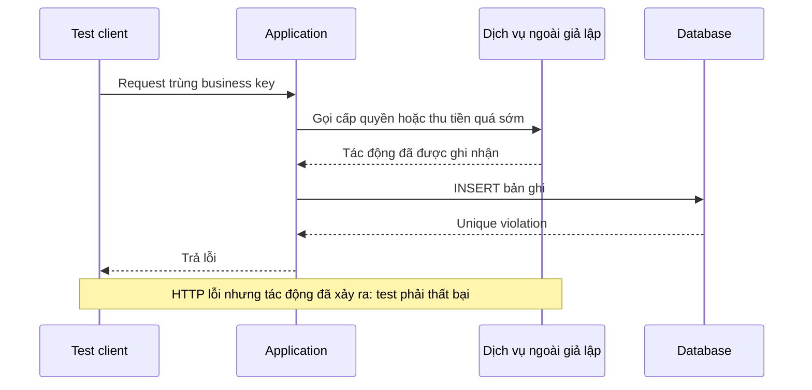

# Constraint bypass testing

## 1. Mục tiêu: tìm đường làm sai invariant dù hệ thống có constraint

Trong chương **Database Constraints** của module bảo vệ logic nghiệp vụ, khai báo một constraint chưa đủ để kết luận quy tắc nghiệp vụ đã được bảo vệ. Cần kiểm tra xem mọi đường tạo tác động có thực sự đi qua đúng ràng buộc, đúng phạm vi dữ liệu và đúng ranh giới transaction hay không.

**Constraint bypass testing** là kiểm thử nhằm tìm những cách dữ liệu hoặc thao tác đi qua các lớp kiểm soát nhưng vẫn tạo ra trạng thái trái với invariant cần bảo vệ.

Ví dụ:

- UNIQUE tồn tại nhưng cho phép nhiều NULL trong business key.
- Foreign key kiểm tra ID tồn tại nhưng không ràng buộc cùng tenant.
- CHECK kiểm tra số tiền dương nhưng cột vẫn nhận NULL.
- API từ chối sửa trạng thái trực tiếp nhưng job import lại ghi theo dữ liệu client.
- Database từ chối bản ghi trùng sau khi application đã gọi dịch vụ cấp quyền lợi bên ngoài.
- Transaction rollback dữ liệu nội bộ nhưng một thông điệp hoặc lần thu tiền đã được gửi trước đó.

Từ “bypass” không nhất thiết có nghĩa database bỏ qua một constraint hợp lệ. Nhiều lỗi xuất phát từ việc constraint chỉ diễn đạt một phần quy tắc, được đặt sai bảng, hoặc được áp dụng sau thời điểm tác động đã xảy ra.

Bài học hướng dẫn thiết kế các tình huống kiểm thử trong môi trường được phép, với dữ liệu và dịch vụ giả lập có kiểm soát. Các ví dụ SQL là fixture minh họa, không phải yêu cầu sửa schema hay thử payload trên hệ thống đang hoạt động.

## 2. Phân biệt bốn loại kết quả kiểm thử

Trước mỗi test, phải biết lớp nào có trách nhiệm chặn hành vi:

| Loại kết quả | Ví dụ | Cách đánh giá |
| --- | --- | --- |
| Constraint phải chặn | Chèn số tiền âm vào cột có CHECK phù hợp | Nếu commit được thì hàng rào dữ liệu không đáp ứng thiết kế |
| Constraint không diễn đạt đủ invariant | Tắt hai admin ở hai hàng khác nhau | Cần kiểm tra khóa, isolation hoặc mô hình dữ liệu bổ sung |
| Constraint thỏa nhưng quyền sai | Ghi vào order hợp lệ của khách hàng khác | Authorization phải chặn; FK không chứng minh quyền của actor |
| Dữ liệu bị chặn nhưng tác động đã xảy ra | INSERT trùng bị từ chối sau khi đã gửi lệnh thu tiền | Test vẫn thất bại về nghiệp vụ |

Không coi mọi INSERT thành công là bypass. Nếu dữ liệu hợp lệ và hành động đúng quyền, nó phải thành công. Một bộ test chỉ có ca từ chối có thể che lỗi “chặn tất cả”.

Cũng không coi một exception là bằng chứng thành công của test. Cần xác định lỗi từ đâu, transaction có commit phần nào không và tác động cuối có đúng invariant không.

## 3. Lập bản đồ invariant, constraint và đường ghi

Một bảng thiết kế test nên có ít nhất:

| Thành phần | Câu hỏi |
| --- | --- |
| Invariant | Điều gì phải đúng sau những thao tác đã commit? |
| Constraint | Tên, loại, cột, predicate và trạng thái validation là gì? |
| Phạm vi | Tenant, tài khoản, tài nguyên và vòng đời nào được bảo vệ? |
| Đường ghi | API, job, import, SQL nội bộ, consumer hay công cụ quản trị? |
| Actor kỹ thuật | Connection dùng quyền ứng dụng, quyền job hay quyền migration? |
| Thời điểm chặn | Trước tác động, khi statement chạy hay tại commit? |
| Oracle | Dựa vào đâu để xác nhận invariant và số tác động thực tế? |

Ví dụ ánh xạ:

```text
Invariant:
  Trong một tenant và account, một client_reference chỉ nhận một request.

Hàng rào:
  UNIQUE (tenant_id, account_id, client_reference)
  Các thành phần business key đều NOT NULL.

Đường ghi:
  API tạo request, consumer, batch import.

Oracle:
  Tối đa một request đã commit cho business key.
  Tối đa một command nghiệp vụ được cấp cho cùng ý định.
  Không có tác động trước khi giành quyền ghi thành công.
```

Nếu không tìm được một constraint diễn đạt invariant, ghi nhận đó là khoảng trống cần lớp khác bảo vệ. Không đặt tên test là “unique bảo vệ tổng tiền” khi UNIQUE chỉ kiểm tra một mã tham chiếu.

## 4. Fixture minh họa có nhiều lớp ràng buộc

Các ví dụ dùng PostgreSQL để chỉ rõ hành vi NULL, mã lỗi và transaction. Không giả định mọi database hoặc thư viện test có cùng ngữ nghĩa.

```sql
CREATE TABLE business_account (
    tenant_id  uuid NOT NULL,
    id         uuid NOT NULL,
    PRIMARY KEY (tenant_id, id)
);

CREATE TABLE payment_request (
    tenant_id         uuid        NOT NULL,
    id                uuid        NOT NULL,
    account_id        uuid        NOT NULL,
    client_reference  varchar(80) COLLATE "C" NOT NULL,
    amount_minor      bigint      NOT NULL,
    currency          varchar(3)  NOT NULL,
    state             varchar(20) NOT NULL DEFAULT 'PENDING',
    requested_by      uuid        NOT NULL,
    approved_by       uuid,
    approved_at       timestamptz,
    version           bigint      NOT NULL DEFAULT 1,

    PRIMARY KEY (tenant_id, id),

    CONSTRAINT uq_payment_request_reference
        UNIQUE (tenant_id, account_id, client_reference),

    CONSTRAINT fk_payment_request_account
        FOREIGN KEY (tenant_id, account_id)
        REFERENCES business_account (tenant_id, id),

    CONSTRAINT ck_payment_request_reference_format
        CHECK (client_reference ~ '^[A-Z0-9_-]{1,80}$'),

    CONSTRAINT ck_payment_request_amount
        CHECK (amount_minor > 0),

    CONSTRAINT ck_payment_request_currency
        CHECK (currency IN ('VND', 'USD')),

    CONSTRAINT ck_payment_request_state
        CHECK (state IN ('PENDING', 'APPROVED', 'REJECTED')),

    CONSTRAINT ck_payment_request_approval_fields
        CHECK (
            (state = 'APPROVED'
                AND approved_by IS NOT NULL
                AND approved_at IS NOT NULL)
            OR
            (state IN ('PENDING', 'REJECTED')
                AND approved_by IS NULL
                AND approved_at IS NULL)
        ),

    CONSTRAINT ck_payment_request_not_self_approved
        CHECK (approved_by IS NULL OR approved_by <> requested_by),

    CONSTRAINT ck_payment_request_version
        CHECK (version > 0)
);
```

Fixture cố ý đơn giản:

- Chỉ hỗ trợ hai loại tiền cho bài kiểm thử, không đại diện danh mục tiền tệ đầy đủ.
- `requested_by` và `approved_by` cần được application gắn với actor được xác thực; schema này chưa mô hình hóa toàn bộ danh tính và vai trò.
- CHECK trên version chỉ yêu cầu giá trị dương, không tự buộc version tăng qua mỗi UPDATE.
- CHECK trên state chỉ kiểm tra trạng thái hàng hiện tại, không tự ngăn mọi chuyển trạng thái trái phép.
- Không có invariant về tổng hạn mức trong fixture; nếu nghiệp vụ cần thì phải bổ sung cơ chế riêng.

Những giới hạn này là mục tiêu để test phân biệt đúng giữa ràng buộc cấu trúc và quy tắc cần lớp khác thực thi.

## 5. Kiểm thử từng constraint bằng dữ liệu gần hợp lệ

Chuẩn bị một request hợp lệ làm baseline. Mỗi ca âm chỉ thay đổi một điều kiện chính để biết chính xác vì sao nó phải bị chặn.

| Biến thể từ baseline | Kỳ vọng ở fixture |
| --- | --- |
| `amount_minor = 0` hoặc âm | CHECK số tiền từ chối |
| `amount_minor = NULL` | NOT NULL từ chối |
| `client_reference = NULL` | NOT NULL từ chối |
| Reference rỗng, có khoảng trắng hoặc chữ thường | CHECK định dạng từ chối theo hợp đồng của fixture |
| Cùng business key nhưng ID request khác | UNIQUE từ chối |
| Account không tồn tại trong tenant | Foreign key từ chối |
| Account thuộc tenant khác, không có cặp tương ứng ở tenant hiện tại | Foreign key ghép từ chối |
| `currency = 'XXX'` | CHECK loại tiền của fixture từ chối |
| `state = 'ADMIN_APPROVED'` | CHECK state từ chối |
| `APPROVED` nhưng thiếu `approved_by` hoặc `approved_at` | CHECK cấu trúc phê duyệt từ chối |
| `PENDING` nhưng có dữ liệu phê duyệt | CHECK cấu trúc phê duyệt từ chối |
| Người duyệt bằng người yêu cầu | CHECK phân tách danh tính trên hàng từ chối |
| `version = 0` | CHECK version từ chối |

Các ca dương tương ứng cũng cần tồn tại: số tiền dương, reference đúng chuẩn, account đúng tenant và trạng thái APPROVED có người duyệt khác người yêu cầu phải qua được lớp constraint. Quyền thực sự của người duyệt vẫn cần được kiểm tra ở application.

Trong PostgreSQL, một số SQLSTATE hữu ích để phân loại test là:

| SQLSTATE | Loại lỗi |
| --- | --- |
| `23502` | NOT NULL violation |
| `23503` | Foreign key violation |
| `23505` | Unique violation |
| `23514` | CHECK violation |

Nên xác nhận mã lỗi và constraint dự kiến khi driver cung cấp được thông tin đó. Không kiểm tra bằng cách tìm một từ trong thông báo lỗi và không giả định thứ tự database kiểm tra nếu payload vi phạm nhiều constraint cùng lúc.

Dữ liệu vượt miền `bigint` có thể bị chặn ở bước parse hoặc chuyển kiểu, không nhất thiết tạo `23514`. Test phải phân biệt lỗi kiểu dữ liệu với lỗi CHECK nhưng vẫn xác minh không có tác động nghiệp vụ.

## 6. Những khoảng trống ngữ nghĩa dễ bị bỏ sót

### 6.1. CHECK có thể chấp nhận UNKNOWN

Một fixture yếu hơn có thể khai báo:

```sql
CREATE TABLE weak_amount_example (
    id            uuid PRIMARY KEY,
    amount_minor  bigint,
    CHECK (amount_minor > 0)
);
```

Trong PostgreSQL, CHECK không từ chối chỉ vì biểu thức có giá trị UNKNOWN do NULL. Vì vậy, `amount_minor = NULL` có thể được chấp nhận ở bảng này.

Test cần chứng minh sự khác nhau giữa “số tiền dương nếu có giá trị” và “số tiền bắt buộc, luôn dương”. Trường hợp thứ hai cần NOT NULL cùng CHECK hoặc một mô hình tương đương đúng ngữ nghĩa.

### 6.2. UNIQUE không mặc định coi mọi NULL là một giá trị trùng

Nếu bỏ NOT NULL khỏi một thành phần business key, nhiều record có NULL có thể lọt qua UNIQUE theo ngữ nghĩa mặc định của PostgreSQL.

Ca test nên thay lần lượt từng thành phần bằng NULL, không chỉ thử hai chuỗi reference giống nhau. Nếu trường thực sự tùy chọn, kỳ vọng phải phản ánh chính sách đó; không gán mọi NULL là lỗi khi nghiệp vụ cho phép.

### 6.3. Foreign key ghép có thành phần NULL

Với cách kiểm tra mặc định `MATCH SIMPLE`, một foreign key ghép có thành phần NULL có thể không yêu cầu tìm thấy hàng cha cho bộ tham chiếu đó.

Nếu quan hệ bắt buộc, kiểm tra NOT NULL trên các thành phần cần thiết. Nếu quan hệ là tùy chọn, phải thiết kế rõ trạng thái thiếu toàn bộ hoặc thiếu một phần; `MATCH FULL` chỉ là lựa chọn phù hợp trong những mô hình có ngữ nghĩa tương ứng, không thay thế mọi NOT NULL.

Đặc biệt, khi tenant luôn bắt buộc nhưng parent ID được phép vắng mặt, không áp dụng máy móc một quy tắc yêu cầu cả bộ foreign key cùng NULL mà chưa xét mô hình.

### 6.4. Canonicalization khác nhau giữa các đường ghi

API có thể chuẩn hóa ` ref-1 ` thành `REF-1`, nhưng import ghi nguyên chuỗi hoặc cắt ngắn theo cách khác. Khi đó “một reference” ở application có thể trở thành nhiều giá trị khác nhau ở database.

Kiểm thử hoa thường, khoảng trắng, độ dài, Unicode và biểu diễn số theo đúng hợp đồng của trường. Fixture dùng reference ASCII viết hoa để làm kỳ vọng rõ; không áp quy tắc này tùy tiện cho mọi loại định danh.

Nếu lưu cả giá trị gốc và giá trị chuẩn, cần test rằng caller không thể tự đặt cột chuẩn thành một giá trị khác để né uniqueness.

### 6.5. Constraint đúng tên nhưng sai cột hoặc predicate

`UNIQUE (tenant_id, account_id, client_reference, id)` thường không bảo vệ mục tiêu vì mỗi request có ID mới. Một partial index chỉ xét `ACTIVE` cũng không bảo vệ các record `PENDING` đã bắt đầu chiếm quyền.

Test phải dựa vào định nghĩa thực tế và trạng thái cuối, không dựa vào tên như `uq_request_once` để kết luận ràng buộc đúng.

## 7. Kiểm thử quyền và state machine bên cạnh constraint

### 7.1. Dữ liệu hợp lệ vẫn có thể được tạo bởi người không có quyền

Tạo một customer hoặc actor hợp lệ khác trong cùng tenant, rồi gọi API với account ID của họ. Foreign key có thể hoàn toàn thỏa mãn. Test cần xác nhận application từ chối thao tác trái quyền và không tạo record, audit gây hiểu nhầm hoặc command downstream.

Thử cả actor cùng tenant nhưng sai đối tượng và actor thuộc tenant khác. Hai tình huống kiểm tra những ranh giới khác nhau.

Không coi SQL trực tiếp bằng tài khoản database của ứng dụng là cách mô phỏng đầy đủ một người dùng API. Đó là một lớp test riêng để kiểm tra hàng rào dữ liệu và đặc quyền kỹ thuật.

### 7.2. Mass assignment các trường nội bộ

Gửi payload tạo request có thêm các trường như:

```json
{
  "accountId": "<authorized-account>",
  "amountMinor": 100000,
  "currency": "VND",
  "clientReference": "REQ-17",
  "state": "APPROVED",
  "requestedBy": "<another-actor>",
  "approvedBy": "<privileged-actor>",
  "version": 99
}
```

Mục tiêu không phải làm database hiểu actor. Test cần xác nhận API từ chối hoặc bỏ qua các trường không thuộc command được phép, rồi tạo dữ liệu từ ngữ cảnh server theo hợp đồng.

Nếu toàn bộ payload được map trực tiếp vào entity, attacker có thể tạo một hàng thỏa CHECK nhưng sai quyền hoặc bỏ qua bước phê duyệt. Constraint bổ sung phòng vệ, không thay việc giới hạn trường được phép ghi.

### 7.3. Trạng thái hợp lệ không đồng nghĩa chuyển trạng thái hợp lệ

Với fixture, UPDATE từ APPROVED về PENDING kèm xóa các trường phê duyệt có thể thỏa mọi CHECK của hàng mới. Tuy nhiên, nếu chính sách cấm mở lại quyết định đã chốt, thao tác đó phải bị state machine chặn.

Test cần gọi đường ghi thực tế và xác minh điều kiện trạng thái cũ hoặc version được áp dụng:

```sql
UPDATE payment_request
SET state = 'APPROVED',
    approved_by = :authenticatedActorId,
    approved_at = :serverTime,
    version = version + 1
WHERE tenant_id = :tenantId
  AND id = :requestId
  AND state = 'PENDING'
  AND version = :expectedVersion
RETURNING id, version;
```

Authorization và các điều kiện nghiệp vụ vẫn phải được kiểm tra tại ranh giới phù hợp. Nếu UPDATE không trả hàng, không bỏ điều kiện rồi chạy lại để cưỡng ép thành công.

CHECK thông thường không tự so sánh OLD và NEW của mọi lần cập nhật. Khi chọn bảo vệ chuyển trạng thái ở database bằng trigger hoặc thủ tục, cần test chính cơ chế đó cùng transaction và quyền thực thi; không chỉ test danh sách state hợp lệ.

## 8. Kiểm thử mọi đường ghi có thể chạm dữ liệu

Một ma trận theo đường ghi giúp phát hiện bảo vệ chỉ có ở endpoint chính:

| Đường ghi | Điều cần kiểm tra |
| --- | --- |
| REST hoặc RPC chính | Validation, authorization, whitelist trường và transaction |
| API batch | Một phần tử sai có ảnh hưởng phần tử khác ra sao; có partial success được định nghĩa không |
| Import file | Chuẩn hóa, tenant, business key và cấu hình commit theo lô |
| Consumer sự kiện | Event trùng, sai thứ tự, payload thiếu trường và retry |
| SQL trực tiếp qua repository | Constraint vẫn chặn khi bỏ qua validator của ORM |
| Bulk update của ORM | Không phụ thuộc vào callback hoặc validation chỉ chạy khi lưu từng entity |
| Job quản trị hoặc đối soát | Không ghi tắt trạng thái, đổi scope hoặc xóa hàng rào nhận diện |
| Migration/backfill | Không đưa dữ liệu cũ không hợp lệ vào sau khi API đã được sửa |

Native SQL hoặc bulk API có thể bỏ qua validation và callback ở application nhưng không tự bỏ qua database constraint. Phải thử đúng đường thực tế thay vì mặc định mọi bulk load đều tắt ràng buộc.

Với batch, cần phân biệt hợp đồng all-or-nothing với partial success. Nếu cả lô phải atomic, một hàng lỗi không được để những hàng khác commit. Nếu cho phép thành công từng phần, response và trạng thái retry phải chỉ rõ phần nào đã ghi, tránh gửi lại gây tác động trùng.

Không dùng API tạo để kiểm tra rồi bỏ qua đường UPDATE. Một bản ghi được tạo hợp lệ có thể bị sửa thành sai account, sai business key hoặc trạng thái không còn được phép.

## 9. Kiểm thử cạnh tranh thay vì chỉ gửi lặp tuần tự

### 9.1. Cùng business key, hai transaction độc lập

Thiết kế test dùng hai connection thực sự độc lập:

```text
Chuẩn bị:
    business account hợp lệ
    chưa có request cho reference R

Worker A và B:
    bắt đầu transaction riêng
    chuẩn bị INSERT cùng tenant, account, reference R
    dùng ID request khác nhau
    chờ tại barrier trước INSERT
    thực hiện INSERT và cố commit

Xác minh bằng connection mới:
    đúng một request đã commit cho business key
    bên còn lại nhận conflict hoặc kết quả duplicate theo hợp đồng
    chỉ có một tác động nghiệp vụ tương ứng
```

Không đặt barrier yêu cầu cả hai INSERT phải trả về trước khi một bên được commit. Một INSERT có thể đang đợi transaction còn lại kết thúc; cách đồng bộ sai đó khiến test tự mắc kẹt thay vì kiểm tra hành vi database.

### 9.2. Các biến thể cần có

- Transaction giành key đầu tiên rollback ở bước sau; transaction còn lại có thể tiếp tục đúng.
- Cùng key, cùng command: replay hoặc duplicate theo hợp đồng, không thêm tác động.
- Cùng key, command khác: không ghi đè record gốc và không trả thành công giả cho nội dung mới.
- Khác key nhưng cùng tài nguyên có giới hạn: invariant tổng vẫn phải giữ bằng cơ chế riêng.
- Hai transaction cùng UPDATE version hoặc trạng thái: chỉ các chuyển hợp lệ được chấp nhận.
- Tạo record ở các trạng thái nằm trong hoặc ngoài predicate của partial unique index.
- Hai đường ghi khác nhau, chẳng hạn API và consumer, cùng nhắm một business identity.

Nếu lựa chọn isolation cho phép serialization failure hoặc deadlock được retry, test cần phân loại abort hợp lệ với lỗi nghiệp vụ. Một transaction bị hủy có thể là hành vi bảo vệ đúng; trạng thái cuối sai thì không.

Trong PostgreSQL, `40001` là serialization failure và `40P01` là deadlock detected. Retry phải chạy lại toàn bộ transaction theo thiết kế, không tiếp tục từ một câu lệnh đã dùng snapshot cũ.

## 10. Kiểm thử thời điểm lỗi: flush, statement và commit

### 10.1. ORM chưa gửi SQL không phải database đã chấp nhận

Một lệnh lưu entity có thể chỉ đưa dữ liệu vào bộ nhớ hoặc hàng đợi của ORM. Lỗi constraint có thể xuất hiện khi flush hoặc commit.

Test gọi phương thức lưu rồi kết thúc mà không flush, trong một transaction tự rollback, có thể chưa kiểm tra điều nó tuyên bố. Cần đi đến ranh giới thực thi phù hợp và xác minh bằng một connection mới sau khi transaction kết thúc.

Flush gửi các thay đổi tới database nhưng không đồng nghĩa commit thành công. Nếu constraint được hoãn kiểm tra, commit vẫn có thể thất bại.

### 10.2. Constraint deferred có thể cố ý cho phép trạng thái tạm thời

Trong một fixture riêng có foreign key được cấu hình `DEFERRABLE INITIALLY DEFERRED`, ứng dụng có thể chèn hàng con trước rồi chèn hàng cha trong cùng transaction và commit hợp lệ.

Hai ca khác nhau:

```text
Chèn hàng con, sau đó chèn cha phù hợp, COMMIT -> có thể hợp lệ.
Chèn hàng con, không tạo cha, COMMIT -> phải bị từ chối.
```

Trạng thái tạm thời trước commit không phải bypass nếu hợp đồng cho phép và không có tác động ngoài nào dựa trên trạng thái chưa hợp lệ đó.

Không giả định mọi loại constraint đều hỗ trợ deferral. Cũng không dùng một cơ chế xử lý conflict với constraint deferred nếu database không hỗ trợ cách kết hợp đó.

### 10.3. Transaction đã lỗi phải được xử lý đúng

Khi một INSERT thông thường vi phạm constraint trong PostgreSQL, transaction thường cần rollback hoặc rollback về savepoint hợp lệ trước khi dùng tiếp.

Test nên kiểm tra cả đường xử lý exception: application có rollback đúng không, có trả thành công sau lỗi không và connection trả về pool có được quản lý đúng không.

Một lỗi rollback hoặc timeout không được che mất lỗi chính trong báo cáo test. Với mất kết nối lúc commit, cần phân biệt kết quả chưa xác định với rollback đã biết; tra cứu bằng intent ổn định thay vì mặc định command chưa chạy.

## 11. Xác minh tác động ngoài database và rollback toàn bộ

Một test quan trọng là cố tình tạo xung đột constraint sau một bước mà application có thể đã tạo tác động:



Oracle cần kiểm tra:

- Số lần gọi dịch vụ giả lập và định danh ý định đã gửi.
- Số record nghiệp vụ đã commit và trạng thái hiện tại.
- Số outbox record tương ứng, không chỉ số message đã được consumer nhìn thấy.
- Tác động của email, cấp quyền, giữ hàng hoặc thanh toán theo phạm vi test.
- Khả năng phục hồi khi process chết giữa các bước.

Với thiết kế outbox, kiểm tra việc giành business identity, ghi thay đổi nội bộ và outbox nằm trong cùng transaction. Nếu transaction bị constraint chặn, không được có outbox đã commit cho tác động bị từ chối.

Worker có thể giao lại message. Test phải xác nhận downstream hoặc consumer xử lý trùng đúng; unique ở bảng nguồn không tự bảo đảm tác động ngoài xảy ra đúng một lần.

Chỉ dùng dịch vụ giả lập hoặc sandbox được phép cho những ca này. Không cần tạo giao dịch thật để chứng minh ứng dụng đã gọi sai thời điểm.

## 12. Kiểm thử vòng đời, xóa dữ liệu và trạng thái chưa xác định

Một constraint có thể đúng khi tạo nhưng mất hiệu lực nghiệp vụ sau thao tác vòng đời:

| Tình huống | Điều cần xác minh |
| --- | --- |
| Xóa mềm record đã dùng quyền lợi | Có được cấp lại hay không theo chính sách, không theo tiện lợi của predicate |
| Chuyển ACTIVE sang CANCEL_PENDING | Suất có được giữ đến khi hủy chắc chắn không? |
| Tác động ngoài timeout rồi record thành UNKNOWN | Không mở lượt mới khi tác động cũ có thể đã xảy ra |
| Archive hoặc xóa record chống trùng | Dấu vết còn đủ để giữ invariant dài hạn không? |
| Xóa hàng cha | Foreign key chặn hoặc cascade đúng chính sách, không xóa mất lịch sử ngoài ý muốn |
| Đổi tenant, account hoặc business key bằng UPDATE | Không chuyển hoặc giải phóng quyền trái phép |
| Tạo lại tài nguyên sau khi xóa | Không dùng lại định danh để thừa hưởng hoặc né lịch sử không được phép |

Với partial unique index, thử từng trạng thái được phép, kể cả NULL nếu schema yếu có thể nhận NULL. Predicate không match một trạng thái có thể làm record đó nằm ngoài hàng rào uniqueness.

Không dùng predicate thời gian như thể index tự đổi phạm vi theo đồng hồ mà không có thiết kế hỗ trợ. Cần kiểm thử cơ chế chuyển trạng thái, mốc hết hạn và việc giải phóng quyền thực tế.

Nếu xóa dữ liệu để test, chỉ thao tác dữ liệu fixture do test sở hữu trong môi trường đã cô lập. Mục tiêu là kiểm chứng vòng đời, không phải dùng quyền quản trị để vô hiệu hóa hàng rào trên dữ liệu thật.

## 13. Kiểm tra schema thực tế, quyền kỹ thuật và negative control

### 13.1. Đối chiếu schema đang chạy với kỳ vọng

File migration đúng không chứng minh database đang test đã được migrate đúng. Có thể test trỏ nhầm schema, dùng bản cũ hoặc chỉ có một index cùng tên nhưng khác định nghĩa.

Ví dụ truy vấn PostgreSQL để xem constraint của đúng bảng và schema:

```sql
SELECT c.conname,
       c.contype,
       c.convalidated,
       c.condeferrable,
       c.condeferred,
       pg_get_constraintdef(c.oid) AS definition
FROM pg_constraint c
JOIN pg_class t ON t.oid = c.conrelid
JOIN pg_namespace n ON n.oid = t.relnamespace
WHERE n.nspname = :schemaName
  AND t.relname = 'payment_request';
```

Kiểm tra riêng nullability trong catalog phù hợp hoặc `information_schema.columns`. Partial unique index cũng cần được kiểm tra trong catalog index, không chỉ tìm trong danh sách constraint:

```sql
SELECT schemaname, tablename, indexname, indexdef
FROM pg_indexes
WHERE schemaname = :schemaName
  AND tablename = :tableName;
```

Với index đang xây dựng hoặc migration thất bại, cần kiểm tra trạng thái thực tế theo database và công cụ migration. Chỉ có tên index không chứng minh hàng rào đã sẵn sàng theo thiết kế.

Constraint chưa validate đối với dữ liệu cũ cần được diễn giải đúng. Chẳng hạn, một CHECK hoặc foreign key được thêm theo chế độ chưa kiểm tra dữ liệu cũ có thể vẫn kiểm soát các lần ghi mới. Test mới bị chặn không chứng minh toàn bộ dữ liệu lịch sử đã hợp lệ.

### 13.2. Test bằng đúng loại tài khoản

Các test đường ứng dụng nên dùng quyền tương đương tài khoản ứng dụng, không mặc định dùng chủ sở hữu database hoặc superuser.

Kiểm tra tài khoản ứng dụng không có quyền thay schema, bỏ ràng buộc hoặc thay cấu hình kiểm soát không thuộc nhiệm vụ của nó. Nếu công cụ quản trị có đặc quyền khác, đánh giá riêng cùng audit và phạm vi được phép.

Không coi “superuser có thể thay schema” là phát hiện mới về cách người dùng thông thường bypass constraint. Phải phân biệt khả năng đặc quyền đã biết với một đường leo quyền hoặc cấu hình dư quyền có thể bị lạm dụng.

### 13.3. Negative control để biết test có phát hiện được lỗi thật

Trong một fixture dùng riêng, có thể dựng biến thể cố ý sai: bỏ NOT NULL, thiếu tenant trong quan hệ, hoặc unique thêm ID ngẫu nhiên. Bộ test tương ứng phải phát hiện invariant không còn được bảo vệ.

Đây là cách kiểm tra độ nhạy của test, không phải bước tắt ràng buộc ở hệ thống đang vận hành. Dựng schema biến thể riêng thường rõ ràng hơn việc sửa schema dùng chung trong lúc nhiều test cùng chạy.

Nếu bỏ hàng rào mục tiêu mà test vẫn luôn xanh, có thể test chưa thực sự gửi SQL, chưa commit, chỉ kiểm tra lỗi validator hoặc không đo trạng thái cuối.

## 14. Ma trận kiểm thử tổng hợp và cách báo cáo

| Nhóm | Ca đại diện | Oracle chính |
| --- | --- | --- |
| NOT NULL và CHECK | Số tiền NULL, 0, âm; state thiếu hoặc sai | Lỗi đúng lớp, không commit dữ liệu hoặc tác động |
| UNIQUE | Cùng business key, khác UUID và request key | Tối đa một kết quả nghiệp vụ |
| Phạm vi tenant | ID tồn tại ở tenant khác | Không liên kết sai tenant và không lộ dữ liệu |
| Quan hệ đối tượng | Account hợp lệ nhưng caller không được thao tác | Authorization chặn trước tác động |
| Canonicalization | Hoa thường, khoảng trắng, độ dài, dạng chuẩn | Một danh tính nghiệp vụ không tách thành nhiều danh tính ngoài ý muốn |
| State machine | Mở lại quyết định đã chốt, bỏ bước phê duyệt | Đường ghi chặn chuyển trái phép dù hàng mới thỏa CHECK |
| Mass assignment | Client tự đặt actor, state hoặc version | Trường nội bộ không bị caller chi phối |
| Cạnh tranh | Hai transaction cùng business key | Một bên giành quyền, trạng thái cuối đúng |
| Invariant nhiều hàng | Hai key khác nhau cùng tiêu hạn mức | Hàng rào tổng bảo vệ, không dựa nhầm vào UNIQUE |
| Commit và deferral | Lỗi xuất hiện khi flush hoặc commit | Test đi hết ranh giới và xác minh sau transaction |
| Batch và import | Một hàng lỗi trong lô | Atomicity hoặc partial success đúng hợp đồng |
| Tác động ngoài | Dịch vụ ngoài được gọi trước lỗi constraint | Không có tác động cho command bị từ chối |
| Vòng đời | Xóa mềm, archive, UNKNOWN, hủy đang chờ | Không giải phóng quyền ngoài chính sách |
| Phân tán | Cùng identity đến nhiều shard hoặc region | Phạm vi uniqueness toàn hệ thống được giữ nếu đã cam kết |
| Schema và quyền | Trỏ nhầm schema, thiếu migration, dư quyền | Test phát hiện cấu hình khác kỳ vọng |

Một báo cáo phát hiện nên có:

1. Invariant bị vi phạm và phạm vi tenant/tài nguyên liên quan.
2. Điều kiện tiền đề cùng đường ghi dùng để tái hiện.
3. Payload hoặc lịch cạnh tranh tối thiểu đã loại dữ liệu nhạy cảm.
4. Kết quả mong đợi và dữ liệu/tác động thực tế sau commit.
5. Constraint thực tế cùng giới hạn của nó, không chỉ tên khai báo trong mã nguồn.
6. Lớp cần sửa: schema, authorization, transaction, state machine, routing hay điều phối tác động.
7. Ca hồi quy chứng minh invariant được giữ sau khi sửa.

Tránh báo cáo chỉ có “API trả 500 khi gửi dữ liệu sai”. Cần phân biệt lỗi xử lý phản hồi với việc trạng thái sai đã được commit hoặc tác động ngoài đã xảy ra.

## 15. Quy trình thực hành và các điểm cần nhớ

Một vòng kiểm thử có thể đi theo thứ tự:

```text
1. Viết invariant và phạm vi trách nhiệm của từng lớp.
2. Dựng fixture gần database mục tiêu, có baseline hợp lệ.
3. Xác minh schema, nullability, predicate và quyền thực tế.
4. Thử từng giá trị biên, NULL và sai quan hệ bằng một biến đổi mỗi ca.
5. Thử INSERT, UPDATE và toàn bộ đường ghi được phép.
6. Tạo lịch cạnh tranh bằng connection độc lập và barrier đúng chỗ.
7. Đi tới flush/commit và kiểm tra bằng connection mới.
8. Đo cả dữ liệu nội bộ, outbox và dịch vụ ngoài giả lập.
9. Thử vòng đời, retry, mất kết nối và trạng thái chưa xác định.
10. Dùng negative control riêng để kiểm tra test phát hiện được hàng rào bị thiếu.
```

Không cần chứng minh database “bỏ qua” một ràng buộc để tìm ra lỗi nghiêm trọng. Một constraint đúng nhưng thiếu tenant, cho phép NULL ngoài ý muốn, không bao phủ đường UPDATE hoặc nằm sau tác động bên ngoài vẫn có thể để invariant bị phá vỡ.

Nguyên tắc cốt lõi: **kiểm thử kết quả nghiệp vụ ở ranh giới đã commit và tác động thực tế, không chỉ kiểm thử exception**. Constraint, quyền, state machine, transaction và idempotency phải phối hợp để một yêu cầu bị từ chối không để lại tác động sai, dù caller đổi đường ghi, sửa payload hoặc tạo cạnh tranh có chủ đích.
