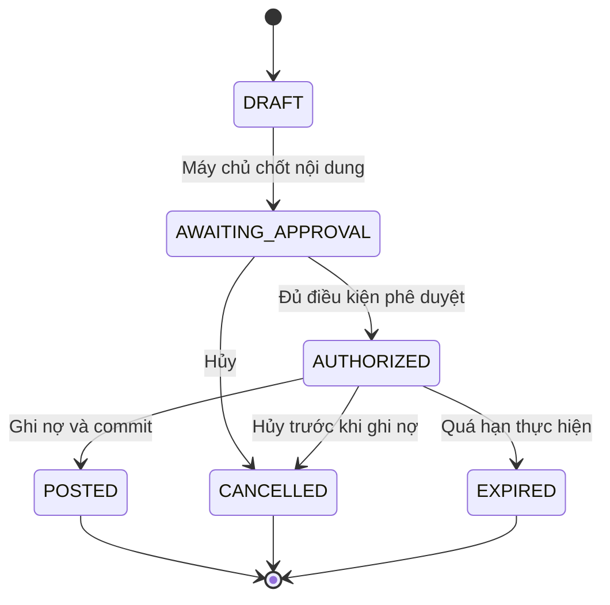

# Debit authorization — Ủy quyền ghi nợ

## 1. Mục tiêu và phạm vi

Debit authorization là quyết định cho phép một chủ thể thực hiện một lần ghi nợ trên một nguồn tiền cụ thể, với nội dung và điều kiện đã xác định. Trong bảo mật logic nghiệp vụ, câu hỏi cần trả lời là: **ai được phép làm giảm số dư nào, để thanh toán việc gì, bao nhiêu tiền, cho ai, vào thời điểm nào và tối đa bao nhiêu lần?**

Bài học thuộc chương **Monetary Rules**, tập trung vào bảo vệ quy tắc ghi nợ trước việc đổi tài khoản nguồn, sửa giá, bỏ qua phê duyệt, dùng lại quyền đã cấp và gửi nhiều yêu cầu đồng thời. Phạm vi là logic phía máy chủ của ví hoặc tài khoản thanh toán nội bộ; đây không phải tài liệu về cơ chế ủy quyền của một mạng thẻ cụ thể.

Sau bài học, bạn có thể:

- Viết business invariants cho một lệnh ghi nợ.
- Phân biệt xác thực, quyền theo đối tượng, phê duyệt giao dịch và bảo đảm số dư.
- Thiết kế trạng thái của giao dịch và quyền ghi nợ dùng một lần.
- Kết hợp transaction, kiểm soát đồng thời và idempotency để giữ đúng bất biến tiền tệ.
- Đặc tả các phép thử tấn công logic bằng kết quả quan sát được trong dữ liệu.

## 2. Đăng nhập thành công chưa đủ để trừ tiền

Giả sử Lan có ví `W-LAN`, số dư 1.000.000 VND. Một đơn hàng cần thanh toán 175.000 VND và phí 5.000 VND. Tổng số tiền bị trừ là 180.000 VND.

Một người dùng đã đăng nhập có thể gọi được endpoint thanh toán nhưng vẫn không được phép dùng mọi ví, mọi đơn hàng hoặc mọi mức giá. Ngay cả Lan cũng không được phép dùng phê duyệt 180.000 VND để trả một đơn hàng khác trị giá 800.000 VND.

| Lớp kiểm soát | Câu hỏi cần trả lời | Ví dụ điều kiện |
| --- | --- | --- |
| Authentication | Máy chủ đang làm việc với ai? | Phiên của Lan còn hiệu lực |
| Object authorization | Chủ thể có quyền trên đối tượng này không? | Lan được phép ghi nợ `W-LAN` trong đúng tenant |
| Transaction approval | Chủ thể đã đồng ý nội dung nào? | Đơn hàng, người nhận và tổng tiền đã được xác nhận |
| Monetary rules | Lệnh có hợp lệ về tiền không? | Đúng tiền tệ, số tiền dương, không vượt số dư khả dụng và hạn mức |
| Execution control | Lệnh có được thực hiện đúng một lần không? | Quyền chưa dùng; chưa có posting cho giao dịch này |

Một access token có scope `payments:write` chỉ giải quyết một phần quyền truy cập. Nó không chứng minh chủ thể sở hữu ví được chỉ định, không chứng minh giá do máy chủ tính và không ngăn hai yêu cầu cùng chi tiêu một số dư.

OWASP khuyến nghị thực thi ủy quyền giao dịch ở máy chủ và có bước kiểm tra cuối trước khi thực hiện giao dịch. Các khuyến nghị này giúp xác định nơi đặt hàng rào kiểm soát; thiết kế ví trong bài là ví dụ cụ thể để áp dụng chúng. Xem [OWASP Transaction Authorization Cheat Sheet](https://cheatsheetseries.owasp.org/cheatsheets/Transaction_Authorization_Cheat_Sheet.html).

## 3. Phân biệt quyền ghi nợ, giữ tiền và hạch toán

Trong bài này, **quyền ghi nợ** là bằng chứng nghiệp vụ cho phép thực hiện một lệnh đã định danh. **Hold** là việc giữ một phần tiền, làm giảm số dư khả dụng. **Posting** là việc ghi nhận biến động tiền đã được thực hiện vào sổ cái.

Với ví trả trước không cho phép thấu chi, đặt:

```text
B = số dư đã hạch toán của ví
H = tổng tiền đang được giữ có hiệu lực
A = số dư khả dụng = B - H
D = tiền hàng + phí phải trừ

B >= 0
0 <= H <= B
D > 0
```

Quyền ghi nợ có thể tồn tại mà chưa có hold. Vì thế, phê duyệt thành công lúc 10:00 không bảo đảm còn đủ tiền lúc 10:05.

| Thao tác | Thay đổi B | Thay đổi H | Điều kiện chính |
| --- | --- | --- | --- |
| Ghi nợ trực tiếp D | `B := B - D` | Không đổi | `B - H >= D` |
| Tạo hold D | Không đổi | `H := H + D` | `B - H >= D` |
| Capture đầy đủ hold D | `B := B - D` | `H := H - D` | Hold đúng giao dịch, còn hiệu lực, chưa capture |
| Release đầy đủ hold D | Không đổi | `H := H - D` | Hold còn hiệu lực, chưa capture hoặc release |

Nếu đã giữ 180.000 VND cho giao dịch đang capture, không áp dụng lại điều kiện `A >= 180.000` như thể đây là khoản chi mới. Tiền đó đã được đưa vào H. Thay vào đó, kiểm tra chính hold tương ứng rồi giảm B và H trong cùng transaction.

Bài học triển khai luồng **ghi nợ trực tiếp**. Luồng hold/capture cần thêm định danh hold, phần tiền còn lại và các bất biến riêng nếu cho phép capture từng phần. Với tài khoản tín dụng hoặc đa tiền tệ, phải định nghĩa lại số dư khả dụng theo sản phẩm; không áp dụng máy móc công thức ví trả trước.

## 4. Viết bất biến trước khi viết endpoint

```text
allowDebit(actor, intent, account, grant, now) =
    actor được phép ghi nợ account trong tenant hiện tại
    AND intent thuộc đúng phạm vi nghiệp vụ của actor
    AND account đang cho phép ghi nợ
    AND grant được cấp cho actor hoặc cơ chế đại diện hợp lệ
    AND grant khớp đầy đủ nội dung intent hiện tại
    AND grant có trạng thái AUTHORIZED và chưa hết hạn
    AND intent đang ở trạng thái có thể thanh toán
    AND currency của intent khớp currency của account
    AND D hợp lệ và được máy chủ xác định
    AND số dư khả dụng hiện tại đủ cho D
    AND hạn mức hiện tại cho phép D
    AND chưa có posting cho cùng nghiệp vụ thanh toán
```

Tất cả điều kiện cần được kiểm tra ở nơi thực hiện ghi nợ. Kiểm tra sớm ở API có ích cho trải nghiệm và giảm tải nhưng không thay thế kiểm tra trên trạng thái dùng để commit.

| Mã | Bất biến | Cách bảo vệ dự kiến |
| --- | --- | --- |
| I1 | Không ghi nợ ví ngoài quyền của chủ thể | Kiểm tra tenant, quan hệ và quyền trên tài khoản thực tế |
| I2 | D dương, đúng đơn vị và không tràn số | Kiểu tiền chuẩn hóa, giới hạn giá trị, cộng có kiểm tra |
| I3 | Nội dung thực hiện khớp nội dung đã duyệt | Intent bất biến hoặc version; grant gắn với nội dung tương ứng |
| I4 | Một grant dùng một lần | Chuyển trạng thái có điều kiện trong transaction |
| I5 | Ví trả trước không âm số dư khả dụng | Khóa hoặc cập nhật số dư có điều kiện |
| I6 | Một payment intent chỉ có một posting ghi nợ | Ràng buộc duy nhất theo nghiệp vụ |
| I7 | Không có tiền đã trừ mà thiếu chứng từ | Commit số dư, sổ cái và trạng thái cùng nhau |
| I8 | Không vượt hạn mức do yêu cầu đồng thời | Cập nhật bộ đếm hạn mức có điều kiện trong transaction |
| I9 | Retry không tạo thêm biến động tiền | Idempotency bền vững kết hợp I4 và I6 |

Không thay toàn bộ bảng bằng `if (balance >= amount)`. Có đủ tiền không làm cho một giao dịch trái quyền trở thành hợp lệ.

## 5. Xác định dữ liệu nào đáng tin

Máy khách gửi **ý định**. Máy chủ quyết định dữ liệu có thẩm quyền và tự xây dựng lệnh ghi nợ.

| Dữ liệu | Nguồn có thẩm quyền | Lỗi cần tránh |
| --- | --- | --- |
| Actor, danh tính workload | Ngữ cảnh xác thực đã được xác minh | Tin `userId` trong body |
| Tenant hoạt động | Ngữ cảnh phiên cộng kiểm tra thành viên/quyền | Tin riêng header `X-Tenant-Id` |
| Quyền ghi nợ ví | Quan hệ sở hữu hoặc ủy quyền phía máy chủ | Chỉ kiểm tra role `USER` |
| Giá, giảm giá, thuế, phí | Đơn hàng hoặc báo giá do máy chủ quản lý | Dùng `totalAmount` từ trình duyệt làm giá cuối |
| Người nhận | Bản ghi người nhận, người bán hoặc intent đã xác minh | Cho đổi tài khoản nhận sau phê duyệt |
| Trạng thái phê duyệt | Grant và workflow ở máy chủ | Tin `approved: true`, `skipApproval: true` |
| Số dư và tiền giữ | Dữ liệu giao dịch có thẩm quyền | Dùng cache hoặc read replica trễ để quyết định ghi nợ |
| Thời gian và hạn mức | Đồng hồ, chính sách và bộ đếm của hệ thống | Dùng ngày hoặc timezone tùy chọn từ client |

Ví dụ request thực hiện thanh toán:

```http
POST /payment-intents/pi-017/execute
Authorization: Bearer <access-token>
Idempotency-Key: <random-key-for-this-execution>
Content-Type: application/json

{
  "authorizationId": "da-081"
}
```

Máy chủ tải `pi-017`, lấy ví nguồn, người nhận, tiền hàng, phí và tiền tệ từ intent. Việc client biết `pi-017` hoặc `da-081` không cấp quyền sử dụng chúng. ID khó đoán giúp giảm khả năng dò tìm nhưng không thay thế kiểm tra quyền theo đối tượng.

Với luồng chuyển tiền tự nhập số tiền, client có thể đề xuất số tiền khi tạo intent. Máy chủ phải kiểm tra và lưu số tiền đó, sau đó phê duyệt chính intent đã lưu. Luồng execute không được thay nội dung bằng tham số mới do client gửi.

## 6. Gắn phê duyệt với nội dung giao dịch

Một grant dùng một lần có thể lưu các trường sau. Đây là mô hình logic minh họa, không phải schema đầy đủ cho mọi sản phẩm.

```text
debit_authorization
  id
  tenant_id
  authorized_actor_id
  source_account_id
  payment_intent_id
  intent_version
  recipient_id
  currency
  principal_minor
  fee_minor
  total_debit_minor
  purpose
  policy_version
  account_auth_epoch
  approved_at
  expires_at
  status: AUTHORIZED | CONSUMED | REVOKED | EXPIRED
  consumed_by_posting_id
```

- `intent_version` nhận diện phiên bản nội dung đã được duyệt.
- `purpose` phân biệt trả đơn hàng với chuyển tiền hoặc thao tác khác.
- `policy_version` hỗ trợ truy vết; máy chủ vẫn phải áp dụng chính sách hiện hành hoặc quy tắc chuyển tiếp đã định nghĩa.
- `account_auth_epoch` là ví dụ một số phiên bản dùng để vô hiệu hóa quyền cũ khi thay đổi ủy quyền hoặc khóa tài khoản. Thay đổi epoch và execute phải phối hợp trên cùng nguồn dữ liệu có thẩm quyền.
- `consumed_by_posting_id` nối bằng chứng phê duyệt với kết quả thực hiện.

Ví dụ grant `da-081` cho phép Lan dùng `W-LAN` để trả `pi-017`, phiên bản 3, cho người bán `M-009`, tổng 180.000 VND, trước thời điểm hết hạn. Nó không cho phép đổi sang ví doanh nghiệp hoặc trả thêm một đơn hàng cùng người bán.

Nếu dùng fingerprint, hãy tính từ biểu diễn chuẩn của toàn bộ trường có ý nghĩa: tenant, chủ thể được phép, tài khoản nguồn, người nhận, số tiền, tiền tệ, mục đích, ID và phiên bản intent. Không hash JSON tùy ý vì thứ tự trường và cách biểu diễn số có thể khác nhau.

Fingerprint chỉ giúp so khớp nội dung. Một hash không có bí mật không phải bằng chứng ủy quyền. Token được ký cũng không tự ngăn replay: máy chủ vẫn cần trạng thái dùng một lần và cơ chế thu hồi nếu nghiệp vụ yêu cầu.

Nếu tiền hàng, phí, người nhận hoặc tỷ giá được duyệt thay đổi, tạo phiên bản intent mới và phê duyệt lại theo chính sách. Không âm thầm ghi nợ tổng tiền khác với nội dung đã được chấp thuận. Thiết kế cho phép “tối đa X” phải mô hình hóa trần tiền, phạm vi người nhận, thời hạn và cách tiêu thụ hạn mức; đó là hợp đồng khác với grant dùng đúng một lần ở bài này.

### Phê duyệt tăng cường và phê duyệt nhiều người

Khi chính sách yêu cầu xác minh bổ sung, kết quả xác minh phải gắn với challenge của intent tương ứng. Cờ chung như `session.otpVerified = true` có thể bị dùng để thực hiện giao dịch khác trong cùng phiên.

Với quy tắc người lập và người duyệt phải khác nhau, kiểm tra `maker_id != approver_id` theo danh tính có thẩm quyền. Đổi tài khoản hiển thị hoặc thêm role vào request không được thay đổi điều kiện này. Mọi người duyệt phải duyệt cùng phiên bản nội dung; không cộng phê duyệt của phiên bản cũ vào phiên bản mới.

## 7. State machine phải được thực thi ở máy chủ

Có hai vòng đời liên quan nhưng không đồng nhất: payment intent và grant.



Trong sơ đồ, `AUTHORIZED` là trạng thái intent đã có grant hợp lệ, chưa phải đã giữ tiền. Khi chuyển intent sang `POSTED`, grant chuyển từ `AUTHORIZED` sang `CONSUMED` trong cùng transaction.

Các cạnh như `DRAFT -> POSTED`, `CANCELLED -> POSTED` hoặc `POSTED -> AUTHORIZED` không tồn tại. Endpoint execute, tác vụ nền và công cụ vận hành đều phải tuân thủ các cạnh này.

Grant có thể quá hạn dù tác vụ dọn dẹp chưa đổi `status` thành `EXPIRED`. Execute phải kiểm tra cả trạng thái và `expires_at` theo thời điểm kiểm tra cuối ở máy chủ. Nếu phải chờ khóa, không dùng lại thời điểm lấy trước khi chờ. Với PostgreSQL, `CURRENT_TIMESTAMP` là thời điểm bắt đầu transaction; cần chọn nguồn thời gian phù hợp với quy tắc hết hạn. Xem [PostgreSQL — Current Date/Time](https://www.postgresql.org/docs/18/functions-datetime.html#FUNCTIONS-DATETIME-CURRENT).

Một thiết kế khả thi định nghĩa hạn quyền là thời điểm chuyển grant sang `CONSUMED` tại hàng rào thực hiện. Nếu sản phẩm yêu cầu hoàn tất trước một hạn khác, cần mô hình hóa thêm hạn đó; không mô tả mọi hạn thời gian bằng một cột mơ hồ.

Hủy và execute có thể đến đồng thời. Cả hai phải dùng cùng cơ chế khóa hoặc cập nhật có điều kiện để chỉ một chuyển trạng thái thắng. Nếu execute đã commit, yêu cầu hủy không được biến posting thành chưa từng xảy ra; dùng nghiệp vụ hoàn tiền hoặc bút toán đảo có quyền riêng.

## 8. Tiền phải có kiểu và miền giá trị rõ ràng

Trong ví dụ VND này, hệ thống lưu số nguyên và quy ước `1 minor unit = 1 đồng`. Với tiền tệ khác, scale phải đến từ cấu hình tiền tệ được hỗ trợ, không lấy tùy ý từ request và không mặc định mọi tiền tệ đều có hai chữ số thập phân.

```java
import java.util.Objects;

record DebitAmount(String currency, long principalMinor, long feeMinor) {
    DebitAmount {
        Objects.requireNonNull(currency, "currency");
        if (!"VND".equals(currency)) {
            throw new IllegalArgumentException("Unsupported currency in this example");
        }
        if (principalMinor <= 0 || feeMinor < 0) {
            throw new IllegalArgumentException("Invalid debit components");
        }
        Math.addExact(principalMinor, feeMinor);
    }

    long totalMinor() {
        return Math.addExact(principalMinor, feeMinor);
    }
}
```

Đoạn Java chỉ kiểm tra cấu trúc tiền cho ví dụ; nó không cấp quyền ghi nợ và không xác minh nguồn giá. Ứng dụng còn phải giới hạn số tiền tối đa theo sản phẩm trước khi chạm cơ sở dữ liệu. Dữ liệu không biểu diễn được bằng `long` phải bị từ chối có kiểm soát khi phân tích request.

Tránh `double` cho tính tiền và tránh tự ép số thập phân về số nguyên bằng cách cắt phần lẻ. Nếu cần tính thuế, phí hoặc tỷ giá bằng số thập phân, định nghĩa thứ tự tính và cách làm tròn, chốt kết quả chính xác rồi mới tạo nội dung phê duyệt.

Số tiền âm là một lỗ hổng logic điển hình:

```text
balance := balance - (-100000)
```

Lệnh “ghi nợ” này lại tăng số dư. Điều kiện dương phải xuất hiện trong validation, domain rule và hàng rào cập nhật dữ liệu. Hoàn tiền phải có lệnh, quyền và chứng từ riêng; không đi qua endpoint ghi nợ bằng cách đổi dấu.

## 9. Chống chi tiêu vượt số dư khi có yêu cầu đồng thời

Một transaction không tự làm cho chuỗi “đọc, kiểm tra, ghi” an toàn trước mọi tranh chấp.

Ví dụ sai với B = 100.000, H = 0 và hai lệnh độc lập cùng yêu cầu 80.000:

```text
T1 đọc khả dụng = 100.000
T2 đọc khả dụng = 100.000
T1 thấy đủ tiền
T2 thấy đủ tiền
T1 và T2 cùng ghi nhận thanh toán thành công
```

Nếu cập nhật bằng phép trừ trực tiếp, số dư có thể âm. Nếu lưu lại số dư đã tính trong bộ nhớ, có thể mất cập nhật: số dư trông còn 20.000 nhưng sổ cái đã ghi hai khoản chi tổng 160.000. Cả hai đều vi phạm nghiệp vụ.

### 9.1. Cập nhật số dư có điều kiện

Schema tối thiểu cho projection số dư ví trả trước:

```sql
CREATE TABLE wallet_balance (
    tenant_id UUID NOT NULL,
    account_id UUID NOT NULL,
    currency VARCHAR(3) NOT NULL,
    debit_enabled BOOLEAN NOT NULL,
    auth_epoch BIGINT NOT NULL DEFAULT 0,
    posted_minor BIGINT NOT NULL CHECK (posted_minor >= 0),
    held_minor BIGINT NOT NULL CHECK (held_minor >= 0),
    PRIMARY KEY (tenant_id, account_id),
    CHECK (held_minor <= posted_minor)
);
```

Sau khi tải và kiểm tra quyền, grant, intent, dùng câu lệnh tham số hóa sau làm hàng rào số dư:

```sql
UPDATE wallet_balance
SET posted_minor = posted_minor - :total_debit_minor
WHERE tenant_id = :tenant_id
  AND account_id = :source_account_id
  AND currency = :currency
  AND debit_enabled = TRUE
  AND auth_epoch = :approved_auth_epoch
  AND :total_debit_minor > 0
  AND posted_minor - held_minor >= :total_debit_minor
RETURNING posted_minor, held_minor;
```

Phải có đúng một dòng trả về mới được đi tiếp. Không có dòng trả về nghĩa là ít nhất một tiền điều kiện không còn đúng; không được tạo posting thành công. Các bước ghi còn lại phải ở trong transaction đó và lỗi ở bất kỳ bước nào phải rollback toàn bộ.

Ở PostgreSQL với Read Committed, một `UPDATE` cạnh tranh trên cùng dòng có thể phải chờ; điều kiện `WHERE` được đánh giá lại trên phiên bản dòng đã được cập nhật. Đây là cơ sở cho hàng rào số dư đơn dòng, không phải bảo đảm tự động cho điều kiện trên nhiều bảng. Xem [PostgreSQL 18 — Transaction Isolation](https://www.postgresql.org/docs/18/transaction-iso.html).

Câu SQL không thay thế kiểm tra quyền theo đối tượng hay phê duyệt. `tenant_id` và `approved_auth_epoch` phải đến từ ngữ cảnh và grant đã xác minh.

### 9.2. Khi cần khóa nhiều đối tượng

Nếu quyết định phụ thuộc intent, grant, ví và hạn mức, có thể dùng khóa hàng để đọc và thay đổi chúng theo một giao thức thống nhất. `SELECT ... FOR UPDATE` khóa các hàng được chọn trước những thao tác ghi hoặc khóa xung đột; nó không chặn mọi phép đọc thông thường. Xem [PostgreSQL 18 — Explicit Locking](https://www.postgresql.org/docs/18/explicit-locking.html).

Một thứ tự khóa minh họa là: bản ghi idempotency, intent, grant, quan hệ quyền nếu cần, các tài khoản theo ID tăng dần, rồi bộ đếm hạn mức theo khóa tăng dần. Mọi đường ghi liên quan phải tuân thủ thứ tự đã chọn, kể cả hủy, thu hồi và tác vụ vận hành. Đây là lựa chọn thiết kế của ví dụ, không phải thứ tự bắt buộc cho mọi hệ thống.

Khóa ví không tự khóa bảng quyền hoặc bộ đếm hạn mức ở nơi khác. Nếu quyền có thể bị thu hồi đồng thời, luồng thu hồi và execute phải cùng khóa dữ liệu liên quan hoặc phối hợp qua phiên bản quyền được kiểm tra tại cập nhật. Đọc quyền cũ rồi bỏ qua thay đổi trong lúc chờ khóa vẫn để lại cửa sổ tranh chấp.

Nếu dùng optimistic locking, cột version và phép cập nhật có điều kiện phải bao trùm trạng thái cần bảo vệ. Nếu dùng Serializable, xử lý retry cả transaction khi gặp serialization failure. Với deadlock hoặc lỗi có thể retry, chạy lại từ đầu bằng cùng định danh nghiệp vụ; không retry riêng bước trừ tiền sau khi bỏ qua các kiểm tra khác.

## 10. Hạn mức cũng là tài nguyên dùng chung

Giả sử hạn mức ngày còn 100.000 VND. Hai yêu cầu, mỗi yêu cầu 80.000 VND, dùng hai ví khác nhau của cùng khách hàng. Khóa từng ví không bảo vệ được hạn mức chung.

Một bộ đếm có thể được định danh bằng `(tenant_id, subject_id, currency, period_id, rule_id)` và lưu `used_minor`, `limit_minor`. `period_id` do máy chủ xác định theo lịch nghiệp vụ đã chọn.

```sql
UPDATE debit_limit_usage
SET used_minor = used_minor + :total_debit_minor
WHERE tenant_id = :tenant_id
  AND subject_id = :subject_id
  AND currency = :currency
  AND period_id = :period_id
  AND rule_id = :rule_id
  AND :total_debit_minor > 0
  AND used_minor <= limit_minor
  AND :total_debit_minor <= limit_minor - used_minor
RETURNING used_minor;
```

Schema tương ứng phải bảo đảm `0 <= used_minor <= limit_minor`, có duy nhất một dòng cho khóa bộ đếm và giới hạn số nguyên phù hợp. Dòng bộ đếm phải tồn tại hoặc được tạo bằng cơ chế an toàn trước tranh chấp. Không coi “chưa có dòng” là không giới hạn.

Điều kiện cuối tránh phải cộng trước khi kiểm tra tràn. Cập nhật bộ đếm, số dư và posting trong cùng transaction. Nếu kiểm tra số dư thất bại, lượng hạn mức vừa tiêu thụ phải rollback.

Xác định rõ phí có tính vào hạn mức không, hold có chiếm hạn mức không, hoàn tiền có trả lại hạn mức không, và hạn mức áp dụng cho cá nhân, ví hay tenant. Bài này dùng tổng tiền bị trừ và hạn mức theo chủ thể. Không cộng trực tiếp các tiền tệ khác nhau; nếu có hạn mức quy đổi, phải quản lý tỷ giá và cách làm tròn như một phần chính sách.

## 11. Idempotency và chống phát lại

**Idempotency** cho phép gửi lại cùng một lệnh mà không tạo thêm hiệu ứng. **Chống phát lại quyền** ngăn cùng một grant bị tiêu thụ cho nhiều lần ghi nợ. Cả hai đều cần thiết.

- Chỉ idempotency: kẻ tấn công đổi key có thể cố thực hiện lại cùng nghiệp vụ.
- Chỉ grant dùng một lần: retry sau timeout có thể báo đã dùng mà không giúp client biết kết quả lần trước.
- Kết hợp cả hai với ràng buộc nghiệp vụ: retry nhận kết quả đã commit, còn key mới cũng không tạo thêm posting.

### 11.1. Hợp đồng của idempotency key

```text
scope = (tenant_id, authenticated_actor_id, operation, idempotency_key)
request_fingerprint
payment_intent_id
result_posting_id
response_code
response_body_or_result_reference
created_at
```

Có ràng buộc duy nhất trên toàn bộ scope. Actor và tenant phải lấy từ danh tính đã xác minh. Fingerprint bao gồm các tham số có ý nghĩa như intent, authorization ID và operation; không đưa access token hoặc giá trị ngẫu nhiên không ảnh hưởng nội dung vào fingerprint.

| Tình huống | Kết quả mong đợi |
| --- | --- |
| Cùng scope, key và nội dung; đã commit | Trả kết quả đã lưu, không ghi nợ lại |
| Cùng scope và key nhưng khác nội dung | Báo xung đột, không thực hiện nội dung mới |
| Hai yêu cầu cùng scope và key đang chạy | Chỉ một yêu cầu sở hữu việc thực hiện; yêu cầu kia chờ hoặc nhận trạng thái đang xử lý theo hợp đồng API |
| Khác key nhưng cùng intent | Không tạo posting thứ hai; xử lý theo kết quả nghiệp vụ đã có |
| Người khác biết key | Không được đọc kết quả hoặc sử dụng quyền của chủ thể ban đầu |

Phải xác thực và kiểm tra quyền xem đối tượng trước khi trả kết quả đã lưu. Cache response tra cứu toàn cục chỉ bằng key có thể làm lộ dữ liệu giao dịch.

Với retry của giao dịch đã commit, không bắt grant phải còn `AUTHORIZED` hoặc chưa hết hạn để trả kết quả cũ: grant chuyển `CONSUMED` là trạng thái đúng. Tuy nhiên, vẫn kiểm tra quyền truy cập kết quả hiện tại và so khớp lệnh. Nhánh trả kết quả cũ không thực hiện ghi nợ mới.

### 11.2. Ràng buộc duy nhất theo nghiệp vụ

Ví dụ áp dụng khi mỗi payment intent chỉ có một lần ghi nợ trực tiếp:

```sql
CREATE UNIQUE INDEX uq_posting_debit_intent
ON payment_posting (tenant_id, payment_intent_id);

CREATE UNIQUE INDEX uq_posting_debit_grant
ON payment_posting (tenant_id, debit_authorization_id);
```

Các cột trong hai chỉ mục phải là `NOT NULL`. Bảng `payment_posting` ở đây chỉ chứa posting thanh toán trực tiếp thuộc mô hình một lần; không áp dụng nguyên xi cho bảng chung có capture từng phần hoặc nhiều loại bút toán. Nếu cho phép nhiều lần thu, cần định danh mỗi lần và bảo vệ tổng số tiền được phép.

Hết thời gian lưu idempotency không được làm mất hàng rào chống ghi nợ lại cùng intent. Ràng buộc nghiệp vụ và lịch sử tiêu thụ quyền phải được bảo toàn theo vòng đời nghiệp vụ, kể cả khi lưu trữ dữ liệu cũ.

## 12. Ghép các hàng rào vào một transaction

Pseudocode mô tả ghi nợ trực tiếp khi dữ liệu quyết định nằm trong cùng cơ sở dữ liệu giao dịch. Tên hàm là các trách nhiệm cần triển khai, không phải thư viện có sẵn.

```text
executeDebit(authenticatedActor, intentId, authorizationId, key):
    requireAuthenticated(authenticatedActor)
    validateIdentifiersAndKey(intentId, authorizationId, key)

    begin transaction
        command = buildCanonicalCommandFromServerContext(
            authenticatedActor, intentId, authorizationId)
        idem = claimIdempotencyScopeOrLoadExisting(command, key)
        requireSameFingerprintIfExisting(idem, command)

        intent = lockIntentInVerifiedTenant(intentId)
        requireActorMayAccessIntent(authenticatedActor, intent)

        if idem already contains a committed result:
            requireActorMayReadResult(authenticatedActor, idem.result)
            commit and return stored result

        if intent already POSTED:
            result = loadItsCommittedPosting(intent)
            requireCommandConsistentWithExistingResult(command, result)
            requireActorMayReadResult(authenticatedActor, result)
            completeIdempotencyForThisKey(idem, result)
            commit and return result

        grant = lockGrant(authorizationId)
        lockAuthorizationRelationsIfRequired()
        lockAffectedAccountsInStableOrder()
        lockRequiredLimitCountersInStableOrder()

        now = authoritativeTimeAfterLockWaits()
        requireIntentCanBeExecuted(intent)
        requireCurrentObjectDebitPermission(authenticatedActor, intent)
        requireCurrentAccountStatusAndAuthorizationVersion(intent, grant)
        requireGrantMatchesActorAndExactIntentVersion(grant, intent)
        requireGrantAuthorizedAndNotExpired(grant, now)
        requireCurrentApprovalAndRiskPolicy(intent, grant)

        amount = calculateOrLoadApprovedServerAmount(intent)
        requireAmountAndCurrencyConsistent(amount, grant, sourceAccount)
        requireLimitUpdateAffectedExactlyOneRow(amount)
        requireConditionalBalanceDebitAffectedExactlyOneRow(amount)

        posting = appendBalancedLedgerTransaction(intent, amount)
        requireGrantTransitionAffectedExactlyOneRow(
            AUTHORIZED -> CONSUMED, posting.id)
        requireIntentTransitionAffectedExactlyOneRow(
            AUTHORIZED -> POSTED, posting.id)
        appendOutboxEvent(posting)
        completeIdempotencyWithResult(idem, posting)
    commit
    return committed result
```

`claimIdempotencyScopeOrLoadExisting` cần ràng buộc duy nhất và insert/đọc có xử lý cạnh tranh. Không dùng “SELECT không thấy rồi INSERT” mà thiếu hàng rào ở cơ sở dữ liệu. Trong mô hình đồng bộ này, claim, kết quả và ghi nợ cùng transaction: chết trước commit thì toàn bộ rollback. Nếu commit `PROCESSING` ở transaction riêng, cần thêm lease, phục hồi và giao thức riêng.

`appendBalancedLedgerTransaction` tạo các bút toán đối ứng cân bằng theo tiền tệ. Ví dụ tiền hàng đi tới tài khoản phải trả người bán, phí đi tới tài khoản doanh thu phí, đồng thời giảm nghĩa vụ số dư ví khách hàng theo mô hình kế toán đã chọn. Chỉ một dòng giảm balance không phải sổ cái đầy đủ.

Schema cần khóa ngoại hoặc kiểm tra tương đương để không gắn posting/grant với intent thuộc tenant khác. Quyền ghi trực tiếp vào bảng tiền phải được giới hạn; một đường cập nhật vận hành bỏ qua domain rules có thể phá các bất biến.

Bất kỳ kiểm tra, cập nhật, ghi ledger, ghi outbox hoặc lưu kết quả nào thất bại đều phải rollback cả transaction. Chỉ trả thành công sau commit. Không commit số dư ở transaction thứ nhất rồi lưu grant hoặc ledger ở transaction thứ hai.

Quyết định từ dịch vụ ngoài, như đánh giá rủi ro, cần bằng chứng gắn với phiên bản intent và thời hạn rõ ràng để kiểm tra khi thực hiện. Kết quả cache “đã cho phép” không tự thay thế chính sách mới hoặc phiên bản giao dịch mới.

## 13. Timeout và tác động ngoài cơ sở dữ liệu

Máy chủ có thể commit thành công nhưng mất kết nối trước khi client nhận response. Client gửi lại cùng key phải nhận kết quả đã commit và cùng posting, thay vì bị trừ thêm tiền.

| Điểm lỗi | Dữ liệu cần có | Cách xử lý |
| --- | --- | --- |
| Trước commit | Không có hiệu ứng tiền được commit một phần | Rollback và retry cả lệnh |
| Sau commit, trước response | Posting và kết quả idempotency | Retry trả kết quả cũ |
| Sau commit, chưa gửi sự kiện | Outbox chưa xử lý | Worker tiếp tục phát sự kiện |
| Phát sự kiện rồi chết trước khi đánh dấu | Sự kiện có thể được gửi lại | Consumer khử trùng theo event ID hoặc posting ID |
| Timeout gọi cổng thanh toán ngoài hệ thống | Kết quả bên ngoài có thể chưa biết | Giữ trạng thái chờ đối soát, tra cứu bằng định danh ổn định |

Không giữ transaction mở trong lúc chờ người dùng xác nhận hoặc chờ mạng thanh toán phản hồi lâu. Outbox được ghi cùng posting phù hợp với tác vụ hậu xử lý.

Outbox không biến lệnh gọi mạng thành “đúng một lần” trên toàn hệ thống. Nếu bên ngoài đã nhận lệnh nhưng mất phản hồi, dùng idempotency của nhà cung cấp hoặc tra cứu/đối soát bằng cùng định danh. Không tạo giao dịch kinh tế mới chỉ vì request trước timeout.

Luồng chờ bên ngoài có thể cần state machine khác gồm hold và trạng thái chờ xác nhận. Không thêm cuộc gọi cổng thanh toán vào giữa pseudocode rồi cho rằng rollback cục bộ sẽ hoàn tác được bên ngoài.

## 14. Các kiểu tấn công và hàng rào tương ứng

| Thao tác của kẻ tấn công | Lỗi thiết kế | Hàng rào cần có |
| --- | --- | --- |
| Đổi ví nguồn sang ví người khác | Chỉ kiểm tra đăng nhập hoặc role | Quyền theo đối tượng và tenant |
| Sửa giá 175.000 thành 1 | Tin tổng tiền từ client | Giá và phí có thẩm quyền ở máy chủ |
| Duyệt xong rồi đổi người nhận | Grant không ràng buộc nội dung | So khớp phiên bản intent và người nhận |
| Gửi thẳng execute khi chưa duyệt | Tin thứ tự màn hình | State machine và kiểm tra grant khi thực hiện |
| Gửi phí âm hoặc số tiền quá lớn | Validation thiếu miền giá trị | Tiền dương, phí không âm, kiểm tra tràn |
| Dùng lại grant bằng key mới | Chỉ chống trùng theo key | Grant dùng một lần và unique theo intent |
| Gửi song song các lệnh độc lập | Kiểm tra số dư ngoài vùng bảo vệ | Cập nhật có điều kiện hoặc khóa đúng phạm vi |
| Chia khoản chi qua nhiều ví | Hạn mức chỉ khóa theo ví | Bộ đếm dùng chung theo chủ thể |
| Thu hồi quyền khi execute chờ | Quyền chỉ được kiểm tra sớm | Phối hợp khóa hoặc version tại hàng rào cuối |
| Hủy và execute đồng thời | Chuyển trạng thái không cạnh tranh an toàn | Chỉ một cạnh trạng thái có thể commit |
| Lạm dụng API vận hành nội bộ | Tin mạng nội bộ là đủ | Danh tính workload, quyền nghiệp vụ, kiểm toán |

Ghi nợ định kỳ cũng cần quyền rõ ràng. Nếu không có người dùng tương tác mỗi lần, mô hình hóa mandate: tài khoản, người nhận, loại giao dịch, trần tiền, kỳ áp dụng, thời hạn và quyền thu hồi. Không giả lập phiên người dùng vĩnh viễn hoặc dùng role `SYSTEM` để bỏ qua quy tắc.

## 15. Đặc tả kiểm thử tình huống tấn công logic

Dưới đây là các phép thử cần xây dựng khi triển khai, không phải báo cáo đã chạy. Ngoài HTTP response, kiểm tra số dư, ledger, grant, intent, hạn mức và kết quả idempotency.

| Ca thử | Thiết lập/thao tác | Kết quả bắt buộc |
| --- | --- | --- |
| Ghi nợ hợp lệ | B = 1.000.000, H = 0, D = 180.000 | B = 820.000; một posting; grant `CONSUMED`; intent `POSTED` |
| Khác chủ ví | Dùng ví ngoài quan hệ được phép | Không biến động tiền, không tiêu thụ grant |
| Khác tenant | ID hợp lệ nhưng tenant khác | Không lộ dữ liệu hoặc ghi nợ chéo tenant |
| Sửa nội dung | Thay giá, phí, người nhận hoặc phiên bản sau duyệt | Từ chối grant cũ |
| Bỏ qua phê duyệt | Intent còn `DRAFT` hoặc `AWAITING_APPROVAL` | Không có posting |
| Giá trị biên | D = 0, âm, ngoài miền hoặc sai currency | Từ chối trước hiệu ứng tiền |
| Tiền đang giữ | B = 200.000, H = 50.000, D = 180.000 | Từ chối vì A chỉ còn 150.000 |
| Hết hạn khi chờ khóa | Grant quá hạn tại kiểm tra cuối | Không ghi nợ |
| Retry cùng lệnh | Cùng key và nội dung sau commit | Cùng posting ID; không trừ thêm |
| Tái dùng key sai nội dung | Cùng scope/key, intent hoặc grant khác | Xung đột; không giao dịch mới |
| Key mới, intent cũ | Thanh toán intent đã `POSTED` | Không posting thứ hai |
| Hai lệnh tranh số dư | B = 100.000, hai intent D = 80.000 | Một thành công; một từ chối; B = 20.000 |
| Hai ví tranh hạn mức | Hạn mức chung còn 100.000; mỗi ví chi 80.000 | Tổng hạn mức được commit không quá 100.000 |
| Thu hồi đồng thời | Điều khiển điểm khóa và commit thu hồi | Tuân thủ thứ tự hiệu lực đã định nghĩa |
| Hủy đồng thời | Cancel cạnh tranh execute | Hủy thắng thì không ghi nợ; execute thắng thì không hủy ngược posting |
| Lỗi ledger | Gây lỗi sau cập nhật balance, trước commit | Balance, hạn mức, grant trở lại trạng thái cũ |
| Mất response | Ngắt sau commit rồi retry | Nhận kết quả đã commit; không trừ lại |
| Sự kiện trùng | Cùng event ID được phát hai lần | Không tạo tác động tiền bổ sung |

Phép thử tranh số dư phải dùng **hai intent, hai grant và hai key khác nhau**. Nếu dùng cùng key, chỉ chứng minh chống trùng, chưa chứng minh bảo vệ số dư giữa các giao dịch độc lập.

Dùng barrier hoặc điều phối transaction để tạo tranh chấp lặp lại được. Không chỉ thêm `sleep` rồi hy vọng lỗi xuất hiện. Kiểm thử tích hợp cần hệ quản trị cơ sở dữ liệu và mức cô lập thực tế; mock repository không chứng minh được hành vi khóa.

```text
Với mọi chuỗi lệnh đã commit trong mô hình ví trả trước:
    posted_minor >= held_minor >= 0
    mỗi payment_intent có tối đa một posting ghi nợ
    mỗi grant dùng một lần gắn với tối đa một posting
    mỗi giao dịch sổ cái cân bằng theo từng tiền tệ
    lệnh bị từ chối không để lại hiệu ứng tiền một phần
```

## 16. Nhật ký và khả năng giải thích quyết định

```text
request/correlation ID
  -> authenticated actor hoặc workload
  -> tenant và source account
  -> payment intent + version
  -> authorization ID + policy version
  -> idempotency scope
  -> posting ID và ledger transaction ID
  -> outbox event ID
```

Ghi lý do từ chối có cấu trúc như `OBJECT_NOT_ALLOWED`, `GRANT_MISMATCH`, `GRANT_EXPIRED`, `AVAILABLE_FUNDS_INSUFFICIENT`, `LIMIT_EXCEEDED`, `IDEMPOTENCY_CONFLICT`. Thông báo ngoài API có thể cần khái quát để tránh tiết lộ tài khoản tồn tại. Nhật ký nội bộ có kiểm soát quyền truy cập giữ chi tiết để điều tra.

Không log access token, mã xác minh dùng một lần hoặc bí mật. Chứng từ nghiệp vụ cần lưu cùng hiệu ứng tiền; log chẩn đoán không thay sổ cái. Với transaction rollback, log lý do từ chối cần cơ chế quan sát riêng nếu phải giữ sự kiện thất bại.

Theo dõi nhiều lần dùng lại grant, nhiều `GRANT_MISMATCH`, cùng chủ thể thử hàng loạt ví, xung đột idempotency tăng và chia nhỏ giao dịch sát hạn mức. Chỉ đếm lỗi HTTP sẽ bỏ qua giao dịch được chấp nhận nhưng vi phạm bất biến.

## 17. Tự đánh giá thiết kế

Đi theo một lệnh từ đầu tới commit và xác định được:

1. Danh tính, tenant và quyền trên tài khoản lấy từ đâu; thu hồi quyền có hiệu lực thế nào.
2. Nguồn xác định số tiền, phí, tiền tệ, người nhận và phiên bản nội dung được duyệt.
3. Grant cho phép thao tác gì, hết hạn khi nào, được tiêu thụ ở đâu.
4. Cơ chế bảo vệ số dư và từng hạn mức trước lệnh đồng thời.
5. Ràng buộc ngăn intent hoặc grant sinh thêm posting dù client đổi key.
6. Ranh giới commit của balance, ledger, trạng thái, idempotency và outbox.
7. Kết quả khi timeout, hủy, thu hồi hoặc lỗi ở mỗi điểm quan trọng.

Quyết định ghi nợ cần có phạm vi, có bằng chứng và có hàng rào thực hiện cụ thể. Các bất biến phải được giữ trên mọi đường gọi, kể cả khi client cố tình gửi sai thứ tự hoặc gửi nhiều yêu cầu cùng lúc.
