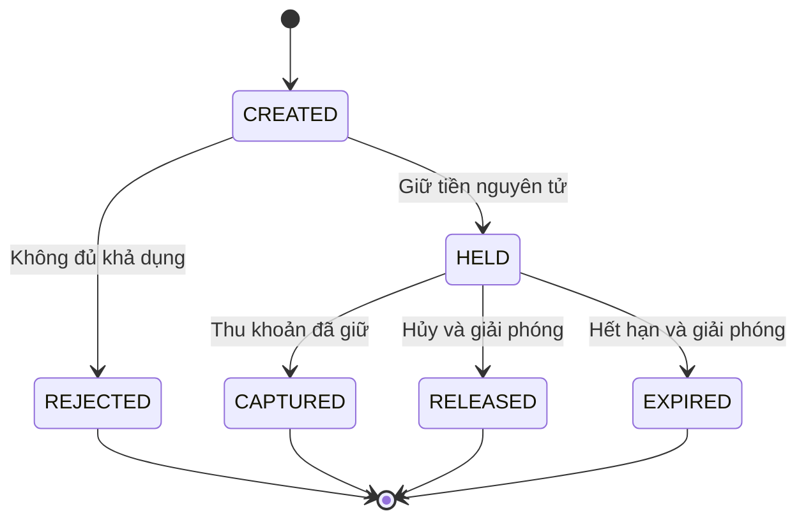

# Insufficient balance handling — Xử lý số dư không đủ

## 1. Mục tiêu và phạm vi

Trong chương **Monetary Rules**, xử lý số dư không đủ là một quy tắc bảo mật logic nghiệp vụ: hệ thống chỉ được ghi nhận thanh toán khi nguồn tiền hợp lệ thực sự đáp ứng nghĩa vụ thanh toán tại thời điểm quyết định. Kiểm tra đúng ở giao diện nhưng sai khi ghi dữ liệu vẫn có thể dẫn đến chi vượt số dư, giao hàng chưa thu tiền hoặc thu tiền nhiều lần.

Bài học sử dụng ví trả trước, không cho thấu chi, thanh toán toàn bộ một đơn hàng bằng một loại tiền. Các tình huống vay, hạn mức tín dụng, thanh toán một phần hoặc kết hợp nhiều nguồn tiền cần chính sách riêng; không được tự bật những hành vi đó để làm cho giao dịch đang thiếu tiền thành công.

Sau bài học, người học có thể:

- Xác định số dư khả dụng và các bất biến phải giữ khi thiếu tiền.
- Đặt kiểm tra quyền, trạng thái nghiệp vụ và số dư vào luồng thanh toán có transaction phù hợp.
- Ngăn hai yêu cầu đồng thời cùng sử dụng một khoản tiền và ngăn yêu cầu trùng trừ tiền lại.
- Thiết kế phản hồi từ chối, giữ tiền và kiểm thử các tình huống lạm dụng logic.

## 2. Số dư nào được dùng để quyết định?

Một con số mang nhãn `balance` thường chưa đủ để quyết định khách hàng có thể thanh toán hay không. Trong mô hình đơn giản của bài học:

| Đại lượng | Ý nghĩa |
| --- | --- |
| `posted_minor` | Số dư đã ghi nhận, tính bằng đơn vị tiền nhỏ nhất mà hệ thống hỗ trợ |
| `held_minor` | Phần số dư đang được giữ cho các nghĩa vụ chưa hoàn tất |
| `available_minor` | Số dư khả dụng, bằng `posted_minor - held_minor` |
| `required_minor` | Tổng phải trả được máy chủ xác định, gồm các khoản phí phải thu trong lần thanh toán này |

Ví dụ với VND và quy ước đơn vị lưu trữ là một đồng:

```text
Số dư đã ghi nhận:           100.000
Đang giữ cho giao dịch khác:  30.000
Khả dụng:                    70.000
Giá đơn hàng:                68.000
Phí phải thu:                 5.000
Tổng phải trả:                73.000
Kết quả: từ chối vì thiếu 3.000
```

Nếu chỉ so sánh giá đơn hàng với số dư đã ghi nhận, hệ thống sẽ cho phép một giao dịch không có đủ nguồn tiền. Phí, khoản giữ tiền và đơn vị tiền phải tham gia cùng một phép quyết định.

`available_minor` có thể là giá trị tính từ các cột được cập nhật nhất quán. Số dư trên trình duyệt, cache hoặc bản sao dữ liệu có độ trễ chỉ phục vụ hiển thị; quyết định chi tiền phải dựa trên nguồn dữ liệu có thẩm quyền và cơ chế đồng thời phù hợp.

Một mô hình sổ cái có thể biểu diễn số dư theo cách khác. Khi áp dụng, cần xác định rõ thành phần nào chịu trách nhiệm cho phép chi tiền; không được coi một phép cộng các bút toán đọc ở thời điểm bất kỳ là cơ chế chống chi vượt số dư.

## 3. Viết bất biến trước khi viết nhánh xử lý lỗi

Với ví trả trước trong bài học, các bất biến là:

```text
posted_minor >= 0
held_minor >= 0
held_minor <= posted_minor
available_minor = posted_minor - held_minor
required_minor > 0
```

Khi ghi nợ trực tiếp thành công:

```text
available_before >= required_minor
posted_after = posted_before - required_minor
held_after = held_before
```

Khi từ chối vì thiếu tiền:

```text
posted_after = posted_before
held_after = held_before
không có bút toán thu tiền thành công cho lần thử này
đơn hàng không chuyển sang PAID
không phát sự kiện cho phép giao hàng do lần thử này tạo ra
```

Hệ thống vẫn có thể lưu lần thử bị từ chối và nhật ký kiểm toán. Những bản ghi này phải phản ánh đúng việc không thu được tiền.

Các bất biến bổ sung nối quy tắc tiền với bảo mật nghiệp vụ:

1. Người gọi được phép dùng đúng ví, trong đúng tenant, để thanh toán đúng đơn hàng.
2. Đơn hàng đang ở trạng thái được phép thanh toán; bước phê duyệt bắt buộc đã hoàn thành.
3. Giá, phí, giảm giá và loại tiền được xác định hoặc kiểm chứng ở máy chủ theo phiên bản nghiệp vụ phù hợp.
4. Một ý định thanh toán toàn bộ đơn hàng chỉ tạo tối đa một lần thu tiền thành công, kể cả khi người gọi thay idempotency key.
5. Thay đổi số dư, bản ghi thanh toán, bút toán sổ cái và sự kiện nghiệp vụ trong cùng cơ sở dữ liệu phải có ranh giới commit nhất quán.

Số dư không âm chỉ là một phần của tính đúng. Ví dụ, hai thanh toán đều được đánh dấu thành công nhưng hệ thống chỉ trừ tiền cho một lần vẫn vi phạm nghiệp vụ dù số dư cuối cùng không âm.

## 4. Vì sao kiểm tra rồi trừ tiền dễ bị vượt qua?

### 4.1. Khoảng trống giữa đọc và ghi

Đoạn mã minh họa sau có lỗi cạnh tranh:

```java
// Mã minh họa không an toàn khi có nhiều yêu cầu đồng thời.
long available = walletRepository.readAvailable(walletId);
if (available < requiredMinor) {
    return PaymentResult.insufficientFunds();
}
walletRepository.subtract(walletId, requiredMinor);
orderRepository.markPaid(orderId);
```

Giả sử ví có 100.000 đồng, không có khoản giữ, hai yêu cầu khác nhau cùng muốn chi 80.000 đồng:

| Thời điểm | Yêu cầu A | Yêu cầu B |
| --- | --- | --- |
| T1 | Đọc khả dụng 100.000 | |
| T2 | | Đọc khả dụng 100.000 |
| T3 | Kết luận đủ tiền | Kết luận đủ tiền |
| T4 | Trừ 80.000, còn 20.000 | |
| T5 | | Tiếp tục trừ theo kết luận cũ |

Nếu thao tác cuối là `balance = balance - 80000`, ví có thể âm nếu không có ràng buộc chặn lại. Nếu ứng dụng ghi đè `balance = 20000` từ kết quả đã tính trước, có thể xuất hiện mất cập nhật: hai đơn cùng được coi là đã trả tiền nhưng chỉ 80.000 đồng bị trừ.

Đây là lỗi **time-of-check to time-of-use**, thường viết tắt là TOCTOU. Chỉ thêm `@Transactional` quanh đoạn mã chưa xác định cách hai transaction tranh chấp cùng số dư. Cần một cơ chế khiến quyết định đủ tiền và thay đổi nguồn tiền không thể bị xen ngang theo cách phá bất biến.

### 4.2. Các đường đi vòng thường gặp

- Nút thanh toán bị vô hiệu hóa ở giao diện nhưng API vẫn chấp nhận yêu cầu trực tiếp.
- API tin `amount`, `fee`, `currency` hoặc `availableBalance` do client gửi.
- Dịch vụ đọc số dư từ cache rồi ghi nợ trên cơ sở dữ liệu chính.
- Kênh web có kiểm tra nhưng tác vụ nền, API quản trị hoặc consumer không dùng cùng quy tắc.
- Đơn hàng được đánh dấu `PAID` trước khi thao tác trừ tiền thực sự thành công.
- Lỗi cơ sở dữ liệu bị bắt rồi xử lý tiếp như thể đã thanh toán xong.
- Yêu cầu số tiền âm biến phép trừ thành cộng tiền; số tiền quá lớn làm tràn phép tính.

Ẩn nút, giới hạn tần suất hoặc khóa trong bộ nhớ của một tiến trình có thể giúp trải nghiệm hay vận hành. Chúng không thay thế cơ chế bảo vệ nguồn tiền dùng chung giữa nhiều instance.

## 5. Chuẩn hóa tiền và nguồn dữ liệu đáng tin

### 5.1. Dùng đơn vị tiền rõ ràng

Một lựa chọn cho ví là số nguyên `long` ở Java và `BIGINT` trong cơ sở dữ liệu, biểu diễn đơn vị nhỏ nhất mà sản phẩm hỗ trợ. Luôn gắn giá trị với mã tiền và cấu hình số chữ số thập phân của sản phẩm; không mặc định mọi loại tiền đều có hai chữ số thập phân.

Với số nguyên, dùng phép toán có kiểm tra tràn khi cộng các thành phần:

```java
long requiredMinor = Math.addExact(orderTotalMinor, feeMinor);
if (requiredMinor <= 0 || requiredMinor > MAX_PAYMENT_MINOR) {
    throw new InvalidPaymentAmountException();
}
```

`orderTotalMinor` và `feeMinor` ở đây là kết quả của quy tắc máy chủ. Chúng phải được kiểm tra miền giá trị trước đó. Nếu có giảm giá, việc tính tổng cũng phải dùng phép toán kiểm tra tràn và xác thực quy tắc giảm giá, không chỉ kiểm tra kết quả cuối.

Đối với biểu diễn thập phân, `BigDecimal` hỗ trợ tính toán và kiểm soát làm tròn. So sánh giá trị bằng `compareTo`; `equals` còn xét scale. Có thể dùng `setScale(..., RoundingMode.UNNECESSARY)` và `longValueExact()` để từ chối giá trị không biểu diễn chính xác theo đơn vị đã chọn. Xem [Java SE 21: BigDecimal](https://docs.oracle.com/en/java/javase/21/docs/api/java.base/java/math/BigDecimal.html).

Ví dụ chuyển giá trị USD đã được máy chủ tính thành số cent:

```java
BigDecimal total = new BigDecimal("73.00");
long cents = total
        .setScale(2, RoundingMode.UNNECESSARY)
        .movePointRight(2)
        .longValueExact();
```

Không chuyển qua `double` ở giữa luồng tiền. Với đầu vào dạng chuỗi, giới hạn độ dài và định dạng trước khi phân tích để tránh giá trị vượt miền hỗ trợ hoặc chi phí xử lý không cần thiết. Chính sách làm tròn phải nằm trong quy tắc tính giá; không tự làm tròn xuống khoản phải trả chỉ để vượt kiểm tra đủ tiền.

### 5.2. Tính lại nghĩa vụ thanh toán ở máy chủ

Client thường chỉ cần gửi ý định như `orderId`, `walletId` và phiên bản báo giá nếu hệ thống sử dụng báo giá. Máy chủ phải lấy hoặc xác minh:

- Đơn hàng thuộc người dùng hoặc phạm vi được ủy quyền.
- Giá và giảm giá theo phiên bản còn được chấp nhận.
- Phí phải thu, bên chịu phí và mã tiền.
- Trạng thái cho phép thanh toán và các bước phê duyệt bắt buộc.

Nếu báo giá hết hiệu lực, trả kết quả yêu cầu xác nhận lại theo hợp đồng API. Không được im lặng lấy một số tiền do client tự giảm làm nghĩa vụ thanh toán mới.

## 6. Ghi nợ nguyên tử bằng cập nhật có điều kiện

### 6.1. Mô hình dữ liệu minh họa

Đây là bảng số dư tối giản cho PostgreSQL, chưa phải một hệ thống kế toán hoàn chỉnh:

```sql
CREATE TABLE wallet (
    id UUID PRIMARY KEY,
    tenant_id UUID NOT NULL,
    owner_id UUID NOT NULL,
    currency CHAR(3) NOT NULL,
    state TEXT NOT NULL
        CHECK (state IN ('ACTIVE', 'FROZEN', 'CLOSED')),
    posted_minor BIGINT NOT NULL CHECK (posted_minor >= 0),
    held_minor BIGINT NOT NULL CHECK (held_minor >= 0),
    CHECK (held_minor <= posted_minor)
);
```

Trong ví dụ, một ví có một chủ sở hữu. Hệ thống có ủy quyền nhiều người cần mô hình quyền tương ứng, được kiểm tra ở thời điểm xử lý; không thay thế bằng một `ownerId` do client khai báo.

Các ràng buộc cơ sở dữ liệu chặn một số trạng thái sai ngay cả khi có đường ghi bị lỗi. Tuy nhiên, chúng không tự xác minh quyền, trạng thái đơn hàng hoặc việc sổ cái có khớp với số dư hay không.

### 6.2. Gộp điều kiện đủ tiền với phép trừ

Sau khi xác thực đầu vào và nghĩa vụ thanh toán, có thể dùng câu lệnh sau cho ghi nợ trực tiếp:

```sql
UPDATE wallet
SET posted_minor = posted_minor - :required_minor
WHERE id = :wallet_id
  AND tenant_id = :authenticated_tenant_id
  AND owner_id = :authenticated_user_id
  AND currency = :server_currency
  AND state = 'ACTIVE'
  AND :required_minor > 0
  AND posted_minor - held_minor >= :required_minor
RETURNING posted_minor, held_minor;
```

Các tên `:...` là tham số bind của tầng truy cập dữ liệu, không phải chuỗi được nối vào SQL. `authenticated_*` lấy từ ngữ cảnh xác thực; `server_currency` và `required_minor` lấy từ nghiệp vụ đã được xác minh.

Tại PostgreSQL `READ COMMITTED`, một `UPDATE` tranh chấp cùng hàng sẽ chờ transaction đang cập nhật. Sau khi transaction đó commit, điều kiện `WHERE` được đánh giá lại trên phiên bản hàng đã cập nhật. Vì vậy, hai yêu cầu chi 80.000 từ cùng ví 100.000 không cùng vượt điều kiện đủ tiền trong ví dụ một hàng này. Xem [PostgreSQL 18: Read Committed](https://www.postgresql.org/docs/18/transaction-iso.html#XACT-READ-COMMITTED).

Kết quả cần được diễn giải chính xác:

- Trả về một hàng: thao tác ghi nợ đã được áp dụng **trong transaction hiện tại**; vẫn cần hoàn tất các bản ghi liên quan và commit.
- Không trả về hàng: không có ví thỏa toàn bộ điều kiện; chưa thể kết luận riêng rằng ví thiếu tiền.
- Phát sinh lỗi hoặc chưa xác định commit: xử lý theo trạng thái kỹ thuật tương ứng, không đổi thành thành công hay từ chối thiếu tiền.

Không trả về hàng còn có thể do ví không tồn tại, khác tenant, sai chủ sở hữu, sai mã tiền hoặc bị khóa. Muốn đưa ra lỗi cụ thể cho người có quyền, có thể khóa và xác minh hàng ví trong transaction trước khi quyết định. Một lần đọc bổ sung sau đó ở ngoài transaction không tái tạo được nguyên nhân chính xác tại thời điểm câu lệnh thất bại.

### 6.3. Hoàn tất nghiệp vụ trong một transaction

Cập nhật ví an toàn chưa đủ nếu việc ghi sổ cái hoặc cập nhật đơn hàng diễn ra độc lập:

```text
BEGIN
  xác minh và bảo vệ trạng thái đơn hàng có thể thanh toán
  giành quyền xử lý lần thử / kiểm tra yêu cầu trùng
  ghi nợ có điều kiện hoặc khóa ví rồi kiểm tra và ghi nợ
  nếu đủ tiền:
      ghi bản ghi thanh toán và các bút toán đối ứng
      chuyển đơn hàng sang PAID theo chuyển trạng thái hợp lệ
      lưu kết quả lần thử thành công
      ghi sự kiện PaymentSucceeded vào outbox
  nếu thiếu tiền đã được xác định:
      lưu kết quả lần thử bị từ chối
      không thực hiện các thay đổi thành công ở trên
COMMIT
```

Thứ tự khóa chi tiết phải thống nhất giữa các luồng của hệ thống; phần 8 mô tả một thứ tự cụ thể hơn. Không đánh dấu thành công cho client trước khi commit thành công. Nếu ghi sổ cái, cập nhật đơn hàng hoặc ghi outbox thất bại sau khi đã ghi nợ, transaction phải rollback toàn bộ nhánh thành công.

Outbox là bảng sự kiện được ghi cùng transaction với thay đổi nghiệp vụ, sau đó được bộ xử lý khác chuyển tiếp. Consumer thực hiện giao hàng cũng phải chống xử lý trùng, vì việc chuyển tiếp sự kiện có thể lặp lại.

## 7. Chọn cơ chế đồng thời phù hợp với bất biến

| Cách thực hiện | Khi phù hợp | Điểm phải xử lý |
| --- | --- | --- |
| `UPDATE ... WHERE available >= amount` | Quyết định chi dựa trên một hàng số dư | Kiểm tra số hàng, cập nhật nghiệp vụ liên quan cùng transaction |
| `SELECT ... FOR UPDATE` rồi kiểm tra và ghi | Cần đọc ví và phân loại lý do từ chối dưới cùng khóa | Khóa trong transaction, giữ ngắn, thống nhất thứ tự khóa |
| Optimistic locking bằng `version` | Muốn phát hiện dữ liệu đã thay đổi trước lúc ghi | Xung đột phải đọc lại và quyết định lại; không tái dùng kết luận đủ tiền cũ |
| `SERIALIZABLE` | Bất biến phụ thuộc nhiều hàng hoặc tập kết quả | Thiết kế retry toàn bộ transaction khi có lỗi serialization phù hợp |

Với optimistic locking, một câu lệnh thường đồng thời kiểm tra `version = :expected_version`, điều kiện đủ tiền, và tăng version khi ghi. Số hàng bằng không có thể là xung đột phiên bản, không đồng nghĩa thiếu tiền.

Nếu tổng khả dụng được tính bằng nhiều hàng, ví dụ nhiều khoản cấp tín dụng hoặc nhiều ngăn tiền, điều kiện trên một hàng không tự bảo vệ tổng đó. Cần một hàng điều phối dùng chung, khóa đủ phạm vi hoặc mức cô lập phù hợp với toàn bộ bất biến.

PostgreSQL có thể yêu cầu hủy và thực hiện lại toàn bộ transaction khi gặp lỗi serialization ở mức cô lập liên quan. Retry phải có giới hạn và giữ nguyên danh tính ý định thanh toán. Xem [PostgreSQL 18: Transaction Isolation](https://www.postgresql.org/docs/18/transaction-iso.html).

Không thực hiện lời gọi mạng dài khi đang giữ khóa ví. Một transaction cơ sở dữ liệu không thể rollback một thao tác đã hoàn tất ở nhà cung cấp thanh toán bên ngoài.

## 8. Idempotency: thiếu tiền và yêu cầu trùng là hai vấn đề khác nhau

Cơ chế đồng thời ngăn những giao dịch khác nhau chi vượt nguồn tiền chung. Idempotency ngăn cùng một ý định bị xử lý lại sau gửi trùng hoặc mất phản hồi. Một luồng thanh toán cần cả hai.

### 8.1. Định danh và lưu kết quả lần thử

Một bản ghi lần thử có thể gồm:

```text
attempt_id
scope = (tenant_id, actor_id, operation, idempotency_key)
request_fingerprint
order_id, wallet_id, pricing_snapshot_id
result_state = SUCCEEDED | REJECTED
result_code, payment_id, response_payload
created_at, completed_at
```

`scope` phải có ràng buộc duy nhất trong cơ sở dữ liệu. Fingerprint gắn key với ý định đã chuẩn hóa, như đơn hàng, ví và phiên bản báo giá được yêu cầu. Không đưa số dư đang thay đổi vào fingerprint. Khi đã lưu kết quả, không tính lại giá hiện tại rồi dùng sự thay đổi đó để diễn giải một lần replay là yêu cầu mới.

Có thể giành quyền xử lý bằng chèn bản ghi theo unique key, xử lý tranh chấp rồi khóa bản ghi lần thử. Luồng phải xác minh kết quả chèn và chỉ xử lý khi thực sự sở hữu lần thử đó. Hai lần `SELECT` kiểm tra key chưa tồn tại không ngăn được hai transaction cùng chèn.

Một lựa chọn đơn giản là tạo lần thử, xử lý tiền và ghi kết quả cuối trong cùng transaction. Khi tiến trình chết trước commit, các thay đổi này cùng rollback. Nếu thiết kế commit `PROCESSING` riêng trước khi xử lý, phải bổ sung lease, khôi phục và đối soát; một cờ `PROCESSING` đơn lẻ không giải quyết được tiến trình bị chết.

### 8.2. Chính sách replay khi đã từ chối thiếu tiền

Bài học chọn chính sách: **cùng key và cùng ý định trả lại kết quả đã lưu, kể cả kết quả thiếu tiền**.

| Tình huống | Hành vi |
| --- | --- |
| Cùng key, cùng fingerprint, kết quả đã có | Kiểm tra quyền hiện tại rồi trả kết quả cũ; không ghi nợ lại |
| Cùng key, fingerprint khác | Từ chối xung đột key; không chuyển key sang ý định khác |
| Hai yêu cầu cùng key chạy đồng thời | Chỉ một lần xử lý được quyền ra quyết định; yêu cầu còn lại chờ hoặc nhận trạng thái đang xử lý theo hợp đồng API |
| Đã thiếu tiền, sau đó người dùng nạp thêm và gửi lại cùng key | Vẫn trả kết quả thiếu tiền của lần thử cũ |
| Người dùng chủ động thử lại sau khi nạp tiền | Tạo key mới cho lần thử mới và kiểm tra lại toàn bộ điều kiện |

Cần thông báo hành vi này cho client để tránh một vòng lặp retry vô ích. Một hệ thống có thể chọn chính sách khác, nhưng phải định nghĩa rõ lúc nào một lần từ chối được coi là kết quả cuối.

Không xóa bản ghi chống trùng quá sớm so với khoảng thời gian client hoặc hạ tầng có thể gửi lại. Khi hết thời hạn lưu key, ràng buộc nghiệp vụ vẫn phải ngăn thanh toán lại một đơn đã trả đủ.

### 8.3. Luồng xử lý có khóa và kết quả từ chối được lưu

Mã giả dưới đây là thiết kế cho một đơn thanh toán toàn bộ, trong cùng cơ sở dữ liệu. Các hàm là mô tả trách nhiệm, không phải mã Java hoàn chỉnh:

```text
authenticate actor
normalize request and bound its size
verify actor may access this order and wallet

BEGIN
  claim attempt using unique idempotency scope
  lock attempt row
  reject if request fingerprint differs
  if final result exists:
      revalidate access before returning its saved response
      COMMIT and return saved result

  lock order row
  verify ownership, approval, payable state and pricing version
  calculate required amount from trusted order and fee rules

  lock wallet row
  verify tenant, owner, ACTIVE state and currency
  available = posted_minor - held_minor

  if available < required_minor:
      save attempt as REJECTED / INSUFFICIENT_FUNDS
      COMMIT
      return declined result

  debit wallet while preserving invariants
  insert successful payment with unique business identity
  write balanced ledger entries for principal and fee
  transition order from payable state to PAID
  save attempt as SUCCEEDED
  insert PaymentSucceeded into outbox
COMMIT
return success
```

Trong luồng này, thứ tự khóa là lần thử, đơn hàng, rồi ví. Các nhánh khác chạm cùng đối tượng cần một thứ tự tương thích. Ràng buộc duy nhất theo danh tính thanh toán của đơn hàng là lớp bảo vệ bổ sung cho trường hợp client đổi key; phạm vi ràng buộc phải phù hợp với giả định đơn chỉ thanh toán toàn bộ một lần.

Nhánh thiếu tiền là một kết quả nghiệp vụ bình thường có thể commit bản ghi lần thử. Nếu ném exception khiến framework rollback transaction này, kết quả từ chối cũng sẽ mất; khi đó không thể tuyên bố rằng replay sẽ luôn trả lại quyết định đã lưu. Cách ánh xạ kết quả ra HTTP phải tôn trọng ranh giới commit đã chọn.

## 9. Giữ tiền: tránh từ chối sai lúc hoàn tất thanh toán

Nhiều hệ thống giữ tiền trước, rồi mới thu chính thức khi giao dịch được xác nhận. Khi đó phải bảo vệ cả vòng đời của khoản giữ, không chỉ so sánh số dư khi bắt đầu.



Với khoản giữ toàn bộ số tiền `a`, các thay đổi là:

| Thao tác | Điều kiện tiền | Thay đổi số dư |
| --- | --- | --- |
| Giữ tiền | `available >= a`, `a > 0` | `held += a`, `posted` không đổi |
| Thu khoản đã giữ | Khoản giữ còn `HELD`, đúng ví, đúng tiền và đúng nghĩa vụ | `posted -= a`, `held -= a` |
| Giải phóng | Khoản giữ còn `HELD` và được phép hủy/hết hạn | `held -= a`, `posted` không đổi |

Ví có `posted = 100.000`, `held = 80.000`, nên `available = 20.000`. Thu đúng khoản đã giữ 80.000 phải làm `posted = 20.000`, `held = 0`, `available = 20.000`. Kiểm tra lại `available >= 80.000` ở bước thu sẽ từ chối sai vì tiền đã được dành sẵn cho khoản giữ đó.

Bước thu phải xác minh **khoản giữ cụ thể** chứ không chỉ thấy tổng `held_minor` đủ lớn. Khoản giữ cho đơn A không được dùng để thu đơn B. Quyền thao tác, hạn dùng và chính sách ví bị phong tỏa cũng phải được kiểm tra theo hợp đồng nghiệp vụ.

Cập nhật trạng thái khoản giữ, số dư và bút toán phải nằm trong cùng transaction. Thu tiền và giải phóng đồng thời phải tranh chấp cùng bản ghi khoản giữ; chỉ một chuyển trạng thái từ `HELD` được thắng. Quy tắc khóa khoản giữ và ví cần thống nhất giữa API và tác vụ hết hạn.

Mốc thời gian hết hạn không tự làm tổng giữ tiền giảm xuống. Cần thao tác giải phóng có chống trùng và có thể phục hồi. Nếu lần thu đến sau thời hạn, phải kiểm tra hạn dùng theo chính sách, không chỉ dựa vào việc tác vụ nền đã chạy hay chưa.

Nếu số tiền cuối cùng lớn hơn khoản đã giữ, phần tăng thêm phải được kiểm tra và giữ bổ sung theo chính sách trước khi thu. Bài học không giả định mọi khoản chênh lệch được phép tự động ghi nợ.

## 10. Phân biệt thiếu tiền với lỗi và kết quả chưa rõ

Một lỗi kỹ thuật không chứng minh rằng khách hàng thiếu tiền. Hợp đồng kết quả nên tách các nhóm sau:

| Nhóm kết quả | Ví dụ | Hành vi cần có |
| --- | --- | --- |
| Từ chối nghiệp vụ xác định | Đã khóa và xác minh ví, khả dụng thấp hơn tổng phải trả | Lưu kết quả từ chối theo chính sách; không tạo hiệu ứng thành công |
| Sai quyền hoặc sai trạng thái | Ví khác chủ, đơn chưa duyệt, ví bị khóa | Từ chối theo quyền/trạng thái; không dùng kiểm tra số dư để tiết lộ dữ liệu |
| Xung đột có thể thử lại | Deadlock, serialization failure phù hợp | Rollback, retry có giới hạn cho toàn bộ transaction với cùng ý định |
| Lỗi kỹ thuật | Không kết nối được cơ sở dữ liệu | Trả lỗi dịch vụ phù hợp; không gắn nhãn thiếu tiền |
| Chưa rõ kết quả | Mất kết nối quanh lúc commit hoặc mất phản hồi từ bên thu tiền | Tra cứu hoặc replay bằng cùng key; đối soát trước khi tạo lần thu mới |

Ví dụ phản hồi từ chối theo một hợp đồng API lựa chọn HTTP `409 Conflict`:

```json
{
  "code": "INSUFFICIENT_FUNDS",
  "message": "Số dư khả dụng không đủ để thực hiện thanh toán.",
  "attemptId": "pay-attempt-7f3a",
  "retryable": false
}
```

`409` là lựa chọn của API này, không phải mã HTTP bắt buộc cho mọi trường hợp thiếu tiền. `retryable: false` ở đây có nghĩa không tự retry cùng lần thử; người dùng vẫn có thể nạp thêm tiền rồi chủ động tạo lần thử mới. Hợp đồng API cần giải thích ý nghĩa đó.

Chỉ cung cấp số dư hoặc khoản thiếu cụ thể cho người có quyền xem ví nếu sản phẩm cần. Các yêu cầu không được phép truy cập không nên phân biệt ví có nhiều tiền với ví không có tiền.

### Khi có nhà cung cấp thanh toán bên ngoài

Phản hồi từ chối thiếu tiền có thẩm quyền từ nhà cung cấp và timeout khi gọi nhà cung cấp là hai kết quả khác nhau. Khi timeout, thao tác thu tiền có thể đã xảy ra. Cần lưu trạng thái chưa rõ, truy vấn trạng thái, xử lý callback có xác thực và đối soát bằng định danh thao tác ổn định.

Outbox giúp không mất ý định gửi sau commit, nhưng việc gửi lại vẫn phải dùng idempotency của nhà cung cấp nếu được hỗ trợ hoặc cơ chế tra cứu/đối soát thích hợp. Không thể suy ra hiệu ứng bên ngoài chỉ diễn ra một lần chỉ vì transaction nội bộ đã commit một lần.

## 11. Những cách xử lý tạo ra lỗ hổng nghiệp vụ

| Cách xử lý | Vì sao nguy hiểm | Hướng xử lý |
| --- | --- | --- |
| Cho số dư âm rồi sửa sau | Tạo nghĩa vụ ngoài chính sách trả trước và có thể giao hàng không có tiền | Chặn ngay tại thao tác chi hoặc giữ tiền |
| Thiếu một phần thì tự trừ phần còn lại | Biến thanh toán toàn bộ thành thanh toán một phần ngoài hợp đồng | Từ chối toàn bộ hoặc dùng luồng chia nguồn đã thiết kế |
| Tự giảm/bỏ phí khi thiếu tiền | Client có thể nhận dịch vụ mà không trả đúng nghĩa vụ | Tính và kiểm tra tổng theo quy tắc máy chủ |
| Đổi ví nguồn theo `walletId` bất kỳ | Dùng tiền của người khác hoặc tenant khác | Kiểm tra quyền theo đối tượng và ràng buộc phạm vi trong luồng ghi |
| Ghi nợ xong, ghi đơn thất bại rồi vẫn commit | Tiền và quyền nhận hàng lệch nhau | Dùng transaction chung cho dữ liệu nội bộ liên quan |
| Trừ tiền rồi hoàn lại bằng một lệnh độc lập khi lỗi | Tiến trình có thể chết giữa hai lệnh; hoàn tiền còn có thể bị lặp | Rollback nếu chưa commit; nếu đã commit thì dùng nghiệp vụ hoàn có định danh và bút toán riêng |
| Callback báo thành công được tin vô điều kiện | Có thể bỏ qua số dư, phê duyệt hoặc giả mạo trạng thái | Xác thực nguồn, đối chiếu nghĩa vụ và kiểm soát chuyển trạng thái |
| Thu khoản đã giữ rồi giải phóng cùng khoản lần nữa | Hoàn khả dụng sai hoặc tổng giữ tiền âm | Chuyển trạng thái khoản giữ đúng một lần trong transaction |

Không dùng tài khoản hệ thống hoặc quyền quản trị như đường tắt bỏ qua tất cả bất biến. Một thao tác điều chỉnh hợp lệ cần quyền riêng, lý do và dấu vết kiểm toán; không phải là cách mặc định để làm thanh toán thiếu tiền thành công.

## 12. Kiểm thử các tình huống lạm dụng logic

Các tình huống sau là thiết kế kiểm thử cho luồng thanh toán, không phải chỉ kiểm tra chuỗi thông báo. Mỗi trường hợp cần đối chiếu số dư, khoản giữ, trạng thái đơn, thanh toán, sổ cái, kết quả idempotency và sự kiện sau khi các transaction đã kết thúc.

### 12.1. Kiểm thử biên và dữ liệu tiền

| Dữ kiện | Kết quả mong đợi |
| --- | --- |
| `available = required` | Thành công; khả dụng sau giao dịch bằng 0 |
| `available = required - 1` đơn vị nhỏ nhất | Thiếu tiền; không có hiệu ứng thành công |
| `posted` đủ nhưng `posted - held` không đủ | Từ chối theo khả dụng |
| Đủ giá đơn nhưng thiếu tổng sau phí | Từ chối; không tự bỏ phí |
| Số tiền âm hoặc 0 cho API ghi nợ | Dữ liệu không hợp lệ; không thực hiện phép trừ |
| Tổng giá và phí tràn `long` | Bị từ chối trước khi ghi; không chuyển thành số âm |
| Khác mã tiền hoặc thừa độ chính xác | Từ chối hoặc dùng luồng chuyển đổi đã định nghĩa |

Nếu nghiệp vụ có đơn miễn phí, thiết kế luồng riêng cho tổng bằng 0. Không nới điều kiện ghi nợ dương chỉ để hỗ trợ trường hợp này.

### 12.2. Kiểm thử đồng thời

1. Khởi tạo ví 100.000, không có khoản giữ, và hai đơn mỗi đơn cần 80.000.
2. Dùng hai kết nối và transaction độc lập; cho các yêu cầu bắt đầu gần đồng thời bằng barrier thay vì chỉ dựa vào `sleep`.
3. Chờ cả hai hoàn tất rồi đọc trạng thái đã commit.
4. Kỳ vọng chỉ một đơn được thanh toán, ví còn 20.000, có một hiệu ứng thu tiền thành công.
5. Nếu tầng transaction tự retry xung đột, vẫn phải giữ các kỳ vọng cuối này; nếu trả xung đột kỹ thuật, yêu cầu thua không được để lại hiệu ứng thành công.

Chạy kịch bản trên cơ sở dữ liệu và mức cô lập mục tiêu, không chỉ repository giả lập. Bổ sung trường hợp một luồng giữ tiền trong khi luồng khác ghi nợ để xác minh cả hai dùng chung nguồn khả dụng.

### 12.3. Kiểm thử yêu cầu trùng và phục hồi

- Gửi cùng key, cùng payload nhiều lần và đồng thời: tối đa một hiệu ứng thu tiền.
- Gửi cùng key nhưng đổi ví, đơn hoặc phiên bản báo giá: xung đột key, không thu lại.
- Dùng nhiều key cho một đơn đã thanh toán: không xuất hiện thanh toán thành công thứ hai.
- Từ chối thiếu tiền, nạp thêm tiền, replay key cũ: nhận kết quả cũ theo chính sách của bài học.
- Tạo key mới sau nạp tiền: đánh giá lại trạng thái đơn, quyền, giá và số dư.
- Làm mất phản hồi sau commit rồi replay: trả thanh toán đã có, không ghi nợ lần nữa.
- Gây lỗi sau ghi nợ nhưng trước ghi sổ cái hoặc cập nhật đơn: toàn bộ nhánh thành công rollback.
- Cho consumer nhận sự kiện hai lần: chỉ một lần tạo hiệu ứng giao hàng tương ứng.

### 12.4. Kiểm thử quyền và state machine

Thử thanh toán bằng ví của người khác, ví tenant khác, ví bị phong tỏa và đơn chưa được phê duyệt. Dù ví có đủ tiền, tất cả phải bị xử lý theo quyền hoặc trạng thái; không có đường đi vòng từ API trực tiếp, tác vụ nền hay callback.

Với giữ tiền, cho hai tiến trình cùng thu và giải phóng một khoản giữ. Kết quả phải là một trạng thái cuối hợp lệ, không thu hai lần, không giải phóng sau khi đã thu, không làm tổng giữ tiền âm. Bổ sung tình huống hết hạn nhưng tác vụ nền chưa chạy.

Một thuộc tính hữu ích khi kiểm thử chuỗi thao tác trên ví là:

```text
Sau mỗi trạng thái đã commit:
    posted_minor >= 0
    0 <= held_minor <= posted_minor
    held_minor khớp tổng các khoản giữ còn hiệu lực theo mô hình
    biến động posted_minor khớp các bút toán đã ghi
    mọi đơn PAID có bằng chứng thanh toán hợp lệ
```

## 13. Quan sát và vận hành kết quả từ chối

Ghi nhận `attemptId`, mã kết quả, định danh đơn/ví theo mức bảo vệ dữ liệu của hệ thống, số tiền, mã tiền, phiên bản quy tắc và correlation ID. Dữ liệu tài chính chi tiết chỉ nên xuất hiện trong nơi lưu có quyền truy cập phù hợp; không ghi token xác thực, thông tin thẻ hoặc toàn bộ payload nhạy cảm.

Những tín hiệu hữu ích gồm tỷ lệ từ chối thiếu tiền, xung đột idempotency, số lần retry transaction, thời gian chờ khóa, sự kiện ràng buộc dữ liệu thất bại và chênh lệch khi đối soát. Số lượng lớn yêu cầu bị từ chối có thể là hành vi sử dụng bình thường hoặc lạm dụng; cần xét ngữ cảnh trước khi chặn.

Đối soát phải phát hiện sự lệch nhau giữa số dư, tổng giữ tiền, sổ cái và trạng thái thanh toán. Nếu phát hiện bất nhất, dừng các thao tác rủi ro trên phạm vi bị ảnh hưởng và xử lý bằng quy trình điều chỉnh có dấu vết. Không âm thầm sửa một con số số dư rồi coi các bút toán khác là đúng.

## 14. Điều kiện để coi luồng đã bảo vệ được số dư

Một luồng xử lý số dư không đủ đáng tin cần trả lời được các câu hỏi sau:

- Số dư khả dụng gồm những thành phần nào, và phí được tính vào nghĩa vụ ở đâu?
- Ai có quyền dùng ví, thanh toán đơn và thực hiện từng bước chuyển trạng thái?
- Tại thao tác nào nguồn tiền được giữ hoặc ghi nợ nguyên tử?
- Khi hai yêu cầu chạy đồng thời, cơ chế nào quyết định yêu cầu được dùng tiền?
- Khi gửi trùng hoặc mất phản hồi, kết quả đã lưu được tìm lại bằng danh tính nào?
- Khi từ chối, những hiệu ứng thành công nào chắc chắn không tồn tại?
- Khi đã giữ tiền, thu và giải phóng có tranh chấp cùng khoản giữ hay không?
- Khi commit không rõ hoặc nhà cung cấp timeout, hệ thống tra cứu và đối soát thế nào?

Trọng tâm của bài học là bảo vệ bất biến xuyên suốt vòng đời thanh toán: nguồn tiền được phép sử dụng, nghĩa vụ đúng giá, chuyển trạng thái đúng quyền, ghi dữ liệu nhất quán và mỗi ý định chỉ tạo hiệu ứng theo chính sách đã công bố.
