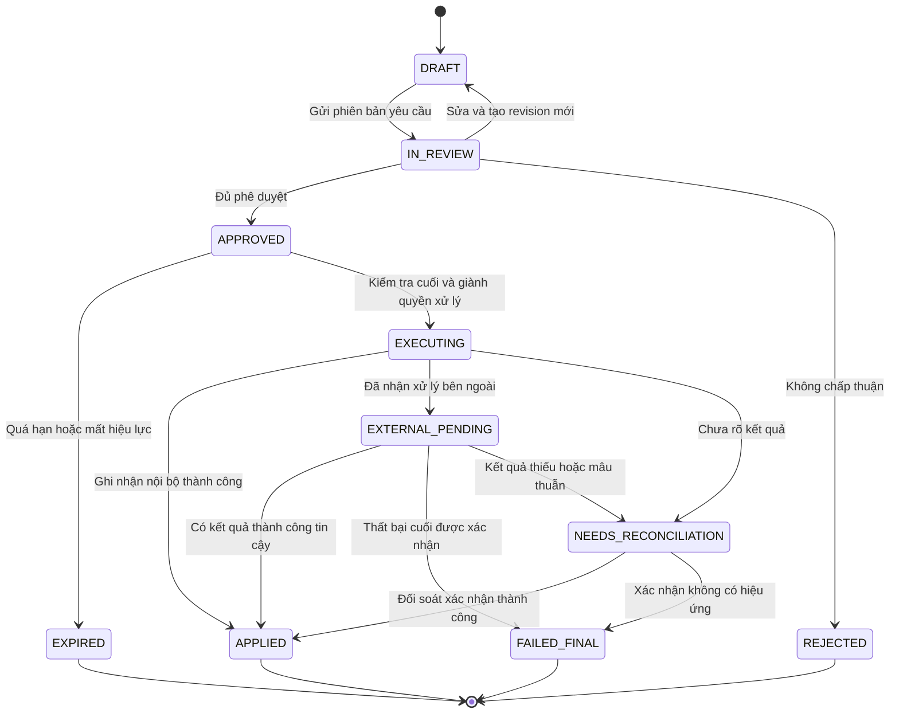

# Financial correction policy — Chính sách điều chỉnh giao dịch tài chính

## 1. Vì sao điều chỉnh tài chính là vấn đề bảo mật logic nghiệp vụ?

Một giao dịch đã ghi nhận sai thường không thể được xử lý an toàn bằng cách sửa số tiền trong cơ sở dữ liệu rồi tiếp tục vận hành. Giao dịch có thể đã tạo bút toán, thay đổi số dư, phát sinh phí, cấp quyền nhận hàng hoặc gửi lệnh chuyển tiền ra ngoài. Sửa một trường dữ liệu không đảo ngược được toàn bộ những hiệu ứng đó.

Trong chương **Monetary Rules**, chính sách điều chỉnh tài chính là tập quy tắc xác định:

- Trường hợp nào được điều chỉnh, dựa trên giao dịch và bằng chứng nào.
- Ai được đề nghị, phê duyệt và thực thi trên từng đối tượng cụ thể.
- Số tiền, loại tiền, tài khoản và hạn mức nào được phép sử dụng.
- Cách ghi nhận hiệu ứng mới mà vẫn truy nguyên được lịch sử.
- Cách ngăn xử lý trùng, vượt hạn mức, bỏ qua phê duyệt hoặc thực thi lại khi kết quả chưa rõ.

Mục tiêu bảo mật là khiến một đường xử lý ngoại lệ không trở thành công cụ tạo tiền, hoàn tiền cho người không có quyền hoặc che giấu giao dịch sai. Bài học tập trung vào thiết kế ứng dụng; các loại tài khoản và bút toán cụ thể phải được định nghĩa trong mô hình nghiệp vụ của sản phẩm.

## 2. Tình huống mở đầu: một giao dịch được hoàn hai lần

Một khách hàng đã thanh toán 1.000.000 VND. Bộ phận hỗ trợ tạo yêu cầu hoàn 700.000 VND; đồng thời một tác vụ xử lý sự cố tạo yêu cầu hoàn 600.000 VND cho cùng giao dịch.

Nếu hai luồng cùng đọc rằng số tiền còn có thể hoàn là 1.000.000 VND rồi xử lý độc lập, tổng tiền hoàn có thể đạt 1.300.000 VND. Mỗi lệnh có thể hợp lệ riêng lẻ, người gọi có thể đã đăng nhập, và mỗi bút toán vẫn có thể cân bằng. Lỗi nằm ở bất biến tổng hợp trên giao dịch gốc.

Một biến thể khác: nhân viên được duyệt hoàn 100.000 VND vào nguồn thanh toán gốc, sau đó đổi payload thành 1.000.000 VND hoặc thay tài khoản nhận trước khi thực thi. Nếu hệ thống chỉ kiểm tra cờ `approved = true`, bước phê duyệt đã bị tách khỏi nội dung thực sự được thực hiện.

Hai tình huống này cho thấy chính sách phải được bảo vệ tại thời điểm thực thi, bằng transaction, quyền theo đối tượng, dữ liệu đã được phê duyệt và cơ chế chống trùng. Một biểu mẫu nội bộ có nút “Điều chỉnh” chưa tạo thành một chính sách an toàn.

## 3. Phân biệt các thao tác trước khi đặt tên API

| Thao tác | Ý nghĩa | Điểm cần phân biệt |
| --- | --- | --- |
| Hủy trước khi ghi nhận | Dừng một ý định chưa tạo hiệu ứng tài chính cuối | Nếu đã có giữ tiền hoặc lệnh bên ngoài, phải hủy/giải phóng theo vòng đời tương ứng |
| Đảo bút toán, `reversal` | Tạo bút toán mới có hiệu ứng đối ứng với bút toán đã ghi | Không xóa giao dịch gốc; không tự chứng minh tiền ngoài hệ thống đã được trả |
| Điều chỉnh chênh lệch, `adjustment` | Ghi thêm hiệu ứng để đưa kết quả về giá trị đúng | Phải có loại điều chỉnh, căn cứ, hướng tiền và tài khoản đối ứng rõ ràng |
| Hoàn tiền, `refund` | Trả lại toàn bộ hoặc một phần khoản thanh toán theo nghiệp vụ | Có thể cần lệnh hoàn tại nhà cung cấp và theo dõi kết quả bất đồng bộ |
| Bồi hoàn thiện chí | Khoản chi bổ sung theo chính sách chăm sóc khách hàng | Có ngân sách và phê duyệt riêng; không giả làm hoàn tiền gốc để vượt giới hạn |
| Sửa thông tin mô tả | Bổ sung ghi chú hoặc sửa dữ liệu không làm đổi hiệu ứng tiền | Vẫn cần dấu vết thay đổi và không được sửa nội dung tài chính đã ghi nhận |

Tên `reversal` tại một nhà cung cấp có thể mang ý nghĩa riêng của kênh thanh toán. Trong bài học, “đảo bút toán” mô tả hiệu ứng sổ cái nội bộ; adapter tích hợp phải ánh xạ đúng hợp đồng của nhà cung cấp.

### Ví dụ: sai số tiền trên sổ nội bộ

Giả sử một giao dịch chuyển giá trị nội bộ đã ghi từ A sang B là 100.000, trong khi giá trị đúng là 80.000. Có hai cách biểu diễn nếu chính sách cho phép:

```text
Cách 1: điều chỉnh phần chênh
  Gốc:                 A -100.000, B +100.000
  Điều chỉnh:          A  +20.000, B  -20.000
  Hiệu ứng ròng:       A  -80.000, B  +80.000

Cách 2: đảo toàn bộ rồi ghi lại
  Gốc:                 A -100.000, B +100.000
  Đảo gốc:             A +100.000, B -100.000
  Giao dịch thay thế:   A  -80.000, B  +80.000
  Hiệu ứng ròng:       A  -80.000, B  +80.000
```

Các dấu cộng/trừ ở đây chỉ minh họa biến động giá trị, không phải định nghĩa Nợ/Có cho mọi loại tài khoản kế toán. Mỗi dòng điều chỉnh phải liên kết với căn cứ nghiệp vụ và giao dịch liên quan.

Nếu B đã rút tiền ra ngân hàng, không thể giả định B còn đủ số dư để thực hiện dòng điều chỉnh ngược. Khi đó chính sách phải xác định cách thu hồi, khoản phải thu hoặc tài khoản xử lý chênh lệch được phép. Không âm thầm cho ví trả trước âm hoặc lấy tiền từ một khách hàng khác.

## 4. Các bất biến của chính sách điều chỉnh

### 4.1. Bất biến lịch sử và sổ cái

1. Bút toán đã ghi nhận không bị sửa số tiền, đổi tài khoản hoặc xóa để che hiệu ứng cũ.
2. Mỗi điều chỉnh có định danh mới, giao dịch gốc và quan hệ truy nguyên rõ ràng.
3. Tổng Nợ bằng tổng Có theo từng loại tiền trong một journal hoàn chỉnh theo mô hình sổ cái đã chọn.
4. Biến động số dư và bút toán phải khớp nhau; không có API quản trị chỉ cộng trực tiếp vào `balance`.
5. Một điều chỉnh sai được sửa bằng nghiệp vụ tiếp theo có liên kết, không xóa mắt xích sai khỏi lịch sử.

Đây là lựa chọn thiết kế của bài học. Một ví dụ triển khai thực tế là TigerBeetle: các transfer đã tạo là bất biến, và việc sửa sai dùng transfer bổ sung để đảo hoặc điều chỉnh hiệu ứng trước đó. Xem [TigerBeetle: Correcting Transfers](https://docs.tigerbeetle.com/coding/recipes/correcting-transfers/).

Tính bất biến áp dụng cho **sự kiện tài chính đã ghi nhận**. Bản nháp yêu cầu, trạng thái xử lý và các bảng tổng hợp có thể thay đổi theo vòng đời được kiểm soát. Không nên nhầm điều này với yêu cầu mọi cột trong hệ thống đều không được cập nhật.

### 4.2. Bất biến số tiền và phạm vi

Với nghiệp vụ hoàn khoản gốc đã thu, đặt:

```text
eligible_minor = số tiền gốc đủ điều kiện hoàn theo chính sách
applied_minor  = tổng đã hoàn có hiệu lực trong cùng phạm vi
reserved_minor = tổng đã dành cho yêu cầu hoàn chưa có kết quả cuối
remaining_minor = eligible_minor - applied_minor - reserved_minor
```

Các điều kiện cần giữ:

```text
eligible_minor >= 0
applied_minor >= 0
reserved_minor >= 0
applied_minor + reserved_minor <= eligible_minor
amount_minor > 0
amount_minor <= remaining_minor trước khi nhận xử lý mới
```

Các đại lượng phải có cùng mã tiền, cùng thành phần tiền và cùng phạm vi giao dịch gốc. Ví dụ, hoàn phí và hoàn tiền hàng có thể dùng hai hạn mức riêng; không lấy phần còn lại của phí để tăng tiền hàng được hoàn nếu chính sách không cho phép.

Giới hạn này áp dụng cho loại hoàn tiền đang xét, không phải giới hạn phổ quát cho mọi bút toán điều chỉnh. Bồi hoàn bổ sung hoặc ghi nhận khoản phải thu có thể có quy tắc khác, phải dùng loại nghiệp vụ và ngân sách riêng.

Các kênh cùng làm giảm quyền lợi tiền trên giao dịch gốc phải được xét chung theo chính sách. Ví dụ, refund và chargeback có thể chồng lặp hiệu ứng trả tiền cho khách. Không để mỗi kênh có một bộ đếm riêng mà không phối hợp với sự kiện bên ngoài và việc đối soát.

### 4.3. Bất biến quyền và thực thi

- Tenant, giao dịch gốc, tài khoản và người hưởng phải thuộc phạm vi được phép.
- Thực thi phải khớp chính xác phiên bản nội dung đã được phê duyệt.
- Không bỏ qua trạng thái bắt buộc hoặc dùng phê duyệt của yêu cầu khác.
- Mỗi hành động nghiệp vụ được phê duyệt chỉ tạo hiệu ứng theo số lần mà chính sách cho phép.
- Kết quả chưa rõ không được coi là thất bại chắc chắn để mở lại hạn mức và chi thêm.

Sổ cái cân bằng không tự chứng minh tất cả các bất biến trên. Một giao dịch lấy đúng số tiền từ sai khách hàng vẫn có thể cân bằng về mặt số học.

## 5. Biến chính sách thành dữ liệu có thể kiểm tra

Một chính sách hữu ích cần định nghĩa được điều kiện quyết định, thay vì chỉ yêu cầu “phải có người duyệt”.

| Thành phần chính sách | Nội dung cần xác định |
| --- | --- |
| Loại và lý do | Ví dụ: thu trùng, sai phí, trả hàng, sai phân bổ; mỗi loại có điều kiện và bằng chứng riêng |
| Giao dịch đủ điều kiện | Trạng thái đã thu/đã ghi nhận, chưa bị xử lý hết, chưa nằm trong tranh chấp không tương thích |
| Phạm vi đối tượng | Tenant, đơn vị vận hành, loại tài khoản, chủ thể có quyền yêu cầu |
| Giá trị cho phép | Số tiền tối đa từng lần, tổng tích lũy, thành phần phí/thuế và mã tiền |
| Nguồn và đích tiền | Tài khoản đối ứng theo mẫu; ưu tiên trả về nguồn gốc nếu chính sách yêu cầu |
| Phê duyệt | Vai trò, số người duyệt, tách người tạo/người duyệt, thời hạn hiệu lực |
| Thời gian | Khoảng được yêu cầu, thời điểm hiệu lực, quy tắc với kỳ đã khóa |
| Thực thi và phục hồi | Nội bộ hay bên ngoài, cách giữ hạn mức, retry, kết quả chưa rõ và đối soát |
| Kiểm toán | Bằng chứng, phiên bản chính sách, danh tính và chuỗi liên kết giao dịch |

Ví dụ một chính sách nội bộ có thể yêu cầu người tạo và người duyệt độc lập cho hoàn tiền; yêu cầu thêm người duyệt cấp cao với giá trị lớn hoặc đích nhận ngoại lệ. Những ngưỡng này là cấu hình sản phẩm, không phải giá trị suy ra từ tên vai trò hay một quy định pháp lý mặc định.

Nếu ngưỡng phê duyệt chỉ xét từng yêu cầu, người dùng có thể chia một khoản lớn thành nhiều khoản nhỏ. Chính sách cần xác định các nhóm tích lũy liên quan, như cùng giao dịch, vụ việc, người hưởng hoặc khoảng thời gian. Việc kiểm tra và tiêu thụ hạn mức tích lũy cũng cần cơ chế đồng thời, không chỉ một báo cáo sau xử lý.

### Những trường client không được tự quyết định

Máy chủ phải xác định hoặc xác minh tenant, giao dịch gốc, số tiền đủ điều kiện, mã tiền, mẫu tài khoản, người hưởng, phiên bản chính sách và tập quyền phê duyệt. Client có thể đề nghị số tiền hoặc lý do, nhưng không được tự đặt `approvedBy`, `approvalRequired = false`, `refundableAmount` hoặc `force = true` để vượt quy tắc.

Các tài khoản ghi Nợ/Có không nên là các ID tùy ý trên API hỗ trợ thông thường. Máy chủ chọn chúng từ loại nghiệp vụ và dữ liệu gốc; luồng điều chỉnh kế toán chuyên biệt nếu có phải có quyền và chính sách riêng.

## 6. Gắn phê duyệt với đúng nội dung sẽ thực thi

Phân quyền theo vai trò chỉ trả lời một phần câu hỏi. Một người có vai trò hỗ trợ không tự động được hoàn mọi giao dịch hoặc chọn mọi tài khoản nhận.

### 6.1. Kiểm tra theo hành động và đối tượng

Một mô hình quyền minh họa:

| Hành động | Điều kiện ví dụ |
| --- | --- |
| Tạo đề nghị | Có quyền trên tenant và giao dịch, lý do được phép sử dụng |
| Phê duyệt | Đúng cấp giá trị, đúng đơn vị, độc lập với người tạo theo chính sách |
| Thực thi | Dịch vụ chuyên trách, yêu cầu đã được duyệt và còn đủ điều kiện |
| Tra cứu | Có quyền xem cả yêu cầu điều chỉnh lẫn giao dịch liên quan |
| Điều chỉnh ngoại lệ | Quyền chuyên biệt, phạm vi giới hạn, căn cứ và kiểm toán tăng cường |

Kiểm tra quyền phải có tại máy chủ và tại cổng thực thi cuối. API quản trị, batch, consumer và tác vụ sửa dữ liệu không được dùng đường ghi riêng để bỏ qua quy tắc.

### 6.2. Phê duyệt một phiên bản, không phê duyệt một cờ

Bản nội dung được duyệt nên bao gồm tối thiểu:

```text
correction_id, revision
origin_payment_id, root_id, correction_kind
amount_minor, currency, component
destination_reference, accounting_template
reason_code, evidence_reference
policy_version, expires_at
```

Hệ thống có thể lưu một snapshot bất biến của phiên bản và hash của biểu diễn chuẩn hóa. Phê duyệt tham chiếu đến revision và hash đó. Hash giúp phát hiện nội dung khác nhau, nhưng không thay thế phân quyền hoặc chứng minh dữ liệu đã được một người hợp lệ duyệt.

Nếu thay đổi số tiền, loại điều chỉnh, nguồn/đích, bằng chứng có ảnh hưởng hoặc phiên bản chính sách áp dụng, phải tạo revision mới và xử lý lại phê duyệt theo chính sách. Không chuyển nguyên cờ `approved = true` sang bản mới.

OWASP khuyến nghị bảo vệ dữ liệu giao dịch trong quá trình xác nhận, kiểm soát thứ tự các bước và kiểm tra ủy quyền ngay trước thực thi. Đây là cơ sở để gắn phê duyệt với nội dung cụ thể trong thiết kế này. Xem [OWASP: Transaction Authorization](https://cheatsheetseries.owasp.org/cheatsheets/Transaction_Authorization_Cheat_Sheet.html).

Một phê duyệt còn hạn không có nghĩa dữ liệu nghiệp vụ vẫn còn hợp lệ. Trước khi thực thi, cần kiểm tra lại hạn mức còn lại, trạng thái tranh chấp, tài khoản bị khóa và các hạn chế đang có hiệu lực. Nếu chính sách mới làm phê duyệt cũ không còn chấp nhận được, xử lý theo quy tắc tái phê duyệt; không tự động hạ yêu cầu kiểm soát.

## 7. State machine cho yêu cầu điều chỉnh



Đây là state machine minh họa của ứng dụng, không phải danh sách trạng thái bắt buộc của một nhà cung cấp. Một số chuyển trạng thái có thể diễn ra trong cùng transaction; không cần commit riêng từng mũi tên.

Các quy tắc chuyển trạng thái phải được kiểm tra cùng với phiên bản hàng hoặc dưới khóa phù hợp. Không cho phép client tự gửi `status = APPLIED`. Không chuyển từ `APPLIED` về `APPROVED` để chạy lại. Muốn sửa một điều chỉnh đã có hiệu lực, tạo điều chỉnh mới liên kết với nó và tiếp tục chuỗi kiểm toán.

Nếu cho hủy yêu cầu đã được duyệt nhưng chưa thực thi, cần thêm chuyển trạng thái có điều kiện và giải phóng các khoản đã giữ đúng một lần. Khi đã gửi lệnh bên ngoài, nút hủy chỉ được xác nhận hoàn tất sau khi xác định việc hủy thực sự có hiệu lực; không dùng thay đổi trạng thái nội bộ để giả định tiền chưa được chuyển.

## 8. Dữ liệu cần giữ để truy nguyên và chống thực thi lại

Có thể tách dữ liệu thành các nhóm sau:

```text
Correction request / revision:
  tenant_id, correction_id, case_id, action_id
  origin_payment_id, root_id, corrects_correction_id
  revision, kind, component, amount_minor, currency
  reason_code, evidence_reference, destination_reference
  accounting_template, policy_version, request_fingerprint
  state, capacity_state, created_by, created_at

Approval:
  correction_id, revision, approved_payload_hash
  approver_id, approval_scope, approved_at, expires_at

Execution:
  correction_id, execution_id, provider_operation_key
  provider_reference, result_code, last_observed_at

Posted journal:
  journal_id, correction_id, effect_kind
  immutable entries, recorded_at, effective_date
```

`root_id` giữ cùng một gốc nghiệp vụ khi có chuỗi điều chỉnh. `corrects_correction_id` mô tả mắt xích đang được sửa. Phải chặn liên kết khác tenant, sai gốc hoặc tạo chu trình; không dùng việc đổi cha để làm mới hạn mức.

Một số ràng buộc duy nhất hữu ích:

- `(tenant_id, case_id, action_id)` xác định một hành động đã được phê duyệt trong vụ việc.
- `(tenant_id, correction_id, effect_kind)` ngăn ghi lại cùng loại hiệu ứng sổ cái cho một điều chỉnh.
- Phạm vi idempotency gồm tenant, người gọi, thao tác và key.
- ID sự kiện nhà cung cấp được chống trùng trong đúng tài khoản/kết nối nhà cung cấp.

`action_id` phải do quy trình vụ việc xác định và kiểm soát, không chỉ là chuỗi mới do client tạo mỗi lần. Một vụ việc có thể có nhiều hành động hợp lệ, nhưng từng hành động cần căn cứ và giới hạn riêng.

Idempotency key và danh tính hành động nghiệp vụ giải quyết hai lớp khác nhau: cùng key phải replay an toàn; đổi key vẫn không được thực thi lại cùng hành động đã áp dụng.

## 9. Giữ hạn mức nguyên tử để tránh điều chỉnh vượt mức

### 9.1. Một bảng hạn mức minh họa

Ví dụ sau chỉ mô hình hóa hạn mức hoàn cho một thành phần tiền của giao dịch gốc. Nó không thay thế toàn bộ sổ cái hay chính sách kế toán:

```sql
CREATE TABLE return_budget (
    tenant_id UUID NOT NULL,
    origin_payment_id UUID NOT NULL,
    component TEXT NOT NULL,
    currency CHAR(3) NOT NULL,
    eligible_minor BIGINT NOT NULL CHECK (eligible_minor >= 0),
    applied_minor BIGINT NOT NULL DEFAULT 0 CHECK (applied_minor >= 0),
    reserved_minor BIGINT NOT NULL DEFAULT 0 CHECK (reserved_minor >= 0),
    PRIMARY KEY (tenant_id, origin_payment_id, component, currency),
    CHECK (applied_minor <= eligible_minor),
    CHECK (reserved_minor <= eligible_minor - applied_minor)
);
```

Dùng đơn vị tiền nhỏ nhất được sản phẩm hỗ trợ và phép tính có kiểm tra tràn ở tầng ứng dụng. Không đi qua `double` để tính số tiền điều chỉnh. Các dữ kiện như `eligible_minor` phải được tạo từ nghiệp vụ có thẩm quyền, không lấy từ giá trị client khai báo.

Các ràng buộc trên kiểm tra từng hàng. Chúng không tự bảo đảm tổng Nợ/Có của nhiều dòng journal, quyền người gọi hoặc sự khớp nhau giữa budget và từng yêu cầu điều chỉnh. Những bất biến đó cần được bảo vệ bởi luồng ghi sổ/transaction và quyền truy cập dữ liệu tương ứng.

### 9.2. Nhận xử lý bằng phép cập nhật có điều kiện

```sql
UPDATE return_budget
SET reserved_minor = reserved_minor + :amount_minor
WHERE tenant_id = :authenticated_tenant_id
  AND origin_payment_id = :server_origin_payment_id
  AND component = :server_component
  AND currency = :server_currency
  AND :amount_minor > 0
  AND eligible_minor - applied_minor - reserved_minor >= :amount_minor
RETURNING eligible_minor, applied_minor, reserved_minor;
```

Các tham số `:...` là bind parameter của tầng truy cập dữ liệu. Câu lệnh được gọi sau khi máy chủ xác minh yêu cầu và giành quyền xử lý điều chỉnh cụ thể.

Trong ví dụ một hàng tại PostgreSQL `READ COMMITTED`, nếu có cập nhật tranh chấp, điều kiện của `UPDATE` được đánh giá lại sau khi transaction cập nhật trước đã commit. Đây là cơ sở để hai yêu cầu không cùng tiêu thụ phần còn lại dựa trên một lần đọc cũ. Xem [PostgreSQL 18: Read Committed](https://www.postgresql.org/docs/18/transaction-iso.html#XACT-READ-COMMITTED).

Với hạn mức ban đầu 1.000.000 và hai yêu cầu 700.000, 600.000, chỉ một yêu cầu có thể giữ phần tương ứng nếu chúng cùng dùng hàng budget này. Không xác định trước yêu cầu nào thắng. Yêu cầu còn lại phải bị từ chối hoặc chờ xử lý nghiệp vụ phù hợp; không tự giảm số tiền đã được duyệt để làm cho nó vừa hạn mức.

Không có hàng trả về nghĩa là không có budget khớp đầy đủ điều kiện hoặc không còn đủ hạn mức. Dừng trước khi tạo hiệu ứng tiền và phân loại kết quả trong phạm vi dữ liệu được phép truy cập; không suy ra nguyên nhân chỉ từ một con số đếm hàng.

### 9.3. Giữ và giải phóng đúng một lần

Câu lệnh trên không tự chống giữ lặp cho cùng điều chỉnh. Luồng gọi phải khóa bản ghi điều chỉnh và chỉ chuyển `capacity_state` từ `NONE` sang `RESERVED` một lần, cùng transaction với tăng `reserved_minor`.

Khi xác nhận hiệu ứng hoàn thành công:

```text
RESERVED -> APPLIED
reserved_minor -= amount_minor
applied_minor  += amount_minor
```

Khi có bằng chứng thất bại cuối, không còn hiệu ứng trả tiền:

```text
RESERVED -> RELEASED
reserved_minor -= amount_minor
applied_minor không đổi
```

Mỗi chuyển trạng thái và cập nhật budget phải cùng transaction, có kiểm tra trạng thái trước đó. Callback lặp hoặc hai worker cạnh tranh không được làm các phép cộng/trừ này lần thứ hai.

Nếu timeout hoặc chưa nhận đủ kết quả, tiếp tục giữ hạn mức và chuyển sang đối soát. Hết thời gian chờ nội bộ không chứng minh nhà cung cấp chưa trả tiền. Nếu muốn hủy, phải có xác nhận hủy phù hợp trước khi giải phóng.

Khi sửa sai một khoản hoàn đã có hiệu lực, không tự giảm `applied_minor` chỉ vì một nhân viên đổi trạng thái bản ghi. Việc tái mở hạn mức cần bằng chứng hiệu ứng trả tiền trước đã được vô hiệu hoặc thu hồi theo một nghiệp vụ được phép, có bút toán và liên kết đầy đủ.

Nếu một sự kiện như chargeback làm thay đổi quyền hoàn, cập nhật phải đi qua cùng cơ chế điều phối trên giao dịch gốc. Trường hợp nghĩa vụ mới xung đột với khoản đang giữ cần được đóng băng/đối soát theo chính sách; không ép các bộ đếm về một giá trị vượt ràng buộc để chạy tiếp.

## 10. Ranh giới transaction khi thực thi điều chỉnh

### 10.1. Điều chỉnh chỉ có hiệu ứng nội bộ

Một luồng thực thi có thể tổ chức như sau. Đây là mã giả mô tả trách nhiệm, không phải mã Java hoàn chỉnh:

```text
authenticate executor
normalize command and bound input size
verify access to correction and origin payment

BEGIN
  claim execution idempotency scope using a unique constraint
  if command fingerprint differs from saved command:
      reject key conflict
  if saved execution result exists:
      revalidate access, return saved result after transaction ends

  lock root payment / relevant budget rows in a stable order
  lock correction row
  verify state = APPROVED and expected revision matches
  verify approval payload, independent approvers and expiry
  verify currently applicable restrictions and policy conditions
  verify origin, currency, component and destination

  reserve allowed capacity once for this correction
  lock affected balance rows in a stable account order
  verify funds / account constraints for the chosen journal template
  create the correction journal and its balanced entries
  update balance projections consistently with the journal
  convert this correction capacity from RESERVED to APPLIED
  mark correction APPLIED and save execution result
  write business event and audit event to transactional outbox
COMMIT
return applied result
```

Các luồng xử lý cùng tập đối tượng phải thống nhất thứ tự khóa, ví dụ bản ghi idempotency của lệnh, giao dịch gốc/budget, điều chỉnh, rồi tài khoản theo thứ tự ID. Khi có nhiều hàng budget, cũng cần thứ tự ổn định. Deadlock hoặc lỗi serialization có thể cần rollback và retry toàn bộ transaction với cùng danh tính lệnh, có giới hạn.

Nếu không đủ số dư ở tài khoản bị ghi giảm hoặc ràng buộc sổ cái thất bại, không được commit riêng phần tăng số dư người nhận. Cách xử lý khoản thiếu phải do loại nghiệp vụ cho phép, như chuyển sang quy trình khoản phải thu đã định nghĩa; không tự bỏ kiểm tra số dư.

Nếu ghi journal, cập nhật projection hoặc ghi outbox thất bại, rollback toàn bộ hiệu ứng nội bộ của nhánh thực thi. Chỉ trả thành công sau commit. Khi mất kết nối quanh commit, kết quả có thể chưa rõ; tra cứu hoặc replay cùng danh tính lệnh trước khi kết luận thất bại.

### 10.2. Giới hạn của một transaction cục bộ

Transaction nội bộ không bao trùm được một lời gọi HTTP đến nhà cung cấp. Không giữ khóa cơ sở dữ liệu trong lúc chờ mạng rồi giả định rằng rollback nội bộ sẽ hoàn tác tiền đã chuyển ngoài hệ thống.

Một cách chia ranh giới:

```text
Transaction A:
  xác minh phiên bản và phê duyệt
  giữ hạn mức một lần
  lưu execution_id và provider_operation_key ổn định
  ghi lệnh vào outbox
  ghi nhận đang chờ thực thi/kết quả bên ngoài
  COMMIT

Worker bên ngoài:
  gửi lệnh với cùng provider_operation_key cho cùng operation
  khi timeout: tra cứu / retry theo hợp đồng nhà cung cấp
  không tự tạo operation mới vì chưa thấy phản hồi

Transaction B khi có kết quả tin cậy:
  khóa giao dịch gốc/budget và điều chỉnh theo cùng quy tắc
  áp dụng đúng một chuyển trạng thái kết quả
  cập nhật budget và bút toán tương ứng
  lưu kết quả, sự kiện và dấu vết kiểm toán
  COMMIT
```

Mô hình có thể ghi nhận nghĩa vụ phải trả trước khi tiền được hoàn thực sự, nếu chính sách kế toán yêu cầu. Những bút toán đó phải có loại và trạng thái riêng; không dùng chúng để tuyên bố khách đã nhận tiền.

## 11. Idempotency, callback và kết quả chưa rõ

### 11.1. Ba lớp định danh cần phối hợp

1. **Key của lệnh API:** gắn với tenant, người gọi, thao tác và fingerprint, giúp nhận diện retry của một lệnh.
2. **Danh tính hành động nghiệp vụ:** gắn với yêu cầu, revision và hành động được duyệt, giúp chặn thực thi lại bằng key khác.
3. **Định danh thao tác bên ngoài:** ổn định trong suốt quá trình gửi, tra cứu và nhận callback cho một lần hoàn.

Cùng key nhưng đổi amount, origin, revision hoặc loại thao tác phải bị từ chối xung đột. Cùng key và cùng lệnh không tạo hiệu ứng mới. API có thể trả lại phản hồi đã lưu của bước nhận xử lý, còn trạng thái mới nhất được lấy qua API tra cứu; hợp đồng phải nói rõ điểm này.

Một ví dụ hỗ trợ retry là idempotency của Stripe. Hành vi lưu kết quả và vòng đời key phụ thuộc phiên bản API, nên adapter phải bám hợp đồng cụ thể, không mặc định mọi nhà cung cấp giống nhau. Xem [Stripe: Idempotent requests](https://docs.stripe.com/api/idempotent_requests).

Nếu đã vượt khoảng lưu key của nhà cung cấp, không giả định việc gửi lại cùng chuỗi key vẫn chống trùng. Phải tra cứu và đối soát thao tác đã có trước khi quyết định tạo lệnh mới.

### 11.2. Callback không được trở thành đường bỏ qua chính sách

Khi nhận một sự kiện bên ngoài, cần:

- Xác thực chữ ký hoặc cơ chế nguồn gốc theo adapter, trên dữ liệu được nhà cung cấp quy định.
- Xác định đúng tài khoản nhà cung cấp, tenant và giao dịch đã liên kết; không tin tenant hoặc người nhận do payload tùy ý khai báo.
- Đối chiếu định danh thao tác, khoản tiền, mã tiền và trạng thái có thể chấp nhận.
- Chống trùng sự kiện và bảo vệ chuyển trạng thái của điều chỉnh.
- Ghi bút toán, tiêu thụ/giải phóng hạn mức và đánh dấu sự kiện đã xử lý trong ranh giới transaction phù hợp.

Nếu dùng inbox để lưu callback trước, phải phân biệt “đã nhận bền vững” với “đã xử lý xong”. Lỗi khi áp dụng journal không được để lại dấu đã xử lý khiến lần gửi lại bị bỏ qua vĩnh viễn.

Callback đến muộn hoặc sai thứ tự không được làm `APPLIED` quay về trạng thái chờ hay tự giải phóng hạn mức. Nếu có kết quả mâu thuẫn với trạng thái đã chốt, đưa vào đối soát và xác minh nguồn có thẩm quyền trước khi tạo hiệu ứng tài chính mới.

### 11.3. Phân biệt đã nhận lệnh và đã hoàn tiền

Tạo một đối tượng refund thành công ở nhà cung cấp không luôn đồng nghĩa tiền đã hoàn tất ở mọi bước. Stripe, chẳng hạn, mô tả refund có thể ở trạng thái pending hoặc thất bại, và giới hạn tổng hoàn theo khoản đã thu. Xem [Stripe: Refund and cancel payments](https://docs.stripe.com/refunds).

Trong giao diện và API, dùng trạng thái phản ánh đúng bằng chứng đang có, như “đã tiếp nhận”, “đang xử lý”, “hoàn tất theo nhà cung cấp” hoặc “cần đối soát”. Không trả thông báo “đã hoàn tiền thành công” chỉ vì đã ghi một hàng vào outbox.

## 12. Ví dụ hợp đồng API bảo vệ nội dung đã duyệt

Một yêu cầu đề nghị điều chỉnh có thể tham chiếu hành động đã được đăng ký trong vụ việc:

```http
POST /payments/pay-42/corrections
Idempotency-Key: correction-request-92d1
Content-Type: application/json
```

```json
{
  "caseId": "case-18",
  "actionId": "return-overcharged-principal",
  "kind": "REFUND_PRINCIPAL",
  "requestedAmountMinor": 20000,
  "reasonCode": "OVERCHARGED_AMOUNT",
  "evidenceReference": "evidence-71"
}
```

Máy chủ kiểm tra hành động thuộc vụ việc, vụ việc liên quan đúng giao dịch, tiền tệ và đích nhận từ nguồn dữ liệu có thẩm quyền. Việc client đổi `caseId` hoặc `actionId` không tự tạo quyền điều chỉnh mới.

Người duyệt đọc snapshot do máy chủ cung cấp và xác nhận một revision cụ thể. Lệnh thực thi chỉ cần tham chiếu nội dung đã duyệt, ví dụ:

```http
POST /corrections/cor-93/execute
Idempotency-Key: correction-execution-44be
Content-Type: application/json
```

```json
{
  "expectedRevision": 3
}
```

Không nhận lại số tiền hoặc tài khoản đích để âm thầm ghi đè snapshot ở API thực thi. Nếu revision không còn đúng, yêu cầu phải thất bại theo hợp đồng thay vì tự thực thi bản mới mà người gọi chưa xác nhận.

Với hiệu ứng bên ngoài, phản hồi HTTP `202 Accepted` có thể chỉ xác nhận đã tiếp nhận:

```json
{
  "correctionId": "cor-93",
  "executionId": "exec-68",
  "state": "EXTERNAL_PENDING"
}
```

Mã HTTP cụ thể là lựa chọn của hợp đồng API. Bất kể mã nào, trạng thái và thông báo phải phân biệt rõ tiếp nhận xử lý với hiệu ứng đã có kết quả cuối.

## 13. Kiểm toán, kỳ ghi nhận và sửa sai lần tiếp theo

### 13.1. Lưu lịch sử đủ để giải thích một con số

Từ mỗi hiệu ứng điều chỉnh cần truy được:

- Giao dịch gốc, các điều chỉnh trước và mắt xích bị sửa.
- Lý do, bằng chứng và phiên bản quy tắc đã dùng để quyết định.
- Người tạo, người duyệt, dịch vụ thực thi, thời điểm và phạm vi quyền liên quan.
- Snapshot được duyệt, phiên bản đã thực thi và kết quả cuối.
- Journal, tài khoản, số tiền, mã tiền và tham chiếu nhà cung cấp.

Bằng chứng nhạy cảm nên được lưu ở nơi có quyền truy cập phù hợp; bản ghi nghiệp vụ giữ tham chiếu và thông tin kiểm chứng cần thiết. Không đưa token xác thực, thông tin thẻ hoặc toàn bộ tài liệu cá nhân vào log ứng dụng.

Dữ liệu journal và dữ liệu kiểm toán cần quyền ghi được giới hạn, cơ chế phát hiện can thiệp và quy trình vận hành thích hợp. Một cột hash trong cùng bảng mà mọi quản trị viên đều sửa được không tự tạo thành lịch sử chống sửa đổi.

### 13.2. Phân biệt thời điểm sự kiện và thời điểm ghi nhận

Có thể cần lưu:

```text
occurred_at   = thời điểm nghiệp vụ xảy ra theo bằng chứng
recorded_at   = thời điểm hệ thống ghi nhận sự kiện
effective_date = ngày hiệu lực theo chính sách kỳ ghi sổ
```

`recorded_at` không nên bị sửa lùi để che việc phát hiện muộn. Nếu kỳ cũ đã khóa, xử lý điều chỉnh theo quy tắc của sản phẩm, như ghi ở kỳ đang mở với tham chiếu về kỳ gốc, hoặc dùng quy trình mở lại có phê duyệt. Không cho API hỗ trợ tùy ý chọn ngày nhằm thay đổi báo cáo lịch sử.

Báo cáo có thể trình bày hiệu ứng ròng và trạng thái đã điều chỉnh, nhưng người có quyền kiểm toán vẫn phải xem được sự kiện ban đầu và chuỗi sửa sai. Projection báo cáo có thể dựng lại; journal gốc không được chỉnh để “làm sạch” lịch sử.

### 13.3. Khi chính điều chỉnh cũng sai

Nếu điều chỉnh chỉ đang ở bản nháp, sửa bằng revision theo vòng đời. Nếu đã ghi nhận nội bộ, tạo một điều chỉnh mới có căn cứ để sửa hiệu ứng đó. Nếu đã trả tiền bên ngoài, việc khôi phục quyền đòi tiền không tự thu lại tiền đã trả; cần nghiệp vụ thu hồi riêng và theo dõi kết quả thực tế.

Không dùng vòng lặp “đảo rồi hoàn lại” để làm mới hạn mức. Toàn bộ chuỗi vẫn phải gắn cùng gốc, xét hiệu ứng kinh tế ròng, số tiền còn được phép xử lý và các khoản đang chờ có liên quan.

## 14. Kiểm thử các tình huống tấn công logic

Các kiểm thử cần xác minh số tiền, sổ cái, trạng thái, budget và hiệu ứng bên ngoài, thay vì chỉ kiểm tra thông báo thành công hay thất bại.

### 14.1. Quyền theo đối tượng và nội dung phê duyệt

| Tình huống | Kỳ vọng |
| --- | --- |
| Dùng ID giao dịch của tenant khác | Bị từ chối; không tiết lộ thông tin hay thay đổi dữ liệu bên đó |
| Người tạo tự duyệt khi chính sách yêu cầu độc lập | Không đủ điều kiện phê duyệt |
| Dùng người duyệt ngoài phạm vi giá trị hoặc đơn vị | Không được tính vào tập phê duyệt hợp lệ |
| Tăng số tiền hoặc đổi đích sau khi được duyệt | Revision cũ không áp dụng cho nội dung mới; phải qua quy trình tương ứng |
| Gọi thẳng API thực thi từ trạng thái `DRAFT` | Không tạo hiệu ứng tiền |
| Tái sử dụng phê duyệt của yêu cầu khác | Bị từ chối do khác định danh hoặc snapshot |
| Phê duyệt hết hạn hoặc tài khoản bị khóa trước lúc chạy | Cổng thực thi cuối xử lý theo chính sách hiện hành |
| Chia nhỏ để tránh cấp duyệt cao | Hạn mức tích lũy và chính sách nhóm vẫn được kiểm tra |

### 14.2. Hạn mức, phí và dữ liệu tiền

- Hoàn đúng phần còn lại: được chấp nhận nếu các điều kiện khác hợp lệ.
- Hoàn vượt phần còn lại một đơn vị nhỏ nhất: bị từ chối, không tạo journal hoặc lệnh ngoài.
- Hai yêu cầu 700.000 và 600.000 trên budget 1.000.000: tổng `applied + reserved` không vượt 1.000.000 sau mọi trạng thái đã commit.
- Số tiền âm, 0, quá lớn hoặc sai mã tiền: bị chặn trước hiệu ứng tài chính.
- Hoàn phí bằng budget tiền hàng: bị từ chối nếu chính sách tách thành phần.
- Refund từ API và tác vụ nền cùng lúc: cùng tranh chấp hạn mức gốc.
- Chargeback xuất hiện khi refund đang chờ: không tự tạo thêm quyền hoàn; chuyển sang xử lý phối hợp/đối soát theo mô hình.

Kiểm thử đồng thời phải dùng nhiều kết nối và transaction độc lập trên cơ sở dữ liệu mục tiêu. Dùng barrier hoặc điểm đồng bộ để tạo tranh chấp, không chỉ thêm `sleep` rồi cho rằng đã kiểm tra được race condition.

### 14.3. Gửi trùng, timeout và callback

| Tình huống | Kỳ vọng |
| --- | --- |
| Cùng key, cùng lệnh, gửi đồng thời | Chỉ một lần nhận xử lý có hiệu ứng |
| Cùng key, khác số tiền hoặc revision | Xung đột, không chuyển key sang ý định mới |
| Key khác, cùng hành động đã thực thi | Không tạo lần áp dụng thứ hai |
| Gửi lại lệnh sau mất phản hồi commit | Tìm được kết quả đã có hoặc trạng thái cần đối soát |
| Nhà cung cấp đã nhận nhưng worker chết trước lưu phản hồi | Dùng cùng định danh để tra cứu/retry theo hợp đồng; không tạo operation mới tùy ý |
| Callback trùng | Journal và budget chỉ cập nhật một lần |
| Callback đến sai thứ tự | Không hạ trạng thái đã chốt hoặc giải phóng hạn mức sai |
| Callback sai chữ ký, số tiền hoặc giao dịch | Không áp dụng; lưu dấu vết và xử lý ngoại lệ phù hợp |
| Timeout kéo dài | Không tự giải phóng khoản giữ chỉ vì hết giờ chờ |
| Thất bại cuối đã được xác nhận, xử lý lặp | Giải phóng đúng một lần |

### 14.4. Lỗi giữa chừng và bất biến xuyên suốt

Chủ động tạo lỗi sau từng bước quan trọng: giữ budget, ghi journal, cập nhật số dư, lưu kết quả, ghi outbox và xử lý callback. Với transaction nội bộ, không được để lại hiệu ứng đã commit một nửa. Với lời gọi bên ngoài, trạng thái phải cho phép tra cứu và hoàn tất xử lý mà không trả tiền lần nữa.

Một số thuộc tính hữu ích sau mỗi trạng thái đã commit:

```text
Mỗi journal hoàn chỉnh cân bằng theo từng loại tiền.
Không có hiệu ứng đã áp dụng mà thiếu journal tương ứng.
Một correction/effect_kind không được ghi hai lần.
Budget áp dụng + budget đang giữ không vượt hạn mức của phạm vi đó.
Tổng đang giữ khớp các correction có capacity_state = RESERVED.
Mọi lần thực thi truy được đúng revision và tập phê duyệt hợp lệ.
Trạng thái đã hoàn tất không bị lùi bởi callback cũ.
Bút toán gốc không đổi sau chuỗi điều chỉnh.
```

Đối chiếu thêm với kết quả nhà cung cấp và sao kê khi kiểm thử tích hợp; tính nhất quán nội bộ không tự chứng minh rằng tiền ngoài hệ thống đã đi đúng một lần.

## 15. Vận hành chính sách và xử lý ngoại lệ

Theo dõi giá trị điều chỉnh theo loại, người tạo, người duyệt, giao dịch gốc và người hưởng; số lần xung đột key; thời gian chờ; số khoản cần đối soát; và chênh lệch giữa budget, journal và kết quả bên ngoài. Các chỉ số này giúp phát hiện lỗi quy trình và hành vi lạm dụng như chia nhỏ, đổi key liên tục hoặc dùng mã lý do không phù hợp.

Đối soát cần phân biệt ít nhất ba lớp: quyết định nghiệp vụ và hạn mức, hiệu ứng sổ cái nội bộ, hiệu ứng tiền tại nhà cung cấp. Một khoản có thể thành công ở lớp này nhưng đang thiếu dữ liệu ở lớp khác. Cách sửa phải bổ sung đúng sự kiện còn thiếu hoặc mở quy trình sửa sai có căn cứ, không chỉ đổi tất cả trạng thái về `APPLIED`.

Luồng khẩn cấp nếu có cần quyền riêng, phạm vi và thời hạn giới hạn, lý do, kiểm toán và rà soát sau thực hiện. Nó vẫn phải giữ các bất biến cốt lõi như truy nguyên, không áp dụng trùng và không sửa bút toán gốc. Một tham số “bỏ qua mọi kiểm tra” không phải là cơ chế xử lý sự cố.

Khi thay đổi chính sách, lưu phiên bản và xác định ảnh hưởng đến các yêu cầu đã tạo, đã duyệt, đang giữ hạn mức và đang chờ bên ngoài. Thay đổi cấu hình không được khiến khoản đang chờ biến mất khỏi đối soát hoặc tự thực thi lại dưới quy tắc mới.

## 16. Tiêu chí hoàn thiện chính sách

Một chính sách điều chỉnh có thể thực thi và kiểm tra được cần trả lời rõ:

1. Đang hủy ý định, sửa sổ, hoàn tiền hay chi bồi hoàn; hiệu ứng nào thực sự thay đổi?
2. Giao dịch nào là gốc, loại tiền và thành phần nào nằm trong hạn mức chung?
3. Ai được đề nghị, duyệt và chạy trên từng đối tượng; nội dung nào đã được duyệt?
4. Điều kiện nào được kiểm tra lại tại thời điểm thực thi?
5. Cơ chế nào chống giữ hạn mức và áp dụng lặp khi nhiều yêu cầu cùng chạy?
6. Lịch sử gốc được bảo vệ và liên kết với chuỗi sửa sai ra sao?
7. Khi mất phản hồi hoặc có kết quả mâu thuẫn, hệ thống giữ trạng thái và đối soát thế nào?
8. Bằng chứng nào đủ để đánh dấu hoàn tất hoặc giải phóng khoản đang giữ?

Chính sách có giá trị khi những câu trả lời này hiện diện trong dữ liệu, state machine, kiểm tra quyền và ranh giới transaction của ứng dụng. Nhờ đó, việc sửa sai tài chính vẫn bảo vệ đúng quy tắc nghiệp vụ như một luồng thanh toán thông thường.
