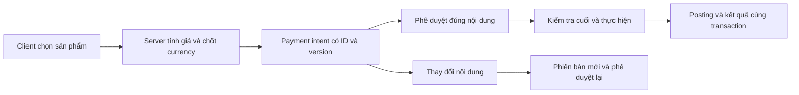

# Mixed currency prevention — Ngăn trộn lẫn tiền tệ

## 1. Mục tiêu và phạm vi

Mixed currency prevention là việc bảo đảm mỗi số tiền luôn được diễn giải cùng đúng loại tiền tệ, đúng đơn vị và đúng ngữ cảnh nghiệp vụ. Một giá trị `10000` đứng riêng không cho biết đó là 100 USD, 10.000 VND hay số điểm thưởng. Bảo vệ logic nghiệp vụ đòi hỏi hệ thống không được tự suy đoán hoặc thay nhãn tiền tệ để tiếp tục xử lý.

Bài học thuộc chương **Currency Handling**, tập trung vào các bất biến ngăn sửa currency để trả thiếu tiền, cộng sai số dư, dùng nhầm hạn mức, hoàn tiền sai loại hoặc lạm dụng retry. Phạm vi bao gồm mô hình Money, quyền theo đối tượng, state machine, transaction, idempotency và kiểm thử các tình huống tấn công logic.

Sau bài học, bạn có thể:

- Xác định nơi phải kiểm tra currency từ request tới sổ cái và callback thanh toán.
- Thiết kế phép tính chỉ thực hiện trên các khoản tiền tương thích.
- Ngăn đổi currency giữa tạo đơn, phê duyệt và thực hiện.
- Phân biệt chuyển tiền cùng loại với quy đổi ngoại tệ có báo giá rõ ràng.
- Viết điều kiện kiểm chứng rằng một yêu cầu sai currency không để lại hiệu ứng tiền.

## 2. Một cuộc tấn công không cần dữ liệu sai định dạng

Một đơn hàng có giá **100,00 USD**. Hệ thống lưu:

```text
order_id = O-017
amount_minor = 10000
currency = USD
```

Trong quy ước của ví dụ, USD dùng hai chữ số phần lẻ; VND dùng số nguyên đồng. Nếu endpoint chấp nhận cả `amount_minor` và `currency` từ client, kẻ tấn công có thể gửi:

```json
{
  "orderId": "O-017",
  "amountMinor": "10000",
  "currency": "VND"
}
```

Nếu server chỉ kiểm tra `receivedAmount == order.amountMinor`, cả hai đều là `10000`. Đơn hàng 100 USD có thể bị đánh dấu đã trả bằng một khoản 10.000 VND. Hai mã tiền tệ đều hợp lệ về cú pháp; vấn đề nằm ở **sự kết hợp dữ liệu không đúng nghĩa**.

OWASP nêu việc giữ nguyên số tiền nhưng đổi currency giữa giao dịch như một ví dụ lỗi logic nghiệp vụ. Tài liệu cũng nhấn mạnh việc xác định lại dữ liệu ảnh hưởng đến giá từ phía máy chủ. Xem [OWASP Business Logic Security Cheat Sheet](https://cheatsheetseries.owasp.org/cheatsheets/Business_Logic_Security_Cheat_Sheet.html).

Hàng rào cần có là so khớp đầy đủ số tiền và currency của nghĩa vụ thanh toán với kết quả thanh toán có thẩm quyền. Đổi mã `USD` thành `VND` không phải một phép quy đổi.

## 3. Định nghĩa bất biến trước khi chọn kiểu dữ liệu

Trong bài này, Money được nhận diện bằng:

```text
Money = (currency_code, amount_minor)

Giá trị theo đơn vị chính = amount_minor / 10^internal_scale(currency_code)
```

`internal_scale` là quy ước lưu trữ đã được hệ thống quản lý. Nếu sản phẩm hỗ trợ nhiều mức precision cho cùng một currency, đơn vị hoặc phiên bản precision cũng phải là một phần được kiểm soát của mô hình; không thể để hai giá trị cùng nhãn nhưng khác đơn vị đi vào cùng phép cộng.

| Mã | Bất biến | Ý nghĩa bảo mật |
| --- | --- | --- |
| C1 | Mỗi số tiền có currency rõ ràng | Không có khoản tiền “không biết đơn vị” đi vào ghi sổ |
| C2 | Cộng, trừ và so sánh tiền yêu cầu cùng currency và đơn vị | Không cộng 100 USD với 100 VND |
| C3 | Tài khoản tiền đơn loại có currency cố định | Không đổi nhãn currency của số dư đang tồn tại |
| C4 | Chuyển tiền thông thường có cùng currency ở hai đầu | Không ghi nợ USD rồi ghi có VND bằng cùng số nguyên |
| C5 | Nội dung thực hiện khớp phiên bản đã duyệt | Không đổi currency sau khi người dùng xác nhận |
| C6 | Chuyển đổi currency đi qua nghiệp vụ FX tường minh | Có báo giá, hướng tỷ giá, phí và quy tắc làm tròn |
| C7 | Mỗi giao dịch sổ cái cân bằng theo từng currency | Không lấy khoản thiếu USD bù bằng khoản thừa VND |
| C8 | Retry không thể thay currency của lệnh cũ | Key cũ với nội dung khác phải bị từ chối |
| C9 | Lệnh sai currency không có hiệu ứng tiền một phần | Không trừ ví rồi mới phát hiện sai loại tiền ở bước ghi có |

Đúng currency chưa đủ để cấp quyền. Hai ví cùng USD nhưng thuộc hai khách hàng khác nhau vẫn cần kiểm tra chủ thể, tenant và quyền ghi nợ trên ví nguồn, cùng quyền sử dụng người nhận theo chính sách.

## 4. Phân biệt các khái niệm dễ bị nhập làm một

| Khái niệm | Vai trò | Điều không được suy diễn |
| --- | --- | --- |
| Currency hiển thị | Cách người dùng xem giá, có thể kèm giá quy đổi tham khảo | Đổi hiển thị không tự đổi nghĩa vụ thanh toán |
| Currency của đơn hàng | Loại tiền của giá hoặc nghĩa vụ đã chốt | Không lấy lại từ locale khi execute |
| Currency thu khách hàng | Loại tiền của khoản charge thực tế | Không mặc định bằng tiền tệ tài khoản ngân hàng nhận |
| Currency quyết toán | Loại tiền nhà cung cấp chuyển về cho đơn vị kinh doanh | Không dùng trực tiếp để đối chiếu giá đơn nếu đã có FX |
| Currency tài khoản nội bộ | Đơn vị số dư của một tài khoản tiền | Không suy từ quốc gia hoặc tên chủ tài khoản |
| Locale | Cách viết dấu phân cách, ký hiệu, ngày tháng | Không phải nguồn xác định currency giao dịch |

Một nền tảng có thể bán bằng USD và nhận quyết toán bằng VND. Điều đó không làm giao dịch sai; hệ thống phải có liên kết giữa khoản thu đúng currency và nghiệp vụ quyết toán/quy đổi tương ứng. Stripe phân biệt currency của phương thức thanh toán, currency charge và currency settlement trong [tài liệu Supported currencies](https://docs.stripe.com/currencies).

Ký hiệu như `$` không định danh duy nhất một currency. Dấu `,` hoặc `.` trên giao diện cũng không xác định đơn vị của số tiền. Dữ liệu máy xử lý nên dùng mã chuẩn hóa và biểu diễn số được đặc tả, còn định dạng theo locale chỉ phục vụ nhập/hiển thị có kiểm soát.

Với danh mục nhiều loại tiền, biểu diễn tổng dưới dạng từng nhóm:

```text
USD: 12500 minor units
VND: 3000000 minor units
```

Không tạo “tổng số dư = 3012500”. Nếu cần hiển thị tổng quy đổi, phải chỉ rõ currency đích, nguồn tỷ giá, thời điểm và tính chất tham khảo; không dùng con số hiển thị này làm số dư có thể chi tiêu.

## 5. Registry tiền tệ và adapter đơn vị

Hệ thống cần một danh mục currency được hỗ trợ thay vì chấp nhận mọi chuỗi có ba chữ cái. Registry có thể quản lý:

```text
currency_code
internal_scale
minimum_amount_minor
maximum_amount_minor
enabled_for_new_payments
policy_version
```

Đây là cấu hình của sản phẩm. Một mã được thư viện nhận biết không đồng nghĩa sản phẩm được phép thanh toán hoặc hoàn tiền bằng mã đó. Ngừng mở thanh toán mới cũng không nên tự làm cho giao dịch lịch sử mất khả năng đọc, đối soát hoặc hoàn tiền theo chính sách.

Java cung cấp `Currency.getDefaultFractionDigits()` để tra số chữ số phần lẻ mặc định; giá trị có thể là `-1` với pseudo-currency. Vì vậy, không dùng kết quả này mà thiếu kiểm tra miền hỗ trợ. Xem [Java Currency API](https://docs.oracle.com/en/java/javase/26/docs/api/java.base/java/util/Currency.html).

Cần phân biệt đơn vị nội bộ với đơn vị API nhà cung cấp. Ví dụ, Adyen ghi nhận một số currency có quy ước số chữ số khác ISO trong API của họ. Không dùng duy nhất scale lấy từ thư viện Java cho mọi adapter. Xem [Adyen — Currency codes and minor units](https://docs.adyen.com/development-resources/currency-codes).

Một adapter nên biết rõ:

```text
(provider, API operation, currency_code, adapter_policy_version)
    -> đơn vị API, giới hạn và quy tắc biểu diễn
```

Đổi scale giữa hai hệ thống nhưng giữ nguyên currency là **đổi đơn vị biểu diễn**, không phải FX. Phép chuyển phải chính xác hoặc bị từ chối theo hợp đồng; không tự cắt phần lẻ rồi làm mất giá trị. Phiên bản adapter đã dùng cần đủ để giải thích giao dịch cũ sau khi cấu hình thay đổi.

Trong ví dụ của bài, quy ước nội bộ là USD scale 2 và VND scale 0. Các con số này phù hợp với ví dụ biểu diễn amount của [Stripe Supported currencies](https://docs.stripe.com/currencies), nhưng không phải cấu hình đầy đủ cho mọi API, quốc gia hoặc loại giao dịch.

## 6. Đưa quy tắc cùng currency vào kiểu Money

Ví dụ Java sau cố ý giới hạn sản phẩm minh họa ở USD và VND. Nó không phải danh mục tiền tệ toàn cầu.

```java
import java.util.Objects;

enum CurrencyUnit {
    USD(2), VND(0);

    private final int scale;

    CurrencyUnit(int scale) {
        this.scale = scale;
    }

    int scale() {
        return scale;
    }
}

record Money(CurrencyUnit currency, long minor) {
    Money {
        Objects.requireNonNull(currency, "currency");
    }

    Money add(Money other) {
        requireSameCurrency(other);
        return new Money(currency, Math.addExact(minor, other.minor));
    }

    Money subtract(Money other) {
        requireSameCurrency(other);
        return new Money(currency, Math.subtractExact(minor, other.minor));
    }

    boolean isAtLeast(Money other) {
        requireSameCurrency(other);
        return minor >= other.minor;
    }

    private void requireSameCurrency(Money other) {
        Objects.requireNonNull(other, "other");
        if (currency != other.currency) {
            throw new IllegalArgumentException("CURRENCY_MISMATCH");
        }
    }
}
```

Sử dụng:

```java
Money price = new Money(CurrencyUnit.USD, 10000);
Money fee = new Money(CurrencyUnit.USD, 200);
Money total = price.add(fee); // 10200 USD minor units = 102,00 USD

Money wrongFee = new Money(CurrencyUnit.VND, 200);
price.add(wrongFee);         // CURRENCY_MISMATCH
```

Điểm quan trọng là kiểm tra tại nơi phép toán được thực hiện, thay vì chỉ nhắc lập trình viên tự nhớ. `Math.addExact` và `Math.subtractExact` tránh tràn `long` âm thầm. Miền giá trị còn phải bị giới hạn theo sản phẩm và cột lưu trữ.

Money có thể cho phép giá trị âm để biểu diễn delta sổ cái. Lệnh thanh toán lại phải yêu cầu số tiền dương; phí, chiết khấu và hoàn tiền cần điều kiện riêng. Không đồng nhất kiểm tra cấu trúc Money với toàn bộ quy tắc của lệnh.

Không cung cấp `withCurrency(newCurrency)` giữ nguyên `minor` như một cách quy đổi. Muốn biến USD thành VND phải tạo kết quả từ một nghiệp vụ FX rõ ràng. Giá trị zero cũng phải có currency: `0 USD` không phải điểm khởi đầu chung cho phép cộng mọi loại tiền.

### Nhận số từ API

Hợp đồng API có thể dùng chuỗi số nguyên cho `amountMinor` để tránh mất chính xác ở client không biểu diễn được mọi giá trị `long`. Máy chủ vẫn phải kiểm tra cú pháp, độ dài, miền giá trị và currency; truyền dưới dạng chuỗi không tự bảo đảm an toàn.

Nếu API dùng số thập phân theo đơn vị chính, đặc tả rõ dấu phân cách và giới hạn precision. Ví dụ `"100.00"` với USD phải trở thành chính xác `10000` theo quy ước nội bộ. Với VND scale 0, `"100.50"` không thể biểu diễn chính xác và phải bị từ chối, trừ khi có bước làm tròn được nghiệp vụ quy định trước. Không dùng `double`, locale của máy chủ hoặc phép ép kiểu cắt phần lẻ để tự quyết định.

## 7. Giữ currency nhất quán xuyên suốt đơn hàng

Một luồng thanh toán có thể dùng intent bất biến theo phiên bản:



Mỗi dòng giá, thuế, phí vận chuyển, chiết khấu cố định và tổng thanh toán phải có currency tương thích. Một tỷ lệ phần trăm không có currency, nhưng cơ sở tính và trần chiết khấu bằng tiền vẫn có. Phiếu giảm `5000 VND` không được trừ `5000` khỏi đơn USD.

Nếu giỏ hàng cho phép sản phẩm niêm yết bằng nhiều loại tiền, chọn một thiết kế tường minh:

1. Tách thành các đơn hoặc nhóm thanh toán cùng currency.
2. Quy đổi từng khoản qua cơ chế báo giá để chốt toàn bộ nghĩa vụ trong currency thanh toán đã chọn.

Không cộng số nguyên của các dòng rồi gắn currency của dòng đầu tiên cho tổng.

Ví dụ request execute chỉ cần tham chiếu nội dung đã chốt:

```http
POST /payment-intents/pi-017/execute
Idempotency-Key: <key-for-this-command>
Content-Type: application/json

{
  "authorizationId": "auth-081"
}
```

Máy chủ tự tải số tiền, currency, ví nguồn và người nhận từ phiên bản intent đã duyệt. Nếu API vẫn nhận lại tiền từ client để phát hiện nội dung cũ, các trường đó chỉ dùng để so khớp; không ghi đè dữ liệu có thẩm quyền.

Currency hiển thị được đổi sau phê duyệt không làm thay đổi intent. Nếu khách muốn đổi currency thanh toán, phải tạo nội dung giá/báo giá mới, tăng version và thực hiện lại phê duyệt theo chính sách. Grant cũ cần gắn với intent ID, version, amount, currency, nguồn và đích để không bị tái sử dụng.

## 8. Tài khoản nhiều loại tiền là nhiều ngăn số dư

Một khách hàng có thể có danh mục đa tiền tệ, nhưng mỗi tài khoản tiền trong mô hình này chỉ có một currency:

```text
Portfolio của Lan
  account A-USD: USD
  account A-VND: VND
```

Không lưu một dòng `balance = 10000` rồi cho thay `currency` qua API cập nhật hồ sơ. Muốn hỗ trợ currency mới, tạo tài khoản/ngăn mới; muốn di chuyển giá trị, dùng chuyển tiền cùng loại hoặc FX đúng quy tắc.

Cùng currency cũng chưa đủ để trộn mọi tài sản. Tiền có thể rút, tín dụng khuyến mại và điểm thưởng có hạn dùng hoặc quyền chi tiêu khác nhau. Nếu cùng mang nhãn VND nhưng có giới hạn khác nhau, cần thêm loại tài sản/ngăn tiền và chính sách tương thích. Không coi điểm thưởng là tiền chỉ bằng cách đặt `currency = VND`.

Currency của account phải được bảo vệ khỏi sửa trực tiếp bằng quyền ghi hạn chế hoặc trigger/quy trình tương đương. Không dựa vào việc giao diện không có nút sửa. Cần giữ cả diễn giải lịch sử: thay registry scale rồi áp dụng ngay cho số dư cũ có thể biến đổi giá trị mà không có posting nào.

## 9. Ràng buộc currency ở cơ sở dữ liệu

Ví dụ PostgreSQL dưới đây minh họa một transfer **cùng currency** giữa hai tài khoản trong cùng tenant. Schema được rút gọn để tập trung vào sự tương thích; không đại diện cho toàn bộ hệ thống kế toán.

```sql
CREATE TABLE currency_definition (
    code VARCHAR(3) PRIMARY KEY,
    internal_scale SMALLINT NOT NULL CHECK (internal_scale BETWEEN 0 AND 9),
    CHECK (code ~ '^[A-Z]{3}$')
);

CREATE TABLE money_account (
    tenant_id UUID NOT NULL,
    account_id UUID NOT NULL,
    currency_code VARCHAR(3) NOT NULL REFERENCES currency_definition(code),
    posted_minor BIGINT NOT NULL CHECK (posted_minor >= 0),
    held_minor BIGINT NOT NULL CHECK (held_minor >= 0),
    debit_enabled BOOLEAN NOT NULL,
    PRIMARY KEY (tenant_id, account_id),
    UNIQUE (tenant_id, account_id, currency_code),
    CHECK (held_minor <= posted_minor)
);

CREATE TABLE same_currency_transfer (
    tenant_id UUID NOT NULL,
    transfer_id UUID NOT NULL,
    source_account_id UUID NOT NULL,
    target_account_id UUID NOT NULL,
    currency_code VARCHAR(3) NOT NULL,
    amount_minor BIGINT NOT NULL CHECK (amount_minor > 0),
    PRIMARY KEY (tenant_id, transfer_id),
    CHECK (source_account_id <> target_account_id),
    FOREIGN KEY (tenant_id, source_account_id, currency_code)
        REFERENCES money_account(tenant_id, account_id, currency_code),
    FOREIGN KEY (tenant_id, target_account_id, currency_code)
        REFERENCES money_account(tenant_id, account_id, currency_code)
);
```

Khoảng scale `0..9` là giới hạn minh họa của sản phẩm, không phải định nghĩa đầy đủ của ISO. Registry phải được quản trị; điều kiện ba chữ cái chỉ kiểm tra hình thức.

Hai khóa ngoại ghép yêu cầu currency của transfer khớp cả tài khoản nguồn và đích, đồng thời giữ đúng tenant. Chỉ khóa ngoại tới `account_id` sẽ không biểu đạt được quy tắc này. Ràng buộc không thay kiểm tra quyền sở hữu hoặc quyền ghi nợ.

Khóa ngoại cũng không tự làm currency bất biến trong mọi trường hợp, chẳng hạn tài khoản chưa có bản ghi tham chiếu. Quyền UPDATE theo cột hoặc một cơ chế bất biến riêng vẫn cần thiết. Không cấu hình cascade đổi currency để “sửa đồng bộ” toàn bộ chứng từ lịch sử.

Ví dụ hàng rào ghi nợ ví trả trước:

```sql
UPDATE money_account
SET posted_minor = posted_minor - :amount_minor
WHERE tenant_id = :verified_tenant_id
  AND account_id = :source_account_id
  AND currency_code = :intent_currency
  AND debit_enabled = TRUE
  AND :amount_minor > 0
  AND posted_minor - held_minor >= :amount_minor
RETURNING posted_minor;
```

`:intent_currency` lấy từ intent đã xác minh, không lấy trực tiếp từ body để quyết định số dư cần trừ. Phải có đúng một dòng trả về. Cập nhật đích cũng phải khớp currency và có kiểm tra giới hạn số nguyên; lỗi ghi có phải rollback ghi nợ.

Câu SQL trên chỉ minh họa hàng rào trên một account. Nó chưa thực hiện chuyển tiền hoàn chỉnh, chưa kiểm tra phê duyệt và chưa tạo sổ cái. Quy tắc nhiều hàng cần cùng transaction và giao thức kiểm soát đồng thời nhất quán.

## 10. Một luồng chuyển tiền cùng currency hoàn chỉnh

Pseudocode sau giả định các tài khoản, intent, grant và sổ cái nằm trong cùng cơ sở dữ liệu giao dịch:

```text
executeSameCurrencyTransfer(actor, intentId, authorizationId, key):
    requireAuthenticated(actor)
    validateCommandShape(intentId, authorizationId, key)

    begin transaction
        command = canonicalCommand(actor, intentId, authorizationId)
        idem = claimOrLoadIdempotency(actor, operation, key)
        requireSameCommandFingerprint(idem, command)

        intent = lockIntentWithinVerifiedTenant(intentId)
        requireActorMayAccessIntent(actor, intent)

        if idem has a committed result:
            requireActorMayReadResult(actor, idem.result)
            commit and return stored result

        if intent is already POSTED:
            requireCommandMatchesItsExistingPosting(command, intent)
            saveExistingResultForThisKey(idem, intent.posting)
            commit and return existing result

        grant = lockAuthorization(authorizationId)
        lockPermissionStateIfRequired()
        accounts = lockSourceAndTargetInStableOrder(intent)
        lockRequiredLimitCounters()

        requireCurrentObjectPermissions(actor, intent, accounts)
        requireExecutableState(intent)
        requireGrantValidForExactIntent(grant, intent, serverTimeNow())
        require(intent.amount > 0)
        require(source.currency == intent.currency)
        require(target.currency == intent.currency)
        require(allFeesAndFixedDiscountsHaveCompatibleCurrency)
        requireCurrentCurrencyPolicyAllowsOperation(intent)

        consumeLimitsInTheirDeclaredCurrency(intent)
        debitSourceWithCurrencyAndAvailableFundsGuard(intent)
        creditTargetWithCurrencyAndOverflowGuard(intent)
        appendBalancedLedgerEntriesPerCurrency(intent)
        consumeGrantOnce(grant)
        markIntentPosted(intent)
        appendOutboxEventWithMoneyFields(intent)
        saveIdempotencyResult(idem, intent.posting)
    commit
    return committed result
```

Mọi bước kiểm tra số dòng ảnh hưởng phải xác nhận kết quả mong đợi. Nếu một điều kiện không đúng, rollback cả transaction. Không giảm số dư nguồn rồi phát hiện target khác currency ở transaction sau.

Các đường execute, hủy và sửa nội dung phải phối hợp bằng khóa hoặc version. Nếu một yêu cầu đổi nội dung thắng trước execute, grant của phiên bản cũ không còn hợp lệ. Nếu execute đã commit, không được sửa currency của intent đã posting để làm nó trông như giao dịch khác.

Hạn mức cần có đơn vị tương ứng. Hạn mức “10.000” không kèm currency có thể bị áp dụng nhầm cho cả USD và VND. Hạn mức riêng từng currency phải có currency trong khóa bộ đếm. Hạn mức tổng quy đổi cần chính sách tỷ giá, thời điểm và làm tròn riêng; không cộng các khoản tiền gốc khác loại để so với một số nguyên.

Khi cần khóa nhiều tài khoản, chọn thứ tự khóa ổn định cho tất cả đường ghi. Lỗi deadlock hoặc serialization có thể yêu cầu retry toàn transaction, vẫn dùng cùng định danh nghiệp vụ. Transaction không tự khôi phục được cuộc gọi thanh toán ngoài hệ thống; phần đó cần quy trình kết quả chưa biết và đối soát riêng.

## 11. FX là nghiệp vụ riêng, không phải ngoại lệ tùy ý

Chuyển từ USD sang VND có thể hợp lệ nếu đi qua một lệnh FX đã được cho phép. Không thêm cờ client như `allowMixedCurrency: true` để bỏ qua kiểm tra currency của transfer thông thường.

Một báo giá FX có thể lưu:

```text
quote_id, quote_version
actor_id, tenant_id
source_account_id, target_account_id
source_currency, source_principal_minor
source_fee_minor, source_total_debit_minor
target_currency, target_credit_minor
rate_value, rate_direction
rounding_policy, pricing_policy_version
created_at, expires_at
status: QUOTED | ACCEPTED | CONSUMED | EXPIRED | CANCELLED
```

Các trường phí ở đây được quy định bằng currency nguồn. Nếu sản phẩm thu phí bằng currency khác, phải có một Money riêng cho phí đó và một chân hạch toán đúng loại; không để số phí thiếu đơn vị.

Tỷ giá phải có hướng. Với tỷ giá giả định để minh họa:

```text
r = 25.000 VND cho 1 USD
source_minor = 10000 USD minor units
source_scale = 2
target_scale = 0

source_major = 10000 / 10^2 = 100 USD
target_minor = round(100 * 25000 * 10^0) = 2.500.000 VND minor units
```

Đây không phải tỷ giá thị trường hiện tại. Ví dụ chưa trừ phí; nếu có phí, báo giá phải nêu rõ khoản nào là principal, tổng ghi nợ và thực nhận. Công thức tổng quát khi `r` là đơn vị đích trên một đơn vị chính nguồn:

```text
target_minor = round(
    source_minor / 10^source_scale * r * 10^target_scale,
    rounding_policy
)
```

Không nhân trực tiếp `source_minor * r` mà bỏ qua hai scale. Dùng số thập phân chính xác hoặc biểu diễn tỷ giá có kiểm soát; không dùng floating point để tự quyết định phần tiền thực nhận.

Khi thực hiện, máy chủ kiểm tra quote thuộc đúng chủ thể, tenant, tài khoản, hướng currency, số tiền, phiên bản, thời hạn và trạng thái chưa tiêu thụ. Quote hết hạn không được âm thầm thay bằng tỷ giá mới mà vẫn dùng sự chấp thuận cũ. Luồng cần xin báo giá mới hoặc tuân thủ hợp đồng giá đã được sản phẩm quy định rõ.

### Hạch toán hai loại tiền

Bất biến sổ cái vẫn áp dụng **theo từng currency**. Ví dụ signed delta minh họa, chưa có phí:

| Currency | Ngăn/tài khoản | Delta theo đơn vị chính |
| --- | --- | --- |
| USD | Ví nguồn | -100 USD |
| USD | Tài khoản đối ứng FX USD | +100 USD |
| VND | Tài khoản đối ứng FX VND | -2.500.000 VND |
| VND | Ví đích | +2.500.000 VND |

```text
sum(delta_USD) = 0 USD
sum(delta_VND) = 0 VND
```

Đây là mô hình đối ứng logic; tên tài khoản và quy ước debit/credit thực tế phụ thuộc sơ đồ kế toán. Không tính `-100 + 2500000` rồi gọi đó là chênh lệch để bù trừ.

Nếu cả hai chân FX ở cùng hệ thống giao dịch, commit chúng cùng nhau. Nếu có một chân tại nhà cung cấp bên ngoài, cần state machine, idempotency, bù trừ/hoàn tác nghiệp vụ và đối soát phù hợp. Không đánh dấu hoàn tất khi mới xong một chân hoặc giả định rollback database sẽ hoàn tác được bên ngoài.

## 12. Callback và đối soát phải kiểm tra đúng loại tiền

Chữ ký hợp lệ chứng minh sự kiện có nguồn phù hợp; nó không chứng minh sự kiện thanh toán đúng nghĩa vụ đang được xử lý. Một callback có thể thuộc giao dịch khác, tài khoản merchant khác hoặc một khoản charge sai currency.

Trước khi hoàn tất đơn hàng, hệ thống cần:

1. Xác minh nguồn callback theo cơ chế của nhà cung cấp và khử trùng event.
2. Tra đúng giao dịch bằng provider reference đã được liên kết phía máy chủ.
3. Kiểm tra merchant/provider account, môi trường và tenant tương ứng.
4. Kiểm tra trạng thái tiền phù hợp để hoàn tất đơn; trạng thái chỉ được ủy quyền chưa chắc là đã capture/thanh toán.
5. Chuẩn hóa amount từ đơn vị API bằng đúng adapter và operation.
6. So sánh amount **và currency của khoản thu** với intent đã chốt.
7. Commit kết quả, ledger và chuyển trạng thái theo giao thức chống trùng.

Nếu đơn thu 100 USD nhưng nhà cung cấp quyết toán thành VND sau quy đổi, đối chiếu nghĩa vụ khách hàng với khoản thu USD. Khoản settlement VND thuộc bước đối soát quyết toán/FX riêng. Không lấy net settlement sau phí để so trực tiếp với giá gốc rồi kết luận thiếu tiền.

Nếu không khớp, giữ bằng chứng và đưa vào trạng thái cần đối soát/xử lý sai lệch; không tự đánh dấu đã trả đủ và không tự quy đổi bằng tỷ giá mới để “cho qua”. Khoản tiền thực tế đã bị thu ở ngoài hệ thống cũng không được phủ nhận chỉ vì nội bộ từ chối fulfillment.

Với thanh toán từng phần được sản phẩm cho phép, tính tổng các khoản hợp lệ theo currency của nghĩa vụ và kiểm soát tổng còn phải trả trong transaction. Callback 40 USD và 60 VND không cấu thành 100 USD. Nếu thanh toán đa tiền tệ là tính năng chủ đích, từng khoản cần quy đổi/liên kết theo hợp đồng rõ ràng, không dùng phép cộng raw amount.

## 13. Hoàn tiền, voucher và tác vụ nền

### Hoàn tiền

Refund gắn với giao dịch gốc và currency của nghĩa vụ hoàn trả đã quy định. Nếu thu 100 USD và quyết toán về VND, không tự tạo hoàn `100 VND` chỉ vì tài khoản nhận quyết toán dùng VND.

```text
refund.currency = original_charge.currency
sum(committed_refunds_in_that_currency) <= refundable_amount
```

Đây là quy tắc cho refund cùng currency của ví dụ. Nếu muốn khách nhận một currency khác, thiết kế thành nghiệp vụ hoàn trả có FX và phê duyệt tương ứng. Không đổi nhãn số tiền hoàn gốc.

Hai refund đồng thời phải tranh chấp an toàn trên số tiền còn được hoàn. Idempotency của từng request không ngăn hai request khác key cùng vượt phần còn lại; cần hàng rào tổng và posting nghiệp vụ.

### Voucher và hạn mức khuyến mại

Voucher số tiền cố định cần mang currency. Voucher theo phần trăm cần áp dụng trên cơ sở tiền hợp lệ, với mức trần được biểu diễn bằng Money. Không dùng ngân sách chiến dịch `100000` chung cho các loại tiền mà không có đơn vị hoặc chính sách quy đổi.

### Hàng đợi, batch và cache

Event, job hoàn tiền và file đối soát cần truyền hoặc tham chiếu Money đầy đủ. Không gửi chỉ `amount = 10000` rồi để consumer lấy currency từ locale hoặc cấu hình mặc định hiện tại.

```json
{
  "eventId": "evt-017",
  "paymentIntentId": "pi-017",
  "intentVersion": 3,
  "amountMinor": "10000",
  "currency": "USD",
  "moneyPolicyVersion": "money-v1"
}
```

Consumer kiểm tra version và dữ liệu có thẩm quyền trước khi tạo hiệu ứng tiền. Cache báo giá hoặc tổng giỏ hàng phải có đủ khóa nhận diện currency và phiên bản định giá. Cache chỉ theo `product_id` có thể trả giá số nguyên của currency khác.

CSV chỉ có cột `amount` không đủ cho dữ liệu đa tiền tệ. Export cần currency và quy ước đơn vị; import phải từ chối dữ liệu mơ hồ, không tự điền currency mặc định. Báo cáo nhóm theo currency, còn tổng quy đổi phải có thông tin tỷ giá và không được viết ngược vào balance.

## 14. Idempotency phải phát hiện đổi currency

Một scope idempotency hợp lý có thể là:

```text
(verified_tenant_id, authenticated_actor_id, operation, idempotency_key)
```

Fingerprint nội dung bao gồm intent, version, nguồn/đích và mọi Money do lệnh cho phép xác định. Với FX, bao gồm quote ID/version và các thông tin ràng buộc tương ứng. Nếu execute chỉ nhận intent ID và authorization ID, máy chủ liên kết kết quả với nội dung bất biến của intent; không dựa vào currency tùy ý do client bổ sung.

Không thêm currency do client chọn vào scope theo cách làm cho cùng key đổi từ USD sang VND trở thành một lệnh mới hợp lệ. Trong scope ổn định, cùng key nhưng khác nội dung phải trả xung đột và không thực hiện tiếp.

| Request đến sau | Hành vi yêu cầu |
| --- | --- |
| Cùng scope/key và cùng nội dung đã commit | Trả kết quả cũ, không tạo posting mới |
| Cùng scope/key nhưng currency hoặc amount khác | Xung đột, không áp dụng nội dung mới |
| Khác key nhưng cùng intent đã hoàn tất | Không tạo lần thanh toán thứ hai |
| Cùng key nhưng chủ thể khác | Không được đọc kết quả của chủ thể ban đầu |
| Callback lặp với cùng provider event | Không cộng tiền hoặc hoàn tất đơn lần nữa |

Trước khi trả cached response, vẫn xác thực và kiểm tra quyền xem kết quả. Khi lần đầu đã commit nhưng response bị mất, retry phải trả kết quả theo currency gốc; không tính lại bằng currency mặc định hiện tại.

Ràng buộc duy nhất theo intent hoặc mã nghiệp vụ giúp ngăn client đổi key để thực hiện lại. Với sản phẩm nhiều lần thu hoặc hoàn từng phần, định danh từng lần phải rõ và tổng số tiền vẫn được bảo vệ riêng. Hết thời gian lưu key không được làm mất hàng rào theo nghiệp vụ.

## 15. Đặc tả kiểm thử tấn công logic

Các ca sau là hướng dẫn xây dựng kiểm thử khi triển khai, không phải báo cáo kiểm thử đã chạy. Mỗi ca cần quan sát response và cả balance, ledger, trạng thái intent/grant, hạn mức, inbox/outbox liên quan.

| Ca thử | Thao tác | Kết quả cần có |
| --- | --- | --- |
| Cùng currency hợp lệ | Chuyển 10 USD giữa hai ví USD được phép | Đúng số dư; một posting; ledger USD cân bằng |
| Cùng số, khác currency | Đơn 10000 USD minor, callback 10000 VND minor | Không đánh dấu đơn trả đủ; đưa sai lệch đi đối soát |
| Hai đầu khác currency | Transfer từ USD sang VND qua endpoint thường | Từ chối; không thay đổi số dư hai đầu |
| Thiếu currency | Gửi amount không có loại tiền ở API yêu cầu Money | Từ chối; không mặc định theo locale |
| Currency ngoài danh mục | Mã đúng ba chữ cái nhưng không được sản phẩm hỗ trợ | Không tạo giao dịch mới bằng mã đó |
| Sửa sau duyệt | Đổi currency của intent phiên bản mới, dùng grant cũ | Grant không hợp lệ cho nội dung mới |
| Đổi hiển thị | Đổi locale/currency hiển thị trước execute | Currency nghĩa vụ không đổi |
| Voucher khác currency | Voucher 5000 VND áp vào đơn USD | Không trừ 5000 khỏi amount USD |
| So sánh Money khác loại | `USD(10000).isAtLeast(VND(10000))` | Lỗi mismatch, không trả true chỉ vì số bằng nhau |
| Precision sai | VND scale 0 nhận giá trị 100.50 | Từ chối biểu diễn không chính xác |
| Đơn vị provider khác | Dùng sai scale adapter cho một operation | Phát hiện sai lệch, không hoàn tất thanh toán |
| Retry đổi currency | Cùng scope/key nhưng khác nội dung tiền | Xung đột; không posting mới |
| Key mới, intent cũ | Thanh toán lại một intent đã hoàn tất | Không ghi nợ lần hai |
| Hoàn sai currency | Charge USD, yêu cầu hoàn bằng VND qua refund thường | Từ chối; không tạo khoản hoàn sai loại |
| Refund đồng thời | Hai request khác key vượt phần còn hoàn | Chỉ lượng hoàn hợp lệ được commit |
| Sai callback merchant | Sự kiện có chữ ký hợp lệ nhưng sai account liên kết | Không gắn vào đơn đang xét |
| Cache chéo currency | Hai người xem cùng sản phẩm ở USD và VND | Không tái sử dụng amount của currency kia |
| FX sai hướng | Đảo source/target hoặc direction của quote | Không dùng quote đó để thực hiện |
| FX quá hạn | Quote hết hạn trước hàng rào execute | Không âm thầm thực hiện theo giá mới |
| Lỗi sau ghi nợ | Gây lỗi trước ghi có hoặc ledger | Rollback toàn bộ trong mô hình một database |
| Khác tenant/quyền | Cùng currency nhưng ví nguồn ngoài quyền actor | Từ chối, không biến động tiền |

Các thuộc tính nên kiểm chứng:

```text
add(Money(C1, a), Money(C2, b)) chỉ hợp lệ nếu C1 = C2
mọi entry có currency khớp account nhận entry
mỗi ledger transaction có sum(delta) = 0 theo từng currency
mỗi same-currency transfer có source.currency = target.currency
lệnh bị từ chối vì mismatch không để lại hiệu ứng tiền một phần
retry không đổi currency hoặc sinh thêm hiệu ứng của nghiệp vụ đã commit
```

Kiểm thử đồng thời dùng barrier hoặc điều phối transaction để tái hiện tranh chấp. Kiểm tra ràng buộc ghép bằng thao tác dữ liệu không hợp lệ trên cơ sở dữ liệu kiểm thử, thay vì chỉ mock validation Java. Với adapter, dùng fixture có đơn vị và operation rõ ràng; một ca USD đúng chưa chứng minh các currency khác được xử lý đúng.

## 16. Quan sát và rà soát một thiết kế

Log có cấu trúc nên chứa actor/workload, tenant, intent ID/version, account ID, amount, currency, adapter/quote version, posting ID và lý do từ chối. Mỗi currency có vai trò cần tên rõ như `charge_currency`, `settlement_currency`; không ghi một trường `currency` rồi đổi nghĩa theo từng service.

Các mã lỗi nội bộ có thể gồm `CURRENCY_MISMATCH`, `UNSUPPORTED_CURRENCY`, `AMOUNT_SCALE_INVALID`, `QUOTE_TERMS_CHANGED`, `PAYMENT_CURRENCY_MISMATCH`. Thông báo ngoài API cần tránh làm lộ dữ liệu ví ngoài quyền. Không log access token, bí mật xác thực callback hoặc toàn bộ dữ liệu thanh toán nhạy cảm.

Theo dõi tỷ lệ mismatch theo endpoint/provider, số lần đổi currency sau phê duyệt, callback đúng chữ ký nhưng sai nội dung, và báo cáo tổng tiền thiếu nhóm currency. Một đợt mismatch có thể là tấn công hoặc lỗi adapter; cần giữ dữ liệu để phân biệt trước khi tự điều chỉnh tiền.

Khi rà soát code, xác định được sáu điểm sau:

1. Currency và đơn vị của mỗi amount được xác định từ nguồn nào.
2. Nơi phép cộng, trừ, so sánh từ chối các khoản không tương thích.
3. Cơ chế giữ nội dung đã duyệt bất biến và bảo vệ account currency.
4. Ranh giới transaction chứa các kiểm tra và toàn bộ hiệu ứng tiền.
5. Luồng FX, callback, refund và idempotency giữ liên kết với giao dịch gốc ra sao.
6. Các bằng chứng dữ liệu chứng minh yêu cầu sai currency không được ghi sổ.

Ngăn trộn lẫn tiền tệ đòi hỏi giữ đúng ý nghĩa của tiền qua mọi bước xử lý. Khi số tiền, currency, đơn vị và phiên bản nghiệp vụ được ràng buộc từ đầu tới commit, việc đổi một mã tiền tệ trong request không còn đủ để thay đổi giá trị kinh tế của giao dịch.
