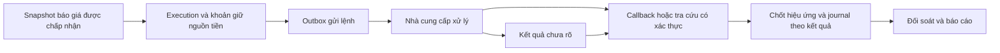

# Currency conversion audit — Kiểm toán chuyển đổi tiền tệ

## 1. Mục tiêu của kiểm toán chuyển đổi

Trong chương **Currency Handling**, kiểm toán chuyển đổi tiền tệ là khả năng giải thích và kiểm chứng một giao dịch đổi tiền từ ý định ban đầu đến hiệu ứng đã ghi nhận. Chỉ lưu hai số “đã trừ” và “đã cộng” không đủ để biết hệ thống có dùng đúng báo giá, đúng phí, đúng người hưởng và đúng quy tắc làm tròn hay không.

Một hồ sơ chuyển đổi cần trả lời được:

- Ai được phép sử dụng tài khoản nguồn và ghi có tài khoản đích?
- Người dùng đã chấp nhận báo giá và điều kiện nào?
- Tỷ giá có chiều gì, áp dụng cho số tiền trước hay sau phí?
- Quy tắc tính toán nào tạo ra số tiền cuối cùng?
- Giao dịch đã được thực thi một lần, đang chờ hay chưa rõ kết quả?
- Sổ cái, nhà cung cấp và dữ liệu báo cáo có đang mô tả cùng một hiệu ứng?

Đây là một cơ chế bảo vệ logic nghiệp vụ. Nó giúp phát hiện sửa tỷ giá, đổi mã tiền, dùng lại báo giá, bỏ qua bước chấp thuận hoặc tạo nhiều hiệu ứng từ một yêu cầu. Hồ sơ kiểm toán không thay thế các kiểm tra đó; nó phải được tạo từ chính luồng đã thực thi chúng.

## 2. Phân biệt các loại tiền và tỷ giá

### 2.1. Không dùng một trường `currency` cho mọi ý nghĩa

Một giao dịch có thể đồng thời liên quan:

| Khái niệm | Ý nghĩa |
| --- | --- |
| Tiền nguồn | Loại tiền bị ghi giảm ở tài khoản nguồn |
| Tiền đích | Loại tiền được ghi tăng ở tài khoản nhận |
| Tiền thu phí | Loại tiền dùng để thu từng khoản phí |
| Tiền thanh toán với nhà cung cấp | Loại tiền thực sự được quyết toán trên kênh bên ngoài |
| Tiền báo cáo | Loại tiền dùng để tổng hợp hoặc định giá báo cáo |

Không được dùng tỷ giá báo cáo để thay thế tỷ giá đã cam kết với khách hàng. Tương tự, số tiền quyết toán thực tế ở nhà cung cấp không nhất thiết bằng một ước tính nội bộ trước khi giao dịch hoàn tất.

Trong một tích hợp thực tế, Stripe phân biệt tiền presentment và settlement, đồng thời có quy ước biểu diễn số tiền và ngoại lệ theo loại thao tác. Điều đó cho thấy mã tiền đơn lẻ chưa mô tả đầy đủ hợp đồng adapter. Xem [Stripe: Supported currencies](https://docs.stripe.com/currencies).

### 2.2. Ghi rõ chiều của tỷ giá

Thay vì chỉ lưu `rate = 0.923456`, cần định nghĩa:

```text
base_currency = USD
quote_currency = EUR
rate = 0.923456 EUR cho 1 USD
đổi USD sang EUR: target_exact = source_basis × rate
```

Nếu báo giá có chiều ngược, công thức có thể là phép chia. Không suy ra chiều từ thứ tự ký tự trong tên field, và không tự lấy nghịch đảo một tỷ giá đã làm tròn rồi coi đó là báo giá tương đương.

Cũng cần phân biệt tỷ giá tham chiếu thị trường, tỷ giá khách hàng được chấp nhận và tỷ giá nhà cung cấp thực thi. Chênh lệch giữa chúng có thể chứa spread hoặc phản ánh các thời điểm khác nhau. Khi có nhiều tỷ giá, mỗi giá trị phải mang mục đích và nguồn gốc riêng.

## 3. Một ví dụ có thể tái dựng đầy đủ

Toàn bộ số liệu sau là dữ liệu minh họa, không phải tỷ giá hiện hành:

```text
Tiền nguồn:                   USD
Tiền đích:                    EUR
Nguồn ghi giảm toàn bộ:        100.00 USD
Phí cố định trừ ở nguồn:         1.25 USD
Cơ sở được đổi:                 98.75 USD
Tỷ giá khách hàng:               0.923456 EUR / USD
Kết quả chính xác:              91.19128 EUR
Quy tắc ghi nhận:               scale 2, HALF_EVEN
Tiền đích ghi tăng:             91.19 EUR
rounding_delta = booked - exact = -0.00128 EUR
```

Ở đây, phí được trừ **trước** chuyển đổi và bằng USD. Nếu phí được thu thêm ngoài 100.00 USD hoặc trừ ở phía EUR, công thức và nguồn tiền cần kiểm tra sẽ khác. Hồ sơ phải lưu chính sách đó thay vì chỉ lưu `fee = 1.25` không có đơn vị.

Đại lượng `rounding_delta` có thể có độ chính xác cao hơn đơn vị ghi sổ. Nó là bằng chứng tính toán; không được tự tạo thêm một bút toán ở độ chính xác mà tài khoản không hỗ trợ. Nếu hệ thống theo dõi phần lẻ ở một sổ phụ, cần mô hình và quy tắc phân bổ riêng.

### 3.1. Số tiền trước và sau phí phải đối chiếu được

Với mô hình minh họa:

```text
source_gross = source_fee + source_basis
100.00 USD   = 1.25 USD   + 98.75 USD

target_exact  = source_basis × customer_rate
target_booked = round(target_exact, target_policy)
rounding_delta = target_booked - target_exact
```

Spread đã nằm trong tỷ giá khách hàng không được tự cộng thêm thành một khoản phí lần thứ hai. Nếu cần tách doanh thu spread để báo cáo, phải định nghĩa cách phân tích riêng và không làm thay đổi nghĩa vụ đã chấp nhận.

### 3.2. Cân bằng theo từng loại tiền

Một cách minh họa biến động nội bộ:

| Phạm vi | Tài khoản | Biến động |
| --- | --- | --- |
| USD | Ví nguồn khách hàng | -100.00 USD |
| USD | Tài khoản thanh khoản USD | +98.75 USD |
| USD | Tài khoản phí USD | +1.25 USD |
| EUR | Tài khoản thanh khoản EUR | -91.19 EUR |
| EUR | Ví đích khách hàng | +91.19 EUR |

Các dấu cộng/trừ mô tả biến động của ví dụ, không định nghĩa quy tắc Nợ/Có cho mọi loại tài khoản. Các dòng USD cân bằng riêng và các dòng EUR cân bằng riêng. Không cộng số học `100 USD` với `91.19 EUR` để kết luận journal thiếu 8.81.

TigerBeetle đưa ra một mô hình tương tự về mặt cấu trúc: đổi tiền được biểu diễn bằng các transfer liên kết nguyên tử giữa các cặp tài khoản cùng ledger tiền tệ. Xem [TigerBeetle: Currency Exchange](https://docs.tigerbeetle.com/coding/recipes/currency-exchange/).

## 4. Dữ liệu tối thiểu của hồ sơ kiểm toán

### 4.1. Định danh và ngữ cảnh quyền

Lưu `conversion_id`, `execution_id`, tenant, người khởi tạo, dịch vụ thực thi, tài khoản nguồn/đích và tham chiếu đối tượng nghiệp vụ như đơn hàng. Nếu có ủy quyền, ghi nhận chủ thể và phạm vi đã cho phép thao tác.

Định danh trong hồ sơ phải lấy từ dữ liệu đã xác thực ở máy chủ. Một field `userId` do client gửi không phải bằng chứng người đó thực sự tạo hoặc được phép thực hiện giao dịch.

### 4.2. Snapshot báo giá và quy tắc

| Nhóm | Dữ liệu cần giữ |
| --- | --- |
| Báo giá | Quote ID, revision, nguồn cung cấp, thời điểm tạo, hạn hiệu lực, điều kiện dùng |
| Tiền và đơn vị | Mã tiền nguồn/đích, scale, quy ước đơn vị adapter, phiên bản cấu hình tiền |
| Tỷ giá | Giá trị thập phân chính xác được chấp nhận, base/quote, chiều, mục đích |
| Phí | Loại phí, giá trị, mã tiền, bên chịu, thu trước/sau đổi hoặc thu thêm |
| Tính toán | Cơ sở đổi, kết quả chưa lượng tử hóa, số tiền ghi nhận, chênh lệch làm tròn |
| Chính sách | Phiên bản công thức, rounding mode, quantum, thời điểm làm tròn và phạm vi tổng hợp |
| Chấp thuận | Nội dung hoặc snapshot được chấp nhận, revision, thời điểm và cơ chế xác nhận |

“Giá trị thập phân chính xác” ở đây là giá trị được chọn làm đầu vào của hợp đồng, không phải khẳng định tỷ giá thị trường có độ chính xác vô hạn. Nếu đầu vào đã được nhà cung cấp lượng tử hóa, lưu đúng giá trị và độ chính xác đó.

Khi phép chia tạo kết quả thập phân vô hạn, cần lưu thêm chính sách precision trung gian và phiên bản thuật toán. Không gọi một kết quả đã cắt ở một precision tùy ý là kết quả toán học chính xác.

### 4.3. Hiệu ứng và trạng thái

Giữ liên kết đến journal, các bút toán, số tiền ghi giảm/ghi tăng, kết quả kiểm tra nguồn tiền, idempotency scope, sự kiện outbox và tham chiếu nhà cung cấp. Tách thời điểm xảy ra nghiệp vụ, thời điểm hệ thống ghi nhận và thời điểm nhận xác nhận bên ngoài.

Các trạng thái như `QUOTE_ACCEPTED`, `RESERVED`, `SUBMITTED`, `CONFIRMED`, `FAILED_FINAL` và `UNKNOWN` có ý nghĩa khác nhau. Tên cụ thể do ứng dụng chọn, nhưng không được gộp tất cả thành `success = true` ngay khi gửi được một lời gọi mạng.

## 5. Gắn hồ sơ với báo giá có thẩm quyền

### 5.1. Client gửi ý định, không quyết định tỷ giá

Một API có thể nhận:

```json
{
  "quoteId": "quote-7e2c",
  "sourceWalletId": "wallet-usd-1",
  "destinationWalletId": "wallet-eur-1",
  "expectedQuoteRevision": 4
}
```

Máy chủ tra cứu báo giá và xác minh quyền trên cả đối tượng liên quan. Không cho client âm thầm ghi đè `rate`, `fee`, `sourceScale`, `roundingMode` hoặc `targetAmount` khi thực thi một báo giá đã chấp nhận.

Nếu thiết kế dùng báo giá tự chứa có chữ ký, máy chủ vẫn phải kiểm tra chữ ký, đối tượng được ràng buộc, loại thao tác, expiry, audience và quy tắc dùng lại. Chữ ký hợp lệ không chứng minh tài khoản đích thuộc quyền người gọi hoặc báo giá chưa bị dùng quá số lần được phép.

### 5.2. Bảo vệ thời hạn và số lần sử dụng

Bài học giả định một báo giá được dùng cho một lần chuyển đổi. Cần kiểm tra tính hợp lệ và giành quyền dùng báo giá trong cùng ranh giới quyết định, bằng khóa hoặc cập nhật trạng thái có điều kiện và ràng buộc duy nhất phù hợp.

```text
ISSUED -> CONSUMED: chấp nhận thực thi đúng một lần
ISSUED -> EXPIRED: quá hạn trước khi được chấp nhận
```

Replay của giao dịch đã được chấp nhận phải tìm lại execution đã có. Không từ chối máy móc vì quote hiện đã hết hạn rồi tạo execution mới bằng một báo giá khác. Ngược lại, một yêu cầu mới không được dùng quote quá hạn chỉ vì đã từng được xem trên giao diện.

Một dịch vụ có thể cho nhiều lần sử dụng báo giá, nhưng số lần, hạn mức và đối tượng phải được quy định rõ. Không suy ra khả năng dùng lại từ việc bảng quote chưa bị xóa.

### 5.3. Phiên bản chính sách là một phần của bằng chứng

Hồ sơ cần chỉ ra đúng phiên bản tỷ giá, công thức phí, metadata tiền và thuật toán đã áp dụng. Tái dựng lịch sử không được đọc “cấu hình hiện tại” rồi coi đó là cấu hình của giao dịch cũ.

Nếu chính sách thay đổi trước khi thực thi, hệ thống phải xác định báo giá cũ còn được cam kết hay cần xác nhận lại. Không âm thầm đổi mức phí hoặc số tiền đích mà vẫn lưu rằng người dùng chấp nhận bản cũ.

## 6. Tính toán có thể tái lập trong Java

Ví dụ dưới đây tái dựng dữ liệu ở phần 3 từ snapshot đáng tin. Nó chưa bao gồm phân quyền, kiểm tra quote hoặc transaction:

```java
long grossMinor = 10_000L;
long feeMinor = 125L;
int sourceScale = 2;
int targetScale = 2;

long basisMinor = Math.subtractExact(grossMinor, feeMinor);
if (grossMinor <= 0 || feeMinor < 0 || basisMinor <= 0) {
    throw new IllegalArgumentException("Invalid conversion basis");
}

BigDecimal basis = BigDecimal.valueOf(basisMinor, sourceScale);
BigDecimal rate = new BigDecimal("0.923456");
BigDecimal exact = basis.multiply(rate);
BigDecimal booked = exact.setScale(targetScale, RoundingMode.HALF_EVEN);
long targetMinor = booked.movePointRight(targetScale).longValueExact();
BigDecimal roundingDelta = booked.subtract(exact);
```

Các API thập phân, điều khiển scale và chuyển số nguyên có kiểm tra được mô tả trong [Java SE 21: BigDecimal](https://docs.oracle.com/en/java/javase/21/docs/api/java.base/java/math/BigDecimal.html). Đoạn mã sử dụng chuỗi thập phân cho tỷ giá và không đi qua `double`.

Trong triển khai, phải giới hạn miền số tiền, độ dài tỷ giá, precision/scale và kết quả. Không để đầu vào có exponent hoặc độ dài tùy ý tạo chi phí tính toán ngoài giới hạn. Nếu số tiền sau làm tròn bằng 0 hoặc vượt miền adapter, xử lý theo chính sách chứ không tự ghi nhận một chuyển đổi vô nghĩa.

Khi truyền dữ liệu qua các client dùng số dấu phẩy động, có thể biểu diễn minor unit lớn và số thập phân bằng chuỗi chuẩn hóa. Quan trọng là hợp đồng nói rõ kiểu, đơn vị và cách phân tích, không chuyển một giá trị nguyên lớn qua kiểu số làm mất chữ số.

### Snapshot tính toán minh họa

```json
{
  "schemaVersion": 1,
  "conversionId": "conv-82a1",
  "quoteId": "quote-7e2c",
  "quoteRevision": 4,
  "source": {"currency": "USD", "scale": 2, "grossMinor": "10000"},
  "fee": {"currency": "USD", "minor": "125", "position": "BEFORE_CONVERSION"},
  "sourceBasisMinor": "9875",
  "rate": {
    "baseCurrency": "USD",
    "quoteCurrency": "EUR",
    "value": "0.923456"
  },
  "target": {"currency": "EUR", "scale": 2, "bookedMinor": "9119"},
  "calculation": {
    "unroundedTarget": "91.19128",
    "roundingMode": "HALF_EVEN",
    "roundingDelta": "-0.00128",
    "roundingDeltaConvention": "BOOKED_MINUS_UNROUNDED"
  },
  "pricingPolicyVersion": "fx-pricing-v3",
  "currencyMetadataVersion": "money-units-v2",
  "calculationVersion": "fx-engine-v5"
}
```

Đây chỉ là phần snapshot số học. Hồ sơ đầy đủ còn cần danh tính, chấp thuận, thời điểm, quyền, trạng thái và các liên kết thực thi đã nêu. Một JSON có đủ field không tự chứng minh các field đến từ nguồn đúng.

## 7. Ghi hiệu ứng tiền và bằng chứng cùng ranh giới nhất quán

### 7.1. Chuyển đổi hoàn toàn nội bộ

Luồng minh họa sau giả định các ví và tài khoản thanh khoản nằm trong cùng cơ sở dữ liệu:

```text
authenticate actor
normalize intent and verify access to source/destination

BEGIN
  claim idempotency scope with a unique constraint
  compare the normalized request fingerprint
  if an execution already exists for this intent:
      verify access and return its recorded result

  lock quote and verify revision, binding, expiry and usage policy
  lock affected accounts in a stable order
  verify account currencies, states, authority and available funds
  compute from the immutable quote/policy snapshot
  verify target liquidity and all business limits

  create execution and consume quote once
  write balanced entries separately for each currency
  update balance projections consistently
  persist mandatory conversion audit facts and calculation snapshot
  record the result and business/audit events in an outbox
COMMIT
return committed result
```

Chỉ đặt `@Transactional` không tự bảo vệ việc hai yêu cầu cùng dùng quote hoặc cùng chi một số dư. Cần khóa, cập nhật có điều kiện hoặc cơ chế đồng thời tương ứng với từng bất biến, cùng các ràng buộc duy nhất cho execution.

Các sự kiện chuyển tiếp ra kho kiểm toán có thể đến muộn hoặc được gửi nhiều lần. Outbox bảo vệ ý định chuyển tiếp sau commit; nơi nhận vẫn cần chống trùng bằng event ID ổn định. Bản ghi bắt buộc để giải thích hiệu ứng tiền phải tồn tại bền vững cùng commit, không phụ thuộc vào một lệnh `logger.info()` có thể bị tắt hoặc bị mất.

Nếu không ghi được snapshot bắt buộc trong transaction, không commit riêng phần chuyển tiền rồi hy vọng dựng lại bằng tỷ giá hiện tại. Ngược lại, lỗi một thông số telemetry tùy chọn không nên được đánh đồng với thiếu bằng chứng tài chính bắt buộc. Cần xác định rõ hai nhóm dữ liệu này trong thiết kế.

### 7.2. Chuyển đổi có nhà cung cấp bên ngoài

Một transaction cục bộ không rollback được tiền đã đổi ở bên ngoài. Cần lưu một execution và provider operation key ổn định trước khi gửi, sau đó ghi nhận từng quan sát kết quả:



Hồ sơ phải phân biệt yêu cầu đã gửi, phản hồi đã nhận, dữ liệu được xác nhận và kết quả chưa rõ. Timeout không chứng minh nhà cung cấp chưa thực hiện đổi tiền. Không tạo một operation mới hoặc giải phóng khoản giữ chỉ vì hết thời gian chờ của HTTP client.

Nếu quote bên ngoài hết hạn trong lúc chờ worker, xử lý theo hợp đồng của quote đó. Không tự gửi lại với tỷ giá mới rồi ghi đè lên snapshot đã được chấp nhận. Cần lưu phản hồi hết hạn, trạng thái thực thi và quyết định hủy hoặc xin xác nhận báo giá mới.

## 8. Ba lớp đối soát cần tách biệt

### 8.1. Tái dựng quyết định tính toán

Sử dụng snapshot lịch sử để tính lại:

1. Số tiền nguồn và các thành phần phí theo đúng mã tiền.
2. Cơ sở nhân/chia tỷ giá theo đúng chiều.
3. Precision trung gian và các điểm lượng tử hóa đã định nghĩa.
4. Số tiền đích cuối cùng, chênh lệch làm tròn và giới hạn liên quan.
5. Sự khớp nhau giữa kết quả tính lại và số tiền thực sự đã ghi nhận.

Không gọi API tỷ giá mới khi replay. Có thể dùng công cụ kiểm chứng độc lập hoặc bộ dữ liệu chuẩn để giảm nguy cơ lặp lại cùng lỗi của engine gốc. Tuy nhiên, tính lại đúng số học không xác minh được rằng báo giá ban đầu là có thẩm quyền; cần kiểm tra cả nguồn báo giá và chấp thuận.

### 8.2. Đối chiếu sổ cái và số dư

Theo từng loại tiền, đối chiếu tổng ghi giảm, ghi tăng, phí, khoản giữ và tài khoản thanh khoản. Mỗi execution đã chốt phải gắn với đúng hiệu ứng, không có journal thiếu, journal trùng hoặc projection đã cập nhật mà không có bút toán.

Ví dụ ở phần 3 cần giải thích được nguồn USD giảm 100.00, phí USD là 1.25 và phần dùng đổi là 98.75. Phía EUR cần giải thích được 91.19 ghi tăng đã lấy từ nguồn thanh khoản nào. Một số `convertedAmount = 91.19` trên bảng nghiệp vụ không thay thế các bằng chứng đó.

### 8.3. Đối chiếu thực thi và quyết toán bên ngoài

Đối chiếu execution nội bộ với ID thao tác, báo cáo hoặc sao kê của nhà cung cấp: trạng thái, tiền nguồn/đích, phí, thời điểm và loại tỷ giá. Tỷ giá ước tính ban đầu, tỷ giá khách hàng và chi phí thực tế của doanh nghiệp có thể khác nhau theo mô hình sản phẩm; lưu từng giá trị, mục đích và chênh lệch thay vì sửa lịch sử cho bằng nhau.

Không áp dụng một ngưỡng “sai lệch dưới 1% thì bỏ qua” cho mọi đối tượng. Ngưỡng cần có đơn vị, loại chênh lệch, lý do, người chịu và cách xử lý. Với tính lại một phép nhân thập phân chính xác trong cùng chính sách, thường có thể yêu cầu khớp đúng kết quả đã lượng tử hóa; khác biệt do đối tác phải được phân loại riêng.

Một chênh lệch nhỏ nhưng luôn cùng chiều có thể chỉ ra sai quy tắc làm tròn hoặc lạm dụng ở quy mô lớn. Theo dõi cả số lượng, tổng giá trị và phân bố chiều sai lệch, không chỉ giá trị lớn nhất từng giao dịch.

## 9. Bảo vệ tính toàn vẹn và quyền truy cập hồ sơ

### 9.1. Tách dữ kiện tài chính với log vận hành

Hồ sơ tài chính lưu dữ kiện cần tái dựng giao dịch. Log vận hành phục vụ chẩn đoán lỗi, độ trễ và quan sát hệ thống. Log bảo mật ghi nhận sửa tham số, lỗi quyền, thử bỏ qua trạng thái và hành vi bất thường. Ba loại có thể liên kết bằng correlation ID nhưng không nên dựa vào nhau như nguồn dữ liệu thay thế hoàn toàn.

OWASP hướng dẫn ghi đủ ngữ cảnh về thời gian, nơi xảy ra, chủ thể và hành động; đồng thời hạn chế ghi bí mật và dữ liệu nhạy cảm trực tiếp. Áp dụng vào chuyển đổi tiền tệ cần chọn field theo mục đích, không ghi toàn bộ request/response một cách mặc định. Xem [OWASP: Logging](https://cheatsheetseries.owasp.org/cheatsheets/Logging_Cheat_Sheet.html).

### 9.2. Không cho sửa bằng chứng sau thực thi

Các dữ kiện đã chốt như quote snapshot, số tiền đã ghi nhận và liên kết journal nên được bảo vệ khỏi cập nhật/xóa tùy tiện. Trạng thái quan sát mới có thể được ghi thành sự kiện bổ sung, với projection hiện tại được cập nhật có kiểm soát.

Giới hạn quyền ghi của ứng dụng và công cụ quản trị; theo dõi thay đổi cấu hình tỷ giá, quyền đọc/xuất hồ sơ và hoạt động điều chỉnh. Có thể dùng lưu trữ chỉ thêm, cơ chế chống can thiệp hoặc dấu kiểm chứng theo kiến trúc thích hợp.

Hash nội dung giúp phát hiện khác biệt chỉ khi giá trị đối chiếu hoặc điểm tin cậy được bảo vệ. Nếu người sửa được cả hồ sơ lẫn hash cùng chỗ, hash đó không tự chứng minh hồ sơ nguyên vẹn. Chữ ký cũng cần quản lý khóa, ngữ cảnh ký và quy tắc xác minh phù hợp.

Nếu chuẩn hóa để băm/ký, phải xác định thứ tự field, biểu diễn số thập phân, đơn vị, timezone và phiên bản schema. Chẳng hạn `1.0` và `1.00` bằng nhau về số học nhưng khác chuỗi; không để mỗi dịch vụ tự tạo một fingerprint khác nhau cho cùng ý định.

### 9.3. Bảo mật dữ liệu và log injection

Quyền xem giao dịch không luôn bao gồm quyền xem toàn bộ báo giá thương mại, bằng chứng hoặc báo cáo đối soát. Áp dụng quyền theo tenant, đối tượng và mục đích sử dụng. Kết quả tra cứu replay cũng phải kiểm tra quyền hiện tại trước khi trả dữ liệu.

Không ghi access token, bí mật chữ ký hoặc thông tin phương thức thanh toán đầy đủ vào log. Với tên người hưởng, mã lỗi hoặc ghi chú có nguồn từ bên ngoài, giới hạn độ dài và dùng log có cấu trúc để tránh ký tự xuống dòng tạo sự kiện giả. Thời hạn lưu và việc xuất hồ sơ phải được định nghĩa theo nhu cầu sản phẩm và nghĩa vụ áp dụng, không mặc định một con số chung cho mọi hệ thống.

## 10. Điều chỉnh và hoàn tiền không được viết lại lịch sử tỷ giá

Nếu một chuyển đổi đã chốt sai, tạo nghiệp vụ điều chỉnh có định danh mới, liên kết với execution và journal gốc. Lưu lý do, người phê duyệt, chính sách, hiệu ứng bổ sung và kết quả thực thi. Không sửa `rate` của giao dịch cũ để báo cáo trông hợp lý hơn.

Cần phân biệt:

- Đảo hiệu ứng gốc theo số lượng tiền thực tế đã ghi nhận, nếu chính sách cho phép.
- Thực hiện một giao dịch đổi ngược mới với báo giá mới.
- Trả lại tiền theo hợp đồng hoàn tiền của đơn hàng, có thể gồm hoặc không gồm phí và chênh lệch tỷ giá.

Ba cách này có thể tạo kết quả khác nhau. Không lấy số tiền đích cũ nhân tỷ giá mới rồi gọi đó là “khôi phục nguyên trạng” mà không có quyết định nghiệp vụ rõ ràng.

Chuỗi điều chỉnh phải tiếp tục giữ liên kết với gốc để kiểm soát tổng đã hoàn, số tiền đang chờ và quyền thao tác. Tách bản ghi bồi hoàn thiện chí hoặc chênh lệch tỷ giá theo loại nghiệp vụ tương ứng, không giấu chúng trong rounding delta.

## 11. Kiểm thử tình huống lạm dụng logic

### 11.1. Đầu vào, báo giá và quyền

| Tình huống | Kết quả cần kiểm tra |
| --- | --- |
| Client đổi mã tiền đích nhưng giữ quote ID | Bị chặn do không khớp ràng buộc báo giá |
| Thay tỷ giá, phí, mode hoặc scale trong payload | Không ghi đè snapshot máy chủ; xử lý tham số không hợp lệ theo hợp đồng |
| Dùng quote của người khác/tenant khác | Từ chối và không tiết lộ dữ liệu không có quyền |
| Chọn tài khoản đích ngoài phạm vi được phép | Từ chối dù quote và số tiền hợp lệ |
| Quote quá hạn trước lần chấp nhận mới | Không tạo execution mới bằng quote đó |
| Đảo chiều tỷ giá hoặc nhầm gross/net | Tái tính và kiểm tra kết quả phát hiện sai lệch |
| Nhập số tiền hoặc tỷ giá vượt miền hỗ trợ | Từ chối trước hiệu ứng tiền và không gây chi phí xử lý vô hạn |

### 11.2. Phiên bản và số học

Dùng bộ dữ liệu cố định bao gồm phí ở nguồn, phí ở đích, phí thu thêm và loại tiền có đơn vị khác nhau. Chỉ chạy những mô hình mà sản phẩm thực sự hỗ trợ; không tự kết hợp chính sách ngoài hợp đồng.

Giữ một giao dịch đã chốt, thay cấu hình hiện tại rồi replay. Kết quả lịch sử phải giữ nguyên và chỉ ra đúng phiên bản cũ. Kiểm thử các giá trị sát điểm làm tròn, tỷ giá nhiều chữ số và phép chia không có biểu diễn thập phân hữu hạn. Với ví dụ ở bài học, phải khôi phục đúng `91.19 EUR` và delta `-0.00128 EUR` từ snapshot.

### 11.3. Đồng thời, gửi trùng và lỗi giữa chừng

- Gửi đồng thời hai lệnh dùng cùng quote một lần: chỉ một execution được nhận theo chính sách đã chọn.
- Cùng key và cùng ý định: tìm lại execution, không ghi nợ/ghi có lần nữa.
- Cùng key nhưng khác tài khoản hoặc revision: xung đột, không chuyển key sang ý định khác.
- Đổi key nhưng dùng lại quote đã tiêu thụ: không tạo hiệu ứng thứ hai.
- Gây lỗi khi ghi snapshot bắt buộc sau ghi bút toán trong transaction: toàn bộ hiệu ứng nội bộ rollback.
- Mất phản hồi sau commit: replay tìm lại kết quả đã có.
- Outbox hoặc callback gửi trùng: không tạo journal hay hồ sơ hoàn tất lặp.
- Nhà cung cấp đã xử lý nhưng client timeout: giữ trạng thái chưa rõ và tra cứu bằng cùng định danh.
- Callback sai chữ ký, sai mã tiền hoặc số tiền: không chốt thành công chỉ vì nhận được sự kiện.

Các kiểm thử tranh chấp cần dùng kết nối và transaction độc lập trên cơ sở dữ liệu mục tiêu. Kiểm tra trạng thái sau commit ở cả ví, journal, execution, quote và hồ sơ kiểm toán, không chỉ mã HTTP.

### 11.4. Bất biến có thể kiểm tra tự động

```text
Mỗi execution đã chốt có snapshot đủ để tái dựng quyết định.
Số tiền ghi nhận khớp kết quả từ snapshot và chính sách lịch sử.
Bút toán cân bằng theo từng loại tiền.
Một ý định/quote một lần không tạo hai hiệu ứng đã chốt.
Không có giao dịch tiền đã commit mà thiếu dữ kiện kiểm toán bắt buộc.
Mọi điều chỉnh giữ được đường truy nguyên về giao dịch gốc.
Kết quả chưa rõ không bị tự đổi thành thất bại chắc chắn.
```

## 12. Một quy trình đọc hồ sơ khi điều tra

Khi khách hàng hỏi vì sao 100.00 USD chỉ tạo 91.19 EUR, có thể đi theo thứ tự:

1. Xác định conversion, chủ thể có quyền và báo giá đã chấp nhận.
2. Kiểm tra 100.00 là số tiền tổng ghi giảm hay cơ sở đổi.
3. Xác minh phí 1.25 USD được trừ trước đổi, còn 98.75 USD.
4. Đọc tỷ giá `0.923456 EUR/USD` và phiên bản quy tắc đã dùng.
5. Tái tính 91.19128 rồi lượng tử hóa thành 91.19 theo snapshot.
6. Đối chiếu dòng USD, dòng EUR và trạng thái nhà cung cấp.
7. Nếu có sai lệch, phân loại là phí, spread, làm tròn, lỗi thực thi hay thiếu dữ liệu; mở điều chỉnh có căn cứ nếu cần.

Khả năng trả lời chuỗi câu hỏi này bằng dữ kiện đã lưu, thay vì phỏng đoán từ cấu hình hôm nay, là dấu hiệu hồ sơ kiểm toán đang phục vụ đúng mục tiêu bảo vệ logic nghiệp vụ.
