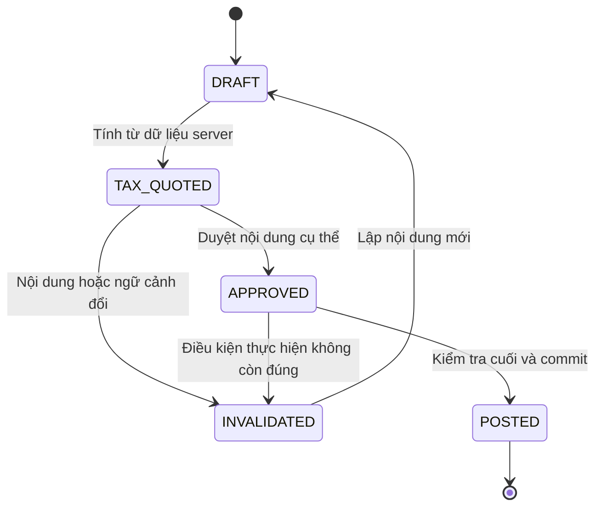

# Tax rounding — Làm tròn tiền thuế an toàn

## 1. Mục tiêu và phạm vi

Tax rounding là quy tắc chuyển kết quả tính thuế có độ chính xác cao thành số tiền có thể ghi nhận, thu hoặc hoàn theo đơn vị tiền tệ đã quy định. Đây là một phần của logic nghiệp vụ: cùng dữ liệu nhưng làm tròn ở thời điểm hoặc phạm vi khác nhau có thể tạo tổng thuế khác nhau.

Trong chương **Rounding Rules**, bài học tập trung vào việc bảo vệ bất biến tiền tệ trước sửa dữ liệu tính thuế, đổi chế độ làm tròn, tách dòng hàng, lạm dụng phần dư và hoàn tiền lặp. Các cơ chế chính gồm dữ liệu có thẩm quyền ở máy chủ, phiên bản chính sách, state machine, quyền theo đối tượng, transaction và idempotency.

Các mức thuế và số tiền trong bài là ví dụ giả định để giải thích thuật toán. Chính sách thực tế phải được cấu hình cho phạm vi nghiệp vụ và quy tắc thuế áp dụng; `LANG=vi` không tự xác định mức thuế, loại thuế hay cách làm tròn.

Sau bài học, bạn có thể:

- Phân biệt làm tròn theo đơn vị hàng, dòng, nhóm thuế và chứng từ.
- Thiết kế thứ tự tính giá, giảm giá, cơ sở tính thuế và tổng phải thu.
- Sử dụng số học chính xác để tránh sai số nhị phân và làm tròn hai lần.
- Phân bổ tiền thuế đã chốt sao cho các phần cộng lại đúng tổng.
- Ngăn hoàn thuế vượt số đã ghi nhận khi có retry hoặc yêu cầu đồng thời.
- Đặc tả kiểm thử cho hành vi tấn công logic tại các ranh giới làm tròn.

## 2. Chênh một đơn vị nhỏ nhất vẫn có thể là lỗi bảo mật

Giả sử một currency trong ví dụ có đơn vị ghi nhận nhỏ nhất là `0.01`. Hai dòng hàng, mỗi dòng có giá chưa thuế `0.05`, cùng chịu thuế suất giả định 10%.

| Dòng | Cơ sở tính thuế | Thuế chưa làm tròn | Làm tròn HALF_UP tới 0.01 |
| --- | --- | --- | --- |
| L1 | 0.05 | 0.005 | 0.01 |
| L2 | 0.05 | 0.005 | 0.01 |

Nếu làm tròn từng dòng, tổng thuế là `0.02`. Nếu cộng cơ sở tính thuế rồi làm tròn một lần cho nhóm cùng thuế:

```text
(0.05 + 0.05) × 10% = 0.010 -> 0.01
```

Hai kết quả đều xuất phát từ những phép tính có chủ đích; điều quyết định kết quả đúng là **chính sách được phép áp dụng**. Không thể chọn phương án có lợi hơn sau khi đã nhìn thấy kết quả.

Microsoft Dynamics 365 mô tả riêng các cấu hình precision, phương pháp làm tròn, nhóm thuế và tính theo dòng hoặc tổng. Đây là minh họa rằng một nhãn như “làm tròn thuế” chưa đủ để đặc tả thuật toán. Xem [Tax calculation rounding rules](https://learn.microsoft.com/en-us/dynamics365/finance/localizations/global/tax-calculation-rounding-rules).

Nếu client được chọn `roundingMode`, đổi phạm vi tính hoặc chia cùng một nghiệp vụ thành hình thức khác để server xử lý không nhất quán, các phần chênh nhỏ có thể được khai thác hàng loạt. Vấn đề bảo mật nằm ở quyền thay đổi quy tắc và khả năng bảo toàn các số tiền đã chốt.

## 3. Một chính sách thuế cần nhiều hơn một rounding mode

Máy chủ nên nhận diện chính sách bằng ID và version, đồng thời lưu dữ liệu đủ để giải thích phép tính.

```text
tax_policy_id, tax_policy_version
currency, posting_scale, rounding_increment
price_mode: TAX_EXCLUSIVE | TAX_INCLUSIVE
calculation_scope: UNIT | LINE | TAX_GROUP | DOCUMENT
rounding_mode
eligible_tax_codes, tax_rates, effective_context
basis_rules, discount_allocation_rule, shipping_tax_rule
grouping_rule, remainder_allocation_rule
negative_amount_rule, refund_rule
```

Các trường là mô hình khái niệm, không phải yêu cầu phải cho client gửi vào API. Đa số chúng phải được xác định từ cấu hình có thẩm quyền, loại sản phẩm, địa điểm/ngữ cảnh thuế và dữ liệu khách hàng đã được xác minh.

| Quyết định | Ví dụ khác biệt cần đặc tả |
| --- | --- |
| Cơ sở tính thuế | Trước hay sau giảm giá; phí vận chuyển có chịu thuế không |
| Giá đã gồm thuế | Trích thuế từ tổng cố định hay cộng thuế lên giá gốc |
| Phạm vi làm tròn | Mỗi đơn vị hàng, mỗi dòng hay mỗi nhóm trên hóa đơn |
| Nhóm tính | Currency, tax code, mức thuế, phạm vi thuế và kiểu bao gồm thuế |
| Đơn vị làm tròn | 0.01 khác với bước 0.05 hoặc 1 |
| Phần dư | Phân bổ vào dòng nào bằng quy tắc ổn định |
| Điều chỉnh âm | Chứng từ giảm, hoàn tiền hoặc đảo bút toán được xử lý thế nào |
| Thay đổi chính sách | Thời điểm áp dụng version mới và cách giữ lịch sử |

Không gộp các tax code chỉ vì chúng có cùng tỷ lệ phần trăm. Chúng có thể thuộc nghĩa vụ hoặc tài khoản phải nộp khác nhau. Thuế ghép tầng cũng không được thay bằng tổng các thuế suất nếu cơ sở tính của thuế sau bao gồm thuế trước.

Currency, scale và rounding increment là ba khái niệm liên quan nhưng khác nhau. `setScale(2)` không làm số trở thành bội số của `0.05`. Việc làm tròn tiền mặt khi thanh toán, nếu có, cần một điều chỉnh được đặc tả riêng; không tự thay tiền thuế đã ghi nhận bằng số tiền đã làm tròn để thu tiền mặt.

## 4. Bất biến cần được bảo vệ

| Mã | Bất biến | Hàng rào dự kiến |
| --- | --- | --- |
| T1 | Thuế được tính từ dữ liệu có thẩm quyền | Giá, tax code, thuế suất và miễn giảm được kiểm tra ở server |
| T2 | Một nội dung và một version chính sách cho kết quả xác định | Không phụ thuộc thứ tự request hoặc cấu hình mới khi retry |
| T3 | Tổng thuế bằng tổng các phần đã phân bổ theo từng nhóm/currency | Quy tắc phân bổ và kiểm tra tổng chính xác |
| T4 | Tổng phải thu khớp các thành phần đã chốt | Công thức cộng/trừ được lưu và kiểm tra |
| T5 | Nội dung được thu tiền khớp nội dung đã duyệt | Intent/version và fingerprint toàn bộ khoản tiền |
| T6 | Không hoàn nhiều hơn phần tiền và thuế được phép hoàn | Bộ đếm/phân bổ gốc, transaction, điều kiện còn lại |
| T7 | Retry không tạo thêm thuế, hoàn tiền hoặc phần dư | Idempotency bền vững và ràng buộc nghiệp vụ |
| T8 | Không có cập nhật tiền một phần khi tính thuế thất bại | Commit/rollback chung trạng thái, ledger và kết quả |

Với giá chưa thuế ở ví dụ đơn giản:

```text
taxable_net = gross_items_before_tax - allocated_discount + taxable_fees
tax = tổng các khoản thuế đã chốt theo chính sách
payable = net_components + tax + non_taxable_fees
```

Các thành phần phải có cùng currency khi cộng. Công thức thực tế có thể khác tùy sản phẩm, nhưng mỗi khoản phải xuất hiện đúng một lần. Không trừ giảm giá hai lần hoặc cộng lại thuế đã bao gồm trong giá.

Với giá đã gồm thuế và một thành phần thuế trong ví dụ:

```text
gross = net + tax
```

Sau khi chốt số thuế ở độ chính xác ghi nhận, suy ra thành phần còn lại để giữ đẳng thức. Không làm tròn độc lập cả ba số rồi bỏ qua sai lệch.

## 5. Chọn phạm vi làm tròn trước khi tính

### 5.1. Theo đơn vị hàng và theo dòng

Một dòng có quantity 2, giá mỗi đơn vị `0.05`, thuế suất 10%:

```text
UNIT: round(0.05 × 10%) × 2 = 0.01 × 2 = 0.02
LINE: round((0.05 × 2) × 10%) = round(0.010) = 0.01
```

Nhân số thuế của một đơn vị đã làm tròn không tương đương tính trên giá trị mở rộng của dòng. Dùng quantity lớn có thể khuếch đại chênh lệch.

### 5.2. Theo dòng và theo nhóm thuế

Với ba dòng `0.05` cùng thuế suất:

```text
LINE: 0.01 + 0.01 + 0.01 = 0.03
TAX_GROUP: round(0.15 × 10%) = round(0.015) = 0.02
```

Nếu chọn TAX_GROUP, cần phân bổ `0.02` xuống các dòng để ghi nhận và hoàn trả; không lưu thuế dòng `0.01` cho cả ba rồi ghi tổng là `0.02`.

Một khóa nhóm có thể bao gồm:

```text
(currency, tax_jurisdiction_context, tax_code, rate,
 price_inclusion_mode, tax_policy_version)
```

Đây là ví dụ khóa; quy tắc nhóm phải phản ánh mô hình thuế thực tế. Không nhóm tùy ý toàn bộ hóa đơn qua các currency, tax code hoặc cách tính khác nhau để giảm số lần làm tròn.

### 5.3. Tách dòng không phải lúc nào cũng giữ nguyên tổng

Không đặt bất biến “tách hoặc gộp bất kỳ dòng nào cũng phải giữ nguyên thuế” nếu chính sách hợp lệ là làm tròn theo dòng. Tính chất đó không đúng về mặt số học.

Thay vào đó, xác định dòng hoặc đơn vị tính thuế có nghĩa nghiệp vụ gì. Client không được tự đổi phạm vi tính bằng cờ hoặc thứ tự phần tử. Nếu sản phẩm coi hai cách gửi là cùng một dòng nghiệp vụ, chuẩn hóa chúng theo quy tắc phía máy chủ. Nếu thực sự là các chứng từ riêng, xử lý theo chính sách tương ứng, đồng thời quan sát hành vi chia nhỏ bất thường.

## 6. Hiểu đúng các chế độ làm tròn

Bảng sau làm tròn tới hai chữ số phần lẻ:

| Giá trị | HALF_UP | HALF_EVEN | DOWN | CEILING | FLOOR |
| --- | --- | --- | --- | --- | --- |
| 0.005 | 0.01 | 0.00 | 0.00 | 0.01 | 0.00 |
| 0.015 | 0.02 | 0.02 | 0.01 | 0.02 | 0.01 |
| -0.005 | -0.01 | 0.00 | 0.00 | 0.00 | -0.01 |

`HALF_UP` chọn giá trị gần nhất, trường hợp chính giữa đi ra xa zero. `HALF_EVEN` chọn phía có chữ số cuối chẵn khi chính giữa. `DOWN` đi về zero, không phải luôn về âm vô cùng; `CEILING` đi về dương vô cùng và `FLOOR` đi về âm vô cùng. Xem [Java RoundingMode API](https://docs.oracle.com/en/java/javase/25/docs/api/java.base/java/math/RoundingMode.html).

Sự khác nhau ở số âm rất quan trọng với credit note hoặc điều chỉnh thuế. Không giả định hàm “round up” của một ngôn ngữ hoặc database có cùng ý nghĩa với chính sách nghiệp vụ.

Không chọn `HALF_EVEN` chỉ vì nó thường được dùng để giảm thiên lệch tích lũy, hoặc `HALF_UP` chỉ vì quen thuộc. Chế độ được chọn phải là một phần chính sách có version, không phải quyết định ngẫu nhiên của từng developer hay từng service.

### Làm tròn hai lần

Với HALF_UP:

```text
Làm trực tiếp: 0.0149 -> scale 2 -> 0.01
Qua trung gian: 0.0149 -> scale 3 -> 0.015 -> scale 2 -> 0.02
```

Việc thêm một chữ số trung gian không tự bảo đảm kết quả cuối đúng. Chỉ làm tròn tại các ranh giới đã đặc tả. Với phép chia vô hạn, dùng thuật toán đủ để quyết định trực tiếp kết quả cuối, thay vì đoán rằng một số chữ số dự phòng luôn đủ.

## 7. Tính thuế loại trừ và bao gồm thuế

Đặt `r = 0.10` là tỷ lệ giả định 10%.

### Giá chưa gồm thuế

```text
N = 100.00
tax_raw = N × r = 10.0000
tax_posted = 10.00
gross = N + tax_posted = 110.00
```

### Giá đã gồm thuế

Với một thuế tính trên giá chưa thuế:

```text
G = 100.00
tax_raw = G × r / (1 + r) = 9.090909...
tax_posted = round(tax_raw) = 9.09
net_posted = G - tax_posted = 90.91
```

Không dùng `G × r = 10.00` để trích thuế bao gồm trong giá. Nếu tổng G đã cố định, cũng không tính net làm tròn ở một nhánh khác rồi tùy tiện cộng thêm chênh lệch vào số tiền thu khách.

Giảm giá cần được phân bổ trước hoặc sau thuế theo chính sách. Một giảm giá toàn hóa đơn phải được đưa vào đúng các nhóm chịu thuế liên quan; không trừ tất cả vào nhóm thuế suất cao chỉ để giảm tổng thuế. Tình trạng miễn thuế cũng phải được xác minh theo quyền và dữ liệu nghiệp vụ, không dựa vào `taxExempt: true` từ trình duyệt.

Các công thức trên chỉ áp dụng cho ví dụ một thành phần thuế theo tỷ lệ. Thuế ghép tầng, thuế cố định theo số lượng hoặc nhiều loại thuế có cơ sở khác nhau cần công thức riêng và thứ tự được lưu rõ.

## 8. Ví dụ Java: làm tròn trực tiếp tới minor unit

Khi cơ sở tính thuế đã là số nguyên minor unit và tỷ lệ là phân số `n/d`, thuế chưa làm tròn tính theo minor unit là:

```text
tax_minor_exact = taxable_base_minor × n / d
```

Có thể tính bằng tử số nguyên chính xác và chia trực tiếp tới số nguyên cuối. Ví dụ sau phục vụ giá chưa thuế, cơ sở không âm và bước ghi nhận đúng một minor unit.

```java
import java.math.BigDecimal;
import java.math.BigInteger;
import java.math.RoundingMode;
import java.util.Objects;

final class TaxRounding {
    static long exclusiveTaxMinor(
            long taxableBaseMinor,
            long rateNumerator,
            long rateDenominator,
            RoundingMode policyMode) {

        Objects.requireNonNull(policyMode, "policyMode");
        if (taxableBaseMinor < 0 || rateNumerator < 0 || rateDenominator <= 0) {
            throw new IllegalArgumentException("Invalid tax inputs");
        }

        BigInteger numerator = BigInteger.valueOf(taxableBaseMinor)
                .multiply(BigInteger.valueOf(rateNumerator));

        return new BigDecimal(numerator)
                .divide(BigDecimal.valueOf(rateDenominator), 0, policyMode)
                .longValueExact();
    }
}
```

Sử dụng cho 10% = `10/100`:

```java
long lineTax = TaxRounding.exclusiveTaxMinor(
        5, 10, 100, RoundingMode.HALF_UP); // 1 minor unit

long groupedTax = TaxRounding.exclusiveTaxMinor(
        10, 10, 100, RoundingMode.HALF_UP); // 1 minor unit
```

Hai dòng độc lập mỗi dòng base 5 cho tổng thuế 2 nếu chính sách theo dòng. Gộp base 10 cho thuế 1 nếu chính sách theo nhóm. Hàm không chọn phạm vi thay cho caller; caller phải lấy phạm vi và mode từ chính sách có thẩm quyền.

`BigInteger` tránh tràn trong phép nhân; `longValueExact()` từ chối kết quả ngoài miền lưu trữ. Cần kiểm tra thêm giới hạn số tiền, thuế suất được phép, currency và quyền thao tác ở lớp nghiệp vụ. Hàm không hỗ trợ ngầm số âm, bước 0.05 hoặc các mô hình thuế khác.

Với inclusive tax cùng điều kiện đơn giản, phân số theo minor unit là `gross_minor × n / (d + n)`. Nếu triển khai, phép cộng mẫu số cũng cần tránh tràn. Làm tròn trực tiếp ở kết quả cuối, sau đó tính net bằng phép trừ chính xác từ gross đã chốt.

### Lưu ý khi dùng BigDecimal

Khởi tạo số thập phân nghiệp vụ từ chuỗi chính xác hoặc số nguyên có đơn vị rõ ràng. `new BigDecimal(double)` mang theo giá trị nhị phân của `double`. `MathContext(2)` là hai chữ số có nghĩa, không phải hai chữ số sau dấu thập phân. `compareTo()` so giá trị số, còn `equals()` còn xét scale. Xem [Java BigDecimal API](https://docs.oracle.com/en/java/javase/25/docs/api/java.base/java/math/BigDecimal.html).

## 9. Phân bổ phần dư mà không tạo thêm tiền thuế

Giả sử chính sách làm tròn theo nhóm, nhưng hệ thống cần số thuế cho từng dòng. Với ba dòng `0.05`, thuế suất 10%, đơn vị ghi nhận `0.01` và HALF_UP:

```text
Thuế thô mỗi dòng = 0.005 = 0.5 minor unit
Thuế nhóm = round(1.5 minor units) = 2 minor units
```

Không thể gán 1 minor unit cho cả ba dòng vì tổng sẽ thành 3. Cần một quy tắc phân bổ được chọn trước. Một lựa chọn minh họa cho nhóm không âm là phân bổ theo phần dư lớn nhất:

1. Biểu diễn thuế thô từng dòng theo minor unit bằng phân số chính xác `p_i / Q`.
2. Lấy phần nguyên dưới `a_i = floor(p_i / Q)` và phần dư `rem_i = p_i mod Q`.
3. Tính tổng thuế nhóm `T` bằng cách làm tròn `sum(p_i) / Q` theo chính sách.
4. Tính số minor unit còn phải phân bổ `R = T - sum(a_i)`.
5. Cộng 1 vào R dòng có phần dư lớn nhất; nếu bằng nhau, dùng thứ tự theo ID dòng bất biến do máy chủ quản lý.

Trong ví dụ:

| Dòng | Thuế thô theo minor unit | Phần nguyên | Thứ tự hòa | Thuế được phân bổ |
| --- | --- | --- | --- | --- |
| L1 | 0.5 | 0 | 1 | 1 minor unit |
| L2 | 0.5 | 0 | 2 | 1 minor unit |
| L3 | 0.5 | 0 | 3 | 0 minor unit |
| Tổng | 1.5 | 0 | — | 2 minor units |

Quy tắc này được áp dụng **sau khi** chọn phạm vi nhóm, không được dùng để biến một chính sách theo dòng thành chính sách theo nhóm. Nó cũng cần được chấp nhận bởi chính sách thuế của sản phẩm.

Với số nguyên, tính quotient và remainder trực tiếp; không cần làm tròn các phần dư bằng `double`. Các tử số có thể lớn, nên cần miền giá trị được kiểm soát hoặc số nguyên độ chính xác tùy ý.

ID dùng phá hòa phải ổn định. Đổi thứ tự mảng từ client không được làm phần dư chuyển sang một dòng khác. Không phân bổ phần dư cho dòng miễn thuế hoặc tax code khác chỉ vì dòng đó đứng cuối. Nếu toàn bộ phần dư bằng zero thì R phải bằng zero.

Thuật toán trên dành cho khoản không âm và một quantum bằng một minor unit. Credit note, nhóm có cả số âm và dương hoặc bước làm tròn khác cần quy tắc riêng; không áp dụng `floor` của nhóm dương một cách máy móc.

### Phần dư không phải khoản điều chỉnh tùy ý

Không có API cho client gửi `roundingAdjustment = -0.01` để được giảm tổng. Một khoản điều chỉnh phải do server tính từ chính sách, có nguồn gốc và được ghi nhận rõ.

Nếu ledger cần tài khoản chênh lệch làm tròn, chỉ ghi các chênh lệch được thuật toán cho phép, theo đúng currency và chứng từ. Không dùng tài khoản này để che việc tổng dòng không bằng tổng hóa đơn hoặc làm cân bằng bất kỳ dữ liệu sai nào.

## 10. Lưu snapshot tính thuế và ràng buộc với phê duyệt

Một bản ghi tính thuế cần đủ để giải thích lại kết quả mà không thay số của chứng từ đã chốt:

```text
tax_document_id, tenant_id
order_id, order_version
currency, posting_scale, rounding_increment
price_snapshot_id
basis_inputs, allocated_discounts, taxable_fees
tax_context, tax_codes, rates
price_inclusion_mode, calculation_scope
policy_id, policy_version
raw_tax_components_or_exact_fractions
rounded_tax_by_group
allocated_tax_by_line
net_minor, tax_minor, payable_minor
calculation_fingerprint
status, created_at
```

Không nhất thiết lưu một số thập phân vô hạn vào database. Có thể lưu các đầu vào chính xác, phân số và version thuật toán để tái hiện. Giá trị thập phân trung gian bị cắt ngắn chỉ để hiển thị không được trở thành nguồn tính lại tiền.



Phê duyệt phải gắn với phiên bản đơn, currency, cơ sở tính, thuế, tổng phải thu, policy version và các đối tượng nhận/chi tiền liên quan. Đổi địa chỉ giao hàng, mức giảm giá, tax code hoặc số lượng có thể đổi kết quả thuế; không giữ cờ `approved = true` cho nội dung mới.

Pin version không có nghĩa được dùng chính sách hết hiệu lực trong mọi hoàn cảnh. Quy tắc phải xác định thời điểm phát sinh nghĩa vụ và thời hạn báo giá. Nếu thực hiện yêu cầu dùng một chính sách hoặc ngữ cảnh khác, vô hiệu hóa nội dung cũ và tạo lại phê duyệt theo quy trình. Không âm thầm thu tổng mới từ một grant đã duyệt tổng cũ.

Công cụ vận hành cũng phải có quyền phù hợp khi sửa tax code hoặc điều chỉnh chứng từ. Nhân viên hỗ trợ không được đổi rounding mode trực tiếp trên giao dịch đã posting. Điều chỉnh phải là một nghiệp vụ có tham chiếu và dấu vết kiểm toán riêng.

## 11. Transaction và idempotency bảo vệ kết quả đã chốt

Pseudocode sau mô tả hoàn tất một chứng từ thuế gắn với một thanh toán nội bộ. Các dữ liệu quyết định được giả định nằm trong cùng cơ sở dữ liệu giao dịch.

```text
finalizeTaxedPayment(actor, orderId, taxDocumentId, authorizationId, key):
    requireAuthenticated(actor)
    validateCommandShape()

    begin transaction
        command = canonicalCommandFromVerifiedContext(actor, IDs)
        idem = claimOrLoadIdempotency(actor, operation, key)
        requireSameFingerprintIfExisting(idem, command)

        order = lockOrderInVerifiedTenant(orderId)
        taxDoc = lockTaxDocument(taxDocumentId)
        requireActorMayAccessOrderAndTaxDocument(actor, order, taxDoc)

        if idem has a committed result:
            requireActorMayReadResult(actor, idem.result)
            commit and return existing result

        requireNoExistingPostingForThisBusinessOperation()
        grant = lockAuthorization(authorizationId)
        lockPermissionAndMoneyStateInStableOrder()

        requireCurrentObjectPermissions(actor)
        requireOrderAndTaxDocVersionsMatch(order, taxDoc)
        requireTaxDocApprovedAndExecutable(taxDoc)
        requireCurrentTaxContextAndPolicyPermitExecution(taxDoc)
        requireGrantMatchesExactAmountsAndCurrency(grant, taxDoc)
        requireAllocatedTaxSumsEqualGroupTotals(taxDoc)
        requirePayableEqualsApprovedComponents(taxDoc)

        debitAndCreditWithMoneyGuards(taxDoc.payable)
        appendBalancedLedgerForNetTaxAndFees(taxDoc)
        consumeAuthorizationOnce(grant)
        markTaxDocumentAndOrderPosted()
        appendOutboxEventWithTaxSnapshotReference()
        saveIdempotencyResult(idem)
    commit
    return committed result
```

Fingerprint hoặc liên kết nội dung bất biến phải bao gồm version chứng từ và dữ liệu tiền có ý nghĩa. Cùng key nhưng đổi đơn, policy version, tax document hoặc amount không được trở thành một giao dịch mới. Idempotency scope dựa trên tenant, actor đã xác minh, operation và key; không thêm rounding mode do client gửi vào scope để né phát hiện thay đổi.

Có ràng buộc duy nhất theo nghiệp vụ hoàn tất chứng từ, không chỉ theo key. Ví dụ sản phẩm một lần thanh toán có thể dùng định danh `(tenant, payment_intent_id)` để ngăn key mới tạo posting thứ hai. Với thu nhiều lần, cần định danh từng lần và kiểm soát tổng riêng.

Mất response sau commit phải được xử lý bằng trả kết quả đã lưu, không tính lại thuế theo chính sách hiện tại. Trước khi trả kết quả cũ vẫn kiểm tra quyền truy cập; biết key không cấp quyền đọc hóa đơn người khác.

Nếu tính thuế nhờ dịch vụ bên ngoài, lấy kết quả gắn với snapshot/version trước khi vào vùng khóa dài. Khi commit, kiểm tra kết quả vẫn ứng với nội dung được thực hiện. Không gọi dịch vụ lâu trong transaction rồi giả định kết quả luôn còn hợp lệ, và không giả định rollback nội bộ có thể hoàn tác khoản charge đã thành công bên ngoài.

## 12. Hoàn thuế phải dựa trên số đã ghi nhận

Xét một dòng quantity 3, giá mỗi đơn vị `0.05`, thuế suất 10%, chính sách tính theo dòng:

```text
Cơ sở dòng = 0.15
Thuế gốc = round(0.15 × 10%) = 0.02
```

Nếu mỗi lần trả một đơn vị lại tính mới `round(0.05 × 10%) = 0.01`, ba lần trả sẽ hoàn `0.03` tiền thuế, cao hơn `0.02` đã ghi nhận. Retry không phải nguyên nhân duy nhất: ba lệnh khác nhau đều có thể hợp lệ về số lượng nhưng sai tổng thuế.

Trong luồng hoàn trả theo chứng từ gốc của ví dụ, có thể chọn một trong các thiết kế sau theo chính sách được phép.

### 12.1. Lưu phân bổ gốc cho các phần có thể hoàn

Phân bổ thuế `0.02` thành `[0.01, 0.01, 0.00]` cho ba đơn vị hoặc phần định danh được. Khi hoàn một phần, dùng đúng thuế đã gắn với phần đó; không cho client tự chọn phần có thuế cao rồi nhận hoàn nhiều lần.

Mỗi phần chỉ được hoàn một lần; lưu tham chiếu tới phần gốc và ràng buộc duy nhất của lần hoàn. Việc chia theo đơn vị phải phù hợp với mô hình hàng hóa: không tự tạo ba đơn vị rời nếu sản phẩm bán theo khối lượng liên tục.

### 12.2. Tính mục tiêu hoàn lũy kế

Nếu không phân bổ sẵn từng phần, một thiết kế có thể tính trên phần cơ sở được hoàn lũy kế:

```text
B = cơ sở gốc có thể hoàn
T = thuế gốc có thể hoàn
S = tổng cơ sở đã được chấp thuận hoàn, với 0 <= S <= B

target_refunded_tax(S) = round(T × S / B)
new_tax_refund = target_refunded_tax(S_new) - refunded_tax_already_committed
```

B phải dương; trường hợp B bằng zero cần quy tắc riêng. Dùng số học chính xác và cùng chính sách xuyên suốt. Khi S bằng B, kết quả mục tiêu phải bằng T, nên hoàn hết sẽ trả đúng phần thuế đã cho phép mà không tạo thêm thuế.

Thiết kế lũy kế có thể phân bổ tiền thuế khác nhau cho từng đợt tùy thứ tự hoàn. Điều đó phải được đặc tả. Nếu số tiền được duyệt trước, cần giữ/reserve phần phân bổ hoặc kiểm tra lại nội dung phê duyệt khi thực hiện; không tự thay amount của một lệnh đã duyệt vì có refund khác vừa commit.

### 12.3. Bảo vệ tổng khi có yêu cầu đồng thời

Trong một mô hình đơn giản, dòng số dư hoàn có các ràng buộc:

```text
0 <= refunded_base_minor <= original_refundable_base_minor
0 <= refunded_tax_minor <= original_refundable_tax_minor
```

Ví dụ hàng rào tham số hóa, với các giá trị gốc đã bao gồm điều chỉnh hợp lệ nếu có:

```sql
UPDATE tax_refund_balance
SET refunded_base_minor = refunded_base_minor + :refund_base_minor,
    refunded_tax_minor = refunded_tax_minor + :refund_tax_minor
WHERE tenant_id = :verified_tenant_id
  AND tax_document_id = :original_tax_document_id
  AND line_id = :original_line_id
  AND currency = :original_currency
  AND :refund_base_minor > 0
  AND :refund_tax_minor >= 0
  AND :refund_base_minor <= original_refundable_base_minor - refunded_base_minor
  AND :refund_tax_minor <= original_refundable_tax_minor - refunded_tax_minor
RETURNING refunded_base_minor, refunded_tax_minor;
```

Schema phải bảo vệ các quan hệ không âm và giới hạn trên; các phép tính còn phải nằm trong miền số nguyên. Các amount trong câu lệnh là kết quả server đã tính theo phân bổ, không phải dữ liệu tùy ý từ client. Phải có đúng một dòng trả về mới được ghi refund tiếp.

Hàng rào tổng không thay thế kiểm tra phần được hoàn: một kẻ tấn công vẫn có thể nhắm hoàn trùng một phần trong khi tổng còn dư. Cần kiểm tra cả định danh phần gốc, quyền hoàn, trạng thái và quy tắc nghiệp vụ.

Cập nhật số dư hoàn, ledger, trạng thái phần đã hoàn, idempotency và outbox phải cùng transaction trong mô hình một database. Với refund qua nhà cung cấp, giữ trạng thái xử lý và định danh ổn định để đối soát kết quả chưa biết, tránh gửi một lệnh hoàn mới sau timeout.

Các quy tắc ở mục này mô tả hoàn theo nghĩa vụ gốc. Nếu cần sửa thuế do thay đổi phân loại hoặc sự kiện mới, dùng chứng từ điều chỉnh hợp lệ có lineage riêng; không sửa số gốc hoặc vượt hạn hoàn bằng cách gửi số âm qua API bán hàng.

## 13. Những đường lạm dụng cần chặn

| Thao tác | Lỗi thiết kế | Hàng rào |
| --- | --- | --- |
| Gửi `taxAmount = 0` | Tin số thuế từ client | Tính hoặc tra kết quả có thẩm quyền ở server |
| Gửi `roundingMode = DOWN` | Cho client chọn chính sách | Server xác định policy/version |
| Chia một dòng thành nhiều phần để đổi kết quả | Phạm vi tính phụ thuộc hình thức request | Định nghĩa và chuẩn hóa đơn vị tính theo nghiệp vụ |
| Đổi thứ tự dòng để lấy phần dư | Phá hòa theo thứ tự client | ID ổn định, lưu phân bổ |
| Dùng địa chỉ khác lúc tính thuế rồi đổi sau duyệt | Không gắn ngữ cảnh thuế với version | Vô hiệu hóa báo giá/phê duyệt cũ |
| Lặp refund từng phần nhỏ | Tính mới tiền thuế mỗi lần | Phân bổ gốc hoặc mục tiêu lũy kế và giới hạn còn lại |
| Gửi nhiều refund đồng thời | Kiểm tra tổng ngoài vùng bảo vệ | Khóa/cập nhật có điều kiện trong transaction |
| Tái dùng key với policy khác | Idempotency không gắn nội dung | Fingerprint/version và xung đột nội dung |
| Xin bỏ qua chênh lệch “chỉ một cent” | Tolerance không có căn cứ | So khớp tổng chuẩn hoặc điều chỉnh server được phép |
| Dùng quyền vận hành sửa thuế đã posting | Đường nội bộ bỏ qua workflow | Quyền tối thiểu, chứng từ điều chỉnh, kiểm toán |

Không chấp nhận một điều kiện kiểu `abs(clientTotal - serverTotal) <= 0.01` như hàng rào tổng quát. Chênh lệch có thể do sai scope, sai currency hoặc sửa dữ liệu, và có thể lặp lại nhiều lần. Nếu hai hệ thống có quy tắc hợp lệ khác nhau, phải có cơ chế đối chiếu/điều chỉnh được đặc tả, không dựa vào amount do client tự khai.

Callback thanh toán có chữ ký đúng vẫn cần khớp payment reference, merchant, currency, số phải thu và trạng thái phù hợp. Sai lệch thuế hoặc tổng tiền phải đi vào xử lý đối soát; không đánh dấu đơn trả đủ chỉ vì chênh lệch trông nhỏ. Khoản tiền đã thu ở ngoài hệ thống cũng phải được giữ bằng chứng và xử lý, không bị xóa khỏi lịch sử vì nội bộ từ chối hoàn tất đơn.

## 14. Đặc tả kiểm thử tình huống tấn công logic

Các ca sau cần được xây dựng khi triển khai; đây không phải báo cáo đã chạy test. Kiểm tra cả số tiền, trạng thái, phân bổ, ledger và kết quả retry.

| Ca thử | Dữ liệu/thao tác | Kết quả mong đợi |
| --- | --- | --- |
| Theo dòng | Hai dòng base 0.05, 10%, HALF_UP | Tổng thuế 0.02 nếu policy là LINE |
| Theo nhóm | Cùng dữ liệu, policy TAX_GROUP | Tổng thuế 0.01 và phân bổ cộng đúng 0.01 |
| Theo đơn vị và theo dòng | Quantity 2, đơn giá 0.05, 10% | Đúng 0.02 hoặc 0.01 theo scope, không lẫn hai cách |
| Ranh giới tie | 0.005 và 0.015, scale 2 | HALF_UP cho 0.01/0.02; HALF_EVEN cho 0.00/0.02 |
| Hai phía tie | 0.0049 và 0.0051, scale 2 | Kết quả nằm đúng hai phía của ranh giới |
| Số âm | -0.005 ở credit-note policy | Đúng mode âm đã đặc tả, không dùng ngầm quy tắc dương |
| Double rounding | 0.0149 | Kết quả trực tiếp scale 2 là 0.01, không thành 0.02 do bước thừa |
| Giá inclusive | Gross 100.00, một thuế 10% | Tax 9.09, net 90.91, tổng vẫn 100.00 |
| Phân bổ phần dư | Ba dòng 0.05, tính theo nhóm | Tổng tax 0.02; phân bổ ổn định, không thành 0.03 |
| Đảo thứ tự request | Cùng line IDs, đổi thứ tự mảng | Không đổi nơi nhận phần dư |
| Nhóm không tương thích | Khác currency, tax code hoặc inclusion mode | Không bị gộp sai phạm vi |
| Sửa sau duyệt | Đổi quantity, địa chỉ hoặc miễn thuế | Nội dung cũ không được dùng để thu tiền mới |
| Client sửa policy | Gửi mode, tax amount hoặc adjustment khác | Không thay quy tắc có thẩm quyền |
| Miền giá trị lớn | Base/rate ngoài miền, kết quả vượt long | Từ chối có kiểm soát, không tràn số hoặc ghi tiền một phần |
| Retry sau commit | Mất response rồi gửi lại cùng lệnh | Cùng kết quả gốc, không tính lại theo version mới |
| Key cũ, nội dung mới | Đổi tax document/version | Xung đột và không posting mới |
| Refund chia nhỏ | Thuế gốc 0.02, trả 3 phần | Tổng thuế hoàn không vượt 0.02 trong luồng hoàn theo gốc |
| Refund đồng thời | Hai request khác key tranh phần còn lại | Chỉ tổng hợp lệ được commit |
| Lỗi giữa transaction | Lỗi sau cập nhật số dư, trước ledger | Rollback toàn bộ hiệu ứng cục bộ |
| Khác quyền/tenant | Dùng chứng từ người khác để hoàn | Không lộ hoặc thay đổi dữ liệu ngoài quyền |

Các thuộc tính cần giữ:

```text
sum(allocated_line_tax_minor) = rounded_group_tax_minor
sum(group_tax_minor) = document_tax_minor, theo từng currency
posted_payable_minor = tổng các thành phần được chính sách quy định
cùng input snapshot + cùng policy version -> cùng kết quả
hoàn toàn bộ phần đủ điều kiện -> hoàn đúng số thuế được phép theo gốc
không refund hoặc retry nào làm tổng vượt giới hạn nghiệp vụ
mỗi ledger transaction cân bằng theo từng currency
```

Tính bất biến khi đảo thứ tự chỉ áp dụng nếu thứ tự không có nghĩa nghiệp vụ và vẫn giữ cùng định danh. Tính bất biến khi tách/gộp chỉ áp dụng trong phạm vi mà chính sách coi là cùng một đối tượng tính thuế. Không viết test đòi mọi phép biến đổi đều giữ nguyên tổng khi thuật toán cho phép kết quả khác nhau.

Test tranh chấp cần hai lệnh độc lập, key khác nhau và điểm điều phối đồng thời rõ ràng. Nếu chỉ gửi lại một key, kết quả chủ yếu kiểm chứng idempotency, chưa chứng minh giới hạn hoàn được bảo vệ giữa nhiều nghiệp vụ.

## 15. Dấu vết tính toán và cách rà soát thiết kế

Một quyết định thuế cần nối được các bằng chứng:

```text
actor/workload + tenant
  -> order ID/version + price snapshot
  -> tax context + policy ID/version
  -> cơ sở, thuế thô và kết quả theo nhóm
  -> phân bổ dòng và tổng phải thu
  -> approval/payment intent
  -> posting + ledger transaction
  -> refund/credit-note references nếu có
```

Log nội bộ có thể dùng mã `TAX_POLICY_MISMATCH`, `TAX_CONTEXT_CHANGED`, `ALLOCATION_SUM_MISMATCH`, `REFUND_TAX_LIMIT_EXCEEDED` hoặc `PAYABLE_MISMATCH`. Mỗi amount cần currency/đơn vị rõ ràng. Không log token, bí mật callback hoặc dữ liệu khách hàng nhạy cảm không cần cho điều tra.

Theo dõi tần suất chia nhỏ dòng bất thường, nhiều lần sửa ngữ cảnh sau báo giá, refund nhỏ lặp, và tổng điều chỉnh làm tròn theo merchant/actor. Nhiều khoản riêng lẻ nhỏ có thể tạo sai lệch tích lũy đáng kể. Dấu hiệu này cần được đối chiếu với chính sách và lịch sử; không mặc định mọi chênh lệch do làm tròn đều là hành vi gian lận.

Khi đọc thiết kế, phải xác định được:

1. Nguồn có thẩm quyền của cơ sở tính thuế, thuế suất, tax code và miễn giảm.
2. Scope, mode, quantum và thứ tự làm tròn ở từng ranh giới.
3. Cách phân bổ bảo toàn tổng và cách giữ ổn định khi request được sắp xếp lại.
4. Phiên bản nội dung nào được duyệt, được thu và được ghi sổ.
5. Cách retry, thay đổi chính sách và hoàn từng phần sử dụng dữ liệu gốc.
6. Hàng rào transaction ngăn vượt tổng hoặc để lại cập nhật một phần.

Làm tròn thuế an toàn cần một quy tắc có thể giải thích từ đầu vào tới chứng từ. Khi phạm vi tính, phân bổ phần dư và giới hạn hoàn được thực thi nhất quán tại nơi commit, các sai lệch nhỏ sẽ không trở thành con đường tự tạo thêm tiền hoặc thay đổi nghĩa vụ đã được chấp thuận.
