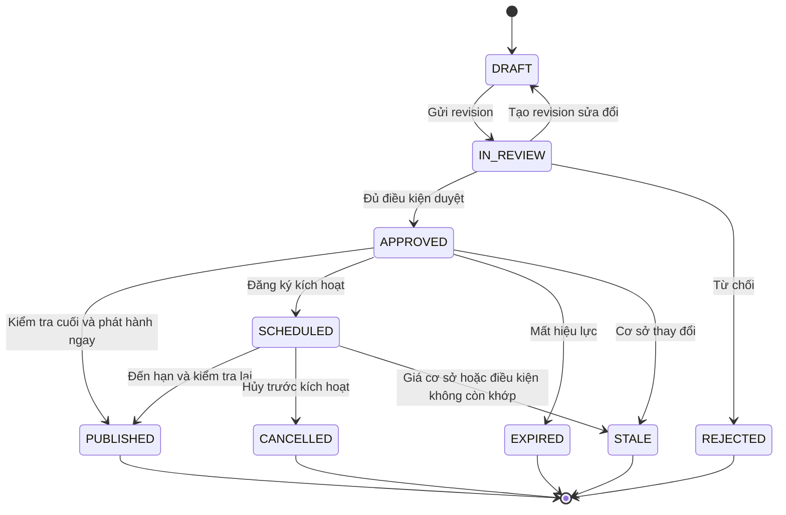

# Price change authorization — Phân quyền thay đổi giá

## 1. Thay đổi giá là một hành động nghiệp vụ có tác động tài chính

Trong chương **Pricing Rules**, phân quyền thay đổi giá bảo đảm rằng chỉ một chủ thể có quyền trên đúng đối tượng mới được đề xuất, phê duyệt và đưa một mức giá vào sử dụng. Đăng nhập thành công hoặc có quyền vào trang quản trị chưa đủ để được đổi mọi giá bán.

Một thay đổi có thể làm giảm doanh thu, tăng nghĩa vụ khách phải trả, phá vỡ cam kết báo giá hoặc tạo điều kiện cho người nội bộ mua hàng với giá tự đặt. Vì vậy, cơ chế bảo vệ cần kết hợp quyền theo đối tượng, bất biến giá, state machine, phiên bản dữ liệu, transaction và idempotency.

Bài học sử dụng mô hình có bảng giá, bản đề xuất và quy trình phê duyệt. Mỗi sản phẩm có thể cho phép một số thay đổi nhỏ được duyệt tự động theo policy. Điều đó vẫn là một quyết định được kiểm soát ở máy chủ, không phải quyền bỏ qua mọi kiểm tra.

## 2. Phân biệt những hành động dễ bị gộp vào quyền sửa giá

| Hành động | Đối tượng được thay đổi | Phạm vi ảnh hưởng |
| --- | --- | --- |
| Sửa giá danh mục | Giá của SKU trong bảng giá, kênh, tiền tệ và thời gian cụ thể | Các lần tính giá đủ điều kiện trong tương lai |
| Tạo giá theo hợp đồng | Giá dành cho khách hàng hoặc nhóm được chỉ định | Chỉ những chủ thể và điều kiện thuộc hợp đồng |
| Ghi đè giá một đơn | Một dòng hoặc một nghĩa vụ của đơn hàng | Một giao dịch cụ thể, có căn cứ và giới hạn riêng |
| Thay đổi khuyến mại | Quy tắc giảm, phạm vi áp dụng, cách cộng dồn | Giá hiệu dụng của nhiều đơn hoặc sản phẩm |
| Sửa báo giá đã phát hành | Snapshot cam kết đang chờ chấp thuận/thực thi | Có thể cần phát hành lại và xác nhận lại |
| Sửa sai sau thanh toán | Giao dịch đã tạo hiệu ứng tài chính | Cần nghiệp vụ điều chỉnh/hoàn tiền, không sửa lịch sử giá đơn thuần |

Quyền sửa giá danh mục không tự bao gồm quyền hoàn tiền hoặc sửa đơn đã chốt. Quyền tạo khuyến mại cũng không tự bao gồm quyền sửa giá sàn hoặc dữ liệu chi phí dùng để kiểm tra biên lợi nhuận.

Một người có thể có nhiều quyền, nhưng từng quyền phải được cấp rõ ràng theo hành động, đối tượng và điều kiện. Một cờ `canEditPrice = true` cho toàn hệ thống thường không mô tả đủ ranh giới cần bảo vệ.

## 3. Tình huống lạm dụng và bất biến cần giữ

### 3.1. Bỏ qua phê duyệt bằng cách sửa nội dung

Giả sử giá hiện tại của một sản phẩm là 1.000.000 VND. Nhân viên tạo đề xuất giảm xuống 950.000 VND và được duyệt. Sau đó người đó đổi payload thành 95.000 VND rồi gọi API phát hành.

Nếu hệ thống chỉ kiểm tra `approved = true`, mức giá thực thi không còn là mức giá đã được duyệt. Chữ ký của người duyệt trên một yêu cầu khác hoặc một revision cũ cũng không giải quyết được lỗi này.

Bất biến cần giữ:

```text
Nội dung được phát hành = nội dung của revision đã được duyệt hợp lệ.
Đối tượng và phạm vi được phát hành = phạm vi người duyệt được phép duyệt.
Không có thay đổi nội dung sau duyệt mà vẫn giữ nguyên hiệu lực phê duyệt cũ.
```

### 3.2. Vượt hạn mức bằng nhiều thay đổi nhỏ

Giả sử policy giới hạn tổng mức giảm của một chiến dịch là 5% so với giá cơ sở đã chốt. Nếu triển khai chỉ kiểm tra mỗi lần giảm không quá 5% so với giá ngay trước đó:

```text
Lần 1: 1.000.000 -> 950.000  : giảm 5%
Lần 2:   950.000 -> 902.500  : giảm 5% nữa
So với cơ sở 1.000.000: đã giảm 9,75%
```

Hai thao tác đều qua kiểm tra cục bộ nhưng vi phạm hạn mức của chiến dịch. Policy cần nói rõ giá cơ sở, phạm vi tích lũy và thời gian áp dụng; các lần thay đổi cùng phạm vi phải được điều phối để không vượt tổng mức cho phép.

Giới hạn theo từng lần thay đổi cũng có thể là chủ đích của một sản phẩm. Khi đó phải ghi rõ đây là giới hạn từng lần, thay vì tuyên bố nó bảo vệ một giới hạn tích lũy mà triển khai không kiểm tra.

### 3.3. Các bất biến bổ sung

- Người gọi có quyền trên đúng tenant, SKU, bảng giá, kênh và nhóm khách hàng.
- Mã tiền, đơn vị, kiểu giá và điều kiện áp dụng được xác minh từ dữ liệu có thẩm quyền.
- Giá hiệu dụng không vượt các giới hạn đã định nghĩa, gồm cả tác động của giảm giá và cộng dồn.
- Bản giá mới không âm, không tràn miền số và không trở thành miễn phí ngoài luồng được phép.
- Hai người phát hành đồng thời không được âm thầm ghi đè quyết định của nhau.
- Mỗi hành động phát hành chỉ có hiệu ứng theo số lần policy cho phép.
- Lịch sử đơn, báo giá và giao dịch đã chốt không bị viết lại bởi việc đổi giá hiện tại.

## 4. Mô hình quyền theo hành động, đối tượng và ngữ cảnh

### 4.1. Vai trò là điểm bắt đầu của quyết định

Một vai trò như `PRICING_EDITOR` có thể cho phép tạo đề xuất. Quyết định cụ thể còn cần xét:

```text
subject: danh tính, trạng thái tài khoản, vai trò và phạm vi được cấp
resource: tenant, bảng giá, SKU, danh mục, kênh, tiền tệ, nhóm khách
action: tạo, sửa nháp, gửi duyệt, duyệt, lên lịch, phát hành, hủy
context: thời điểm, mức thay đổi, trạng thái, policy và quan hệ với người tạo
```

Quyền phải được kiểm tra trên đối tượng máy chủ đã tra cứu. Không dùng `tenantId`, `role` hoặc `approvedBy` do client tự khai như bằng chứng quyền.

OWASP khuyến nghị mặc định từ chối khi không có quy tắc cho phép, cấp quyền tối thiểu và kiểm tra quyền trên mọi yêu cầu, kể cả yêu cầu truy cập đối tượng cụ thể. Các nguyên tắc này là nền tảng cho mô hình ở bài học. Xem [OWASP: Authorization](https://cheatsheetseries.owasp.org/cheatsheets/Authorization_Cheat_Sheet.html).

### 4.2. Ma trận quyền minh họa

| Hành động | Chủ thể và điều kiện ví dụ |
| --- | --- |
| Tạo/sửa bản nháp | Người biên tập được cấp đúng phạm vi SKU/bảng giá |
| Gửi duyệt | Chủ thể có quyền gửi, dữ liệu đủ và thỏa kiểm tra trước duyệt |
| Phê duyệt | Người có cấp duyệt phù hợp giá trị, phạm vi và độ rủi ro |
| Phát hành ngay | Dịch vụ hoặc người vận hành được cấp quyền, revision đã được duyệt |
| Lên lịch | Có quyền lập lịch, khoảng hiệu lực hợp lệ, nội dung đã duyệt |
| Hủy thay đổi chưa có hiệu lực | Có quyền hủy và trạng thái còn cho phép |
| Thay giá sàn hoặc quy tắc duyệt | Quyền quản trị policy riêng, không kế thừa mặc định từ quyền sửa giá |
| Đổi giá riêng một đơn | Quyền ngoại lệ theo đơn và mức chênh, không sửa toàn bộ danh mục |

Nếu policy yêu cầu tách người tạo và người duyệt, hệ thống phải kiểm tra điều đó bằng danh tính đáng tin. Một phiên đăng nhập khác của cùng người không tạo ra một người duyệt độc lập.

Đăng nhập lại hoặc xác thực tăng cường có thể nâng độ tin cậy của phiên, nhưng không tự cấp quyền trên sản phẩm hoặc hạn mức mà chủ thể chưa được cấp.

### 4.3. Kiểm tra mọi đường ghi

Trang quản trị, REST API, GraphQL mutation, import, batch, tác vụ đồng bộ ERP, consumer và công cụ hỗ trợ cần đi qua cùng cổng nghiệp vụ hoặc một cổng riêng có policy tương đương.

Ẩn nút và chặn URL ở giao diện không bảo vệ được API trực tiếp. Chỉ kiểm tra quyền ở controller cũng không đủ nếu job nền gọi repository để cập nhật giá mà bỏ qua cổng kiểm tra.

Tài khoản dịch vụ cần phạm vi rõ và lưu được nguồn yêu cầu. Việc request đến từ mạng nội bộ không chứng minh nó đã được người có quyền phê duyệt.

## 5. Xác định chính sách giá trước khi xác định người duyệt

### 5.1. Tập điều kiện của một thay đổi

| Nhóm | Điều kiện cần định nghĩa |
| --- | --- |
| Phạm vi | SKU, bảng giá, tenant, thị trường/kênh, nhóm khách và tiền tệ |
| Miền giá | Tối thiểu/tối đa, đơn vị, scale, quy tắc miễn phí và kiểu định giá |
| Mức thay đổi | Tăng/giảm tuyệt đối, tỷ lệ, giá cơ sở và giới hạn tích lũy |
| Giá hiệu dụng | Quan hệ với giảm giá, coupon, bậc số lượng, thuế/phí theo mô hình |
| Thời gian | Bắt đầu/kết thúc, thời gian chuẩn bị, xử lý khoảng trùng nhau |
| Phê duyệt | Số người, cấp duyệt, độc lập, hiệu lực và yêu cầu bằng chứng |
| Dữ liệu phụ thuộc | Giá sàn, chi phí, tỷ giá hoặc phiên bản chính sách có ảnh hưởng |
| Thực thi | Phát hành nguyên tử hay theo từng mục, quy tắc xung đột và replay |

Không mặc định mọi thay đổi giảm giá mới cần kiểm soát. Tăng giá ngoài phạm vi hoặc đổi cách bao gồm thuế/phí cũng có thể tạo nghĩa vụ không được phép.

### 5.2. Kiểm tra giá hiệu dụng thay vì chỉ giá niêm yết

Ví dụ giá niêm yết là 1.000.000, giảm theo chiến dịch 45%, sau đó áp thêm coupon 10% nếu được cộng dồn:

```text
1.000.000 × 0,55 × 0,90 = 495.000
```

Nếu giá sàn của phạm vi này là 600.000, chỉ kiểm tra giá niêm yết vẫn sẽ bỏ qua mức giá cuối thấp hơn sàn. Policy phải xác định những tổ hợp áp dụng và đại lượng dùng để so sánh.

Khi tổ hợp khuyến mại được quyết định ở checkout, hệ thống cần cả kiểm soát lúc phát hành quy tắc và kiểm soát giá cuối khi tạo nghĩa vụ thanh toán. Một lần duyệt giá danh mục không tự chứng minh mọi tổ hợp sau đó hợp lệ.

### 5.3. Bảo vệ các đầu vào của policy

Nếu người sửa giá đồng thời được tự hạ giá sàn, đổi chi phí hoặc sửa ngưỡng miễn duyệt, họ có thể làm cho thay đổi nguy hiểm trở thành “hợp lệ” về mặt kiểm tra.

Tách quyền quản lý những dữ kiện này theo mức rủi ro, lưu phiên bản và kiểm soát cả quan hệ phụ thuộc. Không lấy giá cơ sở hoặc ngưỡng cho phép từ một field ẩn trong biểu mẫu client.

Khi tính tỷ lệ thay đổi, xử lý rõ giá cơ sở bằng 0, đơn vị và tràn số. Không dùng `double` hoặc chia nguyên vô tình làm mất phần lẻ để quyết định đúng tại ranh giới hạn mức. Số tiền đã lượng tử hóa và quy tắc so sánh phải nhất quán.

## 6. Phê duyệt phải gắn với snapshot bất biến

### 6.1. Ba loại phiên bản cần phân biệt

Có thể dùng các định danh sau:

```text
binding_version: phiên bản liên kết đang chọn giá có hiệu lực
proposal_revision: phiên bản nội dung của đề xuất
price_revision_id: snapshot giá và điều kiện sẽ được đưa vào sử dụng
```

Đề xuất còn lưu `base_binding_version` và `base_price_revision_id`, tức trạng thái giá mà người tạo/người duyệt dùng làm cơ sở đánh giá thay đổi. Nếu cơ sở đó đổi trước lúc phát hành, cần kiểm tra lại theo policy thay vì tự coi mức chênh cũ vẫn đúng.

### 6.2. Nội dung phải nằm trong phạm vi được duyệt

Snapshot tối thiểu thường gồm:

```text
proposal_id, proposal_revision, price_revision_id
binding_id, tenant_id, SKU, bảng giá, kênh, nhóm khách
currency, amount_minor, price_type, unit_of_measure
quantity_tiers và điều kiện áp dụng nếu có
cách bao gồm thuế/phí và quan hệ với khuyến mại
base_binding_version, base_price_revision_id
effective_from, effective_until
reason_code, evidence_reference, pricing_policy_version
```

Phê duyệt tham chiếu đúng snapshot hoặc hash của một biểu diễn chuẩn hóa, kèm người duyệt, phạm vi, thời điểm và hạn dùng. Các field không làm thay đổi con số trực tiếp, như nhóm khách hay khoảng hiệu lực, vẫn có thể làm thay đổi tác động nghiệp vụ và phải nằm trong nội dung được duyệt.

Hash giúp nhận biết nội dung khác nhau; nó không tự chứng minh người duyệt có quyền. Snapshot, dấu kiểm chứng và bản ghi phê duyệt phải được bảo vệ khỏi sửa đồng thời một cách tùy tiện.

OWASP hướng dẫn bảo vệ dữ liệu đã được xác nhận, kiểm soát thứ tự bước và có cổng kiểm tra ủy quyền trước thực thi. Thiết kế gắn phê duyệt với revision cụ thể áp dụng những nguyên tắc đó cho thay đổi giá. Xem [OWASP: Transaction Authorization](https://cheatsheetseries.owasp.org/cheatsheets/Transaction_Authorization_Cheat_Sheet.html).

### 6.3. Sửa sau duyệt và thu hồi quyền

Thay đổi nội dung có ý nghĩa tạo revision mới và xử lý lại phê duyệt theo policy. Không sao chép nguyên cờ đã duyệt sang giá mới hoặc mở rộng phạm vi của bản cũ.

Trước khi phát hành, kiểm tra trạng thái tài khoản, quyền thực thi, hiệu lực phê duyệt và các hạn chế đang áp dụng theo chính sách thu hồi của hệ thống. Với lệnh đã lên lịch, điều này diễn ra lúc kích hoạt, không chỉ lúc tạo lịch.

Nếu quyền nằm ở một dịch vụ khác, cần định nghĩa độ trễ thu hồi và cách nhận biết phiên bản quyền/policy. Một lần gọi kiểm tra từ xa trước khi ghi không tự tạo ranh giới nguyên tử với commit cơ sở dữ liệu. Yêu cầu thu hồi chặt cần cơ chế điều phối hoặc fencing/epoch phù hợp tại điểm ghi; không tuyên bố kiểm tra “quyền hiện tại” mạnh hơn bảo đảm thực tế của kiến trúc.

## 7. State machine ngăn bỏ qua bước phê duyệt



Đây là state machine minh họa. Nếu thay đổi nhỏ được policy duyệt tự động, hệ thống vẫn tạo quyết định duyệt có căn cứ và chuyển trạng thái theo luồng được cho phép.

Không cho client đặt `status = PUBLISHED`. Cổng phát hành phải kiểm tra chuyển trạng thái, revision và quyền, kể cả khi gọi lại từ một worker đáng tin.

Nếu một đề xuất đã `PUBLISHED`, lịch sử đó không chuyển về `DRAFT` để chạy lại. Hoàn tác giá là một thay đổi mới có cơ sở, revision và quyền tương ứng; không xóa bằng chứng lần phát hành trước.

## 8. API phải giới hạn đúng trường được sửa

### 8.1. Tránh bind request trực tiếp vào entity giá

Nếu API tự động sao chép mọi field vào entity, người gọi có thể gửi thêm `approvedBy`, `status`, `tenantId`, `floorPrice` hoặc `policyVersion` dù giao diện không có ô tương ứng. Một endpoint chỉ được phép sửa giá nháp có thể vô tình trở thành endpoint đổi trạng thái và chính sách.

Dùng DTO riêng theo hành động và danh sách field được phép ghi. OWASP khuyến nghị DTO hoặc allow-list để hạn chế mass assignment, đồng thời nhấn mạnh rằng chúng không thay thế kiểm tra quyền trên đối tượng và thao tác. Xem [OWASP: Mass Assignment](https://cheatsheetseries.owasp.org/cheatsheets/Mass_Assignment_Cheat_Sheet.html).

Ví dụ Java cho đề xuất đổi giá của một binding đã có:

```java
record ProposePriceChangeCommand(
        long expectedBindingVersion,
        long proposedAmountMinor,
        Instant effectiveFrom,
        Instant effectiveUntil,
        String reasonCode,
        String evidenceReference) {}
```

Tenant, SKU, tiền tệ, đơn vị, người tạo và policy được lấy hoặc xác minh từ binding và ngữ cảnh máy chủ. Tạo binding mới hoặc đổi bản chất tiền tệ/đơn vị là thao tác riêng với quyền tương ứng.

DTO trên chỉ mô tả trường đầu vào. Tầng nghiệp vụ vẫn phải kiểm tra giới hạn số, định dạng, thời gian, căn cứ, quyền và bất biến. Với field không được hỗ trợ, có thể từ chối rõ ràng theo hợp đồng; không để nó vô tình tác động entity thông qua một lớp mapping khác.

### 8.2. Tách đề xuất, phê duyệt và phát hành

Ví dụ đề xuất:

```http
POST /price-bindings/pb-42/changes
Idempotency-Key: price-proposal-23c9
Content-Type: application/json
```

```json
{
  "expectedBindingVersion": 12,
  "proposedAmountMinor": 950000,
  "effectiveFrom": "2026-12-01T00:00:00Z",
  "effectiveUntil": "2026-12-08T00:00:00Z",
  "reasonCode": "APPROVED_CAMPAIGN",
  "evidenceReference": "campaign-81"
}
```

Các thời điểm chỉ minh họa định dạng và khoảng hiệu lực, không phải lịch triển khai thực tế. Giá trị minor unit phải được hiểu theo cấu hình của binding, không tự nhân 100 theo thói quen.

Lệnh phê duyệt và phát hành có thể chỉ tham chiếu revision:

```http
POST /price-changes/pc-79/approvals
Content-Type: application/json

{"expectedProposalRevision": 3}
```

```http
POST /price-changes/pc-79/publish
Idempotency-Key: price-publication-a491
Content-Type: application/json

{"expectedProposalRevision": 3}
```

Máy chủ tự tra cứu snapshot được duyệt; endpoint phát hành không nhận một `newPrice` khác để ghi đè. Người duyệt cần được hiển thị đúng snapshot và sự khác biệt so với cơ sở. Chỉ nhận `expectedProposalRevision` không tự chứng minh giao diện đã trình bày đúng nội dung.

Nếu thời gian hiệu lực chưa đến, lệnh phải đi theo chính sách lên lịch thay vì âm thầm kích hoạt ngay. Nếu revision không khớp, trả xung đột theo hợp đồng thay vì tự chọn revision mới nhất.

## 9. Phát hành nguyên tử và kiểm soát xung đột

### 9.1. Kiểm tra đúng rồi ghi không có bảo vệ vẫn có thể sai

Giả sử A và B đều lập đề xuất trên giá cơ sở phiên bản 12. A được duyệt giá 950.000 và B được duyệt 980.000. Nếu cả hai chỉ đọc version 12 rồi ghi sau đó, người ghi cuối có thể ghi đè quyết định kia mà không có lần đánh giá lại nào.

Tương tự, một phê duyệt có thể bị thu hồi hoặc revision bị sửa giữa bước kiểm tra và bước ghi nếu các trạng thái đó không được bảo vệ. Cần xác định dữ liệu nào phải được khóa hoặc kiểm tra bằng phiên bản tại cổng thực thi.

### 9.2. Một luồng transaction minh họa

Mã giả sau dành cho phát hành ngay một binding đã có giá. Các hàm mô tả trách nhiệm, không phải mã Java hoàn chỉnh:

```text
authenticate actor
validate command shape and access to the price-change object

BEGIN
  claim idempotency scope using a unique constraint
  compare normalized command fingerprint
  if publication result already exists:
      verify access to that result and return it after transaction ends

  coordinate relevant local policy/authorization epoch if required
  lock price binding
  lock proposal and the approval state used by this decision

  verify tenant and complete resource scope
  verify proposal revision, state and immutable snapshot
  verify base binding version and base price revision
  verify executor permission and effective approval policy
  verify approvers, approved payload, independence and expiry
  recheck current business restrictions and activation time
  verify amount, effective-price constraints and cumulative limits

  switch active revision using a guarded update
  record one publication with old/new versions
  mark this proposal revision PUBLISHED
  save command result and mandatory audit facts
  write PriceChanged into transactional outbox
COMMIT
return committed publication result
```

Thứ tự khóa phải thống nhất giữa phát hành, hủy, duyệt và các tác vụ liên quan. Nếu có nhiều binding hoặc bộ đếm tích lũy, khóa theo thứ tự ổn định và bao trùm đúng bất biến. Không giữ transaction dài chỉ để gọi các dịch vụ mạng không cần thiết.

Một kiểm tra hạn mức tích lũy bằng cách đọc tổng rồi ghi riêng vẫn có race condition. Cần hàng điều phối, cập nhật có điều kiện hoặc mức cô lập tương ứng với phạm vi đó. Tự thêm `@Transactional` chưa chọn được cơ chế bảo vệ các quyết định cạnh tranh.

### 9.3. Cập nhật có điều kiện theo phiên bản

Giả sử `price_binding` giữ `active_revision_id` và `version`. Sau các kiểm tra trong transaction, có thể chuyển giá hiện hành bằng:

```sql
UPDATE price_binding
SET active_revision_id = :approved_price_revision_id,
    version = version + 1
WHERE id = :server_binding_id
  AND tenant_id = :authenticated_tenant_id
  AND version = :expected_base_binding_version
  AND active_revision_id = :expected_base_price_revision_id
RETURNING active_revision_id, version;
```

Các tên `:...` là tham số bind. ID revision đã duyệt phải được máy chủ xác minh thuộc đúng binding và tenant. Câu lệnh này bảo vệ việc chuyển con trỏ giá, không thay thế kiểm tra quyền hoặc nội dung phê duyệt.

Với PostgreSQL `READ COMMITTED`, một `UPDATE` tranh chấp cùng hàng có thể chờ và đánh giá lại điều kiện trên phiên bản hàng đã cập nhật. Điều kiện version khiến lần ghi dựa trên cơ sở cũ không âm thầm thành công sau lần ghi trước. Xem [PostgreSQL 18: Read Committed](https://www.postgresql.org/docs/18/transaction-iso.html#XACT-READ-COMMITTED).

Kết quả cần được xử lý rõ:

- Một hàng: đã đổi binding trong transaction hiện tại; chỉ báo thành công khi các bản ghi liên quan và commit hoàn tất.
- Không có hàng: không còn đối tượng khớp đầy đủ điều kiện; kiểm tra và phân loại theo dữ liệu đã được phép truy cập, không tự ghi đè bằng version mới.
- Lỗi kỹ thuật hoặc mất kết nối quanh commit: rollback nếu còn có thể xác định, hoặc tra cứu kết quả bằng cùng danh tính lệnh khi kết quả chưa rõ.

Nếu giá cơ sở đã đổi, đánh dấu đề xuất cần đánh giá lại theo policy. Không retry bằng cách tự thay `expectedVersion` thành version mới nhất trong khi giữ nguyên kết luận phê duyệt dựa trên giá cũ.

Cần ràng buộc dữ liệu để revision không tham chiếu chéo tenant/binding và một hành động phát hành không có bản ghi trùng. Các ràng buộc cơ sở dữ liệu là lớp bảo vệ bổ sung; một foreign key hợp lệ không chứng minh người gọi có quyền phát hành.

## 10. Lên lịch, thay đổi hàng loạt và cache

### 10.1. Lên lịch không phải đã phát hành

Một thay đổi được duyệt hôm nay cho tuần sau có thể gặp giá cơ sở mới, chiến dịch bị hủy, quyền bị thu hồi hoặc policy đã thay đổi trước lúc kích hoạt. Worker cần kiểm tra lại đúng điều kiện đã định nghĩa.

Không ghi con trỏ giá hiện hành sang revision tương lai rồi để mọi consumer tự đoán thời điểm được dùng. Có thể lưu lịch và kích hoạt qua transaction, hoặc dùng mô hình tập khoảng hiệu lực đã phê duyệt với thuật toán chọn giá rõ ràng.

Nếu sử dụng khoảng `[effective_from, effective_until)`, định nghĩa quy tắc không trùng hoặc quy tắc ưu tiên cho cùng phạm vi giá. Dùng thời gian có thẩm quyền và quy ước thời điểm quyết định của hệ thống; thời gian client không được tự quyết định một giá còn hiệu lực hay không.

Bài toán chồng lặp nhiều khoảng thời gian cần cơ chế bảo vệ tương ứng, không được giải quyết chỉ bằng version của một hàng giá hiện tại. Khi worker kích hoạt muộn, xử lý theo chính sách chứ không âm thầm lùi thời điểm để giả định giá đã có hiệu lực trước đó.

### 10.2. Phê duyệt batch phải bao trùm đúng tập thay đổi

Một tệp import có thể chứa hàng nghìn dòng. Kiểm tra rằng người gọi có quyền import không chứng minh họ có quyền trên mọi dòng hoặc mọi mức giá.

Tạo manifest có phiên bản gồm tập binding, giá cũ/mới, version cơ sở, điều kiện thời gian và số lượng mục. Phê duyệt gắn với đúng manifest. Không cho sửa tệp sau duyệt rồi tiếp tục dùng mã batch cũ như bằng chứng.

Mỗi mục vẫn cần kiểm tra phạm vi, điều kiện giá và xung đột. Policy phải xác định toàn bộ batch cùng thành công hay cho phép từng mục thành công riêng. Nếu hỗ trợ kết quả từng phần, báo trạng thái từng mục và không tuyên bố toàn bộ đã phát hành khi còn dòng bị từ chối.

Khi retry, chỉ xử lý tiếp các hành động chưa hoàn tất theo danh tính ổn định. Không áp dụng lại tất cả dòng đã thành công hoặc chuyển một dòng lỗi sang chế độ bỏ phê duyệt để hoàn tất batch.

### 10.3. Cache không phải bằng chứng quyền hoặc phê duyệt

Khóa cache giá cần chứa đủ phạm vi như tenant, bảng giá, SKU, kênh, nhóm khách, tiền tệ và version phù hợp. Thiếu một chiều có thể làm giá dành cho nhóm này xuất hiện ở nhóm khác.

Phát sự kiện thay đổi qua outbox để chuyển tiếp sau commit. Consumer xử lý trùng và sự kiện đến sai thứ tự bằng version/quy tắc có chủ đích; sự kiện giá cũ không được ghi đè giá mới hơn.

Cache phục vụ hiển thị không tự quyết định giá có thẩm quyền khi chốt nghĩa vụ. Tầng chốt phải xác minh giá hoặc báo giá theo hợp đồng. Nếu sản phẩm cho giữ báo giá cũ còn hạn, có thể dùng đúng snapshot đó; không bắt buộc đổi mọi yêu cầu sang giá mới nhất một cách trái cam kết.

## 11. Bảo vệ giá tại checkout và trên đơn đã chốt

Khách hàng có thể gửi `skuId`, số lượng, coupon hoặc quote ID. Máy chủ cần tính hoặc xác minh giá từ nguồn đáng tin và quyền áp dụng các điều kiện. Một field `unitPrice` hoặc `priceVersion` do client gửi không tự cho phép chọn giá lịch sử thấp nhất.

Nếu hỗ trợ báo giá có cam kết, ràng buộc snapshot với đối tượng, số lượng/phạm vi, tiền tệ, thời gian và điều kiện dùng lại. Chọn dùng giá danh mục hiện tại hay snapshot báo giá là một quy tắc nghiệp vụ rõ ràng, không phải fallback tùy tiện khi kiểm tra version thất bại.

Với ghi đè giá riêng một đơn, lưu loại ngoại lệ, căn cứ, số tiền, người hưởng, người duyệt và ảnh hưởng lên tổng nghĩa vụ. Không dùng quyền này để cập nhật giá toàn bộ danh mục hoặc cho phép đơn khác thừa hưởng ngoại lệ.

Đơn đã thanh toán giữ số tiền và snapshot lịch sử. Giá danh mục thay đổi không được tự sửa số tiền đã thu, lịch sử hóa đơn hoặc quyền hoàn tiền. Nếu cần sửa sai sau chốt, dùng nghiệp vụ điều chỉnh có liên kết và quyền tương ứng.

## 12. Idempotency, hoàn tác và đường xử lý khẩn cấp

### 12.1. Phân biệt retry lệnh với thay đổi giá mới

Có thể lưu:

```text
scope = (tenant_id, actor_id, operation, idempotency_key)
command_fingerprint
proposal_id, proposal_revision
publication_id, previous_binding_version, resulting_binding_version
result_state, response_payload
```

Phạm vi key cần ràng buộc duy nhất. Cùng key và cùng lệnh tìm lại kết quả đã có; cùng key nhưng khác đề xuất hoặc revision phải bị từ chối xung đột.

Một ràng buộc nghiệp vụ trên hành động phát hành của đề xuất/revision chặn trường hợp người gọi đổi key. Không để một đề xuất đã phát hành có thể được phát hành lần nữa chỉ vì lần gọi thứ hai dùng key khác.

Replay của một lần phát hành cũ không được chuyển giá hiện tại trở lại giá đó. Kết quả cũ có thể nói lần phát hành đã thành công tại version 13, trong khi version hiện hành đã là 14. Trạng thái lịch sử “đã phát hành” và trạng thái hiện tại “đang được sử dụng” cần được phân biệt.

### 12.2. Hoàn tác bằng một quyết định mới

Muốn quay về một mức giá từng dùng, tạo thay đổi mới trên cơ sở hiện tại và kiểm tra quyền/chính sách. Nội dung giá có thể giống một revision cũ, nhưng quyết định đưa nó trở lại sử dụng diễn ra trong ngữ cảnh mới.

Không giảm `binding_version`, xóa sự kiện hoặc sửa giá cũ để giả như thay đổi chưa từng xảy ra. Giữ version tiến lên giúp phát hiện cả tình huống con trỏ quay về giá cũ nhưng đã có các lần phát hành xen giữa.

### 12.3. Xử lý khẩn cấp có phạm vi

Nếu sản phẩm cần quyền dừng một giá nguy hiểm hoặc thay thế khẩn cấp, định nghĩa hành động, phạm vi, thời hạn, căn cứ và kiểm toán riêng. Có thể yêu cầu rà soát sau xử lý theo policy.

Quyền khẩn cấp không nên đồng thời cho phép sửa/xóa lịch sử, tự đặt người duyệt và bỏ mọi giới hạn trên mọi tenant. Một tham số `force = true` không có phạm vi rõ sẽ tạo đường đi vòng qua cổng phân quyền.

## 13. Dấu vết kiểm toán phải giải thích được giá có hiệu lực

Một bản ghi phát hành cần truy được:

- Chủ thể đề xuất, người duyệt, người hoặc dịch vụ thực thi và phạm vi quyền.
- Binding, tenant, SKU, bảng giá, kênh, nhóm khách và mã tiền.
- Giá/điều kiện trước và sau, revision, version cơ sở và version kết quả.
- Snapshot được duyệt, policy, thời gian hiệu lực, lý do và bằng chứng.
- Idempotency scope, publication ID, sự kiện phát ra và kết quả từng mục nếu là batch.

Giới hạn quyền sửa/xóa dữ kiện đã chốt, tách dữ liệu nhạy cảm như giá vốn/bằng chứng thương mại theo quyền truy cập và theo dõi cả việc xuất dữ liệu. Không ghi token hoặc bí mật xác thực vào log.

Có thể theo dõi các dấu hiệu như thay đổi liên tiếp sát ngưỡng, tỷ lệ giảm tích lũy bất thường, người tạo luôn dùng cùng người duyệt, nhiều đề xuất bị `STALE`, thử thêm field trạng thái hoặc phát hành ngoài phạm vi. Tín hiệu cần được xem trong ngữ cảnh nghiệp vụ, không tự kết luận lạm dụng chỉ vì có nhiều thay đổi.

Dữ kiện kiểm toán bắt buộc và ý định phát sự kiện phải được ghi bền vững cùng quyết định phát hành. Một log văn bản có thể mất hoặc bị tắt không thay thế lịch sử phát hành có thẩm quyền.

## 14. Kiểm thử các tình huống tấn công logic

### 14.1. Quyền và field đầu vào

| Tình huống | Kết quả cần xác minh |
| --- | --- |
| Người thường gọi trực tiếp API sửa giá | Không tạo thay đổi ngoài quyền |
| Editor của tenant A dùng binding tenant B | Bị từ chối, không thay dữ liệu hoặc lộ snapshot không có quyền |
| Có quyền một danh mục nhưng sửa SKU ngoài danh mục | Quyền đối tượng được kiểm tra và từ chối |
| Gửi thêm `approvedBy`, `status`, `floorPrice` hoặc policy | Không thay field được bảo vệ |
| Người tạo tự duyệt khi policy yêu cầu độc lập | Không đủ phê duyệt |
| Người duyệt vượt cấp giá trị hoặc sai kênh/nhóm khách | Phê duyệt không có hiệu lực cho đề xuất đó |
| Gọi publish từ `DRAFT` hoặc `IN_REVIEW` | Không tạo publication và không đổi binding |
| Đổi giá, nhóm khách hoặc thời gian sau duyệt | Revision cũ không cho phép thực thi nội dung mới |

Kiểm tra cả API quản trị, import, batch và consumer. Một đường ghi bỏ sót kiểm tra vẫn có thể phá toàn bộ bất biến dù giao diện chính đã đúng.

### 14.2. Điều kiện giá và phạm vi tích lũy

- Thay đổi đúng bằng ranh giới hạn mức và vượt một đơn vị nhỏ nhất.
- Hai mức giảm liên tiếp đều nhỏ nhưng vượt tổng giảm của cùng chiến dịch.
- Tổ hợp giá và khuyến mại làm giá hiệu dụng thấp hơn sàn.
- Mức tăng vượt giới hạn, không chỉ mức giảm.
- Giá âm, bằng 0 ngoài luồng miễn phí, sai đơn vị hoặc vượt miền số.
- Giá cơ sở bằng 0 khi kiểm tra phần trăm.
- Sửa dữ liệu chi phí/giá sàn để làm thay đổi điều kiện được duyệt.
- Đổi tiền tệ hoặc cách bao gồm thuế/phí mà giữ nguyên con số.

Mỗi tình huống cần kiểm tra dữ liệu sau xử lý, không chỉ chuỗi lỗi hoặc màu nút.

### 14.3. Đồng thời, lịch và retry

Cho hai đề xuất cùng cơ sở version 12 được duyệt, rồi phát hành bằng hai transaction/kết nối độc lập. Kỳ vọng chỉ một quyết định có thể chuyển binding từ version 12 theo mô hình ở bài học; quyết định còn lại không tự rebase để ghi đè.

Bổ sung các tình huống:

- Một luồng hủy hoặc thu hồi phê duyệt trong khi luồng khác phát hành: kết quả phải tuân thủ thứ tự quyết định được hệ thống bảo đảm.
- Cùng key gửi đồng thời: không có hai lần phát hành.
- Key khác nhưng cùng hành động đã hoàn tất: không phát hành lại.
- Mất phản hồi sau commit: tra cứu/replay tìm kết quả, không đổi giá lần nữa.
- Lỗi khi ghi audit, trạng thái hoặc outbox: không để lại quyết định nội bộ đã commit một phần.
- Worker kích hoạt lặp, muộn hoặc sau khi cơ sở đã đổi: xử lý đúng policy và trạng thái.
- Batch bị sửa sau duyệt hoặc retry sau thành công một phần: không mở rộng phạm vi duyệt hay lặp dòng đã hoàn tất.
- Sự kiện cache cũ đến sau sự kiện mới: không làm giá quay lùi.

Các ca tranh chấp cần barrier hoặc điểm đồng bộ và cơ sở dữ liệu mục tiêu; không chỉ thêm `sleep` vào một repository giả lập rồi coi là đã kiểm tra được transaction.

### 14.4. Bất biến sau trạng thái đã commit

```text
Mọi publication có phê duyệt/policy hợp lệ cho đúng snapshot.
Giá hiện hành thuộc đúng binding, tenant và phạm vi.
Version phát hành không bị giảm hoặc mất cập nhật.
Không có một hành động phát hành được áp dụng hai lần.
Mọi thay đổi đã có hiệu lực truy được dữ kiện trước/sau và chủ thể quyết định.
Đơn đã chốt không bị viết lại bởi thay đổi giá danh mục.
Giá cuối được dùng tại checkout thỏa hợp đồng giá/quote được phép.
```

## 15. Tiêu chí để cơ chế phân quyền giá có thể vận hành

Một thiết kế đầy đủ cần chỉ ra rõ người nào được làm hành động nào trên phạm vi nào; snapshot nào đã được duyệt; điều kiện nào được kiểm tra lại lúc phát hành; và cách xử lý khi cơ sở, quyền hoặc chính sách đã đổi.

Cơ chế đó phải hiện diện trong cổng nghiệp vụ, state machine, dữ liệu có phiên bản, transaction và kiểm thử tình huống lạm dụng. Khi ấy, thay đổi giá trở thành một quyết định có thẩm quyền và có thể truy nguyên, thay vì một phép gán giá trị được bảo vệ chỉ bởi trang quản trị.
