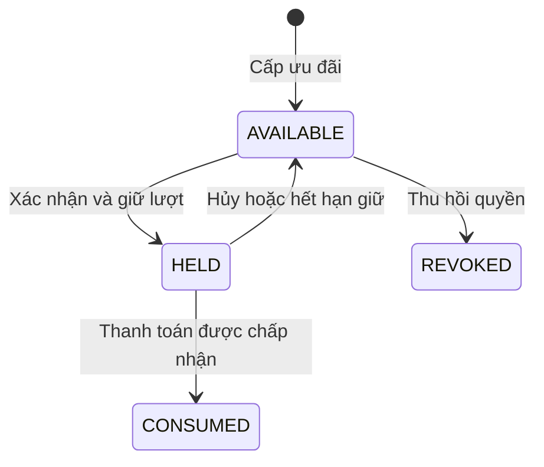

# Discount eligibility — Bảo vệ điều kiện được hưởng giảm giá

## 1. Điều kiện được hưởng giảm giá là một quy tắc nghiệp vụ

Một mã giảm giá tồn tại và còn hạn không có nghĩa mọi người dùng đều được áp dụng mã đó. Hệ thống còn phải xác định người mua, nội dung đơn hàng và thời điểm thực hiện có thỏa chính sách hay không.

**Discount eligibility** là quyết định một chủ thể có được hưởng một ưu đãi cụ thể đối với một đơn hàng cụ thể, trong một bối cảnh nghiệp vụ cụ thể hay không. Quyết định này cần được thực thi ở máy chủ, tại nơi chuyển giỏ hàng thành cam kết như đơn hàng đã xác nhận hoặc quyền giữ ưu đãi.

Trong bảo mật logic nghiệp vụ, một yêu cầu có thể hoàn toàn hợp lệ về cấu trúc, được gửi bởi tài khoản đã đăng nhập, nhưng vẫn vi phạm chính sách giảm giá. Ví dụ:

- Tài khoản lâu năm gửi trực tiếp mã chỉ dành cho khách mua lần đầu.
- Người mua giữ kết quả kiểm tra ưu đãi rồi đổi địa chỉ sang khu vực không được hỗ trợ.
- Giỏ hàng có một sản phẩm thuộc chương trình, nhưng máy chủ giảm giá trên toàn bộ sản phẩm.
- Hai yêu cầu đồng thời cùng sử dụng lượt ưu đãi cuối cùng của một khách hàng.
- Người dùng đưa coupon cá nhân của tài khoản khác vào đơn hàng của mình.

Mục tiêu của bài học là biến điều kiện quảng cáo thành quy tắc có thể kiểm tra, chỉ rõ nguồn dữ liệu đáng tin cậy và đặt quyết định vào đúng giao dịch. Nội dung tập trung vào **quyền hưởng ưu đãi**; công thức tính tiền chỉ xuất hiện khi cần chứng minh hệ thống không áp dụng ưu đãi vượt phạm vi được phép.

## 2. Phân biệt điều kiện, số tiền và quyền sử dụng

Ba câu hỏi sau liên quan chặt chẽ nhưng không thay thế nhau:

| Câu hỏi | Ví dụ | Sai lầm thường gặp |
| --- | --- | --- |
| Có đủ điều kiện không? | Khách thuộc nhóm được mời, giỏ đạt ngưỡng, mã còn hiệu lực | Chỉ kiểm tra mã có tồn tại |
| Được giảm trên phần nào và bao nhiêu? | Giảm 10% trên các dòng hàng được phép, tối đa 100.000 VND | Giảm trên cả hàng bị loại trừ |
| Có thể giữ hoặc tiêu thụ quyền ưu đãi ngay lúc này không? | Chương trình còn ngân sách và khách còn lượt | Dùng kết quả kiểm tra trước đó để bỏ qua cập nhật đồng thời |

Một quyết định đủ điều kiện không tự tạo ra quyền sử dụng vĩnh viễn. Kết quả trả về khi người dùng xem giỏ hàng thường chỉ là **báo giá tạm thời**. Khi xác nhận đơn, máy chủ cần đánh giá lại và giữ hoặc tiêu thụ quyền ưu đãi theo chính sách.

Tương tự, biết mã coupon không đồng nghĩa sở hữu quyền sử dụng coupon. Với ưu đãi được cấp riêng, máy chủ phải kiểm tra quan hệ giữa coupon, tài khoản nhận ưu đãi và chủ đơn hàng.

## 3. Chuyển chính sách thành các bất biến

Xét chương trình minh họa `WELCOME10` với các quy tắc được định nghĩa rõ như sau. Các con số này là chính sách ví dụ, không phải mặc định cho mọi hệ thống.

| Thành phần | Chính sách minh họa |
| --- | --- |
| Đối tượng | Tài khoản đã đăng nhập và đã xác minh; ưu đãi được cấp riêng cho tài khoản đó |
| Khách mua lần đầu | Chưa từng có đơn đạt trạng thái `PAID`; hoàn tiền sau đó không khôi phục quyền khách mới |
| Phạm vi | Đơn hàng thuộc cùng cửa hàng và tenant với chương trình; giao đến Việt Nam |
| Thời gian | `startsAt <= now < endsAt`, lấy thời gian từ máy chủ |
| Hàng được tính | Sản phẩm do chương trình cho phép; loại trừ thẻ quà tặng và các dòng hàng ngoài phạm vi |
| Ngưỡng | Tổng tiền các dòng hợp lệ sau ưu đãi cấp sản phẩm, trước ưu đãi cấp đơn, chưa gồm thuế và vận chuyển, ít nhất 500.000 VND |
| Số tiền giảm | 10% cơ sở hợp lệ, tối đa 100.000 VND, không vượt cơ sở hợp lệ |
| Kết hợp | Không kết hợp với ưu đãi cấp đơn khác; ưu đãi cấp sản phẩm vẫn được phép như định nghĩa ngưỡng ở trên |
| Giới hạn | Tối đa một quyền ưu đãi đang giữ hoặc đã tiêu thụ trên mỗi tài khoản trong chương trình |
| Hủy và hoàn tiền | Hủy trước khi thanh toán giải phóng quyền giữ; sau thanh toán, hoàn tiền không cấp lại lượt |

Từ bảng chính sách, có thể viết bất biến:

```text
Đơn được xác nhận có WELCOME10
  => người thực hiện có quyền thao tác trên đơn
  AND chủ đơn là người nhận ưu đãi
  AND chương trình đang hoạt động và đúng phạm vi
  AND chủ đơn chưa từng đạt mốc PAID
  AND giỏ hàng hiện tại đạt ngưỡng theo cơ sở tiền được định nghĩa
  AND không có ưu đãi cấp đơn xung đột
  AND quyền ưu đãi được giữ hoặc tiêu thụ thành công trong giao dịch
  AND tiền giảm chỉ phân bổ cho các dòng hợp lệ
```

Đối với quyền sử dụng, bất biến quan trọng hơn một biến đếm hiển thị:

```text
Số quyền HELD còn hiệu lực + số quyền CONSUMED của cùng tài khoản/chương trình <= 1
```

Một quyền đang giữ không được trở thành quyền tiêu thụ sau khi đã hết hạn. Khi xác nhận thanh toán, hệ thống phải kiểm tra trạng thái và thời hạn của quyền giữ một cách nguyên tử.

Nếu chương trình có giới hạn ngân sách hoặc số lượt toàn cục, các giới hạn đó cũng cần bất biến riêng và cơ chế giữ tài nguyên tương ứng. Việc đáp ứng giới hạn từng tài khoản không chứng minh ngân sách toàn cục vẫn còn.

### 3.1. Định nghĩa chính xác “khách mới”

“Khách mới” có thể nghĩa là tài khoản mới đăng ký, chưa từng thanh toán thành công, chưa từng nhận hàng hoặc chưa từng dùng một nhóm ưu đãi. Những định nghĩa này cho kết quả khác nhau.

Với chính sách ví dụ, cần một dấu mốc đơn điệu như `firstPaidAt`: một khi tài khoản đã có đơn đạt `PAID`, việc hoàn tiền không xóa lịch sử đó. Đếm các đơn *hiện đang ở trạng thái* `PAID` sẽ sai nếu sau này chúng chuyển sang `REFUNDED`.

Giới hạn theo tài khoản cũng chỉ bảo vệ ở cấp tài khoản. Nếu doanh nghiệp muốn giới hạn theo người, hộ gia đình hoặc phương thức thanh toán, cần mô hình nhận diện và chính sách riêng. Không được xem hai tài khoản khác nhau là bằng chứng chắc chắn về hai con người khác nhau; cũng không được dùng địa chỉ IP chung làm bằng chứng chắc chắn về cùng một người.

### 3.2. Định nghĩa chính xác cơ sở tiền

Giả sử giỏ hàng có:

| Dòng hàng | Số tiền sau ưu đãi cấp sản phẩm | Được tính cho WELCOME10? |
| --- | ---: | --- |
| Sản phẩm A | 300.000 VND | Có |
| Thẻ quà tặng | 300.000 VND | Không |
| Phí vận chuyển | 30.000 VND | Không |

Tổng khách phải trả trước coupon có thể là 630.000 VND, nhưng cơ sở xét ngưỡng chỉ là 300.000 VND. Đơn này không đạt ngưỡng 500.000 VND.

Máy chủ cần dùng cùng một định nghĩa cơ sở tiền khi xét điều kiện và tính giảm giá. Nếu hai bước dùng hai cách lọc dòng hàng khác nhau, đơn có thể vượt ngưỡng nhờ hàng bị loại trừ hoặc được giảm trên phần không được phép.

## 4. Ranh giới tin cậy và quyền theo đối tượng

Client có thể cung cấp ý định như mã ưu đãi muốn dùng, số lượng cần mua hoặc địa chỉ giao hàng đã chọn. Client không có quyền khẳng định kết luận như `isFirstOrder`, `eligible`, `discountAmount` hoặc `remainingUses`.

| Dữ liệu | Nguồn dùng để quyết định | Điều cần kiểm tra |
| --- | --- | --- |
| Danh tính người thực hiện | Ngữ cảnh xác thực phía máy chủ | Phiên hợp lệ; hành động được cho phép |
| Chủ đơn và tenant | Bản ghi đơn hàng do máy chủ tải | Người thực hiện có quyền với đúng đối tượng |
| Người nhận coupon | Bản ghi cấp ưu đãi hoặc danh sách đối tượng phía máy chủ | Khớp chủ thể mà chính sách yêu cầu |
| Lịch sử thanh toán | Dữ liệu nghiệp vụ có cơ chế nhất quán phù hợp | Không suy từ cờ client hoặc bộ nhớ đệm chậm cập nhật |
| Giá và phạm vi hàng hóa | Bộ định giá, catalog và cấu hình chương trình | Đúng cửa hàng, tiền tệ, phiên bản giá và dòng hàng |
| Điểm đến | Địa chỉ của đơn được tải và xác thực | Có quyền chọn địa chỉ; khu vực thuộc chương trình |
| Thời điểm | Đồng hồ phía máy chủ | Cùng quy ước thời gian và biên bắt đầu/kết thúc |
| Lượt còn lại và ngân sách | Sổ quyền sử dụng hoặc bộ đếm cập nhật nguyên tử | Đã tính cả quyền đang giữ theo chính sách |

Địa chỉ và số lượng vẫn có thể bắt nguồn từ người dùng. Điểm khác biệt là máy chủ lưu, kiểm tra quyền, xác thực và sử dụng phiên bản hiện tại của chúng trong quyết định. “Dữ liệu do máy chủ tải” không có nghĩa mọi giá trị trong đó đều đáng tin mà không cần kiểm tra.

### Ví dụ yêu cầu xác nhận

```http
POST /orders/order-123/confirm
Idempotency-Key: checkout-attempt-456
Content-Type: application/json

{
  "promotionCode": "WELCOME10",
  "expectedOrderVersion": 12
}
```

Máy chủ lấy người thực hiện từ phiên xác thực, tải `order-123`, kiểm tra quyền trên đơn rồi mới đánh giá ưu đãi. Không dùng `customerId` do client gửi để chọn tài khoản được hưởng. Nếu API cho phép gửi trường tiền giảm, máy chủ cần từ chối hoặc bỏ qua trường đó theo hợp đồng API và tự tính lại.

Đăng nhập là điều kiện cần cho ví dụ này nhưng chưa đủ. Tài khoản A không được xác nhận đơn của B chỉ vì đoán được mã đơn hoặc có mã giảm giá hợp lệ. Trong mô hình đại diện, nhân viên hoặc tài khoản doanh nghiệp có thể thao tác thay người mua; chính sách phải nêu rõ quyền của người thực hiện và ưu đãi thuộc về chủ thể nào.

## 5. Tách báo giá khỏi cam kết ưu đãi

Luồng xử lý hữu ích gồm hai giai đoạn:

1. **Xem trước:** kiểm tra điều kiện trên giỏ hiện tại và trả báo giá. Giai đoạn này chưa đảm bảo còn lượt khi khách xác nhận, trừ khi hệ thống tạo quyền giữ thật.
2. **Cam kết:** đọc lại dữ liệu có thẩm quyền, kiểm tra điều kiện và giữ hoặc tiêu thụ quyền trong giao dịch xác nhận.

```mermaid
sequenceDiagram
    participant U as Người mua
    participant A as Checkout API
    participant D as Cơ sở dữ liệu
    U->>A: Xem giá với mã ưu đãi
    A->>D: Đọc đơn, chương trình, lịch sử
    A-->>U: Báo giá tạm thời + phiên bản đơn
    U->>A: Xác nhận đơn + phiên bản + idempotency key
    A->>D: Bắt đầu giao dịch; khóa dữ liệu liên quan
    A->>D: Kiểm tra quyền, điều kiện và giữ lượt
    A->>D: Lưu giá cuối, phiên bản chính sách, đơn và kết quả
    A->>D: Commit
    A-->>U: Kết quả xác nhận từ dữ liệu đã commit
```

Nếu có thay đổi ảnh hưởng giá hoặc điều kiện, API nên trả lại báo giá mới để khách xác nhận theo hợp đồng sản phẩm. Không âm thầm thu số tiền cao hơn báo giá mà khách đã chấp nhận.

### 5.1. Những thay đổi phải làm mất hiệu lực kết quả cũ

- Thêm, xóa hoặc đổi số lượng sản phẩm.
- Đổi biến thể sản phẩm, người bán, cửa hàng hoặc tenant.
- Đổi địa chỉ, quốc gia giao hàng hoặc phương thức vận chuyển nếu chính sách phụ thuộc vào chúng.
- Thêm ưu đãi khác hoặc thay đổi điểm thưởng được dùng.
- Thay đổi giá, tiền tệ, trạng thái chương trình hoặc nhóm khách hàng.
- Phát sinh một đơn thanh toán khác khiến người mua mất trạng thái khách mới.
- Quyền giữ hết hạn, lượt còn lại thay đổi hoặc chương trình hết ngân sách.

Phiên bản đơn giúp phát hiện giỏ hàng đã đổi, nhưng không phát hiện mọi thay đổi bên ngoài đơn. Phiên bản chương trình, lịch sử khách hàng và trạng thái quyền giữ cũng cần được kiểm tra tại thời điểm cam kết.

### 5.2. Token báo giá có chữ ký bảo vệ được điều gì?

Token có chữ ký có thể bảo vệ nội dung báo giá khỏi bị sửa. Nếu sử dụng, token cần gắn với chủ đơn, tenant, đơn hàng, phiên bản đơn, tiền tệ, phiên bản chương trình và thời điểm hết hạn.

Chữ ký không chứng minh điều kiện hiện tại còn đúng. Token không tự ngăn khách đã dùng ưu đãi ở đơn khác, không giữ ngân sách và không ngăn phát lại. Máy chủ vẫn phải kiểm tra trạng thái hiện tại hoặc kiểm tra một quyền giữ hợp lệ được token tham chiếu.

## 6. Ví dụ Java: quyết định điều kiện trên dữ liệu đã chuẩn hóa

Ví dụ dưới đây biểu diễn phần quyết định thuần, dùng kiểu `record` có trong Java 17. Nó giả định lớp ứng dụng đã kiểm tra quyền trên đơn và tạo snapshot từ dữ liệu phía máy chủ. Đây không phải DTO nhận trực tiếp từ HTTP.

`eligibleBaseAfterItemDiscounts` là số tiền sau ưu đãi cấp sản phẩm của các dòng được phép, chưa gồm thuế và vận chuyển. Ví dụ chỉ xử lý VND với quy tắc làm tròn về số nguyên đồng bằng `HALF_UP`; hệ thống đa tiền tệ cần quy tắc đơn vị tiền và làm tròn riêng.

```java
import java.math.BigDecimal;
import java.math.RoundingMode;
import java.time.Instant;
import java.util.Objects;

public final class WelcomeEligibility {
    private static final BigDecimal MIN_BASE = new BigDecimal("500000");
    private static final BigDecimal RATE = new BigDecimal("0.10");
    private static final BigDecimal MAX_DISCOUNT = new BigDecimal("100000");

    public enum Reason {
        ELIGIBLE,
        INVALID_CONTEXT,
        OUT_OF_SCOPE,
        UNAVAILABLE,
        CUSTOMER_NOT_VERIFIED,
        NOT_ASSIGNED,
        NOT_FIRST_PURCHASE,
        DESTINATION_NOT_SUPPORTED,
        BELOW_MINIMUM,
        CONFLICTING_PROMOTION
    }

    public record Context(
        String customerId,
        String orderTenantId,
        String orderStoreId,
        boolean customerVerified,
        boolean assignedToCustomer,
        boolean everPaid,
        String destinationCountry,
        String currency,
        BigDecimal eligibleBaseAfterItemDiscounts,
        boolean hasOtherOrderPromotion
    ) {}

    public record Campaign(
        String id,
        long version,
        String tenantId,
        String storeId,
        boolean active,
        Instant startsAt,
        Instant endsAt
    ) {}

    public record Decision(Reason reason, BigDecimal discount) {
        public boolean eligible() {
            return reason == Reason.ELIGIBLE;
        }
    }

    public static Decision evaluate(
        Context context, Campaign campaign, Instant now
    ) {
        Objects.requireNonNull(context);
        Objects.requireNonNull(campaign);
        Objects.requireNonNull(now);
        Objects.requireNonNull(campaign.startsAt());
        Objects.requireNonNull(campaign.endsAt());

        if (!campaign.startsAt().isBefore(campaign.endsAt())) {
            throw new IllegalArgumentException("Invalid campaign interval");
        }

        BigDecimal base = context.eligibleBaseAfterItemDiscounts();
        if (context.customerId() == null
                || context.customerId().isBlank()
                || context.orderTenantId() == null
                || context.orderStoreId() == null
                || base == null
                || base.signum() < 0) {
            return reject(Reason.INVALID_CONTEXT);
        }

        if (!context.orderTenantId().equals(campaign.tenantId())
                || !context.orderStoreId().equals(campaign.storeId())
                || !"VND".equals(context.currency())) {
            return reject(Reason.OUT_OF_SCOPE);
        }

        if (!campaign.active()
                || now.isBefore(campaign.startsAt())
                || !now.isBefore(campaign.endsAt())) {
            return reject(Reason.UNAVAILABLE);
        }
        if (!context.customerVerified()) {
            return reject(Reason.CUSTOMER_NOT_VERIFIED);
        }
        if (!context.assignedToCustomer()) {
            return reject(Reason.NOT_ASSIGNED);
        }
        if (context.everPaid()) {
            return reject(Reason.NOT_FIRST_PURCHASE);
        }
        if (!"VN".equals(context.destinationCountry())) {
            return reject(Reason.DESTINATION_NOT_SUPPORTED);
        }
        if (base.compareTo(MIN_BASE) < 0) {
            return reject(Reason.BELOW_MINIMUM);
        }
        if (context.hasOtherOrderPromotion()) {
            return reject(Reason.CONFLICTING_PROMOTION);
        }

        BigDecimal discount = base.multiply(RATE)
            .min(MAX_DISCOUNT)
            .min(base)
            .setScale(0, RoundingMode.HALF_UP);

        return new Decision(Reason.ELIGIBLE, discount);
    }

    private static Decision reject(Reason reason) {
        return new Decision(reason, BigDecimal.ZERO);
    }
}
```

Với cơ sở hợp lệ 500.000 VND, quyết định trả số tiền giảm 50.000 VND. Với cơ sở 1.500.000 VND, số tiền giảm bị chặn ở 100.000 VND. Cơ sở 499.999 VND không đủ điều kiện dù tổng tiền cả phí vận chuyển lớn hơn 500.000 VND.

Hàm này **chưa** kiểm tra nguyên tử lượt dùng, ngân sách hoặc quyền giữ. Nó cũng không tự chứng minh `everPaid` hay `assignedToCustomer` được đọc từ nguồn đúng. Sự an toàn phụ thuộc vào cách lớp ứng dụng tạo context và đặt quyết định vào giao dịch.

Không dùng `double` để biểu diễn tiền trong luồng này. Với `BigDecimal`, nên tạo hằng tiền từ chuỗi và so sánh giá trị bằng `compareTo`. Với mô hình tiền là số nguyên đơn vị nhỏ nhất, cần kiểm tra tràn số khi cộng, nhân và chuyển đổi.

## 7. Đưa điều kiện vào giao dịch và state machine

### 7.1. Vì sao “kiểm tra rồi cập nhật” có thể sai?

Hai request có thể cùng đọc rằng khách chưa dùng ưu đãi:

```text
Request A: đọc used = 0
Request B: đọc used = 0
Request A: xác nhận đơn A với giảm giá
Request B: xác nhận đơn B với giảm giá
```

Mỗi request riêng lẻ đều vượt qua điều kiện, nhưng kết quả tổng thể vi phạm giới hạn một lượt. Đặt cả hai thao tác trong transaction vẫn có thể chưa đủ nếu chúng chỉ đọc dữ liệu mà không có khóa, ràng buộc hoặc cơ chế xử lý xung đột phù hợp.

### 7.2. Một mô hình quyền ưu đãi cụ thể

Với chương trình ví dụ, có thể dùng một bản ghi entitlement cho mỗi bộ `(tenant_id, campaign_id, customer_id)`, được bảo vệ bởi ràng buộc duy nhất ở cơ sở dữ liệu. Bản ghi tồn tại ổn định, được khóa khi thay đổi và có trạng thái:



`AVAILABLE` chỉ nói quyền chưa bị giữ hoặc tiêu thụ; nó không đảm bảo chương trình còn hạn hoặc tài khoản vẫn đủ điều kiện. Những điều kiện đó vẫn được đánh giá khi chuyển sang `HELD`.

Một bản ghi đang giữ cần tối thiểu `held_order_id`, `hold_expires_at` và số thế hệ hoặc phiên bản giữ. Khi một lượt giữ cũ hết hạn rồi được giữ lại cho đơn khác, callback cũ không được tiêu thụ lượt giữ mới. Vì vậy thao tác tiêu thụ phải khớp đúng đơn, đúng thế hệ giữ, đúng trạng thái và thời hạn.

Nếu chương trình cho phép nhiều lượt, có thể cần nhiều bản ghi quyền hoặc bộ đếm cập nhật có điều kiện. Không áp dụng ràng buộc “một bản ghi bằng một lượt vĩnh viễn” cho mọi chiến dịch.

### 7.3. Khung giao dịch xác nhận

Đoạn sau là **pseudocode**, nhằm thể hiện thứ tự và trách nhiệm. Nó không tương ứng với API thư viện hay một framework cụ thể.

```text
confirmOrder(actor, orderId, expectedVersion, code, idempotencyKey):
    begin transaction

    load order in actor's tenant
    authorize actor to confirm this order

    claim idempotency record scoped to actor + tenant + operation
    bind key to a fingerprint of this confirmation intent
    if completed with same fingerprint:
        return persisted result
    if same key has a different fingerprint:
        reject conflicting reuse

    lock stable customer checkout guard, then order, in a fixed lock order
    verify order state and expectedVersion
    load campaign using code within the order's tenant and store
    load and lock the entitlement for order.customerId + campaign
    load current pricing, assignment, destination and first-paid history
    evaluate eligibility using server time
    reject if the decision is not eligible

    if an old hold is expired:
        expire it with a conditional state transition
        invalidate its order's ability to use that hold
    claim an AVAILABLE entitlement as HELD for this order and generation
    reject if the conditional claim did not succeed
    reserve campaign budget atomically if this campaign has a budget

    persist final price and discount allocation per eligible line
    persist campaign version, eligible base and entitlement reference
    transition order to the allowed confirmed state
    persist the idempotent result
    commit transaction
    return the persisted result
```

Các đường chạy khác cùng thay đổi lịch sử khách hàng, quyền ưu đãi hoặc trạng thái đơn phải tuân theo giao thức khóa và chuyển trạng thái tương ứng. Một khóa chỉ có tác dụng với các thao tác thực sự cùng tranh chấp trên dữ liệu được khóa.

Riêng điều kiện khách mua lần đầu, khóa bản ghi entitlement chỉ ngăn hai lần dùng cùng chương trình. Nó không tự ngăn một đơn khác không dùng chương trình chuyển sang `PAID`. Cần một điểm điều phối chung, chẳng hạn bản ghi guard của khách hàng, cho những bước thay đổi mốc thanh toán và bước cam kết quyền ưu đãi; hoặc chọn cơ chế nhất quán khác có bảo đảm tương đương.

Nếu entitlement chưa tồn tại, khóa một kết quả truy vấn rỗng không phải bảo đảm chung cho mọi cơ sở dữ liệu và mức cô lập. Có thể cấp sẵn bản ghi quyền khi phân phối ưu đãi; hoặc tạo bằng thao tác được ràng buộc duy nhất bảo vệ và xử lý tranh chấp chèn. Lỗi tranh chấp phải dẫn tới tải lại hoặc từ chối theo chính sách, không tiếp tục giảm giá.

Khi có nhiều khóa, mọi luồng cần cùng thứ tự khóa và xử lý retry giao dịch có giới hạn khi gặp deadlock hoặc xung đột. Không giữ transaction cơ sở dữ liệu trong lúc chờ người dùng hoặc gọi cổng thanh toán qua mạng.

### 7.4. Chọn thời điểm chốt điều kiện

Hệ thống phải quyết định ưu đãi được bảo đảm từ lúc nào:

- **Chốt tại xác nhận đơn:** điều kiện được kiểm tra khi giữ quyền thành công. Ưu đãi được bảo đảm đến hết thời hạn giữ; các thay đổi làm mất hiệu lực đơn phải được kiểm soát. Đơn khác thanh toán sau mốc này không tự hủy quyền đã giữ hợp lệ nếu chính sách đã cam kết như vậy.
- **Chốt tại chấp nhận thanh toán:** xác nhận trước đó chỉ tạo trạng thái tạm thời. Phải đánh giá lại các điều kiện yêu cầu còn đúng và nguyên tử hóa bước tiêu thụ khi chuyển đơn sang trạng thái thanh toán được chấp nhận.

Chính sách ví dụ sử dụng cách chốt tại xác nhận và giữ quyền. `firstPaidAt` được kiểm tra tại mốc đó; các luồng cập nhật nó phải cùng điều phối để xác định thứ tự rõ ràng. Không mô tả chính sách với người dùng là “phải chưa từng thanh toán ngay lúc trả tiền” nếu hệ thống thực tế đã chốt từ lúc xác nhận trước đó.

Nếu callback thanh toán đến sau khi hold hết hạn, không được tự chuyển `AVAILABLE` hoặc hold mới thành `CONSUMED`. Cần đối soát trạng thái thanh toán và xử lý theo quy trình đã định nghĩa, chẳng hạn thử tạo cam kết mới hợp lệ hoặc hủy/hoàn khoản thanh toán. Quy trình phải tránh vừa giao hàng theo giá ưu đãi vừa bỏ qua quyền sử dụng đã mất hiệu lực.

Nếu chương trình hết hạn hoặc bị vô hiệu hóa sau khi giữ quyền, chính sách cần nêu rõ có tôn trọng hold còn hạn hay không. Cơ chế này phải nhất quán với cam kết đã hiển thị và việc thu hồi quyền, không phụ thuộc vào nhánh code nào xử lý trước.

### 7.5. Khi dữ liệu nằm ở nhiều dịch vụ

Pseudocode trên giả định dữ liệu quan trọng có thể được điều phối trong một ranh giới giao dịch. Trong kiến trúc nhiều dịch vụ, không thể coi một lần đọc lịch sử từ dịch vụ khách hàng và một lần ghi coupon ở dịch vụ khác là giao dịch nguyên tử.

Có thể cần dịch vụ sở hữu quyền ưu đãi với API giữ/tiêu thụ có điều kiện, phiên bản dữ liệu rõ ràng và luồng bù trừ khi bước tiếp theo thất bại. Sự kiện phát ra sau commit cần cơ chế giao nhận và xử lý lặp phù hợp. Dữ liệu đồng bộ trễ chỉ thích hợp cho gợi ý hiển thị nếu nó không thể bảo vệ bất biến tại thời điểm cam kết.

## 8. Idempotency và giới hạn lượt dùng giải quyết hai vấn đề khác nhau

Idempotency giúp cùng một ý định xác nhận được gửi lại mà không tạo thêm tác dụng phụ. Ví dụ, khách nhấn xác nhận, máy chủ commit thành công nhưng phản hồi bị mất; request gửi lại phải nhận kết quả của đơn đã xác nhận.

Một cách thiết kế:

- Phạm vi key gồm chủ thể xác thực, tenant và loại thao tác.
- Fingerprint gắn với ý định như đơn hàng, phiên bản mong đợi và ưu đãi được yêu cầu.
- Key trùng với fingerprint khác bị từ chối.
- Các request đồng thời cùng key được bảo vệ bằng ràng buộc duy nhất hoặc cơ chế tương đương.
- Kết quả thành công được lưu cùng transaction với đơn và quyền sử dụng nếu cùng cơ sở dữ liệu.
- Thời gian giữ bản ghi được định nghĩa theo cửa sổ retry; trạng thái nghiệp vụ vẫn ngăn xác nhận lại khi bản ghi đã hết hạn lưu.

Khi trả lại kết quả cũ, vẫn phải xác thực và kiểm tra quyền truy cập đối tượng. Không dùng một key đoán được làm cơ chế đọc kết quả của người khác.

Idempotency không thay thế giới hạn lượt. Người dùng có thể gửi hai key khác nhau cho hai đơn khác nhau. Sổ quyền ưu đãi và giao dịch phải bảo vệ bất biến ngay cả trong trường hợp đó.

Callback thanh toán, thao tác tiêu thụ quyền, giải phóng hold và hoàn tiền cũng cần khả năng xử lý lặp. Một callback gửi lại không được tiêu thụ thêm lượt; một tác vụ hết hạn chạy lại không được giải phóng quyền đã tiêu thụ.

## 9. Các tình huống lạm dụng cần kiểm thử

Chỉ thực hiện các tình huống dưới đây trên môi trường và tài khoản được phép kiểm thử. Mục tiêu là chứng minh bất biến, không chỉ kiểm tra thông báo hiển thị.

| Tình huống | Cách tạo điều kiện trong kiểm thử | Kết quả cần quan sát |
| --- | --- | --- |
| Bỏ qua giao diện | Gửi yêu cầu xác nhận trực tiếp dù UI không hiện mã | Máy chủ vẫn đánh giá đầy đủ điều kiện |
| Giả trạng thái khách mới | Gửi thêm `isFirstOrder=true` hoặc sửa dữ liệu tương đương ở client | Quyết định vẫn dựa trên lịch sử phía máy chủ |
| Coupon của người khác | Dùng mã được cấp riêng cho tài khoản B trên đơn của A | Bị từ chối; không tạo hold cho A hoặc B |
| Đơn của người khác | A gọi xác nhận với định danh đơn của B | Bị chặn ở bước quyền theo đối tượng |
| Sai tenant hoặc cửa hàng | Mã cùng tên tồn tại ở phạm vi khác | Không lấy nhầm chương trình hoặc quyền |
| Ngưỡng giả | Giỏ chỉ vượt ngưỡng nếu cộng thẻ quà tặng, thuế hoặc vận chuyển | Không đủ điều kiện theo cơ sở đã định nghĩa |
| Đúng biên tiền | Cơ sở 499.999, 500.000 và 500.001 VND | Chỉ hai trường hợp sau đạt ngưỡng |
| Đúng biên thời gian | Kiểm tra tại `startsAt`, sát `endsAt` và đúng `endsAt` | Bắt đầu được chấp nhận; đúng thời điểm kết thúc bị từ chối khi tạo hold mới |
| Dùng báo giá cũ | Xem giá rồi đổi giỏ hoặc địa chỉ | Kết quả cũ không được dùng để cam kết |
| Xung đột ưu đãi | Đổi thứ tự thêm hai ưu đãi cấp đơn không được kết hợp | Cả hai thứ tự đều không tạo tổ hợp bị cấm |
| Hai lần xác nhận | Hai request cùng key và cùng fingerprint | Một cam kết, cùng kết quả khi retry |
| Hai key khác nhau | Cùng khách đồng thời xác nhận hai đơn bằng hai key | Tối đa một quyền đang giữ hoặc đã tiêu thụ |
| Khách vừa thanh toán đơn khác | Điều phối hai luồng tranh chấp quanh mốc kiểm tra khách mới | Kết quả tuân theo thời điểm chốt và giao thức đồng thời đã chọn |
| Hold cũ bị phát lại | Hết hạn rồi giữ lại cho đơn khác; gửi callback của hold cũ | Không tiêu thụ hoặc giải phóng nhầm thế hệ mới |
| Lỗi giữa giao dịch | Gây lỗi sau khi giữ lượt nhưng trước commit đơn | Không để lại quyền giữ hoặc đơn giảm giá mồ côi trong cùng giao dịch |
| Commit nhưng mất phản hồi | Cho commit thành công rồi mô phỏng mất kết nối | Retry trả kết quả đã lưu, không tạo quyền mới |
| Nguồn điều kiện không sẵn sàng | Dịch vụ lịch sử hoặc chính sách bị timeout | Không suy diễn “không tìm thấy” thành đủ điều kiện |
| Hoàn tiền rồi dùng lại | Hoàn tiền đơn từng đạt `PAID`, sau đó thử WELCOME10 | Không khôi phục quyền theo chính sách ví dụ |

### 9.1. Kiểm thử đồng thời phải tạo được tranh chấp

Một vòng lặp gửi hai request tuần tự không chứng minh cơ chế đồng thời hoạt động. Trong kiểm thử tích hợp, có thể dùng điểm đồng bộ để hai transaction cùng tiến tới bước tranh chấp rồi cho tiếp tục gần nhau.

Sau khi chạy, cần đọc trạng thái đã commit để xác nhận:

```text
held còn hiệu lực + consumed <= 1 cho cùng tài khoản/chương trình
mỗi đơn xác nhận thành công tham chiếu đúng entitlement và thế hệ giữ
mỗi entitlement đang giữ tham chiếu một đơn hợp lệ
tổng tiền giảm bằng tổng phân bổ tiền giảm trên các dòng được phép
không có dòng bị loại trừ nhận phân bổ của chương trình
```

Nếu cùng dữ liệu nằm trong một cơ sở dữ liệu, kiểm thử transaction cần dùng cơ chế ràng buộc và mức cô lập tương ứng môi trường triển khai. Mock repository thường không mô phỏng được xung đột khóa, chèn trùng hoặc commit.

### 9.2. Một số thuộc tính hữu ích

Với chính sách minh họa và giữ nguyên các yếu tố khác:

- Thêm một dòng bị loại trừ không làm tăng cơ sở xét ngưỡng hoặc số tiền giảm của chương trình.
- Nếu thay đổi chỉ là giảm số lượng một dòng hợp lệ, cơ sở hợp lệ không được tăng.
- Tiền giảm không âm, không vượt 100.000 VND và không vượt cơ sở hợp lệ.
- Chuyển `everPaid` từ `false` sang `true` làm yêu cầu tạo hold mới không đủ điều kiện.
- Thay thứ tự các dòng hàng không làm thay đổi kết luận đủ điều kiện hoặc tổng giảm giá; quy tắc phân bổ phần lẻ cần ổn định theo thiết kế.

Các thuộc tính này bổ sung cho test tình huống. Chúng không thay thế test quyền trên đối tượng, state machine và giao dịch.

## 10. Xử lý lỗi và theo dõi quyết định

### 10.1. Phân biệt từ chối nghiệp vụ với không thể đánh giá

“Không đủ điều kiện vì chưa đạt ngưỡng” khác với “không truy cập được lịch sử thanh toán”. Trường hợp thứ hai là thiếu dữ liệu để quyết định, không phải bằng chứng khách chưa từng thanh toán.

Khi không thể đánh giá điều kiện bắt buộc, hệ thống không cấp ưu đãi như thể mọi điều kiện đã đạt. Có thể giữ giỏ để thử lại hoặc cung cấp báo giá không dùng ưu đãi để người mua chủ động xác nhận, theo hợp đồng sản phẩm. Không tự chuyển từ báo giá giảm giá sang thu đủ tiền mà không có sự chấp nhận tương ứng.

Nếu việc ghi đơn và ghi quyền giữ trong cùng transaction thất bại, cần rollback cả hai. Nếu đã gọi dịch vụ bên ngoài, phải nhận diện trạng thái chưa rõ và đối soát; không giả định timeout đồng nghĩa bên ngoài chưa thực hiện gì.

### 10.2. Trả lý do đủ hữu ích, không tiết lộ quyền của người khác

Người dùng có thể nhận thông báo cụ thể như “Chưa đạt mức mua tối thiểu cho các sản phẩm áp dụng”. Với mã cấp riêng hoặc đối tượng không thuộc quyền truy cập, thông báo cần tránh tiết lộ tài khoản nào được nhận mã hoặc lịch sử mua của người khác.

Máy chủ có thể lưu mã lý do nội bộ chi tiết hơn thông báo hiển thị. API cần định nghĩa rõ lỗi xung đột phiên bản, hết lượt và lỗi tạm thời để client có cách xử lý phù hợp.

### 10.3. Dữ liệu cần lưu để giải thích một quyết định

Một bản ghi quyết định hoặc audit event có thể gồm:

- Mã yêu cầu, định danh đơn, tenant, người thực hiện và chủ đơn theo quyền truy cập log.
- Định danh và phiên bản chương trình; phiên bản đơn lúc đánh giá.
- Thời điểm quyết định, cơ sở tiền hợp lệ, tiền tệ và tiền giảm.
- Kết quả cùng mã lý do; tham chiếu quyền và thế hệ giữ nếu đã cam kết.
- Tham chiếu xử lý idempotency đã che hoặc băm khi phù hợp.

Không ghi token xác thực hoặc toàn bộ thông tin thanh toán. Mã coupon cấp riêng có thể là dữ liệu nhạy cảm; ưu tiên định danh nội bộ hoặc giá trị đã che. Không cần sao chép địa chỉ đầy đủ vào log chỉ để chứng minh khu vực được áp dụng.

Theo dõi tỷ lệ từ chối theo lý do, xung đột giữ lượt, lỗi kiểm tra lịch sử và callback trễ có thể giúp phát hiện lỗi chính sách hoặc hành vi lạm dụng. Rate limit hỗ trợ giảm dò mã và tải bất thường, nhưng không làm một đơn sai điều kiện trở thành an toàn.

## 11. Những cách triển khai dễ tạo lỗ hổng

| Cách triển khai | Vì sao thiếu bảo đảm | Hướng sửa |
| --- | --- | --- |
| Ẩn mã trên giao diện của khách không hợp lệ | Client có thể gửi yêu cầu trực tiếp | Kiểm tra tại API và bước cam kết |
| Tin vào `eligible=true` hoặc `discountAmount` từ client | Client tự kết luận về chính sách | Tự xây context và tính kết quả phía máy chủ |
| Chỉ kiểm tra coupon có tồn tại và chưa hết hạn | Bỏ qua đối tượng, phạm vi, giỏ và lượt dùng | Mô hình hóa đầy đủ các điều kiện |
| Dùng tổng giỏ gồm mọi dòng để xét ngưỡng | Hàng bị loại trừ giúp vượt ngưỡng | Dùng cùng cơ sở hợp lệ cho xét ngưỡng và tính tiền |
| Chỉ có `@Transactional` quanh đọc rồi ghi | Không mặc nhiên ngăn hai giao dịch cùng vượt qua điều kiện | Thêm khóa, ràng buộc hoặc cập nhật có điều kiện phù hợp |
| Dùng idempotency key như giới hạn một lượt | Hai ý định khác key vẫn cùng thành công | Bảo vệ thêm entitlement hoặc bộ đếm nghiệp vụ |
| Giữ cờ đủ điều kiện không gắn phiên bản | Giỏ và dữ liệu bên ngoài có thể thay đổi | Đánh giá lại và kiểm tra các phiên bản liên quan |
| Hoàn tiền bằng cách xóa lịch sử hoặc lượt đã dùng | Tạo đường khôi phục ưu đãi trái chính sách | Tách lịch sử, trạng thái hoàn tiền và chính sách cấp lại |
| Dùng endpoint quản trị để bỏ qua mọi điều kiện | Tạo đường đi không bảo vệ bất biến | Quyền override rõ ràng, phạm vi hẹp và có dấu vết |
| Bắt mọi exception rồi cho áp dụng mã | Lỗi dữ liệu trở thành cách cấp ưu đãi | Phân loại lỗi; chỉ cấp khi có đủ bằng chứng |

Override hợp lệ là một phần chính sách riêng. Nếu nhân viên được phép cấp ưu đãi bù trừ, cần xác định họ được thay điều kiện nào, giới hạn tiền bao nhiêu và ai chịu trách nhiệm phê duyệt. Không triển khai bằng cờ `skipEligibility=true` do client tùy ý gửi.

## 12. Áp dụng khi rà soát một luồng checkout

Trước hết, viết điều kiện bằng ngôn ngữ nghiệp vụ có thể đưa ra kết luận đúng hoặc sai: ai nhận ưu đãi, trên đơn nào, theo cơ sở tiền nào và tại mốc thời gian nào. Sau đó lần theo một yêu cầu xác nhận từ ngữ cảnh xác thực đến giao dịch lưu đơn.

Cần chỉ ra được nguồn dữ liệu của từng điều kiện, nơi kiểm tra quyền theo đối tượng, điểm dữ liệu có thể thay đổi và cơ chế giữ bất biến khi hai yêu cầu cùng chạy. Với mỗi thay đổi như đổi địa chỉ, hủy đơn, hết hạn giữ hoặc hoàn tiền, phải xác định kết quả đối với quyền ưu đãi và giá đã cam kết.

Một luồng bảo vệ tốt không chỉ trả đúng kết quả khi nhập coupon trên giao diện. Nó còn giữ đúng quy tắc khi client gọi thẳng API, gửi lại yêu cầu, dùng hai key khác nhau, tận dụng dữ liệu cũ hoặc tạo tranh chấp giữa các bước nghiệp vụ. Đó là tiêu chí đánh giá bảo mật cho discount eligibility trong checkout.
