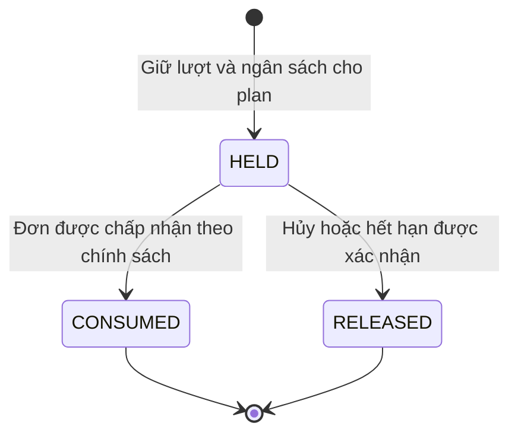

# Discount stacking — Kết hợp ưu đãi có kiểm soát

## 1. Mục tiêu và phạm vi

Discount stacking là việc áp dụng nhiều ưu đãi lên cùng một đơn hàng, một dòng hàng hoặc các thành phần khác nhau như hàng hóa và vận chuyển. Kết hợp ưu đãi có thể là tính năng hợp lệ. Lỗi bảo mật xuất hiện khi hệ thống cho phép một tổ hợp ngoài chính sách, áp dụng cùng quyền lợi nhiều lần hoặc tạo kết quả tiền tệ không được phê duyệt.

Bài học thuộc chương **Discounts**, tập trung vào bảo vệ quy tắc nghiệp vụ trước việc luân phiên mã, trộn ưu đãi tự động với mã nhập tay, đổi thứ tự tính, bỏ qua giới hạn theo khách hàng và tranh ngân sách khi checkout đồng thời. Các cơ chế chính gồm business invariants, quyền theo đối tượng, state machine, transaction, idempotency và kiểm thử tình huống tấn công logic.

Sau bài học, bạn có thể:

- Phân biệt tính hợp lệ của từng ưu đãi với tính hợp lệ của cả tổ hợp.
- Đặc tả khả năng kết hợp, thứ tự tính, giới hạn tổng và phạm vi hưởng lợi.
- Thiết kế bộ tính giá tập trung, có kết quả ổn định và truy vết được.
- Bảo vệ lượt sử dụng, ngân sách và trạng thái tiêu thụ trước replay hoặc yêu cầu đồng thời.
- Xử lý sửa giỏ hàng, hủy và hoàn tiền mà không tạo quyền lợi bổ sung ngoài chính sách.

## 2. Một ưu đãi hợp lệ không làm mọi tổ hợp trở nên hợp lệ

Giả sử giá hàng trước giảm là 1.000.000 VND. Hệ thống có:

- A: giảm 20% trên sản phẩm thuộc chương trình.
- B: giảm 10% trên giá trị hàng còn lại sau ưu đãi sản phẩm.
- C: giảm cố định 100.000 VND, không được dùng cùng A hoặc B.
- S: miễn phí vận chuyển, được phép dùng cùng A và B.

A, B, C và S có thể đều đang còn hạn và người dùng đều đủ điều kiện riêng lẻ. Nhưng điều đó không cho phép áp dụng A + B + C + S.

Một lỗi điển hình là endpoint áp dụng mã chỉ ghi nhớ mã cuối:

```text
apply(A): giảm giá, lastApplied = A
apply(A): bị chặn vì trùng lastApplied
apply(B): giảm tiếp, lastApplied = B
apply(A): lại được giảm vì A khác lastApplied
```

Kẻ tấn công có thể luân phiên A, B, A, B để lặp quyền lợi. Một biến `lastApplied` không biểu diễn tập ưu đãi đã dùng, còn việc lấy tổng hiện tại rồi trừ tiếp khiến lỗi tích lũy.

OWASP coi việc áp dụng lại mã hoặc kết hợp ưu đãi ngoài dự kiến là lỗi logic nghiệp vụ, và khuyến nghị xác minh/tính giảm giá từ phía máy chủ. Xem [Business Logic Security Cheat Sheet](https://cheatsheetseries.owasp.org/cheatsheets/Business_Logic_Security_Cheat_Sheet.html).

Cách thiết kế cần hướng tới là: từ dữ liệu có thẩm quyền và một tập ứng viên, server xây dựng **một kế hoạch giảm giá hoàn chỉnh**; kế hoạch được kiểm tra rồi mới tạo hiệu ứng tiền hoặc tiêu thụ quyền lợi.

## 3. Đưa mọi nguồn ưu đãi vào cùng phạm vi đánh giá

| Nguồn | Ví dụ | Rủi ro nếu tính riêng |
| --- | --- | --- |
| Mã khách nhập | `WELCOME10` | Không thấy ưu đãi tự động đã có |
| Ưu đãi tự động | Giảm theo mùa hoặc danh mục | Không bị tính vào giới hạn số ưu đãi |
| Ưu đãi thành viên | Giá hoặc giảm cho nhóm khách | Bị áp dụng như một lớp bí mật ngoài trần giảm |
| Ưu đãi vận chuyển | Miễn hoặc giảm phí giao hàng | Dùng lặp, tạo phí vận chuyển âm |
| Buy X get Y | Mua đủ số lượng để nhận hàng miễn phí | Cùng một đơn vị hàng bị dùng sai vai trò nhiều lần |
| Giảm thủ công | Nhân viên hỗ trợ điều chỉnh | Bỏ qua kiểm tra tổ hợp và phê duyệt |
| Ưu đãi từ đối tác | Chiết khấu do đối tác tài trợ | Không kiểm soát phần ngân sách cùng chịu |

Không chỉ chạy bộ kiểm tra trên các mã có trong request. Các ưu đãi tự động, quyền lợi thành viên và khoản giảm vận hành cũng phải được nhận diện khi đánh giá tổng hợp. Ngoại lệ cho một nguồn phải được biểu đạt thành chính sách có quyền rõ ràng, không phải đường gọi bỏ qua toàn bộ bộ tính giá.

Gift card hoặc số dư trả trước thường là **phương thức thanh toán**, không phải discount. Nếu đơn sau ưu đãi còn 720.000 VND, dùng gift card 100.000 và trả 620.000 bằng phương thức khác vẫn là thanh toán nghĩa vụ 720.000. Không vừa trừ gift card khỏi giá như ưu đãi, vừa trừ số dư gift card như thanh toán.

Điểm thưởng cần được mô hình hóa theo bản chất của sản phẩm: có thể là đổi quyền lợi, giảm giá hoặc một loại tài sản dùng thanh toán. Không dùng tên gọi “điểm” để bỏ qua kiểm soát giá trị, ngân sách và giới hạn sử dụng.

## 4. Chính sách kết hợp cần kiểm tra nhiều lớp

Tài liệu Shopify phân biệt các lớp giảm trên sản phẩm, đơn hàng và vận chuyển, đồng thời yêu cầu cài đặt của các ưu đãi cho phép kết hợp với nhau. Đây là một ví dụ sản phẩm thực tế có chính sách kết hợp tường minh, không phải bộ quy tắc chung cho mọi nền tảng. Xem [Combining discounts](https://help.shopify.com/en/manual/discounts/discount-combinations).

Một mô hình chính sách có thể lưu:

```text
promotion_id, campaign_id, policy_version
class: PRODUCT | ORDER | SHIPPING
mechanism: PERCENT | FIXED_AMOUNT | BUY_X_GET_Y
eligible_subjects, eligible_items, eligible_channels
valid_from, valid_until
minimum_basis_rule, maximum_benefit
combinable_classes, explicit_allow_pairs, explicit_deny_pairs
exclusive_group, family_limit, line_overlap_rule
application_stage, priority, basis_rule, rounding_rule
max_count_per_order, aggregate_discount_cap
usage_limit, subject_limit, budget_rule
```

Các trường do server quản lý. Client đề xuất mã hoặc lựa chọn, không được tự gửi `canStack: true`, `priority`, `discountAmount` hay policy version rồi yêu cầu server tin chúng.

### 4.1. Kiểm tra từng ưu đãi

Mỗi ứng viên phải đúng tenant, chương trình, thời hạn, sản phẩm, kênh, khách hàng, số lượng và mức chi tiêu. Người biết mã chưa chắc có quyền hưởng mã. Giá trị giảm cố định cần đúng currency; phần trăm phải có miền hợp lệ và trần tiền theo chính sách.

### 4.2. Kiểm tra từng cặp

Một quy tắc kết hợp đối xứng trong ví dụ có thể là:

```text
pairAllowed(A, B, context) =
    A cho phép B
    AND B cho phép A
    AND không có deny rule áp dụng
    AND không vi phạm xung đột trên phần hàng được phân bổ
```

Không chỉ kiểm tra phía ưu đãi mới thêm vào. Nếu A cho B nhưng B cấm A, tổ hợp vẫn không hợp lệ theo hợp đồng đối xứng này. Nếu sản phẩm chọn quy tắc khác, phải đặc tả rõ và áp dụng nhất quán.

Ma trận cho ví dụ đầu bài:

| Cặp | Được kết hợp? |
| --- | --- |
| A + B | Có |
| A + C | Không |
| B + C | Không |
| A + S | Có |
| B + S | Có |
| C + S | Có |

Khả năng kết hợp có thể phụ thuộc phạm vi. Hai ưu đãi sản phẩm được dùng trên hai dòng khác nhau chưa chắc được phép cùng áp vào một đơn vị hàng. Một boolean toàn cục `stackable` không diễn đạt đủ trường hợp này.

### 4.3. Kiểm tra toàn bộ tập

Các cặp hợp lệ vẫn chưa chứng minh cả tập hợp lệ. Một chương trình có thể cho mọi cặp trong ba mã kết hợp nhưng chỉ cho tối đa hai mã trên một đơn. Cũng có thể tổng giảm vượt trần, nhiều mã thuộc cùng một họ ưu đãi hoặc cùng dùng một ngân sách chung.

Cần kiểm tra:

- Số ưu đãi theo lớp và tổng số, bao gồm các nguồn tự động/thủ công liên quan.
- Số ưu đãi cùng campaign/family hoặc nhóm loại trừ.
- Khả năng sử dụng cùng dòng hoặc cùng đơn vị hàng.
- Tổng mức giảm trên từng phạm vi và phần tài trợ của từng bên.
- Lượt dùng theo khách hàng, chương trình và ngân sách còn lại.

Không coi kiểm tra ma trận cặp là bộ kiểm tra hoàn chỉnh.

## 5. Thứ tự tính và cơ sở tính là một phần hợp đồng

### 5.1. Hai tỷ lệ giảm không mặc định được cộng

Với A = 20%, B = 10% và giá hàng 1.000.000 VND, cách tính nối tiếp trong ví dụ là:

```text
A = 1.000.000 × 20% = 200.000
remaining_after_A = 800.000
B = 800.000 × 10% = 80.000
net_merchandise = 720.000
Tổng giảm = 280.000, tương đương 28%
```

Nếu chính sách tính cả hai trên giá gốc, tổng giảm sẽ là 300.000, tương đương 30%. Cả hai là những hợp đồng khác nhau; server phải chọn một cách xác định trước. Không suy ra công thức chỉ từ chữ “được kết hợp”.

### 5.2. Giảm cố định và giảm phần trăm có thể đổi kết quả theo thứ tự

```text
Giảm 100.000 rồi giảm 20%:
    (1.000.000 - 100.000) × 80% = 720.000

Giảm 20% rồi giảm 100.000:
    1.000.000 × 80% - 100.000 = 700.000
```

Không cho client quyết định thứ tự bằng cách đảo mảng mã hoặc gọi endpoint theo thứ tự có lợi hơn. Server sắp theo stage, priority và quy tắc phá hòa ổn định. Đối với các phép toán thuần phần trăm không cap và không làm tròn trung gian, một số thứ tự có thể cho cùng kết quả; điều đó không còn được bảo đảm khi có giảm cố định, trần hoặc rounding.

### 5.3. Định nghĩa trần trên đúng phạm vi

Trong ví dụ A + B, tổng giảm hàng là 280.000. Nếu trần giảm hàng bằng 30% giá hàng đủ điều kiện trước giảm, trần là 300.000. Phí vận chuyển ban đầu 30.000 được S miễn riêng:

```text
Giá hàng:                1.000.000
Giảm hàng A + B:          -280.000
Phí vận chuyển:            30.000
Giảm vận chuyển S:         -30.000
Phải trả trước thuế/phí khác: 720.000
```

Nếu trần chỉ cho hàng hóa, khoản giảm vận chuyển không được âm thầm tính vào hoặc loại khỏi một trần khác. Mọi trần phải có cơ sở, currency và phạm vi rõ ràng.

Nếu tổ hợp vượt trần, chính sách có thể từ chối, chọn tổ hợp khác hoặc cắt mức hưởng theo quy tắc đã công bố. Việc cắt mức hưởng cũng phải được tính vào quote trước khi duyệt. Không chấp nhận tổng giảm sai rồi dùng `max(0, payable)` để che lỗi; số tiền cuối không âm chưa chứng minh các quyền lợi hợp lệ.

### 5.4. Làm tròn và phân bổ

Dùng số học tiền chính xác; không tính tổng bằng `double`. Định nghĩa nơi làm tròn cho mỗi stage và cách phân bổ giảm toàn đơn xuống các dòng. Tổng phân bổ phải bằng đúng mức giảm đã chốt theo từng currency.

Tax được tính theo cơ sở và chính sách thuế áp dụng. Không tự áp dụng một công thức duy nhất cho mọi loại ưu đãi hoặc cộng lại khoản thuế đã bao gồm trong giá. Snapshot cuối cần thể hiện đủ tiền hàng, giảm giá, vận chuyển, thuế, phí và tổng phải thu.

## 6. Điều kiện ngưỡng và phạm vi hàng cần được đánh giá ổn định

Một mã “giảm 100.000 khi mua từ 500.000” chưa đủ đặc tả. Ngưỡng 500.000 có thể tính trên:

- Giá hàng niêm yết trước ưu đãi.
- Giá hàng đủ điều kiện sau ưu đãi sản phẩm, trước mã toàn đơn.
- Một tập dòng cụ thể, không bao gồm vận chuyển, gift card hoặc hàng không tham gia.

Chọn cơ sở theo chính sách. Nếu ngưỡng được xét trước chính mã đó thì việc giảm giá làm số cuối xuống dưới ngưỡng không tự làm mã mất hiệu lực. Ngược lại, không được dùng giá trước giảm nếu chính sách yêu cầu xét sau ưu đãi sản phẩm.

Tránh quy tắc vòng tròn như “B chỉ hợp lệ nếu tổng sau B còn trên ngưỡng, nhưng hủy B lại làm tổng đủ ngưỡng” rồi lặp tính đến khi có vẻ ổn định. Thiết kế các stage và dependency rõ ràng; phát hiện cấu hình phụ thuộc vòng trước khi phát hành.

Sau khi thêm/bớt hàng, đổi quantity, kênh, địa chỉ hoặc danh tính khách hàng, tính lại toàn bộ kế hoạch từ dữ liệu có thẩm quyền. Không giữ nguyên các khoản giảm đã cộng dồn rồi chỉ sửa subtotal.

Với Buy X get Y, cần xác định đơn vị nào làm điều kiện và đơn vị nào hưởng lợi. Hàng tặng không được tự kích hoạt thêm lượt tặng nếu chính sách không cho phép. Khi cùng một đơn vị hàng xuất hiện trong nhiều chương trình, việc tái sử dụng vai trò phải tuân theo quy tắc phân bổ, không chỉ đếm quantity tổng.

Không nhân giảm cố định theo số dòng do client tự chia nếu quyền lợi là một lần trên đơn. Hai dòng cùng SKU không tự tạo hai entitlement.

## 7. Ví dụ Java kiểm tra tập và tính tương thích đối xứng

Đoạn mã sau minh họa một mô hình nhỏ: mọi rule trong danh sách thuộc cùng phạm vi đánh giá, ID đã được server chuẩn hóa, `allowedPeers` là allowlist cụ thể và mỗi exclusive group chỉ cho một rule.

```java
import java.util.HashSet;
import java.util.List;
import java.util.Objects;
import java.util.Set;
import java.util.UUID;

record PromotionRule(
        UUID id,
        String exclusiveGroup,
        Set<UUID> allowedPeers) {
    PromotionRule {
        Objects.requireNonNull(id, "id");
        allowedPeers = Set.copyOf(allowedPeers);
    }
}

final class StackingGuard {
    static void validateSelectedSet(
            List<PromotionRule> selected,
            int serverConfiguredMaximum) {

        Objects.requireNonNull(selected, "selected");
        if (serverConfiguredMaximum < 0
                || selected.size() > serverConfiguredMaximum) {
            throw new IllegalArgumentException("STACK_COUNT_EXCEEDED");
        }

        Set<UUID> ids = new HashSet<>();
        Set<String> groups = new HashSet<>();
        for (PromotionRule rule : selected) {
            if (!ids.add(rule.id())) {
                throw new IllegalArgumentException("DUPLICATE_PROMOTION");
            }
            if (rule.exclusiveGroup() != null
                    && !groups.add(rule.exclusiveGroup())) {
                throw new IllegalArgumentException("EXCLUSIVE_GROUP_CONFLICT");
            }
        }

        for (int i = 0; i < selected.size(); i++) {
            for (int j = i + 1; j < selected.size(); j++) {
                PromotionRule a = selected.get(i);
                PromotionRule b = selected.get(j);
                if (!a.allowedPeers().contains(b.id())
                        || !b.allowedPeers().contains(a.id())) {
                    throw new IllegalArgumentException("STACK_PAIR_NOT_ALLOWED");
                }
            }
        }
    }
}
```

Các dữ liệu rule và maximum phải đến từ cấu hình server có version. Đoạn mã không kiểm tra eligibility, số tiền, trần tổng, thời hạn, quyền, giới hạn lượt dùng hoặc ngân sách; các lớp đó vẫn bắt buộc.

Mô hình group toàn cục ở ví dụ không thay được luật xung đột theo từng dòng hàng. Một sản phẩm cho phép hai ưu đãi trên hai dòng khác nhau cần đánh giá trên các phần phân bổ cụ thể, thay vì gắn chúng vào một nhóm loại trừ toàn đơn.

Chuẩn hóa mã theo hợp đồng rồi resolve tới ID có thẩm quyền. Hai cách viết hoặc hai alias trỏ cùng một promotion không được trở thành hai quyền lợi. Nếu nhiều promotion khác ID cùng thuộc một campaign chỉ cho một lần, kiểm tra thêm giới hạn campaign/family; kiểm tra ID trùng không đủ.

Giới hạn số mã đầu vào, chiều dài và số ứng viên tự động được mở rộng trước khi chạy thuật toán tốn chi phí. Vòng kiểm tra cặp có độ phức tạp bậc hai, nên không để client tạo một tập không giới hạn.

## 8. Xây dựng kế hoạch giảm giá từ đầu, không cộng dồn hiệu ứng

Một bộ tính giá nên nhận snapshot giỏ và các ứng viên, sau đó tạo kết quả mới:

```text
cart snapshot + verified subject + pricing context
  -> giá gốc và điều kiện có thẩm quyền
  -> ứng viên từ mọi nguồn liên quan
  -> chuẩn hóa ID và kiểm tra eligibility
  -> chọn tập hợp lệ theo pair/global/line rules
  -> tính theo stage, basis và rounding đã định nghĩa
  -> kiểm tra cap, phân bổ và tổng phải thu
  -> discount plan có ID và version
```

Không lấy `currentTotal` do client gửi rồi trừ thêm coupon. Cũng không đọc một tổng đã giảm nhưng mất thông tin thành phần, sau đó tiếp tục áp giảm như thể đó là giá gốc.

Kế hoạch có thể lưu:

```text
plan_id, tenant_id, subject_id
cart_id, cart_version
pricing_snapshot_id, policy_version
canonical_candidate_ids
selected_promotion_ids + promotion_versions
application_order
eligible_line_allocations
basis_before_each_stage
benefit_by_promotion_and_line
funding_by_campaign_or_sponsor
subtotal, discount_totals, shipping, tax, fees, payable
currency, valid_until
state, fingerprint
```

Các ứng viên không được chọn nên có lý do như `NOT_ELIGIBLE`, `EXCLUSIVE_GROUP_CONFLICT`, `STACK_PAIR_NOT_ALLOWED`, `COUNT_LIMIT`, `AGGREGATE_CAP` hoặc `BETTER_VALID_PLAN_SELECTED`. Không ghi mã riêng tư hoặc dữ liệu tenant khác vào phản hồi để giải thích.

Nếu sản phẩm tự chọn tổ hợp có lợi nhất, phải xác định hàm mục tiêu và các ràng buộc. Chọn mã giảm lớn nhất từng bước không luôn cho kết quả tốt nhất toàn cục. Có thể đánh giá các tổ hợp trong một tập đã giới hạn hoặc dùng một thuật toán có hợp đồng rõ ràng; không tuyên bố “tốt nhất” nếu bộ chọn chỉ dùng heuristic không bảo đảm điều đó.

Nếu sản phẩm yêu cầu khách chọn một tổ hợp cụ thể, khi tổ hợp sai có thể từ chối và trả lựa chọn hợp lệ. Không tự bỏ một mã, đổi tổng rồi thu tiền bằng phê duyệt cũ.

### Bất biến của kết quả tính giá

```text
selected promotions không trùng entitlement theo quy tắc
mọi cặp và toàn bộ tập đều thỏa chính sách
mọi allocation chỉ tác động dòng/đơn vị đủ điều kiện
sum(line allocations) = benefit của promotion theo currency
merchandise_discount <= merchandise cap đã định nghĩa
shipping_discount <= phí vận chuyển đủ điều kiện
payable = tổng các thành phần đã chốt, không tính trùng
```

Một giỏ có tổng bằng zero có thể hợp lệ nếu chính sách cho phép. Nó vẫn phải vượt qua kiểm tra quyền, eligibility, ngân sách và trạng thái. Không dùng việc “không cần charge” để bỏ qua toàn bộ checkout.

## 9. Phân biệt xem trước, giữ chỗ và tiêu thụ quyền lợi

Xem giá không đồng nghĩa đã dùng coupon. Nếu mỗi lần preview đều tăng bộ đếm sử dụng, thao tác mở giỏ hoặc retry có thể làm cạn chương trình. Ngược lại, quote được hứa giữ ngân sách nhưng không reserve có thể thất bại khi nhiều người thanh toán.

Một vòng đời reservation minh họa:



Đây là vòng đời quyền lợi, không phải toàn bộ trạng thái đơn hoặc thanh toán. Hệ thống cũng có thể chỉ consume tại checkout mà không giữ chỗ trước; khi đó preview phải mô tả đúng mức cam kết, không bảo đảm ngân sách chưa được giữ.

Với reservation, cần định nghĩa:

- Thời hạn và chủ thể/đơn/plan được quyền sử dụng.
- Mỗi campaign bị giữ bao nhiêu lượt, tiền hoặc hàng tặng.
- Mốc chuyển từ giữ sang tiêu thụ: nhận đơn, charge hay một sự kiện khác.
- Khi nào được trả ngân sách hoặc cấp lại entitlement.
- Cách xử lý payment đang chờ hoặc kết quả bên ngoài chưa biết.

Plan bị sửa không được tiếp tục dùng reservation cũ cho số tiền hoặc sản phẩm khác. Thay reservation phải là một cập nhật có kiểm soát: kiểm tra quyền lợi mới và hoàn tất thay đổi cùng transaction, tránh giữ cả cũ lẫn mới hoặc giải phóng cũ rồi mất khả năng quay lại khi bước mới thất bại.

Hết hạn theo đồng hồ và chuyển state `RELEASED` cần phối hợp. Consumer không được tiêu thụ một hold đã hết hạn chỉ vì worker dọn dẹp chưa chạy. Worker cũng không được giải phóng lần nữa sau khi checkout đã tiêu thụ nó.

## 10. Giữ lượt và ngân sách an toàn trước tranh chấp

Một campaign có thể có cả giới hạn số lần và giới hạn tổng tiền tài trợ. Hai giới hạn không thay thế nhau. Một ưu đãi miễn phí vận chuyển cũng tạo chi phí, không thể bỏ qua ngân sách chỉ vì khoản giảm không nằm trên tiền hàng.

Đặt:

```text
budget_limit_minor = trần ngân sách của một bucket theo currency
spent_minor = phần đã tiêu thụ
held_minor = phần đang giữ
available_minor = budget_limit_minor - spent_minor - held_minor
```

Schema phải bảo vệ các quan hệ không âm, `spent_minor <= budget_limit_minor` và `held_minor <= budget_limit_minor - spent_minor`. Ví dụ hàng rào giữ ngân sách:

```sql
UPDATE promotion_budget
SET held_minor = held_minor + :server_computed_cost_minor
WHERE tenant_id = :verified_tenant_id
  AND budget_id = :resolved_budget_id
  AND currency = :plan_currency
  AND :server_computed_cost_minor >= 0
  AND :server_computed_cost_minor
      <= budget_limit_minor - spent_minor - held_minor
RETURNING held_minor;
```

Các giá trị và cột phải nằm trong miền số nguyên được hỗ trợ; các ràng buộc trên giúp phép cộng không vượt trần ngân sách. Chi phí do server tính từ phần tài trợ đã phân bổ, không mặc định bằng toàn bộ mức giảm nếu nhiều bên cùng tài trợ. Với ngân sách quy đổi tiền tệ, cần một chính sách tỷ giá rõ ràng thay vì cộng raw amount khác loại.

Phải có đúng một dòng trả về. Nếu plan dùng A và B mà chỉ giữ được ngân sách A, lỗi B phải rollback cả lần giữ A. Cập nhật lượt, giới hạn khách hàng và reservation cùng transaction với ngân sách. Đọc thấy còn tiền rồi cập nhật ở bước sau không có hàng rào sẽ để hai request cùng chiếm phần còn lại.

Khi consume một hold có chi phí D:

```text
held_minor := held_minor - D
spent_minor := spent_minor + D
reservation: HELD -> CONSUMED
```

Khi release:

```text
held_minor := held_minor - D
reservation: HELD -> RELEASED
```

Chuyển state và bộ đếm phải cùng transaction, có điều kiện trên trạng thái cũ. Hai worker cùng nhận sự kiện release chỉ được hoàn ngân sách một lần. Không trực tiếp trừ bộ đếm chỉ vì nhận một message có chữ “cancel”.

### Ràng buộc theo nghiệp vụ

Ví dụ bảng application chỉ chứa kết quả cuối của mỗi promotion trên một đơn:

```sql
CREATE UNIQUE INDEX uq_order_promotion_application
ON discount_application (tenant_id, order_id, promotion_id);
```

Các cột phải `NOT NULL`. Nếu lưu nhiều phiên bản preview trong cùng bảng, cần mô hình riêng hoặc ràng buộc có phạm vi phù hợp; không áp dụng chỉ mục trên rồi làm hỏng lịch sử định giá.

Với một campaign cho mỗi chủ thể tối đa một lần giữ hoặc dùng có hiệu lực:

```sql
CREATE UNIQUE INDEX uq_campaign_subject_active_claim
ON promotion_claim (tenant_id, campaign_id, subject_id)
WHERE state IN ('HELD', 'CONSUMED');
```

Đây là ví dụ giới hạn một lần, không dùng nguyên xi cho chương trình cho phép nhiều lần. Với giới hạn lớn hơn một, dùng bộ đếm hoặc slot được kiểm soát đồng thời. `subject_id` phải được xác định từ danh tính/entitlement có thẩm quyền; lấy từ body cho phép đổi ID để né giới hạn.

Giới hạn theo tài khoản chỉ chứng minh chính sách trên tài khoản đó. Nếu chương trình yêu cầu giới hạn theo một loại danh tính khác, cần mô hình chủ thể tương ứng; không mặc định một tài khoản luôn tương đương một con người.

## 11. Checkout phải dùng cùng kế hoạch đã được duyệt

Pseudocode sau giả định reservation, đơn, ngân sách và dữ liệu tiền quyết định nằm trong cùng cơ sở dữ liệu giao dịch:

```text
checkoutWithDiscounts(actor, cartId, planId, approvalId, key):
    requireAuthenticated(actor)
    validateCommandShapeAndInputBounds()

    begin transaction
        command = canonicalCommand(actor, cartId, planId, approvalId)
        idem = claimOrLoadIdempotency(actor, operation, key)
        requireSameFingerprintIfExisting(idem, command)

        cart = lockCartInVerifiedTenant(cartId)
        requireActorMayAccessCart(actor, cart)
        if idem has a committed result:
            requireActorMayReadResult(actor, idem.result)
            commit and return stored result

        requireNoExistingCheckoutForThisCartOperation()
        plan = lockPlan(planId)
        approval = lockApproval(approvalId)
        lockPromotionAndPermissionStateInStableOrder()
        lockReservationsBudgetsAndUsageCountersInStableOrder()
        lockRelevantMoneyAndInventoryState()

        requirePlanBelongsToActorAndExactCartVersion(plan, cart)
        requireApprovedPlanFingerprintAndPayableMatch(approval, plan)
        requireCurrentPermissionsAndEligibility()
        requireCombinationsAndGlobalCapsStillPermittedByContract(plan)
        requireReservationsMatchPlanAndRemainExecutable(serverTimeNow())
        requireAllocationSumsAndMoneyInvariants(plan)

        consumeAllRequiredReservationsAndClaimsOnce(plan)
        createImmutableOrderWithDiscountAllocations(plan)
        applyLocalPaymentAndResourceEffects(plan.payable)
        appendBalancedLedgerIfMoneyIsPosted()
        consumeApprovalOnce(approval)
        markCartOperationCompleted()
        appendOutboxEvents()
        saveIdempotencyResult(idem)
    commit
    return committed result
```

Mọi cập nhật có điều kiện phải kiểm tra số dòng ảnh hưởng. Bất kỳ bước nào thất bại phải rollback toàn bộ hiệu ứng cục bộ; không commit ưu đãi A rồi thử B ở transaction khác cho một checkout yêu cầu cả tổ hợp.

Các chương trình có thể thay đổi sau preview. Chính sách phải nói rõ reservation giữ quyền lợi phiên bản cũ hay phải áp điều kiện mới. Nếu điều kiện thực hiện yêu cầu đổi kết quả tiền, lập plan/version mới và phê duyệt lại theo workflow. Không âm thầm bớt giảm giá rồi charge nhiều hơn số khách đã duyệt.

Kiểm tra thời hạn tại hàng rào cuối sau những lần chờ khóa liên quan, dùng thời gian có thẩm quyền. Quyền “khách mua lần đầu” cũng cần nguồn dữ liệu và cơ chế cạnh tranh: hai giỏ khác nhau của cùng khách không được cùng dựa vào một lần đọc “chưa có đơn” rồi cùng hưởng quyền một lần.

### Idempotency không thay thế chống dùng lại entitlement

Scope có thể là `(tenant, authenticated actor, operation, key)`. Nội dung phải gắn với cart/version, plan/version và approval tương ứng. Cùng key nhưng đổi tập ưu đãi hoặc plan không được trở thành một checkout mới.

Key mới không được dùng lại cùng cart operation hoặc entitlement đã tiêu thụ. Vì thế vẫn cần các ràng buộc nghiệp vụ bên cạnh idempotency. Sau commit nhưng mất response, retry trả order/posting gốc, không tính lại và không tiêu thụ thêm ngân sách.

Trước khi trả cached result vẫn kiểm tra quyền truy cập. Biết key, plan ID hoặc mã promotion không cấp quyền đọc/chi tiêu quyền lợi của khách khác.

Nếu bên ngoài cũng áp giảm tự động, cần bảo đảm không giảm lần nữa trên một amount đã được giảm nội bộ. Adapter và đối soát phải thống nhất ý nghĩa khoản tiền; một chữ ký callback đúng không chứng minh amount/currency/discount plan đúng với đơn.

Không gọi dịch vụ thanh toán lâu bên trong transaction rồi kỳ vọng rollback cục bộ hoàn tác được charge bên ngoài. Dùng payment attempt và idempotency của nhà cung cấp khi có, lưu kết quả bền vững và xử lý trạng thái chưa biết. Không giải phóng một reservation đang gắn với kết quả charge chưa biết chỉ vì HTTP timeout, rồi để cùng ngân sách được dùng cho giao dịch khác mà không có quy trình giải quyết rủi ro đó.

## 12. Hủy và hoàn tiền không được tạo thêm lợi ích

### 12.1. Giải phóng không đồng nghĩa hoàn lại mọi quyền

Hủy một reservation chưa dùng có thể trả lượt và ngân sách. Hủy hoặc hoàn một đơn đã consume lại phụ thuộc chính sách: có chương trình cho dùng lại, có chương trình không, và phần tài trợ có thể được hoàn theo các mốc khác nhau.

Không tự đổi `CONSUMED` về `HELD` hoặc xóa claim khi thấy trạng thái đơn thay đổi. Lưu nghiệp vụ hoàn/điều chỉnh riêng với tham chiếu tới application gốc. Mỗi lần trả ngân sách phải có định danh và hàng rào dùng một lần.

Nếu callback hủy và thanh toán thành công cạnh tranh, hai luồng phải có giao thức trạng thái thống nhất. Không để một bên trả ngân sách trong khi bên còn lại ghi đơn hưởng ưu đãi thành công.

### 12.2. Hoàn theo tiền đã phân bổ, không theo giá niêm yết

Giả sử sản phẩm có giá gốc 1.000.000 VND, sau A + B khách thực trả 720.000 VND cho hàng. Hoàn cùng sản phẩm theo giá gốc 1.000.000 sẽ trả nhiều hơn phần tiền khách đã trả, nếu không có một quyền lợi bổ sung được cho phép riêng.

Đơn phải lưu phân bổ giảm theo dòng và đơn vị/phần có thể hoàn. Refund dùng net paid của phần đó, thuế/phí hoàn được theo quy tắc và các phần funding tương ứng. Tổng các phần giảm đã phân bổ phải vẫn khớp snapshot gốc, kể cả phần dư làm tròn.

Với Buy X get Y hoặc ngưỡng chi tiêu, hoàn một phần có thể làm điều kiện ban đầu không còn đúng. Chính sách phải xác định cách xử lý: giữ phân bổ gốc, điều chỉnh mức hoàn hoặc một nghiệp vụ khác đã được chấp thuận. Không tự ghi nợ thêm khách bằng một quy tắc mới xuất hiện sau mua.

Không khôi phục coupon hoặc ngân sách lần nữa khi cùng refund event được gửi lặp. Hai refund khác key cũng phải tranh phần còn lại của cùng application an toàn; idempotency từng request không bảo vệ được tổng giữa các lệnh độc lập.

### 12.3. Cashback và lợi ích phát sau cần cùng lineage

Nếu một chương trình còn phát cashback, điểm hoặc quà sau mua, gắn việc phát với order/application gốc và trạng thái đủ điều kiện. Một đơn được hoàn không được vừa giữ toàn bộ lợi ích sau mua, vừa nhận hoàn vượt chính sách. Việc đảo hoặc giữ lợi ích phải có quy tắc rõ ràng và không được thực hiện lặp do sự kiện trùng.

## 13. Các kiểu tấn công và hàng rào tương ứng

| Thao tác | Lỗi thiết kế | Hàng rào |
| --- | --- | --- |
| Luân phiên A, B, A | Chỉ nhớ mã áp dụng cuối | Tập entitlement chuẩn hóa và tính lại plan |
| Gửi alias/cách viết khác | So sánh raw code | Resolve cùng canonical promotion/entitlement |
| Dùng hai mã khác nhau cùng campaign | Chỉ chống trùng promotion ID | Giới hạn campaign/family |
| Trộn mã với ưu đãi tự động bị bỏ sót | Kiểm tra riêng mỗi nguồn | Tổng hợp mọi nguồn liên quan trong bộ chọn |
| Đảo thứ tự request | Áp tuần tự theo thứ tự client | Stage/priority do server quản lý |
| Gửi `canStack`, `discountAmount` | Tin thuộc tính quyền lợi từ client | Policy và amount có thẩm quyền |
| Gửi ba mã mà mọi cặp đều hợp lệ | Chỉ có kiểm tra cặp | Giới hạn toàn tập và cap |
| Chia dòng để nhân giảm cố định | Nhầm đơn vị áp dụng | Phạm vi theo đơn/dòng/đơn vị được đặc tả |
| Xóa hàng đủ ngưỡng sau khi áp mã | Không tính lại eligibility | Cart version, tính lại và vô hiệu hóa plan cũ |
| Dùng mã cá nhân của người khác | Mã được coi là quyền đầy đủ | Subject, tenant và entitlement có thẩm quyền |
| Hai checkout tranh ngân sách | Đọc rồi cập nhật không bảo vệ | Cập nhật có điều kiện và transaction |
| Key mới cho cùng plan đã dùng | Chỉ chống trùng theo key | Trạng thái dùng một lần và unique theo nghiệp vụ |
| Hoàn nhiều lần để lấy lại lượt | Reset claim theo trạng thái đơn | Nghiệp vụ hoàn có lineage và điều kiện dùng một lần |
| Dùng API hỗ trợ để thêm giảm thủ công | Role nội bộ bỏ qua kiểm tra | Quyền theo scope, giới hạn và phê duyệt cụ thể |

Giới hạn tần suất thử mã có thể giảm việc dò mã hoặc tự động hóa, nhưng không thay thế các bất biến. Một request duy nhất cũng có thể chứa một tổ hợp sai nếu server cho phép.

Cấu hình của người quản trị cũng cần được kiểm tra. Ví dụ A cho B, B cấm A; một ưu đãi vừa thuộc nhóm độc quyền vừa được đánh dấu kết hợp với mọi nhóm; hoặc chuỗi điều kiện phụ thuộc vòng. Không tự chọn nhánh có lợi hơn để giải quyết cấu hình mâu thuẫn. Chặn phát hành hoặc đưa về một cách xử lý đã được chính sách định nghĩa, có khả năng giải thích.

## 14. Đặc tả kiểm thử tình huống tấn công logic

Các ca dưới đây là hướng dẫn xây dựng kiểm thử khi triển khai, không phải báo cáo đã chạy test. Quan sát cả kế hoạch giá, phân bổ, order, claim, budget, ledger và kết quả idempotency.

| Ca thử | Thiết lập/thao tác | Kết quả cần có |
| --- | --- | --- |
| Tổ hợp hợp lệ | A 20%, B 10% nối tiếp trên 1.000.000 | Giảm hàng 280.000; net hàng 720.000 |
| Mã hợp lệ riêng, cặp bị cấm | Dùng A + C theo ví dụ | Không thực hiện tổ hợp bị cấm |
| Cho phép một chiều | A cho B, B không cho A | Từ chối theo chính sách đối xứng |
| Ràng buộc ba phần tử | Mọi cặp hợp lệ nhưng maximum bằng 2 | Tập ba bị loại dù kiểm tra cặp đều pass |
| Áp lặp | A rồi B rồi A | A không tạo thêm quyền lợi lần hai |
| Alias trùng | Hai mã cùng canonical promotion | Không giảm hai lần |
| Campaign trùng | Hai promotion khác ID thuộc family giới hạn một | Không né giới hạn family |
| Ưu đãi ẩn ngoài request | Có auto discount, thêm mã không tương thích | Bộ chọn xét cả auto discount |
| Thứ tự bị đảo | Cùng tập mã, đổi thứ tự mảng/call | Cùng plan theo thứ tự server, nếu lịch sử call không có nghĩa nghiệp vụ |
| Fixed và percent | 100.000 cố định với 20% | Kết quả đúng stage đã cấu hình, không do client chọn |
| Cap toàn tập | Tập hợp hợp lệ về cặp nhưng vượt trần | Từ chối/chọn lại/cắt theo policy trước phê duyệt |
| Vận chuyển | Hai ưu đãi shipping cùng tranh một phí | Không tạo phí âm hoặc dùng vượt số ưu đãi được phép |
| Ngưỡng sau sửa giỏ | Áp mã rồi xóa hàng qualifying | Plan cũ không được checkout cho cart mới |
| Phạm vi dòng | Hai ưu đãi cùng một đơn vị bị cấm | Không vượt luật overlap dù tổng đơn còn hợp lệ |
| Chia dòng | Tách cùng SKU để nhân fixed-off một lần trên đơn | Không tạo thêm entitlement |
| Sai currency | Mã giảm VND cho đơn currency khác | Không trừ raw amount khác loại |
| Khác chủ thể/tenant | Dùng mã cá nhân hoặc plan người khác | Không lộ dữ liệu hoặc cấp sai quyền lợi |
| Ngân sách còn một phần | Hai đơn khác nhau cùng tranh phần còn lại | Chỉ mức giữ/tiêu thụ trong trần được commit |
| Hai ưu đãi, một budget thất bại | Giữ được A nhưng B hết ngân sách | Không để lại hold A một phần |
| Quyền lần đầu đồng thời | Hai giỏ của cùng khách cùng checkout | Không dùng entitlement một lần cho cả hai |
| Retry sau commit | Mất response, gửi lại cùng key | Cùng order; không tăng spent hoặc count thêm |
| Key mới | Gửi lại cùng cart operation/claim đã dùng | Không tạo lần tiêu thụ thứ hai |
| Plan đổi sau duyệt | Đổi tập ưu đãi hoặc payable | Phê duyệt cũ không được dùng để thu tổng mới |
| Release trùng | Hai worker release cùng reservation | Budget được trả đúng một lần |
| Refund | Hoàn hàng đã mua với nhiều ưu đãi | Theo net/phân bổ và giới hạn hoàn, không theo giá niêm yết tùy ý |
| Lỗi giữa transaction | Lỗi sau cập nhật budget, trước order/ledger | Rollback các hiệu ứng cục bộ |

Các thuộc tính cần giữ trong mô hình:

```text
không có entitlement được áp dụng trùng ngoài chính sách
mọi tập được chọn thỏa pair rules và global rules
mọi khoản giảm có dòng, cơ sở và currency phù hợp
sum(allocations) = tổng giảm đã chốt
spent_minor + held_minor <= budget_limit_minor
một nghiệp vụ checkout chỉ tiêu thụ các claim tương ứng một lần
retry không làm thay đổi tổng hoặc tạo thêm quyền lợi
refund/release không trả lại tiền hoặc ngân sách quá mức được phép
```

Kiểm thử hoán vị cần giữ cùng tập ứng viên, cùng snapshot và policy version. Nếu chính sách cho phép thứ tự lựa chọn của khách có ý nghĩa riêng, thứ tự đó phải là một phần nội dung được duyệt; không mặc định mọi hoán vị đều tương đương.

Kiểm thử tranh ngân sách phải dùng hai đơn và hai key khác nhau. Nếu chỉ gửi lặp cùng một key, test chủ yếu chứng minh cơ chế chống trùng, chưa chứng minh trần chung trước các giao dịch độc lập. Dùng barrier hoặc điều phối transaction để tạo tranh chấp có thể lặp lại; mock repository không chứng minh được hành vi khóa hay unique constraint của database.

## 15. Nhật ký quyết định và rà soát thiết kế

Một checkout cần nối được các bằng chứng:

```text
actor/workload + tenant
  -> cart ID/version + pricing snapshot
  -> canonical candidates từ mọi nguồn
  -> selected set + policy/promotion versions
  -> application order + basis + line allocations
  -> reservation/claim + funding bucket
  -> approved payable + order/payment/posting
  -> idempotency result + refund/release references
```

Log có cấu trúc nên ghi lý do chọn/loại, các ID/version và amount kèm currency. Không log toàn bộ mã khuyến mại cá nhân, token hoặc dữ liệu khách hàng nhạy cảm nếu không cần cho điều tra; có thể dùng tham chiếu nội bộ được kiểm soát quyền truy cập.

Theo dõi nhiều lần luân phiên mã, alias trùng, nhiều lần xung đột cap, reservation chưa dùng bất thường, hoàn/hủy rồi dùng lại nhanh và ngân sách chênh so với tổng application. Những tín hiệu này cần được đối chiếu với chính sách và lịch sử, không tự coi mọi khách tìm tổ hợp tốt hơn là gian lận.

Khi rà soát một thiết kế, phải trả lời được:

1. Các nguồn giảm giá nào được đưa vào cùng một quyết định và nguồn nào có ngoại lệ được cho phép.
2. Cách xác định eligibility, tương thích từng cặp, giới hạn toàn tập và overlap trên dòng.
3. Thứ tự, cơ sở tính, rounding, cap và phân bổ ảnh hưởng tổng tiền như thế nào.
4. Điểm giữ, tiêu thụ và trả lại lượt/ngân sách có được bảo vệ trong transaction không.
5. Cart/plan/approval có cùng version và nội dung tiền hay không.
6. Retry, key mới, hủy và refund có thể tạo thêm hiệu ứng nào ngoài quyền được cấp hay không.

Discount stacking an toàn giữ quyền lựa chọn ưu đãi trong khuôn khổ một kế hoạch được xác định và kiểm chứng đầy đủ. Khi cả tổ hợp, tổng tiền và vòng đời quyền lợi đều được bảo vệ, đổi mã, đổi thứ tự hoặc gửi lại request không còn đủ để nhân quyền lợi ngoài chính sách.
