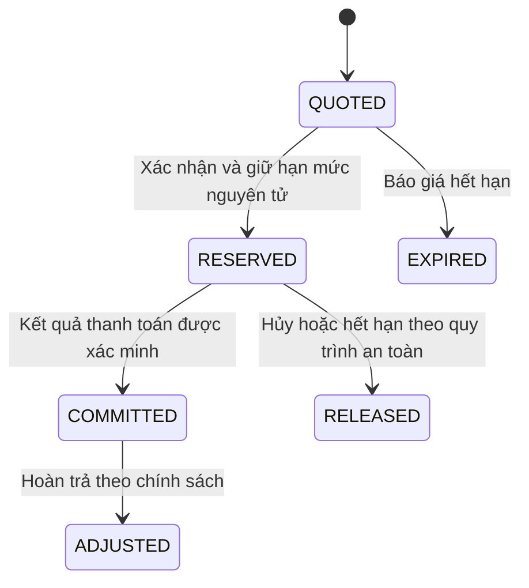

# Discount maximum value — Bảo vệ trần giảm giá

## 1. Trần giảm giá là một bất biến nghiệp vụ

Thông báo “giảm 20%, tối đa 100.000 đồng” tạo ra hai cam kết khác nhau: tỷ lệ xác định mức ưu đãi theo giá trị hàng đủ điều kiện; trần giới hạn số tiền doanh nghiệp cho phép giảm. Nếu máy chủ chỉ tính 20% mà bỏ qua trần, một đơn hàng 5.000.000 đồng sẽ được giảm 1.000.000 đồng thay vì 100.000 đồng. Yêu cầu HTTP vẫn hợp lệ, người mua vẫn đăng nhập đúng và phép nhân vẫn đúng, nhưng quy tắc nghiệp vụ đã bị phá vỡ.

Trong chương **Discounts** của module bảo mật logic nghiệp vụ, **discount maximum value** là giới hạn phải được giữ đúng qua toàn bộ vòng đời giao dịch: báo giá, áp mã, xác nhận đơn, thanh toán, hủy và hoàn tiền. Hiển thị trần trên giao diện hoặc kiểm tra một lần ở API áp mã chưa đủ để bảo vệ cam kết này.

Sau bài học, bạn có thể:

- Chuyển điều kiện “giảm tối đa” thành các bất biến có thể kiểm tra.
- Xác định cơ sở tính giảm, phạm vi của trần và quy tắc cộng dồn.
- Tính tiền giảm bằng Java mà không phụ thuộc giá trị do khách gửi lên.
- Bảo toàn hạn mức khi có yêu cầu đồng thời, retry hoặc thay đổi trạng thái đơn.
- Thiết kế kiểm thử phát hiện việc vượt trần bằng thao tác nghiệp vụ.

Các chính sách, số tiền và tên mã trong bài là ví dụ thiết kế. Khi triển khai, cần chuyển chính sách thực tế thành hợp đồng rõ ràng trước khi viết công thức.

## 2. Làm rõ “tối đa” áp dụng cho điều gì

Xét mã `P20` với hợp đồng minh họa:

| Thuộc tính | Chính sách mẫu |
| --- | --- |
| Tỷ lệ | 20% giá trị hàng đủ điều kiện còn lại sau ưu đãi trước đó |
| Trần của mã trên một đơn | 100.000 VND |
| Trần tổng ưu đãi hàng hóa trên một đơn | 120.000 VND |
| Phạm vi trần đơn | Một đơn mua hàng logic, kể cả khi tách thành nhiều kiện giao |
| Cộng dồn | Chỉ với nhóm ưu đãi được phép; thứ tự do máy chủ quy định |
| Hạn mức khách hàng | 150.000 VND trong một ngày theo `Asia/Ho_Chi_Minh` |
| Ngân sách chiến dịch | 10.000.000 VND, gồm tiền đã dùng và đang giữ chỗ |
| Cơ sở tính | Giá hàng đủ điều kiện trước thuế trong ví dụ; không gồm vận chuyển |
| Đơn vị và làm tròn | VND nguyên đồng; `HALF_UP` một lần ở mức đơn |
| Khi thiếu hạn mức tích lũy | Từ chối áp mã cho giao dịch mới; không tự giảm xuống phần còn lại |

Quy tắc thuế trong bảng chỉ xác định cơ sở cho ví dụ, không phải hướng dẫn tính thuế áp dụng chung. Nếu hệ thống dùng giá đã gồm thuế hoặc giảm phí vận chuyển, phải mô hình hóa cơ sở tương ứng và quy định trần nào bao phủ từng loại ưu đãi.

Cần phân biệt các giới hạn:

| Giới hạn | Câu hỏi cần trả lời | Lỗi nếu nhầm phạm vi |
| --- | --- | --- |
| Trần tiền giảm của mã | Mã đóng góp tối đa bao nhiêu cho một đơn? | Nhân trần lên theo số sản phẩm |
| Trần tổng giảm của đơn | Các ưu đãi trong phạm vi được giảm tối đa bao nhiêu? | Mỗi mã đúng trần nhưng tổng vượt trần đơn |
| Hạn mức khách hàng | Khách được hưởng tối đa bao nhiêu trong kỳ? | Tạo nhiều đơn nhỏ để vượt hạn mức |
| Ngân sách chiến dịch | Tổng ưu đãi đã cam kết tối đa là bao nhiêu? | Nhiều đơn cùng dùng số ngân sách cuối cùng |
| Giới hạn lượt dùng | Được áp mã bao nhiêu lần? | Một lượt hợp lệ vẫn giảm quá nhiều tiền |

Giới hạn tiền và giới hạn lượt cần được bảo vệ độc lập. Mã “mỗi khách một lần” vẫn cần trần tiền; mã có trần tiền trên đơn vẫn có thể bị dùng nhiều lần nếu chính sách không chặn.

Hạn mức theo tài khoản chỉ bảo đảm giới hạn của tài khoản đó. Nếu mục tiêu nghiệp vụ là giới hạn theo người thực, cần tiêu chí định danh và cơ chế chống lạm dụng nhiều tài khoản phù hợp; không thể suy ra bảo đảm này chỉ từ `customer_id`.

## 3. Biểu diễn bất biến và công thức

### 3.1. Trần tại một lần tính giảm

Đặt:

- `E`: giá trị hàng đủ điều kiện còn lại sau các ưu đãi đã áp trước đó.
- `r`: tỷ lệ giảm, nằm trong đoạn `[0, 1]`.
- `C_coupon`: trần đóng góp của mã trên đơn.
- `C_order`: trần tổng ưu đãi hàng hóa trên đơn.
- `D_previous`: tổng giảm đã áp và thuộc cùng phạm vi `C_order`.
- `D_new`: tiền giảm mới của mã đang xét.

Trước khi tính, xác minh tất cả số tiền không âm, cùng tiền tệ, đúng đơn vị và `D_previous <= C_order`. Máy chủ dựng lại `E` từ dòng hàng, giá và phân bổ ưu đãi hợp lệ. Không tính `E` bằng cách trừ tổng giảm của toàn đơn khỏi một tập sản phẩm không tương ứng.

Với hợp đồng mẫu:

```text
raw_discount        = E × r
rounded_discount    = round(raw_discount, đơn vị tiền, quy tắc làm tròn)
remaining_order_cap = C_order - D_previous

D_new = min(
    rounded_discount,
    C_coupon,
    remaining_order_cap,
    E
)
```

Các điều kiện phải còn đúng sau khi áp mã:

```text
0 <= D_new <= C_coupon
D_new <= E
D_previous + D_new <= C_order
Tổng giảm hàng hóa <= Tổng giá hàng hóa tương ứng
Tiền hàng sau giảm >= 0
```

Ví dụ với `E = 800.000`, tỷ lệ 20%, trần mã 100.000 và trần đơn 120.000:

| Giảm trước đó | Giảm theo tỷ lệ | Phần trần đơn còn lại | Giảm mới | Tổng giảm |
| ---: | ---: | ---: | ---: | ---: |
| 0 | 160.000 | 120.000 | 100.000 | 100.000 |
| 50.000 | 160.000 | 70.000 | 70.000 | 120.000 |
| 120.000 | 160.000 | 0 | 0 | 120.000 |

Ở hai hàng cuối, `E` được giữ bằng 800.000 để minh họa tác động của trần đơn. Trong giao dịch thực, `E` phải phản ánh giá trị còn lại của đúng hàng đủ điều kiện sau ưu đãi trước đó.

Không dùng `max(0, remaining_order_cap)` để che trường hợp `D_previous > C_order`. Đây là dữ liệu hoặc luồng xử lý đã vi phạm bất biến; phải ngăn giao dịch tiếp tục và ghi nhận nguyên nhân.

Nếu mã giảm số tiền cố định `A`, thay `rounded_discount` bằng số tiền cố định hợp lệ theo chính sách. Các giới hạn theo giá trị hàng và tổng trần đơn vẫn cần áp dụng.

### 3.2. Hạn mức tích lũy có trạng thái

Gọi `U_used` là tiền khách đã dùng, `U_reserved` là tiền đang giữ cho các đơn chưa chốt trong cùng kỳ. Chiến dịch có `B_used`, `B_reserved` và tổng ngân sách `B_total`.

Khi tạo giữ chỗ mới, phải bảo đảm trong thao tác nguyên tử:

```text
U_used + U_reserved + D_new <= C_user_period
B_used + B_reserved + D_new <= B_total
```

Hai công thức áp dụng cho giữ chỗ mới chưa nằm trong bộ đếm. Khi retry một giữ chỗ đã tồn tại, trả kết quả cũ hoặc cập nhật theo phần chênh lệch; không cộng thêm toàn bộ `D_new`.

Theo chính sách mẫu, nếu khách chỉ còn 30.000 đồng hạn mức nhưng mã tính ra 100.000 đồng, hệ thống từ chối áp mã. Sản phẩm khác có thể cho hưởng 30.000 đồng, nhưng phải công bố quy tắc giảm một phần và đưa số tiền đó vào báo giá được khách xác nhận. Không biến quyết định sản phẩm này thành hệ quả ngẫu nhiên của một lệnh `min(...)`.

Trần hiển thị “tối đa 100.000” là phép chặn mức giảm hợp lệ. Dữ liệu âm, sai tiền tệ, sai phiên bản hoặc yêu cầu không có quyền phải bị từ chối, không được sửa ngầm thành giao dịch khác.

## 4. Chặn sửa trần và cơ sở tính từ phía khách

Một API nguy hiểm nhận cả dữ liệu điều khiển lẫn kết quả tính:

```json
{
  "orderId": "ORDER-DEMO-42",
  "couponCode": "P20",
  "eligibleSubtotal": 800000,
  "discountRate": 0.20,
  "maxDiscount": 100000,
  "discountAmount": 100000,
  "approved": true
}
```

Nếu máy chủ ánh xạ toàn bộ payload vào đơn hàng hoặc chính sách, khách có thể nâng `maxDiscount`, đổi `discountRate`, khai thêm giá trị đủ điều kiện hoặc bật `approved`. Đăng nhập xác nhận ai gửi yêu cầu; nó không chứng minh các trường này là sự thật.

Một hợp đồng áp mã hẹp hơn:

```http
POST /orders/ORDER-DEMO-42/coupon
Idempotency-Key: demo-apply-42-v1
Content-Type: application/json

{
  "couponCode": "P20",
  "expectedOrderVersion": 7
}
```

Máy chủ lấy giá, số lượng, điều kiện mã, trần và trạng thái từ nguồn có thẩm quyền. `expectedOrderVersion` giúp phát hiện khách đang thao tác trên phiên bản cũ; khách không thể dùng trường này để bỏ qua khóa hoặc kiểm tra xung đột.

Trước khi tính hoặc ghi ưu đãi, cần kiểm tra:

1. Đơn thuộc đúng khách hoặc vai trò được phép thao tác, trong đúng tenant và kênh bán.
2. Trạng thái cho phép thay đổi giá; đơn đã khóa thanh toán không được áp lại mã.
3. Mã đang hoạt động, đúng kỳ hiệu lực, đúng tiền tệ và áp dụng cho đối tượng này.
4. Tập hàng đủ điều kiện, giá và số lượng được xác thực phía máy chủ.
5. Mã được phép kết hợp với ưu đãi hiện có và chưa bị dùng trái chính sách.
6. Không có trường do khách gửi được dùng để ghi đè trần, số tiền tính được hoặc kết quả phê duyệt.

Các trường tính tiền ngoài hợp đồng nên bị từ chối rõ ràng để phát hiện sai tích hợp. Dù chọn bỏ qua trường lạ, không đưa chúng vào định giá hoặc lưu xuống đơn.

Nguyên tắc thực thi quyền và bảo vệ dữ liệu giao dịch tại máy chủ được trình bày trong [OWASP Transaction Authorization Cheat Sheet](https://cheatsheetseries.owasp.org/cheatsheets/Transaction_Authorization_Cheat_Sheet.html). Áp dụng vào bài toán này, dịch vụ nghiệp vụ giữ quyền quyết định trần và số tiền giảm.

### Ngoại lệ do nhân viên phê duyệt

Nếu nghiệp vụ cho phép vượt trần thông thường, hãy mô hình hóa ưu đãi ngoại lệ có quyền, phạm vi và giới hạn riêng. Phê duyệt phải gắn với đơn, số tiền, phiên bản dữ liệu, người duyệt và thời hạn. Khi dữ liệu liên quan thay đổi, cần xác định lại hiệu lực phê duyệt.

Không nhận `override=true` từ API mua hàng. Nhân viên có quyền sửa mã cũng không mặc nhiên được duyệt mọi khoản vượt trần. Chính sách cần phân biệt quyền cấu hình chiến dịch với quyền phê duyệt ngoại lệ, đồng thời ghi thay đổi trước và sau.

## 5. Tính trần bằng Java với số tiền chính xác

Dùng `double` cho tiền có thể tạo sai khác do biểu diễn nhị phân. Ví dụ dưới dùng `BigDecimal` cho tiền VND và tạo tỷ lệ từ chuỗi. Làm tròn là lựa chọn của hợp đồng mẫu; các thao tác scale và rounding được mô tả trong [tài liệu BigDecimal của Java SE 21](https://docs.oracle.com/en/java/javase/21/docs/api/java.base/java/math/BigDecimal.html).

Đây là bộ tính thuần dùng Java 17 trở lên. Tầng nghiệp vụ phải xác minh điều kiện áp dụng, tiền tệ VND và nguồn gốc các giá trị trước khi gọi. Hàm chỉ tính trần trên đơn, chưa xử lý quyền, hạn mức tích lũy hay transaction cơ sở dữ liệu.

```java
import java.math.BigDecimal;
import java.math.RoundingMode;
import java.util.Objects;

public final class DiscountCalculator {
    private DiscountCalculator() {}

    public record Policy(
            BigDecimal rate,
            BigDecimal couponCapVnd,
            BigDecimal orderCapVnd) {

        public Policy {
            Objects.requireNonNull(rate, "rate");
            if (rate.signum() < 0 || rate.compareTo(BigDecimal.ONE) > 0) {
                throw new IllegalArgumentException("rate outside [0, 1]");
            }
            couponCapVnd = moneyVnd(couponCapVnd, "couponCapVnd");
            orderCapVnd = moneyVnd(orderCapVnd, "orderCapVnd");
        }
    }

    public static BigDecimal calculateVnd(
            BigDecimal eligibleRemainingVnd,
            BigDecimal previousOrderDiscountVnd,
            Policy policy) {

        Objects.requireNonNull(policy, "policy");
        BigDecimal eligible = moneyVnd(
                eligibleRemainingVnd, "eligibleRemainingVnd");
        BigDecimal previous = moneyVnd(
                previousOrderDiscountVnd, "previousOrderDiscountVnd");

        if (previous.compareTo(policy.orderCapVnd()) > 0) {
            throw new IllegalStateException("existing order cap exceeded");
        }

        BigDecimal remainingOrderCap = policy.orderCapVnd().subtract(previous);
        BigDecimal rounded = eligible.multiply(policy.rate())
                .setScale(0, RoundingMode.HALF_UP);

        return rounded
                .min(policy.couponCapVnd())
                .min(remainingOrderCap)
                .min(eligible);
    }

    private static BigDecimal moneyVnd(BigDecimal value, String name) {
        Objects.requireNonNull(value, name);
        if (value.signum() < 0) {
            throw new IllegalArgumentException(name + " must be non-negative");
        }
        // Reject fractional VND rather than silently rounding an input amount.
        return value.setScale(0, RoundingMode.UNNECESSARY);
    }

    public static void main(String[] args) {
        Policy policy = new Policy(
                new BigDecimal("0.20"),
                new BigDecimal("100000"),
                new BigDecimal("120000"));

        System.out.println(calculateVnd(
                new BigDecimal("800000"),
                new BigDecimal("0"), policy));       // 100000

        System.out.println(calculateVnd(
                new BigDecimal("800000"),
                new BigDecimal("50000"), policy));   // 70000
    }
}
```

Các lựa chọn cần chú ý:

- `rate = 0.20` biểu diễn 20%; không truyền `20` vào bộ tính này.
- `setScale(0, UNNECESSARY)` từ chối số tiền có phần lẻ khác không, thay vì làm tròn dữ liệu đầu vào sai hợp đồng.
- Làm tròn kết quả tỷ lệ rồi chặn bằng các trần cùng đơn vị. Không làm tròn lại thành số lớn hơn trần.
- So sánh giá trị tiền bằng `compareTo`; `BigDecimal.equals` còn xét scale nên không phù hợp cho mọi phép so sánh tiền.
- Giảm trước đó chỉ gồm các thành phần thuộc phạm vi trần tổng; mỗi dòng ưu đãi cần có loại và phạm vi rõ ràng.
- Với tiền tệ có phần lẻ, dùng scale và đơn vị đã định nghĩa cho tiền tệ đó. Không đổi VND thành USD chỉ bằng cách thay nhãn.

Ở biên hệ thống, giới hạn độ dài chuỗi số, precision, scale, số lượng sản phẩm và giá trị đơn tối đa. Dù `BigDecimal` tránh tràn kiểu nguyên cố định trong phép tính thông thường, số quá lớn vẫn gây tốn tài nguyên hoặc không lưu được vào cột tiền. Nếu dùng số nguyên đơn vị nhỏ nhất, phép nhân và cộng cần cơ chế phát hiện tràn.

Cấu hình trần phải được kiểm tra trước khi kích hoạt chiến dịch. Trường `null`, số âm hoặc sai tiền tệ không được ngầm hiểu là “không giới hạn”. Nếu sản phẩm có chế độ không giới hạn, hãy mô hình hóa thành lựa chọn rõ ràng có quyền cấu hình riêng.

## 6. Cộng dồn, phân bổ và tách đơn

### 6.1. Mỗi mã có trần chưa bảo đảm tổng đơn có trần

Hai mã cùng có trần 100.000 đồng có thể tạo tổng giảm 200.000 đồng trong khi trần đơn chỉ là 120.000 đồng. Bộ định giá phải kiểm tra cả tương thích giữa các ưu đãi và tổng tiền giảm trong phạm vi giới hạn.

Với chính sách cộng dồn theo thứ tự:

1. Dựng ứng viên ưu đãi từ dữ liệu máy chủ.
2. Chọn tổ hợp hợp lệ theo chính sách.
3. Áp dụng thứ tự ổn định do chính sách quy định.
4. Cập nhật cơ sở đủ điều kiện và phần trần còn lại sau mỗi bước.
5. Kiểm tra tổng kết quả trước khi ghi.

Không để thứ tự trường JSON hoặc thứ tự khách gọi API quyết định tổ hợp được lợi nhất. Nếu cam kết là “tự chọn ưu đãi tốt nhất”, hệ thống phải tối ưu trong tập tổ hợp được phép rồi vẫn kiểm tra trần. Cùng giỏ và phiên bản chính sách cần cho kết quả có thể tái lập.

### 6.2. Trần đơn không được nhân theo số dòng

Mã giảm 20%, tối đa 100.000 đồng cho đơn gồm ba sản phẩm không được biến thành ba lần trần 100.000 đồng. Tách dòng số lượng ba thành ba dòng số lượng một cũng không tạo thêm hạn mức.

Đơn logic tách thành nhiều kiện, kho hoặc người bán vẫn chỉ có một trần nếu hợp đồng quy định trần theo đơn mua hàng. Nếu có trần riêng theo người bán, phải thể hiện rõ trong khóa phạm vi và điều kiện ưu đãi.

Nếu khách tạo hai đơn độc lập và chính sách chỉ có trần theo từng đơn, mỗi đơn hưởng trần riêng có thể được phép. Muốn hạn chế tổng lợi ích qua nhiều đơn, cần thêm hạn mức khách hàng trong kỳ; một trần đơn không đại diện cho quy tắc chưa được định nghĩa.

### 6.3. Phân bổ xuống dòng hàng phải bảo toàn tổng

Tổng giảm đã chốt là 100.000 đồng cho hai dòng đủ điều kiện trị giá 600.000 và 400.000 đồng. Phân bổ tỷ lệ cho kết quả 60.000 và 40.000 đồng. Tổng phân bổ phải đúng bằng 100.000 đồng; giảm từng dòng không được vượt giá trị của dòng đó.

Khi có phần lẻ, có thể phân bổ theo số dư lớn nhất: lấy phần nguyên của từng khoản rồi phân phối từng đơn vị tiền còn dư theo số dư giảm dần, với tiêu chí phá hòa ổn định. Quá trình phân phối tiếp tục tôn trọng giá trị còn được giảm của từng dòng. Không làm tròn độc lập từng dòng rồi chấp nhận tổng lệch khỏi tiền giảm đã chốt.

Phân bổ đã ghi là cơ sở quan trọng cho hoàn trả, giúp tránh hoàn cả phần tiền khách chưa thực trả do được ưu đãi.

## 7. Báo giá, trạng thái đơn và thay đổi chính sách

Báo giá không đồng nghĩa ngân sách đã được giữ chỗ. Phản hồi nên cho biết tiền giảm, cơ sở tính, tiền tệ, mã báo giá, phiên bản giỏ, phiên bản chính sách, hạn hiệu lực và việc có giữ chỗ hay không.

Một mô hình vòng đời tham khảo cho bản ghi ưu đãi:



Điều kiện chuyển trạng thái được kiểm tra ở máy chủ. Không cho khách gửi `state=COMMITTED` để bỏ qua giữ chỗ. Không chốt cùng giữ chỗ hai lần, hoặc vừa ghi nhận thành công vừa giải phóng hạn mức.

Sửa số lượng, xóa hàng, đổi phương thức giao hoặc thêm ưu đãi làm phiên bản giỏ thay đổi. Hệ thống phải tính lại hoặc từ chối báo giá cũ. Không giữ giảm 100.000 đồng sau khi giá trị hàng đủ điều kiện đã xuống 50.000 đồng.

Khi chính sách thay đổi giữa báo giá và xác nhận, có thể chọn:

- Tính lại theo chính sách hiện hành, yêu cầu khách xác nhận nếu số tiền thay đổi.
- Tôn trọng báo giá còn hạn theo phiên bản chính sách đã chụp lại, nếu hợp đồng cho phép và hạn mức được bảo đảm theo thiết kế.

Phải chọn rõ cách xử lý. Báo giá có chữ ký vẫn cần kiểm tra thời hạn, đối tượng, phiên bản giỏ và việc đã dùng; chữ ký không bảo đảm ngân sách còn đủ. Nếu mã báo giá tham chiếu dữ liệu máy chủ, vẫn cần kiểm tra quyền truy cập dữ liệu đó.

## 8. Giữ hạn mức nguyên tử trước yêu cầu đồng thời

### 8.1. “Đọc rồi kiểm tra” có thể thất bại

Chiến dịch còn 100.000 đồng, hai đơn cùng cần giảm 100.000 đồng:

```text
A đọc ngân sách còn lại = 100.000
B đọc ngân sách còn lại = 100.000
A kiểm tra: đủ
B kiểm tra: đủ
A ghi ưu đãi cho đơn A
B ghi ưu đãi cho đơn B
```

Mỗi yêu cầu đều vượt qua kiểm tra nhưng hệ thống cam kết 200.000 đồng. Đọc số dư mới hơn không loại bỏ khoảng hở giữa kiểm tra và ghi.

Hai đơn của một khách cũng có thể cùng chiếm phần hạn mức cuối ngày. Hai yêu cầu trên cùng đơn có thể cùng cho rằng chưa có ưu đãi trước đó rồi vượt trần tổng.

### 8.2. Giao dịch cục bộ bảo vệ các thay đổi liên quan

Với dữ liệu nằm trong cùng cơ sở dữ liệu giao dịch, luồng minh họa:

```text
BEGIN
  Chiếm khóa idempotency hoặc tìm kết quả đã tồn tại.
  Khóa/kiểm tra phiên bản đơn; xác minh quyền và trạng thái.
  Đọc phiên bản chính sách có hiệu lực, dựng lại dữ liệu định giá.
  Khóa các hàng hạn mức cần dùng theo thứ tự thống nhất.
  Tính D_new; kiểm tra điều kiện mã và tổng trần đơn.
  Giữ hạn mức khách và ngân sách bằng cập nhật có điều kiện.
  Ghi ưu đãi, giữ chỗ, phân bổ và kết quả idempotency.
  Ghi sự kiện outbox nếu cần chuyển thông tin ra ngoài.
COMMIT
```

Nếu một bước không đạt, rollback toàn bộ thay đổi trong giao dịch. Mỗi cơ sở dữ liệu có cơ chế khóa và mức cô lập riêng; cách triển khai phải bảo đảm các yêu cầu không thể cùng chiếm một phần hạn mức. Chỉ thêm `@Transactional` mà không có cập nhật có điều kiện, khóa phù hợp hoặc xử lý xung đột không tự chứng minh tính đúng đắn.

SQL dưới minh họa ý tưởng giữ ngân sách có điều kiện, cần điều chỉnh theo hệ quản trị:

```sql
UPDATE campaign_budget
SET reserved_amount = reserved_amount + :discount
WHERE campaign_id = :campaign_id
  AND currency = :currency
  AND :discount > 0
  AND used_amount + reserved_amount + :discount <= total_amount;
```

Chỉ khi đúng một hàng được cập nhật mới xem là giữ ngân sách thành công. Số dư đọc trước không thay thế được bằng chứng này. Bộ đếm cần ràng buộc không âm, kiểu tiền đủ miền giá trị và bất biến `used_amount + reserved_amount <= total_amount` tại tầng lưu trữ khi phù hợp.

Hạn mức khách cần cơ chế tương tự với khóa gồm tenant, chiến dịch, khách và kỳ. Nếu hàng bộ đếm chưa tồn tại, phải tạo an toàn trước tranh chấp và có ràng buộc duy nhất; không để hai yêu cầu tạo hai bộ đếm độc lập.

Nếu giữ ngân sách thành công nhưng giữ hạn mức khách thất bại, transaction rollback cả phần đã giữ. Với `D_new = 0`, không chạy mẫu cập nhật dương trên và không tạo bản ghi “đã hưởng ưu đãi” trừ khi chính sách tính cả lượt dùng có giá trị bằng không.

### 8.3. Khi dữ liệu nằm ở nhiều dịch vụ

Nếu đơn và ngân sách ở các cơ sở dữ liệu độc lập, transaction cục bộ không bao trùm cả hai. Cần giao thức giữ chỗ có mã duy nhất, thời hạn, trạng thái bền vững và thao tác bù trừ có idempotency.

Dịch vụ ngân sách có thể giữ 100.000 đồng cho `reservation_id`, sau đó dịch vụ đơn lưu tham chiếu trước khi cho thanh toán. Nếu mất phản hồi mạng, tra lại cùng `reservation_id`; không tạo giữ chỗ mới vì chưa biết kết quả cũ. Nếu không thể hoàn tất đơn, giải phóng đúng giữ chỗ một lần.

Outbox hỗ trợ chuyển sự kiện từ transaction cục bộ ra ngoài theo cách có thể retry, nhưng không biến nhiều cơ sở dữ liệu thành một transaction nguyên tử. Mỗi bên vẫn phải chống xử lý lặp và kiểm tra chuyển trạng thái.

## 9. Idempotency và chống lặp ở nhiều lớp

Idempotency xử lý việc gửi lại cùng thao tác do timeout. Hạn mức nguyên tử xử lý nhiều thao tác cạnh tranh nguồn lực. Hai cơ chế bổ sung cho nhau.

Khóa idempotency cần phạm vi rõ ràng như tenant, khách và loại thao tác. Máy chủ lưu fingerprint của lệnh đã chuẩn hóa, trạng thái và kết quả. Với cùng khóa:

- Cùng nội dung nghiệp vụ: trả kết quả cũ hoặc trạng thái đang xử lý, không giữ hạn mức lần nữa.
- Khác nội dung: trả lỗi xung đột, không biến khóa cũ thành thao tác mới.
- Đến đồng thời: chỉ một yêu cầu chiếm quyền thực thi bằng ràng buộc bền vững trong kho dữ liệu.

Fingerprint cần chứa định danh đơn, phiên bản đơn và lựa chọn mã liên quan. Không dùng idempotency để bỏ qua kiểm tra quyền khi trả kết quả cũ.

Khách có thể gửi nhiều khóa khác nhau, nên cần ràng buộc duy nhất theo định danh nghiệp vụ. Ví dụ, một slot ưu đãi đang hoạt động không được xuất hiện hai lần cho cùng đơn và mã; hoặc một đơn chỉ có một bản ghi chốt cho phiên bản định giá đã khóa. Ràng buộc phải phản ánh việc có cho phép thay hay áp lại mã sau giải phóng hay không.

Thay mã hoặc phiên bản giỏ cần chuyển giữ chỗ cũ sang mới có kiểm soát, hoặc cập nhật phần chênh lệch trong transaction. Không giữ cả hai chỉ vì chúng dùng hai khóa khác nhau.

Sau khi khóa idempotency hết hạn lưu trữ, trạng thái đơn và ràng buộc nghiệp vụ vẫn phải chặn chốt lặp. Thời gian lưu khóa cần bao phủ cửa sổ retry thực tế, nhưng không thay thế ràng buộc lâu dài của giao dịch.

## 10. Thanh toán, hủy, hết hạn và hoàn tiền

### 10.1. Chốt ưu đãi không tiêu ngân sách lần thứ hai

Khi chốt giữ chỗ, chuyển số tiền từ `reserved` sang `used` trong thao tác được bảo vệ:

```text
Trước: reserved = R,     used = U
Sau:   reserved = R - D, used = U + D
```

Tổng cam kết không tăng ở bước này. Chuyển trạng thái giữ chỗ và cập nhật bộ đếm phải thống nhất. Webhook thanh toán lặp không được cộng `used` lần nữa.

Số tiền thanh toán xuất phát từ phiên bản đơn đã khóa sau áp trần. Khi nhận kết quả cổng thanh toán, đối chiếu giao dịch, số tiền và tiền tệ với đơn đó trước khi đánh dấu thanh toán thành công. Không nhận kết quả tính giá từ trình duyệt làm số tiền cần thu.

Nếu số tiền phải trả bằng không, cần luồng hoàn tất đơn miễn thanh toán được bảo vệ bằng các kiểm tra và trạng thái tương ứng. Không yêu cầu giao dịch thanh toán giả làm điều kiện duy nhất cho tính đúng đắn của ưu đãi.

### 10.2. Timeout không chứng minh thanh toán thất bại

Gửi lệnh thanh toán rồi timeout có thể để lại kết quả chưa biết. Không giải phóng ngay khi chưa xác minh, vì thanh toán có thể đã thành công và ngân sách vừa được tái dùng cho đơn khác.

Tác vụ hết hạn phải tranh chấp trạng thái an toàn với tác vụ xác nhận thanh toán. Nếu giữ chỗ đã giải phóng rồi mới nhận thanh toán thành công muộn, xử lý theo quy trình đã định nghĩa, như thử giữ lại hạn mức hoặc hoàn/hủy giao dịch. Không chuyển thẳng sang `COMMITTED` nếu làm vượt ngân sách.

### 10.3. Hoàn tiền dựa vào phân bổ đã chốt

Với hai dòng 600.000 và 400.000 đồng được phân bổ giảm 60.000 và 40.000 đồng, phần tiền hàng thực trả của dòng thứ nhất là 540.000 đồng. Trả riêng dòng này có cơ sở hoàn phần tiền hàng là 540.000 đồng, trước khi xét các quy tắc thuế, phí và điều kiện hoàn khác.

Không mặc định hoàn 600.000 đồng rồi giữ nguyên ưu đãi. Cũng không tính lại theo chiến dịch hiện tại rồi dùng kết quả mới thay dữ liệu lịch sử của đơn đã chốt.

Khôi phục hạn mức khách hoặc ngân sách sau hoàn tiền là quyết định riêng của chính sách. Nếu có, giải phóng đúng phần đủ điều kiện một lần; nếu không, giữ lịch sử sử dụng. Với hạn mức ngày, điều chỉnh tham chiếu kỳ gốc của giữ chỗ, không tự trừ vào ngày webhook được gửi lại.

Nếu hoàn một phần làm đơn không còn đạt giá trị mua tối thiểu, quy tắc thu hồi ưu đãi phải được thiết kế và thông báo rõ. Mọi điều chỉnh vẫn phải tôn trọng giới hạn hoàn theo tiền thực thu và tổng đã hoàn; không tự tạo khoản thu mới ngoài luồng được phê duyệt.

## 11. Kiểm thử tình huống lạm dụng trần

Thử nghiệm API và đồng thời dưới đây dành cho môi trường kiểm thử với đơn, tài khoản và ngân sách giả lập. Kiểm tra kết quả đã lưu, bộ đếm và trạng thái; chỉ thấy HTTP thành công hoặc thất bại chưa đủ.

Thử lặp chức năng hưởng lợi và thay đường đi qua các bước phù hợp với [OWASP WSTG — Test Number of Times a Function Can Be Used Limits](https://owasp.github.io/www-project-web-security-testing-guide/stable/4-Web_Application_Security_Testing/10-Business_Logic_Testing/05-Test_Number_of_Times_a_Function_Can_Be_Used_Limits). Các tình huống sau áp dụng hướng kiểm thử đó vào giới hạn tiền giảm.

### 11.1. Biên số học và phạm vi

Với tỷ lệ 20%, trần mã 100.000, trần đơn 120.000, chưa có giảm trước đó và đủ hạn mức khác:

| `E` (VND) | Kết quả kỳ vọng | Điều đang kiểm tra |
| ---: | ---: | --- |
| 0 | 0 | Không tạo tiền giảm từ cơ sở rỗng |
| 499.997 | 99.999 | Dưới điểm làm tròn chạm trần |
| 499.998 | 100.000 | 99.999,6 được làm tròn thành 100.000 |
| 500.000 | 100.000 | Đúng trần theo tỷ lệ |
| 500.001 | 100.000 | Tăng cơ sở không làm vượt trần |
| 800.000 | 100.000 | Phần vượt bị chặn |
| Số âm | Từ chối | Không sửa ngầm dữ liệu sai |
| Số tiền có phần lẻ khác không | Từ chối trong mô hình VND này | Hợp đồng đơn vị tiền |

Với `E = 800.000` và `D_previous = 50.000`, giảm mới phải là 70.000. Với `D_previous = 120.001`, phải ngăn giao dịch vì trạng thái đã vượt trần; không chỉ trả “giảm thêm 0”.

Ngoài tỷ lệ âm và trên 100%, cần thử cấu hình thiếu trần, trần bằng không, sai tiền tệ, dữ liệu số cực lớn và tổng giảm trước đó vượt giá trị hàng.

### 11.2. Sửa dữ liệu và thay đường đi

| Tình huống | Kết quả bảo vệ kỳ vọng |
| --- | --- |
| Thêm `maxDiscount=999999999` | Từ chối trường ngoài hợp đồng hoặc không dùng; giảm theo cấu hình máy chủ |
| Gửi `approved=true` hay `override=true` | Không có hiệu lực ngoài luồng phê duyệt có quyền |
| Đổi `orderId` sang đơn người khác | Từ chối trước khi sửa đơn hoặc tiêu hạn mức |
| Dùng mã của tenant khác | Không truy cập hoặc dùng chính sách ngoài phạm vi |
| Gửi lại cùng mã nhiều lần | Không cộng dồn sai hoặc nhân tiền giữ chỗ |
| Áp hai mã đều dưới trần riêng | Tổng vẫn không quá trần đơn |
| Đảo thứ tự áp mã | Kết quả theo thứ tự do chính sách máy chủ quyết định |
| Tách một dòng thành nhiều dòng | Không tăng số trần trên đơn |
| Tách đơn thành nhiều kiện | Trần theo đơn logic nếu hợp đồng quy định như vậy |
| Xóa hàng sau báo giá | Báo giá cũ mất hiệu lực hoặc được tính lại |
| Áp mã vào đơn khóa thanh toán | Từ chối theo trạng thái |
| Dùng báo giá hết hạn, sai phiên bản | Từ chối hoặc báo giá lại theo hợp đồng |
| Gửi qua web, mobile và API tích hợp | Cùng tuân thủ quy tắc và phạm vi trần |

### 11.3. Retry và tranh chấp đồng thời

Thiết lập ngân sách chỉ còn 100.000 đồng, hai đơn độc lập cùng cần giảm 100.000 đồng. Đồng bộ hai yêu cầu gần bước giữ ngân sách rồi cho chạy đồng thời. Theo chính sách không giảm một phần, chỉ một giữ chỗ mới được thành công. Sau đó đối chiếu:

```text
used_amount >= 0
reserved_amount >= 0
used_amount + reserved_amount <= total_amount
Tổng bản ghi giữ chỗ đang hoạt động = reserved_amount
Tổng bản ghi đã chốt, sau điều chỉnh hợp lệ = used_amount
```

Lặp lại ở phạm vi hạn mức khách và trần đơn. Trên cùng đơn, bảo vệ phiên bản hoặc khóa phải ngăn hai kết quả định giá chồng lên nhau.

Các ca bổ sung:

- Hai yêu cầu cùng khóa, cùng nội dung: một hiệu ứng nghiệp vụ, cùng kết quả khi retry.
- Cùng khóa nhưng khác mã hoặc phiên bản: lỗi xung đột, không giữ chỗ mới.
- Khác khóa nhưng cùng thao tác nghiệp vụ: không tạo ưu đãi đang hoạt động trùng.
- Mất kết nối sau commit nhưng trước HTTP: retry tìm được kết quả đã ghi.
- Lỗi sau giữ ngân sách nhưng trước giữ hạn mức khách: rollback không để lại phần giữ mồ côi.
- Webhook thanh toán, tác vụ hết hạn và hủy cùng chạy: chỉ chuyển trạng thái hợp lệ thắng.
- Webhook và hoàn tiền gửi lặp: không tăng tiêu dùng hoặc giải phóng hạn mức nhiều lần.
- Hai phía thời điểm đổi ngày: mỗi giữ chỗ dùng đúng khóa kỳ theo múi giờ chính sách.

Chạy tuần tự không chứng minh an toàn đồng thời. Nên đồng bộ trong kiểm thử để tạo tranh chấp xác định thay vì chỉ gửi nhiều yêu cầu và hy vọng lỗi xuất hiện.

### 11.4. Kiểm thử theo thuộc tính

Với dữ liệu hợp lệ và trạng thái hạn mức chưa đổi, sinh nhiều tổ hợp tiền hàng, tỷ lệ và trần để kiểm tra:

```text
0 <= D_new
D_new <= E
D_new <= C_coupon
D_previous + D_new <= C_order
Tổng phân bổ theo dòng = tiền giảm đã chốt
Mỗi phân bổ <= giá trị còn được giảm của dòng tương ứng
Retry không làm tăng tổng tiền giữ chỗ hoặc đã dùng
```

Với cùng cấu hình, ưu đãi trước đó và tập điều kiện áp dụng, tăng `E` không làm tiền giảm vượt trần; khi đã bị trần chặn, tăng hàng không làm tiền giảm tăng tiếp. Không áp dụng vô điều kiện nếu đổi giỏ làm đổi hạng khách, nhóm ưu đãi hoặc ngưỡng đủ điều kiện.

## 12. Dữ liệu kiểm toán và vận hành

Để giải thích vì sao đơn giảm 70.000 thay vì 100.000 đồng, bản ghi quyết định nên lưu:

| Nhóm | Thông tin gợi ý |
| --- | --- |
| Định danh, phạm vi | Đơn, khách, tenant, mã, chiến dịch, kỳ hạn mức |
| Định giá | Tiền tệ, cơ sở đủ điều kiện, tỷ lệ, giảm trước đó, trần mã và đơn |
| Kết quả | Giảm theo tỷ lệ, giảm chấp nhận, giới hạn đã chặn kết quả |
| Phiên bản | Giỏ, chính sách, báo giá và bộ định giá nếu cần tái hiện |
| Giao dịch | Giữ chỗ, trạng thái, hạn hiệu lực, tham chiếu thanh toán và điều chỉnh |
| Chống lặp | Phạm vi khóa idempotency, fingerprint, sự kiện đã xử lý |
| Phê duyệt | Người duyệt, quyền, lý do và dữ liệu được duyệt nếu có ngoại lệ |

Chỉ lưu dữ liệu cần thiết theo chính sách bảo mật; tránh ghi mã bí mật còn dùng được hoặc thông tin cá nhân không phục vụ đối soát. Lịch sử phải giải thích được quyết định tại thời điểm đó, thay vì chỉ trỏ tới cấu hình chiến dịch có thể sửa sau này.

Theo dõi tiền giảm vượt trần đã chốt, tổng phân bổ khác tổng giảm, bộ đếm âm, giữ chỗ quá hạn, xung đột tăng cao hoặc yêu cầu sửa trường tính tiền bất thường. Đối soát sổ ưu đãi, bộ đếm, đơn và thanh toán giúp phát hiện sai lệch không xuất hiện trong một phản hồi API riêng lẻ.

Khi giảm ngân sách hoặc trần trong cấu hình, cần xét cam kết đã tồn tại. Không đặt ngân sách xuống thấp hơn tổng đã dùng và đang giữ rồi tiếp tục trong trạng thái vi phạm. Chính sách cho cam kết cũ và giao dịch mới phải rõ ràng.

## 13. Checklist triển khai trần giảm giá

- [ ] Xác định trần theo mã, đơn, khách, kỳ và chiến dịch; mỗi trần có đơn vị và phạm vi rõ ràng.
- [ ] Thống nhất cơ sở tính, thứ tự cộng dồn, làm tròn và loại ưu đãi thuộc trần.
- [ ] Xác minh giá, tỷ lệ, trần, quyền và trạng thái tại máy chủ.
- [ ] Bộ tính bảo toàn bất biến, không che trạng thái đã sai bằng kết quả 0.
- [ ] Trần đơn không nhân theo dòng, kiện hoặc số lần gọi API.
- [ ] Giữ hạn mức và lưu ưu đãi được bảo vệ trước yêu cầu đồng thời.
- [ ] Retry có idempotency; khóa khác vẫn bị ràng buộc nghiệp vụ kiểm soát.
- [ ] Sửa giỏ, thay mã hoặc chính sách không dùng lại báo giá mất hiệu lực.
- [ ] Chốt, giải phóng, điều chỉnh chỉ có hiệu lực một lần trên đúng giữ chỗ và kỳ.
- [ ] Tiền thu, hoàn và phân bổ được đối chiếu với dữ liệu đã chốt.
- [ ] Có kiểm thử biên số học, quyền, thay đổi luồng và đồng thời.
- [ ] Có kiểm toán và đối soát để giải thích, phát hiện, xử lý sai lệch.

Trần giảm giá được bảo vệ khi mọi đường đi tạo hoặc điều chỉnh quyền lợi đều giữ đúng giới hạn đã cam kết, bao gồm đường đi do retry, đồng thời và thay đổi trạng thái tạo ra.
