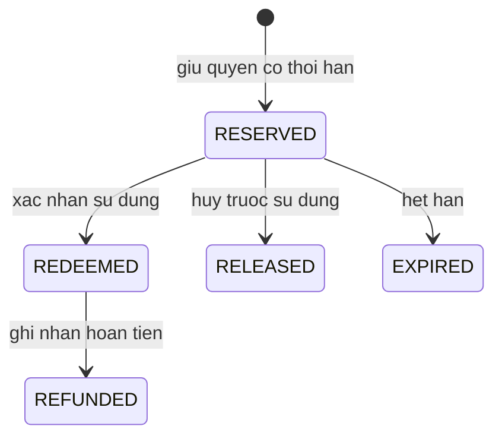
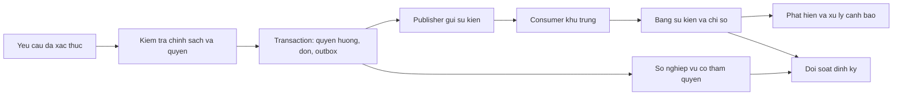

# Giám sát lạm dụng giảm giá (Discount abuse monitoring)

Giám sát lạm dụng giảm giá là quá trình thu thập bằng chứng, đối chiếu quyền hưởng ưu đãi và phát hiện cách sử dụng khuyến mãi làm sai quy tắc nghiệp vụ. Mục tiêu không chỉ là nhận ra khách hàng “dùng nhiều mã”, mà là xác định hệ thống đã từ chối, cho phép hoặc ghi nhận một lợi ích có đúng hay không.

Trong phạm vi bảo mật logic nghiệp vụ của ứng dụng, giám sát phải gắn với business invariants, trạng thái đơn hàng, quyền theo đối tượng, transaction và idempotency. Một biểu đồ tăng đột biến chỉ là tín hiệu điều tra; một giao dịch đã trừ tiền vượt mức giảm được phép là bằng chứng về sai lệch cần xử lý. Phòng ngừa vẫn phải nằm ở phía máy chủ tại thời điểm xác nhận giao dịch.

## 1. Những câu hỏi hệ thống giám sát phải trả lời

Một chương trình giám sát hữu ích trả lời được bốn nhóm câu hỏi:

- **Ý định:** Có ai đang dò mã, cố dùng ưu đãi sai điều kiện hoặc thử lại một yêu cầu bằng nhiều cách?
- **Quyết định:** Máy chủ đã kiểm tra điều kiện nào, dùng phiên bản chính sách nào và vì sao chấp nhận hoặc từ chối?
- **Kết quả:** Ưu đãi đã được giữ chỗ, sử dụng, giải phóng hay điều chỉnh sau hoàn tiền? Khách hàng thực sự nhận bao nhiêu lợi ích?
- **Tác động:** Có bao nhiêu đơn và chủ thể bị ảnh hưởng, ngân sách đã tiêu hao bao nhiêu, và biện pháp kiểm soát gây phiền cho bao nhiêu khách hàng hợp lệ?

Bốn nhóm này cần các nguồn dữ liệu khác nhau. Access log có thể thể hiện số lần gửi yêu cầu nhưng không chứng minh số lượt ưu đãi đã bị sử dụng. Sổ ghi nhận sử dụng ưu đãi có thể chứng minh tác động nhưng thường không chứa đủ thông tin về các lần dò mã thất bại.

### Chính sách ví dụ dùng xuyên suốt

Giả sử chiến dịch giả lập `WELCOME20` có các quy tắc:

| Quy tắc | Ý nghĩa cần bảo vệ |
| --- | --- |
| Chỉ dành cho lần mua thành công đầu tiên | Kiểm tra dựa trên lịch sử giao dịch do máy chủ quản lý |
| Mỗi tài khoản được hưởng một lần trong chiến dịch | Không được tạo thêm quyền hưởng bằng cách đổi đơn hoặc đổi idempotency key |
| Giảm 20% trên hàng đủ điều kiện, tối đa 100.000 VND | Máy chủ xác định cơ sở tính giảm và số tiền cuối cùng |
| Giá trị hàng đủ điều kiện trước giảm ít nhất 500.000 VND | Không dùng tổng giỏ do client khai báo làm căn cứ |
| Không cộng dồn với mã khác | Hai mã riêng lẻ hợp lệ vẫn có thể tạo ra tổ hợp không hợp lệ |
| Quyền giữ chỗ có thời hạn | Hết hạn hoặc hủy phải được giải phóng đúng một lần |
| Hoàn tiền không khôi phục quyền đã sử dụng | Tránh hủy hoặc hoàn để hưởng lại ưu đãi, theo chính sách của ví dụ |

Các quy tắc trên là giả định học tập, không phải mặc định của mọi sản phẩm. Ví dụ, một doanh nghiệp có thể cho phép khôi phục quyền sau một số loại hủy đơn; khi đó máy giám sát phải phân biệt sự khôi phục hợp lệ với lỗi.

## 2. Chuyển quy tắc nghiệp vụ thành điều kiện quan sát được

Đừng bắt đầu bằng một danh sách địa chỉ IP cần chặn. Hãy bắt đầu bằng các điều kiện hệ thống bắt buộc duy trì, sau đó xác định bằng chứng để kiểm tra chúng.

| Invariant | Bằng chứng cần có | Sai lệch cần phát hiện |
| --- | --- | --- |
| Người yêu cầu có quyền thao tác trên đơn | Chủ thể xác thực, chủ sở hữu đơn từ dữ liệu máy chủ, quyết định phân quyền | Một chủ thể thao tác lên đơn không thuộc phạm vi được phép |
| Mức giảm không vượt quyền được cấp | Dòng hàng đủ điều kiện, giới hạn, quy tắc làm tròn, phiên bản chính sách | Mức giảm cuối cùng lớn hơn mức máy chủ cho phép |
| Chỉ tiêu dùng quyền một lần | Sổ quyền hưởng, redemption ID, trạng thái đã tiêu dùng | Hai lần tiêu dùng thành công cho cùng quyền |
| Không cộng dồn sai chính sách | Tập ưu đãi áp dụng, nhóm loại trừ và thứ tự tính | Tổ hợp ưu đãi bị cấm vẫn được xác nhận |
| Yêu cầu lặp không tạo lợi ích mới | Idempotency key có phạm vi, dấu vân tay nội dung, kết quả gốc | Cùng một yêu cầu hợp lệ tạo nhiều redemption |
| Giữ chỗ và giải phóng đúng trạng thái | Reservation ID, trạng thái trước/sau, phiên bản bản ghi | Giải phóng hai lần hoặc sử dụng một quyền đã hết hạn |
| Ngân sách không bị vượt ngoài chính sách | Ngân sách cấp phát, số đã giữ, số đã tiêu dùng | Tổng nghĩa vụ vượt giới hạn mà chính sách không cho phép |

Phải định nghĩa thêm “lần mua thành công” là đã thanh toán, đã giao hàng hay một mốc khác. Nếu chính sách dùng mốc giao hàng nhưng kiểm tra chỉ dựa trên lịch sử thanh toán, giám sát có thể đưa ra kết luận sai dù phép đếm chính xác.

Một thay đổi phiên bản chính sách không tự động tạo lại quyền hưởng. Cần xác định rõ quyền thuộc chiến dịch, đợt phát hành hay phiên bản nào để tránh chia nhỏ dữ liệu làm mất dấu vi phạm.

### Phân biệt kiểm soát đồng bộ và phát hiện bất đồng bộ

Các điều kiện về giá, quyền thao tác, số lượt sử dụng và trạng thái phải được kiểm tra ngay trong đường xử lý nghiệp vụ. Với những thao tác cạnh tranh, cần một cơ chế đảm bảo tính nguyên tử thích hợp: ràng buộc duy nhất, cập nhật có điều kiện, khóa hoặc mức cô lập đáp ứng invariant.

Bộ giám sát bất đồng bộ giúp phát hiện lỗ hổng, đánh giá tác động và kích hoạt ứng phó. Nó không thay thế transaction: nếu hai giao dịch đã cùng tiêu dùng một quyền, một cảnh báo xuất hiện sau đó không ngăn được sai lệch đã xảy ra.

Idempotency và giới hạn quyền hưởng cũng khác nhau. Idempotency xử lý việc gửi lại cùng một thao tác; giới hạn quyền hưởng phải vẫn đúng khi người dùng tạo những thao tác khác nhau với các khóa khác nhau.

## 3. Mô hình hóa vòng đời ưu đãi trước khi đếm

Một vòng đời đơn giản có thể biểu diễn như sau:



Đây là mô hình minh họa. Hệ thống có thể tách riêng trạng thái thanh toán, giữ ưu đãi và hoàn tiền. Điều quan trọng là không coi mọi sự kiện trong vòng đời là một lượt giảm giá mới.

Trong chính sách ví dụ:

- `RESERVED` là quyền đang giữ, chưa phải lợi ích đã tiêu dùng.
- `REDEEMED` là quyền đã tiêu dùng và phải được tính vào giới hạn một lần.
- `RELEASED` và `EXPIRED` chỉ giải phóng quyền đang giữ; không được giải phóng lại quyền đã tiêu dùng.
- `REFUNDED` ghi nhận điều chỉnh tài chính. Dấu mốc từng tiêu dùng quyền vẫn được giữ vì chính sách không khôi phục quyền.

Một đơn có thể phát sinh nhiều yêu cầu HTTP, nhiều sự kiện thanh toán và nhiều lần giao nhận thông báo. Số request, số sự kiện và số redemption là ba đại lượng khác nhau.

### Những lỗi logic thường lộ qua vòng đời

1. Hai đơn cùng giữ quyền và cùng xác nhận thành công cho một tài khoản.
2. Thông báo thanh toán được gửi lại làm giảm ngân sách lần thứ hai.
3. Một tác vụ hết hạn chạy trễ giải phóng cả quyền đã được sử dụng.
4. Hoàn một phần nhưng hệ thống khôi phục toàn bộ hạn mức.
5. Thay đổi giỏ hàng sau khi giữ ưu đãi nhưng không tính lại điều kiện.
6. Client dùng lại báo giá đã hết hạn hoặc thuộc một chủ thể khác.

Máy giám sát cần đối chiếu chuyển trạng thái với dữ liệu có thẩm quyền, thay vì chỉ cộng trừ theo thứ tự nhận thông báo.

## 4. Thiết kế dữ liệu quan sát có thể điều tra được

### 4.1. Tách lớp yêu cầu, quyết định và kết quả

**Lớp yêu cầu** phục vụ đo lưu lượng, phát hiện dò mã và nhận diện thử lại. Một request ID đại diện cho một lần truyền tải.

**Lớp quyết định** ghi nhận kết quả đánh giá của máy chủ. Một decision ID đại diện cho một lần quyết định nghiệp vụ có định danh rõ ràng; việc phát lại sự kiện của quyết định đó không tạo thêm quyết định mới.

**Lớp kết quả** lấy từ sổ ghi nhận ưu đãi và trạng thái giao dịch. Một redemption ID đại diện cho một lần sử dụng ưu đãi, có thể có nhiều cập nhật trạng thái.

Nếu chỉ có log “apply coupon: success”, không thể biết đó là thành công ở bước kiểm tra, giữ chỗ hay thực sự tiêu dùng quyền.

### 4.2. Hợp đồng sự kiện tối thiểu

Ví dụ sau là một sự kiện giả lập, được phát từ máy chủ sau khi transaction xác nhận sử dụng ưu đãi đã commit:

```json
{
  "schema_version": 1,
  "event_id": "evt_482",
  "event_type": "discount.redemption_committed",
  "occurred_at": "2026-11-22T03:15:10Z",
  "recorded_at": "2026-11-22T03:15:11Z",
  "decision_id": "dec_731",
  "subject_id": "sub_193",
  "tenant_id": "tenant_a",
  "campaign_id": "WELCOME20",
  "rule_version": "v3",
  "order_id": "ord_816",
  "order_version": 7,
  "reservation_id": "res_640",
  "redemption_id": "red_902",
  "idempotency_key_fingerprint": "ik_opaque_027",
  "eligible_subtotal_minor": 600000,
  "discount_minor": 100000,
  "currency": "VND",
  "outcome": "COMMITTED",
  "reason_code": "ELIGIBLE",
  "entitlement_consumed": true,
  "trace_id": "trace_458"
}
```

Số tiền dùng đơn vị nhỏ nhất của đồng tiền và số nguyên. Trong ví dụ VND, 600000 tương ứng 600.000 đồng. Không suy ra rằng mọi đồng tiền đều có hai chữ số thập phân.

Các trường cần có ý nghĩa nhất quán:

| Nhóm trường | Cách sử dụng |
| --- | --- |
| `event_id`, `schema_version` | Chống xử lý trùng và kiểm soát thay đổi hợp đồng dữ liệu |
| `occurred_at`, `recorded_at` | Phân biệt thời điểm nghiệp vụ xảy ra và thời điểm ghi nhận |
| `subject_id`, `tenant_id` | Xác định chủ thể và phạm vi dữ liệu từ ngữ cảnh đã xác thực |
| `campaign_id`, `rule_version` | Truy nguyên chính sách đã áp dụng tại thời điểm quyết định |
| `order_id`, `order_version` | Nối với trạng thái và bản chụp giá tương ứng |
| `reservation_id`, `redemption_id` | Theo dõi vòng đời và đếm quyền bị tiêu dùng |
| `decision_id`, dấu vân tay idempotency | Phân biệt quyết định mới, retry và kết quả được phát lại |
| Số tiền và đồng tiền | Đối soát tác động tài chính theo cùng phạm vi |
| `outcome`, `reason_code` | Phân tích điều kiện bị từ chối bằng mã ổn định |
| `trace_id` | Điều tra đường đi qua các dịch vụ |

Không phải mọi trường đều có ở mọi loại sự kiện. Một yêu cầu bị từ chối trước khi tạo đơn có thể không có order ID; không điền ID giả để làm dữ liệu trông đầy đủ.

Các giá trị như giá hàng, chủ sở hữu đơn và quyền hưởng phải lấy từ máy chủ. Nếu cần ghi dữ liệu client khai báo để đối chiếu, đặt trong trường riêng thể hiện rõ nguồn không đáng tin cậy.

### 4.3. Mã lý do có cấu trúc

Có thể dùng các mã như `NOT_FIRST_PURCHASE`, `ALREADY_CONSUMED`, `MINIMUM_NOT_MET`, `STACKING_NOT_ALLOWED`, `OWNER_MISMATCH` và `IDEMPOTENCY_PAYLOAD_MISMATCH`.

Một phản hồi API cho khách hàng có thể cần ít chi tiết hơn log nội bộ, nhất là khi chi tiết giúp dò tài nguyên hoặc đoán trạng thái của người khác. Log nội bộ vẫn cần đủ bằng chứng và phải được phân quyền truy cập.

## 5. Đảm bảo dữ liệu giám sát phản ánh giao dịch đã commit

Một kiến trúc thường dùng là ghi thay đổi nghiệp vụ và bản ghi outbox trong cùng transaction:



Outbox giúp tránh tình huống dữ liệu đã commit nhưng ứng dụng lỗi trước khi gửi sự kiện. Cơ chế truyền vẫn có thể phát lại; không được mặc định hệ thống vận chuyển bảo đảm đúng một lần ở mọi tầng.

Các yêu cầu vận hành quan trọng:

- Consumer dùng khóa duy nhất như `(consumer_name, event_id)` để nhận diện thông điệp đã xử lý.
- Việc ghi nhận event đã xử lý và cập nhật kết quả tổng hợp phải nguyên tử hoặc có khả năng chạy lại an toàn.
- Kết quả phát hiện cũng cần khóa ổn định để một sự kiện phát lại không tạo hàng chục sự cố.
- Sự kiện của cùng redemption có thể đến sai thứ tự. Dùng phiên bản nghiệp vụ hoặc quy tắc chuyển trạng thái, không lấy “thông báo đến sau” làm trạng thái mới nhất.
- Có đường xử lý thông điệp lỗi, cảnh báo backlog và cơ chế phát lại sau khi sửa consumer.
- Đối soát định kỳ với sổ nghiệp vụ để tìm sự kiện thiếu, tác động trùng hoặc trạng thái không khớp.

Đối với yêu cầu bị từ chối, không có transaction đơn hàng để dựa vào. Có thể phát decision event qua kênh telemetry riêng, nhưng phải đo tỷ lệ mất dữ liệu và không dùng nguồn này làm sổ số tiền đã chi.

Không lấy sự kiện từ trình duyệt hoặc ứng dụng di động làm bằng chứng duy nhất cho việc đã hưởng ưu đãi. Nguồn gửi sự kiện, quyền ghi vào kênh và quyền sửa dữ liệu giám sát đều thuộc phạm vi bảo vệ.

## 6. Xây dựng tín hiệu phát hiện theo mức độ bằng chứng

### 6.1. Vi phạm trực tiếp và bất thường hành vi

**Vi phạm trực tiếp** là quan sát trái một invariant đã xác định: hai quyền tiêu dùng thành công cho tài khoản chỉ được hưởng một lần, hoặc mức giảm vượt giới hạn tính từ bản chụp chính sách hợp lệ.

**Bất thường hành vi** là mẫu đáng điều tra nhưng có thể hợp lệ: nhiều lần nhập sai mã, tỷ lệ ưu đãi cao hoặc nhiều tài khoản xuất hiện trên cùng mạng.

Phân biệt này ảnh hưởng tới cách phản ứng. Một vi phạm trực tiếp có thể là lỗi triển khai hoặc cấu hình, chưa chứng minh người dùng có ác ý. Một bất thường có thể là chiến dịch tiếp thị thành công, chưa chứng minh có vi phạm.

| Tín hiệu | Phạm vi tổng hợp | Cách hiểu và phản ứng ban đầu |
| --- | --- | --- |
| Nhiều mã sai trong thời gian ngắn | Tài khoản, phiên, chiến dịch | Nghi dò mã; xem tỷ lệ từ chối và lưu lượng nền |
| Nhiều yêu cầu dùng lại quyền đã tiêu dùng | Tài khoản, quyền hưởng | Phân biệt retry tự động với thao tác mới sau khi biết bị từ chối |
| Hai redemption thành công cho quyền một lần | Quyền hưởng, chiến dịch | Ưu tiên đối soát transaction, ràng buộc và mức thiệt hại |
| Mức giảm cuối cùng vượt mức cho phép | Đơn hàng, bản chụp chính sách | Kiểm tra tính giá, thay đổi giỏ, đơn vị tiền và làm tròn |
| Cùng khóa idempotency nhưng nội dung khác | Chủ thể, thao tác, khóa có phạm vi | Từ chối nội dung không khớp; điều tra cả lỗi client |
| Nhiều lần chạm đơn ngoài phạm vi | Chủ thể và tài nguyên được yêu cầu | Kiểm tra phân quyền theo đối tượng và mức bao phủ kiểm soát |
| Lặp chu kỳ dùng ưu đãi rồi hoàn tiền | Tài khoản, giao dịch liên quan | Xét lý do hoàn, loại hàng và chính sách khôi phục quyền |
| Nhiều tài khoản có liên hệ và cùng hưởng ưu đãi | Cụm tài khoản với tín hiệu được phép sử dụng | Chỉ là tín hiệu bổ trợ; cần bằng chứng độc lập |

Địa chỉ IP chung, mạng doanh nghiệp, ký túc xá hoặc gia đình tạo ra liên hệ tự nhiên. Không khóa hàng loạt chỉ vì cùng IP. Dấu vân tay thiết bị cũng không phải danh tính đáng tin cậy tuyệt đối.

### 6.2. Tỷ lệ phải đi cùng mẫu số và quy mô

Một vài đại lượng nên định nghĩa rõ:

```text
Tỷ lệ từ chối =
  số quyết định bị từ chối / số quyết định đã đánh giá

Tỷ lệ sử dụng thành công =
  số redemption đã tiêu dùng / số quyết định đủ điều kiện

Mức tiêu hao ngân sách =
  tổng nghĩa vụ ưu đãi được tính theo chính sách / ngân sách được cấp

Tỷ lệ hoàn trong nhóm đã hưởng ưu đãi =
  số đơn đã hưởng có hoàn / số đơn đã hưởng đủ thời gian quan sát
```

Mỗi tỷ lệ phải nêu cửa sổ thời gian, phạm vi và tiêu chí loại trùng. Tỷ lệ hoàn cần nhóm đơn có thời gian trưởng thành tương đương; so đơn mới hôm nay với đơn đã giao một tháng sẽ làm lệch kết quả.

Không cộng trực tiếp các khoản tiền khác đồng tiền. Nếu cần quy đổi để báo cáo chung, lưu đồng tiền gốc, thời điểm và quy tắc quy đổi; kiểm tra invariant vẫn nên theo đơn vị và đồng tiền của giao dịch.

### 6.3. Chọn ngưỡng có ngữ cảnh

Ví dụ một quy tắc thử nghiệm là: trong 15 phút, một tài khoản có ít nhất 30 quyết định và ít nhất 90% bị từ chối. Đây chỉ là con số minh họa, cần hiệu chỉnh bằng dữ liệu thực tế.

Phân đoạn đường cơ sở theo chiến dịch, kênh, thời điểm khởi chạy và nhóm khách hàng có hành vi tương đương. Một đợt livestream có thể làm lưu lượng tăng mạnh mà không có lạm dụng.

Với vi phạm invariant đã được chứng minh, một lần xảy ra có thể đủ tạo sự cố. Với tín hiệu thống kê, nên kết hợp quy mô mẫu, độ lệch đường cơ sở, tác động và tín hiệu độc lập.

## 7. Ví dụ truy vấn trên dữ liệu đã chuẩn hóa

Các ví dụ dưới dùng cú pháp PostgreSQL và minh họa cách nghĩ về dữ liệu. Chúng giả định đã có bảng chuẩn hóa từ sự kiện; không truy vấn trực tiếp một dòng cho mỗi lần gửi thông điệp.

### 7.1. Phát hiện nhiều quyết định bị từ chối

Giả sử `discount_decision_fact` có một dòng cho mỗi `decision_id`, với các cột `occurred_at`, `tenant_id`, `campaign_id`, `subject_id`, `outcome` và `reason_code`. Trong ví dụ này, `outcome` chỉ nhận `APPROVED` hoặc `REJECTED`.

```sql
SELECT
    tenant_id,
    campaign_id,
    subject_id,
    COUNT(*) AS total_decisions,
    COUNT(*) FILTER (
        WHERE outcome = 'REJECTED'
    ) AS rejected_decisions,
    ROUND(
        100.0 * COUNT(*) FILTER (
            WHERE outcome = 'REJECTED'
        ) / NULLIF(COUNT(*), 0),
        2
    ) AS rejection_percent
FROM discount_decision_fact
WHERE occurred_at >= CURRENT_TIMESTAMP - INTERVAL '20 minutes'
  AND occurred_at <  CURRENT_TIMESTAMP - INTERVAL '5 minutes'
GROUP BY tenant_id, campaign_id, subject_id
HAVING COUNT(*) >= 30
   AND COUNT(*) FILTER (
       WHERE outcome = 'REJECTED'
   ) >= 0.90 * COUNT(*);
```

Cửa sổ dài 15 phút kết thúc trước hiện tại 5 phút để minh họa một khoảng chờ dữ liệu đến muộn. Năm phút không phải hằng số phổ quát; cần dựa vào độ trễ đo được. Một luồng cảnh báo nhanh hơn có thể chạy song song với kết quả còn tạm thời.

Bảng đã loại trùng theo decision ID giúp chống sự kiện phát lại. Các request trả lại cùng một kết quả idempotent cần được ghi rõ là replay; vẫn theo dõi chúng ở chỉ số request, nhưng không biến chúng thành quyết định mới trong bảng này.

Kết quả truy vấn chỉ tạo danh sách cần xem xét. Tiếp theo phải phân tích mã lý do, phiên bản client, số redemption thành công và trạng thái chiến dịch.

### 7.2. Tìm nhiều lần tiêu dùng quyền chỉ được hưởng một lần

Giả sử `discount_redemption` là bảng có một dòng cho mỗi redemption, gồm `redemption_id`, `tenant_id`, `campaign_id`, `subject_id`, `order_id` và `benefit_consumed_at`.

Với chính sách `WELCOME20` không khôi phục quyền sau hoàn tiền, `benefit_consumed_at` được giữ khi trạng thái tài chính chuyển sang đã hoàn.

```sql
SELECT
    tenant_id,
    campaign_id,
    subject_id,
    COUNT(DISTINCT redemption_id) AS consumed_redemptions,
    COUNT(DISTINCT order_id) AS affected_orders,
    MIN(benefit_consumed_at) AS first_consumed_at,
    MAX(benefit_consumed_at) AS last_consumed_at
FROM discount_redemption
WHERE campaign_id = 'WELCOME20'
  AND benefit_consumed_at IS NOT NULL
GROUP BY tenant_id, campaign_id, subject_id
HAVING COUNT(DISTINCT redemption_id) > 1;
```

Không chia nhóm theo phiên bản chính sách trong ví dụ này: quyền hưởng thuộc toàn chiến dịch. Nếu nhóm theo phiên bản, hai lần hưởng ở hai phiên bản có thể bị che khuất.

Đây là truy vấn đối soát, không phải cách thay thế ràng buộc đồng bộ. Với dữ liệu lớn, có thể xử lý tăng dần những chủ thể vừa thay đổi và đối soát đầy đủ theo lịch; khi xét một chủ thể, phải tính cả lịch sử thuộc phạm vi quyền, tránh chỉ nhìn phần dữ liệu gần nhất.

Nếu chính sách cho phép cấp lại quyền, cần mô hình hóa lần cấp quyền và lý do cấp lại. Không tái sử dụng truy vấn này nguyên trạng rồi kết luận mọi lần hưởng thứ hai đều sai.

## 8. Đối soát tiền và ngân sách đúng ý nghĩa

Một dashboard có thể đồng thời hiển thị:

- **Đang giữ:** nghĩa vụ từ các reservation còn hiệu lực.
- **Đã sử dụng:** số tiền ưu đãi được xác nhận theo nghiệp vụ.
- **Điều chỉnh sau sử dụng:** khoản hoàn hoặc bù trừ có tham chiếu giao dịch gốc.
- **Ngân sách khả dụng:** giá trị được tính theo chính sách cụ thể của chiến dịch.

Không mặc định “đã sử dụng trừ hoàn tiền” luôn là số ngân sách tiêu hao. Chính sách có thể không tái cấp ngân sách sau hoàn, hoặc chỉ tái cấp một phần. Mô hình tài chính và mô hình quyền hưởng phải được định nghĩa riêng.

Để điều tra một mức giảm bất thường, cần tái dựng được:

1. Bản chụp giá và các dòng hàng tại phiên bản đơn đã xác nhận.
2. Tập ưu đãi, điều kiện đủ tư cách và phiên bản quy tắc tại thời điểm đó.
3. Cơ sở tính giảm, trần giảm, thứ tự cộng dồn và quy tắc làm tròn.
4. Cách phân bổ giảm giá vào dòng hàng để xử lý hoàn một phần.
5. Lần giữ, lần sử dụng và mọi điều chỉnh liên quan.

Đối chiếu theo chính sách hiện tại có thể kết luận sai về giao dịch cũ. Tương tự, thay giá sản phẩm hôm nay rồi tính lại đơn hôm qua không tạo ra bằng chứng đáng tin cậy.

Không cần sao chép toàn bộ dữ liệu đơn vào mọi log. Có thể lưu một bản chụp nghiệp vụ bất biến và tham chiếu tới bản đó, miễn là còn truy cập được trong thời hạn điều tra.

## 9. Biến phát hiện thành cảnh báo có thể xử lý

Một cảnh báo cần đủ thông tin để người trực biết kiểm tra gì:

| Thành phần | Nội dung nên có |
| --- | --- |
| Danh tính quy tắc | Mã quy tắc, phiên bản và thời điểm kích hoạt |
| Phạm vi | Tenant, chiến dịch, chủ thể hoặc tập đơn bị ảnh hưởng |
| Bằng chứng | ID quyết định, redemption, bản ghi đối soát và trace liên quan |
| Điều kiện kích hoạt | Giá trị quan sát, ngưỡng, cửa sổ và mẫu số |
| Tác động | Số đơn, số tiền đã xác nhận theo từng đồng tiền |
| Độ tin cậy dữ liệu | Độ trễ, phạm vi đã đối soát, nguồn còn thiếu |
| Hành động đề xuất | Điều tra, giới hạn tốc độ, tăng xác minh hoặc ngừng một nhánh ưu đãi |
| Người phụ trách | Nhóm chịu trách nhiệm và thời hạn phản hồi theo mức độ |

Phân biệt rõ mức độ nghiêm trọng của tác động với độ tin cậy của kết luận. Một cụm tài khoản có giá trị lớn có thể đáng ưu tiên nhưng bằng chứng gian lận vẫn yếu.

### Tránh bão cảnh báo

Dùng khóa gom nhóm như `(rule_id, tenant_id, campaign_id, subject_id, window)`, cập nhật bằng chứng vào sự cố đang mở và đặt thời gian chờ phù hợp. Khi cùng lỗi triển khai tạo ra nhiều vi phạm, cần một sự cố cấp chiến dịch kèm danh sách bị ảnh hưởng.

Ngưỡng gom nhóm phải phục vụ điều tra, không che mất số lượng hay tổng tác động. Việc cảnh báo đã gửi thành công cũng không đồng nghĩa đã có người nhận xử lý.

## 10. Chọn phản ứng tương xứng với bằng chứng

Một thang phản ứng có thể gồm:

1. **Chỉ ghi nhận:** dùng lúc mới triển khai quy tắc hoặc tín hiệu còn yếu.
2. **Giới hạn tốc độ theo phạm vi thích hợp:** giảm dò mã mà vẫn cho phép mua hàng hợp lệ.
3. **Yêu cầu xác minh bổ sung:** dùng khi có đủ lý do và cơ chế hỗ trợ khách hàng.
4. **Từ chối thao tác vi phạm invariant:** thực hiện ngay tại máy chủ.
5. **Tạm dừng một chiến dịch hoặc đường áp dụng bị lỗi:** dùng khi đã xác nhận hệ thống tiếp tục phát sinh thiệt hại.
6. **Điều tra tài khoản hoặc giao dịch:** xử lý theo bằng chứng, quy trình và quyền hạn phù hợp.

Giới hạn tốc độ cần lấy chủ thể từ phiên đã xác thực; không cho người gửi tự chọn ID của nạn nhân để kích hoạt hạn chế lên tài khoản đó. Với request chưa xác thực, cần dùng khóa phù hợp và nhận thức được rủi ro ảnh hưởng người dùng chung mạng.

Nếu có cơ chế tự động tạm dừng, phải định nghĩa phạm vi, thời gian hết hiệu lực, người có quyền khôi phục và cách xử lý quyền đã giữ hợp lệ. Thay cấu hình không được âm thầm khiến đơn đã thanh toán mất quyền ưu đãi.

### Ví dụ ứng phó với hai lần sử dụng thành công

Khi phát hiện hai redemption cho cùng quyền:

1. Đối soát với dữ liệu có thẩm quyền để loại trường hợp thông điệp trùng hoặc mô hình tổng hợp sai.
2. Xác định thời điểm, phiên bản ứng dụng, chính sách và các transaction liên quan.
3. Chặn nguyên nhân tiếp tục tạo lợi ích sai bằng kiểm soát đồng bộ hoặc tạm ngừng nhánh bị lỗi.
4. Bảo toàn dữ liệu và tính phạm vi tác động theo đơn, chủ thể và đồng tiền.
5. Sửa cơ chế cạnh tranh hoặc chuyển trạng thái; xử lý giao dịch đã phát sinh theo quy trình nghiệp vụ.
6. Phát lại dữ liệu giám sát khi cần và xác nhận không còn sai lệch mới.

Không tự động trừ tiền lại hoặc thay đổi giao dịch đã hoàn tất chỉ từ một điểm rủi ro. Đây là một hành động nghiệp vụ riêng cần căn cứ và quyền xử lý rõ ràng.

## 11. Kiểm thử các tình huống tấn công logic và lỗi dữ liệu

Kiểm thử giám sát cần đồng thời kiểm tra kết quả nghiệp vụ và kết quả quan sát. Không coi “đã có log” là đủ nếu log mô tả sai kết quả.

| Tình huống | Kỳ vọng nghiệp vụ | Kỳ vọng giám sát |
| --- | --- | --- |
| Gửi lại cùng request và cùng khóa hợp lệ | Trả lại kết quả cũ, không tiêu dùng thêm quyền | Request tăng; redemption và quyết định gốc không bị đếm thêm |
| Dùng cùng khóa với nội dung khác | Từ chối xung đột nội dung | Có mã lý do và liên kết tới thao tác gốc |
| Hai đơn đồng thời dùng quyền một lần | Chỉ một giao dịch được tiêu dùng quyền | Ghi nhận kết quả cả hai; số tiêu dùng hợp lệ bằng một |
| Lỗi được chủ động mô phỏng tạo hai redemption | Bộ kiểm soát bất biến phát hiện được sai lệch | Đối soát tạo cảnh báo với bằng chứng hai redemption |
| Giữ quyền rồi thay giỏ xuống dưới ngưỡng | Xác nhận phải đánh giá lại điều kiện | Thể hiện phiên bản đơn và lý do từ chối |
| Dùng hai mã riêng lẻ hợp lệ nhưng bị cấm cộng dồn | Không xác nhận tổ hợp sai | Có tín hiệu vi phạm điều kiện cộng dồn |
| Gửi thông báo thanh toán hoặc hoàn tiền nhiều lần | Chỉ một hiệu ứng cho cùng thao tác | Không cộng hoặc trừ ngân sách lặp |
| Sự kiện dùng quyền đến trước sự kiện giữ quyền | Trạng thái tổng hợp cuối cùng vẫn đúng | Không tự hạ trạng thái theo thứ tự nhận |
| Sự kiện trễ vượt cửa sổ ban đầu | Giao dịch gốc không đổi | Đối soát hoặc cập nhật cửa sổ bổ sung phát hiện phần thiếu |
| Nhiều khách hợp lệ dùng chung IP | Tiếp tục xử lý đúng quyền từng người | Không kết luận lạm dụng chỉ từ IP chung |
| Hoàn một phần đơn đã hưởng | Hoàn theo phân bổ và chính sách | Không giả định toàn bộ quyền hoặc tiền được tái cấp |
| Thay cấu hình chiến dịch | Dùng đúng phiên bản tại thời điểm quyết định | Phân tích được thay đổi hành vi do phiên bản mới |

Chỉ mô phỏng hành vi gây sai lệch trong môi trường kiểm thử có kiểm soát. Dữ liệu thử cần có nhãn và tách khỏi báo cáo tài chính, nhưng nhãn đó không được trở thành cách để request bên ngoài bỏ qua kiểm soát.

Ngoài các tình huống trên, cần thử mất kết nối sau khi commit, publisher gửi lại sự kiện và consumer dừng giữa chừng. Mục tiêu là chứng minh khả năng khôi phục mà không tạo hiệu ứng hoặc cảnh báo trùng.

## 12. Đo chất lượng của cả phát hiện và vận hành

Các chỉ số nên được chia theo mục đích:

| Nhóm | Chỉ số tiêu biểu |
| --- | --- |
| Toàn vẹn nghiệp vụ | Số vi phạm invariant đã xác nhận, số giao dịch và tiền bị ảnh hưởng |
| Hiệu quả phát hiện | Thời gian phát hiện, thời gian xử lý, tỷ lệ cảnh báo được xác nhận |
| Ảnh hưởng khách hàng | Tỷ lệ bị yêu cầu xác minh, lỗi checkout, khiếu nại, tỷ lệ dương tính giả trong mẫu đã đánh giá |
| Sức khỏe dữ liệu | Độ trễ sự kiện, backlog outbox, thông điệp lỗi, chênh lệch đối soát |
| Bao phủ | Tỷ lệ đường xử lý tạo đủ quyết định và kết quả có thể nối với nhau |

Không thể suy ra tỷ lệ bỏ sót chỉ từ các cảnh báo đã có. Muốn ước lượng cần nguồn đánh giá độc lập như mẫu giao dịch được rà soát, tình huống kiểm thử đã biết kết quả hoặc các sự cố được phát hiện qua đối soát.

Cũng không thể kết luận “không có gian lận” khi số sự kiện đột ngột bằng không. Hãy kiểm tra lượng giao dịch thực tế, tình trạng publisher, consumer và độ đầy đủ dữ liệu.

Dashboard nên hiển thị riêng các tầng: yêu cầu áp dụng, quyết định được duyệt, quyền đang giữ, redemption đã tiêu dùng và điều chỉnh sau sử dụng. Các tầng này cần liên kết được nhưng không bắt buộc có số đếm bằng nhau.

## 13. Bảo vệ dữ liệu giám sát

Dữ liệu điều tra có thể tiết lộ hành vi mua hàng và mối liên hệ giữa tài khoản. Chỉ thu thập những gì có mục đích rõ ràng.

- Dùng ID nội bộ hoặc định danh đã được xử lý phù hợp; không đưa email, token truy cập hay thông tin thanh toán đầy đủ vào log.
- Không ghi toàn bộ mã ưu đãi bí mật hoặc khóa idempotency thô nếu có thể dùng ID và dấu vân tay phục vụ đối chiếu.
- Nếu cần tương quan qua dữ liệu nhạy cảm, cân nhắc HMAC với khóa được quản lý; hash không có khóa của dữ liệu dễ đoán không bảo đảm che giấu được dữ liệu đó.
- Phân quyền truy cập và lưu dấu thao tác xem, xuất, sửa hoặc thay đổi cấu hình giám sát.
- Đặt thời hạn lưu theo nhu cầu đối soát và điều tra; có cơ chế xử lý dữ liệu hết hạn.
- Tách dữ liệu có độ đa dạng lớn như subject ID, order ID khỏi nhãn metric. Dùng log hoặc kho phân tích có phân quyền để tra cứu chi tiết.

Không coi dữ liệu đã đổi tên hoặc băm là tự động vô danh. Khả năng liên kết và truy ngược vẫn cần được đánh giá.

## 14. Triển khai từng bước và giữ khả năng giải thích

Có thể đưa giám sát vào vận hành theo trình tự:

1. Chốt nghĩa của quyền hưởng, mốc tiêu dùng, cách hoàn và invariant cho từng loại chiến dịch.
2. Bổ sung sự kiện máy chủ, ID liên kết, dữ liệu phiên bản và phép đối soát với sổ nghiệp vụ.
3. Chạy quy tắc ở chế độ quan sát; đo chất lượng dữ liệu và đọc mẫu cảnh báo.
4. Hiệu chỉnh ngưỡng với dữ liệu hợp lệ, phân tích chiến dịch mới và kiểm tra các nhóm dùng chung hạ tầng.
5. Bật phản ứng tự động theo từng phạm vi nhỏ, theo dõi tác động checkout và có đường khôi phục.
6. Duy trì kiểm thử sự kiện trùng, đến muộn, cạnh tranh và thay đổi chính sách khi phát hành.

Ở mọi bước, người xử lý phải giải thích được một phát hiện bằng chuỗi bằng chứng: **chính sách nào → quyền nào → quyết định nào → giao dịch nào → lợi ích nào đã được ghi nhận**.

Giám sát giảm giá có giá trị khi chuỗi đó nhất quán với dữ liệu nghiệp vụ. Nó vừa giúp phát hiện việc lạm dụng, vừa chỉ ra chỗ hệ thống cần sửa để một yêu cầu trái quy tắc không thể tiếp tục tạo lợi ích.
