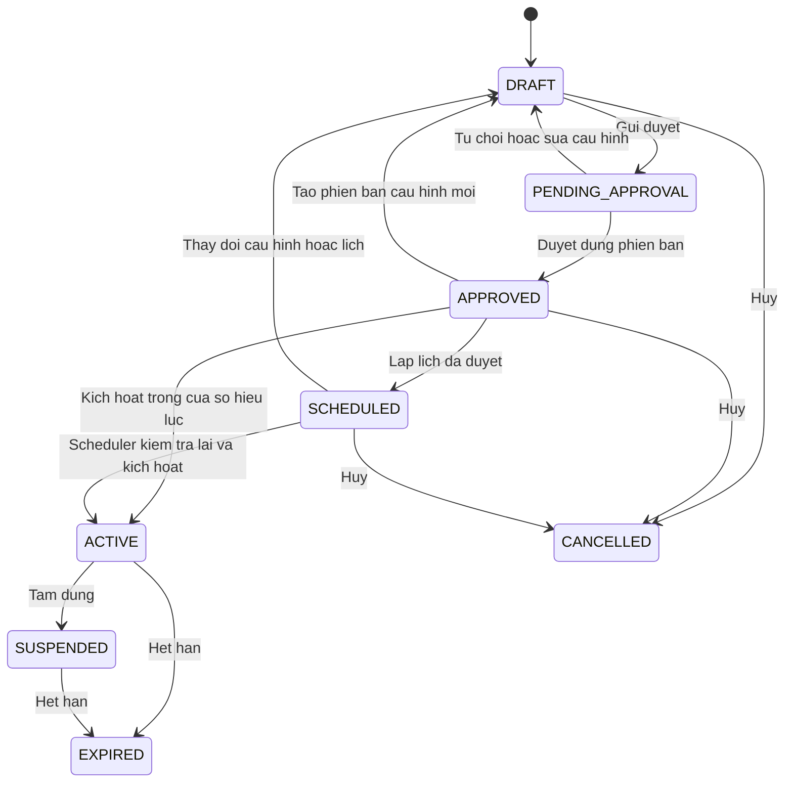

# Kích hoạt chương trình khuyến mãi (Promotion activation)

## 1. Kích hoạt khuyến mãi là một quyết định nghiệp vụ

Trong chương Promotions, **promotion activation** là thao tác đưa một cấu hình khuyến mãi đã được chấp thuận vào trạng thái có thể được bộ máy tính giá sử dụng. Một lần kích hoạt có thể làm hàng nghìn đơn hàng nhận giảm giá, nên thao tác này cần bảo vệ cả quyền thực hiện, nội dung được duyệt và tính nhất quán khi có nhiều yêu cầu đồng thời.

Bài học thuộc phạm vi bảo mật logic nghiệp vụ: ngăn bỏ qua phê duyệt, sửa mức giảm sau khi duyệt, kích hoạt chương trình ngoài phạm vi được giao và tạo tác dụng phụ nhiều lần khi gửi lại yêu cầu. Trọng tâm là business invariants, state machine, quyền theo đối tượng, transaction và idempotency.

Sau bài học, người học cần có thể:

- Viết các bất biến xác định khi nào một khuyến mãi được phép kích hoạt.
- Ràng buộc quyết định phê duyệt với đúng phiên bản cấu hình.
- Thiết kế một lệnh kích hoạt có kiểm tra quyền trên từng chương trình.
- Xử lý kích hoạt đồng thời, chạy lịch và retry mà không tạo thêm tác dụng nghiệp vụ.
- Xác định các tình huống kiểm thử nhằm phá vỡ quy trình kích hoạt.

### 1.1. Phân biệt ba thao tác thường bị gọi chung là “activate”

| Thao tác | Chủ thể thường thực hiện | Kết quả nghiệp vụ |
| --- | --- | --- |
| Kích hoạt chương trình | Nhân viên vận hành hoặc scheduler được cấp quyền | Một phiên bản khuyến mãi được đưa vào vận hành |
| Nhận ưu đãi, lưu mã hoặc đăng ký tham gia | Khách hàng | Tạo quyền hưởng ưu đãi cho một khách hàng nếu chính sách yêu cầu |
| Áp dụng ưu đãi vào đơn hàng, còn gọi là redemption | Dịch vụ tính giá hoặc đặt hàng | Tính tiền giảm, giữ chỗ hoặc tiêu thụ hạn mức |

Bài này tập trung vào hàng đầu tiên. Việc khách hàng nhận mã thành công không cho phép họ thay đổi trạng thái chương trình. Việc chương trình đã kích hoạt cũng không đồng nghĩa mọi đơn hàng đều đủ điều kiện nhận giảm giá.

### 1.2. Tình huống xuyên suốt

Doanh nghiệp A chuẩn bị chương trình `WELCOME15`, phiên bản cấu hình 7:

| Thuộc tính | Giá trị được duyệt |
| --- | --- |
| Tenant | Doanh nghiệp A |
| Phạm vi | Kênh web, nhóm sản phẩm được chỉ định |
| Điều kiện khách hàng | Khách hàng mới theo định nghĩa của hệ thống |
| Mức giảm | 15%, tối đa 100.000 VND mỗi đơn |
| Giá trị đơn tối thiểu | 500.000 VND trước giảm giá, theo cơ sở tính đã quy định |
| Ngân sách chiến dịch | 50.000.000 VND |
| Thời gian | Từ 00:00 ngày 01/12/2026 đến trước 00:00 ngày 08/12/2026, múi giờ Asia/Ho_Chi_Minh |
| Người tạo và người duyệt | Hai người khác nhau theo chính sách của ví dụ |

Các con số và chính sách này là giả định để minh họa. Sản phẩm thực tế phải chốt định nghĩa khách hàng mới, cơ sở tính tiền, cách làm tròn và chính sách cộng dồn trước khi cho phép kích hoạt.

Nếu một người thay mức giảm thành 90% sau khi duyệt, rồi gọi đúng API kích hoạt bằng tài khoản nhân viên hợp lệ, yêu cầu vẫn có thể gây thất thoát. Đăng nhập thành công và JSON hợp lệ chưa chứng minh quyết định kích hoạt là hợp lệ.

## 2. Mô hình đe dọa của luồng kích hoạt

Xét cả khách hàng bên ngoài, nhân viên có quyền giới hạn và các tác vụ nội bộ bị cấu hình sai. Không mặc định request từ màn hình quản trị, hàng đợi hay scheduler đã vượt qua kiểm soát nghiệp vụ.

| Cách lạm dụng | Điều kiện tạo lỗ hổng | Tác động |
| --- | --- | --- |
| Gọi thẳng API khi chương trình còn DRAFT | Backend chỉ ẩn nút kích hoạt trên giao diện | Bỏ qua phê duyệt |
| Thay ID chương trình hoặc tenant | Chỉ kiểm tra vai trò chung như MARKETING | Kích hoạt khuyến mãi của đơn vị khác |
| Sửa mức giảm sau khi duyệt | Phê duyệt gắn với ID chương trình, không gắn phiên bản | Cấu hình đang chạy khác nội dung đã được duyệt |
| Gửi kèm `approved=true`, `force=true` hoặc `status=ACTIVE` | Bind toàn bộ request vào entity | Client tự quyết định trạng thái nghiệp vụ |
| Gửi hàng loạt request hoặc dùng nhiều idempotency key | Không có ràng buộc duy nhất cho lần kích hoạt | Tạo nhiều reservation, sự kiện hoặc thông báo |
| Chạy lại job cũ sau khi sửa lịch | Job mang cấu hình cũ nhưng không kiểm tra lại | Kích hoạt phiên bản hoặc thời điểm đã bị thay thế |
| Kích hoạt đồng thời nhiều chiến dịch | Kiểm tra hạn mức chung bằng truy vấn không đồng bộ hóa | Vượt giới hạn ngân sách hoặc số chiến dịch được chạy |
| Phát lại sự kiện kích hoạt sau khi tạm dừng | Consumer chỉ nhìn loại sự kiện | Cache hoặc dịch vụ phụ đưa ưu đãi trở lại |

Rate limiting giúp giảm lượng yêu cầu nhưng không sửa được lỗi cho phép một yêu cầu hợp lệ về cú pháp phá vỡ quy tắc nghiệp vụ.

## 3. Viết business invariants trước khi viết endpoint

**Business invariant** là điều kiện hệ thống phải bảo toàn qua mọi đường ghi dữ liệu liên quan. Với một lệnh kích hoạt ban đầu, có thể đặt các bất biến sau:

| Mã | Bất biến | Điểm cần thực thi |
| --- | --- | --- |
| I1 | Chủ thể có quyền kích hoạt đúng chương trình, tenant và phạm vi vận hành | Chính sách phân quyền cùng truy vấn đối tượng |
| I2 | Chỉ trạng thái nguồn được quy định mới đi tới ACTIVE | Domain service và cập nhật có điều kiện |
| I3 | Phiên bản được kích hoạt chính là phiên bản đã duyệt, chưa bị thu hồi phê duyệt | Bản ghi phiên bản và quyết định duyệt |
| I4 | Người tạo không tự duyệt nếu chính sách yêu cầu tách nhiệm vụ | Luồng duyệt và kiểm tra trước kích hoạt |
| I5 | Cấu hình thỏa giới hạn kinh doanh: mức giảm, trần giảm, phạm vi, thời gian và tiền tệ | Bộ kiểm tra cấu hình trên server |
| I6 | Thời điểm quyết định nằm trong cửa sổ hiệu lực khi kích hoạt ngay | Đồng hồ tin cậy và điều kiện thời gian |
| I7 | Một phiên bản chỉ có một bản ghi kích hoạt ban đầu | Unique constraint theo khóa nghiệp vụ |
| I8 | Retry cùng một ý định không tạo thêm tác dụng nghiệp vụ | Idempotency cùng transaction |
| I9 | Thay đổi trạng thái, bản ghi kích hoạt, audit và outbox cùng commit hoặc cùng rollback | Transaction trong cơ sở dữ liệu |
| I10 | Các giới hạn dùng chung giữa nhiều chương trình không bị vượt do chạy đồng thời | Khóa hoặc cơ chế nhất quán trên tài nguyên dùng chung |

Không phải mọi hệ thống đều cần hai người duyệt hoặc giữ trước toàn bộ ngân sách. Đây là các chính sách cần lựa chọn rõ ràng. Khi đã chọn, mọi đường kích hoạt phải thực thi thống nhất.

Một biểu thức rút gọn cho điều kiện cho phép kích hoạt:

```text
canActivate(actor, promotion, version, decisionTime) =
    authorized(actor, promotion, ACTIVATE)
    AND promotion.state IN {APPROVED, SCHEDULED}
    AND version.id = promotion.currentConfigVersion
    AND approval.isValidFor(version)
    AND configurationIsAcceptable(version)
    AND version.startsAt <= decisionTime < version.endsAt
    AND sharedLimitsAllowActivation(version)
```

`canActivate` phải được đánh giá trên dữ liệu có cơ chế bảo vệ khỏi thay đổi đồng thời. Đọc dữ liệu, kiểm tra đúng, rồi cập nhật trên một trạng thái đã thay đổi vẫn có thể vi phạm bất biến.

## 4. Mô hình hóa vòng đời bằng state machine

Một state machine cho luồng minh họa:



| Trạng thái | Ý nghĩa trong mô hình | Lệnh kích hoạt ban đầu |
| --- | --- | --- |
| DRAFT | Cấu hình đang được soạn | Từ chối |
| PENDING_APPROVAL | Đang chờ quyết định duyệt | Từ chối |
| APPROVED | Phiên bản hiện tại đã được duyệt | Chấp nhận nếu đủ các điều kiện còn lại |
| SCHEDULED | Đã lên lịch cho đúng phiên bản | Chấp nhận khi đến thời gian và job còn hợp lệ |
| ACTIVE | Đã có một lần kích hoạt ban đầu | Không tạo thêm lần kích hoạt |
| SUSPENDED | Đã bị tạm dừng | Không dùng lệnh kích hoạt ban đầu để mở lại |
| EXPIRED hoặc CANCELLED | Đã hết hiệu lực hoặc bị hủy | Từ chối |

Nếu sản phẩm cho phép tiếp tục chương trình từ SUSPENDED, cần một lệnh `resume` riêng với chính sách rõ ràng. Lệnh này giữ lịch sử và bộ đếm đã tiêu thụ, kiểm tra lại thời hạn, phê duyệt và ngân sách; không coi đó là một lần kích hoạt mới để đặt lại hạn mức.

Việc sửa nội dung kinh doanh khi còn APPROVED hoặc SCHEDULED tạo phiên bản mới và đưa quy trình về DRAFT. Một tác vụ chạy lịch cho phiên bản cũ phải mất hiệu lực. Trong mô hình này, không được sửa trực tiếp cấu hình đang ACTIVE; muốn thay đổi cần một quy trình thay thế phiên bản có kiểm soát riêng.

Kiểm soát trình tự trên server và gắn việc cho phép thực thi với dữ liệu thực tế là nguyên tắc được nêu trong [OWASP Transaction Authorization Cheat Sheet](https://cheatsheetseries.owasp.org/cheatsheets/Transaction_Authorization_Cheat_Sheet.html). State machine trên là thiết kế minh họa cho bài toán khuyến mãi, không phải một vòng đời bắt buộc của OWASP.

## 5. Phê duyệt phải gắn với một cấu hình xác định

### 5.1. Tách phiên bản nội dung và phiên bản trạng thái

Nên phân biệt hai khái niệm:

- `configVersion`: phiên bản nội dung kinh doanh, ví dụ mức giảm, nhóm sản phẩm, ngân sách, thời gian và chính sách cộng dồn.
- `stateRevision`: số thứ tự thay đổi của đối tượng điều phối, tăng khi duyệt, lên lịch, kích hoạt, hủy hoặc chuyển con trỏ sang cấu hình mới.

Một thay đổi trạng thái có thể không đổi `configVersion`. Ngược lại, một thay đổi từ mức giảm 15% sang 20% phải tạo `configVersion` mới, dù tên chương trình giữ nguyên.

Phê duyệt có thể được lưu dưới dạng:

```text
ApprovalDecision
  tenantId
  promotionId
  configVersion = 7
  configurationDigest
  decision = APPROVED
  approvedBy
  approvedAt
  revokedAt
  approvalPolicyVersion
```

`configurationDigest` là dấu kiểm tra bổ sung cho nội dung có biểu diễn chuẩn hóa do server tạo. Nó không thay thế bản ghi phê duyệt, phân quyền hoặc tính bất biến của phiên bản. Không nhận digest do client gửi rồi coi đó là bằng chứng đã duyệt.

### 5.2. Những gì cần nằm trong nội dung được duyệt

Ít nhất cần xác định mức giảm, trần tiền giảm, cơ sở tính, cách làm tròn, tiền tệ, thời gian, tenant, kênh, điều kiện khách hàng, phạm vi sản phẩm, ngân sách và cách cộng dồn.

Đặc biệt chú ý các tham chiếu gián tiếp. Nếu phiên bản chỉ trỏ tới “nhóm sản phẩm X” nhưng thành viên của X được thay đổi tự do, tác dụng thực tế có thể khác thời điểm duyệt. Phải lựa chọn một trong các cách:

- Chụp danh sách hoặc ghim phiên bản của nhóm sản phẩm khi duyệt.
- Cho phép nhóm động nhưng duyệt rõ quy tắc động, giới hạn tác động và kiểm soát quyền sửa nhóm.

Tương tự, nếu giá gốc lấy theo catalog hiện hành thì cần duyệt quy tắc tính trên giá hiện hành, không mô tả sai rằng mọi số tiền trong tương lai đã được đóng băng.

### 5.3. Chặn cuộc đua giữa sửa, thu hồi duyệt và kích hoạt

Ví dụ có lỗi:

```text
T1: Đọc version 7 đã được duyệt.
T2: Sửa mức giảm thành 90% trên cùng bản ghi.
T1: Đặt trạng thái ACTIVE theo kết quả kiểm tra cũ.
```

Cách bảo vệ trong mô hình bài học:

1. Cấu hình của một phiên bản đã lưu là bất biến; sửa nội dung tạo phiên bản mới.
2. Mọi lệnh sửa con trỏ cấu hình, duyệt, thu hồi duyệt, lên lịch và kích hoạt đều khóa cùng bản ghi gốc của chương trình trước khi quyết định.
3. Sau khi lấy khóa, lệnh kích hoạt đọc lại phiên bản hiện tại và phê duyệt, rồi đối chiếu với phiên bản được yêu cầu.
4. Nếu lệnh sửa thắng trước, kích hoạt bị từ chối vì phiên bản hoặc trạng thái đã đổi. Nếu kích hoạt thắng trước, lệnh sửa không được ghi đè cấu hình ACTIVE theo đường sửa bản nháp.

Nếu chỉ endpoint kích hoạt khóa bản ghi còn endpoint thu hồi duyệt đi đường khác, giao thức bảo vệ vẫn chưa hoàn chỉnh.

## 6. Quyền theo đối tượng và hợp đồng API

### 6.1. Kiểm tra cả hành động lẫn phạm vi

Một nhân viên có vai trò marketing chưa chắc được phép kích hoạt mọi chiến dịch. Quyết định quyền cần xét:

- Danh tính đã xác thực và quyền hành động `PROMOTION_ACTIVATE`.
- Tenant mà danh tính được phép thao tác trong phiên hiện tại.
- Chương trình có thuộc tenant đó không.
- Chi nhánh, thương hiệu, kênh hoặc vùng thị trường mà người đó được quản lý.
- Giới hạn thẩm quyền theo mức giảm, ngân sách hoặc mức rủi ro nếu chính sách có quy định.

Tenant context phải được server xác nhận từ quan hệ thành viên và chính sách truy cập. Một header `X-Tenant-Id` chỉ là lựa chọn tenant của client, không tự chứng minh quyền truy cập tenant đó.

Truy vấn đối tượng luôn bao gồm phạm vi tenant:

```sql
SELECT *
FROM promotion_root
WHERE tenant_id = :authorized_tenant_id
  AND promotion_id = :promotion_id
FOR UPDATE;
```

ID khó đoán không thay thế việc phân quyền. Tùy chính sách chống lộ thông tin, đối tượng ngoài phạm vi có thể được trả về dưới dạng không tồn tại; hệ thống vẫn cần ghi nhận lý do từ chối trong log nội bộ phù hợp.

### 6.2. Dùng lệnh chuyên biệt, không nhận entity tùy ý

Hợp đồng kích hoạt ngay có thể là:

```http
POST /admin/promotions/pr_42/activate
Authorization: Bearer <access-token>
Idempotency-Key: 06f67ff6-72bc-4f8f-8b32-38db14385ed2
Content-Type: application/json

{
  "expectedConfigVersion": 7,
  "expectedRevision": 12
}
```

Hai trường `expected...` biểu thị phiên bản mà người gọi đang thao tác, không phải nguồn sự thật. Server đối chiếu chúng với dữ liệu hiện tại. Việc lên lịch nên có lệnh riêng để kiểm tra thời điểm và lưu lịch cho đúng phiên bản.

DTO kích hoạt không có `discountPercent`, `approvedBy`, `tenantId`, `budgetRemaining`, `status` hoặc `force`. Server tự xác định các giá trị nghiệp vụ từ dữ liệu được quản lý. Nên từ chối trường ngoài hợp đồng thay vì âm thầm bind chúng vào entity.

Với giao diện quản trị dùng cookie phiên, cần bảo vệ CSRF cho lệnh thay đổi trạng thái. Kiểm soát này bổ sung cho quyền theo đối tượng và các bất biến nghiệp vụ.

### 6.3. Scheduler là một chủ thể có giới hạn

Job chỉ cần mang khóa định danh, phiên bản cấu hình, mã lịch và dữ liệu truy vết cần thiết. Khi thực thi, scheduler dùng service identity có quyền và phạm vi xác định, tải lại đối tượng, kiểm tra lịch chưa bị hủy và chạy cùng domain service kích hoạt.

Không nhận trường `approved=true` từ payload job làm bằng chứng duyệt. Một job cũ, job bị giao hai lần hoặc tài khoản hệ thống có phạm vi quá rộng đều có thể gây cùng loại lỗi như request từ người dùng.

## 7. Transaction phải bảo vệ toàn bộ quyết định

### 7.1. Mẫu sai: kiểm tra trước, cập nhật sau

```java
// Ví dụ có lỗ hổng, không dùng làm mẫu triển khai.
Promotion p = repository.findById(id);
if (p.isApproved()) {
    repository.markActive(id);
    messageBus.publish(new PromotionActivated(id));
}
```

Luồng này bỏ sót tenant, quyền theo đối tượng, phiên bản được duyệt và hiệu lực thời gian. Giữa `findById` và `markActive`, dữ liệu có thể đã thay đổi. Nếu cập nhật thành công nhưng publish lỗi, trạng thái và hệ thống nhận sự kiện cũng lệch nhau.

### 7.2. Một ranh giới transaction phù hợp

Với dữ liệu kích hoạt cùng nằm trong một cơ sở dữ liệu, có thể dùng trình tự:

```text
Xác thực request và xác định tenant được phép
  → Bắt đầu transaction
  → Chiếm khóa của yêu cầu idempotency
  → Khóa promotion_root theo tenant + promotionId
  → Kiểm tra quyền hiện tại trên đối tượng
  → Nếu có kết quả retry hợp lệ, trả lại kết quả đã lưu
  → Kiểm tra phiên bản, state machine và phê duyệt
  → Khóa/kiểm tra tài nguyên dùng chung nếu có
  → Lấy thời gian quyết định từ nguồn tin cậy
  → Kiểm tra cửa sổ hiệu lực và cấu hình
  → Ghi activation + đổi trạng thái có điều kiện
  → Ghi audit + outbox + kết quả idempotency
  → Commit
  → Trả kết quả cho caller
```

`SELECT ... FOR UPDATE` của PostgreSQL khóa những hàng được chọn để ngăn các thao tác cập nhật hoặc khóa xung đột cho tới khi transaction kết thúc. Nó không tự khóa mọi bản ghi liên quan hay một hàng chưa tồn tại. Vì vậy phải chỉ rõ hàng gốc và tài nguyên chung cần bảo vệ. Xem [PostgreSQL 18 — Explicit Locking](https://www.postgresql.org/docs/18/explicit-locking.html).

Các đường ghi phải tuân thủ cùng thứ tự khóa để giảm nguy cơ deadlock. Nếu có nhiều khóa cùng loại, sắp xếp khóa theo một thứ tự ổn định. Retry lỗi deadlock phải chạy lại toàn bộ transaction với số lần giới hạn, không lặp riêng câu lệnh cuối.

Không gọi dịch vụ gửi email, broker hay API bên ngoài trong lúc giữ khóa rồi kỳ vọng rollback cơ sở dữ liệu sẽ hoàn tác được các tác dụng đó.

### 7.3. Cập nhật có điều kiện vẫn cần kiểm tra kết quả

```sql
UPDATE promotion_root
SET state = 'ACTIVE',
    state_revision = state_revision + 1,
    activated_at = :decision_time
WHERE tenant_id = :tenant_id
  AND promotion_id = :promotion_id
  AND current_config_version = :expected_config_version
  AND state_revision = :expected_revision
  AND state IN ('APPROVED', 'SCHEDULED');
```

Phải có đúng một hàng được cập nhật. Nếu bằng 0, dừng và rollback các thay đổi của lần thực thi mới; không tiếp tục tạo sự kiện như thể đã kích hoạt thành công.

Câu SQL này là lớp kiểm tra trạng thái và phiên bản. Nó không tự chứng minh phê duyệt còn hiệu lực hoặc người gọi có quyền. Những điều kiện đó phải được kiểm tra và bảo vệ trong cùng giao thức transaction.

### 7.4. Quyền bị thu hồi trong lúc đang xử lý

“Kiểm tra quyền hiện tại” cần có nghĩa vận hành rõ ràng. Nếu quyền được kiểm tra từ token sống dài hoặc cache cũ, người đã bị thu hồi quyền có thể còn thao tác được trong một khoảng thời gian.

Nếu yêu cầu thu hồi có hiệu lực nghiêm ngặt tại điểm quyết định, dữ liệu membership hoặc policy cần tham gia cùng cơ chế nhất quán: chẳng hạn khóa bản ghi quyền trong cơ sở dữ liệu và yêu cầu đường thu hồi quyền dùng khóa tương thích. Nếu hệ thống quyền là dịch vụ ngoài, cần định nghĩa thời hạn dữ liệu quyền, điểm quyết định và cơ chế phiên bản/hủy hiệu lực phù hợp; transaction cục bộ không tự giải quyết cuộc đua xuyên dịch vụ.

## 8. Idempotency và duy nhất theo nghiệp vụ là hai lớp bảo vệ

### 8.1. Phân biệt retry với một ý định mới

Một caller có thể không nhận được response dù transaction đã commit. Retry cùng idempotency key giúp server nhận diện đó là cùng một ý định.

Khóa tra cứu nên bao gồm:

```text
(tenantId, actorId, operation, idempotencyKey)
```

`operation` ở đây là loại lệnh, ví dụ `PROMOTION_INITIAL_ACTIVATE`. Fingerprint do server tạo phải bao gồm method, đường dẫn chuẩn hóa hoặc ID đối tượng, tenant và các tham số ngữ nghĩa như hai trường phiên bản. Không đưa đồng hồ hiện tại vào fingerprint, vì retry sau vài giây vẫn là cùng request.

| Tình huống | Cách xử lý |
| --- | --- |
| Cùng khóa, cùng fingerprint, đã thành công | Sau khi kiểm tra quyền đọc kết quả hiện tại, trả lại kết quả đã lưu |
| Cùng khóa, khác fingerprint | Từ chối xung đột, không đổi dữ liệu nghiệp vụ |
| Cùng khóa, request đầu chưa hoàn tất | Chờ có giới hạn hoặc trả trạng thái retry theo hợp đồng; không chạy song song tác dụng |
| Khác khóa, cùng chương trình và phiên bản đã kích hoạt | Unique constraint nghiệp vụ ngăn tạo activation mới |
| Khóa đã hết thời gian lưu | Vẫn phải kiểm tra trạng thái và khóa nghiệp vụ trước khi tạo tác dụng |

Tài liệu [Stripe — Idempotent requests](https://docs.stripe.com/api/idempotent_requests) minh họa cách dùng khóa để gửi lại request và đối chiếu tham số. Phạm vi khóa, cách lưu lỗi và thời gian lưu trong bài này là hợp đồng của dịch vụ khuyến mãi, không mặc định giống Stripe.

### 8.2. Một cách lưu kết quả nguyên tử

Có thể dùng bảng `command_result` với unique key theo phạm vi trên. Trong cùng transaction nghiệp vụ:

1. Thử insert một hàng cho key bằng `INSERT ... ON CONFLICT DO NOTHING` và ghi nhớ mình có insert được hay không.
2. Với request trùng, đọc hàng đã tồn tại và khóa hàng đó; đối chiếu fingerprint.
3. Với request mới, thực hiện kích hoạt và điền response thành công trước commit.
4. Nếu thực thi lỗi, rollback cả hàng key mới và dữ liệu nghiệp vụ.

Trong mô hình chỉ commit kết quả thành công này, hàng key mới chưa hoàn chỉnh không được commit riêng. Request trùng phải có timeout chờ khóa, và sau khi request trước rollback thì thực hiện lại bước chiếm key. Không được đọc một kết quả chưa hoàn chỉnh rồi trả thành công.

Không nên bắt lỗi unique violation rồi tiếp tục chạy SQL trên một PostgreSQL transaction đã bị lỗi. Dùng `ON CONFLICT`, savepoint phù hợp hoặc mở lại transaction theo thiết kế đã chọn.

Việc phát lại kết quả diễn ra trước kiểm tra `expectedRevision` cho một lệnh mới: lần kích hoạt đầu đã tăng revision, nhưng retry đúng ý định vẫn cần nhận lại kết quả thành công. Tuy nhiên, xác thực và quyền hiện tại trên đối tượng phải được kiểm tra trước khi phát lại dữ liệu cho caller.

### 8.3. Khóa nghiệp vụ tồn tại độc lập với idempotency key

Ví dụ các ràng buộc cho bảng kích hoạt ban đầu:

```sql
-- Giả định promotion_version có khóa duy nhất
-- (tenant_id, promotion_id, config_version) và nội dung bất biến.
CREATE TABLE promotion_activation (
    activation_id UUID PRIMARY KEY,
    tenant_id UUID NOT NULL,
    promotion_id UUID NOT NULL,
    config_version BIGINT NOT NULL,
    activated_by UUID NOT NULL,
    activated_at TIMESTAMPTZ NOT NULL,
    state_revision BIGINT NOT NULL,
    CONSTRAINT uq_initial_activation
        UNIQUE (tenant_id, promotion_id, config_version),
    CONSTRAINT fk_activation_version
        FOREIGN KEY (tenant_id, promotion_id, config_version)
        REFERENCES promotion_version
            (tenant_id, promotion_id, config_version)
);
```

Khóa ngoại chứa tenant giúp ngăn liên kết activation của tenant này với phiên bản của tenant khác. Unique constraint giữ bất biến một lần kích hoạt ban đầu kể cả khi caller dùng key khác hoặc bản ghi idempotency đã được dọn.

Đây chỉ là phần schema minh họa cho activation. Các bảng cấu hình, phê duyệt, command result, audit và outbox cần định nghĩa riêng trước khi chạy ví dụ trên.

Các giới hạn nội tại như `starts_at < ends_at`, số tiền không âm hoặc mức phần trăm trong miền cho phép có thể có thêm `CHECK` và `NOT NULL`. Quy tắc tổng ngân sách của nhiều hàng hoặc quyền của actor không nên được mô tả như một `CHECK` đơn giản. Xem phạm vi của các ràng buộc trong [PostgreSQL 18 — Constraints](https://www.postgresql.org/docs/18/ddl-constraints.html).

## 9. Mã giả Java cho application service

Ví dụ sau là **mã giả định hướng thiết kế**, không phải lớp Java có thể biên dịch độc lập. Các helper về transaction, khóa, quyền và idempotency phải được triển khai theo hợp đồng đã giải thích. `tx.required` chỉ trả kết quả cho caller sau khi commit thành công.

```java
ActivationResult activate(Principal actor,
                          AuthorizedTenant tenant,
                          UUID promotionId,
                          ActivateCommand command,
                          String idempotencyKey) {
    validateRequestShape(command, idempotencyKey);
    requireAuthenticated(actor);
    requireTenantMembership(actor, tenant);

    RequestFingerprint fingerprint = fingerprintOf(
        "PROMOTION_INITIAL_ACTIVATE", tenant.id(), promotionId, command);

    return tx.required(() -> {
        CommandSlot slot = commandResults.claimOrLoadForUpdate(
            tenant.id(), actor.id(), "PROMOTION_INITIAL_ACTIVATE",
            idempotencyKey, fingerprint);

        PromotionRoot root = promotions.lockByTenantAndId(
            tenant.id(), promotionId).orElseThrow(NotFound::new);

        authorization.requireActivateNow(actor, tenant, root);

        // Helper chỉ phát lại nếu fingerprint khớp; không tạo tác dụng mới.
        if (slot.hasCompletedResult()) {
            return slot.savedActivationResult();
        }

        root.requireConfigVersion(command.expectedConfigVersion());
        root.requireRevision(command.expectedRevision());
        root.requireInitialActivationSourceState();

        PromotionVersion version = versions.loadImmutable(
            tenant.id(), promotionId, root.currentConfigVersion());
        ApprovalDecision approval = approvals.loadFor(version.key());
        approval.requireValidFor(version);
        approvalPolicy.requireSeparationOfDuties(version, approval);

        // Mọi lệnh tranh chấp cùng giới hạn phải theo cùng giao thức khóa.
        SharedLimits limits = sharedLimits.lockFor(version);
        configurationPolicy.validate(version);

        Instant decisionTime = databaseClock.currentInstant();
        version.requireEffectiveAt(decisionTime);
        limits.requireCanActivate(version);

        Activation activation = activations.insertInitial(
            root, version, actor.id(), decisionTime);
        limits.recordActivationIfRequired(activation, version);

        long newRevision = promotions.markActiveConditionally(
            root, command, activation, decisionTime); // yêu cầu đúng 1 hàng

        audit.appendActivation(actor, root, version, approval,
                               activation, newRevision, decisionTime);
        outbox.appendActivated(activation, newRevision);

        ActivationResult result = ActivationResult.from(
            activation, newRevision);
        commandResults.complete(slot, result);
        return result;
    });
}
```

Các điểm cần giữ khi hiện thực:

- `claimOrLoadForUpdate` đối chiếu fingerprint cả khi đã có kết quả và khi đang tranh chấp key.
- `requireActivateNow` kiểm tra quyền của actor trên đối tượng đã tải theo tenant, không chỉ một annotation vai trò ở controller.
- Phê duyệt chỉ được sửa hoặc thu hồi qua đường ghi khóa cùng `promotion_root`; phiên bản cấu hình đã lưu không bị sửa tại chỗ.
- `insertInitial`, cập nhật giới hạn, đổi trạng thái, audit, outbox và kết quả request dùng cùng connection/transaction.
- Nếu phát sinh lỗi sau khi insert activation, toàn bộ transaction phải rollback. Lỗi commit cũng không được trả response thành công.
- Không gửi sự kiện hoặc email trực tiếp trong các helper của transaction.

Nếu dùng Spring, cần bảo đảm cơ chế transaction thực sự có hiệu lực ở điểm gọi và các ngoại lệ liên quan gây rollback theo cấu hình. Việc đặt tên phương thức hoặc thêm annotation không thay thế kiểm chứng ranh giới transaction của ứng dụng.

## 10. Thời gian, lịch chạy và giới hạn dùng chung

### 10.1. Chốt cửa sổ thời gian theo khoảng nửa mở

Dùng quy ước:

```text
startsAt <= decisionTime < endsAt
```

Thời điểm bằng `startsAt` được phép, bằng `endsAt` thì không. Lưu các thời điểm dưới dạng instant; múi giờ kinh doanh được dùng khi nhập, diễn giải và hiển thị lịch. Không lấy giờ từ máy người dùng làm căn cứ cấp quyền kích hoạt.

Lấy `decisionTime` sau khi đã lấy các khóa có thể phải chờ, sát bước cập nhật quyết định. Trong PostgreSQL, `CURRENT_TIMESTAMP`/`now()` biểu thị thời điểm bắt đầu transaction, còn `clock_timestamp()` phản ánh thời gian thực tại lúc gọi. Transaction chờ khóa lâu có thể cần loại thứ hai cho quyết định hiệu lực. Xem [PostgreSQL 18 — Current Date/Time](https://www.postgresql.org/docs/18/functions-datetime.html#FUNCTIONS-DATETIME-CURRENT).

Phải quy định điểm quyết định: ví dụ kiểm tra hiệu lực ngay trước cập nhật trạng thái. Không tuyên bố rằng kiểm tra thời gian ở đầu transaction bảo đảm commit xảy ra trước `endsAt`. Luồng áp dụng giảm giá vẫn phải kiểm tra lại cửa sổ hiệu lực khi quyết định giá.

### 10.2. Scheduler chậm hoặc phát lại

Nếu job tới muộn và `decisionTime >= endsAt`, hệ thống không kích hoạt, dù lịch ban đầu hợp lệ. Nếu job tới sớm, chờ hoặc lên lịch lại theo hợp đồng. Nếu chương trình đã bị hủy, thay phiên bản hoặc thu hồi duyệt, job cũ phải bị từ chối.

Job có thể dùng key ổn định theo `scheduleId` để retry. Ràng buộc duy nhất của activation vẫn cần tồn tại vì lịch có thể bị giao qua nhiều job hoặc nhiều key khác nhau.

### 10.3. Khóa một chương trình không bảo vệ giới hạn liên chương trình

Giả sử một kênh chỉ được chạy một chương trình độc quyền tại một thời điểm. Hai transaction khóa hai chương trình khác nhau, cùng đếm thấy chưa có chương trình ACTIVE, rồi cùng kích hoạt. Khóa trên từng chương trình không ngăn được tình huống này.

Có thể khóa một hàng điều phối dùng chung theo `(tenant, channel, exclusiveGroup)`, rồi kiểm tra và cập nhật quyền sử dụng trong cùng transaction. Mọi đường cấp hoặc giải phóng quyền đó phải tuân thủ cùng giao thức. Nếu cần đặt trước các khoảng thời gian, phải kiểm soát sự giao nhau của khoảng, không chỉ đếm trạng thái hiện tại.

Tương tự với ngân sách: cần xác định kích hoạt có giữ trước ngân sách hay chỉ bật một trần tiêu thụ. Nếu giữ trước, ghi reservation nguyên tử và không tạo reservation thứ hai khi retry. Nếu không giữ trước, không mô tả bước kích hoạt là đã bảo đảm mọi lượt giảm giá tương lai đều còn tiền; luồng redemption phải kiểm soát tiêu thụ ngân sách riêng.

## 11. Ghi sự kiện và bảo vệ hệ thống sau kích hoạt

### 11.1. Outbox tránh khoảng trống giữa commit và publish

Trong thiết kế của bài, một transaction ghi đồng thời:

```text
promotion_root → ACTIVE
promotion_activation → activation mới
audit → quyết định kích hoạt
outbox → PromotionActivated
command_result → response thành công
```

Worker outbox phát sự kiện sau commit. Nếu phát thành công nhưng chưa đánh dấu đã gửi rồi bị dừng, sự kiện có thể được phát lại. Vì vậy consumer cần deduplicate theo `eventId`, và việc ghi dấu đã xử lý phải gắn nguyên tử với thay đổi cục bộ mà consumer tạo ra.

Nếu consumer gọi một dịch vụ ngoài, cần idempotency hoặc cơ chế đối soát tương ứng ở phía tác dụng ngoài. Một bảng “đã xử lý” cục bộ không tự bảo đảm email hoặc API ngoài chỉ được gọi đúng một lần.

Payload hữu ích gồm `eventId`, `tenantId`, `promotionId`, `configVersion`, `activationId`, `stateRevision` và thời điểm quyết định. Không đưa dữ liệu cá nhân không cần thiết hoặc coi event là một quyết định phân quyền cho mọi lệnh tiếp theo.

### 11.2. Chặn sự kiện cũ làm sống lại chương trình

Ví dụ thứ tự thực tế là:

```text
revision 13: ACTIVE
revision 14: SUSPENDED
```

Nếu consumer nhận revision 14 trước rồi nhận lại revision 13, nó không được ghi đè cache thành ACTIVE. Consumer cần kiểm tra revision và xử lý bản tin trùng, bản tin cũ hoặc khoảng trống theo giao thức đã chọn. Khi thiếu trạng thái cần thiết, tải lại trạng thái có thẩm quyền thay vì đoán từ một event.

Ngay cả khi job chuyển EXPIRED bị chậm, bộ máy tính giá phải từ chối khi thời gian đã hết. Trạng thái lưu sẵn và cache chỉ là một phần dữ liệu ra quyết định.

### 11.3. Activation không thay thế kiểm tra tại redemption

Khi tính giảm giá cho một đơn hàng, hệ thống vẫn cần kiểm tra chương trình đang có hiệu lực, phiên bản áp dụng, khách hàng, sản phẩm, giá trị đơn, trần giảm, ngân sách và quy tắc cộng dồn. Số tiền giảm do server tính; không tin `finalPrice` hoặc `discountAmount` do client cung cấp.

Khi tạm dừng khẩn cấp, phải xác định tác động tới các đơn đang giữ chỗ hoặc đã chốt giá. Hệ thống cần chính sách cho dữ liệu cache cũ và nguồn kiểm tra có thẩm quyền tại điểm cam kết ưu đãi. Chỉ ghi SUSPENDED ở màn hình quản trị không bảo đảm mọi nơi đã dừng áp dụng ngay.

## 12. Hợp đồng lỗi và phản hồi retry

Một quy ước có thể sử dụng:

| Trường hợp | HTTP minh họa | Mã nghiệp vụ |
| --- | --- | --- |
| Chưa xác thực | 401 | `AUTHENTICATION_REQUIRED` |
| Không có quyền trên đối tượng | 403 hoặc 404 theo chính sách che giấu tồn tại | `PROMOTION_ACCESS_DENIED` hoặc `NOT_FOUND` |
| Sai trạng thái hoặc phiên bản | 409 | `INVALID_ACTIVATION_STATE`, `STALE_PROMOTION_VERSION` |
| Cùng key nhưng khác request | 409 | `IDEMPOTENCY_KEY_REUSED` |
| Ngoài cửa sổ kích hoạt hoặc cấu hình vi phạm chính sách | 422 | `ACTIVATION_WINDOW_INVALID`, `PROMOTION_POLICY_REJECTED` |
| Đã được kích hoạt bởi một ý định khác | 409 | `PROMOTION_ALREADY_ACTIVATED` |
| Transaction rollback do tranh chấp tạm thời | 503 theo hợp đồng retry của dịch vụ | `ACTIVATION_RETRY_REQUIRED` |

Các mã HTTP trên là lựa chọn thiết kế, cần nhất quán trong API. Không trả stack trace, dữ liệu tenant khác hoặc nội dung phê duyệt cho người không có quyền.

Retry đúng key có thể nhận response thành công ban đầu dù trạng thái hiện tại đã là SUSPENDED. Response đó phải thể hiện kết quả của lệnh đã hoàn tất, chẳng hạn `activationId`, `configVersion`, `activatedAt` và `revisionAtActivation`; muốn biết trạng thái hiện tại, caller dùng API đọc trạng thái. Không diễn giải response replay là một lần mở lại chương trình.

## 13. Kiểm thử các tình huống tấn công logic

Các tình huống sau là kế hoạch kiểm thử cho phần hiện thực. Chúng không phải tuyên bố rằng mã giả trong bài đã được chạy hoặc đã vượt qua kiểm thử.

| Tình huống | Chuẩn bị hoặc thao tác | Kết quả cần quan sát |
| --- | --- | --- |
| Bỏ qua bước duyệt | Gọi activate ở DRAFT và PENDING_APPROVAL | Bị từ chối; không có activation, reservation hay sự kiện kích hoạt |
| Giả tham số nội bộ | Thêm `approved=true`, `status=ACTIVE`, `force=true` | Không vượt được hợp đồng và kiểm tra server |
| Truy cập khác tenant | Dùng actor tenant A với promotion của B | Không kích hoạt và không lộ dữ liệu của B |
| Sai phạm vi cùng tenant | Actor chỉ được quản lý kênh web, yêu cầu cho kênh khác | Bị từ chối theo quyền đối tượng |
| Duyệt sai phiên bản | Version 7 đã duyệt, version 8 là bản nháp | Version 8 không được hưởng phê duyệt của version 7 |
| Vi phạm tách nhiệm vụ | Người tạo tự duyệt khi chính sách cấm | Không tạo được trạng thái đủ điều kiện kích hoạt |
| Thu hồi phê duyệt | Thu hồi trước khi activate lấy được quyền quyết định | Không kích hoạt theo quyết định đã mất hiệu lực |
| Sửa cấu hình đồng thời | Chặn hai transaction tại điểm khóa, cho sửa và activate tranh chấp | Kết quả theo một thứ tự hợp lệ; không chạy cấu hình chưa duyệt |
| Retry sau mất response | Commit lần đầu rồi mô phỏng mất kết nối; gửi lại cùng key | Cùng activationId, không tăng số bản ghi nghiệp vụ |
| Cùng key, khác payload | Đổi `expectedConfigVersion` hoặc đối tượng đích | Xung đột key, không tạo tác dụng mới |
| Hai request cùng key | Dùng barrier cho hai transaction cùng tới bước chiếm key | Một lần thực thi; request sau nhận kết quả hoặc phản hồi chờ theo hợp đồng |
| Hai key khác nhau | Hai request cùng chương trình và version | Chỉ một activation ban đầu và một tác dụng cấp hạn mức |
| Sát biên thời gian | Kiểm tra ngay trước start, đúng start, ngay trước end và đúng end | Đúng quy ước `start <= t < end` |
| Chờ khóa vượt thời hạn | Request tới trước end nhưng lấy được khóa sau end | Không dùng đồng hồ cũ để cho phép kích hoạt |
| Job cũ hoặc bị giao lặp | Hủy lịch/thay version rồi giao lại job | Không kích hoạt sai phiên bản, không lặp tác dụng |
| Tranh chấp giới hạn chung | Hai chương trình cùng xin suất độc quyền hoặc reservation cuối | Không vượt hạn mức đã định nghĩa |
| Lỗi giữa transaction | Gây lỗi sau ghi activation hoặc trước ghi outbox | Không còn trạng thái thành công từng phần |
| Consumer nhận trùng hoặc đảo thứ tự | Phát lại ACTIVE sau SUSPENDED có revision cao hơn | Không nhân đôi tác dụng, không làm sống lại chương trình |
| Quyền bị thu hồi | Thu hồi membership/quyền theo điểm quyết định đã định nghĩa | Đúng hợp đồng hiệu lực thu hồi, kể cả request replay |
| Dọn idempotency record | Xóa key hết hạn theo chính sách rồi gửi ý định tương tự | Ràng buộc nghiệp vụ vẫn ngăn activation thứ hai |

Với bài kiểm thử đồng thời, dùng hai connection hoặc transaction độc lập và barrier/latch để điều khiển thứ tự. Không dựa vào `sleep` ngẫu nhiên rồi kết luận không có race condition.

Không chỉ kiểm tra status code. Sau mỗi tình huống cần kiểm tra trạng thái gốc, phiên bản đang chạy, số activation, reservation, audit thành công, outbox và kết quả idempotency. Log từ chối có thể tồn tại dù transaction nghiệp vụ rollback; cần phân biệt log đó với audit xác nhận kích hoạt thành công.

Một thuộc tính hữu ích để kiểm tra theo nhiều chuỗi thao tác:

```text
Với mọi tenant, promotion và configVersion:
    số bản ghi initial activation <= 1

Với mọi initial activation đã commit:
    có quyết định duyệt hợp lệ cho đúng version tại điểm quyết định
    có audit thành công tương ứng
    có outbox event tương ứng
    không vượt giới hạn chung theo chính sách đã chọn
```

Khi dùng đồng hồ giả cho kiểm thử, phải bảo đảm nguồn thời gian trong application và cơ sở dữ liệu cùng chịu sự điều khiển theo thiết kế kiểm thử, hoặc thiết kế test tích hợp dựa trên một nguồn thời gian có thể quan sát được.

## 14. Audit và khả năng xử lý sự cố

Một audit kích hoạt thành công nên đủ dữ liệu để trả lời ai đã đưa cấu hình nào vào vận hành và dựa trên quyết định duyệt nào:

- Actor hoặc service identity, tenant và chương trình.
- Phiên bản cấu hình, tham chiếu quyết định duyệt và phiên bản chính sách liên quan.
- Trạng thái trước/sau, revision, activationId và thời điểm quyết định.
- Correlation ID của request/job; tham chiếu idempotency đã được xử lý theo chính sách log.

Audit cần được hạn chế quyền sửa/xóa và có chính sách lưu phù hợp. Không ghi access token, session cookie hay toàn bộ payload nhạy cảm vào log.

Các tín hiệu đáng theo dõi gồm nhiều lần activate từ DRAFT, sai tenant, dùng lại key với payload khác, xung đột phiên bản tăng đột biến, job kích hoạt ngoài lịch, thay đổi cấu hình ngay trước lúc chạy và độ trễ outbox/cache quá ngưỡng vận hành.

Khi có sự cố, tạm dừng chương trình là một chuyển trạng thái cần quyền, audit và phát tán trạng thái tương tự các lệnh khác. Tiến trình điều tra phải phân biệt lần kích hoạt đã commit, request chỉ bị retry và sự kiện chỉ bị phát lại để tránh xử lý nhầm thành nhiều chiến dịch độc lập.

## 15. Các điểm cần ghi nhớ khi thiết kế

Kích hoạt an toàn là quyết định cho phép **đúng chủ thể** đưa **đúng phiên bản đã duyệt** vào vận hành **đúng thời điểm**, trong một quá trình bảo toàn các giới hạn đã công bố.

Một thiết kế hoàn chỉnh cần nối các lớp bảo vệ với nhau: state machine xác định chuyển trạng thái hợp lệ; quyền theo đối tượng giới hạn người thao tác; phiên bản bất biến giữ nguyên nội dung phê duyệt; transaction và ràng buộc dữ liệu xử lý tranh chấp; idempotency xử lý retry; outbox và revision giữ các hệ thống phụ đi theo lịch sử đã commit.

Cuối cùng, activation chỉ mở khả năng sử dụng khuyến mãi. Quyết định cấp tiền giảm cho từng đơn hàng vẫn cần kiểm tra điều kiện, thời gian và hạn mức tại luồng áp dụng ưu đãi.
