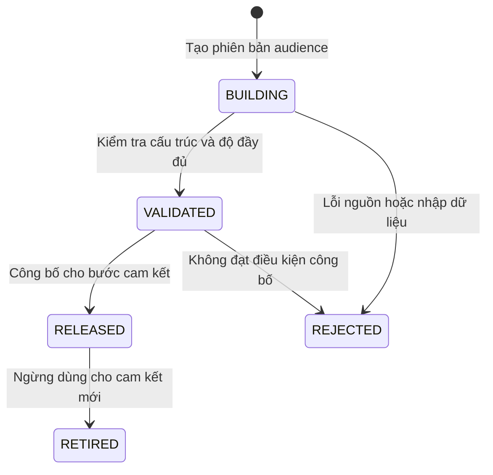

# Promotion audience — Bảo vệ nhóm đối tượng được nhận khuyến mãi

## 1. Promotion audience trả lời câu hỏi nào?

**Promotion audience** là tập chủ thể mà một chương trình khuyến mãi được phép hướng tới. Chủ thể có thể là tài khoản khách hàng, tổ chức mua hàng hoặc một nhóm thành viên đã được định nghĩa rõ. Việc xác định chủ thể nào thuộc tập này là một phần của chính sách nghiệp vụ, cần được thực thi ở máy chủ.

Ví dụ, doanh nghiệp gửi ưu đãi quay lại mua hàng cho một nhóm khách đã lâu không giao dịch. Người ngoài nhóm có thể nhìn thấy ảnh quảng cáo, biết mã hoặc nhận được liên kết chuyển tiếp. Những điều đó không tự tạo quyền hưởng ưu đãi.

Một lỗi logic xuất hiện khi hệ thống chọn đúng nhóm để gửi thông báo nhưng lại cho mọi tài khoản biết mã áp dụng chương trình. Luồng gửi tin và luồng cấp lợi ích đã sử dụng hai quy tắc khác nhau.

Trong phạm vi bảo mật logic nghiệp vụ, cần giữ bất biến:

```text
Mỗi cam kết cấp lợi ích của chương trình
  => đúng chủ thể hưởng lợi thuộc audience được chấp nhận
  AND quyết định sử dụng đúng phạm vi và phiên bản chính sách
  AND quyền chưa bị thu hồi tại mốc cam kết do chính sách quy định.
```

Việc hiển thị chương trình có thể dùng dữ liệu gợi ý. Việc cam kết lợi ích cần dữ liệu đủ thẩm quyền và mức nhất quán để bảo vệ bất biến trên.

## 2. Phân biệt audience, điều kiện áp dụng và quyền thao tác

| Khái niệm | Câu hỏi được trả lời | Ví dụ |
| --- | --- | --- |
| Phân khúc marketing | Nhóm khách có đặc điểm gì để phân tích hoặc tiếp cận? | Khách từng xem sản phẩm thể thao |
| Audience của chương trình | Chủ thể này có nằm trong nhóm được chương trình cho phép không? | Khách có tên trong đợt cấp ưu đãi quay lại mua |
| Điều kiện áp dụng trên đơn | Đơn và bối cảnh hiện tại có thỏa các điều kiện còn lại không? | Giỏ đủ mức mua tối thiểu, đúng mặt hàng, đúng thời gian |
| Quyền theo đối tượng | Người thực hiện có được thao tác trên đơn hoặc tài khoản đó không? | Nhân viên hỗ trợ có quyền sửa đơn của khách này hay không |
| Quyền sử dụng và giới hạn | Chủ thể còn lượt, chương trình còn ngân sách không? | Mỗi khách một lượt; tổng ngân sách chưa hết |

Một phân khúc dùng cho quảng cáo không mặc nhiên là nguồn cấp quyền. Dữ liệu phân tích có thể cập nhật chậm, thiếu một phần hoặc được thiết kế để chấp nhận sai số. Nếu dùng phân khúc đó làm audience chính thức, cần xác định cách công bố phiên bản, độ đầy đủ của dữ liệu và thời điểm quyết định có hiệu lực.

Thuộc audience cũng không đồng nghĩa chắc chắn được giảm tiền. Khách đúng nhóm vẫn có thể không đạt ngưỡng mua, đã dùng hết lượt hoặc đang áp dụng một ưu đãi xung đột.

Ngược lại, có quyền quản trị hoặc hỗ trợ không tự biến nhân viên thành người được hưởng ưu đãi của khách. Cần phân biệt:

- **Actor:** người thực hiện hành động, lấy từ ngữ cảnh xác thực phía máy chủ.
- **Beneficiary:** chủ thể thực sự nhận lợi ích, thường lấy từ chủ đơn hoặc tổ chức mua hàng.

Trong luồng đại diện, actor và beneficiary có thể khác nhau. Hệ thống phải kiểm tra quyền của actor trên đối tượng, sau đó đánh giá audience theo beneficiary mà chính sách quy định.

## 3. Viết chính sách đối tượng đủ rõ để kiểm tra

Xét chương trình minh họa `RECONNECT15`. Các quy tắc dưới đây được lựa chọn để minh họa, không phải quy tắc mặc định cho mọi chương trình.

| Thành phần | Chính sách minh họa |
| --- | --- |
| Chủ thể hưởng lợi | Tài khoản khách hàng sở hữu đơn hàng |
| Phạm vi | Cùng tenant và cửa hàng được chương trình cấu hình |
| Nhóm bao gồm | Khách VIP tại mốc `T0`, **hoặc** khách từng thanh toán nhưng không có đơn mới đạt `PAID` trong 90 ngày trước `T0` |
| Quy ước biên 90 ngày | Nhóm quay lại yêu cầu `lastPaidAt <= T0 - 90 ngày`; đã từng thanh toán ít nhất một lần |
| Cách chọn đối tượng | Chốt nhóm bao gồm bằng một snapshot được công bố với phiên bản cụ thể |
| Nhóm loại trừ | Tài khoản nhân viên hoặc tài khoản thử nghiệm theo dữ liệu loại trừ của phiên bản audience |
| Điều kiện hiện tại | Tài khoản còn hoạt động, còn xác minh, không bị chặn và không bị thu hồi quyền chương trình |
| Thứ tự ưu tiên | Loại trừ hoặc thu hồi có ưu tiên cao hơn nhóm bao gồm |
| Mốc kiểm tra cuối | Ngay khi tạo cam kết ưu đãi cho đơn; cam kết thành công được ghi nhận cùng giao dịch nghiệp vụ |
| Sau khi đã cam kết | Không tự thay đổi cam kết cũ chỉ vì audience được cập nhật; hủy cam kết nếu có là một quy trình riêng |

Chính sách ví dụ phân biệt hai loại dữ liệu:

1. Nhóm bao gồm và các nhóm loại trừ đã chốt trong một phiên bản audience.
2. Những điều kiện an toàn còn phải đúng tại thời điểm cam kết, như tài khoản bị chặn hoặc quyền bị thu hồi.

Việc khách VIP tại `T0` không còn VIP sau đó không tự xóa tư cách trong snapshot này. Ngược lại, tài khoản bị chặn hiện tại vẫn bị từ chối, kể cả trước đó có tên trong snapshot.

Nếu doanh nghiệp muốn việc trở thành nhân viên sau `T0` cũng lập tức loại khách khỏi chương trình, trạng thái nhân viên phải được đưa vào nhóm điều kiện hiện tại hoặc phát sinh một sự kiện thu hồi. Không được chỉ sửa cách diễn đạt chính sách mà vẫn dùng bản snapshot cũ để quyết định.

### 3.1. Quy tắc bao gồm và loại trừ

Biểu thức của chính sách ví dụ có thể viết:

```text
inclusion = VIP_AT_T0 OR RETURNING_INACTIVE_AT_T0
exclusion = STAFF_AT_T0 OR TEST_ACCOUNT_AT_T0
currentGuards = accountActive AND accountVerified AND NOT accountBlocked

audienceAllowed = correctScope
                  AND inclusion
                  AND NOT exclusion
                  AND currentGuards
                  AND NOT programRevoked
```

Trong nhóm quay lại, điều kiện là đã từng thanh toán **và** đủ thời gian không phát sinh lần thanh toán mới. Tài khoản chưa từng mua không được suy thành khách quay lại chỉ vì `lastPaidAt` rỗng.

Đối với dữ liệu chưa biết, không thể chỉ thay bằng `false` ở mọi nơi. Nếu `accountBlocked` chưa đọc được rồi bị gán thành `false`, biểu thức `NOT accountBlocked` sẽ mở quyền ngoài ý muốn.

### 3.2. Dùng ba kết quả thay vì một boolean mơ hồ

| Kết quả | Ý nghĩa | Hành vi tại bước cam kết |
| --- | --- | --- |
| `ALLOW` | Có đủ bằng chứng chủ thể thuộc audience và các điều kiện bắt buộc còn đúng | Tiếp tục kiểm tra điều kiện đơn, lượt dùng và ngân sách |
| `DENY` | Có bằng chứng không thuộc nhóm, bị loại trừ, sai phạm vi hoặc đã bị thu hồi | Không tạo cam kết lợi ích |
| `INDETERMINATE` | Thiếu dữ liệu bắt buộc, chưa công bố snapshot hoặc không thể đọc nguồn quyết định | Không cấp lợi ích; trả trạng thái phù hợp để thử lại hoặc xử lý lỗi |

Kết quả không xác định không được coi là đủ điều kiện. Tuy nhiên, nó cũng không nên bị lưu vĩnh viễn thành kết luận “khách không thuộc nhóm”, vì nguyên nhân có thể chỉ là dịch vụ tạm thời không sẵn sàng.

Khi đã biết có một điều kiện từ chối, như sai tenant hoặc quyền bị thu hồi, điều kiện đó đủ để ngăn cấp lợi ích. Không cần chờ nguồn dữ liệu khác khôi phục để coi yêu cầu là an toàn.

## 4. Xác định đúng chủ thể và nguồn dữ liệu

### 4.1. Chủ thể là một khóa có phạm vi

Một định danh như `customer-42` có thể không duy nhất trên toàn hệ thống. Khóa dùng để tra audience cần thể hiện đủ phạm vi:

```text
(tenant_id, subject_type, subject_id)
```

Trong ví dụ chỉ có tài khoản khách hàng nên `subject_type` có thể được cố định trong mô hình. Với audience cho tổ chức, khóa tổ chức phải được phân biệt với khóa tài khoản cá nhân, dù phần chuỗi định danh giống nhau.

Không dùng email, tên hiển thị hoặc số điện thoại chưa xác minh làm bằng chứng chắc chắn rằng hai bản ghi là cùng chủ thể. Các giá trị đó có thể đổi, được tái sử dụng hoặc có cách chuẩn hóa khác nhau. Việc hợp nhất tài khoản cần có quy trình chuyển quyền rõ ràng; không sao chép audience chỉ vì trùng một thuộc tính liên hệ.

### 4.2. Dữ liệu nào được dùng để quyết định?

| Dữ liệu | Nguồn có thẩm quyền cho bước cam kết | Dữ liệu không đủ để cấp quyền |
| --- | --- | --- |
| Actor | Phiên xác thực và thông tin quyền phía máy chủ | `actorId` tùy ý trong request |
| Beneficiary | Chủ đơn hoặc tổ chức mua hàng đã được kiểm tra quyền | `customerId` do client tự chọn |
| Tenant và cửa hàng | Đối tượng đơn hàng và cấu hình chương trình được tải đúng phạm vi | Header hay tham số tenant chưa được đối chiếu quyền |
| Nhóm bao gồm | Membership thuộc phiên bản audience đã công bố | Tên segment trong cookie hoặc local storage |
| Trạng thái xác minh | Dịch vụ hoặc bản ghi tài khoản chịu trách nhiệm về trạng thái đó | Cờ `verified=true` gửi từ trình duyệt |
| Chặn hoặc thu hồi | Nguồn kiểm soát hiện tại có bảo đảm nhất quán phù hợp | Bản sao cũ không phản ánh việc thu hồi |
| Quyền nhận mã cá nhân | Bản ghi cấp quyền gắn với đúng chủ thể | Việc biết mã hoặc có email chuyển tiếp |

Một request có thể chỉ biểu đạt ý định:

```http
POST /orders/order-203/confirm-promotion
Idempotency-Key: promotion-attempt-903
Content-Type: application/json

{
  "campaignCode": "RECONNECT15",
  "expectedOrderVersion": 8
}
```

Máy chủ lấy actor từ phiên, tải đơn theo phạm vi được phép, kiểm tra quyền thao tác và lấy beneficiary từ đơn. Sau đó mới chọn chương trình và audience tương ứng.

Các trường như `audienceId`, `segment=VIP`, `beneficiaryId` hoặc `audienceApproved=true` do client gửi không được dùng để thay kết luận phía máy chủ. Nếu API có mục đích cho phép chọn tổ chức mua hàng, việc chọn đó phải được xác thực như một thay đổi đối tượng nghiệp vụ trước khi đánh giá chương trình.

## 5. Chọn audience động hay audience chốt theo thời điểm

Hai cách thiết kế sau đều có thể hợp lệ khi chính sách và bảo đảm kỹ thuật khớp nhau.

| Đặc điểm | Audience động | Audience theo snapshot |
| --- | --- | --- |
| Cách xác định | Đánh giá điều kiện trên dữ liệu hiện tại tại mốc quy định | Tra tập đối tượng đã chốt ở một thời điểm |
| Ví dụ | Thành viên gói trả phí đang còn hiệu lực | Khách VIP tại ngày mở chiến dịch |
| Khi dữ liệu thay đổi | Có thể vào hoặc ra khỏi nhóm | Không tự đổi membership của phiên bản đã chốt |
| Rủi ro chính | Dữ liệu đọc lệch thời điểm hoặc cập nhật trễ | Dùng sai phiên bản, dữ liệu chưa đủ hoặc quên thu hồi |
| Bằng chứng cần lưu | Phiên bản quy tắc và các dữ kiện quan trọng lúc đánh giá | Phiên bản audience, chủ thể và kết quả tra membership |

### 5.1. Snapshot không có nghĩa bỏ qua mọi thay đổi sau đó

Một chính sách có thể chốt điều kiện marketing nhưng vẫn kiểm tra thu hồi hoặc trạng thái bị chặn ở thời điểm sử dụng. Đây là lựa chọn chính sách rõ ràng, không phải lý do để trộn tùy ý dữ liệu cũ và mới.

Với `RECONNECT15`, hệ thống không tính lại thời gian ngừng mua mỗi lần xác nhận, vì nhóm bao gồm đã chốt ở `T0`. Nó vẫn đọc trạng thái tài khoản và quyền thu hồi hiện tại. Hai loại kiểm tra này cần được đặt tên và lưu dấu vết riêng.

Nếu nghiệp vụ chuyển sang yêu cầu khách phải còn ngừng mua đủ 90 ngày tại lúc xác nhận, đó là một chính sách khác. Cần phiên bản mới, cách giải thích với người dùng và đánh giá tác động đến các cam kết đang tồn tại.

### 5.2. Công bố snapshot hoàn chỉnh

Một snapshot thường được tạo theo nhiều lô. Trong lúc đang nạp lô thứ nhất, việc không tìm thấy khách ở lô đó chưa chứng minh khách nằm ngoài tập cuối cùng.

Luồng công bố có thể là:



Chỉ phiên bản `RELEASED` được dùng để kết luận membership trong ví dụ. `BUILDING` không được dùng như một allowlist hoàn chỉnh. Có thể dùng bảng manifest ghi phiên bản nguồn, số lô dự kiến, số bản ghi, thời điểm chốt và trạng thái công bố.

Khi xuất bản phiên bản mới, con trỏ phiên bản mà chương trình sử dụng cần chuyển một cách nhất quán. Không đọc danh sách bao gồm của phiên bản mới cùng danh sách loại trừ của phiên bản cũ.

Tập rỗng phải có nghĩa cụ thể. Với chương trình nhắm đích, tập bao gồm rỗng nghĩa là không ai được nhận, hoặc bản cấu hình chưa hợp lệ nếu chính sách cấm tập rỗng. Nó không có nghĩa “áp dụng toàn bộ khách hàng”. Chương trình công khai nên có chế độ `PUBLIC` rõ ràng, được cấu hình và phân quyền riêng.

## 6. Ví dụ Java: đánh giá audience đã chốt

Ví dụ dùng Java 17, chỉ mô tả phần quyết định trên dữ liệu do lớp ứng dụng chuẩn bị. Nó không tải dữ liệu, không kiểm tra lượt dùng và không tự kiểm tra quyền trên đơn. Các record bên dưới không phải DTO được phép nhận trực tiếp từ client.

`Facts` chứa membership của đúng snapshot và kết quả đọc các điều kiện hiện tại. `ReadState.COMPLETE` chỉ được gán khi toàn bộ dữ liệu bắt buộc đã được đọc thành công theo hợp đồng nguồn dữ liệu. Các tập membership được cung cấp dưới dạng bất biến.

```java
import java.util.Objects;
import java.util.Set;

public final class PromotionAudience {
    public enum IncludeGroup {
        VIP_AT_T0,
        RETURNING_INACTIVE_AT_T0
    }

    public enum ExcludeGroup {
        STAFF_AT_T0,
        TEST_ACCOUNT_AT_T0
    }

    public enum ReadState {
        COMPLETE,
        UNAVAILABLE
    }

    public enum Outcome {
        ALLOW,
        DENY,
        INDETERMINATE
    }

    public record Subject(
        String tenantId,
        String customerId
    ) {}

    public record Policy(
        String tenantId,
        String campaignId,
        long audienceVersion,
        boolean released
    ) {}

    public record Facts(
        String tenantId,
        String campaignId,
        long audienceVersion,
        String customerId,
        ReadState readState,
        Set<IncludeGroup> includedBy,
        Set<ExcludeGroup> excludedBy,
        boolean accountActive,
        boolean accountVerified,
        boolean accountBlocked,
        boolean programRevoked
    ) {}

    public record Decision(Outcome outcome, String reason) {}

    public static Decision evaluate(
        Subject subject, Policy policy, Facts facts
    ) {
        Objects.requireNonNull(subject);
        Objects.requireNonNull(policy);

        if (!hasText(subject.tenantId())
                || !hasText(subject.customerId())
                || !hasText(policy.tenantId())
                || !hasText(policy.campaignId())
                || policy.audienceVersion() < 1) {
            return deny("INVALID_CONTEXT");
        }
        if (!subject.tenantId().equals(policy.tenantId())) {
            return deny("OUT_OF_SCOPE");
        }
        if (!policy.released()) {
            return unknown("AUDIENCE_NOT_RELEASED");
        }
        if (facts == null) {
            return unknown("FACTS_UNAVAILABLE");
        }

        boolean correctlyBound =
            policy.tenantId().equals(facts.tenantId())
            && policy.campaignId().equals(facts.campaignId())
            && policy.audienceVersion() == facts.audienceVersion()
            && subject.customerId().equals(facts.customerId());

        if (!correctlyBound) {
            return deny("FACTS_BINDING_MISMATCH");
        }

        // Known exclusions can deny even when another read failed.
        if (facts.programRevoked()) {
            return deny("PROGRAM_REVOKED");
        }
        if (facts.accountBlocked()) {
            return deny("ACCOUNT_BLOCKED");
        }
        if (facts.excludedBy() != null && !facts.excludedBy().isEmpty()) {
            return deny("EXCLUDED_GROUP");
        }

        // False primitive fields must never turn incomplete facts into ALLOW.
        if (facts.readState() != ReadState.COMPLETE
                || facts.includedBy() == null
                || facts.excludedBy() == null) {
            return unknown("INCOMPLETE_FACTS");
        }
        if (!facts.accountActive() || !facts.accountVerified()) {
            return deny("ACCOUNT_NOT_READY");
        }

        boolean included =
            facts.includedBy().contains(IncludeGroup.VIP_AT_T0)
            || facts.includedBy().contains(
                IncludeGroup.RETURNING_INACTIVE_AT_T0);

        if (!included) {
            return deny("NOT_IN_AUDIENCE");
        }
        return new Decision(Outcome.ALLOW, "AUDIENCE_MATCHED");
    }

    private static boolean hasText(String value) {
        return value != null && !value.isBlank();
    }

    private static Decision deny(String reason) {
        return new Decision(Outcome.DENY, reason);
    }

    private static Decision unknown(String reason) {
        return new Decision(Outcome.INDETERMINATE, reason);
    }
}
```

Khách thuộc cả `VIP_AT_T0` và `STAFF_AT_T0` bị từ chối do loại trừ có ưu tiên. Khách không có nhóm bao gồm nào bị từ chối ngay cả khi tài khoản đã xác minh. Dữ liệu của đúng khách nhưng sai `audienceVersion` cũng không được dùng để cấp quyền.

Ví dụ dùng một cờ đầy đủ dữ liệu cho cả gói facts để giữ mô hình ngắn gọn. Nếu hệ thống cần giải thích trạng thái từng nguồn riêng, có thể dùng kiểu `KNOWN_TRUE`, `KNOWN_FALSE`, `UNKNOWN` hoặc kết quả đọc riêng cho từng điều kiện. Không để giá trị boolean mặc định che mất lỗi đọc dữ liệu.

Biến `released` trong ví dụ biểu thị audience sẵn sàng phục vụ quyết định. Trạng thái chiến dịch, thời hạn, cửa hàng, giỏ hàng và giới hạn sử dụng vẫn là những kiểm tra khác. `ALLOW` từ hàm này chỉ cho phép tiếp tục luồng, không phải lệnh giảm giá cuối cùng.

## 7. Gắn quyết định vào điểm cam kết nghiệp vụ

### 7.1. Không chỉ kiểm tra ở trang danh sách

Các endpoint có thể phục vụ những mục đích khác nhau:

- Danh sách chương trình gợi ý: giúp khách khám phá ưu đãi.
- Trang chi tiết hoặc báo giá: giải thích điều kiện trên dữ liệu hiện có.
- Xác nhận ưu đãi cho đơn: tạo quyền hoặc lợi ích có giá trị nghiệp vụ.
- Callback hoặc bước hoàn tất: tiêu thụ quyền đã được giữ theo state machine.

Không thể bảo vệ bước thứ ba chỉ bằng cách lọc chương trình khỏi danh sách ở bước thứ nhất. Một yêu cầu đi thẳng đến API xác nhận vẫn phải kiểm tra đầy đủ.

Nếu trang chi tiết là nội dung công khai, việc đọc được nội dung không đồng nghĩa được hưởng ưu đãi. Nếu bản thân chương trình là thông tin riêng, endpoint đọc cũng cần quyền truy cập riêng để tránh tiết lộ danh sách khách hoặc chiến dịch nội bộ.

### 7.2. Luồng cam kết với dữ liệu cùng ranh giới giao dịch

Pseudocode sau thể hiện một cách đặt kiểm tra. Nó giả định dữ liệu quan trọng có thể được điều phối trong cùng cơ sở dữ liệu hoặc một cơ chế có bảo đảm tương đương.

```text
confirmPromotion(actor, orderId, campaignCode, expectedVersion, key):
    begin transaction

    load order in actor's authorized scope
    authorize actor to confirm this order
    derive beneficiary from the order

    claim idempotency key scoped to actor + tenant + operation
    bind key to order, expected version and requested campaign
    if an identical intent already committed:
        return its stored result after access checks
    reject the same key with a different intent

    acquire campaign and beneficiary decision guards in a fixed order
    lock order; verify state, ownership and expected version
    load the campaign and its released audience version
    load complete membership for that beneficiary and version
    load current account restrictions and program revocation

    evaluate audience
    continue only for ALLOW
    check campaign time, store, cart conditions and stacking rules
    reserve usage rights and budget atomically

    persist promotion commitment and its audience evidence
    persist resulting order state and idempotent result
    commit
    return stored result
```

Các bước kiểm tra quyền và suy ra beneficiary cần được đối chiếu lại khi khóa hoặc kiểm tra phiên bản đơn, vì chủ đơn hay trạng thái đơn có thể thay đổi giữa lần đọc đầu và điểm cam kết.

### 7.3. Tranh chấp giữa thu hồi và xác nhận

Xét tình huống:

```text
A: đọc rằng khách chưa bị thu hồi quyền
B: thu hồi quyền của khách và commit
A: tạo cam kết ưu đãi dựa trên lần đọc cũ
```

Nếu chính sách yêu cầu mọi cam kết mới sau thu hồi phải bị chặn, lần đọc cũ của A không đủ. Luồng thu hồi và luồng cam kết cần tranh chấp trên cùng một điểm điều phối, như bản ghi guard ổn định của khách/chương trình, hoặc dùng cơ chế phiên bản và cập nhật có điều kiện bảo đảm tương đương.

Thứ tự hợp lệ được xác định tại điểm cam kết có bảo đảm nhất quán:

- Thu hồi hoàn tất trước điểm tạo cam kết: yêu cầu mới phải bị từ chối.
- Cam kết hoàn tất trước thu hồi: xử lý cam kết đã tồn tại theo chính sách riêng; không giả định thu hồi đã tự hủy nó.

Một dòng annotation transaction không tự chứng minh được thứ tự này. Cần xem dữ liệu được đọc, cách khóa, mức cô lập và việc các luồng thu hồi có cùng tham gia giao thức hay không.

Nếu bản ghi thu hồi chưa tồn tại, việc truy vấn không có kết quả không mặc nhiên khóa được khả năng một giao dịch khác chèn bản ghi đó trên mọi cơ sở dữ liệu. Guard tồn tại ổn định hoặc cơ chế chống xung đột tương đương giúp tránh phụ thuộc vào giả định này.

### 7.4. Không đánh đồng retry với một cam kết mới

Request gửi lại sau khi đã commit thành công cần nhận kết quả cũ theo hợp đồng idempotency. Nó không tự tạo thêm quyền và không trở thành cam kết mới chỉ vì phản hồi trước đó bị mất.

Với ý định chưa commit, việc thử lại phải đánh giá điều kiện hiện tại. Không dùng một bản ghi `ALLOW` từ lần thử thất bại làm quyền vĩnh viễn để vượt qua thu hồi.

Nếu doanh nghiệp muốn hủy quyền đã giữ khi khách bị loại khỏi audience, cần state machine và quy trình hủy rõ ràng: xác định trạng thái nào có thể hủy, xử lý thanh toán đang diễn ra và tránh callback cũ phục hồi quyền đã hủy.

## 8. Cache, token và kiến trúc nhiều dịch vụ

### 8.1. Cache phải gắn với đúng ngữ cảnh

Một khóa cache quyết định audience có thể cần:

```text
tenant_id
campaign_id
audience_version
subject_type + subject_id
revision của các điều kiện hiện tại nếu quyết định có dùng chúng
```

Chỉ dùng `campaignCode` làm khóa có thể khiến kết quả của một khách được dùng cho khách khác hoặc tenant khác. Chỉ dùng `customerId` lại có thể trộn quyết định giữa hai chương trình.

Membership của snapshot bất biến có thể được cache theo đúng phiên bản. Trạng thái thu hồi và bị chặn hiện tại có yêu cầu khác. TTL ngắn chỉ giới hạn khoảng dữ liệu cũ có thể được dùng; nó không bảo đảm thu hồi có hiệu lực ngay tại mọi cam kết.

Nếu hệ thống chấp nhận một cửa sổ trì hoãn thu hồi, đó phải là đặc tính được xác định trong chính sách. Nếu yêu cầu thu hồi tức thời cho cam kết mới, bước cuối cần đọc hoặc xác nhận phiên bản từ nguồn có thẩm quyền với giao thức nhất quán phù hợp.

Khi snapshot đổi phiên bản, cần tránh để quyết định phủ định cũ tồn tại dưới khóa thiếu phiên bản. Cache `NOT_IN_AUDIENCE` nhầm ngữ cảnh cũng là lỗi nghiệp vụ, dù không trực tiếp cấp thêm lợi ích.

### 8.2. Token có chữ ký không thay thế quyền hiện tại

Một liên kết ưu đãi có chữ ký có thể giúp chống sửa nội dung. Nếu token được dùng như bằng chứng cấp quyền, nó cần gắn với mục đích, issuer, beneficiary, tenant, chương trình, phiên bản audience hoặc grant, thời hạn và định danh để theo dõi sử dụng khi cần.

Máy chủ vẫn phải kiểm tra token được dùng cho đúng hành động và đúng chủ thể. Token được ký cho khách A không được chấp nhận trên đơn của B chỉ vì chữ ký hợp lệ.

Chữ ký không tự giải quyết:

- Token bị chuyển tiếp cho người khác.
- Quyền đã bị thu hồi sau khi token được phát hành.
- Token bị phát lại để tạo thêm cam kết.
- Đơn hoặc beneficiary đã đổi.
- Ngân sách và lượt dùng không còn.

Nếu sản phẩm chủ đích cho phép ưu đãi chuyển nhượng, cần mô hình chuyển quyền riêng. Không âm thầm biến mọi mã cá nhân thành quyền chuyển nhượng chỉ vì ai có mã cũng gọi được API.

### 8.3. Khi audience và checkout thuộc hai dịch vụ

Một lần gọi `checkAudience` trả `ALLOW`, sau đó checkout ghi đơn ở cơ sở dữ liệu khác, vẫn có khoảng thời gian để quyền bị thu hồi. Hai thao tác này không tự trở thành giao dịch nguyên tử.

Một phương án là dịch vụ sở hữu quyền cấp một quyết định hoặc grant có thời hạn, được ràng buộc với đơn và chủ thể, đồng thời định nghĩa rõ cam kết nào đã được bảo đảm. Bước sử dụng grant cần kiểm tra trạng thái hoặc tiêu thụ có điều kiện; khi bước sau thất bại, có luồng giải phóng hoặc bù trừ.

Phương án khác là xác định điểm điều phối cuối tại một dịch vụ, nơi nó chịu trách nhiệm cho bất biến và các dịch vụ còn lại chấp nhận hợp đồng đó. Dù chọn cách nào, phải nêu rõ thứ tự giữa thu hồi, cấp grant và tạo đơn. Sự kiện đồng bộ bất chợt hoặc một lần đọc cache không phải bảo đảm thay thế.

## 9. Bảo vệ đường tạo và chỉnh sửa audience

Lỗ hổng không chỉ nằm ở API người mua. Nếu người có quyền xem báo cáo cũng sửa được audience đang hoạt động, họ có thể tự đưa tài khoản vào nhóm nhận lợi ích.

Cần tách quyền cho các thao tác có ảnh hưởng khác nhau:

| Thao tác | Yêu cầu bảo vệ |
| --- | --- |
| Xem số lượng đối tượng | Chỉ trả thông tin trong phạm vi được phép |
| Xem danh sách chi tiết | Kiểm tra quyền dữ liệu khách hàng; tránh lộ danh sách qua export |
| Soạn quy tắc và nhập danh sách | Kiểm tra phạm vi tenant, kiểu chủ thể và định dạng nguồn |
| Công bố phiên bản | Kiểm tra quyền thay đổi chính sách đang dùng; lưu người thực hiện và phiên bản |
| Chuyển chương trình sang công khai | Hành động riêng, không suy từ danh sách rỗng hoặc lỗi cấu hình |
| Thu hồi hoặc cấp ngoại lệ | Quyền cụ thể, lý do và dấu vết; tuân theo giao thức cam kết |

Không cho request từ trình duyệt dùng cờ `skipAudienceCheck=true` để đi qua mọi điều kiện. Nếu có ngoại lệ hợp lệ cho chăm sóc khách hàng, nên biểu diễn bằng một quyền hoặc chương trình ngoại lệ có phạm vi, giới hạn và bằng chứng rõ ràng.

### 9.1. Những lỗi dễ xuất hiện khi nhập danh sách

- Dòng không có `tenant_id` được gán sang tenant mặc định không phù hợp.
- Bản ghi trùng làm tăng nhầm số quyền được cấp.
- Cột email bị dùng làm khóa tài khoản mà không giải quyết sai lệch định danh.
- Import thất bại giữa chừng nhưng phiên bản vẫn được công bố.
- Tập loại trừ bị bỏ qua vì nguồn của nó timeout.
- Quy tắc không hợp lệ bị bộ đánh giá chuyển thành “khớp tất cả”.
- Một bản import cũ hoàn tất muộn ghi đè con trỏ phiên bản mới hơn.

Việc công bố cần kiểm tra đúng phiên bản nguồn, độ đầy đủ, phạm vi và xung đột với lần công bố khác. Xem trước số lượng bao gồm, loại trừ và giao nhau giúp người vận hành hiểu tác động trước khi kích hoạt theo quy trình của tổ chức.

### 9.2. Khóa membership không phải khóa lượt dùng

Với snapshot, ràng buộc duy nhất theo `(tenant, campaign, audienceVersion, subject)` giúp tránh trùng một membership nếu mô hình dùng một dòng cho mỗi chủ thể. Nếu một chủ thể có nhiều lý do vào nhóm, có thể lưu các lý do trong cấu trúc con với khóa phù hợp.

Ràng buộc membership đó không ngăn một khách nhận hai lần lợi ích. Giới hạn sử dụng vẫn cần sổ quyền hoặc bản ghi tiêu thụ với khóa và giao dịch riêng. Audience chứng minh “ai thuộc nhóm”; sổ sử dụng chứng minh “đã giữ hoặc dùng bao nhiêu”.

## 10. Các tình huống cần kiểm thử

Kiểm thử cần quan sát cả kết quả API lẫn dữ liệu đã commit. Thông báo từ chối đúng trên giao diện không đủ nếu request vẫn tạo một grant hoặc đơn giảm giá ở phía sau.

| Tình huống | Dữ liệu hoặc hành động kiểm thử | Kết quả mong đợi |
| --- | --- | --- |
| Gọi thẳng API | Tài khoản ngoài nhóm biết mã và bỏ qua trang gợi ý | Không tạo cam kết ưu đãi |
| Giả segment | Client gửi `segment=VIP` hoặc `audienceApproved=true` | Không thay kết quả phía máy chủ |
| Đúng nhóm VIP | Khách có membership đúng phiên bản, không bị loại trừ | Audience cho phép; vẫn phải qua điều kiện đơn |
| Giao giữa hai nhóm | Khách vừa VIP vừa là tài khoản thử nghiệm | Loại trừ thắng nhóm bao gồm |
| Chưa từng mua | Không có `lastPaidAt`, không thuộc VIP | Không tự được xếp vào nhóm khách quay lại |
| Biên thời gian | Lần thanh toán cuối đúng `T0 - 90 ngày` | Được đưa vào nhóm theo quy ước biên đã chọn |
| Sai tenant | Cùng chuỗi customer ID ở tenant khác | Không dùng chung membership hoặc cache |
| Sai chủ thể hưởng lợi | A thao tác đơn của B hoặc thay beneficiary sau báo giá | Kiểm tra quyền và audience theo chủ thể thực tế |
| Nhân viên đại diện | Actor là nhân viên hỗ trợ, beneficiary là khách | Không dùng membership của actor để cấp cho khách |
| Token chuyển tiếp | Token của A được dùng cho đơn của B | Bị từ chối do không khớp chủ thể |
| Snapshot đang nạp | Khách chưa xuất hiện trong các lô đã nhập | Không kết luận bằng tập chưa hoàn chỉnh |
| Sai phiên bản | Membership v3 đi cùng chương trình đang dùng v4 | Không cấp quyền từ dữ liệu trộn phiên bản |
| Tập bao gồm rỗng | Snapshot nhắm đích hoàn chỉnh có 0 chủ thể | Không mở chương trình cho toàn bộ khách |
| Thiếu tập loại trừ | Nguồn loại trừ không đọc được | Không cấp quyền chỉ dựa trên nhóm bao gồm |
| Cache của người khác | Hai khách gọi cùng mã liên tiếp | Không dùng kết quả ALLOW của khách trước |
| Thu hồi sau xem trước | Xem ưu đãi rồi thu hồi trước cam kết | Cam kết mới bị chặn theo chính sách |
| Thu hồi đồng thời | Thu hồi và xác nhận được điều phối để tranh chấp | Kết quả tuân theo thứ tự tại điểm cam kết |
| Replay sau thành công | Commit xong nhưng mất phản hồi rồi retry cùng key | Trả kết quả cũ; không cấp thêm quyền |
| Retry sau thất bại | Lần đầu chưa commit, sau đó khách bị thu hồi | Lần thử mới không dùng quyết định ALLOW cũ |
| Hai key khác nhau | Hai đơn cùng khách thuộc audience | Audience đúng nhưng giới hạn lượt vẫn được bảo vệ riêng |
| Import trái quyền | Vai trò chỉ xem báo cáo cố công bố audience | Bị chặn trước khi thay đổi phiên bản hoạt động |

### 10.1. Kiểm thử đồng thời phải kiểm tra thứ tự và tác dụng phụ

Với thu hồi và xác nhận, có thể đặt điểm đồng bộ trong môi trường kiểm thử để tạo hai thứ tự có kiểm soát:

1. Thu hồi commit trước khi xác nhận được phép tạo cam kết.
2. Xác nhận commit trước khi thu hồi có hiệu lực.

Kiểm tra đúng kết quả cho cả hai thứ tự theo chính sách. Ngoài mã phản hồi, cần kiểm tra bản ghi cam kết, phiên bản audience, revision thu hồi và số quyền giữ hoặc đã dùng.

Trong trường hợp transaction xác nhận rollback, không được để lại lợi ích có thể tiêu thụ như một cam kết thành công. Nếu có cấp grant qua dịch vụ khác, kiểm tra thêm luồng giải phóng hoặc đối soát theo mô hình phân tán đã chọn.

### 10.2. Những thuộc tính hữu ích cho bộ quyết định

Với cùng chính sách và giữ nguyên các dữ kiện khác:

- Thêm một lý do loại trừ không được biến kết quả từ chối thành cho phép.
- Đổi tenant hoặc beneficiary sang giá trị không khớp facts không được tạo `ALLOW`.
- Thay đổi thứ tự phần tử trong tập membership không đổi quyết định.
- Bỏ một nguồn bắt buộc khỏi facts không được giữ kết quả `ALLOW` nhờ giá trị mặc định.
- Membership của một phiên bản không được tự thỏa chính sách yêu cầu phiên bản khác.
- Khi mọi dữ liệu đều đầy đủ, khách không thuộc bất kỳ nhóm bao gồm nào phải nhận `DENY`.

Các thuộc tính này kiểm tra phần quyết định. Kiểm thử quyền theo đối tượng, cache, import và transaction cần kiểm tra ở ranh giới tích hợp tương ứng.

## 11. Giải thích quyết định mà không tiết lộ danh sách khách

Một thông báo như “Ưu đãi này không áp dụng cho tài khoản hiện tại” có thể phù hợp với chương trình nhắm đích. Không cần trả về tên nhóm nội bộ, tên tài khoản được mời hoặc toàn bộ lý do khách bị đánh dấu trong hệ thống chống lạm dụng.

Các lỗi không xác định, như không đọc được audience, nên có mã riêng để client biết có thể thử lại. Không tự chuyển thành ưu đãi công khai; cũng không âm thầm thu số tiền cao hơn mức khách đã xác nhận khi ưu đãi không áp dụng được.

Để giải thích một cam kết sau này, bản ghi quyết định có thể chứa:

- Định danh yêu cầu, đơn hàng, tenant, actor và beneficiary trong phạm vi truy cập log được phép.
- Chương trình, phiên bản chính sách và phiên bản audience được sử dụng.
- Kết quả `ALLOW`, `DENY` hoặc `INDETERMINATE` cùng mã lý do nội bộ.
- Revision hoặc tham chiếu dữ liệu thu hồi và trạng thái tài khoản tại mốc quyết định.
- Tham chiếu grant hoặc cam kết và kết quả giao dịch.

Chỉ lưu dữ liệu cần để giải thích và đối soát. Không chép toàn bộ danh sách audience vào mỗi log, không ghi token truy cập và không dùng địa chỉ email làm nhãn metric cho từng khách.

Theo dõi sự tăng đột biến của `FACTS_BINDING_MISMATCH`, lỗi thiếu dữ liệu, tỷ lệ tài khoản ngoài nhóm thử cùng mã và xung đột phiên bản có thể giúp phát hiện lỗi tích hợp hoặc lạm dụng. Rate limit giảm dò mã và tải bất thường, nhưng không thay kiểm tra audience tại bước cấp lợi ích.

## 12. Những cách triển khai cần tránh

| Cách triển khai | Lỗ hổng hoặc sai lệch tạo ra | Cách thiết kế phù hợp hơn |
| --- | --- | --- |
| Chỉ gửi email cho đúng nhóm, API áp dụng cho ai biết mã | Audience chỉ tồn tại ở kênh truyền thông | Kiểm tra membership theo beneficiary khi cam kết |
| Tin vào segment trong JWT quá lâu mà không có chính sách cập nhật | Vai trò nhóm cũ tiếp tục cấp quyền sau thay đổi | Định nghĩa mốc chốt, thời hạn và kiểm tra hiện tại cần thiết |
| Nhận customer ID từ client rồi tra membership | Có thể lấy tư cách của tài khoản khác | Suy ra beneficiary từ đối tượng đã được kiểm tra quyền |
| Danh sách rỗng hoặc lỗi parse nghĩa là mọi khách | Lỗi dữ liệu mở rộng quyền | Phân biệt PUBLIC, tập rỗng và lỗi cấu hình |
| Đọc bao gồm mới nhưng loại trừ cũ | Tạo quyết định chưa từng có trong một phiên bản hoàn chỉnh | Công bố và tra theo phiên bản nhất quán |
| Trả `true` khi dịch vụ phân khúc timeout | Sự cố trở thành đường cấp ưu đãi | Trả không xác định và không tạo cam kết |
| Dùng TTL để tuyên bố thu hồi tức thời | Còn cửa sổ chấp nhận dữ liệu cũ | Kiểm tra nguồn hiện tại tại mốc yêu cầu nhất quán |
| Thu hồi bằng cách chỉ xóa khỏi cache | Nguồn dữ liệu vẫn có thể cấp lại quyền | Ghi trạng thái thu hồi có thẩm quyền, rồi vô hiệu hóa bản sao |
| Audience đúng được xem là đã còn lượt dùng | Khách thuộc nhóm có thể nhận nhiều lần | Bảo vệ riêng giới hạn và state machine sử dụng |
| Sửa trực tiếp phiên bản snapshot đã công bố | Không thể giải thích lại quyết định cũ | Tạo phiên bản mới và lưu dấu vết thay đổi |

## 13. Áp dụng vào một chương trình thực tế

Khi rà soát một chương trình nhắm đích, hãy xác định rõ chủ thể hưởng lợi, phạm vi định danh, các nhóm bao gồm, nhóm loại trừ và cách xử lý dữ liệu chưa biết. Tiếp theo, chốt xem membership được tính tại thời điểm nào, dữ liệu nào phải còn đúng khi cấp lợi ích và việc thu hồi tác động đến cam kết mới hay cả quyền đã tồn tại.

Sau đó lần theo đường đi từ request đến dữ liệu đã commit: quyền của actor trên đơn, beneficiary được suy ra ở đâu, phiên bản audience nào được chọn, cache có gắn đủ ngữ cảnh và thu hồi có tranh chấp đúng với bước cam kết hay không.

Một chương trình bảo vệ audience tốt vẫn giữ đúng nhóm người được nhận lợi ích khi mã bị chia sẻ, client gọi thẳng API, dữ liệu phân khúc cập nhật trễ hoặc hai thao tác cùng chạy. Điều đó đòi hỏi quy tắc đối tượng được thực thi trong luồng nghiệp vụ, cùng các kiểm tra quyền, giao dịch, idempotency và giới hạn sử dụng có liên quan.
