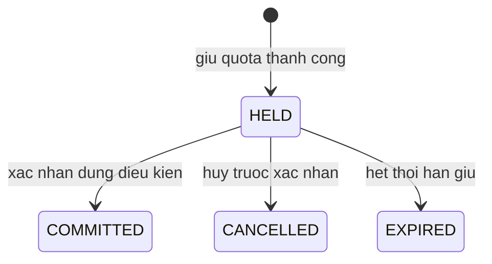
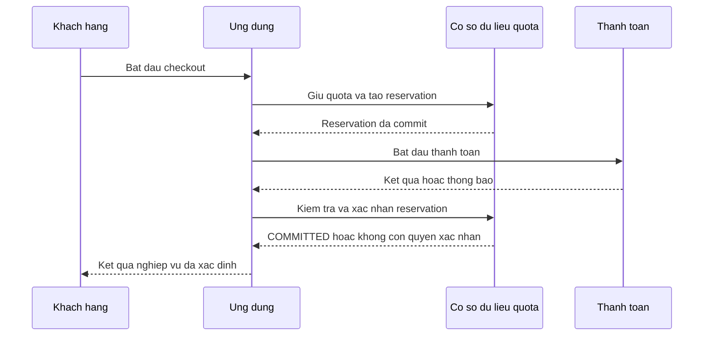

# Hạn mức khuyến mãi (Promotion quota)

Hạn mức khuyến mãi là giới hạn mà hệ thống phải duy trì đối với một quyền lợi: số lượt nhận quà, số đơn được giảm giá, số lần một tài khoản được tham gia hoặc ngân sách được phép sử dụng. Bảo vệ hạn mức là một bài toán bảo mật logic nghiệp vụ vì từng yêu cầu có thể hợp lệ khi xét riêng, nhưng nhiều yêu cầu đồng thời hoặc bị gửi lại có thể tạo ra tổng quyền lợi vượt quy định.

Trong chương Promotions, bài này tập trung vào cách biến hạn mức thành **bất biến nghiệp vụ được bảo vệ tại nơi ghi dữ liệu**. Việc kiểm tra quyền theo đối tượng, quản lý trạng thái, transaction và idempotency phải phối hợp với nhau; thông báo “đã hết lượt” trên giao diện không tạo ra sự bảo đảm đó.

## 1. Hạn mức cần được định nghĩa trước khi triển khai

Giả sử chương trình giả lập `FLASH_GIFT` có chính sách:

- Toàn chiến dịch có tối đa 1.000 suất quà.
- Mỗi tài khoản có tối đa hai suất, mỗi đơn đủ điều kiện nhận một suất.
- Khi checkout, hệ thống giữ một suất trong năm phút.
- Xác nhận nghiệp vụ hợp lệ trong thời hạn giữ chỗ sẽ tiêu dùng suất đó.
- Hủy trước khi xác nhận hoặc hết hạn sẽ giải phóng suất đang giữ.
- Hoàn tiền sau khi đã xác nhận không tự khôi phục lượt tham gia.

Đây là chính sách minh họa. Mốc xác nhận có thể là thanh toán thành công hoặc một mốc khác, nhưng phải được định nghĩa rõ cho hệ thống thực tế.

### Các loại hạn mức thường gặp

| Loại hạn mức | Ví dụ | Câu hỏi phải chốt |
| --- | --- | --- |
| Toàn chiến dịch | 1.000 suất quà | Giữ chỗ có chiếm suất ngay không? |
| Theo chủ thể | Hai lượt mỗi tài khoản | Chủ thể là tài khoản, tổ chức hay một quyền hưởng đã cấp? |
| Theo thời gian | Một lượt mỗi ngày theo múi giờ chiến dịch | Dùng ngày lịch hay cửa sổ trượt? |
| Theo sản phẩm hoặc kênh | 200 suất cho một SKU hoặc kênh bán | Có cùng dùng chung giới hạn toàn chiến dịch không? |
| Theo ngân sách | Tổng nghĩa vụ ưu đãi tối đa một mức tiền | Tính tiền đang giữ, đã dùng và hoàn như thế nào? |
| Theo nguồn cấp | Một nhóm được phân bổ 100 suất | Phần được cấp có được chuyển sang nhóm khác không? |

Hạn mức lượt, hạn mức tiền và tồn kho là các ràng buộc khác nhau. Một suất khuyến mãi chưa chắc đồng nghĩa kho còn một món quà. Nếu chiến dịch có 1.000 suất nhưng kho chỉ còn 800 sản phẩm, hệ thống phải bảo vệ cả hai điều kiện.

**Hạn mức cũng khác rate limit.** Rate limit giới hạn tốc độ gửi yêu cầu; quota giới hạn tổng quyền lợi được cấp trong phạm vi nghiệp vụ. Gửi rất chậm vẫn có thể vượt quota nếu kiểm soát quyền hưởng bị sai.

## 2. Xác định đúng phạm vi của một hạn mức

Một bộ đếm chỉ có ý nghĩa khi khóa của nó thể hiện đúng chính sách. Có thể mô hình hóa một bucket hạn mức bằng:

```text
(tenant_id, campaign_id, bucket_key)
```

Ví dụ:

```text
tenant_a / FLASH_GIFT / global
tenant_a / FLASH_GIFT / account:193
tenant_a / FLASH_GIFT / day:2026-11-22
```

Mỗi lượt tham gia có thể phải giữ chỗ ở nhiều bucket: một suất toàn chiến dịch, một suất của tài khoản và một suất của ngày hiện tại.

Các nguyên tắc xác định phạm vi:

1. Tenant, tài khoản và quyền thao tác phải lấy từ ngữ cảnh đã xác thực.
2. Mã chiến dịch do client gửi chỉ là đầu vào để tra cứu; máy chủ phải kiểm tra chiến dịch có áp dụng cho chủ thể và đơn hàng hay không.
3. Không cho client tự chọn khóa bucket, giá trị hạn mức, lượng cần giữ hoặc số đã dùng.
4. Nếu dùng quota theo ngày, máy chủ xác định ngày bằng thời điểm và múi giờ đã chốt trong chính sách.
5. Một lần retry phải tham chiếu lần cấp quyền gốc; không được tự chuyển sang bucket ngày mới để tạo thêm lợi ích.

Đừng dùng địa chỉ IP làm định danh mặc định cho quyền “mỗi khách hàng một lần”. Nhiều người có thể chung mạng và một người có thể đổi mạng. Khi doanh nghiệp cần hạn mức theo chủ thể khác tài khoản, cần mô hình định danh và chính sách riêng.

### Phiên bản chính sách không tự tạo quota mới

Tăng phiên bản từ `v1` lên `v2` để sửa mô tả hoặc điều kiện không đồng nghĩa chiến dịch được cấp lại 1.000 suất. Phạm vi hạn mức và phiên bản quy tắc cần được quản lý riêng.

Nếu doanh nghiệp chủ động mở một đợt mới, hãy tạo định danh đợt hoặc quyền cấp phát có ý nghĩa rõ ràng. Không dựa vào việc đổi tên mã khuyến mãi để ngầm quyết định có được hưởng lại hay không.

## 3. Biểu diễn bất biến bằng số đang giữ và số đã tiêu dùng

Với một bucket, đặt:

- `L`: hạn mức được cấp.
- `R`: số lượng đang được giữ chỗ.
- `C`: số lượng đã tiêu dùng và còn được tính vào quota theo chính sách.

Bất biến cơ bản là:

```text
L >= 0
R >= 0
C >= 0
R + C <= L

available = L - R - C
```

Khi một thao tác tác động nhiều bucket, bất biến phải đúng với **từng bucket**, không chỉ tổng toàn chiến dịch.

| Thao tác | Điều kiện chính | Thay đổi R | Thay đổi C |
| --- | --- | --- | --- |
| Giữ q suất | q > 0 và available >= q | +q | 0 |
| Xác nhận suất đang giữ | Reservation còn quyền chuyển trạng thái | -q | +q |
| Hủy trước xác nhận | Reservation còn ở trạng thái đang giữ | -q | 0 |
| Hết hạn | Reservation đang giữ và đã đến hạn | -q | 0 |
| Gửi lại thao tác đã hoàn tất | Trùng thao tác đã được xử lý | 0 | 0 |

Chuyển từ giữ chỗ sang tiêu dùng không làm tăng `available`: quyền lợi đó đã chiếm quota ngay từ khi được giữ.

### Ví dụ diễn biến số lượng

Giả sử `L = 1.000`, `R = 18`, `C = 982`. Khi đó không còn suất khả dụng.

- Xác nhận ba suất: `R = 15`, `C = 985`, khả dụng vẫn bằng 0.
- Giải phóng hai suất đã hết hạn: `R = 13`, `C = 985`, khả dụng bằng 2.
- Hoàn tiền một đơn đã xác nhận: theo chính sách ví dụ, quota không đổi; điều chỉnh tiền được ghi riêng.

Nếu hệ thống tăng quota khả dụng ngay khi xác nhận, hoặc giải phóng lại một reservation đã xác nhận, tổng quyền lợi có thể vượt giới hạn.

### Số lượng phải có đơn vị rõ ràng

Dùng số nguyên cho số lượt hoặc đơn vị tiền nhỏ nhất; xác thực giới hạn miền giá trị và tránh phép tính tràn số. Không chấp nhận lượng âm để biến “giữ -1 suất” thành tăng quota khả dụng.

Với quota tiền, cần nêu rõ đồng tiền, cách làm tròn và nghĩa vụ nào được tính. Không cộng trực tiếp ngân sách VND và USD vào cùng một bộ đếm.

## 4. Vì sao kiểm tra trước rồi cập nhật sau dễ bị vượt quota?

Giả sử chỉ còn một suất. Hai request A và B chạy đồng thời:

```text
A đọc available = 1
B đọc available = 1
A cấp một suất
B cấp một suất
```

Mỗi request đều thấy điều kiện hợp lệ tại lúc đọc, nhưng kết quả là hai suất được cấp trên một suất còn lại. Đây là lỗi cạnh tranh giữa kiểm tra và sử dụng điều kiện.

Những cách sau không tự giải quyết vấn đề:

- Vô hiệu hóa nút nhận ưu đãi sau lần bấm đầu.
- Kiểm tra quota bằng một API rồi gọi API cấp quyền lợi riêng.
- Đọc số còn lại từ cache và tin rằng nó vẫn đúng khi ghi.
- Dùng khóa trong một tiến trình khi ứng dụng chạy nhiều instance.
- Chỉ dùng idempotency key nhưng không bảo vệ quota giữa các thao tác khác nhau.
- Đếm số đơn rồi tạo đơn mới mà không có cơ chế kiểm soát đồng thời tương ứng.

Điểm quyết định là **thao tác chiếm quota phải nguyên tử đối với các thao tác cạnh tranh**, và phải nằm trong phạm vi nhất quán với bản ghi quyền hưởng.

Một giá trị “còn 10 suất” trên trang giới thiệu có thể là thông tin gần đúng. Kết quả cấp quyền lợi cuối cùng phải được xác nhận bằng nguồn dữ liệu có thẩm quyền.

## 5. Vòng đời reservation phải là một state machine

Một mô hình tối thiểu:



Trong chính sách ví dụ, các trạng thái cuối không quay lại `HELD`. Nếu được phép thử giữ lại sau khi hết hạn, hệ thống tạo lần giữ mới gắn với cùng quyền hưởng nghiệp vụ, sau khi kiểm tra lần trước đã được giải quyết.

Một reservation nên liên kết được với:

| Dữ liệu | Mục đích |
| --- | --- |
| Reservation ID | Nhận diện lần giữ cụ thể |
| Tenant, chiến dịch, chủ thể | Kiểm tra phạm vi và quyền theo đối tượng |
| Đơn hàng hoặc quyền hưởng | Chống tạo nhiều lợi ích cho cùng một đối tượng nghiệp vụ |
| Trạng thái và phiên bản bản ghi | Kiểm soát chuyển trạng thái cạnh tranh |
| Thời điểm hết hạn | Xác định còn quyền xác nhận hay cần giải phóng |
| Phiên bản đơn và chính sách | Biết điều kiện nào đã được dùng khi giữ |
| Danh sách allocation | Biết lượng đã giữ trong từng bucket |
| Tham chiếu thao tác idempotent | Trả lại đúng kết quả khi request bị gửi lại |

Reservation ID dù khó đoán vẫn không thay thế kiểm tra quyền. Mọi API xác nhận, hủy hoặc xem chi tiết phải xác minh chủ thể được phép thao tác lên reservation đó.

### Hết thời gian không có nghĩa bộ đếm đã tự thay đổi

Nếu reservation đã quá hạn nhưng tác vụ dọn dẹp chưa chạy, phần quota đó vẫn nằm trong `R` cho đến khi hệ thống thực hiện chuyển trạng thái và giảm bộ đếm một cách nguyên tử.

Cách này có thể làm tạm thời từ chối khách hợp lệ do quota chưa được giải phóng, nhưng tránh cấp vượt. Có thể cải thiện độ trễ bằng worker hết hạn hoặc thu hồi các reservation hết hạn trong transaction thích hợp.

Không được vừa coi reservation hết hạn là “không còn chiếm quota” khi đọc, vừa để worker sau đó giảm `R` lần nữa. Hai cách tính khác nhau sẽ làm sai sổ.

### Tranh chấp giữa xác nhận và hết hạn

Cả luồng xác nhận và luồng hết hạn phải khóa hoặc cập nhật có điều kiện trên cùng trạng thái gốc. Chỉ một chuyển trạng thái được thắng.

Thời điểm dùng để kiểm tra hạn phải do hệ thống có thẩm quyền lấy sau khi đã giành được quyền xử lý bản ghi. Với transaction chờ khóa lâu, không nên dùng một thời điểm được chụp từ rất sớm rồi coi reservation vẫn còn hạn.

Cần chốt rõ ý nghĩa thời hạn: chẳng hạn hệ thống cho phép xác nhận nếu lúc kiểm tra dưới khóa vẫn chưa hết hạn. Điều này khác việc yêu cầu phản hồi HTTP phải đến client trước hạn.

## 6. Cập nhật nguyên tử trong cơ sở dữ liệu

Ví dụ sau dùng PostgreSQL để minh họa một bucket hạn mức:

```sql
CREATE TABLE promotion_quota_bucket (
    tenant_id   TEXT NOT NULL,
    campaign_id TEXT NOT NULL,
    bucket_key  TEXT NOT NULL,

    quota_limit BIGINT NOT NULL CHECK (quota_limit >= 0),
    reserved    BIGINT NOT NULL DEFAULT 0 CHECK (reserved >= 0),
    consumed    BIGINT NOT NULL DEFAULT 0 CHECK (consumed >= 0),

    PRIMARY KEY (tenant_id, campaign_id, bucket_key),

    CHECK (reserved <= quota_limit),
    CHECK (consumed <= quota_limit - reserved)
);
```

Ràng buộc ở cơ sở dữ liệu là lớp bảo vệ bổ sung. Chỉ những đường ghi được thiết kế đúng và được cấp quyền phù hợp mới được cập nhật bảng này.

### Giữ chỗ bằng một UPDATE có điều kiện

```sql
UPDATE promotion_quota_bucket
SET reserved = reserved + :quantity
WHERE tenant_id = :tenant_id
  AND campaign_id = :campaign_id
  AND bucket_key = :bucket_key
  AND :quantity > 0
  AND :quantity <= quota_limit - reserved - consumed
RETURNING quota_limit, reserved, consumed;
```

Các tham số phải được bind; `quantity` được suy ra và kiểm tra từ nghiệp vụ phía máy chủ. Không ghép dữ liệu client thành câu SQL hoặc tên bucket tùy ý.

Nếu trả về một dòng, thao tác đã chiếm quota của bucket trong transaction hiện tại. Nếu không có dòng, có thể bucket không tồn tại hoặc không đủ quota; tầng nghiệp vụ phải xử lý đúng, không tự tạo bucket với hạn mức mặc định lớn.

**Chưa commit transaction thì chưa được thông báo thành công ra ngoài.** UPDATE thành công không đồng nghĩa bước tạo quyền hưởng tiếp theo chắc chắn thành công.

Trong trường hợp các transaction cùng sửa một hàng, PostgreSQL thực hiện cơ chế khóa và kiểm tra cập nhật tương ứng với mức cô lập. Ở mức cô lập hoặc tình huống có lỗi serialization hay deadlock, ứng dụng phải có cách retry toàn bộ transaction một cách an toàn, không bỏ qua kiểm tra.

### Nhiều bucket phải cùng thành công

Với một lượt của tài khoản 193:

```text
BEGIN
  kiểm tra quyền thao tác và trạng thái đơn
  khóa bản ghi quyền hưởng nghiệp vụ
  chiếm 1 suất ở bucket global
  chiếm 1 suất ở bucket account:193
  tạo reservation và các allocation
  ghi kết quả idempotent và sự kiện outbox
COMMIT
```

Nếu bucket tài khoản không đủ quota, phải rollback cả phần đã giữ ở bucket toàn chiến dịch. Không commit từng bucket độc lập rồi hy vọng tác vụ bù sau đó sẽ luôn hoàn tất.

Các luồng cần truy cập nhiều bản ghi phải dùng thứ tự khóa thống nhất, bao gồm bản ghi quyền hưởng, reservation và các bucket. Với danh sách bucket, một thứ tự ổn định theo khóa giúp giảm tranh chấp khóa chéo.

Lỗi khi commit hoặc mất kết nối khiến client chưa biết kết quả phải được giải quyết qua định danh thao tác, không bằng cách tạo một thao tác mới vô điều kiện.

### Ghi nhận và giải phóng trong cùng transaction

Khi xác nhận một reservation:

1. Kiểm tra quyền trên đơn và reservation, rồi khóa các bản ghi theo quy ước chung.
2. Đọc lại trạng thái, hạn giữ và các điều kiện phải còn đúng.
3. Với từng allocation, chuyển lượng từ `reserved` sang `consumed`.
4. Chuyển reservation từ `HELD` sang `COMMITTED` và tạo quyền lợi theo đơn đúng một lần.
5. Ghi kết quả thao tác và outbox, sau đó commit.

Khi hủy hoặc hết hạn:

1. Giành quyền chuyển trạng thái từ `HELD`.
2. Giảm `reserved` đúng lượng của các allocation.
3. Chuyển sang trạng thái kết thúc tương ứng và ghi sự kiện.
4. Commit tất cả thay đổi cùng nhau.

Không có bước nào được giảm quota đang giữ của một reservation đã `COMMITTED`. Nếu request đến lại, trả trạng thái hoặc kết quả đã có, không chạy lại hiệu ứng.

## 7. Idempotency bảo vệ request lặp, khóa nghiệp vụ bảo vệ quyền hưởng

Hai lớp này xử lý hai vấn đề khác nhau.

**Idempotency** giúp cùng một thao tác gửi lại nhiều lần chỉ có một hiệu ứng. Khóa cần có phạm vi, chẳng hạn:

```text
(tenant_id, authenticated_subject_id, operation_type, idempotency_key)
```

**Khóa nghiệp vụ** ngăn nhiều thao tác khác nhau cùng cấp một quyền lợi không được phép lặp. Với chính sách mỗi đơn nhận một suất, có thể dùng bản ghi quyền hưởng có khóa duy nhất:

```text
(tenant_id, campaign_id, order_id, benefit_type)
```

Bản ghi này theo dõi lần giữ đang hoạt động và việc quyền lợi đã được cấp hay chưa. Một lần giữ hết hạn có thể được thay bằng lần giữ mới nếu chính sách cho phép; một quyền lợi đã cấp không được tạo lại chỉ vì request mang khóa mới.

| Tình huống | Kết quả cần có |
| --- | --- |
| Cùng khóa, cùng nội dung, request đầu đã commit | Trả kết quả đã lưu, không giữ thêm |
| Cùng khóa nhưng nội dung khác | Báo xung đột, không dùng lại khóa cho thao tác mới |
| Khác khóa nhưng cùng đơn đã có quyền lợi | Không tạo quyền lợi thứ hai |
| Cùng khóa đến hai instance đồng thời | Chỉ một lần được thực thi hiệu ứng nghiệp vụ |
| Mất phản hồi sau commit | Retry tra được kết quả trước đó |
| Retry sau khi reservation đã hết hạn | Không âm thầm giữ lại một suất bằng thao tác cũ |

Dấu vân tay nội dung cần dựa trên yêu cầu đã chuẩn hóa và phạm vi thao tác. Lưu riêng bản chụp chính sách và trạng thái được dùng khi thực thi. Không vì giá hoặc thời gian hiện tại thay đổi mà coi một request gửi lại giống hệt là thao tác mới.

Kết quả idempotent đã lưu có thể mô tả lần giữ ban đầu; API tra trạng thái phải cho biết reservation hiện còn hạn hay không. Không được hiểu việc nhận lại phản hồi tạo reservation cũ là gia hạn reservation đó.

### Ranh giới transaction của thao tác giữ

Mã giả sau mô tả thứ tự xử lý, không phải một hàm có thể chép nguyên vào ứng dụng:

```text
reservePromotion(authenticatedContext, request, idempotencyKey):
    xác thực định dạng và chuẩn hóa nội dung request

    bắt đầu transaction
        lấy hoặc tạo bản ghi idempotency bằng khóa duy nhất
        giành quyền xử lý bản ghi theo cơ chế đồng thời đã chọn

        nếu dấu vân tay không khớp:
            kết thúc mà không cấp quyền lợi

        nếu đã có kết quả hoàn tất:
            trả lại kết quả đã lưu, không chạy lại hiệu ứng

        tải và kiểm tra quyền trên đơn hàng
        kiểm tra chiến dịch, điều kiện tham gia và phiên bản đơn
        khóa bản ghi quyền hưởng nghiệp vụ
        kiểm tra không có quyền lợi đã cấp hoặc lần giữ xung đột

        xác định allocation ở các bucket từ chính sách máy chủ
        cập nhật quota từng bucket trong cùng transaction
        nếu bất kỳ bucket nào không đủ:
            rollback toàn bộ thay đổi nghiệp vụ

        tạo reservation và ghi các allocation
        gắn lần giữ với bản ghi quyền hưởng
        lưu kết quả idempotent
        ghi outbox nếu cần phát sự kiện
    commit

    chỉ sau commit mới trả kết quả thành công
```

Các thao tác “lấy hoặc tạo” phải có ràng buộc duy nhất và cơ chế xử lý xung đột thực sự. Một câu `SELECT` không thấy bản ghi rồi `INSERT` tùy ý vẫn có thể đua nhau.

Nếu một thao tác thất bại và transaction rollback, không được để lại bản ghi “đang xử lý” vô thời hạn. Chính sách có lưu kết quả lỗi nghiệp vụ hay cho phép thử lại cần được thiết kế rõ, nhưng không được giữ quota một phần.

Thời hạn lưu idempotency cũng phải phù hợp với khả năng retry và vòng đời giao dịch. Khi dữ liệu idempotency đã được dọn, khóa nghiệp vụ vẫn là lớp bảo vệ chống cấp lại quyền lợi cho đơn đã hoàn tất.

## 8. Giữ quota không đóng băng mọi điều kiện nghiệp vụ

Một reservation chỉ chứng minh hệ thống đã giữ một lượng quota trong một phạm vi nhất định. Nó không chứng minh mọi điều kiện của đơn sẽ luôn đúng.

Ví dụ, khách giữ một suất cho đơn đủ giá trị, sau đó:

- Xóa các sản phẩm đủ điều kiện.
- Chuyển quyền sở hữu hoặc phạm vi xử lý đơn.
- Đổi số lượng và làm thay đổi lượng quà được phép nhận.
- Thêm một khuyến mãi không được phép cộng dồn.
- Gửi xác nhận từ một tài khoản khác.

Tại bước xác nhận, máy chủ cần áp dụng chính sách đã chốt về việc đánh giá lại. Có thể yêu cầu phiên bản đơn không đổi, hoặc tính lại điều kiện và cấp lại reservation nếu cần. Không lấy các giá trị client gửi trước đó làm bằng chứng duy nhất.

Quyền thao tác phải được kiểm tra ở mọi bước: giữ, xem, xác nhận, hủy và gia hạn. Một API hủy không kiểm tra chủ sở hữu có thể bị dùng để giải phóng suất của người khác rồi chiếm lấy.

### Gia hạn cần là thao tác riêng

Nếu chỉ cần gửi lại request là đồng hồ hết hạn được kéo dài, một người có thể giữ suất vô thời hạn. Khi cho phép gia hạn, nên chốt:

- Những trạng thái nào được gia hạn.
- Tổng thời gian giữ tối đa.
- Điều kiện đơn phải còn đúng.
- Giới hạn lần gia hạn và số reservation đang hoạt động.
- Cách phối hợp với worker hết hạn và request xác nhận.

Việc gia hạn phải cập nhật có kiểm soát và có dấu vết; retry cùng thao tác không được tự tạo lần gia hạn mới.

## 9. Thanh toán đến muộn, hủy và hoàn tiền

Khuyến mãi thường liên quan dịch vụ thanh toán hoặc hệ thống ngoài, nhưng không nên giữ transaction cơ sở dữ liệu mở trong suốt lúc chờ mạng bên ngoài.

Một luồng có thể là:



Sơ đồ không hàm ý thanh toán và quota nằm trong một transaction phân tán. Cần thiết kế cách xử lý khi chúng không hoàn tất cùng lúc.

### Thông báo thành công sau khi reservation hết hạn

Không được chuyển `EXPIRED` sang `COMMITTED` chỉ vì thanh toán vừa báo thành công. Suất đã giải phóng có thể đã được người khác giữ.

Tùy thiết kế, hệ thống có thể:

1. Thử cấp một reservation mới bằng đầy đủ kiểm tra quota và quyền hưởng.
2. Dùng một luồng đã được thiết kế để giữ quota tới một mốc thanh toán phù hợp.
3. Chuyển giao dịch sang trạng thái cần xử lý, thực hiện bù hoặc hoàn theo quy trình nghiệp vụ.

Không âm thầm loại bỏ quyền lợi đã cam kết với khách. Phương án xử lý cần được quyết định trong chính sách checkout và quy trình vận hành, trước khi có sự cố.

Thông báo thanh toán cũng phải được xác minh nguồn, liên kết đúng đơn và xử lý lặp an toàn. Dữ liệu “đã thanh toán” do trình duyệt gửi không đủ để xác nhận quyền lợi.

### Hủy trước và sau khi đã tiêu dùng là hai việc khác nhau

- **Hủy khi đang giữ:** giải phóng `R`, nếu chuyển trạng thái thành công.
- **Hủy hoặc hoàn sau khi đã tiêu dùng:** xử lý tài chính và quyền lợi theo chính sách, không dùng lại hàm giải phóng reservation đang giữ.

Nếu doanh nghiệp cho phép khôi phục quota sau hoàn, phải có một thao tác điều chỉnh riêng, tham chiếu quyền lợi gốc và có định danh duy nhất. Cùng một thông báo hoàn đến hai lần không được giảm `C` hai lần.

Việc quota có được khôi phục cũng không quyết định món quà có quay lại kho hay không. Tồn kho, tiền và quyền tham gia là các sổ nghiệp vụ liên quan nhưng có quy tắc riêng.

## 10. Nhiều dịch vụ, cache và nhiều vùng triển khai

### Khi các hạn mức cùng nằm trong một cơ sở dữ liệu

Ưu tiên một transaction bao phủ các bucket và bản ghi quyền hưởng liên quan nếu kiến trúc cho phép. Đây là cách trực tiếp để bảo vệ đồng thời hạn mức toàn chiến dịch và hạn mức tài khoản.

Một hàng quota toàn chiến dịch có thể trở thành điểm tranh chấp khi lưu lượng cao. Trước khi phân tán bộ đếm, cần đo thời gian khóa, độ dài transaction và số thao tác thực sự cần bảo vệ.

### Khi quota và tồn kho thuộc hai dịch vụ

Không thể giả định hai lệnh gọi HTTP tạo thành một transaction. Cần giao thức giữ chỗ, xác nhận và bù có định danh; mỗi dịch vụ tự bảo vệ bất biến của mình.

Ví dụ:

```text
giữ quota -> giữ hàng -> xác nhận theo chính sách
                 |
                 +-> thất bại: giải phóng phần đã giữ bằng thao tác lặp an toàn
```

Trong thời gian chờ bù, hệ thống có thể tạm giữ nhiều tài nguyên hơn cần thiết. Đó là vấn đề khả dụng cần khôi phục, không phải lý do để bỏ qua giới hạn và cấp vượt.

Một saga không tự biến các bước thành nguyên tử. Cần xét mọi điểm dừng, thao tác bù thất bại và thông điệp đến lại; các hiệu ứng không đảo ngược phải có cách xử lý nghiệp vụ riêng.

### Redis hoặc cache không mặc nhiên là nguồn sự thật

Một script nguyên tử trong Redis chỉ bảo vệ những thao tác nằm trong phạm vi nguyên tử và mô hình triển khai của nó. Nó không tự commit cùng transaction ghi đơn hàng ở một cơ sở dữ liệu khác.

Nếu dùng Redis để quyết định quota, phải thiết kế rõ độ bền dữ liệu, khả năng mất trạng thái, failover, phân vùng và việc khôi phục. Không để key bị xóa hoặc bị eviction rồi coi chiến dịch chưa có ai sử dụng.

Nếu Redis chỉ phục vụ đọc nhanh, quyết định cuối cùng vẫn phải qua nơi bảo vệ quota có thẩm quyền. Không dùng số liệu cache cũ để bỏ qua cập nhật có điều kiện.

TTL của key cache cũng khác thời hạn của từng reservation. Xóa một key bộ đếm không đồng nghĩa đã kết thúc đúng tất cả các quyền giữ chỗ liên quan.

### Phân bổ quota cho nhiều nơi xử lý

Với nhiều vùng hoặc phân vùng dữ liệu, có thể cấp trước các phần quota không chồng lấn, ví dụ 600 suất cho vùng A và 400 suất cho vùng B.

Điều kiện cần duy trì là tổng phần cấp phát không vượt giới hạn toàn cục; mỗi nơi không được vượt phần được cấp. Chuyển phần cấp phát giữa các nơi cần giao thức ngăn cả hai cùng sử dụng một phần quyền.

Chia theo tài khoản rồi cho mỗi phân vùng tự dùng giới hạn 1.000 không bảo vệ quota toàn chiến dịch. Đọc các bản sao bất đồng bộ cũng không đủ để bảo đảm một giới hạn cứng.

Nếu nguồn quyết định quota không khả dụng, không được mặc định cấp quyền lợi khi yêu cầu là không bao giờ vượt hạn mức. Có thể cho thử lại, xếp hàng hoặc áp dụng phương án đã được chốt trong nghiệp vụ.

## 11. Chống việc chiếm chỗ mà không hoàn tất

Ngay cả khi không vượt `L`, hệ thống vẫn có thể bị lạm dụng bằng cách giữ toàn bộ suất rồi không mua hàng.

Các biện pháp bổ sung gồm:

- Kiểm tra đủ điều kiện trước khi giữ tài nguyên khan hiếm.
- Giới hạn tổng reservation đang hoạt động theo chủ thể.
- Áp dụng TTL phù hợp và hạn chế gia hạn.
- Ngăn nhiều lần giữ song song cho cùng quyền hưởng hoặc đơn.
- Giới hạn tốc độ tạo thao tác mới, phân biệt với retry hợp lệ.
- Theo dõi tỷ lệ giữ rồi hết hạn theo chiến dịch và chủ thể.
- Chỉ giữ tại bước thực sự cần, thay vì mọi lần xem trang hoặc thêm hàng.

Không chỉ dùng một ngưỡng IP để chống chiếm chỗ. Cần cân nhắc người dùng chung mạng, đồng thời tránh cho request chưa xác thực tự chọn tài khoản khác làm khóa giới hạn.

TTL quá ngắn làm tăng số thanh toán đến sau hạn; TTL quá dài làm giảm cơ hội của khách hợp lệ. Quyết định này cần dựa trên thời gian checkout thực tế và chính sách thanh toán, không chỉ mong muốn làm sạch bộ đếm nhanh.

Quota duy trì đúng không đồng nghĩa phân phối công bằng. Nếu chương trình cần hàng chờ hoặc bốc thăm, đó là một cơ chế phân bổ riêng; không thể suy ra công bằng từ một UPDATE nguyên tử.

## 12. Kiểm thử bất biến và các điểm cạnh tranh

Kiểm thử phải quan sát cả bản ghi quyền lợi lẫn các bộ đếm. Chỉ kiểm tra status code của API sẽ bỏ sót việc đã từ chối phản hồi nhưng vẫn giữ quota.

| Tình huống | Kỳ vọng |
| --- | --- |
| 50 request hợp lệ cạnh tranh năm suất, không hủy hay hết hạn trong phép thử | Trong điều kiện không có lỗi kỹ thuật, chỉ năm thao tác giữ thành công; không lúc nào cấp vượt năm |
| Một request gửi lại đồng thời nhiều lần với cùng khóa | Một reservation, một tập allocation, một hiệu ứng quota |
| Một đơn dùng nhiều khóa idempotency khác nhau | Không tạo nhiều quyền lợi trái chính sách |
| Cùng khóa nhưng đổi nội dung yêu cầu | Xung đột, không thay kết quả của thao tác gốc |
| Bucket toàn chiến dịch còn nhưng bucket tài khoản hết | Rollback mọi thay đổi; không rò suất toàn chiến dịch |
| Xác nhận và worker hết hạn chạy cùng lúc | Chỉ một chuyển trạng thái có hiệu ứng, theo điều kiện thời gian dưới cơ chế đồng thời đã chọn |
| Gửi hủy nhiều lần | Chỉ lần chuyển từ HELD đầu tiên được giảm R |
| Gửi hủy sau COMMITTED | Không giải phóng quota đã tiêu dùng bằng đường hủy giữ chỗ |
| Mất phản hồi ngay sau commit | Retry tìm được kết quả, không cấp thêm |
| Instance dừng sau UPDATE nhưng trước commit | Transaction rollback, không có reservation thành công một phần |
| Instance dừng sau commit trước khi phát sự kiện | Outbox cho phép phát lại, không tạo lại quyền lợi |
| Đổi ngày trong lúc request được retry | Kết quả gốc vẫn tham chiếu bucket đã dùng, không chiếm thêm bucket mới |
| Gửi số lượng âm, quá lớn hoặc giá trị gây tràn | Bị từ chối trước hiệu ứng nghiệp vụ |
| Gọi xác nhận reservation của người khác | Bị từ chối theo quyền đối tượng, bộ đếm không đổi |
| Thanh toán thành công sau khi suất đã cấp cho người khác | Không hồi sinh reservation hết hạn để cấp vượt |
| Hai tenant dùng cùng campaign ID | Quota và quyền hưởng được tách đúng phạm vi |

Để tạo tranh chấp có ý nghĩa, đồng bộ điểm bắt đầu của các request bằng một cơ chế kiểm thử thích hợp; gửi tuần tự rồi lặp nhiều lần không tái hiện cùng loại lỗi.

Sau mỗi phép thử, kiểm tra:

```text
reserved >= 0
consumed >= 0
reserved + consumed <= quota_limit

số lượng trong sổ allocation khớp với bộ đếm
mỗi quyền lợi đã cấp có một nguồn tiêu dùng quota hợp lệ
mỗi thao tác lặp không tạo thêm hiệu ứng
```

Ngoài tình huống thành công, cần thử lỗi giữa các bước, deadlock hoặc lỗi serialization, worker chạy lại và dữ liệu sự kiện đến sai thứ tự. Retry kỹ thuật phải thực hiện lại toàn bộ đơn vị transaction phù hợp với cùng định danh thao tác.

## 13. Đối soát và quan sát khi vận hành

Bộ đếm giúp quyết định nhanh; sổ reservation và allocation giúp giải thích vì sao số đó đúng.

Với chính sách ví dụ không khôi phục quota sau hoàn:

```text
R_expected =
    tổng lượng allocation của reservation có trạng thái HELD

C_expected =
    tổng lượng allocation của reservation có trạng thái COMMITTED
```

Khi tính `R_expected`, reservation đã quá thời gian nhưng chưa chuyển khỏi `HELD` vẫn được tính. Đây là cách đối soát bộ đếm đang lưu; một chỉ số khác có thể thể hiện số lượt đã quá hạn cần dọn.

Việc đối chiếu phải dùng một ảnh chụp dữ liệu nhất quán hoặc một mốc xử lý đã được xác định. So hai bảng được đọc ở hai thời điểm khác nhau giữa lúc giao dịch vẫn chạy có thể tạo chênh lệch giả.

Nếu có điều chỉnh khôi phục quota theo chính sách khác, công thức phải bao gồm sổ điều chỉnh có định danh, không chỉ nhìn trạng thái reservation.

### Những chỉ số hữu ích

| Nhóm | Ví dụ |
| --- | --- |
| Khả dụng | Số suất còn, số giữ mới bị từ chối do hết quota |
| Vòng đời | Số đang giữ, tỷ lệ hết hạn, tuổi của reservation quá hạn |
| Toàn vẹn | Sai lệch bộ đếm với allocation, chuyển trạng thái bất hợp lệ |
| Cạnh tranh | Thời gian chờ khóa, deadlock, lỗi serialization, số lần retry |
| Khôi phục | Backlog outbox, tác vụ hết hạn lỗi, thao tác bù chưa hoàn tất |
| Khách hàng | Lỗi checkout, thanh toán đến muộn, tỷ lệ giữ rồi hoàn tất |

Hết quota theo chính sách là kết quả nghiệp vụ bình thường, khác với lỗi lưu trữ hoặc lỗi kiểm tra quyền. Nên ghi mã lý do riêng để không biến hết suất thành một đợt báo động hạ tầng.

Sự kiện cần có tenant, chiến dịch, reservation ID, quyền hưởng, loại chuyển trạng thái, lượng tác động và định danh thao tác. Không ghi token thanh toán hoặc dữ liệu bí mật vào log. Không dùng order ID hay subject ID làm nhãn metric có độ đa dạng lớn; tra cứu chi tiết qua nguồn dữ liệu được phân quyền.

Nếu cần sửa bộ đếm do phát hiện sai lệch, phải điều tra nguồn, kiểm soát ghi đồng thời và ghi nhận điều chỉnh. Không chạy một lệnh “đặt lại số còn” dựa trên ảnh chụp cũ trong lúc hệ thống vẫn cấp suất.

## 14. Thay đổi hạn mức cũng là một thao tác nhạy cảm

Một API cập nhật `quota_limit` có thể làm vô hiệu mọi bảo vệ ở đường checkout nếu quyền quản trị quá rộng hoặc client sửa được cấu hình.

Cần bảo vệ:

- Quyền thay đổi theo tenant, chiến dịch và loại thao tác.
- Bước phê duyệt nếu quy trình yêu cầu, bao gồm việc không cho gọi thẳng bước áp dụng khi chưa có phê duyệt hợp lệ.
- Phiên bản cấu hình để tránh một cập nhật cũ ghi đè quyết định mới.
- Lý do, người thực hiện và lịch sử giá trị trước/sau.
- Tính hợp lệ của hạn mức mới so với phần đang giữ và đã tiêu dùng.

Nếu `R + C = 900`, đặt `L = 800` làm bất biến không còn đúng. Hệ thống có thể từ chối giảm, tạm dừng nhận thêm rồi chờ phần giữ được giải quyết, hoặc thực hiện một quy trình điều chỉnh đã được thiết kế. Không xóa số đã tiêu dùng để ép phép kiểm tra qua.

Quota theo ngày nên tạo bucket của ngày mới theo chính sách đã chốt; không xóa lịch sử để “reset” trong khi reservation hoặc retry của ngày cũ còn tồn tại.

Một thiết kế hoàn chỉnh phải giải thích được chuỗi: **ai có quyền tham gia → quota nào được giữ → lần giữ chuyển trạng thái ra sao → quyền lợi nào được cấp → tác động nào đã được ghi đúng một lần**. Khi chuỗi này được bảo vệ bằng transaction, khóa nghiệp vụ và idempotency, việc gửi lại request hoặc chạy đồng thời không thể tự tạo thêm suất khuyến mãi.
