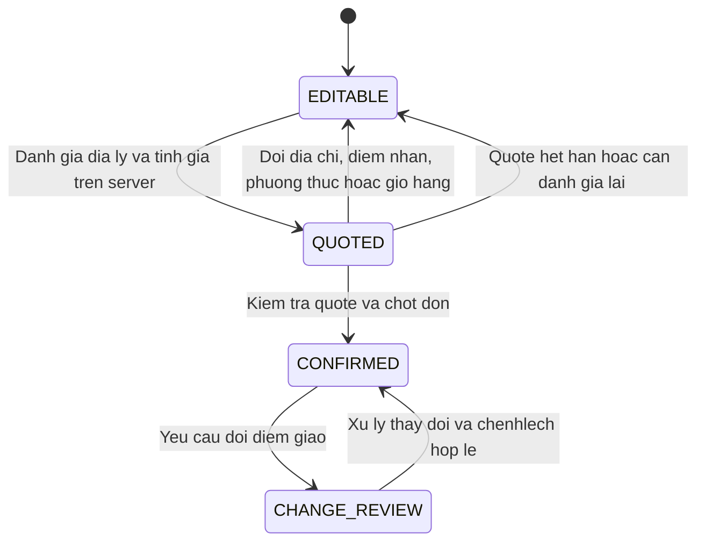

# Phạm vi địa lý của chương trình khuyến mãi (Promotion geographic scope)

## 1. Phạm vi địa lý là một điều kiện cấp ưu đãi

Trong chương Promotions, **promotion geographic scope** xác định một chương trình khuyến mãi được áp dụng cho giao dịch ở những khu vực nào và căn cứ vào vị trí của đối tượng nào. Điều kiện này có thể giới hạn ngân sách theo vùng, hỗ trợ khai trương cửa hàng hoặc chỉ cấp ưu đãi cho các đơn giao trong một vùng phục vụ.

Đây là một bài toán bảo mật logic nghiệp vụ. Nếu hệ thống tin trường `region` do client gửi, kiểm tra địa chỉ ở bước xem giỏ hàng rồi bỏ qua ở bước đặt hàng, hoặc giữ nguyên giảm giá sau khi đổi điểm nhận, người dùng có thể nhận ưu đãi ngoài phạm vi đã phê duyệt.

Bài học tập trung vào bất biến địa lý, quyền sửa phạm vi, vòng đời quyết định giá, transaction, idempotency và các tình huống kiểm thử lạm dụng. Mục tiêu là bảo đảm tiền giảm được cấp cho đúng giao dịch đủ điều kiện, dựa trên dữ liệu mà server có thể giải thích và kiểm soát.

### 1.1. “Vị trí” của ai?

Một giao dịch có nhiều vị trí khác nhau:

| Vị trí | Ý nghĩa | Ví dụ chính sách phù hợp |
| --- | --- | --- |
| Địa chỉ giao hàng | Nơi hàng được giao theo đơn | Giảm phí vận chuyển trong vùng phục vụ |
| Cửa hàng nhận hàng | Điểm nhận do hệ thống quản lý | Ưu đãi khi nhận tại một chi nhánh mới |
| Địa chỉ thanh toán | Địa chỉ gắn với thông tin thanh toán | Chỉ sử dụng khi điều khoản chương trình thực sự quy định căn cứ này |
| Nơi cư trú hoặc hồ sơ đã xác minh | Thông tin chủ thể được quản lý theo quy trình riêng | Chương trình dành cho cư dân của một khu vực |
| Vị trí thiết bị hoặc IP | Vị trí được thiết bị khai báo hoặc suy luận từ mạng | Cá nhân hóa nội dung, gợi ý cửa hàng, tín hiệu rủi ro |
| Kho xuất hàng hoặc địa điểm người bán | Điểm phát sinh hoạt động cung ứng | Hỗ trợ đơn xuất từ một kho hoặc chi nhánh nhất định |

Không tự thay thế các căn cứ này cho nhau. Khách hàng đang ở vùng A nhưng yêu cầu giao hàng tới B có thể không được hưởng chương trình chỉ dành cho giao hàng tới A. Khách hàng dùng mạng ở B vẫn có thể hợp lệ nếu địa chỉ giao hàng thực tế nằm trong A.

### 1.2. Tình huống xuyên suốt

Giả sử doanh nghiệp triển khai `LOCAL15` với các điều kiện minh họa:

- Giảm 15% trên giá trị hàng đủ điều kiện, tối đa 80.000 VND mỗi đơn.
- Giá trị hàng đủ điều kiện trước giảm phải đạt 400.000 VND.
- Chỉ áp dụng cho **địa chỉ giao hàng** thuộc các vùng `ZONE_A` hoặc `ZONE_B`.
- Loại trừ `ZONE_X`, kể cả khi vùng này nằm trong một vùng được bao phủ rộng hơn.
- Chỉ cho phương thức giao tận nơi; nhận tại cửa hàng không thuộc chương trình này.
- Áp dụng phiên bản chính sách địa lý 7, gắn với danh mục vùng phiên bản 12.

Tên vùng trong ví dụ là mã nội bộ giả định, không đại diện cho một địa giới hành chính thực tế. Các ngưỡng tiền, quy tắc ưu tiên và cách xử lý dữ liệu thiếu đều là lựa chọn của tình huống minh họa.

## 2. Diễn đạt chính sách trước khi chọn công nghệ định vị

Một câu như “khuyến mãi tại khu vực A” còn thiếu nhiều thông tin để triển khai đúng. Cần chốt ít nhất:

| Câu hỏi | Quyết định cần lưu trong chính sách |
| --- | --- |
| Dựa trên vị trí nào? | Địa chỉ giao, điểm nhận, hồ sơ hay vị trí thiết bị |
| Mức chi tiết cần thiết? | Quốc gia, đơn vị hành chính, mã bưu chính, vùng dịch vụ hoặc polygon |
| Vùng cho phép có bao gồm vùng con? | Theo cây địa lý nào và phiên bản nào |
| Có vùng loại trừ không? | Độ ưu tiên khi một địa chỉ khớp cả cho phép và loại trừ |
| Không xác định được vùng thì sao? | Không cấp ưu đãi, yêu cầu bổ sung dữ liệu hoặc xử lý có thẩm quyền |
| Kiểm tra vào lúc nào? | Xem trước, giữ ưu đãi, chốt đơn, đổi địa chỉ hoặc đổi điểm nhận |
| Đơn có nhiều điểm giao thì sao? | Tất cả cùng hợp lệ hay chỉ giảm trên từng nhóm hàng hợp lệ |
| Chính sách hoặc bản đồ đổi thì sao? | Áp dụng cho giao dịch mới, hủy báo giá cũ hay giữ cam kết trong hạn |

Ví dụ một cấu hình nghiệp vụ, không phải payload cho khách hàng tự sửa:

```yaml
policyId: LOCAL15-GEO
policyVersion: 7
locationBasis: SHIPPING_DESTINATION
fulfillmentMode: DELIVERY
scopeMode: RESTRICTED
regionCatalogVersion: 12
includeRegions:
  - ZONE_A
  - ZONE_B
excludeRegions:
  - ZONE_X
exclusionPrecedence: DENY_OVERRIDES
boundaryRule: INCLUDED
unknownLocationAction: REQUIRE_CORRECTION
multiDestinationRule: ALL_DESTINATIONS_REQUIRED
```

Trong ví dụ, `RESTRICTED` phải có ít nhất một vùng cho phép. Danh sách rỗng, `null`, mã không tồn tại hoặc lỗi tải cấu hình không được âm thầm hiểu là áp dụng toàn bộ. Nếu sản phẩm hỗ trợ phạm vi toàn bộ thị trường đã cấu hình, dùng một giá trị `scopeMode` tường minh và quyền phê duyệt tương ứng.

“Toàn bộ” cũng cần có miền xác định: toàn bộ các vùng phục vụ của tenant khác với mọi địa điểm trên thế giới.

## 3. Xác định nguồn dữ liệu có thẩm quyền

### 3.1. Phân biệt dữ liệu đầu vào và kết luận đủ điều kiện

Khách hàng có thể cung cấp địa chỉ muốn giao hàng. Server vẫn phải kiểm tra cấu trúc, chuẩn hóa theo quy tắc quốc gia, xác nhận quan hệ giữa các thành phần và gắn địa chỉ đó với checkout hiện tại. Việc người dùng nhập một địa chỉ không làm cho kết luận `eligible=true` của họ trở thành đáng tin.

| Dữ liệu | Mức sử dụng phù hợp |
| --- | --- |
| `region=ZONE_A` hoặc `eligible=true` từ client | Không dùng làm kết luận cấp ưu đãi |
| Địa chỉ mới khách hàng nhập | Đầu vào cần kiểm tra, chuẩn hóa và chụp vào checkout |
| ID địa chỉ đã lưu | Cần kiểm tra quyền truy cập và đọc nội dung/phiên bản hiện tại |
| Tọa độ khách hàng gửi | Đầu vào có thể bị sửa; không tự coi là bằng chứng vị trí |
| Kết quả resolver do backend gọi | Có thể dùng theo hợp đồng chất lượng, phiên bản và nguồn gốc dữ liệu |
| Cửa hàng trong danh mục nội bộ | Dùng sau khi kiểm tra tenant, trạng thái hoạt động và vùng của cửa hàng |
| IP geolocation | Gợi ý hoặc tín hiệu rủi ro theo chính sách, không mặc định thay địa chỉ giao |

Chuẩn hóa địa chỉ giúp hệ thống nhất quán, nhưng không chứng minh người nhập đang cư trú ở đó hoặc thực sự có mặt tại đó. Nếu ưu đãi dựa trên cư trú, cần quy trình xác minh chủ thể phù hợp thay vì chỉ geocode một địa chỉ tự khai.

### 3.2. Giới hạn của IP và vị trí thiết bị

IP có thể thuộc VPN, proxy, mạng di động hoặc cổng ra của doanh nghiệp. [MaxMind — Geolocation accuracy](https://support.maxmind.com/knowledge-base/articles/maxmind-geolocation-accuracy) nêu rằng IP geolocation không xác định chính xác một hộ gia đình hay địa chỉ đường phố, và vị trí của VPN có thể khác vị trí người dùng. Vì vậy không dùng kết quả IP ở mức thành phố để khẳng định một điểm giao thuộc vùng nhỏ.

Nếu dùng thông tin IP để đánh giá rủi ro, phải lấy IP qua chuỗi proxy tin cậy được cấu hình trên server. Không tin một header `X-Forwarded-For` bất kỳ do caller tự thêm. Việc nhận diện đúng IP nguồn cũng không biến IP đó thành bằng chứng về địa chỉ giao hàng.

Tọa độ từ trình duyệt hoặc ứng dụng có thể hữu ích để điền địa chỉ, nhưng request gửi lên backend vẫn có thể bị chỉnh sửa. Một cơ chế xác thực thiết bị, nếu có, chỉ bảo vệ những thuộc tính được hợp đồng đó thực sự bảo đảm; không tự suy ra đã xác minh nơi cư trú hay nơi nhận hàng.

### 3.3. Dùng ba trạng thái cho kết quả đánh giá

```text
ELIGIBLE       = Có đủ dữ liệu để khẳng định thỏa chính sách địa lý.
INELIGIBLE     = Có đủ dữ liệu để khẳng định không thỏa chính sách.
INDETERMINATE  = Chưa đủ dữ liệu hoặc có mâu thuẫn chưa giải quyết.
```

Địa chỉ nằm ngoài vùng đã xác định là `INELIGIBLE`. Resolver timeout, mã bưu chính mâu thuẫn với quốc gia hoặc kết quả nằm sát biên với độ chính xác không đủ có thể là `INDETERMINATE`.

Với chương trình có giới hạn địa lý, `INDETERMINATE` không được quy thành cho phép. Giao diện có thể yêu cầu sửa địa chỉ, thử lại hoặc tiếp tục mua với mức giá không áp dụng chương trình sau khi khách hàng xác nhận. Không cần chặn toàn bộ hoạt động mua hàng chỉ vì một ưu đãi chưa xác minh được.

## 4. Mô hình đe dọa và business invariants

### 4.1. Những đường lạm dụng cần dự kiến

| Cách lạm dụng | Lỗi nghiệp vụ bị khai thác |
| --- | --- |
| Đổi `country`, `region` hoặc tọa độ trong request | Server tin kết luận địa lý của client |
| Chọn địa chỉ trong vùng để lấy ưu đãi rồi đổi sang ngoài vùng | Quyết định giá không gắn với snapshot địa chỉ |
| Gửi cùng lúc yêu cầu đổi địa chỉ và chốt đơn | Kiểm tra và sử dụng dữ liệu không cùng phiên bản |
| Dùng địa chỉ hoặc cửa hàng của tenant/người dùng khác | Thiếu quyền theo đối tượng |
| Chọn pickup ở cửa hàng hợp lệ rồi chuyển sang delivery | Căn cứ địa lý thay đổi nhưng giá không bị vô hiệu |
| Tách đơn để phần ngoài vùng nhận giảm theo phần trong vùng | Chính sách nhiều điểm giao không rõ ràng |
| Gửi lại request giữ ưu đãi bằng nhiều key | Không có ràng buộc duy nhất theo checkout và lần định giá |
| Sửa danh sách vùng hoặc polygon sau khi duyệt | Phạm vi thực tế khác cấu hình đã được phê duyệt |
| Gây lỗi resolver để kích hoạt fallback toàn bộ | Xử lý lỗi mở rộng quyền hưởng ưu đãi |
| Dùng kết quả cache của địa chỉ khác | Cache key thiếu căn cứ quyết định |

### 4.2. Các bất biến đề xuất

| Mã | Bất biến |
| --- | --- |
| G1 | Vị trí dùng đánh giá đúng với `locationBasis` của phiên bản chính sách |
| G2 | Tenant của checkout, chương trình, vùng và điểm nhận tương thích theo mô hình sở hữu |
| G3 | Quyết định địa lý gắn với nội dung địa chỉ/điểm nhận, phương thức giao và checkout revision xác định |
| G4 | Không cấp ưu đãi khi kết quả là INELIGIBLE hoặc INDETERMINATE |
| G5 | Thay đổi dữ liệu ảnh hưởng địa lý làm quyết định cũ mất hiệu lực trước khi cấp thêm quyền lợi |
| G6 | Vùng cho phép, vùng loại trừ và dữ liệu bản đồ được giải thích theo đúng phiên bản đã chọn |
| G7 | Sửa phạm vi đã duyệt phải qua quyền và quy trình phê duyệt tương ứng |
| G8 | Giữ/chốt ưu đãi cùng kiểm tra phiên bản, hạn mức và trạng thái trong một giao thức nhất quán |
| G9 | Retry không tạo thêm reservation hoặc tiêu thụ hạn mức vùng lần nữa |
| G10 | Audit đủ giải thích quyết định mà không phải ghi toàn bộ địa chỉ và tọa độ vào mọi log |

Khuyến nghị tính lại giá trị quan trọng trên server và kiểm soát workflow được trình bày trong [OWASP Business Logic Security Cheat Sheet](https://cheatsheetseries.owasp.org/cheatsheets/Business_Logic_Security_Cheat_Sheet.html). Các bất biến G1–G10 là cách cụ thể hóa cho ví dụ phạm vi khuyến mãi trong bài.

## 5. Biểu diễn vùng và kết hợp điều kiện đúng nghĩa

### 5.1. Không so sánh tên hiển thị như một mã định danh

Tên vùng có thể khác dấu, cách viết, ngôn ngữ hoặc thay đổi sau điều chỉnh danh mục. Mã bưu chính cũng cần namespace quốc gia và quy tắc chuẩn hóa riêng; không mặc định một chuỗi mã là duy nhất toàn cầu.

Nên lưu mã vùng ổn định trong danh mục có phiên bản. Quan hệ vùng cha/con phải đến từ danh mục đó, không suy ra bằng tiền tố chuỗi hoặc phép tìm chuỗi con trên địa chỉ tự do.

Ví dụ danh mục có thể ghi:

```text
RegionKey = (catalogVersion, countryCode, regionType, regionId)

ServiceZoneKey = (tenantId, zoneId, zoneVersion)
```

Nếu dùng danh mục địa giới chung và vùng dịch vụ riêng cho từng tenant, cần phân biệt hai namespace này. Không cho client tham chiếu một `zoneId` của tenant khác chỉ vì mã có cùng tên.

### 5.2. Xác định rõ AND, OR và vùng loại trừ

Với tình huống `LOCAL15`, một biểu thức minh họa là:

```text
geoEligible(context, policy) =
    context.fulfillmentMode = DELIVERY
    AND context.locationBasis = SHIPPING_DESTINATION
    AND context.locationQualityIsAcceptable
    AND exists z in policy.includeRegions: matches(context.location, z)
    AND NOT exists z in policy.excludeRegions: matches(context.location, z)
```

Phép OR áp dụng giữa `ZONE_A` và `ZONE_B` trong danh sách cho phép. Các điều kiện độc lập như phương thức giao, quốc gia và vùng dịch vụ thường phải kết hợp bằng AND theo điều khoản. Không viết `countryAllowed OR zoneAllowed` nếu chương trình yêu cầu cả hai.

Trong chính sách `DENY_OVERRIDES`, khớp một vùng loại trừ đủ để từ chối, dù địa chỉ đồng thời thuộc một vùng cha được cho phép. Nếu muốn dùng chính sách “vùng cụ thể hơn thắng”, phải định nghĩa độ cụ thể, trường hợp hòa và phiên bản cây vùng. Không lấy thứ tự trả về của truy vấn làm quy tắc ưu tiên.

Khi dữ liệu chỉ biết cấp quốc gia nhưng chính sách yêu cầu vùng giao hàng nhỏ, thiếu độ chi tiết là chưa xác định; không được tự coi rằng mọi vùng con đều hợp lệ.

## 6. Chuẩn hóa địa chỉ và đánh giá hình học

### 6.1. Pipeline địa chỉ do server điều phối

```text
Đầu vào địa chỉ
  → Kiểm tra cấu trúc và độ dài
  → Chuẩn hóa theo quốc gia
  → Kiểm tra quan hệ các thành phần
  → Resolve theo danh mục/bản đồ được chọn
  → Đánh giá chất lượng và mâu thuẫn
  → Tạo GeoContext có nguồn gốc, phiên bản và dấu thời gian
```

Giữ được mối liên hệ giữa địa chỉ gốc, địa chỉ chuẩn hóa và kết quả resolver trong hệ thống có quyền truy cập phù hợp. Không chỉ lưu một boolean `isInRegion=true` vì sau này không thể biết boolean đó thuộc địa chỉ và chính sách nào.

Đối với mã bưu chính, không bỏ số 0 đầu hoặc ép sang số nguyên một cách tùy tiện. Chỉ loại bỏ khoảng trắng, đổi chữ hoa/thường hoặc chuẩn hóa ký tự theo quy tắc được hỗ trợ cho quốc gia tương ứng.

Nếu resolver đưa ra nhiều địa chỉ ứng viên, cần xác nhận hoặc có quy tắc chất lượng rõ ràng. Không tự chọn ứng viên được ưu đãi cao nhất để “tăng tỷ lệ thành công”.

### 6.2. Polygon cần quy tắc biên

Nếu chương trình dựa trên polygon, phải chốt điểm nằm trên đường biên có được tính trong vùng hay không. Với quy tắc bao gồm biên, PostGIS cung cấp `ST_Covers`: phép thử bao gồm phần trong và đường biên. Tài liệu cũng cảnh báo không dùng hình học không hợp lệ vì kết quả có thể không như mong đợi. Xem [PostGIS — ST_Covers](https://www.postgis.net/docs/ST_Covers.html).

Ví dụ chỉ để minh họa việc lấy các vùng khớp một điểm đã được backend resolve:

```sql
-- Giả định service_zone_version.geom là MultiPolygon hợp lệ, SRID 4326.
-- :longitude và :latitude đến từ GeoContext phía server, không tin trực tiếp client.
SELECT zone_id, zone_version
FROM service_zone_version
WHERE tenant_id = :tenant_id
  AND catalog_version = :catalog_version
  AND ST_Covers(
        geom,
        ST_SetSRID(ST_MakePoint(:longitude, :latitude), 4326)
      );
```

Trong `ST_MakePoint`, X là kinh độ và Y là vĩ độ đối với tọa độ địa lý; xem [PostGIS — ST_MakePoint](https://postgis.net/docs/ST_MakePoint.html). Ví dụ trên giả định tọa độ đầu vào đã thuộc WGS 84; việc gán SRID trong câu lệnh không phải bước chuyển một hệ tọa độ bất kỳ sang WGS 84.

Trước khi đưa vào truy vấn, kiểm tra miền giá trị, giá trị hữu hạn và hệ tọa độ. Nếu đo khoảng cách hoặc tạo bán kính theo mét, dùng cách biểu diễn và phép toán có đơn vị phù hợp; không coi độ kinh/vĩ là mét.

Truy vấn có thể trả nhiều vùng do chồng lấn hoặc cùng chung biên. Backend áp dụng quy tắc cho phép/loại trừ đã định nghĩa, không dùng `LIMIT 1` rồi lấy kết quả tùy ý.

### 6.3. Sai số định vị không biến mất sau phép point-in-polygon

Một tọa độ trung tâm nằm trong polygon chưa chắc đủ chứng minh điểm giao nằm trong nếu resolver chỉ xác định được ở mức vùng rộng. Cần phân biệt độ chính xác cần có theo chính sách và chất lượng thực tế của dữ liệu.

Nếu kết quả có vùng bất định cắt qua ranh giới, có thể yêu cầu địa chỉ chính xác hơn hoặc chuyển INDETERMINATE theo chính sách. Không tự cộng thêm một khoảng đệm lớn để mọi điểm sát biên đều được hưởng ưu đãi, trừ khi khoảng đệm đó là phần được phê duyệt của chương trình.

## 7. Quản trị phạm vi và quyền theo đối tượng

### 7.1. Mở rộng vùng là thay đổi tác động kinh doanh

Thêm một vùng, bỏ một vùng loại trừ, đổi căn cứ từ địa chỉ giao sang IP hoặc thay polygon đều có thể mở rộng số giao dịch được giảm giá. Các thay đổi này cần thuộc nội dung cấu hình được duyệt, không phải một chỉnh sửa hiển thị vô hại.

Một nhân viên được quản lý vùng A không mặc nhiên được thêm vùng B vào chương trình. Server phải kiểm tra quyền sửa chương trình, tenant, tập vùng được phép quản lý và thẩm quyền phê duyệt mức tác động mới. Quyền nhập polygon cũng cần giới hạn tương ứng.

Với phạm vi đã duyệt, tạo `policyVersion` mới; không sửa âm thầm nội dung của phiên bản cũ. Nếu chính sách dùng bản đồ có thể đổi, chọn một trong hai cách tường minh:

- Ghim phiên bản bản đồ/vùng để giữ đúng nội dung đã duyệt.
- Cho phép cập nhật động theo một quy tắc đã duyệt, có giới hạn, thời điểm hiệu lực và khả năng truy vết tác động.

Một job cập nhật danh mục vùng không được trở thành đường vòng mở rộng chương trình mà không ai chịu trách nhiệm về quyết định đó.

### 7.2. Quyền đọc địa chỉ và checkout cũng phải được kiểm tra

Khi request chọn `addressId`, kiểm tra địa chỉ có thuộc tài khoản hoặc luồng được phép sử dụng không, rồi chụp nội dung cần thiết vào checkout. Không dùng việc đoán được UUID như bằng chứng sở hữu.

API khách hàng không nhận trực tiếp `eligibleRegionIds`, `geoDecision=ELIGIBLE`, `policyVersionOverride` hoặc `approvedScope=true`. Nếu hỗ trợ nhân viên xử lý ngoại lệ, cần một lệnh riêng có quyền, lý do, giới hạn và audit; không để một cờ `force` dùng chung với API đặt hàng.

## 8. Gắn quyết định địa lý với snapshot giao dịch

### 8.1. ID địa chỉ chưa đủ chống thay đổi

Nếu địa chỉ đã lưu có thể bị sửa tại chỗ, một `addressId` có thể mang hai nội dung khác nhau ở hai thời điểm. Quote chỉ gắn với ID này sẽ không phân biệt được “địa chỉ trong vùng lúc tính giá” và “địa chỉ ngoài vùng lúc chốt đơn”.

Checkout nên chứa snapshot địa chỉ hoặc tham chiếu tới phiên bản địa chỉ bất biến. Khi sửa thông tin có thể ảnh hưởng giao hàng, vùng, giá hoặc phân bổ hàng, tăng revision và vô hiệu quyết định giá liên quan. Không tự sửa snapshot của một đơn đã xác nhận chỉ vì người dùng cập nhật sổ địa chỉ.

### 8.2. Nội dung một GeoDecision có thể lưu

```text
GeoDecision
  decisionId
  tenantId
  checkoutId
  checkoutRevision
  fulfillmentMode
  addressSnapshotId + addressSnapshotVersion
  locationFingerprint
  promotionId + promotionConfigVersion
  geoPolicyId + geoPolicyVersion
  regionCatalogVersion + resolverVersion
  matchedRegionReferences
  outcome = ELIGIBLE | INELIGIBLE | INDETERMINATE
  reasonCode
  evaluatedAt
```

`locationFingerprint` do server tạo trên biểu diễn chuẩn hóa của các dữ liệu dùng đánh giá. Nó hỗ trợ phát hiện sai lệch, không thay thế snapshot, phân quyền hay bảo vệ dữ liệu. Băm địa chỉ không tự làm dữ liệu thành ẩn danh; dữ liệu đó vẫn cần được quản lý theo mức nhạy cảm phù hợp.

Nếu tính giảm giá trên nhiều nhóm giao hàng, quyết định còn cần gắn với nhóm hàng và từng điểm nhận có liên quan. Không áp kết luận của một địa chỉ cho toàn bộ giỏ mà không xét quy tắc nhiều điểm giao.

### 8.3. Preview không phải quyền hưởng ưu đãi vĩnh viễn

Màn hình xem trước có thể dùng resolver và cache để giúp khách hàng chọn địa chỉ. Tại bước giữ ưu đãi hoặc chốt đơn, server phải xác nhận quote còn hạn, snapshot còn khớp, trạng thái chương trình cho phép và chính sách hiệu lực được tuân thủ.

Nếu có cơ chế cam kết giá trong một khoảng thời gian, phải định nghĩa rõ những gì được giữ nguyên và các điều kiện làm mất cam kết. Đổi địa chỉ hoặc phương thức giao thường là thay đổi căn cứ tính giá, không phải retry của cùng ý định.

## 9. Bảo vệ vòng đời quote và các thay đổi địa chỉ

Một vòng đời checkout tối giản có thể là:



Các đường cập nhật địa chỉ, phương thức giao và nhóm hàng phải dùng cùng cơ chế bảo vệ checkout. Khi thay đổi căn cứ địa lý của checkout chưa chốt:

1. Khóa hoặc cập nhật có điều kiện đúng revision của checkout.
2. Tạo snapshot mới thay vì sửa nội dung lịch sử đang được quote tham chiếu.
3. Làm quote và GeoDecision cũ mất hiệu lực cho việc chốt mới.
4. Giải phóng reservation cũ nếu có, theo một chuyển trạng thái chỉ thực hiện một lần.
5. Tăng revision, trả về yêu cầu tính lại giá và ghi sự kiện/audit thích hợp.

Không chỉ xóa nhãn “được giảm giá” trên giao diện trong khi số tiền server lưu vẫn là giá cũ.

Với đơn đã xác nhận, đổi địa chỉ phải đi qua quy trình sửa đơn có kiểm soát. Tùy chính sách có thể từ chối đổi, báo giá lại để khách hàng xác nhận hoặc xử lý chênh lệch qua quy trình thanh toán/hoàn tiền. Không tự tăng số tiền thu hoặc giữ ưu đãi ngoài vùng chỉ vì đơn đã được thanh toán.

Nếu đang có thao tác thanh toán bất đồng bộ, cần quy định quyền sở hữu phiên bản đơn tại từng giai đoạn. Callback thanh toán không được chốt một quote đã bị vô hiệu sau khi địa chỉ thay đổi.

## 10. Transaction và ví dụ application service

### 10.1. Chặn cuộc đua giữa đổi địa chỉ và giữ ưu đãi

Ví dụ có lỗ hổng:

```text
T1: Đọc checkout revision 20, địa chỉ nằm trong ZONE_A.
T1: Kết luận đủ điều kiện.
T2: Chuyển địa chỉ sang ngoài vùng, lưu revision 21.
T1: Ghi quote giảm giá nhưng không đối chiếu revision.
```

Kết quả là quyết định địa lý thuộc revision 20 nhưng có thể bị dùng cho revision 21. Cách sửa là ràng buộc kết luận với snapshot và revision, đồng thời kiểm tra chúng trong transaction trước khi tạo reservation/quote.

Có thể dùng khóa trên hàng gốc checkout hoặc optimistic concurrency với cập nhật có điều kiện. Khóa hàng trong PostgreSQL chỉ bảo vệ những hàng và xung đột tương ứng; các đường sửa dữ liệu phải phối hợp cùng giao thức. Xem [PostgreSQL 18 — Explicit Locking](https://www.postgresql.org/docs/18/explicit-locking.html).

Geocoding có thể cần gọi dịch vụ ngoài và tốn thời gian. Nên chuẩn bị kết quả đó ngoài vùng giữ khóa, rồi vào transaction kiểm tra nội dung địa chỉ, revision và phiên bản danh mục vẫn khớp. Nếu không khớp, bỏ kết quả đã chuẩn bị và tính lại. Không giữ khóa cơ sở dữ liệu trong suốt một cuộc gọi resolver không có giới hạn thời gian rõ ràng.

### 10.2. Hợp đồng API không cho caller chọn kết luận địa lý

Ví dụ lệnh tạo quote:

```http
POST /checkouts/co_42/quotes
Authorization: Bearer <access-token>
Idempotency-Key: 3fa85f64-5717-4562-b3fc-2c963f66afa6
Content-Type: application/json

{
  "expectedCheckoutRevision": 20,
  "promotionCode": "LOCAL15"
}
```

Địa chỉ và phương thức giao đã thuộc checkout, được sửa bằng lệnh chuyên biệt có tăng revision. API quote không nhận thêm một địa chỉ “chỉ để xét ưu đãi” khác với điểm giao thực tế, cũng không nhận `discountAmount`, `matchedZoneId` hay `eligible=true` như nguồn quyết định.

Nếu sản phẩm cho phép truyền địa chỉ mới ngay trong cùng lệnh, phải chuẩn hóa, kiểm tra quyền và gắn snapshot đó vào checkout một cách nguyên tử; không để hai địa chỉ khác nhau đại diện cho cùng lần định giá.

### 10.3. Mã giả Java

Ví dụ sau tập trung vào phần tạo quote có giữ ưu đãi. Đây là mã giả, không phải lớp Java có thể biên dịch độc lập. `ServerGeoResult` do backend chuẩn bị từ snapshot checkout đã được đọc với quyền phù hợp; nó không phải DTO được bind từ request bên ngoài.

```java
QuoteResult createQuote(Actor actor,
                        AuthorizedTenant tenant,
                        UUID checkoutId,
                        QuoteCommand command,
                        String idempotencyKey,
                        ServerGeoResult preparedGeo) {
    requireAuthenticated(actor);
    validateCommand(command, idempotencyKey);

    Fingerprint requestHash = fingerprintOf(
        tenant.id(), checkoutId, command);

    // tx.required chỉ trả kết quả cho caller sau khi commit thành công.
    return tx.required(() -> {
        CommandSlot slot = commands.claimOrLoadForUpdate(
            tenant.id(), actor.id(), "CREATE_QUOTE",
            idempotencyKey, requestHash);

        Checkout checkout = checkouts.lockByTenantAndId(
            tenant.id(), checkoutId).orElseThrow(NotFound::new);
        authorization.requireManageCheckout(actor, checkout);

        if (slot.hasCompletedResult()) {
            return slot.savedQuoteResult(); // fingerprint phải khớp
        }

        checkout.requireRevision(command.expectedCheckoutRevision());
        checkout.requireState(EDITABLE);

        PromotionRoot promotion = promotions.lockByTenantAndCode(
            tenant.id(), command.promotionCode());
        PromotionVersion config = promotion.currentImmutableVersion();
        GeoPolicy policy = geoPolicies.loadImmutable(config.geoPolicyKey());

        // Bao gồm checkout revision, snapshot vị trí, phương thức giao,
        // danh mục vùng và nguồn resolver được chính sách chấp nhận.
        preparedGeo.requireMatches(checkout, policy);

        Instant decisionTime = databaseClock.currentInstant();
        promotion.requireUsableAt(decisionTime);
        GeoDecision decision = geoEvaluator.evaluate(
            policy, checkout.fulfillmentPlan(), preparedGeo, decisionTime);
        decision.requireEligible();

        // Giá, điều kiện hàng và tiền giảm đều lấy/tính trên server.
        PriceBreakdown price = pricing.calculate(checkout, config, decision);
        QuotaLocks locks = quotas.lockRequiredResources(
            tenant.id(), promotion, decision);
        long boundRevision = checkout.revision() + 1;

        Quote quote = quotes.insertHeldQuote(
            checkout, boundRevision, config, decision, price);
        locks.reserveOnce(quote.id(), price.discountAmount());

        checkouts.markQuotedConditionally(
            checkout.id(), checkout.revision(), boundRevision, quote.id());
        geoDecisions.appendBoundToQuote(decision, quote, boundRevision);
        audit.appendQuoteDecision(actor, checkout, quote, decision);
        outbox.appendQuoteCreated(quote, boundRevision);

        QuoteResult result = QuoteResult.from(quote, boundRevision);
        commands.complete(slot, result);
        return result;
    });
}
```

Các hợp đồng mà helper phải thực hiện:

- Khóa request, checkout, chương trình và quota theo thứ tự thống nhất giữa các đường ghi. Nếu cần nhiều quota, có thứ tự ổn định cho các khóa cùng loại.
- `preparedGeo.requireMatches` không chỉ so sánh ID địa chỉ; phải đối chiếu snapshot/version, revision, phương thức giao và danh mục resolver liên quan.
- Cấu hình và vùng được tải là phiên bản bất biến. Thay con trỏ chương trình hoặc tạm dừng chương trình dùng cơ chế bảo vệ tương thích với khóa mà service đang giữ.
- Quote mới gắn với `boundRevision`, là revision sau chuyển sang QUOTED. Quote cũng lưu revision nguồn để truy vết; không nhầm hai giá trị này khi kiểm tra chốt đơn.
- Cập nhật checkout có điều kiện phải ảnh hưởng đúng một hàng; lỗi ở bất kỳ bước nào làm rollback quote, reservation, audit thành công, outbox và kết quả request mới.
- `reserveOnce` không gọi dịch vụ ngoài mà kỳ vọng transaction cục bộ hoàn tác được. Nếu quota nằm ở dịch vụ khác, cần một giao thức giữ chỗ/xác nhận/bù trừ có idempotency và đối soát riêng.

Tại bước xác nhận đơn, kiểm tra quote thuộc checkout/tenant hiện tại, revision và snapshot còn khớp, thời hạn giữ còn hiệu lực và reservation còn HELD. Chính sách chương trình đổi hoặc bị tạm dừng được xử lý theo quy tắc cam kết giá đã công bố. Không chỉ kiểm tra một boolean đủ điều kiện được lưu từ trước.

## 11. Idempotency, quota vùng và giải phóng giữ chỗ

### 11.1. Retry cùng ý định

Request tạo quote có thể đã commit nhưng response bị mất. Dùng key theo phạm vi `(tenant, actor, operation, idempotencyKey)` và fingerprint chứa checkout, revision nguồn, mã chương trình cùng các tham số ngữ nghĩa khác.

| Tình huống | Kết quả mong đợi |
| --- | --- |
| Cùng key, cùng fingerprint, đã thành công | Sau kiểm tra quyền hiện tại, trả lại quoteId/kết quả ban đầu |
| Cùng key, khác revision hoặc chương trình | Từ chối xung đột key |
| Request đầu đang chạy | Chờ có giới hạn hoặc phản hồi retry theo hợp đồng |
| Key mới nhưng cùng ý định nghiệp vụ đã tạo quote | Không tạo thêm reservation cho cùng lần định giá |
| Đổi địa chỉ rồi dùng key cũ | Không dùng response replay như một quote hợp lệ cho địa chỉ mới |

Kết quả replay có thể là bản ghi lịch sử của một quote đã hết hạn hoặc đã vô hiệu. Caller phải đọc trạng thái hiện tại hoặc tạo ý định mới để tính lại; response cũ không tự gia hạn reservation.

Trong triển khai, đường replay thành công nên có thể kiểm tra quyền và lấy kết quả đã lưu trước khi phụ thuộc vào một cuộc gọi geocoding mới. Như vậy lỗi resolver sau này không ngăn caller xác nhận kết quả của một lệnh trước đó đã hoàn tất.

Ràng buộc nghiệp vụ phải tồn tại ngoài vòng đời bản ghi idempotency: chẳng hạn một quote cho mỗi tổ hợp tenant, checkout và revision được định giá trong mô hình này, cùng một reservation cho mỗi quote và quota liên quan. Mọi lần thay thế quote đi qua chuyển trạng thái rõ ràng, không chỉ insert quote mới bằng key khác.

### 11.2. Quota vùng cần kiểm tra nguyên tử

Giả sử chương trình có ngân sách riêng cho `ZONE_A`. Hai checkout có thể cùng vượt qua kiểm tra “còn 80.000 VND” rồi cùng giữ 80.000 VND nếu chỉ đọc trước và ghi sau.

Một mẫu cập nhật có điều kiện cho số tiền giữ chỗ, với đơn vị tiền đã thống nhất:

```sql
UPDATE promotion_region_budget
SET reserved_amount = reserved_amount + :discount_amount
WHERE tenant_id = :tenant_id
  AND promotion_id = :promotion_id
  AND quota_region_id = :quota_region_id
  AND currency = :currency
  AND :discount_amount > 0
  AND consumed_amount + reserved_amount + :discount_amount <= budget_limit;
```

Phải kiểm tra đúng một hàng được cập nhật. Ghi reservation định danh duy nhất và thay đổi ngân sách trong cùng transaction. Nếu có cả ngân sách toàn chương trình và ngân sách vùng, phải giữ cả hai theo cùng thứ tự khóa và cùng nguyên tắc rollback.

Nếu một điểm khớp nhiều vùng, cần một quy tắc xác định quota nào phải chịu chi phí. Không cấp hai lần cùng ưu đãi hoặc chọn quota còn nhiều tiền hơn chỉ vì truy vấn trả nhiều vùng.

### 11.3. Vòng đời reservation

```text
HELD → COMMITTED   khi chốt đơn hợp lệ
HELD → RELEASED    khi thay địa chỉ, hủy hoặc thay quote
HELD → EXPIRED     khi hết thời gian giữ
```

Mỗi chuyển trạng thái phải có điều kiện trên trạng thái hiện tại và chỉ điều chỉnh bộ đếm một lần. Job hết hạn, lệnh hủy và callback xác nhận có thể tranh chấp; bên thua không được giải phóng hoặc tiêu thụ cùng khoản tiền lần nữa.

Idempotency không thay thế giới hạn hưởng ưu đãi theo khách hàng. Nếu chương trình cho mỗi người một lần, giới hạn đó cần khóa nghiệp vụ riêng trên danh tính phù hợp. Địa chỉ và IP không mặc nhiên là định danh duy nhất của một người.

## 12. Cache, sự kiện và tính nhất quán giữa các dịch vụ

### 12.1. Cache key phải chứa căn cứ quyết định

Cache theo `promotionCode` hoặc `customerId` thường không đủ, vì một khách hàng có thể giao tới nhiều vùng. Một khóa đánh giá địa lý có thể cần các thành phần:

```text
tenant
+ promotionConfigVersion + geoPolicyVersion
+ regionCatalogVersion + resolverVersion
+ fulfillmentMode + locationBasis
+ locationFingerprint + fulfillmentPlanVersion
```

Nếu cache cả quyết định giá, còn phải tính các đầu vào về hàng hóa, số lượng, khách hàng, tiền tệ và chính sách giá liên quan. Cache đánh giá địa lý không chứng minh ngân sách còn đủ hoặc chương trình chưa bị tạm dừng.

TTL giúp giới hạn độ cũ nhưng không thay thế kiểm tra tại điểm chốt. Cache trong CDN hoặc giao diện chỉ được dùng theo phạm vi chia sẻ thích hợp, tránh trả kết quả riêng của checkout này cho checkout khác.

### 12.2. Sự kiện cũ không được khôi phục quote cũ

Một chuỗi thay đổi có thể là:

```text
revision 21: Tạo quote cho địa chỉ trong vùng.
revision 22: Đổi địa chỉ, vô hiệu quote.
```

Consumer nhận lại sự kiện revision 21 sau revision 22 không được đánh dấu quote cũ có hiệu lực trở lại. Dùng eventId để xử lý trùng, revision để nhận biết thứ tự và tải lại trạng thái có thẩm quyền khi thiếu dữ liệu cần thiết.

Nếu dùng outbox, ghi thay đổi checkout và outbox cùng transaction. Việc phát sự kiện có thể lặp; consumer cần gắn xử lý tác dụng cục bộ với việc ghi dấu đã xử lý. Tác dụng ở dịch vụ ngoài tiếp tục cần idempotency hoặc cơ chế đối soát tương ứng.

### 12.3. Quote token có chữ ký vẫn cần kiểm tra trạng thái

Nếu quote được chuyển qua một token có chữ ký, token nên ràng buộc tenant, checkout, quoteId, revision, snapshot, phiên bản chính sách và thời hạn. Chữ ký chỉ giúp phát hiện nội dung bị sửa trong phạm vi thiết kế chữ ký; token cũ vẫn có thể bị replay.

Server không được bỏ qua việc quote đã bị vô hiệu, reservation đã giải phóng hoặc địa chỉ đã đổi chỉ vì chữ ký token còn hợp lệ.

## 13. Các tình huống địa lý cần chốt quy tắc riêng

### 13.1. Đơn hàng có nhiều điểm giao

Với `ALL_DESTINATIONS_REQUIRED`, tất cả điểm giao liên quan phải đủ điều kiện. Trong ví dụ `LOCAL15`, một điểm ngoài vùng làm đơn không đủ điều kiện cho chương trình.

Nếu thay bằng chính sách chỉ giảm trên phần đủ điều kiện, cần phân bổ tiền hàng, ngưỡng đơn tối thiểu, trần giảm và ngân sách theo quy tắc rõ ràng. Phần ngoài vùng không được dùng để vượt ngưỡng rồi hưởng giảm như phần trong vùng nếu điều khoản yêu cầu ngưỡng trên hàng đủ điều kiện.

Ví dụ: nhóm giao trong vùng có 300.000 VND, nhóm ngoài vùng có 200.000 VND. Với ngưỡng 400.000 VND tính trên phần đủ điều kiện, tổng đơn 500.000 VND chưa đủ để cho nhóm trong vùng hưởng ưu đãi.

### 13.2. Nhận tại cửa hàng và đổi phương thức giao

Chương trình dựa trên điểm nhận phải lấy vùng từ cửa hàng do server quản lý, kiểm tra cửa hàng thuộc phạm vi và đang hoạt động. Không lấy địa chỉ giao hàng ở nhà làm căn cứ cho một đơn pickup.

Đổi từ pickup sang delivery hoặc ngược lại làm thay đổi căn cứ đánh giá. Cần quote mới hoặc quy trình sửa đơn đã nêu, kể cả khi hàng hóa và số lượng không đổi.

### 13.3. Chuyển tiếp hàng, đổi điểm nhận và kho trung gian

Địa chỉ kho chuyển tiếp nằm trong vùng không chứng minh người mua cư trú trong vùng. Nếu chương trình chỉ yêu cầu điểm giao đầu tiên thuộc vùng, cần thực thi đúng điều kiện đó. Nếu yêu cầu điểm nhận cuối hoặc cấm chuyển tiếp, phải có dữ liệu và quy trình có thể kiểm tra; không tự suy ra từ một phép geocode.

Đối tác giao hàng đổi điểm nhận hoặc khách hàng yêu cầu chuyển hướng sau chốt đơn cũng cần được đưa vào mô hình. Nếu hệ thống không kiểm soát được các thay đổi này, phải mô tả rõ giới hạn bảo đảm thay vì tuyên bố luôn xác minh được nơi nhận cuối.

### 13.4. Hàng số hoặc dịch vụ không có địa chỉ giao

Không tạo một địa chỉ giả chỉ để tái sử dụng quy tắc hàng vật lý. Chính sách phải chọn căn cứ phù hợp như tài khoản đã xác minh hoặc địa điểm cung cấp dịch vụ, rồi định nghĩa chất lượng dữ liệu và thời điểm đánh giá. Locale giao diện, tiền tệ hiển thị và IP không tự đồng nghĩa với nơi cư trú.

## 14. Kiểm thử lạm dụng phạm vi địa lý

Đây là ma trận kiểm thử đề xuất cho phần hiện thực, không phải báo cáo rằng mã giả hoặc schema trong bài đã được chạy.

| Tình huống | Thao tác | Kết quả cần quan sát |
| --- | --- | --- |
| Vùng hợp lệ | Địa chỉ chuẩn hóa nằm trong vùng được phép, không thuộc vùng loại trừ | Đánh giá đúng và tạo quote khi các điều kiện khác cũng đạt |
| Vùng không hợp lệ | Địa chỉ xác định chắc chắn ngoài phạm vi | Không cấp ưu đãi |
| Thiếu độ chi tiết | Chỉ biết quốc gia nhưng chính sách yêu cầu vùng nhỏ | INDETERMINATE, không tự cho phép |
| Giả vùng client | Gửi `region=ZONE_A`, `eligible=true` cho địa chỉ ngoài vùng | Kết luận dựa trên dữ liệu server, không theo cờ client |
| IP khác địa chỉ giao | Đổi IP/VPN trong khi giữ nguyên địa chỉ | Không đổi kết quả của chương trình chỉ dựa trên điểm giao |
| Sai căn cứ | Dùng địa chỉ thanh toán trong vùng, địa chỉ giao ngoài vùng | Không lấy địa chỉ thanh toán thay địa chỉ giao |
| Mã bưu chính mâu thuẫn | Gửi mã thuộc nơi khác với quốc gia/đơn vị hành chính | Phát hiện hoặc chuyển chưa xác định theo hợp đồng |
| Mã có số 0 đầu | Chuẩn hóa dữ liệu có số 0 đầu hoặc ký tự hợp lệ | Không làm sai vùng do ép kiểu hoặc chuẩn hóa tùy tiện |
| Điểm trên biên | Kiểm tra đúng đường biên polygon | Đúng quy tắc biên đã công bố |
| Vùng chồng lấn | Điểm thuộc cả vùng cho phép và vùng loại trừ | Vùng loại trừ thắng theo chính sách ví dụ |
| Hình học lỗi | Cấu hình polygon không hợp lệ | Chặn cấu hình trước khi dùng, không mở rộng mặc định |
| Sai tọa độ | Đảo lat/lon, ngoài miền hoặc sai hệ tọa độ | Không âm thầm nhận như kết quả hợp lệ |
| Resolver lỗi | Timeout, nhiều ứng viên hoặc chất lượng thấp | Không chuyển thành áp dụng toàn bộ |
| Danh sách cho phép rỗng | Lưu RESTRICTED với include rỗng | Không kích hoạt cấu hình không hợp lệ |
| Khác tenant | Tham chiếu zone/store/checkout của tenant khác | Từ chối, không lộ dữ liệu ngoài phạm vi |
| Địa chỉ người khác | Đoán addressId của tài khoản khác | Không sử dụng trái quyền |
| Đổi địa chỉ sau quote | Từ trong vùng sang ngoài vùng trước confirm | Quote cũ không chốt được cho snapshot mới |
| Sửa sổ địa chỉ | Sửa nội dung cùng addressId sau khi checkout chụp snapshot | Không âm thầm thay nội dung snapshot đã gắn với quote |
| Đổi phương thức | Pickup sang delivery hoặc ngược lại | Vô hiệu quyết định cũ và tính lại đúng căn cứ |
| Nhiều điểm giao | Một điểm trong vùng, một điểm ngoài vùng | Đúng chính sách toàn đơn hoặc phần hàng đã chọn |
| Thay đổi đồng thời | Dùng hai transaction đổi địa chỉ và tạo/chốt quote | Không gắn quyết định revision cũ vào revision mới |
| Retry sau mất response | Gửi lại cùng key sau commit | Cùng quoteId, không tạo reservation mới |
| Cùng key khác ý định | Đổi revision hoặc promotionCode | Xung đột key |
| Hai key cho cùng revision | Gửi song song hai lệnh tạo quote | Không có hai reservation cho cùng ý định nghiệp vụ |
| Quota vùng cuối cùng | Hai checkout tranh phần ngân sách còn lại | Tổng giữ và tiêu thụ không vượt ngân sách |
| Chốt và hết hạn cùng lúc | Callback confirm tranh với job expire reservation | Chỉ một chuyển trạng thái có hiệu lực, bộ đếm đúng |
| Chính sách/bản đồ thay đổi | Đổi phiên bản giữa preview và confirm | Tuân thủ chính sách cam kết giá, không dùng phiên bản tùy ý |
| Cache hoặc event cũ | Đọc cache cũ hoặc phát lại QuoteCreated sau invalidation | Không khôi phục hiệu lực của quote cũ |
| Token còn chữ ký | Replay token của quote đã hủy hoặc đổi địa chỉ | Bị từ chối tại kiểm tra trạng thái có thẩm quyền |
| Lỗi giữa transaction | Gây lỗi sau ghi quote hoặc reservation | Không có thành công từng phần hoặc giữ ngân sách mồ côi |

Với test đồng thời, dùng transaction/connection độc lập và barrier/latch để cố định điểm tranh chấp. Không chỉ chạy lặp một request tuần tự rồi kết luận đã kiểm tra race condition.

Ngoài HTTP status, kiểm tra nội dung snapshot, revision, phiên bản policy/catalog, trạng thái quote, số reservation, bộ đếm quota và outbox. Cần phân biệt log từ chối với audit xác nhận cấp ưu đãi thành công.

Một số thuộc tính có thể kiểm tra theo nhiều chuỗi thao tác:

```text
Mọi quote được phép chốt:
    outcome địa lý là ELIGIBLE
    snapshot và revision phù hợp với checkout tại điểm chốt
    phiên bản chính sách thỏa hợp đồng hiệu lực/cam kết giá
    reservation cần thiết còn hợp lệ

Mọi thay đổi căn cứ địa lý trước chốt:
    không để quote cũ tiếp tục dùng cho nội dung mới

Mọi reservation:
    chỉ được commit hoặc giải phóng đúng một lần theo state machine
```

## 15. Audit, quan sát và các điểm cần ghi nhớ

### 15.1. Ghi đủ để giải thích quyết định

Audit nên liên kết được actor, tenant, checkout, quote, revision, snapshot vị trí, phiên bản chương trình/chính sách/danh mục, kết quả đánh giá và reason code. Các mã lý do có thể gồm `OUTSIDE_ALLOWED_SCOPE`, `EXCLUDED_ZONE`, `LOCATION_UNRESOLVED`, `ADDRESS_CHANGED` hoặc `GEO_POLICY_VERSION_MISMATCH`.

Giới hạn quyền đọc dữ liệu địa chỉ và tọa độ. Thông thường log vận hành chỉ cần mã tham chiếu và lý do; dữ liệu chi tiết được giữ ở nơi có quyền và thời hạn lưu phù hợp. Không đưa toàn bộ địa chỉ khách hàng vào URL, cache key dạng rõ hoặc log lỗi dùng chung.

Các tín hiệu vận hành đáng theo dõi gồm tỷ lệ chưa xác định tăng đột ngột, resolver trả nhiều mâu thuẫn, số lần đổi địa chỉ ngay sau khi có quote, xung đột revision, retry bất thường, quota bị giữ lâu và chênh lệch quyết định giữa các phiên bản resolver. Những tín hiệu này hỗ trợ điều tra, không tự chứng minh người dùng gian lận.

### 15.2. Giữ mối liên hệ giữa chính sách, vị trí và giao dịch

Phạm vi địa lý an toàn bắt đầu bằng việc xác định đúng **vị trí làm căn cứ** và **thời điểm ra quyết định**. Địa chỉ giao, vị trí thiết bị, cửa hàng và hồ sơ khách hàng là các dữ liệu khác nhau, cần quy tắc riêng.

Quyết định cấp ưu đãi phải gắn với snapshot giao dịch và phiên bản chính sách xác định. Khi địa chỉ, phương thức giao hoặc nhóm hàng thay đổi, hệ thống cần tính lại hoặc xử lý theo quy trình sửa đơn đã định nghĩa. Transaction, concurrency control và idempotency giữ cho quy tắc đó không bị phá vỡ bởi request đồng thời hoặc gửi lại.

Một phép so sánh vùng chỉ là một phần của quyết định. Tiền giảm cuối cùng vẫn phải được server tính và kiểm tra cùng các điều kiện chương trình, quyền theo đối tượng, thời gian hiệu lực và hạn mức tương ứng.
