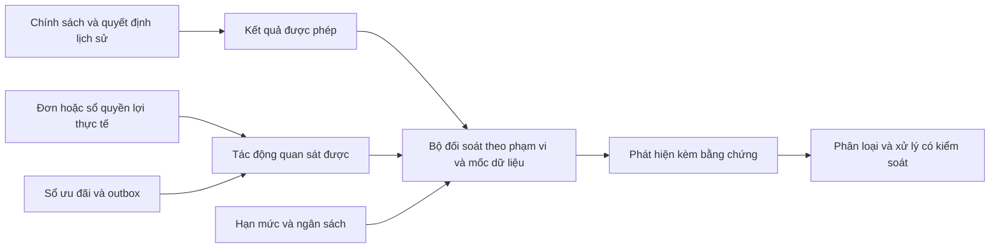

# Promotion outcome audit — Kiểm toán kết quả khuyến mại

## 1. Kiểm toán kết quả trả lời câu hỏi nào?

Một chiến dịch có thể báo “10.000 lượt áp mã thành công” trong khi chỉ 8.000 đơn thực sự hoàn tất, một số đơn được giảm vượt chính sách và vài khách nhận quyền lợi hai lần do retry. Số lần gọi API hoặc sự kiện `PromotionApplied` không đủ chứng minh rằng ưu đãi đã đến đúng người, đúng số tiền và đúng trạng thái nghiệp vụ.

**Promotion outcome audit** là quá trình thu thập bằng chứng và đối chiếu quyền lợi khuyến mại thực tế với quyền lợi được phép theo chính sách, dữ liệu giao dịch, quyền truy cập và các chuyển trạng thái hợp lệ. Kết quả kiểm toán phải chỉ ra đối tượng sai lệch, quy tắc bị vi phạm, mức ảnh hưởng và bằng chứng để điều tra hoặc khắc phục.

Trong chương **Promotions** của module bảo mật logic nghiệp vụ, trọng tâm là bảo vệ các bất biến trước việc bỏ qua điều kiện, sửa giá, cấp sai đối tượng, xử lý trùng hoặc lợi dụng luồng hủy và hoàn tiền. Đánh giá doanh thu tăng thêm hay hiệu quả tiếp thị có thể dùng cùng dữ liệu, nhưng không thay thế kiểm tra tính đúng đắn và an toàn của quyền lợi đã cấp.

Sau bài học, bạn có thể:

- Phân biệt quyết định áp dụng, giữ chỗ, quyền lợi đã chốt và kết quả đã đảo.
- Thiết kế bằng chứng có thể liên kết từ yêu cầu đến tác động thực tế.
- Phát hiện cấp sai tiền, cấp trùng, sai đối tượng và thiếu dữ liệu kiểm toán.
- Đối soát kết quả trong hệ thống có transaction, hàng đợi và tính nhất quán sau cùng.
- Xử lý phát hiện mà không làm mất lịch sử hoặc tạo quyền lợi mới ngoài ý muốn.

Các mô hình dữ liệu và chính sách dưới đây là thiết kế minh họa cho bài học, không phải một chuẩn bắt buộc cho mọi hệ thống khuyến mại.

## 2. Chọn đúng đơn vị kết quả và nguồn sự thật

### 2.1. Một quyết định cho phép chưa phải một quyền lợi đã cấp

Cần phân biệt các sự kiện có ý nghĩa khác nhau:

| Giai đoạn | Ý nghĩa | Có được tính là quyền lợi đã cấp không? |
| --- | --- | --- |
| `EVALUATED` | Đã đánh giá điều kiện trên một phiên bản dữ liệu | Chưa |
| `APPROVED` | Quyết định cho phép áp dụng | Chưa; còn phụ thuộc điều kiện chốt |
| `RESERVED` | Đã giữ hạn mức hoặc ngân sách | Chưa; đây là một cam kết đang chờ |
| `COMMITTED` | Quyền lợi đã chốt theo hợp đồng nghiệp vụ | Có, theo loại quyền lợi |
| `RELEASED` | Giữ chỗ đã được giải phóng | Không phải một lần cấp hoặc một khoản hoàn |
| `REVERSED` / `ADJUSTED` | Đảo hoặc điều chỉnh quyền lợi đã chốt | Là tác động tiếp theo, phải tham chiếu bản ghi gốc |

Tên trạng thái có thể khác trong từng sản phẩm. Điều quan trọng là định nghĩa được thời điểm nào một giá trị thực sự trở thành quyền lợi của khách và bằng chứng nào chứng minh điều đó.

Ví dụ, giảm trực tiếp trên đơn có thể được chốt khi thanh toán thành công; hoàn tiền vào ví chỉ được coi là đã cấp khi giao dịch ghi có ví hoàn tất; điểm thưởng có thể chờ giao hàng. Không dùng sự kiện “đã yêu cầu cấp” làm bằng chứng thay cho “đã cấp thành công”.

### 2.2. Đơn vị kiểm toán cần ổn định

Trong ví dụ, `benefit_effect_id` định danh một quyền lợi logic: một loại lợi ích của một chiến dịch trên một đối tượng giao dịch. Retry không tạo định danh quyền lợi mới. Một quyền lợi có thể có nhiều bản ghi lịch sử như cấp ban đầu, đảo một phần rồi đảo tiếp phần còn lại.

Các định danh phục vụ mục đích khác nhau:

| Định danh | Dùng để làm gì? |
| --- | --- |
| `request_id` / `trace_id` | Liên kết một lần xử lý kỹ thuật qua các dịch vụ |
| `decision_id` | Tham chiếu lần đánh giá chính sách và dữ liệu đầu vào |
| `reservation_id` | Theo dõi phần hạn mức được giữ |
| `benefit_effect_id` | Nhận diện quyền lợi logic cần kiểm toán |
| `operation_id` | Nhận diện một thao tác cấp hoặc điều chỉnh có idempotency |
| `event_id` | Nhận diện một sự kiện được truyền hoặc lưu |
| `entry_id` | Nhận diện một dòng trong sổ tác động khuyến mại |

Không dùng `trace_id` làm khóa chống cấp trùng: một lần retry có thể có trace mới. Cũng không giả định `event_id` khác nhau thì đó là hai quyền lợi hợp lệ; lỗi ứng dụng có thể phát hai sự kiện mới cho cùng một thao tác nghiệp vụ.

### 2.3. Nguồn kiểm tra phải chạm đến tác động thật

Nếu bộ tính sai 90.000 đồng rồi cả log và báo cáo cùng sao chép con số đó, việc hai hệ thống “khớp nhau” không chứng minh chính sách đúng.

Cần đối chiếu tối thiểu ba lớp:

1. **Chính sách và quyết định lịch sử:** điều kiện nào được phép, phiên bản nào có hiệu lực, ai được quyền phê duyệt ngoại lệ.
2. **Tác động nghiệp vụ:** dòng giảm giá đã khóa trên đơn, bút toán ví, điểm thưởng hoặc bản ghi cấp quà thực tế.
3. **Bằng chứng và bộ đếm:** sổ ưu đãi, sự kiện, hạn mức khách, ngân sách và lịch sử điều chỉnh.

Bằng chứng thanh toán chỉ cho biết số tiền thu. Khi có nhiều loại giảm giá, thuế, vận chuyển hoặc tín dụng khác, không suy ra riêng tiền khuyến mại chỉ bằng phép trừ giá niêm yết và tiền thu. Cần các thành phần định giá và phân bổ tương ứng.

## 3. Chuyển chính sách thành các bất biến có thể kiểm toán

Xét chiến dịch mẫu `PROMO10`:

| Thuộc tính | Chính sách minh họa |
| --- | --- |
| Quyền lợi | Giảm 10% giá hàng đủ điều kiện, tối đa 60.000 VND |
| Điều kiện tối thiểu | Giá hàng đủ điều kiện đạt 300.000 VND |
| Phạm vi | Một tenant, nhóm hàng và nhóm khách xác định |
| Giới hạn sử dụng | Mỗi khách tối đa một quyền lợi đã chốt trong chiến dịch |
| Điều kiện chốt | Đơn ở trạng thái thanh toán thành công với giá đã khóa |
| Làm tròn | VND nguyên đồng, `HALF_UP` một lần trên cơ sở tính của đơn |
| Hủy trước chốt | Giải phóng giữ chỗ; không ghi quyền lợi đã cấp |
| Hoàn sau chốt | Đảo phần ưu đãi được chính sách cho phép; không khôi phục lượt dùng |
| Ngoại lệ | Chỉ được dùng nếu có phê duyệt hợp lệ gắn với đúng đơn và phiên bản |

Các giá trị phải đến từ dữ liệu phía máy chủ. Tỷ lệ và mức trần là ví dụ, không phải tham số tin cậy do trình duyệt gửi.

### 3.1. Đúng đối tượng và đúng quyền

Mỗi quyền lợi đã cấp cần thuộc đúng tenant, khách, đơn và chiến dịch; đối tượng phải thỏa điều kiện tại thời điểm chính sách quy định. Nếu có thao tác của nhân viên, phải kiểm tra quyền đối với đối tượng và giới hạn được duyệt, không chỉ vai trò chung.

Phát hiện “đơn thuộc khách B nhưng ưu đãi gắn khách A” cần được xem xét độc lập với việc số tiền có khớp. Trộn dữ liệu giữa tenant có thể đồng thời gây cấp sai quyền lợi và lộ thông tin trong báo cáo kiểm toán.

### 3.2. Đúng số tiền và đơn vị

Với cơ sở đủ điều kiện `E` trong chính sách mẫu:

```text
Nếu đủ điều kiện và được phép chốt:
    expected_grant = min(round(E × 0,10), 60.000, E)
Nếu có đủ bằng chứng chứng minh không được phép chốt:
    expected_grant = 0
Nếu thiếu dữ liệu để xác định:
    expected_grant = UNKNOWN
```

`UNKNOWN` không được thay bằng 0. Thiếu phiên bản chính sách hoặc thiếu xác nhận trạng thái là lỗi chất lượng bằng chứng, chưa đủ để khẳng định khách nhận ưu đãi trái phép.

Giữ tiền bằng số nguyên đơn vị nhỏ nhất hoặc số thập phân chính xác, luôn kèm tiền tệ và quy tắc đơn vị. Không cộng VND và USD trong một tổng tiền. Điểm thưởng, quà tặng và miễn phí vận chuyển cũng cần đại lượng riêng; chỉ quy đổi khi có mô hình quy đổi được xác định rõ.

### 3.3. Đúng trạng thái và đúng số lần

Đối với mô hình một lần cấp ban đầu cho mỗi quyền lợi logic:

```text
Số GRANT của một benefit_effect_id <= 1
GRANT phải có quyết định và điều kiện chốt hợp lệ
RELEASE không được tính thành GRANT hoặc REVERSAL
Tổng REVERSAL tham chiếu một GRANT <= số tiền GRANT đó
Mỗi operation_id tạo tối đa một tác động nghiệp vụ
```

Nếu sản phẩm cho phép cấp nhiều đợt, cần khóa đợt cấp và giới hạn tương ứng. Không áp dụng ràng buộc “một GRANT” cho mô hình khác mà chưa định nghĩa lại đơn vị quyền lợi.

Với sổ ghi số tiền dương cho cả cấp và đảo:

```text
gross_granted = tổng amount của GRANT
reversed      = tổng amount của REVERSAL hợp lệ
net_benefit   = gross_granted - reversed
```

Phải kiểm tra cả từng dòng lẫn tổng ròng. Hai lần cấp sai rồi một lần đảo có thể làm `net_benefit` đúng nhưng vẫn thể hiện lỗi cấp trùng và rủi ro đã tồn tại trong một khoảng thời gian.

### 3.4. Đúng hạn mức và ngân sách

Đối chiếu hạn mức theo đúng hợp đồng, không mặc định mọi bộ đếm bằng `net_benefit`. Chính sách mẫu không trả lại lượt dùng sau hoàn, nên khách có `net_benefit = 0` vẫn có thể đã dùng hết một lượt.

Tương tự, ngân sách có thể tính theo tiền đã cấp, tiền ròng sau đảo hoặc gồm cả giữ chỗ. Cần lưu rõ loại bộ đếm, khóa phạm vi và kỳ hạn mức. Điều chỉnh giao dịch ngày trước phải liên kết với kỳ gốc, không tự sửa bộ đếm của ngày tác vụ kiểm toán đang chạy.

## 4. Thiết kế bằng chứng cho một kết quả

### 4.1. Ghi dữ liệu đủ để tái hiện quyết định

Một bản ghi kết quả cần giải thích được điều gì đã xảy ra, với ai, ở đâu và khi nào. Hướng dẫn này phù hợp với [OWASP Logging Cheat Sheet](https://cheatsheetseries.owasp.org/cheatsheets/Logging_Cheat_Sheet.html), đặc biệt là việc liên kết sự kiện của cùng một tương tác. Các trường nghiệp vụ dưới đây cụ thể hóa yêu cầu đó cho khuyến mại.

| Nhóm bằng chứng | Nội dung gợi ý |
| --- | --- |
| Phạm vi | Tenant, chiến dịch, khách, đơn, loại quyền lợi |
| Chủ thể thao tác | Tài khoản hoặc dịch vụ thực thi; người yêu cầu nếu hành động thay mặt |
| Quyết định | `decision_id`, kết quả cho phép/từ chối, mã lý do, phiên bản chính sách |
| Đầu vào lịch sử | Phiên bản đơn, cơ sở đủ điều kiện, nguồn giá, nhóm khách và điều kiện liên quan |
| Phê duyệt | Người duyệt, quyền, số tiền, đối tượng, phiên bản và thời hạn được duyệt |
| Giữ chỗ | `reservation_id`, kỳ hạn mức, số tiền và trạng thái |
| Tác động | `benefit_effect_id`, `operation_id`, `entry_id`, loại thao tác, số tiền và tiền tệ |
| Tham chiếu thực tế | Phiên bản giá đã khóa, giao dịch ví hoặc bút toán khác chứng minh quyền lợi |
| Thời gian và thứ tự | Thời điểm nghiệp vụ, thời điểm nhận, phiên bản đối tượng hoặc sequence của nguồn |
| Truy vết | `event_id`, `trace_id`, nguồn phát, phiên bản schema |

Không cần sao chép toàn bộ hồ sơ khách hàng vào mỗi sự kiện. Có thể dùng tham chiếu đến dữ liệu lịch sử được quản lý bền vững, nhưng tham chiếu phải cho phép lấy đúng phiên bản cũ. Một con trỏ chỉ tới cấu hình hiện tại sẽ mất giá trị khi chiến dịch bị chỉnh sửa.

Ví dụ sự kiện đã chốt giảm giá:

```json
{
  "schemaVersion": 1,
  "eventId": "evt-demo-501",
  "eventType": "PromotionBenefitCommitted",
  "occurredAt": "2026-11-22T02:15:00Z",
  "recordedAt": "2026-11-22T02:15:01Z",
  "producer": "order-service",
  "tenantId": "tenant-demo",
  "promotionId": "PROMO10",
  "customerId": "customer-demo-8",
  "orderId": "order-demo-42",
  "orderVersion": 12,
  "decisionId": "decision-demo-42",
  "policyVersion": "PROMO10-v3",
  "reservationId": "reservation-demo-42",
  "benefitEffectId": "benefit-demo-42-discount",
  "operationId": "commit-demo-42",
  "entryId": "entry-demo-42",
  "entryType": "GRANT",
  "currency": "VND",
  "minorUnitScale": 0,
  "eligibleBaseMinor": 800000,
  "amountMinor": 60000,
  "sourceReference": "order-demo-42/pricing/12",
  "actorType": "SERVICE",
  "actorId": "order-service",
  "traceId": "trace-demo-42"
}
```

Đây là thông điệp minh họa từ một dịch vụ được xác thực, không phải payload để trình duyệt tự khai việc đã được cấp ưu đãi. Bên nhận phải xác thực nguồn, kiểm tra schema và quyền phát loại sự kiện tương ứng. Trường `producer` dạng chuỗi không tự chứng minh danh tính nguồn phát.

`amountMinor` là số tiền nguồn ghi nhận; việc nó bằng 60.000 không tự chứng minh cơ sở 800.000 hoặc quyết định lịch sử đúng. Tác vụ kiểm toán vẫn đối chiếu các tham chiếu và bất biến liên quan.

### 4.2. Lưu lịch sử thay vì sửa dấu vết

Sổ tác động nên ghi bổ sung các dòng mới. Một dòng `REVERSAL` tham chiếu `entry_id` của khoản cấp gốc và lý do điều chỉnh, thay vì sửa số tiền cấp gốc xuống 0. Đảo một phần nhiều lần cần các `operation_id` riêng, đồng thời tổng đảo không được vượt khoản gốc.

Nếu schema có lỗi, lưu phiên bản và cách diễn giải đã dùng. Bản chuyển đổi hoặc dữ liệu bổ sung phải có nguồn gốc rõ ràng. Không đổi ý nghĩa sự kiện cũ mà vẫn giữ cùng phiên bản schema.

Thời gian nhận khác thời gian xảy ra nghiệp vụ. Hai sự kiện đến ngược thứ tự không đủ để kết luận state machine đã bị vượt qua. Dùng phiên bản của đối tượng, sequence của nguồn hoặc tham chiếu nhân quả; đồng hồ thời gian chỉ hỗ trợ phân tích.

## 5. Ghi kết quả đáng tin cậy bằng transaction và idempotency

### 5.1. Tránh khoảng hở giữa cấp quyền lợi và ghi bằng chứng

Luồng dưới đây có khoảng hở:

```text
Ghi giảm giá trên đơn
COMMIT
Gửi sự kiện PromotionBenefitCommitted
```

Nếu tiến trình dừng sau commit nhưng trước khi gửi, quyền lợi đã tồn tại mà kênh audit không biết. Đảo thứ tự gửi cũng tạo rủi ro: sự kiện nói đã cấp nhưng transaction thực tế rollback.

Với dữ liệu cùng cơ sở dữ liệu, mô hình tham khảo là ghi thay đổi nghiệp vụ, dòng sổ khuyến mại và outbox trong cùng transaction. Relay chỉ chuyển các sự kiện đã commit. Đây là cách dùng outbox được mô tả trong [AWS Prescriptive Guidance — Transactional outbox pattern](https://docs.aws.amazon.com/prescriptive-guidance/latest/cloud-design-patterns/transactional-outbox.html); bên nhận vẫn phải xử lý được giao lại thông điệp.

```text
BEGIN
  Xác minh danh tính, tenant và quyền với đơn.
  Chiếm operation_id bằng ràng buộc duy nhất.
  Nếu thao tác đã hoàn tất: trả kết quả cũ.
  Khóa/kiểm tra phiên bản đơn và giữ chỗ.
  Xác minh điều kiện chốt, số tiền và quyết định có hiệu lực.
  Ghi quyền lợi thực tế hoặc trạng thái chốt trong nguồn nghiệp vụ.
  Ghi GRANT với định danh quyền lợi và tham chiếu quyết định.
  Chuyển bộ đếm reserved/used theo chính sách.
  Ghi thông điệp outbox và kết quả operation_id.
COMMIT
```

Ràng buộc và khóa phải ngăn hai yêu cầu cùng cấp trên một quyền lợi logic, kể cả khi chúng dùng hai khóa yêu cầu khác nhau. Việc chiếm `operation_id` không thay thế điều kiện nghiệp vụ đó.

Nếu bằng chứng bền vững là một phần của transaction chốt quyền lợi, lỗi ghi sổ hoặc outbox làm transaction không được chốt. Lỗi hệ thống log chẩn đoán hoặc dashboard bên ngoài được xử lý bằng đường truyền bất đồng bộ và cảnh báo phù hợp; không đồng nhất chúng với mất bản ghi nghiệp vụ bắt buộc.

Với ví hoặc hệ thống cấp quà ở dịch vụ khác, transaction cục bộ chỉ chứng minh ý định đã ghi. Cần thao tác phía nhận có idempotency và xác nhận kết quả thực tế. Trạng thái gửi yêu cầu chưa đủ để tạo một `GRANT` hoàn tất trong mô hình audit.

### 5.2. Khử trùng thông điệp không được xóa dấu hiệu cấp trùng

Consumer thường cần lưu `(consumer_name, event_id)` cùng với thay đổi projection trong một transaction. Retry cùng sự kiện không được cộng lại số tiền vào báo cáo. Nếu chỉ đánh dấu “đã xử lý” trước rồi cập nhật projection sau, lỗi giữa hai bước có thể làm mất kết quả.

Cần phân biệt:

- **Giao lại thông điệp:** cùng `event_id` được nhận nhiều lần, cùng một `entry_id`; projection chỉ phản ánh một dòng sổ.
- **Cấp trùng thật:** có hai dòng sổ hoặc hai bút toán thực tế cho cùng quyền lợi không được phép cấp nhiều lần. Đây là phát hiện cần giữ lại.

Không dùng `SELECT DISTINCT` trên số tiền, khách và chiến dịch để “làm sạch” mọi dòng giống nhau: cách này có thể che cả hai khoản cấp thật. Khử trùng kỹ thuật dựa trên định danh nguồn; phát hiện trùng nghiệp vụ dựa trên đơn vị quyền lợi và hợp đồng.

## 6. Đối soát với dữ liệu đầy đủ và đúng thời điểm

Một kiến trúc kiểm toán có thể tổ chức như sau:



### 6.1. Xác định tập đối tượng từ cả hai phía

Nếu chỉ duyệt những dòng có trong sổ audit, một đơn bị giảm tiền nhưng thiếu dòng sổ sẽ không bao giờ được phát hiện. Nếu chỉ duyệt các quyết định được duyệt, một quyền lợi được cấp mà không có quyết định cũng có thể bị bỏ qua.

Tập kiểm tra cần lấy từ hợp của các nguồn có liên quan: giao dịch đủ điều kiện cần cấp, quyền lợi thực tế, giữ chỗ và sổ ưu đãi. Liên kết theo định danh và phạm vi đã xác định, sau đó phát hiện thiếu hoặc thừa ở mỗi nguồn.

Có thể triển khai nhiều bộ kiểm tra độc lập:

| Đối chiếu | Sai lệch có thể phát hiện |
| --- | --- |
| Quyết định so với chính sách lịch sử | Bỏ điều kiện, dùng sai phiên bản hoặc ngoại lệ không có quyền |
| Quyết định được phép so với quyền lợi thực tế | Cấp thừa, cấp thiếu, sai đối tượng hoặc sai trạng thái |
| Quyền lợi thực tế so với sổ ưu đãi | Thiếu ghi sổ, sự kiện ma hoặc số tiền không khớp |
| Sổ giữ chỗ so với bộ đếm | Rò rỉ giữ chỗ, giải phóng trùng hoặc ngân sách sai |
| Điều chỉnh so với khoản gốc | Hoàn quá số đã cấp, sai kỳ hoặc sai chủ thể |

### 6.2. Chốt mốc đọc và theo dõi độ trễ

Một lần chạy cần ghi `audit_run_id`, phạm vi tenant/chiến dịch, mốc dữ liệu, phiên bản luật kiểm tra và trạng thái đầy đủ của từng nguồn. Phân biệt:

- Khoảng thời gian nghiệp vụ mà báo cáo đang xét.
- Mốc dữ liệu đã được đọc hoặc offset đã xử lý của từng nguồn.
- Khoảng chờ dành cho sự kiện đến muộn.
- Đối tượng còn chờ bằng chứng, chưa thể kết luận.

Khoảng chờ là chính sách vận hành theo độ trễ đo được, không phải bằng chứng chắc chắn rằng sẽ không còn sự kiện muộn. Khi có dữ liệu bổ sung, cần chạy lại vùng chồng lấn hoặc tái xét các đối tượng bị ảnh hưởng.

Với nhiều truy vấn trong một PostgreSQL database, transaction chỉ đọc ở `REPEATABLE READ` có thể giữ cùng snapshot cho các lần đọc. Phạm vi bảo đảm này được mô tả trong [tài liệu PostgreSQL 18 về transaction isolation](https://www.postgresql.org/docs/18/transaction-iso.html). Nó không tạo snapshot chung cho database khác, broker hoặc hệ thống ví bên ngoài.

Không dùng `MAX(id)` làm bằng chứng rằng mọi bản ghi nhỏ hơn đã commit và đã được đồng bộ. Thứ tự cấp ID, thứ tự commit và thứ tự tiêu thụ có thể khác nhau. Mốc đọc phải dựa trên khả năng và cam kết của nguồn, không chỉ một trường tăng dần.

### 6.3. Phân loại sự thiếu dữ liệu

Một bản ghi chưa thấy trên projection có thể là lỗi hoặc đơn giản là chưa tới. Bộ kiểm toán nên trả các trạng thái tách biệt:

| Trạng thái | Ý nghĩa |
| --- | --- |
| `MATCHED` | Đủ bằng chứng và các kiểm tra trong phạm vi đã khớp |
| `VIOLATION` | Đủ bằng chứng xác định vi phạm một bất biến |
| `PENDING_EVIDENCE` | Chưa đến mốc đủ dữ liệu hoặc còn chờ xác nhận |
| `DATA_QUALITY_ERROR` | Thiếu lịch sử, schema sai, nguồn mất dữ liệu hoặc không thể tái hiện |

Không gộp ba trạng thái cuối thành “gian lận”. Một sai lệch đã xác nhận cũng có thể do lỗi triển khai, sai cấu hình hoặc thao tác hợp lệ chưa được mô hình hóa; nguyên nhân và mức chắc chắn cần được điều tra riêng.

## 7. Ví dụ SQL đối chiếu số tiền

### 7.1. Chuẩn bị dữ liệu trước khi so sánh

Giả sử một lần chạy đã tạo hai tập dữ liệu theo cùng phạm vi và mốc đối soát:

- `audit_expected_effect`: một dòng duy nhất cho `(run_id, tenant_id, benefit_effect_id, currency)`, có `evidence_complete` và `expected_net_minor`.
- `audit_observed_entry`: các dòng cấp/đảo quan sát được từ nguồn tác động thực tế, có cùng định danh quyền lợi, `entry_type` và `amount_minor`.

`expected_net_minor` là quyền lợi ròng được phép tại mốc đang xét, đã xét các điều chỉnh hợp lệ, không chỉ tiền giảm của lần cấp đầu tiên. Nếu thiếu bằng chứng để tính, đặt trạng thái không đầy đủ và không dùng giá trị 0 thay thế.

`audit_observed_entry` phải bao gồm toàn bộ lịch sử liên quan đến các quyền lợi trong tập kiểm tra đến mốc chốt dữ liệu, kể cả khoản cấp gốc trước ngày báo cáo. Chỉ lấy dòng đảo của hôm nay mà bỏ khoản cấp từ hôm qua sẽ tạo số ròng âm giả.

Các dòng trùng do truyền lại cùng `entry_id` đã được xử lý khi nhập dữ liệu. Hai `entry_id` khác nhau phản ánh hai tác động thật phải được giữ. Schema giới hạn `entry_type` vào `GRANT` và `REVERSAL`, số tiền hợp lệ, các khóa và tiền tệ không null; dữ liệu vi phạm được báo lỗi chất lượng trước truy vấn dưới đây.

### 7.2. Tổng hợp từng nguồn trước khi join

Mẫu SQL theo PostgreSQL sau chỉ đối chiếu số tiền; `:run_id` là tham số được bind bởi chương trình gọi:

```sql
WITH expected AS (
    SELECT tenant_id, benefit_effect_id, currency,
           evidence_complete, expected_net_minor
    FROM audit_expected_effect
    WHERE run_id = :run_id
), observed AS (
    SELECT tenant_id, benefit_effect_id, currency,
           COUNT(*) AS entry_count,
           SUM(CASE WHEN entry_type = 'GRANT' THEN 1 ELSE 0 END)
               AS grant_count,
           SUM(CASE
                 WHEN entry_type = 'GRANT' THEN amount_minor
                 WHEN entry_type = 'REVERSAL' THEN -amount_minor
               END) AS observed_net_minor
    FROM audit_observed_entry
    WHERE run_id = :run_id
    GROUP BY tenant_id, benefit_effect_id, currency
)
SELECT COALESCE(e.tenant_id, o.tenant_id) AS tenant_id,
       COALESCE(e.benefit_effect_id, o.benefit_effect_id)
           AS benefit_effect_id,
       COALESCE(e.currency, o.currency) AS currency,
       e.expected_net_minor,
       COALESCE(o.observed_net_minor, 0) AS observed_net_minor,
       COALESCE(o.grant_count, 0) AS grant_count,
       CASE
         WHEN e.benefit_effect_id IS NULL THEN 'MISSING_EXPECTATION'
         WHEN e.evidence_complete IS NOT TRUE
              OR e.expected_net_minor IS NULL THEN 'UNKNOWN_EXPECTATION'
         WHEN COALESCE(o.observed_net_minor, 0) <> e.expected_net_minor
              THEN 'AMOUNT_MISMATCH'
         ELSE 'MATCHED_AMOUNT_ONLY'
       END AS amount_status
FROM expected e
FULL OUTER JOIN observed o
  ON o.tenant_id = e.tenant_id
 AND o.benefit_effect_id = e.benefit_effect_id
 AND o.currency = e.currency;
```

Điều kiện sử dụng và giới hạn của truy vấn:

1. `FULL OUTER JOIN` giữ cả quyền lợi kỳ vọng bị thiếu tác động lẫn tác động không có kỳ vọng tương ứng.
2. `COALESCE` số quan sát về 0 chỉ hợp lệ khi nguồn tác động đã được xác nhận đầy đủ cho tập kiểm tra. Nếu chưa đủ, lần chạy phải đánh dấu chờ dữ liệu trước khi kết luận.
3. Tổng hợp riêng trước khi join tránh nhân bản số tiền do quan hệ một-nhiều giữa quyết định, dòng sổ và sự kiện.
4. `MISSING_EXPECTATION` là yêu cầu điều tra thiếu liên kết hoặc cấp ngoài luồng, chưa tự khẳng định người nhận không đủ điều kiện.
5. `MATCHED_AMOUNT_ONLY` không có nghĩa toàn bộ audit đã đạt. Vẫn phải kiểm tra người nhận, quyền, trạng thái, khoản gốc của từng dòng đảo và số lần cấp.
6. Sai tiền tệ có thể hiện thành hai dòng không khớp vì tiền tệ nằm trong khóa join. Cần kiểm tra riêng tính nhất quán tiền tệ của cùng định danh quyền lợi; không tự quy đổi để làm khớp.
7. Với mô hình chỉ một lần cấp ban đầu, `grant_count > 1` là dấu hiệu cần kiểm tra ngay cả khi số ròng khớp.

Để tìm cấp trùng ở cấp khách và chiến dịch, cần nhóm theo khóa hạn mức của chính sách, không chỉ `benefit_effect_id`. Kẻ lạm dụng hoặc lỗi chương trình có thể tạo hai quyền lợi logic khác nhau trên hai đơn nhưng vẫn vượt quy tắc “mỗi khách một lần”.

## 8. Tình huống đối soát hoàn chỉnh

Các số tiền dưới tính bằng VND, các nguồn đã đủ dữ liệu tại mốc kiểm tra. Mỗi dòng là một trường hợp độc lập trong chiến dịch mẫu:

| Trường hợp | Bằng chứng và tác động | Kết luận cần ghi |
| --- | --- | --- |
| A | Đơn đủ điều kiện 800.000; được phép 60.000; thực tế cấp 60.000 | Khớp số tiền; tiếp tục các kiểm tra quyền, trạng thái và hạn mức |
| B | Đơn đủ điều kiện 500.000; được phép 50.000; thực tế cấp 90.000 | Cấp thừa 40.000, đồng thời vượt trần 60.000 |
| C | Đơn đã hủy trước chốt; đủ bằng chứng chỉ được giải phóng giữ chỗ; thực tế có GRANT 60.000 | Cấp quyền lợi sai trạng thái |
| D | Được phép cấp 60.000; có hai bút toán GRANT 60.000 khác nhau | Cấp trùng thật, tổng cấp thừa 60.000 |
| E | Một GRANT 60.000, cùng sự kiện được giao ba lần | Không phải ba quyền lợi; projection phải chỉ phản ánh một dòng |
| F | GRANT 60.000 rồi REVERSAL hợp lệ 20.000; kỳ vọng ròng 40.000 | Khớp ròng nếu các tham chiếu, quyền điều chỉnh và số tiền đều đúng |
| G | Thực tế cấp 60.000 nhưng thiếu phiên bản chính sách lịch sử | Lỗi bằng chứng; chưa xác định được kỳ vọng |
| H | Hai GRANT 60.000 rồi đảo một GRANT 60.000; kỳ vọng ròng 60.000 | Ròng khớp nhưng vẫn có lịch sử cấp trùng phải ghi nhận |

Ở trường hợp B, không chỉ nhìn tổng giảm toàn chiến dịch: một đơn bị cấp thiếu 40.000 ở nơi khác có thể bù đúng tổng tiền và che sai lệch nếu chỉ đối chiếu số tổng.

Ở trường hợp D và E, sự khác nhau nằm ở tác động nguồn. Hai sự kiện khác ID cũng chưa đủ chứng minh có hai lần cấp; cần xác định chúng tham chiếu một hay hai bút toán thực tế. Ngược lại, consumer khử trùng thông điệp tốt không sửa được lỗi ứng dụng đã tạo hai bút toán.

Ở trường hợp H, điều chỉnh đúng sau đó không xóa vi phạm ban đầu. Lịch sử cần phản ánh khoảng thời gian khách có quyền lợi vượt mức, ai phát hiện và thao tác nào đã khắc phục.

## 9. Bảo vệ chính kênh kiểm toán

### 9.1. Phân quyền theo đối tượng và tách vai trò

Tác vụ audit cần quyền đọc đúng dữ liệu để đối soát nhưng không mặc nhiên có quyền sửa đơn, cấp ưu đãi hoặc hoàn tiền. API xem phát hiện và xuất báo cáo cũng phải kiểm tra tenant, chiến dịch và phạm vi người dùng được phép xem.

Có thể tách các năng lực:

| Năng lực | Phạm vi gợi ý |
| --- | --- |
| Dịch vụ nghiệp vụ | Ghi tác động và bằng chứng cho giao dịch do nó sở hữu |
| Bộ thu thập | Nhập sự kiện từ nguồn được phép, không tự phê duyệt khuyến mại |
| Bộ đối soát | Đọc dữ liệu nguồn, tính phát hiện, không tự thay quyền lợi |
| Người điều tra | Xem bằng chứng trong phạm vi được cấp |
| Luồng khắc phục | Thực hiện lệnh điều chỉnh có kiểm tra và ghi lịch sử riêng |

Người sửa chính sách hoặc phê duyệt ngoại lệ không nên đồng thời có khả năng xóa không dấu vết bằng chứng và phát hiện liên quan. Việc sửa cấu hình luật audit hoặc nới ngưỡng cảnh báo cũng cần được ghi nhận.

### 9.2. Toàn vẹn và bảo mật dữ liệu

Kho audit cần hạn chế sửa/xóa, sao lưu, theo dõi truy cập và có thời gian lưu phù hợp với cửa sổ hoàn, khiếu nại và điều tra của sản phẩm. Bảo vệ cả các tham chiếu lịch sử; giữ sự kiện nhưng xóa toàn bộ chính sách được tham chiếu có thể khiến không còn tái hiện được quyết định.

Có thể dùng lưu trữ bất biến hoặc cơ chế phát hiện sửa đổi khi cần. Tuy nhiên, một hash được lưu cùng dữ liệu và cùng quyền sửa không tự ngăn việc sửa cả hai. Chuỗi hash cũng cần mốc kiểm chứng hoặc nguồn đối chiếu độc lập để phát hiện việc cắt bỏ phần cuối.

Thông tin xác thực, access token, dữ liệu thanh toán nhạy cảm và mã khuyến mại bí mật không nên xuất hiện nguyên vẹn trong báo cáo. Dùng định danh hoặc token hóa đủ cho đối chiếu. Nếu đầu vào như tên chiến dịch hoặc lý do do người dùng cung cấp được đưa vào log, cần cấu trúc dữ liệu, giới hạn độ dài và xử lý ký tự điều khiển; giao diện xem báo cáo phải mã hóa nội dung phù hợp.

Đối với dữ liệu bên ngoài, tách rõ “nguồn khai báo” và “nguồn đã xác minh”. Không cho một payload tự khai `auditPassed=true` hoặc `approvedBy=admin` trở thành bằng chứng có thẩm quyền.

### 9.3. Không có phát hiện chưa chắc không có sai lệch

Nếu pipeline ngừng thu thập mà bảng phát hiện không tăng, dashboard có thể trông như hệ thống đang an toàn. Vì vậy cần giám sát riêng tình trạng nguồn, độ trễ outbox, backlog, sự kiện bị cách ly do sai schema và số lượng đối tượng chưa đủ bằng chứng.

Không sampling các tác động tiền hoặc quyền lợi nếu mục tiêu là đối soát đầy đủ. Có thể lấy mẫu log chẩn đoán ở lớp khác, nhưng phải biết dữ liệu nào đủ để chứng minh toàn bộ tập giao dịch đã được kiểm tra.

## 10. Kiểm thử các tình huống tấn công logic và lỗi hạ tầng

Kiểm thử bằng dữ liệu giả lập, có thể quan sát cả tác động nguồn, sổ ưu đãi, bộ đếm và phát hiện. Một bài kiểm thử đạt phải chứng minh phát hiện đúng hoặc không báo sai theo trạng thái bằng chứng, không chỉ kiểm tra có dòng log.

| Tình huống | Điều cần xác minh |
| --- | --- |
| Sửa tỷ lệ hoặc tiền giảm từ client | Số tiền không theo dữ liệu tự khai; nếu tác động sai được tạo trong bộ dữ liệu kiểm thử, audit phát hiện |
| Dùng đơn hoặc mã của tenant khác | Luồng cấp và API audit đều chặn truy cập sai phạm vi |
| Bỏ bước đủ điều kiện hoặc phê duyệt | GRANT không có căn cứ hợp lệ bị phát hiện |
| Phê duyệt đúng người nhưng sai phiên bản đơn | Audit không chấp nhận ngoại lệ cũ cho dữ liệu mới |
| Hai yêu cầu cùng tranh lượt dùng cuối | Chỉ một lần chốt hợp lệ; đối soát phát hiện nếu nguồn cố tình chứa hai kết quả |
| Hai khóa idempotency khác nhau cho cùng quyền lợi | Không tạo hai tác động hoặc phát hiện cấp trùng nếu kiểm thử đưa vào nguồn |
| Giao lại cùng một sự kiện nhiều lần | Sổ nguồn và projection không tăng số tiền do truyền lại |
| Có hai tác động thật nhưng nội dung giống nhau | Không bị làm mất bởi khử trùng theo nội dung |
| Dừng tiến trình sau commit, trước gửi broker | Outbox còn bằng chứng để phát lại; audit theo dõi độ trễ |
| Transaction nghiệp vụ rollback | Không có sự kiện chốt hoặc GRANT ma từ transaction đó |
| Đánh dấu đã nhận sự kiện rồi lỗi ghi projection | Cả hai cùng rollback hoặc retry khôi phục đúng, không mất dòng |
| REVERSAL tới trước GRANT do truyền ngược thứ tự | Chờ hoặc liên kết lại; không tự tạo vi phạm vĩnh viễn từ thứ tự nhận |
| Webhook hoàn tiền gửi lặp | Không đảo cùng khoản nhiều lần; không giải phóng hạn mức trùng |
| Thay chính sách sau giao dịch | Audit tái hiện theo phiên bản lịch sử được hợp đồng sử dụng |
| Khoản cấp ở hôm trước, khoản đảo hôm nay | Báo cáo ròng dùng đủ lịch sử, không tạo số âm giả |
| Nguồn ví hoặc đơn ngừng đồng bộ | Đánh dấu chưa đủ dữ liệu và cảnh báo pipeline; không kết luận mọi thứ khớp |
| Hai sai lệch tiền trái dấu bù tổng | Vẫn phát hiện từng đối tượng sai |
| Chạy lại cùng lô và cùng luật | Không nhân đôi tiền, số phát hiện hoặc hành động khắc phục |

Nên bổ sung kiểm thử thuộc tính cho bộ đối soát:

```text
Giao lại cùng entry_id không đổi tác động quan sát được.
Thêm một GRANT thật phải làm tăng gross_granted đúng số tiền đó.
Một REVERSAL hợp lệ chỉ giảm đúng quyền lợi được tham chiếu.
Thiếu bằng chứng kỳ vọng không được chuyển thành kỳ vọng bằng 0.
Tổng theo nhóm bằng tổng chi tiết trong cùng đơn vị và phạm vi.
MATCHED_AMOUNT_ONLY không tự chuyển thành kết quả audit toàn diện.
Chạy lại không thay đổi nguồn quyền lợi.
```

Kiểm thử đồng thời cần chủ động tạo điểm tranh chấp, ví dụ đồng bộ hai yêu cầu ngay trước bước chiếm lượt. Với sự kiện đến muộn, kiểm thử cả lần chạy ban đầu và lần chạy bổ sung để xác minh phát hiện được cập nhật đúng mà không mất lịch sử.

## 11. Xử lý phát hiện và đối soát lại

Một phát hiện hữu ích cần có mã luật, định danh đối tượng, phạm vi, mức ảnh hưởng, mức chắc chắn, bằng chứng và lần chạy đã phát hiện. Ví dụ:

```json
{
  "findingType": "PROMOTION_AMOUNT_EXCEEDED",
  "ruleVersion": "amount-check-v2",
  "tenantId": "tenant-demo",
  "benefitEffectId": "benefit-demo-77-discount",
  "promotionId": "PROMO10",
  "expectedAmountMinor": 50000,
  "observedAmountMinor": 90000,
  "excessAmountMinor": 40000,
  "currency": "VND",
  "evidenceStatus": "COMPLETE",
  "auditRunId": "audit-demo-20261122-01",
  "status": "OPEN"
}
```

Đừng đưa `auditRunId` mới vào khóa duy nhất của cùng một vấn đề rồi tạo cảnh báo mới ở mỗi lần chạy. Có thể định danh vấn đề theo tenant, luật, quyền lợi và phạm vi phù hợp; các lần chạy bổ sung thêm bằng chứng hoặc cập nhật diễn biến. Nếu lỗi tái diễn sau khi đã khắc phục, cần ghi nhận một lần tái diễn có lịch sử rõ ràng.

Quy trình xử lý tham khảo:

1. Xác minh nguồn và mốc dữ liệu, tách độ trễ với sai lệch đã xác nhận.
2. Thu thập chuỗi quyết định, phê duyệt, giữ chỗ, tác động và điều chỉnh.
3. Xác định quy tắc bị vi phạm, phạm vi ảnh hưởng và các giao dịch liên quan.
4. Xử lý nguyên nhân ở luồng tạo quyền lợi để ngăn tiếp tục phát sinh.
5. Nếu cần điều chỉnh, gửi lệnh nghiệp vụ có quyền, lý do, tham chiếu khoản gốc và idempotency.
6. Chạy đối soát lại, xác minh tác động và bộ đếm, rồi ghi trạng thái xử lý cùng bằng chứng.

Không sửa trực tiếp số tiền trong sổ audit để làm báo cáo khớp; hành động đó không thay đổi quyền lợi thật và làm mất dấu vết. Cũng không tự hoàn tiền, thu hồi điểm hoặc trừ ví chỉ vì một truy vấn báo khác số. Luồng khắc phục phải kiểm tra trạng thái hiện tại, số đã điều chỉnh và quyền thực hiện thao tác.

Một bộ phát hiện chỉ đọc nên tách khỏi bộ thực thi điều chỉnh. Nếu sản phẩm chủ động tự động hóa một loại khắc phục, đó phải là quy tắc nghiệp vụ riêng có giới hạn, kiểm tra, chống lặp và lịch sử, không phải tác dụng phụ của việc chạy lại audit.

## 12. Chỉ số giúp đánh giá hệ thống kiểm toán

| Chỉ số | Ý nghĩa | Điều cần tránh |
| --- | --- | --- |
| Độ bao phủ kết luận | Tỷ lệ đối tượng mục tiêu có kết luận đủ bằng chứng | Chỉ lấy những dòng đã vào kho audit làm mẫu số |
| Đối tượng chờ bằng chứng | Quyền lợi chưa đối soát được và thời gian chờ | Coi chưa biết là đúng hoặc là gian lận |
| Sai lệch theo tiền tệ | Tiền cấp thừa, cấp thiếu, đảo sai; báo riêng từng loại | Bù cấp thừa với cấp thiếu hoặc cộng khác tiền tệ |
| Trùng nghiệp vụ | Số quyền lợi hoặc thao tác tạo tác động vượt số lần cho phép | Đếm giao lại message như một khoản cấp thật |
| Thiếu liên kết | Tác động không có quyết định, sổ hoặc khoản gốc tương ứng | Bỏ qua vì join trong chỉ giữ phần khớp |
| Độ trễ nguồn | Khoảng cách giữa tác động và khả năng đối soát | Dùng dashboard không có dữ liệu như bằng chứng an toàn |
| Thời gian xử lý phát hiện | Từ phát hiện đến ngăn phát sinh và xác minh khắc phục | Đóng vấn đề chỉ vì đã có người nhận xử lý |

Gọi `N_target` là số đối tượng trong tập mục tiêu đã xác định từ nguồn nghiệp vụ và tác động thực tế. Nếu `N_matched` và `N_violation` đều là kết luận đã đủ bằng chứng:

```text
conclusive_coverage = (N_matched + N_violation) / N_target
```

Chỉ số này đo mức đã kiểm tra được, không đo mức an toàn. Báo riêng số pending, lỗi dữ liệu và vi phạm; trường hợp mẫu số bằng 0 phải được diễn giải rõ là không có đối tượng, không tự hiển thị 100% an toàn.

Ngưỡng cảnh báo nên dựa trên mức ảnh hưởng và khả năng xảy ra của từng lỗi. Một tác động sai tenant hoặc một khoản cấp không có quyền có thể quan trọng dù số lượng nhỏ. Ngược lại, message retry nhiều nhưng được xử lý đúng chủ yếu là tín hiệu vận hành, không tự chứng minh thất thoát quyền lợi.

## 13. Checklist thiết kế promotion outcome audit

- [ ] Định nghĩa được thời điểm quyền lợi đã cấp cho từng loại khuyến mại.
- [ ] Có đơn vị quyền lợi, thao tác, dòng sổ và sự kiện riêng biệt.
- [ ] Chính sách, đầu vào và phê duyệt lịch sử đủ để tái hiện quyết định.
- [ ] Kiểm tra tiền, quyền, đối tượng, trạng thái và số lần; không chỉ tổng tiền.
- [ ] Bằng chứng cấp quyền lợi được ghi bền vững cùng transaction hoặc giao thức phân tán phù hợp.
- [ ] Consumer chống giao lại sự kiện nhưng không che tác động cấp trùng thật.
- [ ] Tập đối soát lấy từ cả kỳ vọng lẫn tác động nguồn, phát hiện phần thiếu ở mỗi phía.
- [ ] Mỗi lần chạy có mốc đọc, độ đầy đủ nguồn và cách xử lý sự kiện muộn.
- [ ] Thiếu bằng chứng được biểu diễn là chưa biết hoặc lỗi dữ liệu, không mặc định bằng 0.
- [ ] Khoản đảo liên kết khoản gốc; hạn mức và ngân sách theo đúng chính sách khôi phục.
- [ ] Kênh xem, xuất và chỉnh cấu hình audit có phân quyền theo phạm vi.
- [ ] Phát hiện có bằng chứng, chống tạo lặp và được xác minh lại sau khắc phục.
- [ ] Pipeline audit có giám sát sức khỏe độc lập với số lượng vi phạm.

Kiểm toán kết quả cung cấp khả năng chứng minh và phát hiện sai lệch sau hoặc trong quá trình giao dịch. Các bất biến quan trọng vẫn cần được cưỡng chế ngay trong luồng cấp quyền lợi bằng quyền theo đối tượng, state machine, transaction và idempotency; một báo cáo tốt không tự ngăn được khoản cấp sai đã xảy ra.
