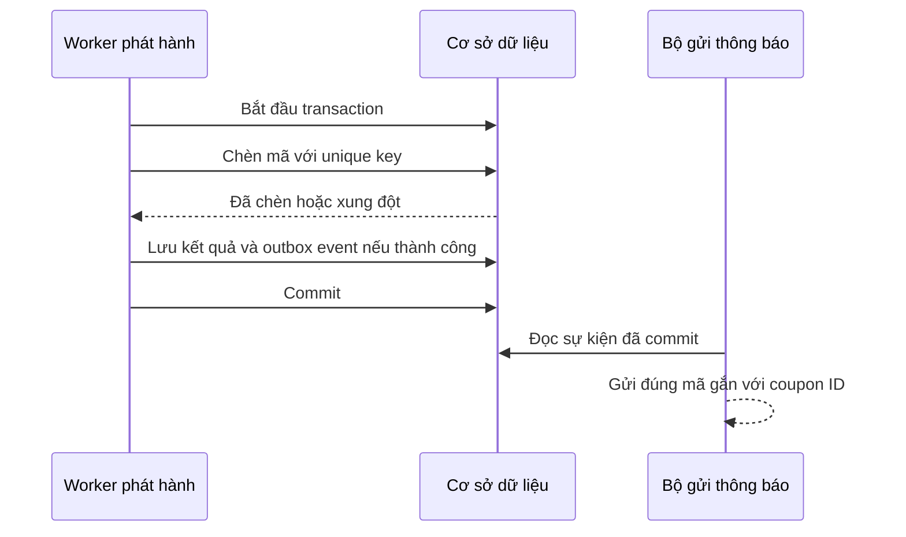
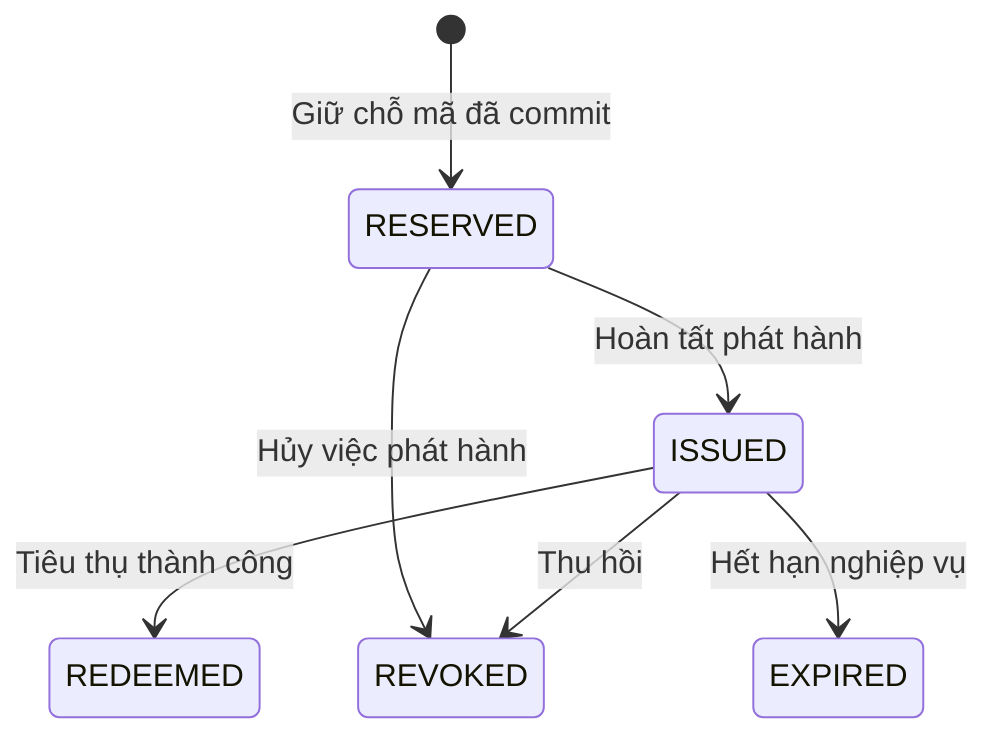

# Coupon code uniqueness — Bảo đảm tính duy nhất của mã coupon

## 1. Vì sao mã coupon trùng nhau là lỗi logic nghiệp vụ?

Mã coupon là giá trị người dùng nhập hoặc nhận qua liên kết để hệ thống tìm một ưu đãi. Nếu cùng một mã có thể trỏ đến hai bản ghi khác nhau trong cùng ngữ cảnh sử dụng, việc chọn coupon trở nên mơ hồ: đơn hàng có thể nhận sai mức giảm, sai chủ sở hữu hoặc sai chính sách giới hạn lượt.

Ví dụ, chương trình A đã phát hành `SAVE2026`. Một chương trình B tạo thêm mã `save-2026`, trong khi API áp dụng mã lại bỏ dấu gạch nối và không phân biệt hoa thường. Cơ sở dữ liệu có thể nhìn thấy hai chuỗi khác nhau, nhưng người dùng đang sử dụng cùng một mã theo quy tắc của ứng dụng.

**Coupon code uniqueness** là bất biến bảo đảm một mã sau chuẩn hóa chỉ định danh tối đa một coupon trong phạm vi đã chọn. Bất biến này cần đúng khi tạo thủ công, sinh tự động, nhập hàng loạt, xử lý retry và chạy nhiều yêu cầu đồng thời.

```text
Với mọi namespace N và mã chuẩn hóa K:
  số bản ghi sở hữu cặp (N, K) không vượt quá 1.
```

Trong bài này, namespace được chọn là tenant. Mã đã cấp trong một tenant không được gán lại cho coupon khác, kể cả coupon cũ đã hết hạn, bị thu hồi hoặc đã dùng. Đây là chính sách minh họa có chủ đích để tránh liên kết cũ nhận ý nghĩa mới.

Tính duy nhất không tự chứng minh coupon còn hiệu lực, người nhập có quyền sử dụng hoặc lượt dùng chưa hết. Những điều kiện đó phải được kiểm tra sau khi hệ thống xác định đúng coupon.

## 2. Phân biệt bốn thuộc tính thường bị nhầm

| Thuộc tính | Câu hỏi | Cơ chế điển hình |
| --- | --- | --- |
| Duy nhất | Mã này có thể chỉ đến hai coupon trong cùng namespace không? | Khóa chuẩn hóa và ràng buộc duy nhất |
| Khó đoán | Người ngoài có dễ tìm được một mã đang có giá trị không? | Không gian mã đủ lớn, sinh ngẫu nhiên phù hợp, giới hạn dò mã |
| Đúng đối tượng | Người thực hiện có được dùng coupon này cho đơn này không? | Kiểm tra actor, chủ đơn và người được cấp quyền |
| Không dùng vượt lượt | Coupon có bị giữ hoặc tiêu thụ quá giới hạn không? | State machine, giao dịch và cập nhật có điều kiện |

Một mã tăng dần có thể duy nhất nhưng dễ đoán. Một mã ngẫu nhiên dài có thể khó đoán nhưng vẫn có xác suất va chạm. Một mã vừa duy nhất vừa khó đoán vẫn có thể bị tài khoản khác sử dụng nếu máy chủ không kiểm tra chủ sở hữu.

Cũng cần phân biệt **coupon dùng chung** và **coupon cấp riêng**:

- Với mã dùng chung như một chiến dịch công khai, có thể có một bản ghi mã và nhiều bản ghi quyền hoặc lượt sử dụng bên dưới.
- Với mã cấp riêng, mỗi coupon có thể gắn một beneficiary cụ thể; biết mã không tự chứng minh quyền của beneficiary.

Không tạo hàng nghìn bản ghi coupon cùng mã chỉ để biểu diễn hàng nghìn người nhận. Có thể giữ một định danh coupon ổn định rồi mô hình hóa việc phân phối và tiêu thụ bằng các bảng hoặc đối tượng riêng.

## 3. Chọn đúng phạm vi duy nhất

Từ “duy nhất” không đầy đủ nếu chưa xác định phạm vi mà hệ thống dùng để phân giải mã.

| Phạm vi | Khóa nghiệp vụ | Khi có thể phù hợp | Điều phải bảo đảm |
| --- | --- | --- | --- |
| Toàn nền tảng | `code_key` | Một cổng nhập mã chung không có ngữ cảnh tenant | Mọi bên phát hành dùng cùng cơ chế cấp mã |
| Theo tenant | `(tenant_id, code_key)` | Đơn hàng luôn thuộc một tenant đã xác định | API lấy tenant từ đối tượng và quyền đã kiểm tra |
| Theo cửa hàng | `(tenant_id, store_id, code_key)` | Chương trình và thao tác nhập mã luôn gắn cửa hàng | Không tra mã chỉ bằng tenant và code |
| Theo chiến dịch | `(tenant_id, campaign_id, code_key)` | Người dùng đã chọn rõ chiến dịch trước khi nhập | Mọi đường áp dụng đều biết đúng chiến dịch |

Bài học dùng tính duy nhất theo tenant. Hai tenant có thể cùng có `SAVE2026`, nhưng cùng tenant không được có hai coupon sở hữu mã đó, dù thuộc hai chiến dịch khác nhau.

Nếu API chỉ nhận mã và định danh đơn, trong khi một tenant có nhiều chiến dịch, ràng buộc duy nhất theo chiến dịch sẽ không đủ cho cách tra cứu đó. Thêm `campaign_id` vào unique key có thể làm ràng buộc dễ đạt hơn nhưng lại bỏ mất bất biến cần bảo vệ.

Một quy tắc thiết kế hữu ích:

```text
+ Phạm vi dùng để tra mã
+ Phạm vi của unique key
+ Phạm vi của cache
+ Phạm vi của quyền truy cập
phải khớp với cùng định nghĩa namespace.
```

Client không được tự chọn tenant tùy ý rồi khiến máy chủ áp dụng mã của tenant đó cho đơn khác. Máy chủ cần xác thực actor, kiểm tra quyền trên đơn, lấy tenant của đơn và đối chiếu với coupon được tải.

### 3.1. ID nội bộ và mã hiển thị có vai trò khác nhau

`coupon_id` là định danh nội bộ ổn định. `code_key` là khóa tra cứu theo quy tắc nhập mã. Các đơn và lịch sử sử dụng nên tham chiếu `coupon_id`, không suy lại coupon bằng chuỗi mã khi cần đối soát.

Một UUID dùng làm `coupon_id` không ngăn hai hàng cùng có `code_key`. Ngược lại, unique key trên mã không thay thế khóa chính của bản ghi và các quan hệ tham chiếu.

## 4. Chuẩn hóa mã trước khi nói đến trùng lặp

### 4.1. Định nghĩa một hàm canonicalization

Hệ thống cần một hàm chuẩn hóa duy nhất về mặt đặc tả cho mọi đường tạo và sử dụng mã:

```text
canonicalize(rawCode) -> code_key hoặc lỗi định dạng
```

Chính sách minh họa trong bài:

1. Đầu vào không rỗng và dài tối đa 64 ký tự trước xử lý.
2. Chỉ cho phép chữ ASCII, chữ số ASCII, dấu gạch nối ASCII `-` và dấu cách ASCII ở hai đầu.
3. Bỏ dấu cách ASCII ở đầu và cuối; không bỏ khoảng trắng ở giữa.
4. Đổi `a-z` thành `A-Z` theo ánh xạ ASCII.
5. Bỏ dấu gạch nối ASCII, vì dấu này chỉ phục vụ trình bày.
6. Kết quả phải có từ 8 đến 32 ký tự, chỉ thuộc `A-Z` và `0-9`.
7. Không tự coi `O` là `0`, `I` là `1` hoặc chấp nhận ký tự Unicode trông giống chữ ASCII.

| Đầu vào | Kết quả | Ý nghĩa |
| --- | --- | --- |
| `SAVE2026` | `SAVE2026` | Mã chuẩn |
| `save-2026` | `SAVE2026` | Cùng một mã theo chính sách |
| ` SAVE-2026 ` | `SAVE2026` | Dấu cách hai đầu được bỏ |
| `SAVE 2026` | Lỗi | Khoảng trắng giữa mã không hợp lệ |
| `SAVE–2026` | Lỗi | Dấu `–` không phải dấu gạch nối ASCII |
| `ＳＡＶＥ２０２６` | Lỗi | Ký tự fullwidth không được chấp nhận |
| Chuỗi chỉ có dấu cách hoặc gạch nối | Lỗi | Không có mã hợp lệ sau chuẩn hóa |

Đây là một lựa chọn đơn giản để minh họa. Nếu sản phẩm cần Unicode hoặc cần giữ dấu gạch nối như một phần định danh, phải định nghĩa quy tắc khác một cách nhất quán. Không thay đổi âm thầm quy tắc khi đã có mã phát hành.

### 4.2. Cùng một quy tắc ở mọi đường ghi và đọc

Những đường sau đều phải tuân theo cùng đặc tả:

- API tạo coupon thủ công.
- Bộ sinh mã tự động.
- Import và tác vụ đồng bộ từ hệ thống khác.
- API kiểm tra hoặc áp dụng coupon.
- Công cụ vận hành và đường sửa dữ liệu được phép.
- Khóa cache, fingerprint tra cứu và báo cáo trùng lặp.

Kiểm tra trùng trên chuỗi gốc rồi chuẩn hóa khi áp dụng là thứ tự sai. Cần chuẩn hóa trước, sau đó mới giành quyền sở hữu `code_key` trong namespace.

Collation và kiểu dữ liệu của cơ sở dữ liệu cũng phải được lựa chọn có chủ đích. Không để một tầng coi hai mã khác nhau còn tầng khác lại coi chúng bằng nhau. Mô hình trong bài chỉ lưu khóa chuẩn ASCII, dùng kiểu chuỗi có độ dài biến đổi và phép so sánh phù hợp với khóa đó.

## 5. Đặt bất biến tại cơ sở dữ liệu

### 5.1. Vì sao kiểm tra tồn tại trước khi chèn không đủ?

Luồng sau có lỗi tranh chấp:

```text
Request A: SELECT mã SAVE2026 -> chưa tồn tại
Request B: SELECT mã SAVE2026 -> chưa tồn tại
Request A: INSERT coupon A với SAVE2026
Request B: INSERT coupon B với SAVE2026
```

Cả hai lần kiểm tra đều có thể đúng ở thời điểm đọc. Nếu không có cơ chế nguyên tử bảo vệ cặp khóa, cả hai lần ghi vẫn có thể thành công.

Kiểm tra sớm có thể giúp phản hồi cho người vận hành, nhưng kết quả cuối cùng phải dựa trên thao tác ghi được ràng buộc bảo vệ. Khóa trong một tiến trình hoặc `synchronized` chỉ điều phối các luồng dùng cùng khóa trong tiến trình đó; nó không bao phủ các instance, job import và công cụ khác.

### 5.2. Schema minh họa với PostgreSQL 17

DDL dưới đây tập trung vào định danh coupon. Bảng chiến dịch được rút gọn để thể hiện quan hệ tenant, không bao gồm toàn bộ chính sách khuyến mãi.

```sql
CREATE TABLE coupon_campaign (
    tenant_id uuid NOT NULL,
    campaign_id uuid NOT NULL,
    PRIMARY KEY (tenant_id, campaign_id)
);

CREATE TABLE coupon_registry (
    coupon_id uuid PRIMARY KEY,
    tenant_id uuid NOT NULL,
    campaign_id uuid NOT NULL,
    code_key varchar(32) COLLATE "C" NOT NULL,
    state text NOT NULL,
    created_at timestamptz NOT NULL DEFAULT CURRENT_TIMESTAMP,

    CONSTRAINT uq_coupon_tenant_code
        UNIQUE (tenant_id, code_key),

    CONSTRAINT ck_coupon_canonical_code
        CHECK (code_key ~ '^[A-Z0-9]{8,32}$'),

    CONSTRAINT ck_coupon_state
        CHECK (state IN (
            'RESERVED', 'ISSUED', 'REDEEMED', 'REVOKED', 'EXPIRED'
        )),

    CONSTRAINT fk_coupon_campaign
        FOREIGN KEY (tenant_id, campaign_id)
        REFERENCES coupon_campaign (tenant_id, campaign_id)
);
```

`UNIQUE (tenant_id, code_key)` bảo vệ cặp khóa. `NOT NULL` là yêu cầu riêng: trong PostgreSQL, unique constraint mặc định không coi các giá trị null là bằng nhau. `CHECK` kiểm tra dạng khóa chuẩn, không thay thế `NOT NULL`. Các đặc tính này được mô tả trong [tài liệu Constraints của PostgreSQL 17](https://www.postgresql.org/docs/17/ddl-constraints.html).

DDL không tự kiểm tra mọi quyền nghiệp vụ. Lớp ứng dụng vẫn phải xác thực người tạo, kiểm tra quyền trên chiến dịch và chọn đúng tenant. Tài khoản cơ sở dữ liệu dùng để phát hành cũng cần được giới hạn theo mô hình vận hành.

Mô hình này giữ unique key trên mọi trạng thái. Việc coupon hết hạn không tự giải phóng chuỗi mã cho một coupon khác.

### 5.3. Chèn với xử lý xung đột có mục tiêu

Ví dụ dưới đây dùng tham số đặt tên để minh họa ý nghĩa; thư viện truy cập dữ liệu cần ánh xạ chúng sang cơ chế binding thực tế.

```sql
INSERT INTO coupon_registry (
    coupon_id, tenant_id, campaign_id, code_key, state
)
VALUES (
    :coupon_id, :tenant_id, :campaign_id, :code_key, 'ISSUED'
)
ON CONFLICT ON CONSTRAINT uq_coupon_tenant_code
DO NOTHING
RETURNING coupon_id;
```

Với câu lệnh này, có hàng trả về nghĩa là đã chèn được bản ghi trong transaction hiện tại; chưa có nghĩa transaction đã commit. Không có hàng trả về nghĩa là không chèn vì xung đột trên unique key đã chỉ định. `DO NOTHING` và `RETURNING` có hành vi này theo [tài liệu INSERT của PostgreSQL 17](https://www.postgresql.org/docs/17/sql-insert.html).

Việc chỉ định đúng constraint giúp không đánh đồng lỗi mã trùng với lỗi khóa chính, khóa ngoại hoặc dữ liệu không hợp lệ. Những lỗi ngoài xung đột mã phải được xử lý theo nguyên nhân thực tế.

Không dùng `ON CONFLICT DO UPDATE` để tự động chuyển coupon đã tồn tại sang chiến dịch hoặc chủ sở hữu mới. Mã trùng là thất bại trong việc cấp một mã mới; nó không trao quyền sửa coupon của người khác.

Nếu dùng ngoại lệ vi phạm unique thay vì câu lệnh trên, cần tuân thủ cơ chế rollback hoặc savepoint của tầng giao dịch. Không giả định có thể bắt ngoại lệ rồi tiếp tục dùng nguyên transaction như thể thao tác chưa từng thất bại.

## 6. Sinh mã ngẫu nhiên: giảm va chạm, vẫn phải giành khóa

### 6.1. Không gian mã và xác suất trùng

Nếu bảng chữ cái có `A` ký tự và phần ngẫu nhiên dài `L`, số khả năng là:

```text
M = A^L
```

Khi sinh `n` mã độc lập, phân bố đều, xác suất có ít nhất một cặp trùng có thể xấp xỉ:

```text
P(collision) ≈ 1 - exp(-n × (n - 1) / (2 × M))
```

Khi đại lượng trong số mũ rất nhỏ, có thể dùng `n × (n - 1) / (2 × M)` làm xấp xỉ. Đây là mô hình xác suất cho bộ sinh lý tưởng; nó không bao gồm lỗi seed, sao chép trạng thái hay mã nhập thủ công.

Ví dụ suy ra từ công thức với bảng chữ cái 32 ký tự và một triệu mã:

| Độ dài ngẫu nhiên | Không gian | Xấp xỉ xác suất có ít nhất một cặp trùng |
| --- | --- | --- |
| 8 ký tự | `2^40` | Khoảng 36,5% |
| 12 ký tự | `2^60` | Khoảng `4,34 × 10^-7` |
| 16 ký tự | `2^80` | Khoảng `4,14 × 10^-13` |

Dù xác suất nhỏ, bộ sinh không phải bằng chứng duy nhất. Ràng buộc ở nơi cấp khóa vẫn quyết định một candidate có thực sự được sở hữu hay không.

Prefix cố định như `VIP-` không thêm entropy nếu ai cũng biết prefix. Ký tự checksum giúp phát hiện một số lỗi nhập, nhưng không thay thế phần ngẫu nhiên hoặc unique constraint.

### 6.2. Ví dụ Java cho chuẩn hóa và sinh candidate

Ví dụ dùng Java 17. Bộ sinh chọn 16 ký tự từ bảng 32 ký tự, bỏ `I`, `O`, `0`, `1` để giảm một số nhầm lẫn khi nhập. Hàm chuẩn hóa vẫn chấp nhận toàn bộ chữ và số ASCII theo chính sách đã định nghĩa, vì mã thủ công có thể dùng tập ký tự rộng hơn bộ sinh.

`SecureRandom` là bộ sinh phù hợp cho đầu ra ngẫu nhiên cần tính khó đoán; không tự seed bằng thời gian hoặc định danh tài khoản. Đặc tính của lớp được mô tả trong [Java 17 SecureRandom API](https://docs.oracle.com/en/java/javase/17/docs/api/java.base/java/security/SecureRandom.html).

```java
import java.security.SecureRandom;

public final class CouponCodes {
    private static final char[] ALPHABET =
        "ABCDEFGHJKLMNPQRSTUVWXYZ23456789".toCharArray();
    private static final int GENERATED_LENGTH = 16;
    private static final SecureRandom RANDOM = new SecureRandom();

    private CouponCodes() {}

    public static String canonicalize(String raw) {
        if (raw == null || raw.isEmpty() || raw.length() > 64) {
            throw new IllegalArgumentException("Invalid raw code length");
        }

        int start = 0;
        int end = raw.length();
        while (start < end && raw.charAt(start) == ' ') {
            start++;
        }
        while (end > start && raw.charAt(end - 1) == ' ') {
            end--;
        }

        StringBuilder key = new StringBuilder(32);
        for (int i = start; i < end; i++) {
            char ch = raw.charAt(i);
            if (ch == '-') {
                continue;
            }
            if (ch >= 'a' && ch <= 'z') {
                ch = (char) (ch - 'a' + 'A');
            }
            if (!((ch >= 'A' && ch <= 'Z')
                    || (ch >= '0' && ch <= '9'))) {
                throw new IllegalArgumentException("Invalid code character");
            }
            key.append(ch);
            if (key.length() > 32) {
                throw new IllegalArgumentException("Canonical code too long");
            }
        }

        if (key.length() < 8) {
            throw new IllegalArgumentException("Canonical code too short");
        }
        return key.toString();
    }

    public static String nextCandidate() {
        char[] code = new char[GENERATED_LENGTH];
        for (int i = 0; i < code.length; i++) {
            code[i] = ALPHABET[RANDOM.nextInt(ALPHABET.length)];
        }
        return new String(code);
    }
}
```

`nextCandidate()` chỉ tạo ứng viên. Caller không được phát mã cho người dùng trước khi bản ghi sở hữu mã được commit. Nếu candidate va chạm, tạo ứng viên khác và thử chèn lại với giới hạn số lần rõ ràng.

Độ dài 16 ở đây là lựa chọn minh họa. Việc chọn độ dài cho mã mang giá trị cần xét số mã đang hoạt động, khả năng dò mã, thời hạn và giá trị lợi ích. Không suy từ “xác suất trùng thấp” thành “mọi kịch bản đoán mã đều an toàn”.

## 7. Phát hành nguyên tử và phân biệt mã thủ công với mã tự sinh

### 7.1. Luồng phát hành

Pseudocode dưới đây giả định bản ghi coupon, kết quả idempotency và sự kiện phát hành nằm trong cùng ranh giới transaction.

```text
issueCoupon(actor, campaignId, requestKey, requestedCode):
    begin transaction

    load campaign in authorized scope
    authorize actor to issue coupons for that campaign
    derive tenant from the campaign

    claim requestKey scoped to actor + tenant + issuance operation
    bind it to campaign and issuance parameters
    if same intent already committed:
        return persisted result after access checks
    reject same key with a different intent

    if a manual code was requested:
        canonicalize the requested code
        attempt the constrained insert once
        if code conflict:
            reject CODE_UNAVAILABLE without changing the existing coupon
    else:
        repeat up to a configured small attempt limit:
            generate and canonicalize a candidate
            attempt the constrained insert
            if inserted:
                stop the loop
        if no insert succeeded:
            fail issuance; do not return an unowned candidate

    persist beneficiary binding and issuance metadata if required
    persist idempotent result and publication event
    commit transaction
    return committed result
```

Với mã thủ công, việc tự thêm ký tự để né trùng có thể làm sai ý định của người vận hành hoặc nội dung quảng cáo đã duyệt. Cần trả lỗi xung đột để họ chọn mã khác theo quy trình. Với mã tự sinh, retry nội bộ trên candidate mới là hành vi hợp lý.

Nếu xác suất va chạm dự kiến rất thấp nhưng liên tục chạm giới hạn retry, cần xem bộ sinh, quy tắc rút gọn mã, namespace hoặc import. Không retry vô hạn và không xóa bản ghi đang sở hữu mã để “giải phóng” candidate.

### 7.2. Chỉ công bố mã đã commit



Nếu gửi email trước commit, người nhận có thể nhận mã mà transaction sau đó rollback. Nếu commit xong nhưng mất phản hồi, một lần retry không có idempotency có thể phát hành thêm coupon dù mọi chuỗi mã đều duy nhất.

Bộ gửi thông báo cần xử lý sự kiện gửi lại theo định danh ổn định. Mã không được sinh lại chỉ vì gửi email thất bại; nó phải tham chiếu coupon đã phát hành.

## 8. Tính duy nhất và idempotency bảo vệ hai bất biến khác nhau

Giả sử cùng một yêu cầu cấp coupon được gửi hai lần, mỗi lần sinh một mã khác nhau:

```text
Request lần 1 -> mã A đã commit, nhưng phản hồi bị mất
Request lần 2 -> mã B đã commit
```

Không có mã nào trùng, nhưng khách nhận hai quyền thay vì một. Unique key trên mã không ngăn được sai lệch này.

Ngược lại, idempotency key không bảo đảm hai yêu cầu độc lập không cùng chọn một mã. Cần bảo vệ cả hai:

```text
Mỗi ý định phát hành đã được nhận diện -> tối đa một kết quả phát hành.
Mỗi (tenant, code_key) -> tối đa một coupon sở hữu mã.
```

### 8.1. Định nghĩa ý định phát hành

Bản ghi idempotency nên có phạm vi rõ ràng và gắn với fingerprint của ý định. Tùy API, fingerprint có thể gồm chiến dịch, beneficiary, số lượng, loại phát hành và mã thủ công đã chuẩn hóa.

Một key được dùng lại với tham số khác cần bị từ chối, không trả coupon của ý định cũ như thể chúng tương đương. Việc đọc kết quả đã lưu vẫn phải kiểm tra danh tính và quyền truy cập đối tượng.

Hai request đồng thời cùng key cần tranh chấp trên bản ghi idempotency được bảo vệ nguyên tử. Coupon, quyền người nhận và kết quả thành công cần được commit cùng nhau nếu nằm trong cùng cơ sở dữ liệu.

Không chỉ lưu key trong bộ nhớ của một instance. Retry có thể đến instance khác hoặc xảy ra sau khi tiến trình khởi động lại.

### 8.2. Phân loại đúng lỗi để retry

| Tình huống | Hành vi phù hợp |
| --- | --- |
| Candidate tự sinh trùng `uq_coupon_tenant_code` | Sinh candidate mới và thử lại trong giới hạn |
| Mã thủ công đã có chủ sở hữu | Trả lỗi mã không khả dụng, không đổi bản ghi cũ |
| Cùng idempotency key, cùng ý định đã commit | Trả kết quả đã lưu sau kiểm tra quyền |
| Cùng key nhưng khác ý định | Từ chối xung đột sử dụng key |
| Lỗi khóa ngoại hoặc quyền ghi | Xử lý lỗi dữ liệu/quyền, không giả thành va chạm ngẫu nhiên |
| Transaction bị hủy do xung đột cần retry | Retry đơn vị giao dịch theo cơ chế của hệ thống, giữ nguyên ý định |
| Mất kết nối khi chưa rõ commit hay chưa | Khôi phục trạng thái bằng key; không mặc nhiên phát hành coupon mới |

Nếu client hoặc job đổi key mỗi lần timeout, chúng đã đổi dấu nhận diện ý định và có thể tạo thêm coupon. Vì vậy hợp đồng retry cần được mô tả cùng API phát hành, không chỉ nằm trong một hàm sinh mã.

## 9. Vòng đời mã và rủi ro tái sử dụng

### 9.1. Giữ nguyên ánh xạ từ mã sang coupon

Một state machine minh họa cho coupon dùng một lần:



Mọi trạng thái vẫn giữ cùng `coupon_id`, tenant và `code_key`. Với mã dùng chung nhiều lượt, một lượt sử dụng không nhất thiết chuyển toàn bộ mã sang `REDEEMED`; cần sổ sử dụng riêng theo chính sách của loại coupon đó.

`RESERVED` trong sơ đồ là việc giữ định danh mã, không phải một lượt giảm giá đang giữ cho đơn. Hai loại reservation này cần được phân biệt trong mô hình và tên API.

Danh sách trạng thái hợp lệ trong DDL chỉ giới hạn giá trị của cột, chưa ngăn mọi chuyển trạng thái sai. Các thao tác chuyển cần kiểm tra trạng thái nguồn, quyền và phiên bản tương ứng. Không dùng thao tác “phát hành mới” để chuyển coupon đã tiêu thụ về trạng thái chưa dùng.

### 9.2. Vì sao không tái cấp mã đã hết hạn trong chính sách này?

Giả sử mã `GIFT2026` từng dành riêng cho khách A. Sau khi hết hạn, hệ thống xóa bản ghi hoặc chỉ ràng buộc unique cho mã đang hoạt động. Mã đó được cấp lại cho khách B. Email cũ hoặc liên kết cũ của A lúc này có thể tìm thấy một coupon mới.

Rủi ro bao gồm:

- Người giữ thông điệp cũ truy cập vào ý nghĩa mới của mã.
- Báo cáo và hỗ trợ nhầm giữa hai đợt cấp quyền.
- Cache hoặc tác vụ chậm áp dụng sai coupon.
- Callback cũ thay đổi trạng thái bản ghi được tra lại bằng mã.

Trong chính sách minh họa, giữ bản ghi registry hoặc tombstone để mã không được cấp lại. Nếu cần xóa dữ liệu cá nhân, có thể tách thông tin người nhận khỏi dữ liệu giữ namespace theo thiết kế lưu trữ phù hợp; không mặc nhiên phải giữ mọi thông tin cá nhân cùng mã mãi mãi.

Một unique index chỉ áp dụng cho `state = 'ISSUED'` sẽ bảo vệ một bất biến yếu hơn: mã không trùng trong tập đang phát hành. Nó không đáp ứng chính sách không tái cấp của bài học.

Nếu sản phẩm chủ đích tái dùng chuỗi mã theo mùa, cần thiết kế namespace hoặc thế hệ rõ ràng, thời gian an toàn, khả năng phân giải liên kết cũ và quy tắc cache. Đơn giản hơn có thể là dùng mã khác như `SUMMER2027` và giữ ánh xạ cũ ổn định.

### 9.3. Không sửa khóa định danh như một thuộc tính thông thường

Sau khi phát hành, thay `tenant_id` hoặc `code_key` của coupon có thể phá các liên kết đã gửi và dấu vết đối soát. Nếu cần thay mã, thường nên thu hồi coupon cũ và phát hành coupon mới với quan hệ thay thế được ghi nhận.

Callback, lượt sử dụng và đơn hàng cần tham chiếu ID nội bộ cùng phiên bản hoặc thế hệ khi mô hình yêu cầu. Không tìm lại một coupon bất kỳ bằng chuỗi mã rồi cập nhật trạng thái chỉ vì callback nhắc đến chuỗi đó.

## 10. Nhập hàng loạt và nhiều bên cùng phát hành

### 10.1. Kiểm tra trong batch không thay kiểm tra toàn hệ thống

Với một batch có cả `save-2026` và `SAVE2026`, kiểm tra trùng cần thực hiện sau chuẩn hóa. Một `Set` trong bộ nhớ có thể phát hiện trùng bên trong batch, nhưng không phát hiện chắc chắn các bản ghi được request khác commit trong lúc import đang chạy.

Một luồng import phù hợp cần:

1. Kiểm tra người thực hiện được phép phát hành cho đúng tenant và chiến dịch.
2. Xác thực định dạng, chuẩn hóa và phát hiện trùng nội bộ batch.
3. Chọn rõ chế độ toàn bộ thành công hoặc chấp nhận từng phần.
4. Chèn qua registry với cùng unique key như API thông thường.
5. Ghi kết quả ổn định theo batch và số dòng hoặc định danh dòng.
6. Chỉ công bố những coupon đã commit thành công.

Nếu cho phép thành công từng phần, retry phải nhận diện dòng đã hoàn tất để không phát hành lại. Nếu chọn tất cả hoặc không có gì, phải bảo đảm không gửi mã trước khi transaction của cả phần được cam kết đã hoàn tất.

Không tắt unique constraint để import nhanh rồi dự định dọn trùng sau. Trong khoảng đó, mã mơ hồ đã có thể được cấp và sử dụng.

### 10.2. Một nguồn sở hữu namespace

Khi API, job marketing, CRM và công cụ hỗ trợ cùng phát hành, chúng cần đi qua cùng một registry hoặc cơ chế điều phối có bảo đảm tương đương. Đồng bộ qua sự kiện sau khi mỗi bên đã cấp mã chỉ phát hiện trùng sau khi lợi ích có thể đã được công bố.

Với hệ thống phân mảnh dữ liệu:

- Unique key cục bộ trên hai shard không tự tạo tính duy nhất cho một namespace nằm trên cả hai shard.
- Nếu mọi mã của một tenant được định tuyến về một chủ sở hữu nhất quán, registry đó có thể bảo vệ phạm vi tenant.
- Nếu muốn chia không gian mã theo prefix, các vùng không gian phải thực sự tách biệt và được cưỡng chế cho mọi bên ghi, gồm cả mã thủ công.
- Failover hoặc ghi nhiều vùng cần giữ cùng bảo đảm; một cache phân tán hoặc khóa có lease không tự thay thế unique key bền vững nếu thao tác ghi không được ràng buộc tương ứng.

Không tuyên bố “duy nhất toàn cục” chỉ vì tên cột có từ `global` hoặc vì mỗi vùng dùng một bộ sinh ngẫu nhiên riêng.

### 10.3. Tra cứu và cache cũng phải dùng cùng namespace

Sau khi chuẩn hóa đầu vào, việc tra coupon cần dùng cả tenant có thẩm quyền và `code_key`. Khóa cache chỉ có mã có thể trả coupon của tenant khác.

Không dùng `findFirstByCode` để che giấu dữ liệu trùng. Nếu phát hiện nhiều kết quả ở một hệ thống cũ, cần coi đó là vi phạm bất biến và chặn quyết định mơ hồ theo quy trình xử lý lỗi, thay vì chọn bản ghi theo thứ tự ngẫu nhiên.

Read replica cập nhật chậm có thể chưa thấy mã vừa phát hành. Lần đọc “chưa tồn tại” từ replica không cho phép bỏ qua registry khi phát hành và không chứng minh chắc chắn mã sai tại một điểm yêu cầu đọc sau ghi.

## 11. Mã bí mật, fingerprint và luân chuyển khóa

Ví dụ schema lưu `code_key` rõ để tập trung vào tính duy nhất. Với mã cấp riêng có giá trị như một bí mật, cần đánh giá cách lưu trữ, xuất dữ liệu và che mã trong công cụ vận hành.

Một phương án thiết kế là tra cứu bằng fingerprint xác định, chẳng hạn HMAC của mã chuẩn hóa và ngữ cảnh được mã hóa không mơ hồ. Unique key khi đó có thể dựa trên `(tenant_id, fingerprint)` thay vì mã rõ. Việc này đòi hỏi bảo vệ khóa và cơ chế phục hồi hoặc gửi lại mã nếu sản phẩm cần.

Những điểm cần giữ:

- Cùng mã chuẩn hóa trong cùng namespace phải luôn đi đến cùng miền kiểm tra duy nhất.
- Không dùng salted hash ngẫu nhiên riêng cho từng hàng làm khóa duy nhất rồi kỳ vọng mã trùng tạo ra cùng giá trị lưu.
- Fingerprint rút gọn quá ngắn làm tăng va chạm; hash không phải phép chứng minh tuyệt đối rằng mọi đầu vào khác nhau đều cho đầu ra khác nhau.
- Không xử lý xung đột fingerprint bằng cách nhận nó là quyền sở hữu coupon cũ.
- Che mã trong log; không dùng mã bí mật làm nhãn metric hoặc đưa vào URL công khai khi luồng không cần.

Luân chuyển khóa có thể làm cùng mã tạo fingerprint khác. Nếu unique key chứa thêm `key_id` mà không có cơ chế đối chiếu xuyên phiên bản khóa, cùng mã có thể được phát hành lần nữa dưới khóa mới.

Cần một chiến lược chuyển đổi có bảo đảm, như duy trì miền fingerprint bảo vệ uniqueness ổn định theo chính sách quản lý khóa, hoặc chuyển đổi có điều phối và ngăn đường ghi hỗn hợp tạo trùng. Không coi việc thêm `key_id` vào unique key là đã giải quyết xong tính duy nhất.

Đây là lựa chọn lưu trữ bổ sung; nó không thay việc kiểm tra người được cấp, thời hạn và giới hạn sử dụng. Mã có tính bí mật cao vẫn cần chống dò và phản hồi tránh tiết lộ coupon của người khác.

## 12. Các tình huống cần kiểm thử

Kiểm thử cần quan sát trạng thái đã commit, không chỉ mã HTTP. Với kiểm thử transaction, dùng ràng buộc và cơ chế đồng thời tương ứng cơ sở dữ liệu triển khai; mock repository không thể chứng minh unique constraint thực sự hoạt động.

| Tình huống | Hành động kiểm thử | Kết quả cần có |
| --- | --- | --- |
| Mã giống hệt | Tạo cùng mã hai lần trong một tenant | Chỉ một coupon sở hữu mã |
| Khác hoa/thường | Tạo `save2026` sau `SAVE2026` | Xung đột sau chuẩn hóa |
| Khác định dạng trình bày | Tạo `SAVE-2026` sau `SAVE2026` | Cùng `code_key`, không có chủ sở hữu thứ hai |
| Khoảng trắng hai đầu | Tạo hoặc áp dụng ` SAVE2026 ` | Tra cùng khóa theo chính sách |
| Ký tự không được phép | Dùng fullwidth, NBSP hoặc dấu gạch Unicode | Từ chối định dạng, không tự tạo biến thể ngoài đặc tả |
| Biên độ dài | Đầu vào chuẩn dài 7, 8, 32 và 33 ký tự | Chỉ 8 và 32 hợp lệ trong bốn trường hợp |
| Hai chiến dịch cùng tenant | Cùng mã ở hai chiến dịch | Xung đột theo namespace đã chọn |
| Hai tenant khác nhau | Cùng mã trong hai tenant | Được phép tồn tại; mỗi luồng chỉ tra đúng tenant |
| Giả tenant | Client gửi tenant khác với đơn hoặc chiến dịch được phép | Bị chặn trước khi cấp hoặc áp dụng sai phạm vi |
| Tạo đồng thời cùng mã | Hai transaction cùng thử sở hữu một khóa | Tối đa một bản ghi sở hữu được commit |
| Owner đầu rollback | Transaction giành khóa trước bị rollback | Không công bố mã của transaction thất bại; giao dịch khác có thể thử sở hữu theo cơ chế DB |
| Candidate tự sinh va chạm | Bộ sinh kiểm thử trả mã đã tồn tại rồi trả mã mới | Retry có giới hạn và chỉ phát mã được chèn thành công |
| Candidate luôn va chạm | Bộ sinh kiểm thử luôn trả mã đã có | Dừng có kiểm soát, không trả candidate chưa sở hữu |
| Lỗi không phải mã trùng | Gây lỗi FK, quyền hoặc kết nối | Không che lỗi bằng vòng sinh mã mới |
| Retry cùng ý định | Commit xong, mất phản hồi, gửi lại cùng key | Cùng coupon ID và kết quả, không cấp coupon thứ hai |
| Key dùng cho ý định khác | Đổi chiến dịch hoặc beneficiary nhưng giữ key | Từ chối xung đột idempotency |
| Hai key độc lập cùng mã thủ công | Hai ý định tạo cùng mã | Unique key vẫn chặn chủ sở hữu thứ hai |
| Mã hết hạn hoặc đã dùng | Tạo lại cùng mã ở coupon mới | Bị chặn theo chính sách không tái cấp |
| Import có biến thể trùng | Một batch chứa hai dạng cùng mã chuẩn | Phát hiện trùng nội bộ và không bỏ qua ràng buộc DB |
| Import và API tranh chấp | Cùng lúc cấp cùng mã qua hai đường ghi | Cùng chịu sự bảo vệ của registry |
| Cache thiếu phạm vi | Hai tenant gọi cùng mã liên tiếp | Không trả chéo coupon |
| Công bố trước commit | Gây rollback sau bước chèn | Không có thông báo chứa coupon chưa commit |
| Luân chuyển fingerprint | Cùng mã được thử dưới hai phiên bản khóa | Không tạo hai chủ sở hữu trong cùng namespace |

### 12.1. Tạo tranh chấp thực sự trong kiểm thử

Để kiểm tra race condition, cho hai transaction tiến đến cùng bước giành khóa rồi tiếp tục bằng điểm đồng bộ của môi trường kiểm thử. Hai lời gọi tuần tự thành công/thất bại đúng không chứng minh luồng đồng thời an toàn.

Với hai transaction đều cố commit cùng một `(tenant, code_key)`, kiểm tra:

```text
COUNT(coupon_registry với cặp khóa đang xét) <= 1
mọi kết quả phát hành thành công trỏ tới đúng bản ghi đã commit
không có sự kiện phát hành cho coupon đã rollback
coupon đã tồn tại không bị đổi chiến dịch, người nhận hoặc trạng thái vì xung đột
```

Trong thử nghiệm candidate va chạm, có thể thay bộ sinh bằng một nguồn giá trị có kiểm soát. Việc đó phục vụ tái hiện lỗi; bộ sinh thật vẫn phải dùng nguồn ngẫu nhiên phù hợp trong môi trường chạy sản phẩm.

### 12.2. Thuộc tính của hàm chuẩn hóa

Với mọi đầu vào hợp lệ theo chính sách:

- `canonicalize(canonicalize(x))` phải bằng `canonicalize(x)`.
- Khóa trả về luôn khớp `[A-Z0-9]{8,32}`.
- Thêm dấu gạch nối ASCII để trình bày hoặc đổi chữ ASCII thành chữ thường không đổi khóa, nếu đầu vào vẫn trong giới hạn độ dài.
- Không có đầu vào chỉ gồm dấu cách và gạch nối tạo được khóa hợp lệ.
- Các tầng phát hành và áp dụng phải cho cùng kết quả trên cùng tập ví dụ chuẩn.

Những thuộc tính này giúp ngăn một thay đổi parser làm lệch ý nghĩa mã. Chúng không thay kiểm thử DB, quyền truy cập hoặc idempotency.

## 13. Đưa ràng buộc vào hệ thống đã có dữ liệu

Không thêm unique key rồi mặc định dữ liệu cũ đã an toàn. Nếu trước đây lưu mã gốc, quá trình chuẩn hóa có thể làm nhiều hàng hội tụ về một khóa.

Một kế hoạch chuyển đổi cần xác định:

1. Namespace và quy tắc chuẩn hóa sẽ dùng sau chuyển đổi.
2. Những nhóm bản ghi có cùng khóa chuẩn, kể cả mã đã hết hạn hoặc soft delete.
3. Cách giải quyết từng nhóm mà không chuyển lịch sử sử dụng sang coupon sai.
4. Cách chặn hoặc điều phối đường ghi trong lúc bổ sung khóa và ràng buộc.
5. Thời điểm mọi đường tra cứu chuyển sang cùng khóa chuẩn.
6. Cách giữ tương thích cho liên kết đã gửi, nếu chính sách yêu cầu.

Không tự chọn hàng mới nhất làm “bản đúng” rồi xóa các hàng còn lại. Có thể có đơn, quyền người nhận và bằng chứng phát hành đang tham chiếu từng coupon ID. Việc xử lý xung đột là quyết định nghiệp vụ cần dữ liệu đối soát.

Thay đổi quy tắc chuẩn hóa cũng là thay đổi namespace về mặt ý nghĩa. Ví dụ, bắt đầu bỏ dấu gạch nối có thể hợp nhất hai mã vốn từng được coi khác nhau. Cần kiểm tra xung đột trước khi công bố quy tắc mới, thay vì chỉ sửa hàm xử lý đầu vào.

## 14. Theo dõi lỗi và giới hạn tiết lộ thông tin

Với API tạo mã dành cho người có quyền vận hành, thông báo mã không khả dụng giúp họ chọn giá trị khác. Tuy nhiên, không cần trả toàn bộ thông tin coupon đang chiếm mã nếu actor không có quyền xem bản ghi đó.

Với API nhập mã của khách, cách phản hồi cần tránh biến endpoint thành công cụ liệt kê coupon cá nhân hoặc chủ sở hữu. Kiểm tra quyền theo đối tượng vẫn phải thực hiện sau khi phân giải mã, dù mã có độ ngẫu nhiên cao.

Dữ liệu vận hành hữu ích có thể gồm tenant, chiến dịch, loại phát hành, số lần thử candidate, tên constraint gây xung đột và request ID. Với mã cấp riêng, dùng định danh nội bộ hoặc giá trị đã che trong log thay vì mã đầy đủ. Không ghi khóa bí mật tạo fingerprint.

Một tỷ lệ va chạm bất thường so với không gian mã dự kiến có thể chỉ ra lỗi bộ sinh, rút gọn chuỗi, sai chuẩn hóa hoặc nhiều bên phát hành không cùng registry. Cần phân biệt metric va chạm mã với lỗi idempotency và lỗi transaction để tránh sửa nhầm nguyên nhân.

## 15. Áp dụng khi thiết kế hoặc rà soát coupon

Bắt đầu bằng việc viết chính xác câu “một mã là duy nhất ở đâu và trong bao lâu”. Tiếp đó xác định hàm chuẩn hóa, kiểu dữ liệu lưu khóa và phép phân giải mà mọi endpoint cùng sử dụng.

Theo luồng phát hành đến thời điểm commit, cần chỉ ra được unique key bảo vệ namespace, cách xử lý candidate trùng, cách retry cùng ý định và nơi công bố mã. Theo luồng sử dụng, cần chỉ ra được tenant lấy từ đâu, quyền của actor trên đơn và quan hệ giữa coupon với beneficiary.

Một hệ thống bảo vệ tính duy nhất tốt không chỉ tạo chuỗi nhìn có vẻ khác nhau. Nó giữ ổn định ánh xạ từ mã chuẩn hóa đến coupon, kể cả khi nhiều bên cùng ghi, kết nối bị ngắt, dữ liệu được nhập lại hoặc coupon đã đi hết vòng đời sử dụng.
