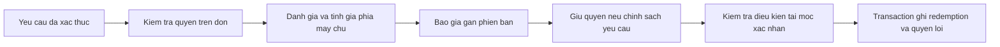

# Điều kiện được sử dụng coupon (Coupon redemption eligibility)

Một mã coupon tồn tại và chưa hết hạn chưa đủ để kết luận người đang gửi yêu cầu được hưởng ưu đãi. Quyền sử dụng còn phụ thuộc vào chủ thể, đơn hàng, sản phẩm, lịch sử tham gia, cách cộng dồn và trạng thái giao dịch tại thời điểm xác nhận.

Trong bảo mật logic nghiệp vụ, **coupon redemption eligibility** là tập điều kiện phía máy chủ quyết định một quyền giảm giá có được áp dụng cho một giao dịch cụ thể hay không. Mục tiêu là ngăn việc dùng mã của người khác, sửa giá trị giỏ hàng, dùng lại quyền đã tiêu dùng hoặc vượt qua một bước kiểm tra bằng cách gọi thẳng API cuối.

## 1. Phân biệt mã coupon, quyền được cấp và lần sử dụng

Một hệ thống có thể có các đối tượng sau:

| Đối tượng | Ý nghĩa |
| --- | --- |
| Campaign | Chiến dịch chứa chính sách, phạm vi và hạn mức |
| Coupon code | Chuỗi người dùng nhập để tìm hoặc yêu cầu áp dụng ưu đãi |
| Coupon grant | Quyền được cấp cho một chủ thể, nếu chương trình có phát hành cá nhân |
| Eligibility decision | Kết quả đánh giá điều kiện cho một chủ thể và phiên bản đơn |
| Reservation | Lần giữ một quyền hoặc hạn mức trước khi hoàn tất |
| Redemption | Bản ghi quyền lợi đã được sử dụng |
| Order | Đơn hàng có chủ sở hữu, phiên bản, dòng hàng và trạng thái riêng |

Một mã công khai có thể được nhiều người nhập, nhưng mỗi người chỉ được hưởng một lần. Ngược lại, một coupon cá nhân có thể chỉ được tài khoản được cấp sử dụng, kể cả người khác biết chính xác chuỗi mã.

Đừng mặc định mọi coupon đều có chủ sở hữu cá nhân. Coupon dùng chung, coupon cá nhân và coupon có thể chuyển nhượng cần chính sách khác nhau. Với coupon có thể chuyển nhượng, cần quy trình chuyển quyền rõ ràng; việc gửi một subject ID mới trong request không tạo ra chuyển quyền hợp lệ.

**Biết mã không đồng nghĩa có quyền.** Tương tự, mã có chữ ký hợp lệ chỉ chứng minh một số dữ liệu đã được ký, không chứng minh quyền chưa bị thu hồi, chưa dùng hoặc còn phù hợp với đơn hiện tại.

## 2. Chính sách ví dụ: coupon cá nhân LEARN20

Giả sử hệ thống có chương trình giả lập:

| Điều kiện | Quy định của ví dụ |
| --- | --- |
| Phạm vi | Chỉ áp dụng trong một tenant và chiến dịch đã được phê duyệt, đang hoạt động |
| Chủ thể | Coupon được cấp cho tài khoản 193 |
| Đối tượng hưởng | Tài khoản phải còn thuộc nhóm đủ điều kiện tại thời điểm xác nhận |
| Số lần | Một lần cho mỗi grant, đồng thời tối đa một lần mỗi tài khoản trong chiến dịch |
| Sản phẩm | Chỉ các dòng thuộc nhóm hàng được phép; loại trừ thẻ quà tặng |
| Giá trị tối thiểu | 500.000 VND trên các dòng đủ điều kiện |
| Cơ sở tính | Giá bán sau giảm giá sản phẩm, trước coupon; không gồm thuế và phí giao hàng |
| Mức giảm | 20%, tối đa 100.000 VND |
| Cộng dồn | Không cùng coupon khác; giảm giá sản phẩm được phép theo chính sách |
| Thời gian | Trong khoảng bắt đầu có hiệu lực đến trước thời điểm kết thúc |
| Đơn hàng | Thuộc phạm vi được phép thao tác và còn ở trạng thái cho áp dụng coupon |
| Hoàn tiền | Không tự khôi phục quyền đã dùng trong chính sách ví dụ |

Các điều kiện trên là giả định học tập, không phải quy tắc mặc định của mọi sản phẩm.

### Ví dụ giỏ hàng

| Thành phần | Giá trị máy chủ xác định | Được tính vào ngưỡng? |
| --- | --- | --- |
| Khóa học A | 400.000 VND | Có |
| Khóa học B | 200.000 VND | Có |
| Thẻ quà tặng | 150.000 VND | Không |
| Phí giao hàng | 30.000 VND | Không |

Cơ sở đủ điều kiện là 600.000 VND. Mức giảm theo tỷ lệ là 120.000 VND, sau trần còn 100.000 VND.

Nếu bỏ khóa học B, cơ sở còn 400.000 VND nên không đạt ngưỡng, dù tổng gồm thẻ quà tặng và phí vẫn lớn hơn 500.000 VND. Tin vào tổng giỏ do client gửi sẽ làm sai điều kiện này.

## 3. Mỗi nhóm điều kiện cần dữ liệu có thẩm quyền

| Nhóm kiểm tra | Dữ liệu nên lấy từ đâu | Đầu vào không được tự tin cậy |
| --- | --- | --- |
| Danh tính | Phiên hoặc token đã được xác thực | accountId trong body |
| Quyền trên đơn | Chủ sở hữu và quan hệ được phép trong dữ liệu máy chủ | orderId hợp lệ về định dạng |
| Phạm vi tenant | Ngữ cảnh xác thực và quan hệ tài nguyên | tenantId do client tùy chọn |
| Chủ sở hữu grant | Bản ghi phát hành hoặc chuyển quyền hợp lệ | Người đang nắm chuỗi mã |
| Nhóm khách hàng | Nguồn thuộc tính được quản lý và chính sách về độ mới | isStudent, isVip trong request |
| Sản phẩm và giá | Danh mục, giá bán và phiên bản đơn phía máy chủ | eligibleSubtotal hoặc unitPrice từ client |
| Lịch sử tham gia | Sổ redemption và quyền hưởng | Cờ usedCoupon trong local storage |
| Thời gian | Đồng hồ máy chủ có thẩm quyền | Thời gian trên thiết bị người dùng |
| Cộng dồn | Tập ưu đãi của đơn và quy tắc kết hợp | Một cờ allowStacking do client gửi |

Có thể để client gửi mã coupon, order ID hoặc phiên bản đơn dự kiến. Đây là thông tin để máy chủ tra cứu và kiểm tra, không phải bằng chứng về quyền.

Nếu một loại quy tắc không được bộ đánh giá hiểu hoặc dữ liệu bắt buộc không có, không được mặc định điều kiện đó đã đạt.

### Quyền trên đối tượng là một điều kiện độc lập

Một người có quyền gọi API checkout chưa chắc được checkout mọi đơn. Cần kiểm tra quyền đối với **chính đơn và grant đang được yêu cầu**.

Ví dụ, tài khoản 193 có coupon riêng nhưng gửi order ID của tài khoản 204. Việc người gửi sở hữu coupon không làm họ có quyền sửa đơn 204. Ngược lại, quyền được hỗ trợ xử lý một đơn không nhất thiết cho phép dùng coupon cá nhân của khách hàng khác.

Với luồng hỗ trợ khách hàng, cần chốt quyền đại diện, phạm vi tác động và dấu vết người thực hiện; không bỏ qua kiểm tra bằng một tham số như `admin=true`.

## 4. Xây dựng quyết định eligibility có thể giải thích

Không nên gom mọi kết quả thành một boolean không có ngữ cảnh. Có thể phân biệt:

- **ELIGIBLE:** Các điều kiện được yêu cầu đều đạt trong phạm vi và tại thời điểm đã đánh giá.
- **INELIGIBLE:** Có một điều kiện nghiệp vụ xác định không đạt.
- **UNDETERMINED:** Chưa thể kết luận, chẳng hạn nguồn xác minh nhóm khách hàng không sẵn sàng.

`UNDETERMINED` không được tự chuyển thành cho phép. Có thể yêu cầu thử lại hoặc dùng cơ chế đã được phê duyệt cho chính sách đó. Đồng thời, không gắn nhãn người dùng lạm dụng chỉ vì dịch vụ phụ thuộc bị lỗi.

Một quyết định nội bộ có thể ghi:

```json
{
  "decision_id": "dec_731",
  "outcome": "ELIGIBLE",
  "reason_codes": [],
  "order_id": "ord_816",
  "order_version": 7,
  "campaign_id": "LEARN20",
  "policy_version": "v3",
  "audience_revision": "aud_29",
  "evaluated_at": "2026-11-22T03:15:10Z",
  "eligible_subtotal_minor": 600000,
  "discount_minor": 100000,
  "currency": "VND"
}
```

Đây là ví dụ dữ liệu nội bộ. Quyết định cần gắn thêm ngữ cảnh chủ thể, tenant và grant ở nơi lưu có thẩm quyền, nhưng không nhất thiết trả mọi trường đó cho client.

### Mã lý do ổn định

Các mã như `NOT_ASSIGNED_TO_SUBJECT`, `AUDIENCE_NOT_ELIGIBLE`, `MINIMUM_NOT_MET`, `ALREADY_REDEEMED`, `STACKING_NOT_ALLOWED`, `ORDER_VERSION_CHANGED` giúp điều tra và kiểm thử.

Phản hồi công khai có thể ít chi tiết hơn dữ liệu nội bộ. Không nên tiết lộ mã tồn tại và đang thuộc tài khoản nào cho người chưa có quyền xem. Cân bằng tính hữu ích cho khách hàng hợp lệ với việc hạn chế dò mã và suy đoán thông tin tài khoản.

Thứ tự kiểm tra cũng cần có chủ đích: kiểm tra xác thực và quyền trước khi đọc hoặc tiết lộ thông tin nhạy cảm, rồi thực hiện các kiểm tra nghiệp vụ cần thiết.

## 5. Đánh giá ở báo giá, giữ chỗ và xác nhận

Một luồng thường gặp có ba thời điểm, với mức bảo đảm khác nhau:

| Thời điểm | Mục đích | Điều chưa được bảo đảm |
| --- | --- | --- |
| Preview hoặc quote | Hiển thị khả năng áp dụng và số tiền dự kiến | Quyền hoặc hạn mức chưa chắc đã được giữ |
| Reservation | Giữ quyền và tài nguyên theo chính sách | Đơn vẫn có thể thay đổi hoặc có điều kiện phải đánh giá lại |
| Commit redemption | Ghi nhận tiêu dùng và quyền lợi chính thức | Không được dựa vào một kết quả cũ đã mất hiệu lực |



API xác nhận phải bảo vệ đầy đủ các điều kiện bắt buộc dù client có bỏ qua API preview. Không dùng trình tự giao diện làm ràng buộc bảo mật.

### Quote không phải quyền sử dụng vĩnh viễn

Một quote nên liên kết với chủ thể, tenant, đơn, phiên bản đơn, chính sách và thời hạn. Nếu được ký, chữ ký ngăn sửa dữ liệu đã ký nhưng không tự xử lý việc thu hồi hay tiêu dùng đồng thời.

Khi khách sửa giỏ từ phiên bản 7 sang 8, quote cho phiên bản 7 phải được xử lý theo chính sách: từ chối phiên bản cũ hoặc tính lại và yêu cầu chấp nhận kết quả mới. Không được áp dụng nguyên số tiền giảm cũ lên nội dung đơn mới.

Với quyền được giữ, cần chốt rõ điều kiện nào được bảo đảm đến hạn giữ và điều kiện nào phải kiểm tra lại. Ví dụ có thể giữ ngân sách nhưng vẫn yêu cầu đơn đủ giá trị tại bước xác nhận.

### Chính sách thay đổi trong lúc checkout

Có hai cách hợp lệ nếu được thiết kế rõ:

1. Tôn trọng phiên bản và một số quyền đã cam kết trong reservation đến khi hết hạn.
2. Áp dụng kiểm tra lại với phiên bản hiện hành đối với những điều kiện đã được quy định là có thể thay đổi.

Không trộn hai cách một cách ngẫu nhiên. Một lệnh thu hồi khẩn cấp cũng cần quy tắc riêng cho quyền đang giữ, quyền đã dùng và giao dịch đang thanh toán.

Nếu phát hành coupon cần phê duyệt, chỉ trạng thái đã phê duyệt và được phép hoạt động mới được dùng. Cờ `active` trên một bản nháp không được trở thành đường bỏ qua quy trình.

## 6. Tính điều kiện tiền và sản phẩm bằng dữ liệu máy chủ

Đánh giá điều kiện nên tách thành hai việc:

1. Xác định những dòng và chủ thể đủ điều kiện.
2. Tính ngưỡng, mức giảm và phân bổ theo chính sách đó.

Không cộng tất cả dòng hàng rồi kiểm tra ngưỡng nếu chỉ một phần giỏ thuộc phạm vi coupon.

Những chi tiết cần chốt gồm:

- Giá trị dùng trước hay sau giảm giá sản phẩm.
- Thuế, phí giao hàng và tiền tip có thuộc ngưỡng hay không.
- Sản phẩm bị loại trừ, hàng trả trước hoặc thẻ quà tặng.
- Số lượng tối đa được hưởng trên từng dòng.
- Cách làm tròn và áp dụng trần giảm.
- Cách phân bổ giảm giá xuống dòng để hoàn một phần.
- Điều kiện theo đồng tiền và phạm vi cửa hàng.

Với ví dụ LEARN20:

```text
eligible_subtotal =
    tổng giá trị các dòng đủ điều kiện
    sau giảm giá sản phẩm, trước coupon

đủ ngưỡng khi eligible_subtotal >= 500000 VND

discount =
    min(làm tròn xuống 20% của eligible_subtotal, 100000 VND)
```

Quy tắc làm tròn xuống ở đây chỉ thuộc ví dụ. Hệ thống thực tế phải dùng quy tắc đã chốt, với số nguyên hoặc kiểu thập phân chính xác thích hợp, không dùng số thực nhị phân để quyết định tiền.

Nếu có coupon khác, không chỉ kiểm tra từng coupon độc lập. Hai ưu đãi có thể đều hợp lệ khi đứng một mình nhưng tổ hợp của chúng bị cấm hoặc thay đổi cơ sở tính. Chính sách kết hợp cần xác định thứ tự và nhóm loại trừ rõ ràng.

## 7. Điều kiện thời gian, nhóm khách hàng và lịch sử mua

### 7.1. Khoảng thời gian có biên rõ ràng

Một quy ước dễ kiểm thử là:

```text
valid_from <= checked_at < valid_until
```

Thời điểm bắt đầu được tính, thời điểm kết thúc không được tính. Nếu giao diện hiển thị “hết ngày 22”, cần chuyển yêu cầu ngày lịch và múi giờ của chiến dịch thành mốc thời gian chính xác, không tùy tiện lấy 23:59:59.

Thời gian trên máy client không phải nguồn quyết định. Đồng hồ của nguồn có thẩm quyền cũng cần được vận hành nhất quán.

Hạn của coupon và hạn giữ chỗ là hai điều kiện khác nhau. Một reservation còn hạn không mặc nhiên cho phép vượt thời hạn chiến dịch, trừ khi chính sách đã cam kết điều đó cho quyền đang giữ.

Khi transaction chờ khóa lâu, kiểm tra thời gian phải dùng mốc phù hợp sau khi giành quyền xử lý bản ghi. Cần chốt rõ quyết định có hiệu lực tại điểm kiểm tra được bảo vệ, thay vì ngầm yêu cầu thời gian phản hồi qua mạng cũng phải trước hạn.

### 7.2. Nhóm khách hàng: tại lúc phát hành hay lúc sử dụng?

Có hai chính sách khác nhau:

- **Theo ảnh chụp lúc cấp:** Đủ điều kiện khi nhận grant thì được giữ quyền trong thời hạn đã cam kết.
- **Theo trạng thái hiện tại:** Khi xác nhận phải vẫn thuộc nhóm đủ điều kiện.

Ví dụ LEARN20 chọn cách thứ hai. Vì vậy một coupon đã được cấp không đủ chứng minh tài khoản vẫn còn tư cách sử dụng.

Nếu kiểm tra nhóm qua một dịch vụ khác, cần xác định độ mới, phiên bản, thời hạn chứng cứ và cách xử lý thu hồi. Một thuộc tính cũ trong token có chữ ký hợp lệ không tự trở thành thông tin hiện tại.

Không thể bảo đảm “luôn theo trạng thái mới nhất” giữa hai dịch vụ chỉ bằng hai lần gọi API rời rạc. Nếu điều kiện cần sự nhất quán chặt, phải có giao thức hoặc điểm quyết định có thẩm quyền tương ứng. Nếu chấp nhận ảnh chụp có thời hạn, chính sách phải nói rõ mức bảo đảm đó.

### 7.3. “Khách mới” và “đơn đầu tiên” dễ có race condition

Đây là điều kiện mở rộng thường gặp, dù không nằm trong chính sách LEARN20 ở trên.

Giả sử điều kiện là chưa có lần mua thành công. Nếu hai checkout cùng đọc số đơn thành công bằng 0, cả hai có thể tự kết luận mình đủ điều kiện.

Cần định nghĩa trước:

1. Mua thành công là chốt đơn, thanh toán được ghi nhận, giao hàng hay một mốc khác?
2. Hủy và hoàn có khôi phục tư cách khách mới không?
3. Phạm vi là toàn nền tảng, tenant, cửa hàng hay chiến dịch?
4. Thứ tự nghiệp vụ dựa trên nguồn ghi nhận nào khi thông báo bên ngoài đến trễ?

Chỉ khóa bản ghi coupon có thể ngăn dùng lại một grant, nhưng không ngăn một đường mua hàng khác thay đổi lịch sử của tài khoản. Những luồng ảnh hưởng cùng điều kiện phải đi qua cơ chế phối hợp chung.

Một cách thiết kế là dùng bản ghi trạng thái khách hàng hoặc quyền “lần mua đầu” được kiểm soát trong cùng điểm xác nhận có thẩm quyền. Nếu cần giữ quyền trước thanh toán, phải có giao thức giữ và xác nhận tương ứng.

Không dùng một truy vấn `COUNT(*) = 0` tách rời rồi coi điều kiện được bảo vệ trước mọi giao dịch đồng thời.

Khi request xác nhận bị gửi lại, cần trả kết quả gốc trước khi coi đây là một lần mua mới. Nếu lần đầu đã cập nhật lịch sử thành công, lần retry không được bị từ chối chỉ vì chính lần mua đó làm tài khoản không còn là khách mới.

## 8. Bảo vệ điều kiện một lần bằng trạng thái và transaction

Với coupon cá nhân, có thể tách hai vòng đời:

| Đối tượng | Các trạng thái minh họa |
| --- | --- |
| Grant | ISSUED, REDEEMED, REVOKED |
| Reservation | HELD, COMMITTED, RELEASED, EXPIRED |

Grant hết hiệu lực theo thời gian vẫn phải bị từ chối dù chưa có worker đổi một trạng thái lưu sẵn. Không phụ thuộc hoàn toàn vào tác vụ nền để quyết định hạn dùng.

Reservation hết hạn cũng không đồng nghĩa grant đã dùng. Nếu chính sách cho thử lại, grant có thể vẫn chưa tiêu dùng, nhưng mọi lần giữ cũ phải được giải quyết đúng và không được hồi sinh trái phép.

### Các ràng buộc cần phối hợp

- Một grant chỉ có một lần tiêu dùng hợp lệ.
- Một tài khoản chỉ được hưởng số lần chính sách cho phép trong chiến dịch.
- Một đơn không được nhận thêm coupon trái quy tắc cộng dồn.
- Reservation, nếu bắt buộc, phải còn thuộc quyền sử dụng của thao tác đang xác nhận.
- Mọi cập nhật quyền hưởng, đơn và hạn mức liên quan phải nhất quán.

Khác idempotency key không tạo quyền hưởng mới. Hai request có khóa khác nhau vẫn có thể tranh cùng một grant hoặc cùng quyền một lần của tài khoản.

### Ví dụ UPDATE có điều kiện

Đoạn SQL sau dùng cú pháp PostgreSQL và chỉ minh họa việc tiêu dùng một grant cá nhân. Giả sử bảng có khóa duy nhất theo `(tenant_id, grant_id)`.

```sql
UPDATE coupon_grant
SET status = 'REDEEMED',
    redeemed_order_id = :order_id,
    redeemed_at = :checked_at
WHERE tenant_id = :tenant_id
  AND grant_id = :grant_id
  AND campaign_id = :campaign_id
  AND owner_subject_id = :authenticated_subject_id
  AND status = 'ISSUED'
  AND valid_from <= :checked_at
  AND :checked_at < valid_until
RETURNING grant_id;
```

`checked_at` phải do nguồn thời gian có thẩm quyền cung cấp theo quy ước của transaction. Subject và tenant lấy từ ngữ cảnh xác thực; order đã được kiểm tra quyền và trạng thái.

Một dòng được trả về chỉ chứng minh thao tác này đã thắng điều kiện trên grant trong transaction hiện tại. Nó **chưa chứng minh** đủ điều kiện sản phẩm, audience, cộng dồn hoặc hạn mức. Các kiểm tra và cập nhật đó vẫn phải nằm trong đơn vị xử lý phù hợp.

Nếu không trả về dòng, không được bỏ điều kiện trạng thái rồi thử UPDATE lại vô điều kiện. Cần kiểm tra kết quả thao tác gốc hoặc trả xung đột nghiệp vụ thích hợp.

### Ràng buộc một lần mỗi tài khoản trong chiến dịch

Nếu chính sách cho phép nhiều grant được phát nhưng chỉ một lần hưởng trong chiến dịch, khóa duy nhất trên từng grant là chưa đủ.

Có thể có bảng `coupon_campaign_consumption` với ràng buộc duy nhất:

```text
UNIQUE (tenant_id, campaign_id, subject_id)
```

Trong cùng transaction:

```sql
INSERT INTO coupon_campaign_consumption (
    tenant_id,
    campaign_id,
    subject_id,
    redemption_id
)
VALUES (
    :tenant_id,
    :campaign_id,
    :authenticated_subject_id,
    :redemption_id
)
ON CONFLICT (tenant_id, campaign_id, subject_id)
DO NOTHING
RETURNING redemption_id;
```

Nếu không tạo được quyền tiêu dùng mới, transaction phải xử lý xung đột và rollback các cập nhật mới khác, trừ trường hợp đang trả lại đúng kết quả đã có của thao tác gốc.

Phạm vi ràng buộc phải phản ánh chính sách. Không thêm `policy_version` vào khóa chỉ để tránh xung đột nếu đổi phiên bản không cấp lại quyền hưởng.

Với hạn mức lớn hơn một, cần mô hình số lượng hoặc quyền cấp phát phù hợp. Không sửa ràng buộc một lần bằng cách bỏ hết bảo vệ đồng thời rồi đếm trong ứng dụng.

### Idempotency là lớp bảo vệ riêng

Bản ghi idempotency nên gắn tenant, chủ thể đã xác thực, loại thao tác và khóa, đồng thời lưu dấu vân tay yêu cầu.

- Cùng khóa, cùng nội dung: trả kết quả gốc.
- Cùng khóa, khác nội dung: từ chối xung đột.
- Khác khóa, cùng grant hoặc quyền một lần: vẫn chịu ràng buộc nghiệp vụ.
- Mất phản hồi sau commit: retry không tạo redemption mới.

Trước khi trả dữ liệu đã lưu, vẫn phải kiểm tra người gọi có quyền truy cập kết quả tương ứng. Cache idempotency không được trở thành đường đọc kết quả của người khác.

## 9. Luồng xác nhận phía máy chủ

Client có thể gửi một yêu cầu gọn như:

```http
POST /orders/ord_816/coupon-redemptions
Idempotency-Key: req_027
Content-Type: application/json

{
  "couponCode": "LEARN20-PERSONAL",
  "expectedOrderVersion": 7,
  "quoteId": "quote_318"
}
```

Không cần nhận các giá trị có tính quyết định như `isEligible`, `discountAmount` hoặc `grantOwnerId` từ client để làm căn cứ cấp quyền lợi.

Một quy trình xác nhận có thể gồm:

1. Xác thực người gọi, kiểm tra cấu trúc request và chuẩn hóa mã theo quy tắc đã chốt.
2. Chuẩn bị chứng cứ từ nguồn bên ngoài nếu cần, với hợp đồng về phiên bản và độ mới được chính sách chấp nhận.
3. Bắt đầu transaction; lấy quyền xử lý bản ghi idempotency bằng cơ chế có ràng buộc duy nhất.
4. Kiểm tra quyền truy cập kết quả cũ; nếu đã hoàn tất đúng thao tác, trả kết quả gốc.
5. Khóa và tải dữ liệu cần thiết theo thứ tự nhất quán: đơn, grant, quyền hưởng và các tài nguyên liên quan.
6. Kiểm tra tenant, chủ sở hữu, trạng thái đơn, phiên bản, trạng thái chính sách và chứng cứ nhóm khách hàng.
7. Lấy thời điểm đánh giá có thẩm quyền; kiểm tra thời gian và reservation nếu có.
8. Tính lại hoặc xác minh cơ sở tính tiền từ bản chụp máy chủ, kiểm tra điều kiện sản phẩm và cộng dồn.
9. Chiếm quyền tiêu dùng và hạn mức bằng thao tác nguyên tử, cập nhật grant và quyền lợi trên đơn.
10. Ghi redemption, kết quả idempotent và outbox nếu cần phát sự kiện; commit.
11. Chỉ sau commit mới trả kết quả thành công.

Các lệnh “khóa” hoặc “lấy quyền xử lý” trong mô tả phải có triển khai thực sự, không phải một cờ trong bộ nhớ của một instance. Cần xử lý deadlock hoặc lỗi serialization bằng retry toàn bộ đơn vị transaction với định danh thao tác phù hợp.

Không nên giữ khóa cơ sở dữ liệu lâu trong khi chờ gọi mạng. Nếu điều kiện bên ngoài không thể được bảo vệ bằng chứng cứ có phiên bản hoặc một giao thức thích hợp, cần thừa nhận giới hạn nhất quán và thiết kế lại điểm quyết định.

### Transaction thất bại không được để lại quyền lợi một phần

Nếu cập nhật grant thành công nhưng chiếm hạn mức chiến dịch thất bại, phải rollback cả phần đã cập nhật grant. Tương tự, không commit redemption rồi mới sửa số tiền trên đơn trong một thao tác độc lập không có cơ chế khôi phục phù hợp.

Outbox giúp việc phát sự kiện đi cùng dữ liệu đã commit. Consumer vẫn cần xử lý thông điệp lặp an toàn; nhận lại sự kiện không được coi là một lần sử dụng coupon mới.

## 10. Các tình huống biên cần có chính sách rõ ràng

### Mã công khai và mã cá nhân

Mã công khai không cần bí mật để an toàn; quyền sử dụng vẫn phải được kiểm soát theo chính sách. Mã cá nhân không được bảo vệ chỉ bằng việc khó đoán.

Nếu mã có giá trị như một quyền có thể chuyển nhượng, cần coi việc nắm giữ mã theo đúng mô hình đó và bổ sung kiểm soát tiêu dùng, thu hồi, chuyển quyền. Không áp dụng lẫn lộn quy tắc coupon cá nhân không chuyển nhượng.

### Chuẩn hóa chuỗi mã

Chốt trước mã có phân biệt chữ hoa, chữ thường hay không; có bỏ khoảng trắng đầu cuối hay không; bảng ký tự nào được chấp nhận. Dùng cùng quy tắc khi phát hành, tra cứu và kiểm tra tính duy nhất.

Không tự chuẩn hóa theo nhiều cách khác nhau ở các API, khiến cùng một quyền có các biến thể bị đếm hoặc kiểm soát khác nhau. Giới hạn độ dài đầu vào và dùng truy vấn có tham số, nhưng nhớ rằng chống lỗi cú pháp không thay thế kiểm tra quyền hưởng.

### Thanh toán đến sau thời hạn giữ

Nếu hệ thống chờ thanh toán sau khi giữ coupon, cần quy định rõ cách xử lý khi thông báo thanh toán đến muộn.

Không hồi sinh reservation đã hết hạn nếu quota hoặc quyền giữ đã được cấp cho giao dịch khác. Có thể cần giữ lại quyền bằng một thiết kế khác, thử cấp mới có kiểm tra hoặc thực hiện bù theo chính sách.

Không âm thầm thu thêm tiền, xóa ưu đãi đã cam kết hoặc tự cho phép vượt hạn mức để giải quyết sự không khớp. Chính sách về thời điểm chốt giá, tiêu dùng coupon và xác nhận thanh toán phải được thiết kế cùng nhau.

Thông báo thanh toán phải được xác minh và liên kết đúng giao dịch. Một callback trên trình duyệt không phải bằng chứng đủ về việc thanh toán thành công.

### Hoàn tiền, hủy và phát hành lại

Trong LEARN20, hoàn tiền không khôi phục quyền dùng coupon. Redemption vẫn tồn tại; điều chỉnh tài chính được ghi riêng.

Nếu chính sách khác cho khôi phục quyền, cần một thao tác có định danh, lý do và tham chiếu lần sử dụng gốc, bảo đảm cùng sự kiện hoàn không khôi phục hai lần.

Phát hành một grant mới cũng không tự xóa giới hạn “một lần mỗi tài khoản trong chiến dịch”. Nếu doanh nghiệp muốn cấp ngoại lệ, đó là quyền nghiệp vụ riêng cần được quản lý và ghi nhận.

### Thay đổi đơn sau khi đã áp dụng

Không cho một endpoint sửa đơn độc lập làm mất điều kiện coupon mà vẫn giữ nguyên quyền lợi. Các thay đổi như xóa dòng, đổi số lượng hoặc đổi kênh phải đi qua quy trình đánh giá lại, định giá lại hoặc điều chỉnh đã được chốt.

Với đơn đã hoàn tất, không sửa lặng lẽ bản chụp giá lịch sử. Cần giữ khả năng giải thích mức giảm ban đầu và các điều chỉnh sau đó.

## 11. Kiểm thử bằng tình huống logic nghiệp vụ

Kiểm thử cần kết hợp đầu vào có vẻ hợp lệ với trạng thái hoặc trình tự không hợp lệ. Không chỉ thử mã đúng và mã sai.

| Tình huống | Kết quả mong đợi |
| --- | --- |
| Tài khoản khác biết mã cá nhân chính xác | Không tiêu dùng được grant không thuộc quyền |
| Người sở hữu grant gửi đơn của tài khoản khác | Bị từ chối theo quyền trên đơn |
| Grant và đơn ở hai tenant khác nhau | Không được áp dụng chéo phạm vi |
| Client gửi isEligible=true và số tiền giảm lớn hơn | Máy chủ bỏ qua làm căn cứ quyết định, tự đánh giá |
| Tổng giỏ đạt ngưỡng nhưng dòng đủ điều kiện không đạt | Từ chối điều kiện giá trị tối thiểu |
| Cơ sở đủ điều kiện bằng đúng 500.000 VND | Đạt điều kiện ngưỡng của ví dụ |
| Cơ sở đủ điều kiện là 499.999 VND | Không đạt điều kiện ngưỡng |
| Xác nhận đúng tại valid_until | Không còn hiệu lực theo khoảng nửa mở |
| Client sửa giờ thiết bị hoặc múi giờ | Không thay đổi quyền sử dụng |
| Quote phiên bản 7 được gửi cho đơn phiên bản 8 | Không áp dụng mù quáng kết quả cũ |
| Gọi API xác nhận mà chưa preview | Vẫn chịu đầy đủ kiểm tra bắt buộc |
| Chiến dịch còn bản nháp hoặc thiếu phê duyệt | Không được áp dụng chỉ vì có code |
| Audience đã bị thu hồi, chính sách yêu cầu trạng thái hiện tại | Không dựa vào tư cách cũ để xác nhận |
| Nguồn audience bị lỗi và không có chứng cứ được chấp nhận | Kết quả chưa xác định; không cấp quyền lợi |
| Hai request cùng grant với khóa khác nhau | Tối đa một lần tiêu dùng grant |
| Hai grant khác nhau cùng tài khoản, chính sách một lần | Tối đa một lần tiêu dùng trong chiến dịch |
| Cùng idempotency key nhưng nội dung khác | Báo xung đột, không tạo hiệu ứng mới |
| Retry sau commit nhưng mất phản hồi | Trả kết quả đã có, không thêm redemption |
| Hai coupon riêng lẻ hợp lệ nhưng cấm cộng dồn | Không xác nhận tổ hợp bị cấm |
| Coupon được thu hồi cạnh tranh với xác nhận | Kết quả theo thứ tự được bảo vệ, không tạo trạng thái nửa chừng |
| Hoàn tiền được thông báo nhiều lần | Không khôi phục quyền trái chính sách hoặc khôi phục lặp |
| Quote hoặc reservation của người khác được gửi lại | Không trở thành quyền của người gửi |
| Lịch sử mua thay đổi ở luồng khác trong lúc áp dụng coupon khách mới | Điều kiện được bảo vệ theo cơ chế phối hợp đã chọn |

Với các phép thử cạnh tranh, cần tạo điểm bắt đầu đủ đồng thời hoặc điều khiển vị trí chờ giữa các bước. Gửi tuần tự nhiều lần không tái hiện cùng một race condition.

Sau kiểm thử, xác minh dữ liệu:

```text
không có redemption thành công cho chủ thể không có quyền
không có grant được tiêu dùng quá số lần cho phép
không có tài khoản vượt quyền hưởng của chiến dịch
không có đơn nhận tổ hợp coupon bị cấm
số tiền giảm khớp chính sách và phiên bản đơn đã xác nhận
thao tác thất bại không để lại cập nhật quyền lợi một phần
thao tác lặp không làm tăng số lần sử dụng hoặc giảm tiền thêm
```

Đặc biệt, hãy thử mất kết nối trước và sau commit. Client nhìn thấy lỗi mạng không chứng minh transaction đã rollback; lớp idempotency phải giải quyết được trạng thái không chắc chắn này.

## 12. Ghi nhận bằng chứng đủ để điều tra

Mỗi lần quyết định hoặc sử dụng nên truy nguyên được:

- Chủ thể đã xác thực, tenant và quyền thao tác liên quan.
- Grant, chiến dịch, phiên bản chính sách và chứng cứ audience đã dùng.
- Đơn, phiên bản đơn và bản chụp cơ sở tính giá.
- Thời điểm kiểm tra, outcome và mã lý do.
- Reservation, redemption và tham chiếu thao tác idempotent.
- Sự thay đổi trạng thái và số tiền được ghi nhận.

Phân biệt sự kiện “đánh giá đủ điều kiện”, “giữ quyền” và “đã tiêu dùng”. Nếu tất cả đều được ghi thành `coupon_success`, bộ phận vận hành có thể nhầm một preview với lợi ích đã cấp.

Không đưa mã cá nhân bí mật, token phiên hoặc thông tin thanh toán đầy đủ vào log. Có thể dùng grant ID và định danh tra cứu được phân quyền; nếu cần dấu vân tay của một giá trị dễ đoán, cân nhắc cơ chế có khóa phù hợp thay vì coi hash đơn giản là bảo vệ đầy đủ.

Cảnh báo nên ưu tiên những sai lệch có bằng chứng: grant bị tiêu dùng hai lần, chủ thể không khớp hoặc số tiền vượt chính sách. Nhiều lần không đủ ngưỡng có thể chỉ là người dùng thử giỏ hàng, chưa chứng minh có hành vi xấu.

## 13. Một tình huống xuyên suốt

Tài khoản 193 dùng LEARN20 trên đơn phiên bản 7 có 600.000 VND hàng đủ điều kiện. Preview cho kết quả giảm 100.000 VND.

Sau đó khách xóa một dòng hàng, làm đơn lên phiên bản 8 và cơ sở đủ điều kiện còn 400.000 VND. Client vẫn gửi quote của phiên bản 7.

Một luồng an toàn sẽ:

1. Xác minh người gọi có quyền trên đơn và grant.
2. Nhận ra quote không còn khớp phiên bản đơn.
3. Tính lại hoặc yêu cầu báo giá mới theo chính sách.
4. Kết luận đơn mới không đạt ngưỡng và không ghi redemption.
5. Nếu đang có quyền giữ, giải quyết quyền giữ theo state machine, không tiêu dùng hoặc giải phóng lặp.
6. Trả lý do phù hợp để khách biết cần điều chỉnh giỏ, đồng thời lưu bằng chứng nội bộ.

Nếu khách gửi lại request nhiều lần hoặc thay idempotency key, kết luận về quyền của đơn phiên bản 8 vẫn phải giữ nguyên. Nếu khách thêm hàng hợp lệ và tạo một thao tác mới, hệ thống có thể đánh giá lại; đây là thay đổi nghiệp vụ hợp lệ, không phải bỏ qua kiểm soát.

Điều kiện được dùng coupon vì vậy phải gắn với **đúng người, đúng tài nguyên, đúng nội dung đơn, đúng chính sách và đúng thời điểm**. Quyết định cuối cùng chỉ có giá trị khi việc kiểm tra và ghi nhận quyền lợi được phối hợp để không thể bị vượt qua bằng sửa request, đổi thứ tự hoặc chạy đồng thời.
