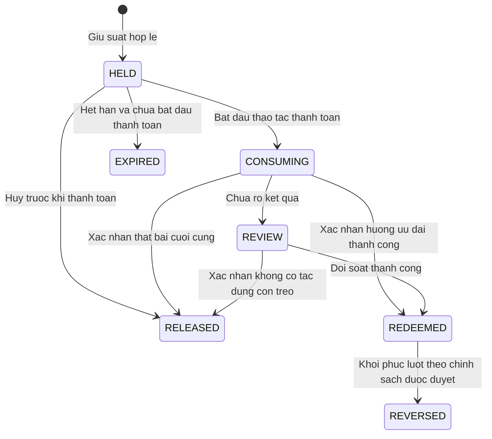

# Giới hạn số lần dùng coupon theo người dùng (Coupon per user limit)

## 1. Giới hạn theo người dùng bảo vệ điều gì?

Trong chương Coupons, **coupon per user limit** là giới hạn số lượt hưởng ưu đãi mà một chủ thể được phép sử dụng trong một phạm vi và khoảng thời gian xác định. Quy tắc có thể là “mỗi tài khoản một lần cho chiến dịch này” hoặc “mỗi khách hàng tối đa hai lần mỗi ngày”.

Đây là một bất biến nghiệp vụ, không chỉ là việc ẩn nút nhập mã sau khi khách hàng đã mua hàng. Người dùng có thể mở nhiều tab, tạo nhiều checkout, gọi trực tiếp API hoặc gửi yêu cầu đồng thời. Các tác vụ thanh toán, hủy đơn và hết hạn giữ chỗ còn có thể chạy lệch thứ tự.

Một thiết kế đúng cần giải quyết cùng lúc:

- Ai là người được tính hạn mức, và danh tính đó do đâu xác định?
- Hạn mức áp dụng cho từng mã, một chiến dịch hay một nhóm quyền lợi?
- Lượt đang giữ chỗ và lượt đã hưởng ưu đãi được tính thế nào?
- Hai request cùng tranh lượt cuối có thể cùng thành công không?
- Retry, webhook lặp, hủy đơn và hoàn tiền có làm sai bộ đếm không?

Bài học tập trung vào business invariants, state machine, quyền theo đối tượng, transaction và idempotency để ngăn lạm dụng giới hạn. Các chính sách và con số bên dưới là giả định minh họa, cần được chốt riêng cho sản phẩm thực tế.

### 1.1. Phân biệt các loại giới hạn

| Loại giới hạn | Ví dụ | Có thay thế giới hạn theo người dùng không? |
| --- | --- | --- |
| Toàn coupon hoặc chiến dịch | Tối đa 10.000 lượt toàn hệ thống | Không; một người vẫn có thể dùng nhiều lượt |
| Theo người dùng | Mỗi khách hàng một lượt trong chiến dịch | Là đối tượng của bài học |
| Theo đơn hàng | Một đơn chỉ áp dụng một coupon cùng nhóm | Không; người dùng có thể tạo nhiều đơn |
| Theo request | Không thực hiện lại cùng một yêu cầu retry | Không; người dùng có thể tạo ý định mới |
| Rate limit | Tối đa một số request trong một khoảng ngắn | Không; gửi chậm vẫn có thể dùng vượt hạn mức |
| Theo số tiền | Tổng tiền giảm của một khách hàng không vượt một ngưỡng | Khác đơn vị đếm, cần quy tắc và bộ đếm riêng |

Idempotency xử lý việc lặp lại cùng một ý định. Giới hạn theo người dùng kiểm soát nhiều ý định khác nhau của cùng chủ thể. Một hệ thống thường cần cả hai.

## 2. Định nghĩa rõ khóa hạn mức và thời điểm tính lượt

### 2.1. Không dùng một câu “mỗi user một lần” chưa đủ nghĩa

Một chính sách cần trả lời:

| Thành phần | Ví dụ được chọn trong bài |
| --- | --- |
| Tenant | Đơn vị sở hữu chiến dịch và dữ liệu khách hàng |
| Chủ thể hưởng ưu đãi | `benefitSubjectId` do server xác định từ khách hàng đã đăng nhập |
| Phạm vi hạn mức | Một `limitScopeId` ổn định của chiến dịch |
| Cửa sổ thời gian | `LIFETIME` trong toàn phạm vi chiến dịch |
| Số lượt tối đa | `L = 1` |
| Đơn vị một lượt | Một lần áp dụng coupon cho một đơn, không phụ thuộc số sản phẩm |
| Lượt đang xử lý | Giữ một suất trước khi thanh toán để ngăn các đơn song song |
| Lượt đã dùng | Thanh toán và xác nhận hưởng ưu đãi thành công theo workflow của ví dụ |
| Khôi phục sau hoàn tiền | Không tự khôi phục; chỉ theo chính sách ngoại lệ được phê duyệt |

Khóa đếm có thể được mô hình hóa:

```text
QuotaKey = (tenantId, limitScopeId, benefitSubjectId, windowKey)
```

`couponCode` là phương tiện tìm cấu hình, không nhất thiết là phạm vi đếm. Nếu `WELCOME-A` và `WELCOME-B` cùng thuộc quyền lợi “ưu đãi khách hàng mới một lần”, hai mã phải trỏ tới cùng `limitScopeId`. Nếu khóa bộ đếm theo từng chuỗi mã, khách hàng có thể đổi mã để dùng lại cùng quyền lợi.

Tương tự, tạo phiên bản mô tả hoặc đổi mức giảm không được tự tạo lại quota mới nếu ý định kinh doanh vẫn là một lượt cho cả chiến dịch.

### 2.2. Công thức gồm lượt đã dùng và lượt đang giữ

Với một khóa hạn mức, đặt:

```text
U = số lượt đã dùng còn được tính vào hạn mức
R = số lượt đang được giữ bởi các reservation còn chiếm suất
L = giới hạn được phê duyệt

Điều kiện cấp thêm một suất: U + R + 1 <= L
```

Trong ví dụ giới hạn cố định, hệ thống bảo toàn:

```text
U >= 0
R >= 0
U + R <= L
```

Ví dụ `L = 1`:

| Thời điểm | U | R | Có thể cấp thêm lượt không? |
| --- | --- | --- | --- |
| Chưa dùng, chưa giữ | 0 | 0 | Có |
| Checkout A đang giữ | 0 | 1 | Không |
| A thanh toán thành công | 1 | 0 | Không |
| A được giải phóng trước khi hưởng ưu đãi | 0 | 0 | Có |

Nếu chỉ đếm đơn đã thanh toán, hai checkout có thể cùng được giảm giá trước khi cả hai thanh toán xong. Reservation đưa quyền sử dụng đang treo vào phép đếm ngay từ đầu.

Không tính một reservation quá hạn thành đã giải phóng chỉ vì `expiresAt` đã qua. Bộ đếm phải được thay đổi cùng một chuyển trạng thái nguyên tử. Dọn trễ có thể tạm thời từ chối thêm lượt; tự bỏ qua reservation trong phép đọc nhưng vẫn giữ bộ đếm sẽ gây hai nguồn sự thật không nhất quán.

## 3. Danh tính hưởng ưu đãi phải do server kiểm soát

### 3.1. Không lấy userId từ payload làm danh tính quyết định

Ví dụ request nguy hiểm nếu backend tin trực tiếp `userId`:

```json
{
  "couponCode": "WELCOME-A",
  "checkoutId": "co_42",
  "userId": "another-user",
  "remainingUses": 1
}
```

Server phải lấy danh tính actor từ phiên hoặc token đã xác thực, xác định tenant được phép và ánh xạ tới chủ thể hưởng ưu đãi theo chính sách. Sau đó kiểm tra actor có quyền trên checkout, đơn hàng và coupon đang thao tác.

Không để khách hàng chọn một `benefitSubjectId` khác chỉ để mượn hạn mức. Việc biết ID hoặc dùng UUID không chứng minh quyền truy cập đối tượng.

### 3.2. Actor và chủ thể hưởng ưu đãi có thể khác nhau

Nhân viên chăm sóc khách hàng có thể tạo đơn thay khách. Khi đó:

- `actorId` là nhân viên thực hiện, dùng cho phân quyền và audit.
- `benefitSubjectId` là khách hàng nhận ưu đãi, dùng cho quota.

Nếu đếm theo tài khoản nhân viên, nhiều khách hàng có thể tranh cùng quota hoặc một khách hàng có thể đổi nhân viên để hưởng lại. Lệnh thao tác thay cần quyền riêng, quan hệ với khách hàng được kiểm tra và lý do được ghi nhận theo chính sách.

### 3.3. “Một tài khoản” không tự đồng nghĩa “một con người”

Giới hạn theo ID tài khoản có thể được thực thi chính xác nhưng vẫn bị lạm dụng bằng nhiều tài khoản. Cần công bố đúng phạm vi bảo đảm:

| Mô hình chủ thể | Giới hạn thực sự kiểm soát |
| --- | --- |
| Account ID | Mỗi tài khoản |
| Customer identity ổn định | Mỗi hồ sơ khách hàng theo quy tắc liên kết |
| Danh tính đã xác minh theo quy trình riêng | Mỗi danh tính trong mức bảo đảm của quy trình đó |
| Cookie hoặc guest session | Mỗi phiên/thiết bị theo dữ liệu có thể bị đặt lại |

Email mới, đổi số điện thoại hoặc xóa tài khoản không nên tự xóa lịch sử hưởng quyền lợi nếu chính sách dựa trên một danh tính khách hàng ổn định. Ngược lại, không tự gom mọi người dùng chung IP hoặc địa chỉ nhà thành một người; điều đó có thể từ chối nhầm thành viên gia đình hoặc người dùng mạng công cộng.

Nếu cho phép checkout khách vãng lai, phải xác định cách chống đặt lại danh tính và cách chuyển quota khi khách đăng nhập. Nếu không có nguồn danh tính đủ cho chính sách, có thể yêu cầu đăng nhập trước khi cấp ưu đãi thay vì tuyên bố đã bảo đảm mỗi người một lượt.

## 4. Mô hình đe dọa và các bất biến cần bảo toàn

| Cách lạm dụng | Lỗ hổng tạo cơ hội |
| --- | --- |
| Mở nhiều tab/checkout cùng nhập mã | Kiểm tra quota và ghi nhận sử dụng tách rời |
| Dùng nhiều idempotency key | Chỉ chống retry, không kiểm tra quota chủ thể |
| Gửi userId khác hoặc sửa tenant | Tin dữ liệu client và thiếu quyền theo đối tượng |
| Đổi mã cùng chiến dịch | Bộ đếm gắn chuỗi code thay vì phạm vi quyền lợi |
| Tạo phiên bản coupon mới | Phiên bản cấu hình vô tình làm mới lịch sử |
| Hủy/thử lại nhiều lần | Giải phóng hoặc khôi phục lượt không theo trạng thái |
| Phát lại webhook thành công | Cùng reservation bị cộng lượt đã dùng nhiều lần |
| Gây timeout thanh toán | Hệ thống giải phóng suất trong khi thanh toán có thể đã thành công |
| Gộp hoặc tạo lại tài khoản | Lịch sử quota không đi cùng danh tính được chính sách sử dụng |
| Gửi qua nhiều vùng triển khai | Mỗi vùng dùng một bộ đếm riêng, không phối hợp |

Các bất biến đề xuất:

| Mã | Bất biến |
| --- | --- |
| C1 | Chủ thể quota do server xác định, thuộc tenant và quan hệ truy cập hợp lệ |
| C2 | Mọi mã cùng một quyền lợi bị giới hạn chia sẻ đúng `limitScopeId` |
| C3 | Với giới hạn cố định, tổng lượt đã tính và đang giữ không vượt L |
| C4 | Mỗi lần cấp suất có một reservation định danh, gắn với checkout/đơn và snapshot được kiểm soát |
| C5 | Mỗi reservation chỉ thực hiện tác dụng của một chuyển trạng thái đúng một lần |
| C6 | Retry cùng ý định không giữ hoặc tiêu thụ thêm suất |
| C7 | Không giải phóng suất khi tác dụng thanh toán/hưởng ưu đãi còn chưa rõ |
| C8 | Đổi cấu hình, đổi mã hoặc đổi cửa sổ không âm thầm xóa lịch sử thuộc phạm vi cũ |
| C9 | Bộ đếm, reservation, audit thành công và sự kiện cục bộ cùng commit/rollback |
| C10 | Quyền quản trị sửa hạn mức, khôi phục lượt và liên kết danh tính được kiểm tra riêng |

Việc suy ra dữ liệu quan trọng trên server, mô hình hóa workflow và bảo vệ vùng tranh chấp là các nguyên tắc được trình bày trong [OWASP Business Logic Security Cheat Sheet](https://cheatsheetseries.owasp.org/cheatsheets/Business_Logic_Security_Cheat_Sheet.html). C1–C10 là thiết kế minh họa áp dụng cho coupon theo người dùng.

## 5. State machine của lượt sử dụng

### 5.1. Phân biệt giữ suất và đã dùng

Một workflow có thanh toán bất đồng bộ có thể dùng:



| Trạng thái reservation | Đóng góp vào R | Đóng góp vào U |
| --- | --- | --- |
| HELD | 1 | 0 |
| CONSUMING | 1 | 0 |
| REVIEW | 1 | 0 |
| REDEEMED | 0 | 1 |
| RELEASED, EXPIRED | 0 | 0 |
| REVERSED | 0 | 0, chỉ khi chính sách cho khôi phục lượt |

REVERSED không có nghĩa một khoản hoàn tiền bất kỳ đều tự động khôi phục lượt. Đây là trạng thái dùng khi nghiệp vụ đã chấp thuận không tính lượt đó nữa. Lịch sử hưởng ưu đãi và sự kiện khôi phục vẫn được giữ.

### 5.2. Tác động bộ đếm theo chuyển trạng thái

```text
Tạo HELD:                  R += 1
HELD → CONSUMING:          không đổi U, R
CONSUMING → REVIEW:        không đổi U, R
CONSUMING/REVIEW → REDEEMED:
                           R -= 1; U += 1
HELD → RELEASED/EXPIRED:   R -= 1
CONSUMING/REVIEW → RELEASED:
                           R -= 1, sau khi xác nhận điều kiện giải phóng
REDEEMED → REVERSED:       U -= 1, nếu được chính sách cho phép
```

Mỗi dòng là một chuyển trạng thái có điều kiện trên trạng thái nguồn, được thực hiện trong transaction với bộ đếm. Request lặp gặp trạng thái đích không thực hiện tác dụng lần nữa.

Trước khi gọi cổng thanh toán, chuyển HELD sang CONSUMING và lưu định danh payment attempt. Một timeout không chứng minh thất bại cuối cùng; lượt vẫn chiếm R trong CONSUMING hoặc REVIEW cho tới khi có kết quả có thẩm quyền.

## 6. Mô hình dữ liệu: quota, reservation và lịch sử

### 6.1. Không chỉ lưu một boolean trên tài khoản

`user.hasUsedCoupon = true` không diễn đạt được nhiều chiến dịch, giới hạn lớn hơn một, cửa sổ thời gian hoặc lượt đang giữ. Một mô hình có thể tách:

| Thành phần | Trách nhiệm |
| --- | --- |
| Chính sách coupon có phiên bản | Xác định phạm vi, L, thời hạn, chủ thể và quy tắc khôi phục |
| Quota theo chủ thể | Lưu U và R để cấp suất nguyên tử |
| Reservation | Gắn một suất với checkout/đơn, trạng thái và payment attempt |
| Lịch sử chuyển trạng thái | Giải thích tăng/giảm bộ đếm và phục vụ đối soát |
| Kết quả idempotency | Nhận diện retry của một lệnh |
| Inbox/outbox nếu có sự kiện | Tiếp nhận/phát tin bền vững và xử lý lặp |

Một schema rút gọn cho quota trong PostgreSQL:

```sql
CREATE TABLE coupon_subject_quota (
    tenant_id UUID NOT NULL,
    limit_scope_id UUID NOT NULL,
    benefit_subject_id UUID NOT NULL,
    window_key TEXT NOT NULL,
    redeemed_count BIGINT NOT NULL DEFAULT 0,
    reserved_count BIGINT NOT NULL DEFAULT 0,
    revision BIGINT NOT NULL DEFAULT 0,
    PRIMARY KEY (
        tenant_id, limit_scope_id, benefit_subject_id, window_key
    ),
    CHECK (redeemed_count >= 0),
    CHECK (reserved_count >= 0)
);
```

L được lấy từ chính sách có thẩm quyền, không nhận từ client. Các CHECK trên không tự thực thi giới hạn liên quan đến bảng chính sách; điều kiện cấp suất nằm trong giao thức cập nhật được kiểm soát.

Reservation nên lưu tối thiểu:

```text
reservationId
tenantId + limitScopeId + benefitSubjectId + windowKey
couponId + couponConfigVersion + limitPolicyVersion
checkoutId/orderId + applicationSequence
checkoutRevision/quoteReference
state + revision
expiresAt
paymentAttemptId nếu có
createdAt + updatedAt
```

Khóa ngoại tới quota cần mang đủ các thành phần, bao gồm tenant. Các liên kết tới checkout, đơn hàng và coupon cũng phải ngăn trộn tenant.

### 6.2. Ràng buộc duy nhất theo đúng đơn vị nghiệp vụ

Với L lớn hơn một, `UNIQUE(couponId, userId)` sẽ chặn cả lượt hợp lệ thứ hai. Ngược lại, chỉ unique trên idempotency key sẽ không ngăn nhiều ý định khác nhau vượt L.

Có thể đặt unique theo `(tenant, checkout, applicationSequence, limitScopeId)` cho từng lần áp dụng do server cấp số thứ tự. Bên cạnh đó, checkout cần kiểm soát chỉ có một lần áp dụng còn hiệu lực của cùng phạm vi theo chính sách. Mở lần áp dụng mới sau khi hủy phải qua workflow cho phép và vẫn đi qua quota U + R.

Không đưa `expiresAt > now()` vào ý tưởng unique “còn hiệu lực” mà kỳ vọng chỉ thời gian trôi qua sẽ cập nhật index và bộ đếm. Hết hạn là một chuyển trạng thái do ứng dụng thực hiện.

### 6.3. Bộ đếm và lịch sử phải đối soát được

Quota phục vụ quyết định nhanh; reservation và lịch sử phục vụ chứng minh con số. Nếu lưu cả hai, mỗi thay đổi phải cùng transaction. Hệ thống có thể định kỳ so sánh:

```text
R = số reservation đang ở HELD, CONSUMING hoặc REVIEW của đúng QuotaKey
U = số lượt REDEEMED còn được tính theo chính sách của đúng QuotaKey
```

Không xóa reservation cũ rồi giữ nguyên bộ đếm mà không có cơ chế lưu lịch sử thay thế. Khi phát hiện lệch, cần khoanh vùng cấp thêm suất và sửa có audit; không tự đặt U/R về 0 để “làm sạch”.

## 7. Cấp suất nguyên tử để chặn race condition

### 7.1. Mẫu check-then-act không an toàn

```java
// Ví dụ có lỗi, không dùng làm mẫu triển khai.
long used = repository.countPaidOrders(userId, couponId);
if (used < perUserLimit) {
    checkout.applyCoupon(couponId);
}
```

Với giới hạn một lần, hai request có thể cùng đọc `used = 0`, cùng áp dụng rồi cùng thanh toán. Đặt đoạn mã trong hai transaction riêng cũng không tự làm điều kiện “chưa ai dùng” được bảo vệ.

Khóa trong bộ nhớ như `synchronized` không bảo vệ các instance khác, job hoặc API ghi qua đường khác. Cache đọc từ replica trễ cũng không phù hợp để quyết định cấp suất cuối.

### 7.2. Tạo hàng quota nếu chưa có

Một `SELECT ... FOR UPDATE` không tìm thấy hàng không phải là đã khóa được khóa quota logic đó. Cần có ràng buộc duy nhất và cơ chế tạo hàng an toàn:

```sql
INSERT INTO coupon_subject_quota (
    tenant_id, limit_scope_id, benefit_subject_id, window_key
)
VALUES (:tenant_id, :limit_scope_id, :subject_id, :window_key)
ON CONFLICT (
    tenant_id, limit_scope_id, benefit_subject_id, window_key
) DO NOTHING;
```

`ON CONFLICT` dùng ràng buộc duy nhất để xử lý trường hợp đồng thời khởi tạo; xem [PostgreSQL 18 — INSERT](https://www.postgresql.org/docs/18/sql-insert.html). Ví dụ giả định mức cô lập READ COMMITTED và các câu lệnh tiếp theo có thể nhìn thấy hàng đã được tạo sau khi tranh chấp kết thúc. Với mức cô lập khác hoặc lỗi serialization/deadlock, cần retry toàn bộ transaction theo hợp đồng đã chọn.

### 7.3. Cập nhật có điều kiện và kiểm tra số hàng

Sau khi khóa/đọc chính sách hiệu lực, cấp một suất bằng:

```sql
UPDATE coupon_subject_quota
SET reserved_count = reserved_count + 1,
    revision = revision + 1
WHERE tenant_id = :tenant_id
  AND limit_scope_id = :limit_scope_id
  AND benefit_subject_id = :subject_id
  AND window_key = :window_key
  AND redeemed_count + reserved_count < :approved_limit
RETURNING redeemed_count, reserved_count, revision;
```

`:approved_limit` phải do server lấy từ chính sách đã được bảo vệ khỏi thay đổi đồng thời không tương thích. Một hàng trả về nghĩa là đã giữ được suất; không có hàng trả về thì không được tiếp tục cấp ưu đãi. Không thay thế kết quả này bằng một lần đọc cache.

Việc cập nhật hàng tạo điểm tranh chấp cho cùng QuotaKey. Nếu dùng `SELECT ... FOR UPDATE` để kiểm tra rồi cập nhật, mọi đường cấp suất cũng phải khóa đúng hàng. Các đặc tính khóa hàng được mô tả trong [PostgreSQL 18 — Explicit Locking](https://www.postgresql.org/docs/18/explicit-locking.html).

Trong cùng transaction, ghi reservation, liên kết checkout, lịch sử thành công, outbox và kết quả idempotency. Nếu bất kỳ bước nào lỗi, rollback cả phần tăng R. Không để một exception ở bước ghi reservation biến thành suất bị giữ không có chủ.

Nếu có giới hạn toàn chiến dịch hoặc ngân sách tiền giảm, chúng cần được cấp cùng giao thức. Cấp được suất cá nhân không đồng nghĩa toàn chiến dịch vẫn còn lượt.

## 8. Idempotency và giới hạn nghiệp vụ bổ sung cho nhau

### 8.1. Chọn đúng phạm vi khóa request

Một hợp đồng có thể dùng:

```text
IdempotencyScope = (tenantId, actorId, operation, idempotencyKey)
Fingerprint = checkoutId + checkoutRevision + couponCode
              + các tham số ngữ nghĩa khác được chuẩn hóa
```

Không đưa thời gian hiện tại vào fingerprint. Actor là người thực hiện request, còn chủ thể quota được server suy ra; hai vai trò không bị đánh đồng khi nhân viên đặt hàng thay.

| Trường hợp | Xử lý |
| --- | --- |
| Cùng key, cùng fingerprint, đã thành công | Kiểm tra quyền hiện tại rồi trả reservationId/kết quả cũ |
| Cùng key, khác checkout hoặc payload | Từ chối xung đột key |
| Request trước đang thực thi | Chờ có giới hạn hoặc trả phản hồi retry theo hợp đồng |
| Key khác, cùng chủ thể và phạm vi | Vẫn kiểm tra quota U + R và ràng buộc checkout |
| Key hết hạn lưu | Quota và lịch sử nghiệp vụ vẫn ngăn dùng vượt |

[Stripe — Idempotent requests](https://docs.stripe.com/api/idempotent_requests) minh họa việc lưu kết quả để retry và đối chiếu tham số. Cách lưu lỗi, thời hạn và phạm vi key trong dịch vụ coupon phải được thiết kế riêng, không mặc định sao chép toàn bộ hành vi của Stripe.

### 8.2. Lưu key và tác dụng nghiệp vụ cùng transaction

Một cách thực hiện là dùng unique key cho bảng kết quả lệnh, chiếm key bằng insert có xử lý xung đột, rồi ghi kết quả thành công trong cùng transaction với reservation. Nếu lệnh lỗi, rollback cả key mới và tác dụng nghiệp vụ.

Không commit một hàng “thành công” trước khi quota/reservation commit. Nếu dùng cơ chế tách riêng trạng thái đang xử lý, phải có quyền sở hữu, timeout và phục hồi rõ ràng; không để hai worker cùng tiếp quản rồi đều cấp suất.

Request replay được kiểm tra fingerprint và quyền trước khi trả dữ liệu. Nó không cần giữ thêm suất hoặc đối chiếu lại revision như một ý định mới, vì lần trước có thể đã làm revision tăng. Tuy nhiên, response lịch sử không tự gia hạn một reservation đã hết hạn hoặc đã giải phóng.

Đặc biệt, trả lại `reservationId` cũ không có nghĩa caller được dùng nó cho checkout khác. Mọi bước bắt đầu thanh toán và chốt đơn vẫn kiểm tra liên kết đối tượng, trạng thái và thời hạn phù hợp.

## 9. Ví dụ API và application service bằng mã giả Java

### 9.1. API chỉ nhận ý định áp dụng coupon

```http
POST /checkouts/co_42/coupon-reservations
Authorization: Bearer <access-token>
Idempotency-Key: b2c48e5e-4e27-4c13-8bd9-951be34b058c
Content-Type: application/json

{
  "couponCode": "WELCOME-A",
  "expectedCheckoutRevision": 20
}
```

Danh tính khách hàng hưởng ưu đãi thuộc dữ liệu checkout đã được kiểm tra quyền, không lấy từ trường userId tùy ý. `expectedCheckoutRevision` chỉ là điều kiện mong đợi; server phải đối chiếu với bản ghi hiện tại.

Không nhận `perUserLimit`, `usedCount`, `discountAmount`, `forceApply` hay `limitScopeId` để khách hàng tự quyết định. Mã coupon được chuẩn hóa theo quy tắc của hệ thống và tra trong đúng tenant. Nhiều alias của cùng coupon không được tách thành nhiều lịch sử quota.

### 9.2. Mã giả cấp một suất

Đây là mã giả định hướng thiết kế, không phải lớp Java có thể biên dịch độc lập. Ví dụ giả định dữ liệu quota, checkout và mapping danh tính cần thiết cùng nằm trong một cơ sở dữ liệu; các helper không gọi dịch vụ ngoài khi đang giữ khóa.

```java
ReservationResult reserveCoupon(Actor actor,
                                AuthorizedTenant tenant,
                                UUID checkoutId,
                                ApplyCouponCommand command,
                                String idempotencyKey) {
    requireAuthenticated(actor);
    requireTenantMembership(actor, tenant);
    validateRequest(command, idempotencyKey);

    Fingerprint fingerprint = fingerprintOf(
        tenant.id(), checkoutId, command);

    // Chỉ trả kết quả ra ngoài sau khi commit thành công.
    return tx.required(() -> {
        CommandSlot slot = commands.claimOrLoadForUpdate(
            tenant.id(), actor.id(), "RESERVE_COUPON",
            idempotencyKey, fingerprint);

        Checkout checkout = checkouts.lockByTenantAndId(
            tenant.id(), checkoutId).orElseThrow(NotFound::new);
        authorization.requireManageCheckout(actor, checkout);

        if (slot.hasCompletedResult()) {
            return slot.savedReservationResult();
        }

        checkout.requireRevision(command.expectedCheckoutRevision());
        checkout.requireCanApplyCoupon();

        PolicyGuard guard = couponPolicies.lockEffectiveByCode(
            tenant.id(), command.couponCode());
        CouponPolicy policy = guard.immutablePolicy();
        checkout.requireNoLiveApplicationFor(policy.limitScopeId());

        BenefitSubject subject = identities.lockCanonicalCouponSubject(
            tenant.id(), checkout.customerId());
        eligibility.requireEligible(checkout, subject, policy);

        GlobalQuota global = globalQuotas.lockIfRequired(policy);
        WindowKey window = policy.windowAt(databaseClock.currentInstant());
        SubjectQuota quota = subjectQuotas.createIfAbsentThenLock(
            tenant.id(), policy.limitScopeId(), subject.id(), window);

        Instant decisionTime = databaseClock.currentInstant();
        policy.requireUsableAt(decisionTime);
        policy.requireSameWindow(window, decisionTime);

        PriceBreakdown price = pricing.calculateOnServer(checkout, policy);
        quota.reserveOneOrThrow(policy.approvedPerSubjectLimit());
        global.reserveIfRequiredOrThrow(price.discountAmount());

        Reservation reservation = reservations.insertHeld(
            checkout, subject, policy, window, price, decisionTime);
        checkouts.attachReservationConditionally(
            checkout, command.expectedCheckoutRevision(), reservation);

        history.appendReserved(reservation, actor.id(), decisionTime);
        outbox.appendCouponReserved(reservation);
        ReservationResult result = ReservationResult.from(reservation);
        commands.complete(slot, result);
        return result;
    });
}
```

Các điều kiện cần giữ khi triển khai:

- Helper idempotency đối chiếu fingerprint trước khi phát lại kết quả.
- Policy guard bảo vệ quyết định hiệu lực, L và ánh xạ code sang scope khỏi cập nhật đồng thời không tương thích. Có thể dùng khóa đọc phù hợp để không bắt mọi người dùng tranh một khóa độc quyền toàn chiến dịch.
- Mapping danh tính phải nhất quán với các luồng liên kết/gộp tài khoản. Nếu nguồn danh tính nằm ngoài cơ sở dữ liệu, cần một hợp đồng phiên bản và phối hợp riêng; transaction cục bộ không tự khóa được dịch vụ đó.
- `reserveOneOrThrow` thực hiện cập nhật nguyên tử và kiểm tra số hàng. `globalQuotas` có thể là đối tượng không tạo tác dụng nếu chính sách không có quota chung.
- Toàn bộ đường reserve, release, redeem, expiry và reversal dùng thứ tự khóa thống nhất. Nếu nhiều tài nguyên cùng loại, sắp xếp khóa theo thứ tự ổn định.
- Gắn reservation vào checkout phải kiểm tra đúng revision, cập nhật snapshot giá và revision mới theo mô hình checkout; không chỉ thêm một cờ giảm giá.
- Bất kỳ lỗi nào sau tăng R phải rollback toàn bộ. Không bắt exception rồi vẫn commit reservation thiếu liên kết hoặc quota thiếu lịch sử.

Nếu chờ khóa đi qua biên cửa sổ thời gian, `requireSameWindow` yêu cầu thực hiện lại toàn bộ quyết định với cửa sổ phù hợp, không ghi một lượt mới vào bucket đã chọn từ trước khi chờ.

## 10. Thanh toán bất đồng bộ và hết hạn giữ chỗ

### 10.1. Không đồng nhất timeout với thất bại

Một chuỗi nguy hiểm:

```text
1. Checkout A giữ lượt duy nhất.
2. Cổng thanh toán nhận yêu cầu, nhưng response bị mất.
3. Hệ thống coi timeout là thất bại và giải phóng lượt của A.
4. Checkout B dùng cùng coupon, thanh toán thành công.
5. Webhook của A tới muộn và xác nhận đã thanh toán thành công.
```

Nếu cả A và B đều được nhận ưu đãi, người dùng đã hưởng hai lượt dù L bằng một. Idempotency của request ban đầu không tự giải quyết việc giải phóng sai thời điểm.

Cách xử lý trong state machine của bài:

1. Transaction đầu chuyển HELD sang CONSUMING, kiểm tra còn hạn và gắn payment attempt ổn định.
2. Sau commit, gọi cổng thanh toán bằng cơ chế idempotency cho cùng payment attempt.
3. Nếu chưa rõ kết quả, giữ suất trong CONSUMING hoặc REVIEW, thực hiện truy vấn/đối soát có giới hạn vận hành.
4. Khi xác nhận thành công và điều kiện chốt đơn thỏa mãn, chuyển sang REDEEMED, giảm R và tăng U trong cùng transaction với trạng thái đơn liên quan.
5. Chỉ giải phóng khi có căn cứ chắc chắn không còn tác dụng hưởng ưu đãi/thanh toán có thể được chốt theo attempt đó, hoặc đã hoàn tất bù trừ theo chính sách.

Nếu không thể xác định ngay kết quả, ưu tiên bảo toàn suất và đưa vào quy trình xử lý thay vì cấp tiếp một lượt dựa trên phỏng đoán. Reservation REVIEW cần được giám sát, có trách nhiệm xử lý và thời hạn đối soát; không được bỏ quên vô thời hạn.

### 10.2. Expiry chỉ áp dụng cho trạng thái được phép

Job hết hạn kiểm tra `state = HELD` và `expiresAt <= decisionTime` trong transaction. Nếu request bắt đầu thanh toán thắng trước và chuyển sang CONSUMING, job không được giảm R.

Nếu job hết hạn thắng trước, lệnh bắt đầu thanh toán phải thấy EXPIRED và dừng. Không gọi cổng thanh toán trước khi đã chiếm được chuyển trạng thái HELD → CONSUMING.

Quy tắc này cần áp dụng cho mọi đường thanh toán, kể cả app mobile, API nội bộ và tác vụ retry. Một đường gọi trực tiếp cổng thanh toán rồi mới tạo reservation sẽ phá vỡ giao thức.

### 10.3. Webhook cần kiểm tra nguồn và xử lý lặp

Callback từ trình duyệt như `paymentSuccess=true` không phải căn cứ để tăng U. Dùng thông tin thanh toán có thẩm quyền, kiểm tra liên kết provider account, tenant, payment attempt, đơn hàng, số tiền và tiền tệ theo mô hình thanh toán.

[Stripe — Webhooks](https://docs.stripe.com/webhooks) mô tả việc xác minh chữ ký, khả năng nhận sự kiện trùng và không bảo đảm thứ tự giao sự kiện. Đây là một ví dụ nhà cung cấp; triển khai phải theo hợp đồng của cổng thanh toán thực tế.

Lưu eventId giúp chống giao lặp cùng bản tin, nhưng vẫn cần tính idempotent theo payment attempt và chuyển trạng thái reservation. Hai bản tin khác eventId có thể cùng phản ánh một kết quả nghiệp vụ. Một bản tin thất bại cũ tới sau thành công không được kéo reservation đã REDEEMED về trạng thái giải phóng.

Nếu nhận bằng hàng đợi/inbox, chỉ xác nhận tiếp nhận thành công sau khi sự kiện đã được ghi bền vững theo giao thức đã chọn. Sau đó consumer thực hiện cập nhật đơn, reservation, quota và dấu đã xử lý nguyên tử ở phần dữ liệu cục bộ.

### 10.4. Không cấp quyền lợi trước khi xác nhận trạng thái nội bộ

Tác dụng cấp hàng, điểm thưởng hoặc quyền truy cập phải dựa trên quyết định đã commit theo workflow. Nếu chỉ nhìn một callback thành công rồi cấp quyền lợi ngoài transaction, hệ thống có thể phát ưu đãi dù quota/đơn chưa được chốt.

Outbox có thể ghi sự kiện chốt quyền lợi cùng transaction với REDEEMED. Việc giao sự kiện có thể lặp; tác dụng ở consumer vẫn cần cơ chế idempotency hoặc đối soát tương ứng.

## 11. Hủy đơn, hoàn tiền và chính sách khôi phục lượt

### 11.1. Chốt định nghĩa khôi phục trước khi viết decrement

| Sự kiện | Cách xử lý trong ví dụ |
| --- | --- |
| Bỏ checkout trước khi bắt đầu thanh toán | HELD được giải phóng hoặc hết hạn theo quy trình |
| Thanh toán thất bại cuối cùng, không có quyền lợi được cấp | Giải phóng reservation còn chiếm R |
| Thanh toán chưa rõ kết quả | Giữ R và đối soát |
| Đơn đã hưởng ưu đãi rồi hủy/hoàn tiền | Không tự giảm U |
| Ngoại lệ được phép khôi phục và đã hoàn tất điều kiện | REDEEMED → REVERSED một lần, giảm U đúng khóa gốc |
| Hoàn một phần đơn hàng | Không tự suy ra được khôi phục một lượt nguyên |

Nếu chính sách cho hoàn lại lượt sau hủy, phải xác định hủy ở giai đoạn nào, hàng/quyền lợi đã được thu hồi chưa và khoản hoàn tiền đã có kết quả cuối cùng chưa. Một yêu cầu hoàn tiền đang chờ không đồng nghĩa ưu đãi đã được hoàn tác.

Ngăn vòng lặp mua hàng hưởng ưu đãi, yêu cầu hoàn tiền, nhận lại lượt rồi mua tiếp khi quyền lợi trước chưa bị thu hồi. Với hàng số hoặc điểm thưởng đã sử dụng, việc bù trừ có thể cần workflow riêng.

### 11.2. Khôi phục theo reservation gốc, không theo dữ liệu hiện tại tùy ý

Lệnh reversal tham chiếu reservation đã REDEEMED, khóa đúng quota mà reservation đã chiếm và kiểm tra chính sách/ủy quyền cho phép. Không nhận `restoreCount=10` hoặc `userId` khác từ API khách hàng.

Trong một transaction:

```text
Khóa các đối tượng theo thứ tự chung
  → Xác nhận reservation còn REDEEMED
  → Kiểm tra căn cứ cho phép khôi phục
  → Chuyển REVERSED có điều kiện
  → Giảm U của đúng QuotaKey, yêu cầu U >= 1
  → Ghi lý do, actor, tham chiếu hủy/hoàn tiền và outbox
  → Commit
```

Callback hoặc lệnh reversal trùng không được giảm U lần nữa. Nếu bộ đếm không phù hợp với lịch sử, dừng để đối soát; không dùng `max(0, U - 1)` để che giấu sai lệch.

Nhân viên có quyền hoàn tiền chưa chắc có quyền cấp lại ưu đãi. Quyền khôi phục quota cần được định nghĩa và kiểm tra riêng, nhất là với ngoại lệ vượt chính sách thông thường.

## 12. Cửa sổ thời gian, thay đổi chính sách và danh tính

### 12.1. Lifetime, theo ngày và rolling window là các chính sách khác nhau

Với `LIFETIME`, windowKey cố định trong phạm vi quyền lợi; đổi ngày không xóa lịch sử.

Với hạn mức theo ngày, cần múi giờ kinh doanh và quy tắc gán cửa sổ. Ví dụ có thể quy định lượt thuộc ngày mà reservation được cấp. Khi chốt sau nửa đêm hoặc giải phóng hôm sau, vẫn cập nhật bucket gốc lưu trong reservation. Không giảm bộ đếm “hôm nay” trong khi suất đã giữ ở “hôm qua”.

Nếu muốn tính theo ngày thanh toán thành công, phải thiết kế việc chuyển reservation từ bucket nguồn sang bucket đích và kiểm tra suất ở bucket đích một cách nhất quán. Không đổi windowKey khi nhận webhook rồi bỏ qua phần giữ trước đó.

“Hai lần trong ngày lịch” khác “hai lần trong 24 giờ trượt”. Rolling window cần đánh giá lịch sử trong khoảng thời gian động với cơ chế bảo vệ theo chủ thể/phạm vi; tạo một hàng quota mới vào nửa đêm không thực thi được quy tắc đó.

### 12.2. Phiên bản mới không mặc nhiên cấp lại lượt

Tách:

- `couponConfigVersion`: mức giảm, điều kiện hàng, thời gian và các nội dung cấu hình.
- `limitScopeId`: phạm vi lịch sử mà quyền lợi được tính chung.
- `limitPolicyVersion`: nội dung chính sách đếm và xử lý vòng đời.

Nếu chỉ sửa nội dung hiển thị hoặc thay mức giảm trong cùng chiến dịch một lượt, giữ scope theo quyết định kinh doanh. Chỉ tạo scope mới khi thực sự muốn cấp một quyền lợi mới và việc đó đã được phê duyệt.

Tăng L từ một lên hai có thể cho phép cấp thêm theo lịch sử hiện có. Giảm L khi U + R đang lớn hơn mức mới không thể làm các quyền lợi đã cấp biến mất. Cần chính sách chuyển đổi: chặn cấp thêm, xử lý reservation chưa chốt theo cam kết đã công bố và ghi nhận phần lịch sử vượt mức mới.

Bất biến U + R <= L của ví dụ giả định L cố định. Không tuyên bố bất biến đó luôn đúng ngay sau một lần giảm L xuống dưới mức đã cam kết mà chưa có giao thức chuyển đổi tương ứng.

### 12.3. Gộp tài khoản hoặc thay mapping danh tính

Hai tài khoản có thể đã từng được tính riêng. Khi gộp, cần chuyển hướng mọi yêu cầu mới về một chủ thể chuẩn và xử lý toàn bộ lịch sử/reservation liên quan trong cùng quy trình nhất quán. Không chỉ chuyển email đăng nhập rồi tạo một hàng quota trống.

Nếu mỗi tài khoản đã dùng một lượt trước khi được phát hiện là cùng chủ thể, việc gộp có thể tạo tổng lịch sử lớn hơn L. Hệ thống không thể đảo ngược quá khứ chỉ bằng sửa counter; cần chặn cấp thêm theo chính sách và lưu nguyên căn cứ lịch sử.

Các reservation đang CONSUMING/REVIEW phải tiếp tục được đối soát theo định danh gốc hoặc mapping đã chuyển có kiểm soát. Không để callback sau gộp cập nhật hàng cũ trong khi API mới cấp thêm theo hàng mới mà không nhìn cùng nghĩa vụ quota.

## 13. Triển khai nhiều instance, cache và khả năng quan sát

### 13.1. Một nguồn quyết định có thẩm quyền cho cùng quota

Nhiều instance phải đi qua cùng nguồn quota có bảo đảm nhất quán cần thiết. Hai vùng triển khai ghi vào hai bộ đếm độc lập có thể cùng cấp lượt duy nhất.

Nếu phân bổ trước các suất giữa vùng hoặc dùng một dịch vụ coupon riêng, cần một giao thức cho biết ai có quyền cấp suất nào, chuyển quyền ra sao và khôi phục sau lỗi thế nào. Đồng bộ sự kiện sau cùng không tự bảo đảm một giới hạn cứng bằng một ở mọi thời điểm.

Phân vùng dữ liệu theo QuotaKey có thể giúp tập trung tranh chấp đúng nơi. Giới hạn toàn chiến dịch vẫn cần phối hợp ở cấp phù hợp; không được bỏ qua chỉ vì quota cá nhân đã được xử lý.

### 13.2. Cache chỉ hỗ trợ hiển thị và giảm tải hợp lý

Giao diện có thể hiển thị số lượt còn lại từ cache, nhưng lệnh cấp suất phải kiểm tra nguồn có thẩm quyền. Không trả thành công chỉ vì cache báo `remaining = 1`.

Không cache “chưa dùng” vô thời hạn khi không tìm thấy hàng quota. Trường hợp chưa có hàng phải đi qua bước khởi tạo có ràng buộc duy nhất và cấp suất nguyên tử.

Rate limiting, giới hạn số checkout giữ chỗ và giám sát tài khoản liên quan giúp giảm lạm dụng tài nguyên. Chúng bổ sung cho quota, không thay thế bất biến. Thời hạn HELD cần hợp lý, còn CONSUMING/REVIEW phải dựa trên workflow thanh toán thay vì TTL giải phóng tùy tiện.

### 13.3. Audit và đối soát

Ghi đủ dữ liệu để trả lời một lượt đã được giữ, tiêu thụ hoặc trả lại bởi sự kiện nào:

- Actor thực hiện và chủ thể hưởng ưu đãi, tenant, scope và windowKey.
- Coupon/config/policy version, checkout/đơn, reservation và payment attempt.
- Trạng thái trước/sau, revision, thay đổi U/R và reason code.
- Correlation ID, tham chiếu request idempotency hoặc sự kiện nguồn theo chính sách log.

Không ghi access token, dữ liệu thanh toán nhạy cảm hoặc toàn bộ thông tin cá nhân vào log vận hành dùng chung. Hạn chế quyền sửa quota và lịch sử; thao tác sửa dữ liệu do sự cố cần có audit riêng.

Theo dõi reservation REVIEW tồn đọng, R không khớp lịch sử, U/R âm, mức xung đột quota tăng, webhook lặp, số lần reversal bất thường và chênh lệch giữa thanh toán thành công với reservation đã chốt. Chỉ số là đầu mối điều tra, không tự chứng minh hành vi gian lận.

## 14. Kiểm thử các tình huống tấn công logic

Các trường hợp sau là kế hoạch kiểm thử cho phần hiện thực. Chúng không phải tuyên bố mã giả và SQL trong bài đã được chạy hoặc đã vượt qua kiểm thử.

| Tình huống | Thao tác | Kết quả cần quan sát |
| --- | --- | --- |
| Lượt đầu hợp lệ | Chủ thể có U = 0, R = 0, L = 1 | Tạo đúng một HELD, R = 1 |
| Lượt thứ hai khi đã dùng | U = 1, thử checkout khác | Bị từ chối, không thêm reservation |
| Lượt thứ hai khi đang giữ | R = 1, chưa thanh toán, thử checkout khác | Không cấp suất thứ hai |
| Đồng thời từ nhiều tab | Hai transaction cùng tranh lượt cuối | Chỉ một transaction được cấp suất |
| Chưa có hàng quota | Hai request đồng thời khởi tạo cùng QuotaKey | Một hàng quota, không cấp vượt |
| Giới hạn lớn hơn một | L = 3, gửi nhiều ý định đồng thời | Không vượt ba suất tính cả U và R |
| Hai người dùng khác nhau | Cùng coupon, khác chủ thể | Quota cá nhân độc lập, vẫn tuân giới hạn chung |
| Giả danh tính | Gửi userId/benefitSubjectId của người khác | Không được đổi chủ thể quota trái phép |
| Khác tenant | Dùng code, checkout hoặc reservation tenant khác | Từ chối và không lộ dữ liệu ngoài quyền |
| Nhân viên thao tác thay | Hai nhân viên tạo đơn cho cùng khách | Cùng quota khách hàng, actor audit khác nhau |
| Hai code cùng quyền lợi | Dùng alias hoặc mã khác cùng limitScopeId | Không tạo thêm lượt ngoài scope |
| Phiên bản coupon mới | Đổi configVersion trong cùng quyền lợi | Không tự làm mới lịch sử |
| Retry sau mất response | Commit reserve rồi gửi lại cùng key | Cùng reservationId, R không tăng |
| Cùng key khác payload | Đổi checkout, revision hoặc code | Từ chối xung đột key |
| Key mới cho ý định khác | Gửi key khác cùng chủ thể | Quota nghiệp vụ vẫn chặn khi hết lượt |
| Key đã bị dọn | Retry sau thời hạn lưu idempotency | Lịch sử và quota vẫn ngăn dùng vượt |
| Lỗi giữa transaction | Gây lỗi sau tăng R, trước ghi reservation/outbox | Không còn thay đổi thành công từng phần |
| Expiry tranh với bắt đầu trả tiền | Hai transaction cùng xử lý HELD | Chỉ một chuyển trạng thái thắng, R đúng |
| Timeout thanh toán | Provider có thể đã nhận nhưng chưa trả kết quả | Suất tiếp tục bị giữ, không cấp lại tùy tiện |
| Thành công đến muộn | Đối soát/webhook xác nhận sau timeout | Chốt reservation cũ một lần, không phát quyền lợi ngoài quota |
| Webhook trùng/khác eventId | Nhiều bản tin cho cùng payment attempt | R giảm và U tăng đúng một lần |
| Sai thứ tự sự kiện | Thất bại cũ tới sau thành công | Không giải phóng lượt đã REDEEMED |
| Hủy và hết hạn cùng lúc | Hai đường giải phóng cùng reservation | R chỉ giảm một lần, không âm |
| Hoàn tiền theo mặc định | Đơn đã hưởng ưu đãi được hoàn tiền | Không tự giảm U khi chính sách không cho |
| Reversal hợp lệ bị lặp | Hai lệnh cùng khôi phục một reservation | U chỉ giảm một lần, lịch sử đủ |
| Qua nửa đêm | Reserve hôm trước, settle/release hôm sau | Cập nhật đúng bucket theo chính sách đã chọn |
| Gộp tài khoản | Gộp hai chủ thể có lịch sử/giữ chỗ | Không xuất hiện quota mới trống để dùng lại |
| Giảm L dưới nghĩa vụ hiện tại | Sửa chính sách khi U + R đã cao | Thực hiện quy trình chuyển đổi, không xóa lịch sử |
| Nhiều instance/vùng ghi | Gửi đồng thời qua các instance | Cùng bảo toàn giới hạn có thẩm quyền |
| Cache trễ | Cache báo còn lượt sau khi đã reserve | Lệnh ghi vẫn từ chối đúng ở nguồn quota |

Test concurrency cần connection/transaction độc lập và barrier/latch để cố định điểm tranh chấp. Không chỉ gọi tuần tự hoặc dùng `sleep` ngẫu nhiên rồi kết luận không có race condition.

Kiểm tra HTTP status chưa đủ. Sau mỗi tình huống, kiểm tra QuotaKey, U/R, trạng thái reservation, checkout/đơn, payment attempt, lịch sử và outbox. Đặc biệt xác nhận không có quyền lợi được cấp khi transaction cấp suất đã rollback.

Các thuộc tính hữu ích để kiểm thử theo nhiều chuỗi thao tác:

```text
Với mỗi QuotaKey và chính sách giới hạn cố định:
    U >= 0, R >= 0, U + R <= L

Mỗi reservation chiếm đúng một suất trong trạng thái giữ,
hoặc đúng một lượt đã dùng, hoặc không chiếm suất theo trạng thái cuối.

Retry hoặc sự kiện lặp không làm thay đổi U/R lần nữa
cho cùng một chuyển trạng thái đã hoàn tất.

Không cấp quyền lợi cho một checkout bằng reservation
của chủ thể, tenant hoặc đơn hàng khác.
```

Nếu có thao tác gộp danh tính hoặc giảm L xuống dưới mức đã cam kết, test cần đối chiếu chính sách chuyển đổi và phần lịch sử được giữ, thay vì áp máy móc bất biến giới hạn cố định cho quá khứ.

## 15. Những điểm cần ghi nhớ khi thiết kế

Giới hạn coupon theo người dùng cần một định nghĩa rõ về **chủ thể**, **phạm vi quyền lợi**, **cửa sổ** và **thời điểm tính lượt**. Không để userId, chuỗi code, phiên bản cấu hình hoặc ngày hiện tại vô tình quyết định lại những khái niệm đó.

Để ngăn dùng vượt khi có nhiều yêu cầu, cần tính cả lượt đã dùng và lượt đang giữ, cấp suất nguyên tử và gắn mỗi suất với một reservation có state machine. Các thao tác thanh toán, hủy, hết hạn và khôi phục phải bảo toàn cùng bộ đếm trong transaction hoặc giao thức phối hợp đã chọn.

Idempotency bảo vệ retry; quota bảo vệ nhiều ý định khác nhau. Danh tính tài khoản ổn định giúp thực thi đúng hạn mức đã định nghĩa, nhưng không tự chứng minh nhiều tài khoản thuộc cùng một con người. Thiết kế và báo cáo cần giữ đúng phạm vi bảo đảm đó.
