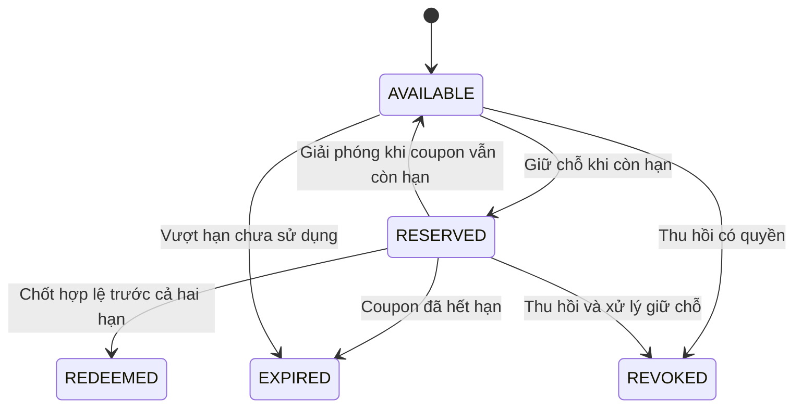

# Coupon expiration — Bảo vệ thời hạn sử dụng mã ưu đãi

## 1. Hết hạn là một quy tắc nghiệp vụ phải được cưỡng chế

Một mã ưu đãi được công bố “dùng đến hết ngày 22/11” nhưng vẫn áp dụng được sau thời điểm kết thúc là một lỗi logic nghiệp vụ. Yêu cầu có thể đúng định dạng, tài khoản có thể đăng nhập hợp lệ và mã có thể tồn tại trong cơ sở dữ liệu; những điều đó không chứng minh quyền sử dụng mã vẫn còn hiệu lực.

**Coupon expiration** là việc xác định và thực thi giới hạn thời gian của quyền sử dụng mã. Giới hạn này phải được giữ đúng khi khách thêm mã vào giỏ, xác nhận đơn, gửi lại yêu cầu, thanh toán, hủy đơn hoặc nhận lại mã sau hoàn trả.

Trong chương **Coupons** của module bảo mật logic nghiệp vụ, mục tiêu không chỉ là lưu một trường `expires_at`. Cần biến thời hạn thành bất biến phía máy chủ, gắn với quyền theo đối tượng, state machine, transaction và idempotency để ngăn giữ báo giá cũ, dùng thời gian tự khai hoặc tận dụng yêu cầu đồng thời nhằm kéo dài quyền lợi.

Sau bài học, bạn có thể:

- Định nghĩa thời điểm bắt đầu, kết thúc và bước nghiệp vụ phải còn hạn.
- Biểu diễn thời gian đúng trong Java và dữ liệu lưu trữ.
- Kiểm tra hết hạn ở điểm quyết định, kể cả sau khi chờ khóa hoặc hàng đợi.
- Phân biệt hạn coupon, hạn giữ chỗ, hạn báo giá và thời gian lưu idempotency.
- Thiết kế kiểm thử tại biên thời gian mà không phụ thuộc việc chờ đồng hồ thật.

Các chính sách trong bài là ví dụ thiết kế. Sản phẩm cần công bố cách xử lý thực tế, nhất là đối với thanh toán sát hạn và các cam kết đã được giữ chỗ.

## 2. Định nghĩa hợp đồng thời gian trước khi viết điều kiện

### 2.1. Chọn khoảng hiệu lực nửa mở

Một biểu diễn dễ kiểm tra là:

```text
not_before <= decision_at < expires_at
```

Khoảng `[not_before, expires_at)` bao gồm thời điểm bắt đầu và không bao gồm thời điểm kết thúc. Tại đúng `expires_at`, một lần sử dụng mới đã hết hạn.

Ví dụ `expires_at = 2026-11-22T17:00:00Z`:

| Thời điểm quyết định | Kết quả kiểm tra hạn |
| --- | --- |
| Trước `not_before` | Chưa có hiệu lực |
| Đúng `not_before` | Đã vào khoảng hiệu lực |
| `2026-11-22T16:59:59.999Z` | Còn hạn nếu đã qua thời điểm bắt đầu |
| `2026-11-22T17:00:00Z` | Hết hạn |
| `2026-11-22T17:00:00.001Z` | Hết hạn |

Kết quả “còn hạn” chỉ là một điều kiện cần. Mã còn phải đúng chủ sở hữu, tenant, chiến dịch, giỏ hàng, trạng thái và giới hạn sử dụng.

Không dùng các điều kiện khác nhau ở từng dịch vụ, chẳng hạn API áp mã dùng `now <= expires_at` nhưng API xác nhận dùng `now < expires_at`. Sai khác tại biên có thể tạo kết quả không nhất quán và khó tái hiện.

### 2.2. “Hết ngày” phải có ngày và múi giờ cụ thể

Nếu mã dùng đến hết ngày **22/11/2026 theo `Asia/Ho_Chi_Minh`**, thời điểm kết thúc loại trừ là:

```text
2026-11-23T00:00:00+07:00
= 2026-11-22T17:00:00Z
```

Không lưu “23:59:59” như thời điểm cuối cùng còn hiệu lực. Cách này bỏ sót phần giây lẻ hoặc phụ thuộc độ chính xác của từng tầng. Hãy lấy đầu ngày kế tiếp làm ranh giới loại trừ.

Đồng thời, không diễn giải ngày theo múi giờ mặc định của máy chủ hoặc thiết bị khách. Một tiến trình chạy ở UTC và một tiến trình chạy ở Việt Nam phải đi đến cùng thời điểm kết thúc.

### 2.3. Phân biệt các loại hạn

| Loại hạn | Ý nghĩa | Không được suy ra rằng |
| --- | --- | --- |
| Hạn chiến dịch | Khoảng hoạt động của chương trình | Mọi coupon cá nhân đều còn hạn đến cuối chiến dịch |
| Hạn coupon cá nhân | Quyền sử dụng một mã hoặc một lần cấp mã | Mã trong giỏ đã được tiêu thụ hoặc giữ ngân sách |
| Hạn báo giá | Thời gian kết quả định giá được phép dùng | Báo giá được phép vượt hạn coupon |
| Hạn giữ chỗ | Thời gian giữ một lượt hoặc phần ngân sách | Có thể giữ vô hạn bằng cách gửi lại cùng yêu cầu |
| Hạn thanh toán | Thời gian của một phiên hoặc lệnh thanh toán | Kết quả thanh toán muộn tự làm coupon có hiệu lực lại |
| Thời gian lưu idempotency | Khoảng máy chủ lưu kết quả thao tác để xử lý retry | Đây là thời hạn sử dụng mới của mã |

Nếu có nhiều giới hạn đồng thời, cần xác định giới hạn nào là ràng buộc cứng. Ví dụ, hợp đồng có thể quy định một coupon cá nhân hết hạn sau 48 giờ kể từ khi cấp nhưng không được vượt thời điểm kết thúc chiến dịch.

### 2.4. Chọn rõ bước phải còn hạn

Có ít nhất hai mô hình hợp lệ nếu được thiết kế và công bố rõ:

| Mô hình | Điều kiện thời gian |
| --- | --- |
| Kiểm tra lại lúc chốt sử dụng | Áp mã vào giỏ chỉ là dự kiến; khi chốt quyền dùng mã phải còn hạn |
| Tôn trọng giữ chỗ đã được chấp nhận | Giữ chỗ hợp lệ trước hạn tạo quyền hoàn tất đến hạn giữ chỗ riêng, có thể sau hạn coupon |

Bài dùng mô hình thứ nhất làm mặc định: **giữ chỗ không tự gia hạn coupon**. Hạn giữ chỗ được chặn bởi hạn coupon, và bước chốt kiểm tra lại cả hai. Phần về thanh toán sẽ phân tích hệ quả và mô hình thay thế.

Trong mô hình mặc định, `decision_at` là thời gian có thẩm quyền được lấy trong đoạn xử lý đã bảo vệ dữ liệu, sau khi giành được các khóa cần thiết và ngay trước khi ghi quyết định sử dụng. Đây không phải thời điểm khách bấm nút, thời điểm request tới gateway hoặc thời điểm bắt đầu transaction.

Hợp đồng này kiểm tra tại điểm quyết định đã định nghĩa. Transaction có thể commit sau mốc đó; nó không cam kết rằng mọi thao tác vật lý, commit và thanh toán đều kết thúc trước hạn. Nếu sản phẩm yêu cầu một mốc khác, cần mô hình hóa và cưỡng chế mốc đó riêng.

## 3. Các bất biến thời gian cần bảo vệ

### 3.1. Khoảng hiệu lực phải hợp lệ và có nguồn gốc

Đối với coupon có thời hạn:

```text
not_before < expires_at
issued_at và expires_at được xác định từ nguồn máy chủ
Một lần sử dụng mới chỉ hợp lệ nếu:
    not_before <= decision_at < expires_at
```

Nếu mã có TTL tính từ lúc cấp và giới hạn của chiến dịch:

```text
not_before = max(issued_at, campaign_starts_at)
expires_at = min(issued_at + ttl, campaign_expires_at)
```

TTL trong ví dụ bắt đầu từ lúc cấp, không phải lúc khách mở trang hoặc lần đầu áp mã. Nếu chính sách tính từ lúc kích hoạt, sự kiện kích hoạt phải là một bước nghiệp vụ có quyền, xảy ra một lần và được lưu bền vững.

Nếu công thức tạo khoảng rỗng, phải từ chối cấp một mã có thể sử dụng hoặc thể hiện rõ rằng mã không khả dụng; không tự đổi ngày để tạo hiệu lực. `null`, lỗi parse hoặc giá trị ngoài miền dữ liệu không được tự hiểu là “không hết hạn”. Chế độ không hết hạn, nếu tồn tại, cần kiểu chính sách rõ ràng và quyền cấu hình riêng.

### 3.2. Hạn không được kéo dài bởi truy cập hoặc retry

Các thao tác sau không được thay đổi `issued_at` hoặc `expires_at` ngoài chính sách:

- Tải lại trang danh sách coupon.
- Thêm mã vào một giỏ khác.
- Áp lại cùng mã sau khi báo giá hết hạn.
- Gửi lại cùng yêu cầu với khóa idempotency mới.
- Đồng bộ lại bản ghi từ cache hoặc xử lý lại sự kiện cấp mã.

Một TTL trượt kiểu `expires_at = now + 48 giờ` ở mỗi lần đọc cho phép khách giữ mã còn hạn vô thời hạn. Cần lưu thời điểm cấp gốc và hạn đã được xác lập, không tính lại từ thời gian truy cập hiện tại.

### 3.3. Hết hạn không thay thế trạng thái và quyền

```text
Có thể bắt đầu sử dụng =
    Có quyền đối với coupon và đơn
    AND coupon ở trạng thái cho phép
    AND chiến dịch và điều kiện còn hợp lệ
    AND not_before <= decision_at < expires_at
    AND hạn mức và ngân sách đủ
```

Một mã đã sử dụng hoặc bị thu hồi không được hoạt động lại chỉ vì cấu hình hạn được kéo dài. Khi đồng hồ quay lùi, một trạng thái hết hạn đã được chốt cũng không được tự trở về khả dụng. Mở lại mã hoặc cấp mã thay thế là thao tác nghiệp vụ riêng có lịch sử và kiểm tra quyền.

## 4. Biểu diễn thời gian và múi giờ trong Java

### 4.1. Lưu thời điểm tuyệt đối, giữ ngữ cảnh hiển thị

`Instant` biểu diễn một điểm trên trục thời gian, thích hợp cho so sánh hiệu lực giữa các máy. Ngày mà người dùng đọc được cần múi giờ kinh doanh để chuyển thành thời điểm tuyệt đối. Cách biểu diễn này dựa trên ý nghĩa của [Instant trong Java SE 21](https://docs.oracle.com/en/java/javase/21/docs/api/java.base/java/time/Instant.html).

Ví dụ chuyển điều kiện “dùng hết ngày 22/11/2026 ở Việt Nam”:

```java
import java.time.Instant;
import java.time.LocalDate;
import java.time.ZoneId;

ZoneId businessZone = ZoneId.of("Asia/Ho_Chi_Minh");
LocalDate lastUsableDate = LocalDate.of(2026, 11, 22);

Instant expiresAt = lastUsableDate.plusDays(1)
        .atStartOfDay(businessZone)
        .toInstant();

System.out.println(expiresAt); // 2026-11-22T17:00:00Z
```

`LocalDate` không mang giờ hoặc múi giờ; `atStartOfDay(zone)` dùng quy tắc của vùng để tìm thời điểm đầu ngày hợp lệ theo [tài liệu LocalDate](https://docs.oracle.com/en/java/javase/21/docs/api/java.base/java/time/LocalDate.html). Với thị trường có chuyển giờ mùa hè, một ngày lịch không luôn tương đương 24 giờ thực trôi qua.

Do đó, “48 giờ kể từ lúc cấp” và “đến hết hai ngày lịch tiếp theo” là hai hợp đồng khác nhau. Dùng `Duration` cho khoảng thời gian thực trôi qua; dùng phép toán ngày và vùng thời gian cho điều kiện theo lịch. Nếu nhận một giờ địa phương rơi vào khoảng bị thiếu hoặc lặp do chuyển múi giờ, cần chính sách giải quyết rõ ràng và lưu kết quả đã xác định.

Ở tầng lưu trữ, chọn kiểu biểu diễn được thời điểm tuyệt đối, chẳng hạn `timestamp with time zone` trong PostgreSQL. Khi cần tái hiện điều kiện theo lịch, lưu thêm vùng kinh doanh và phiên bản chính sách; kiểu thời điểm không thay thế ngữ cảnh đó.

### 4.2. Thống nhất độ chính xác

Java có thể biểu diễn phần giây chi tiết hơn một số cột dữ liệu hoặc giao thức. Cần xác định độ chính xác được hỗ trợ, chuẩn hóa khi phát hành và lưu hạn, rồi giữ nhất quán khi so sánh.

Không làm tròn tăng `expires_at` mỗi lần tuần tự hóa, không chuyển epoch mili giây thành epoch giây bằng phép đoán định dạng, và không so sánh thời gian bằng chuỗi hiển thị. Kiểm thử cả đường đi qua API, driver và cơ sở dữ liệu tại sát ranh giới đã lưu.

## 5. Bộ kiểm tra thời gian có thể kiểm thử được

Thay vì gọi đồng hồ tĩnh ở nhiều chỗ, hãy truyền thời gian quyết định vào hàm nghiệp vụ. Khi cần lấy thời gian ở tầng ứng dụng, có thể tiêm `Clock`; `Clock.fixed` cho phép kiểm thử bằng thời gian xác định theo [tài liệu Clock của Java SE 21](https://docs.oracle.com/en/java/javase/21/docs/api/java.base/java/time/Clock.html).

Ví dụ dưới dùng Java 17 trở lên. Nó chỉ kiểm tra cửa sổ thời gian; quyền, trạng thái, hạn mức và thao tác ghi cần tầng nghiệp vụ xử lý riêng.

```java
import java.time.Clock;
import java.time.Duration;
import java.time.Instant;
import java.time.ZoneOffset;
import java.util.List;
import java.util.Objects;

public final class CouponTimePolicy {
    private CouponTimePolicy() {}

    public enum TimeStatus {
        NOT_STARTED, ACTIVE, EXPIRED
    }

    public record Window(Instant notBefore, Instant expiresAt) {
        public Window {
            Objects.requireNonNull(notBefore, "notBefore");
            Objects.requireNonNull(expiresAt, "expiresAt");
            if (!notBefore.isBefore(expiresAt)) {
                throw new IllegalArgumentException("empty validity window");
            }
        }
    }

    public static Window issuedWindow(
            Instant issuedAt,
            Instant campaignStartsAt,
            Instant campaignExpiresAt,
            Duration ttl) {

        Objects.requireNonNull(issuedAt, "issuedAt");
        Objects.requireNonNull(campaignStartsAt, "campaignStartsAt");
        Objects.requireNonNull(campaignExpiresAt, "campaignExpiresAt");
        Objects.requireNonNull(ttl, "ttl");

        if (ttl.isZero() || ttl.isNegative()) {
            throw new IllegalArgumentException("ttl must be positive");
        }
        if (!campaignStartsAt.isBefore(campaignExpiresAt)) {
            throw new IllegalArgumentException("invalid campaign window");
        }

        Instant start = issuedAt.isAfter(campaignStartsAt)
                ? issuedAt : campaignStartsAt;
        Instant personalExpiry = issuedAt.plus(ttl);
        Instant end = personalExpiry.isBefore(campaignExpiresAt)
                ? personalExpiry : campaignExpiresAt;

        return new Window(start, end);
    }

    public static TimeStatus evaluateAt(Window window, Instant decisionAt) {
        Objects.requireNonNull(window, "window");
        Objects.requireNonNull(decisionAt, "decisionAt");

        if (decisionAt.isBefore(window.notBefore())) {
            return TimeStatus.NOT_STARTED;
        }
        if (!decisionAt.isBefore(window.expiresAt())) {
            return TimeStatus.EXPIRED;
        }
        return TimeStatus.ACTIVE;
    }

    public static TimeStatus evaluateWithClock(Window window, Clock clock) {
        Objects.requireNonNull(clock, "clock");
        Instant decisionAt = clock.instant();
        return evaluateAt(window, decisionAt);
    }

    public static void main(String[] args) {
        Instant end = Instant.parse("2026-11-22T17:00:00Z");
        Window window = new Window(end.minus(Duration.ofDays(1)), end);

        for (Instant time : List.of(
                end.minusMillis(1), end, end.plusMillis(1))) {
            Clock fixedClock = Clock.fixed(time, ZoneOffset.UTC);
            System.out.println(evaluateWithClock(window, fixedClock));
        }
        // ACTIVE
        // EXPIRED
        // EXPIRED
    }
}
```

Điểm cần chú ý:

- `!decisionAt.isBefore(expiresAt)` bao gồm cả trường hợp bằng hạn. Nếu chỉ kiểm tra `decisionAt.isAfter(expiresAt)`, đúng thời điểm hết hạn sẽ bị lọt.
- Một lần đánh giá dùng một `decisionAt`. Gọi đồng hồ nhiều lần trong cùng phép kiểm tra có thể cắt qua ranh giới và tạo kết quả khó giải thích.
- `issuedWindow` không thay `issuedAt` bằng thời điểm gọi hàm. Nó cần được dùng khi cấp mã hoặc tái hiện theo dữ liệu gốc, không để phát lại sự kiện làm trượt hạn.
- Khoảng rỗng sau khi chặn theo hạn chiến dịch bị từ chối. TTL quá lớn gây vượt miền thời gian cũng phải được coi là cấu hình không hợp lệ, không bỏ qua ngoại lệ để cho phép dùng mã.
- `ACTIVE` ở đây chỉ nói về thời gian. Không lưu kết quả này rồi coi mã luôn khả dụng cho các bước sau.

Trong mô hình lấy thời gian quyết định từ database, truyền `decisionAt` do database trả về vào bộ kiểm tra. Một `Clock.systemUTC()` ở ứng dụng giúp có thời điểm tuyệt đối nhưng không tự bảo đảm đồng bộ với các node khác hoặc bảo vệ tranh chấp dữ liệu.

## 6. Kiểm tra tại máy chủ và tại bước tạo tác động

### 6.1. Không nhận thời gian có thẩm quyền từ client

Một yêu cầu áp mã có thể chỉ chứa mã, đơn và phiên bản dự kiến:

```http
POST /orders/order-demo-42/coupon
Idempotency-Key: apply-demo-42
Content-Type: application/json

{
  "couponCode": "WELCOME-DEMO",
  "expectedOrderVersion": 8
}
```

Các trường như `clientNow`, `expiresAt`, `issuedAt`, `isExpired`, `approved` hoặc `ignoreExpiration` không được quyết định hiệu lực. Khách có thể sửa đồng hồ thiết bị, header, cookie hoặc payload. Cần từ chối hoặc bỏ qua trường ngoài hợp đồng mà không ánh xạ chúng vào bản ghi có thẩm quyền.

Trước khi kiểm tra hạn và ghi tác động, máy chủ xác minh:

1. Danh tính, tenant và quyền của khách đối với coupon và đơn.
2. Coupon đúng đối tượng nhận, chưa sử dụng và không bị thu hồi.
3. Phiên bản đơn cho phép thay đổi; giá và sản phẩm được lấy từ nguồn máy chủ.
4. Phiên bản chính sách, điều kiện và hạn thực tế từ nguồn có thẩm quyền.
5. Thời gian tại điểm quyết định, không phải thời gian tự khai.
6. Việc chốt coupon, hạn mức, ngân sách và đơn thống nhất trong cơ chế giao dịch phù hợp.

API “kiểm tra coupon” có thể hỗ trợ trải nghiệm, nhưng câu trả lời thành công của nó không thay thế kiểm tra tại thao tác sử dụng. Nguyên tắc có cổng kiểm soát gắn với thực thi giao dịch được trình bày trong [OWASP Transaction Authorization Cheat Sheet](https://cheatsheetseries.owasp.org/cheatsheets/Transaction_Authorization_Cheat_Sheet.html); ở đây áp dụng ý tưởng đó để ngăn dùng kết quả kiểm tra hạn đã cũ.

### 6.2. Tránh khoảng hở giữa kiểm tra và ghi

Một luồng không an toàn:

```text
16:59:59.900  Đọc coupon: còn hạn
16:59:59.950  Chờ khóa đơn hoặc bộ đếm ngân sách
17:00:01.000  Giành được khóa
17:00:01.010  Dùng kết quả kiểm tra cũ để ghi sử dụng
```

Nếu hợp đồng kiểm tra tại điểm quyết định sau khi lấy khóa, yêu cầu này phải bị từ chối. Việc request đã tới máy chủ trước hạn không đủ điều kiện.

Luồng tham khảo với một database giao dịch:

```text
BEGIN
  Xác minh quyền và chiếm khóa idempotency.
  Nếu cùng thao tác đã hoàn tất: trả kết quả cũ theo quyền truy cập.
  Khóa coupon, đơn và các bản ghi liên quan theo thứ tự thống nhất.
  Đọc/khóa phiên bản chính sách hoặc kiểm tra cơ chế phiên bản tương ứng.
  Dựng lại điều kiện và số tiền, kiểm tra trạng thái và hạn mức.
  Lấy decision_at từ nguồn thời gian có thẩm quyền sau các bước chờ khóa.
  Kiểm tra not_before <= decision_at < expires_at.
  Chuyển trạng thái coupon và ghi quyết định với decision_at.
  Ghi đơn, hạn mức, sổ ưu đãi, kết quả idempotency và outbox liên quan.
COMMIT
```

Nếu bước lấy thêm khóa hoặc gọi dịch vụ ngoài kéo dài xảy ra sau khi đã lấy `decision_at`, cần bố trí lại điểm quyết định theo hợp đồng. Không giữ thời gian cũ xuyên qua một khoảng chờ không được kiểm soát rồi gọi đó là “thời gian hiện tại”. Đoạn ghi sau điểm quyết định nên ngắn; tác vụ thanh toán ngoài hệ thống không nằm trong transaction khóa kéo dài này.

### 6.3. Cẩn thận với ý nghĩa của `now()` trong database

Trong PostgreSQL, `CURRENT_TIMESTAMP` và `now()` phản ánh thời điểm bắt đầu transaction; `statement_timestamp()` phản ánh thời điểm bắt đầu statement; `clock_timestamp()` trả thời gian thực tại lúc gọi. Sự khác biệt này được mô tả trong [tài liệu PostgreSQL 18 về thời gian hiện tại](https://www.postgresql.org/docs/18/functions-datetime.html#FUNCTIONS-DATETIME-CURRENT).

Vì vậy, transaction bắt đầu trước hạn rồi chờ khóa qua hạn có thể vẫn thấy `now()` ở trước hạn. Nếu hợp đồng yêu cầu thời gian sau khi đã giành khóa, cần lấy thời gian phù hợp ở đúng vị trí đó, chẳng hạn:

```sql
-- Chạy sau khi đã giành các khóa cần thiết trong cùng transaction.
SELECT clock_timestamp() AS decision_at;
```

Ứng dụng nhận giá trị này rồi bind vào lệnh ghi, không lấy tham số tương ứng từ client. Ví dụ đơn giản hóa cho coupon cá nhân dùng trực tiếp từ trạng thái `AVAILABLE`:

```sql
UPDATE coupon_instance
SET state = 'REDEEMED',
    redeemed_at = :decision_at,
    redeemed_order_id = :order_id,
    version = version + 1
WHERE coupon_instance_id = :coupon_id
  AND tenant_id = :tenant_id
  AND owner_customer_id = :customer_id
  AND version = :expected_coupon_version
  AND state = 'AVAILABLE'
  AND not_before <= :decision_at
  AND :decision_at < expires_at
RETURNING coupon_instance_id, redeemed_at, version;
```

Chỉ khi đúng một dòng được chuyển trạng thái mới được tiếp tục ghi tác động tương ứng. Không có dòng trả về thì rollback phần thay đổi của thao tác; phân loại nguyên nhân từ dữ liệu được phép xem. Lệnh trên chỉ minh họa điều kiện cuối, không phải toàn bộ luồng redeem: quyền với đơn, chiến dịch, ngân sách, khóa, số tiền và chống dùng trùng vẫn phải được bảo vệ.

Đối với coupon đã giữ chỗ, điều kiện phải là `RESERVED` với đúng `reservation_id`, đơn, khách và hạn giữ chỗ; không bỏ kiểm tra liên kết chỉ để dùng chung lệnh mẫu. Mã công khai dùng nhiều lượt cần bản ghi từng lần sử dụng và bộ đếm riêng, không chuyển cả mã công khai sang `REDEEMED` sau khách đầu tiên.

## 7. Giữ chỗ và state machine quanh thời điểm hết hạn

### 7.1. Hạn giữ chỗ không được trượt vô hạn

Theo mô hình mặc định của bài:

```text
reservation_expires_at = min(
    reservation_created_at + reservation_ttl,
    coupon.expires_at
)

Chốt một giữ chỗ cần:
    coupon.not_before <= decision_at < coupon.expires_at
    AND decision_at < reservation_expires_at
    AND giữ chỗ đang hoạt động, đúng coupon, đơn và khách
```

Ví dụ coupon hết hạn lúc 17:00, khách giữ chỗ lúc 16:58 với TTL dự kiến 5 phút. Hạn giữ chỗ thực tế là 17:00, không phải 17:03. Nếu giữ chỗ được tạo lúc 16:50 với TTL 5 phút, nó kết thúc lúc 16:55 dù coupon vẫn còn hạn đến 17:00.

Gửi lại thao tác tạo giữ chỗ chỉ trả bản ghi cũ; không đổi `reservation_created_at`. Nếu sản phẩm cho phép gia hạn giữ chỗ, phải có giới hạn tổng, kiểm tra lại điều kiện và không vượt hạn coupon trong mô hình này. Không để heartbeat của giao diện tự kéo dài quyền lợi.

### 7.2. Mô hình trạng thái tham khảo

Với một coupon cá nhân dùng một lần, có thể mô hình hóa:



Sơ đồ lược bỏ các trạng thái chưa bắt đầu và các bước vận hành riêng của hệ thống. `AVAILABLE` không tự chứng minh thời gian hợp lệ: một bản ghi chưa được tác vụ nền cập nhật vẫn phải bị từ chối nếu `decision_at >= expires_at`.

Một coupon đã `REDEEMED` là lịch sử sử dụng, không phải mã khả dụng cần chuyển thành `EXPIRED` khi đồng hồ qua hạn. Nếu có hoàn hoặc hủy, ghi quan hệ với giao dịch gốc và xử lý theo chính sách khôi phục; không chạy lệnh hàng loạt làm mất trạng thái đã dùng.

Tác vụ hết hạn, thao tác chốt, giải phóng và thu hồi phải tranh chấp cùng bản ghi hoặc phiên bản một cách an toàn. Chỉ một chuyển trạng thái tương ứng được thắng. Không để một tác vụ giải phóng sau đó ghi đè `REDEEMED` thành `AVAILABLE`.

### 7.3. Trạng thái hết hạn lưu sẵn là dữ liệu hỗ trợ

Một job có thể cập nhật các mã chưa sử dụng đã qua hạn để hỗ trợ tìm kiếm, thông báo hoặc thu dọn giữ chỗ. API sử dụng mã vẫn phải so sánh thời gian trực tiếp với hạn đã lưu.

Nếu chỉ kiểm tra `state != EXPIRED`, việc job chạy chậm, mất kết nối hoặc bị dừng sẽ mở cửa cho mã quá hạn. Ngược lại, xóa dữ liệu hết hạn ngay lập tức có thể làm mất bằng chứng cần cho retry, hoàn trả và điều tra.

Tách rõ:

- **Hết quyền sử dụng:** do chính sách thời gian và trạng thái quyết định.
- **Cập nhật trạng thái dẫn xuất:** giúp vận hành và truy vấn.
- **Xóa hoặc lưu trữ dữ liệu:** theo thời gian lưu lịch sử của hệ thống.

## 8. Thanh toán và retry sau khi coupon hết hạn

### 8.1. Đã chốt trước hạn khác với đang chờ chốt

Trong một cách triển khai của mô hình mặc định, hệ thống chốt sử dụng coupon khi khách xác nhận đơn và khóa giá, trước khi mở phiên thanh toán. Coupon phải còn hạn tại điểm quyết định đó. Sau khi transaction hoàn tất, đơn lưu phiên bản giá đã khóa và tham chiếu coupon đã sử dụng.

Nếu khách thanh toán đơn này sau hạn coupon nhưng trong hạn thanh toán riêng, đây có thể là hoàn tất một giao dịch đã chốt quyền lợi hợp lệ, không phải một lần sử dụng coupon mới. Máy chủ đối chiếu đúng đơn, phiên bản giá và trạng thái thanh toán; không tạo một lần redeem khác.

Nếu khách mới chỉ thêm mã hoặc giữ chỗ trước hạn, rồi đến sau hạn mới xác nhận đơn, không có kết quả chốt cũ để tôn trọng. Phải từ chối ưu đãi hoặc báo giá lại theo chính sách. Khi tiền phải trả thay đổi, yêu cầu khách xác nhận giá mới trước khi tiếp tục thanh toán; không sửa ngầm số tiền của một lệnh đã được xác nhận.

Một hệ thống khác có thể chọn chốt coupon khi thanh toán thành công. Khi đó cần định nghĩa rõ “thành công trước hạn” là thời điểm xác nhận nội bộ hay thời điểm sự kiện thanh toán có thẩm quyền. Không lấy `paidAt` do client gửi làm bằng chứng và không dùng thời điểm webhook đến thay cho thời điểm nghiệp vụ nếu hợp đồng quy định khác.

### 8.2. Nếu muốn tôn trọng giữ chỗ vượt hạn

Mô hình thay thế có thể cho phép giữ chỗ được chấp nhận lúc 16:59 hoàn tất đến 17:04 dù coupon kết thúc lúc 17:00. Để đây là quyền lợi được kiểm soát, cần:

- Ghi thời điểm chấp nhận, hạn hoàn tất riêng và phiên bản chính sách ngay khi giữ chỗ thành công.
- Giữ lượt và ngân sách tương ứng; gắn quyền hoàn tất với một đơn, khách và phiên bản giá.
- Không cho chuyển giữ chỗ sang giỏ khác hoặc tạo giữ chỗ mới sau hạn coupon.
- Không tự gia hạn khi retry, thay thiết bị hoặc gọi lại API.
- Phân biệt quyền hoàn tất giữ chỗ cũ với quyền dùng coupon mới.
- Xử lý hết hạn, hủy và kết quả thanh toán đến muộn bằng các chuyển trạng thái an toàn.

Đây là chính sách khác với việc chặn hạn giữ chỗ bằng hạn coupon. Không lấy công thức của một mô hình rồi áp thêm ngoại lệ ngầm của mô hình kia.

### 8.3. Retry thành công cũ không làm mã sống lại

Giả sử một thao tác đã chốt coupon hợp lệ lúc 16:59:59 nhưng phản hồi HTTP bị mất. Khách gửi lại cùng khóa sau 17:00. Nếu máy chủ tìm thấy đúng kết quả đã commit của cùng thao tác, nó có thể trả lại kết quả đó sau khi kiểm tra quyền truy cập.

Điều này không cấp ưu đãi lần nữa. Kết quả trả lại cần tham chiếu cùng đơn và cùng bản ghi sử dụng.

| Tình huống sau hạn | Cách xử lý |
| --- | --- |
| Cùng khóa và cùng nội dung, kết quả đã commit trước hạn | Trả kết quả cũ, không ghi lại tác động |
| Cùng khóa nhưng nội dung khác | Lỗi xung đột, không coi là retry hợp lệ |
| Cùng khóa nhưng thao tác trước đã rollback, chưa có kết quả chốt | Nếu thực thi mới thì phải kiểm tra thời gian mới và từ chối khi quá hạn |
| Khóa mới, muốn dùng mã lần đầu | Kiểm tra hạn hiện tại; không dùng thời gian request cũ |
| Khóa mới, coupon đã dùng trên đơn khác | Từ chối theo trạng thái và ràng buộc nghiệp vụ |
| Không rõ transaction trước đã commit chưa | Tra cứu kết quả bền vững; không đoán và cấp lại |

Thời gian lưu idempotency không thay thế ràng buộc coupon dùng một lần. Khi khóa được dọn khỏi kho, trạng thái và khóa nghiệp vụ vẫn phải ngăn chốt lại cùng quyền lợi.

### 8.4. Timeout thanh toán không chứng minh giao dịch thất bại

Nếu đã gửi lệnh thanh toán và chưa biết kết quả, việc coupon hoặc phiên thanh toán qua hạn không tự chứng minh có thể an toàn khôi phục mã và giải phóng mọi cam kết.

Cần xác minh hoặc xử lý trạng thái chưa rõ theo giao thức với hệ thống thanh toán. Webhook thành công đến muộn phải đối chiếu giao dịch, số tiền, đơn, phiên bản giá và trạng thái hiện tại. Không cho webhook tự gắn một coupon đã hết hạn vào đơn khác hoặc vượt qua quy tắc chốt.

Nếu giao dịch không thể được hoàn tất theo cam kết còn hiệu lực, dùng luồng nghiệp vụ đã thiết kế như xác minh lại, hủy hoặc hoàn giao dịch. Các hành động này cần có quyền, idempotency và lịch sử, thay vì thay `expires_at` để hợp thức hóa kết quả.

## 9. Cache, hàng đợi và nguồn thời gian phân tán

### 9.1. Cache chỉ giúp đọc nhanh

Danh sách mã trong cache có thể hiển thị một coupon còn hạn, nhưng thao tác sử dụng phải kiểm tra lại hạn và trạng thái tại nguồn có thẩm quyền. Cache còn giữ khóa hoặc key có TTL chưa hết không chứng minh quyền sử dụng còn tồn tại.

Nếu cache dữ liệu coupon, có thể giới hạn TTL theo phần thời gian còn lại và yêu cầu độ tươi. Tuy nhiên, thu hồi sớm, rút hạn hoặc thay chính sách vẫn cần cơ chế phiên bản hoặc vô hiệu hóa phù hợp. Một bản cache được làm mới không được đổi hạn gốc.

Báo giá hoặc token có chữ ký bảo vệ tính toàn vẹn của dữ liệu được ký, nhưng vẫn phải kiểm tra hạn, đối tượng, trạng thái và việc đã dùng. Chữ ký không làm báo giá hết hạn trở nên hợp lệ và không cấp quyền thay đổi một coupon đã bị thu hồi.

### 9.2. Thời điểm vào hàng đợi không mặc nhiên là thời điểm dùng mã

Nếu một lệnh vào queue trước hạn nhưng worker xử lý sau hạn, mô hình kiểm tra tại điểm quyết định sẽ từ chối. Không tin trường `requestedAt` do producer không có thẩm quyền gửi để backdate thao tác.

Nếu sản phẩm cam kết giữ quyền từ lúc tiếp nhận, bước tiếp nhận phải tạo một bản ghi chấp nhận bền vững, có kiểm tra điều kiện, chống trùng và giữ nguồn lực cần thiết. Dấu thời gian gắn lên một message đơn thuần không thay thế được giao thức đó.

### 9.3. Đồng hồ lệch và quay lùi

Chọn nguồn thời gian có thẩm quyền cho thao tác chốt, đồng bộ và giám sát sức khỏe đồng hồ. Hai dịch vụ dùng hai đồng hồ lệch nhau có thể cho kết quả khác ở sát hạn. Một nguồn tập trung giúp giảm khác biệt, nhưng vẫn cần xử lý việc nguồn đó bị lệch hoặc không sẵn sàng.

Nếu không thể xác định thời gian đáng tin cậy trong giới hạn vận hành đã đặt, không mặc định cho qua kiểm tra hạn. Có thể trả lỗi tạm thời cho thao tác coupon; việc tiếp tục mua với giá khác phải đi qua xác nhận giá tương ứng.

Đồng hồ đo khoảng thời gian chạy trong một tiến trình, như `System.nanoTime()`, phù hợp đo timeout cục bộ nhưng không phải thời điểm UTC để lưu hoặc so sánh hạn giữa máy và qua khởi động lại. Thời gian tuyệt đối cũng không được mặc định là luôn tăng; lịch sử và trạng thái đã chốt giúp ngăn hồi sinh mã do đồng hồ quay lùi, còn tình trạng nguồn thời gian cần được giám sát riêng.

Không tự thêm “dung sai 30 giây” vào mọi lần kiểm tra để chữa lệch đồng hồ. Một khoảng gia hạn làm thay đổi quyền lợi nghiệp vụ; nếu có, nó phải được mô hình hóa, giới hạn và kiểm toán như chính sách, không chỉ là cấu hình kỹ thuật bị giấu.

## 10. Gia hạn, thu hồi và hoàn trả

### 10.1. Gia hạn là thao tác có quyền

Thay `expires_at` làm thay đổi quyền lợi có giá trị. Luồng quản trị cần kiểm tra quyền đối với tenant, chiến dịch và coupon cụ thể, đồng thời lưu hạn cũ, hạn mới, người thực hiện, lý do, thời điểm và phiên bản.

Cần quyết định rõ gia hạn chỉ áp dụng cho coupon chưa dùng hay có thể mở lại một mã đã hết hạn. Nếu có mở lại, đó là chuyển trạng thái được cho phép rõ ràng hoặc cấp một coupon thay thế, không phải hệ quả tự động của phép so sánh ngày.

Gia hạn không mặc nhiên mở lại coupon đã dùng hoặc bị thu hồi. Nó cũng không được vượt hạn chiến dịch nếu hợp đồng coi hạn chiến dịch là ràng buộc cứng, trừ khi chính sách chiến dịch được sửa bằng luồng có quyền tương ứng.

Khi thay hạn, cần xử lý cache, báo giá và giữ chỗ đang tồn tại theo phiên bản. Ví dụ, rút hạn không thể chỉ cập nhật một cột mà bỏ qua các quyền hoàn tất đã được chấp nhận theo mô hình giữ chỗ vượt hạn.

### 10.2. Hoàn tiền không đặt lại ngày phát hành

Nếu chính sách cho trả lại quyền sử dụng mã sau hủy đơn, giữ nguyên hạn gốc. Việc hủy sau hạn không được biến thành:

```text
issued_at = thời điểm hủy
expires_at = thời điểm hủy + TTL ban đầu
state = AVAILABLE
```

Cách xử lý đó tạo chuỗi đặt hàng rồi hủy để kéo dài mã. Một mã được khôi phục chỉ có thể dùng tiếp nếu chính sách cho phép, trạng thái được chuyển an toàn và cửa sổ hiệu lực vẫn còn.

Nếu doanh nghiệp muốn cấp bù, tạo quyền lợi thay thế có định danh, thời hạn, lý do và tham chiếu mã cũ. Chống cấp bù nhiều lần do webhook hoặc yêu cầu hỗ trợ bị gửi lại. Không sửa lịch sử dùng mã gốc để làm như giao dịch chưa từng xảy ra.

## 11. Kiểm thử biên thời gian và tình huống lạm dụng

### 11.1. Kiểm thử đơn vị bằng thời gian cố định

Với khoảng `[S, E)`, cần kiểm tra tối thiểu:

| Thời gian hoặc cấu hình | Kỳ vọng |
| --- | --- |
| `S - 1` đơn vị chính xác được hỗ trợ | Chưa có hiệu lực |
| `S` | Có hiệu lực về thời gian |
| `E - 1` đơn vị chính xác được hỗ trợ | Còn hạn |
| `E` | Hết hạn |
| `E + 1` đơn vị chính xác được hỗ trợ | Hết hạn |
| `S = E` hoặc `S > E` | Từ chối cấu hình khoảng hiệu lực |
| TTL bằng 0, âm hoặc vượt miền dữ liệu | Từ chối cấu hình hoặc phát hành |
| Hạn cá nhân sau hạn chiến dịch | Hạn hiệu lực bị chặn theo chính sách |
| Thời điểm cấp sau khi chiến dịch đã kết thúc | Không tạo coupon có thể sử dụng |
| Đổi múi giờ mặc định của tiến trình | Không đổi thời điểm hết hạn đã xác định |
| Serialize rồi đọc lại hạn | Không kéo dài hoặc rút ngắn ngoài hợp đồng độ chính xác |

Dùng `Clock.fixed` hoặc truyền `Instant` trực tiếp để kiểm tra đúng ranh giới. Không viết kiểm thử yêu cầu chờ đến nửa đêm hoặc sleep nhiều giây; chúng chậm, không ổn định và thường không kiểm tra được trường hợp bằng hạn.

Nếu sản phẩm hoạt động ở nhiều vùng, thêm ngày có chuyển giờ mùa hè, giờ địa phương thiếu/lặp và các ngày chuyển tháng, năm hoặc năm nhuận. Kỳ vọng phải theo hợp đồng thời gian lịch hoặc thời gian thực trôi qua đã chọn.

### 11.2. Kiểm thử tích hợp và tình huống tấn công logic

Chạy các ca sau trên môi trường kiểm thử với coupon, đơn và cổng thanh toán giả lập:

| Tình huống | Kết quả cần xác minh |
| --- | --- |
| Sửa đồng hồ thiết bị về trước hạn | Không thay đổi kết quả tại máy chủ |
| Gửi `clientNow`, `expiresAt` hoặc `ignoreExpiration` | Không ghi đè nguồn thời gian hoặc hạn có thẩm quyền |
| Dùng coupon của khách hoặc tenant khác | Bị từ chối theo quyền, kể cả khi mã còn hạn |
| Thêm mã trước hạn, xác nhận sau hạn | Bị từ chối trong mô hình kiểm tra lại khi chốt |
| Transaction bắt đầu trước hạn, chờ khóa qua hạn | Dùng thời gian sau bước chờ, không lọt do `now()` cũ |
| Hai yêu cầu sát hạn cùng dùng mã một lần | Tối đa một lần chốt; lần thắng phải thỏa hợp đồng thời gian |
| Dừng job cập nhật `EXPIRED` | Coupon quá hạn vẫn không dùng được |
| Cache còn trả mã đã quá hạn | API tạo tác động vẫn từ chối |
| Retry giữ chỗ nhiều lần | Hạn giữ chỗ không bị trượt và không vượt hạn cứng |
| Cùng thao tác đã thành công trước hạn, retry sau hạn | Trả kết quả cũ, không tạo tác động mới |
| Thao tác trước rollback, retry sau hạn | Kiểm tra như lần thực thi mới và từ chối |
| Gửi lệnh vào queue trước hạn, xử lý sau hạn | Theo đúng chính sách điểm quyết định hoặc quyền tiếp nhận đã lưu |
| Job hết hạn và thao tác redeem cùng chạy | Một chuyển trạng thái hợp lệ; không ghi đè lịch sử đã dùng |
| Hoàn/hủy sau hạn và webhook gửi lại | Không khởi động TTL mới hoặc cấp bù trùng |
| Gia hạn mã đã thu hồi hoặc đã dùng | Không tự hoạt động lại ngoài luồng có quyền |
| Rút hạn khi còn báo giá cũ | Không dùng phiên bản cũ trái chính sách đã xác định |
| Webhook thanh toán thành công đến muộn | Không tự tạo redeem mới hoặc gắn mã vào giao dịch khác |
| Nguồn thời gian lỗi hoặc lệch quá mức cho phép | Không bỏ qua kiểm tra hạn; kết quả lỗi có thể giải thích |

Ở ca chờ khóa qua hạn, có thể dùng một transaction kiểm thử giữ khóa, điều khiển nguồn thời gian kiểm thử rồi giải phóng khóa để yêu cầu còn lại tiếp tục. Xác minh cả `decision_at`, trạng thái coupon, bản ghi sử dụng, đơn và hạn mức. Không chỉ nhìn mã HTTP.

Bộ kiểm thử transaction cần xác minh rollback không để lại coupon đã dùng nhưng đơn chưa ghi, hoặc đơn đã hưởng giảm nhưng coupon vẫn khả dụng. Bộ kiểm thử idempotency cần xác minh kết quả cũ sau hạn vẫn tham chiếu cùng tác động gốc.

### 11.3. Thuộc tính có thể kiểm tra trên nhiều dữ liệu

```text
Với cửa sổ cố định và không có gia hạn:
    mọi decision_at >= expires_at đều không cho một lần sử dụng mới.

Tăng thời gian không được tự kéo dài expires_at.
Đổi múi giờ hiển thị không đổi kết quả so sánh Instant.
Retry không thay issued_at, expires_at hoặc tác động đã chốt.
Hạn giữ chỗ trong mô hình mặc định không vượt expires_at.
Coupon đã dùng hoặc thu hồi không tự trở về khả dụng.
```

Các thuộc tính về thời gian cố định cần tách khỏi kiểm thử gia hạn có quyền. Khi chính sách thực sự đổi, phải kiểm tra phiên bản và lịch sử thay đổi, không coi kết quả khác là lỗi ngẫu nhiên.

## 12. Dữ liệu kiểm toán và vận hành

Để giải thích vì sao khách bị từ chối sát hạn, nên lưu được:

| Nhóm | Dữ liệu gợi ý |
| --- | --- |
| Đối tượng | Coupon nội bộ, tenant, khách, đơn, chiến dịch |
| Hiệu lực | `issued_at`, `not_before`, `expires_at`, vùng kinh doanh và phiên bản chính sách |
| Quyết định | `decision_at`, nguồn thời gian, kết quả và mã lý do |
| Giao dịch | Trạng thái trước/sau, phiên bản, bản ghi sử dụng và giữ chỗ |
| Chống lặp | Định danh thao tác, phạm vi idempotency, tham chiếu kết quả gốc |
| Thay đổi | Người gia hạn/thu hồi, hạn cũ/mới, lý do và quyền được sử dụng |
| Thanh toán | Tham chiếu phiên và giao dịch cần đối chiếu, không chứa bí mật thanh toán |

Dùng các mã lý do như `NOT_STARTED`, `EXPIRED`, `RESERVATION_EXPIRED`, `ALREADY_REDEEMED`, `REVOKED`, `VERSION_CONFLICT` hoặc `TIME_SOURCE_UNAVAILABLE` để phân biệt sự cố. Chỉ trả thông tin phù hợp với quyền truy cập của người gọi; không để API kiểm tra mã làm lộ coupon riêng của người khác.

Không cần ghi nguyên văn mã coupon bí mật trong log. Định danh nội bộ hoặc cách biểu diễn đã bảo vệ vẫn có thể phục vụ đối chiếu nếu được thiết kế nhất quán.

Theo dõi số lần chốt có `decision_at >= expires_at` trái chính sách, giữ chỗ vượt hạn cứng, mã hồi sinh sau hoàn/hủy, thời gian chờ khóa, độ trễ worker và sai lệch nguồn đồng hồ. Tách các lần retry trả kết quả cũ khỏi số lần sử dụng mới để tránh báo động nhầm.

Việc xóa cache, chạy job hết hạn hoặc gửi thông báo cho khách không phải bằng chứng rằng luồng redeem đã cưỡng chế đúng thời gian. Đối soát cần dựa trên quyết định, tác động và phiên bản chính sách thực tế.

## 13. Checklist triển khai coupon expiration

- [ ] Hợp đồng xác định bước nghiệp vụ phải còn hạn và thời gian có thẩm quyền.
- [ ] Khoảng hiệu lực dùng ranh giới rõ ràng, thống nhất tại đúng thời điểm kết thúc.
- [ ] Ngày hết hạn theo lịch có múi giờ kinh doanh; thời điểm so sánh được lưu tuyệt đối.
- [ ] TTL gắn với sự kiện gốc, không trượt theo truy cập hoặc retry.
- [ ] Coupon, đơn, khách và tenant được kiểm tra quyền theo đối tượng.
- [ ] Kiểm tra thời gian nằm ở điểm quyết định được bảo vệ, sau các bước chờ cần thiết.
- [ ] Hạn báo giá, giữ chỗ, thanh toán và idempotency được phân biệt rõ.
- [ ] Retry kết quả cũ không tạo lần dùng mới; khóa mới không vượt ràng buộc nghiệp vụ.
- [ ] Cache và job nền không phải lớp cưỡng chế hết hạn duy nhất.
- [ ] Gia hạn, thu hồi, hoàn và cấp bù có quyền, phiên bản và lịch sử.
- [ ] Có kiểm thử tại biên, chờ khóa qua hạn, xử lý muộn và tranh chấp trạng thái.
- [ ] Có bằng chứng đủ giải thích quyết định và giám sát nguồn thời gian.

Một coupon hết quyền sử dụng vì hợp đồng nghiệp vụ đã đến ranh giới hiệu lực, không phải vì giao diện đã ẩn mã hoặc một tác vụ nền đã kịp chạy. Việc kiểm tra tại đúng điểm tạo quyền lợi, cùng trạng thái và transaction phù hợp, giúp giữ cam kết này trên mọi đường đi của giao dịch.
