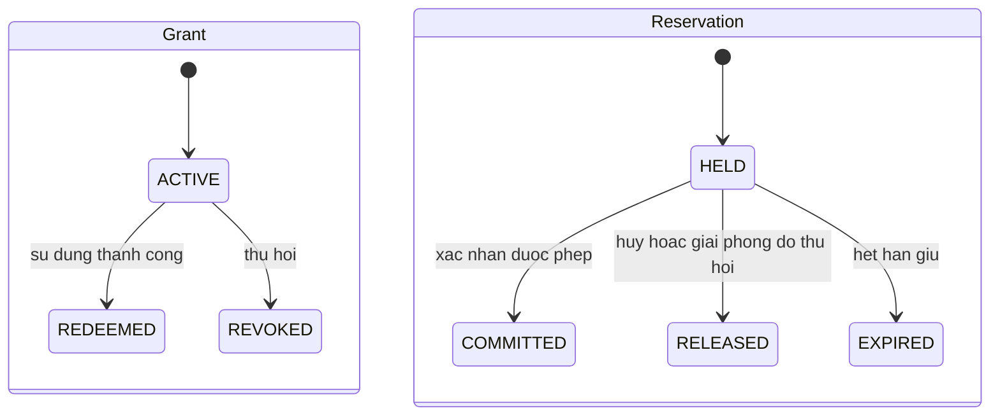

# Thu hồi coupon (Coupon revocation)

Thu hồi coupon là hành động làm mất quyền sử dụng một coupon hoặc một nhóm coupon theo chính sách đã xác định. Hành động này có thể cần khi phát hành sai đối tượng, lộ mã cá nhân, phát hiện điều kiện nghiệp vụ bị cấu hình sai hoặc phải dừng một chiến dịch.

Trong bảo mật logic nghiệp vụ, thu hồi không chỉ là đổi một cờ trên màn hình quản trị. Hệ thống phải bảo đảm mọi đường xác nhận sử dụng coupon đều tôn trọng quyết định đó, kể cả request chạy đồng thời, báo giá cũ, thông báo thanh toán đến muộn và thao tác được gửi lại.

## 1. Thu hồi khác hết hạn, tạm dừng và đảo giao dịch

| Khái niệm | Ý nghĩa | Có tự thay đổi giao dịch đã hoàn tất không? |
| --- | --- | --- |
| Hết hạn | Quyền không còn sử dụng được sau mốc thời gian của chính sách | Không |
| Tạm dừng | Ngừng một số thao tác trong một khoảng hoặc cho đến khi mở lại | Không |
| Thu hồi | Rút quyền sử dụng trong phạm vi được chỉ định | Không mặc nhiên |
| Giải phóng giữ chỗ | Trả tài nguyên của reservation chưa tiêu dùng | Không |
| Hủy hoặc hoàn giao dịch | Điều chỉnh đơn, thanh toán hoặc quyền lợi đã phát sinh | Là quy trình nghiệp vụ riêng |
| Phát hành lại | Cấp một quyền mới theo một quyết định mới | Không xóa lịch sử quyền cũ |

Ví dụ, một coupon đã giảm 50.000 VND cho đơn được xác nhận trước lúc thu hồi không tự làm đơn đó tăng thêm 50.000 VND. Nếu doanh nghiệp muốn điều chỉnh giao dịch cũ, cần căn cứ, quyền xử lý và quy trình riêng.

Ngược lại, coupon chưa từng được dùng nhưng đã bị thu hồi không được chấp nhận chỉ vì mã vẫn đúng định dạng hoặc chữ ký vẫn hợp lệ.

### Chính sách ví dụ dùng trong bài

Giả sử chiến dịch giả lập `GIFT50`:

- Cấp coupon cá nhân giảm 50.000 VND cho tài khoản đủ điều kiện.
- Mỗi grant được dùng một lần, đồng thời chịu giới hạn của chiến dịch.
- Checkout có thể giữ quyền trong mười phút.
- Thu hồi ở chế độ tức thời sẽ chặn mọi lần xác nhận mới chưa được ghi nhận thành công, kể cả đang có reservation.
- Quyền đã được sử dụng không bị tự động đảo; việc giải quyết giao dịch liên quan được thực hiện riêng.

Đây là giả định học tập. Một hệ thống khác có thể tôn trọng các quyền đã giữ trước lúc thu hồi, nhưng cần mô hình hóa ngoại lệ đó rõ ràng.

## 2. Xác định đúng đối tượng và phạm vi thu hồi

Một mã người dùng nhập không nhất thiết là một quyền sử dụng duy nhất. Cần phân biệt chiến dịch, mã, grant cá nhân, reservation và redemption.

| Phạm vi | Ví dụ | Điều cần tránh |
| --- | --- | --- |
| Một grant cá nhân | Quyền được cấp nhầm cho một tài khoản | Thu hồi mọi người chỉ vì họ dùng cùng mẫu mã |
| Một lô phát hành | Một nhóm grant được tạo từ cấu hình sai | Bỏ sót các grant đã được phát dưới bí danh khác |
| Một mã dùng chung | Ngừng nhận thêm lượt qua một mã công khai | Coi mã công khai là grant cá nhân |
| Một chiến dịch | Dừng toàn bộ quyền mới trong GIFT50 | Chỉ chặn giao diện nhưng để API khác xác nhận |
| Quyền của một chủ thể trong chiến dịch | Chặn một quyền hưởng theo quyết định hợp lệ | Tác động nhầm tài khoản hoặc vượt tenant |
| Một thế hệ phát hành | Thu hồi token thuộc một lần phát hành cụ thể | Để token cũ có hiệu lực trở lại sau khi phát hành lại |

Mọi phạm vi phải gắn với tenant và định danh nghiệp vụ có thẩm quyền. Không dùng tìm kiếm chuỗi mã gần giống để suy ra một lệnh thu hồi hàng loạt.

Nếu một coupon có nhiều mã thay thế hoặc đường nhập khác nhau, tất cả cần quy về cùng định danh quyền gốc. Thu hồi một chuỗi hiển thị nhưng để một alias khác sử dụng cùng quyền là một lỗ hổng logic.

### Mã có chữ ký vẫn cần cơ chế thu hồi

Chữ ký chứng minh dữ liệu được ký không bị sửa và đến từ nguồn có khóa phù hợp. Nó không chứng minh quyền chưa bị thu hồi sau khi ký.

Một token chứa `grant_id` và `generation` vẫn cần được đối chiếu với trạng thái hoặc phiên bản có thẩm quyền nếu hệ thống cam kết thu hồi trước hạn. Đợi token tự hết hạn chỉ đáp ứng một chính sách thu hồi có độ trễ tương ứng, không phải thu hồi tức thời.

## 3. Định nghĩa chính xác thời điểm có hiệu lực

Cần phân biệt ít nhất ba mốc:

1. **Đã nhận yêu cầu:** API hoặc hàng đợi đã nhận lệnh.
2. **Đã phê duyệt:** Người hoặc cơ chế có thẩm quyền cho phép áp dụng.
3. **Đã áp dụng:** Trạng thái có thẩm quyền đã được cập nhật và commit.

Chỉ mốc thứ ba mới có thể là căn cứ để báo lệnh đã có hiệu lực theo mô hình của bài. Một phản hồi “đã tiếp nhận” không có nghĩa các request đang chạy đã bị chặn.

### Bất biến cho chế độ thu hồi tức thời

Trong phạm vi bị thu hồi:

```text
Sau khi quyết định thu hồi đã được commit tại điểm có thẩm quyền,
không được có một lần tiêu dùng mới được xác nhận sau nó
mà bỏ qua trạng thái thu hồi đó.
```

“Sau” ở đây là thứ tự xử lý được bảo vệ tại điểm quyết định nghiệp vụ, không chỉ là thời điểm request HTTP đến hoặc thời điểm log xuất hiện.

Nếu một transaction tiêu dùng đã thắng quyền xử lý và commit trước transaction thu hồi, đó là một lần sử dụng trước thu hồi. Nếu thu hồi commit trước, lần xác nhận sau phải thấy trạng thái không còn cho phép.

Không thể bảo đảm điều này chỉ bằng việc so hai timestamp do các máy khác nhau tự ghi.

### Hai chính sách cho reservation đang hoạt động

| Chính sách | Giữ chỗ mới | Xác nhận reservation đã có |
| --- | --- | --- |
| Thu hồi tức thời | Không cho phép | Bị chặn nếu chưa tiêu dùng thành công |
| Tôn trọng quyền đã giữ hợp lệ | Không cho phép | Chỉ cho phép các reservation được chính sách bảo đảm, trong hạn và đúng điều kiện |

Với chính sách thứ hai, cần lưu bằng chứng bất biến về reservation được bảo đảm: phạm vi, phiên bản hoặc epoch khi được cấp, thời hạn và quyền lợi cụ thể. Không chấp nhận thời điểm giữ chỗ do client khai báo.

Một preview hoặc quote không chiếm quyền không tự trở thành reservation được bảo đảm. Request dùng lại quote cũ sau khi thu hồi vẫn phải chịu chính sách hiện hành.

Không nên dùng một cờ `active=false` với ý nghĩa khác nhau ở mỗi API. Chính sách dừng nhận mới và chính sách xử lý quyền đã giữ cần có dữ liệu và quy tắc riêng.

## 4. Mô hình trạng thái và lịch sử thu hồi

Có thể tách trạng thái grant khỏi trạng thái reservation:



Đây là mô hình minh họa cho grant dùng một lần. Trạng thái chiến dịch hoặc lô phát hành là một lớp kiểm tra bổ sung; một grant còn `ACTIVE` vẫn có thể không được sử dụng nếu chiến dịch đã bị thu hồi.

Các nguyên tắc:

- Không đổi `REDEEMED` thành `REVOKED` rồi coi quyền chưa từng được sử dụng.
- Không xóa redemption để sửa số lượt sau một lệnh thu hồi.
- Không giải phóng phần quota đã tiêu dùng bằng đường xử lý reservation đang giữ.
- Không tự chuyển `REVOKED` về `ACTIVE` bằng một thao tác hỗ trợ không có quy trình.
- Mọi lần cấp lại, điều chỉnh hoặc xử lý ngoại lệ cần tham chiếu lịch sử gốc.

Có thể có các trường như:

```text
scope_id
tenant_id
status
config_version
revocation_epoch
revocation_mode
revocation_operation_id
reason_code
applied_at
actor_id
approval_id
```

`config_version` giúp ngăn ghi đè cấu hình bằng một quyết định cũ. `revocation_epoch` giúp nhận diện thế hệ quyết định thu hồi. Chúng không nhất thiết là một trường và không thay thế nhau.

Thời điểm ghi nhận phục vụ truy vết, nhưng thứ tự transaction hoặc một cơ chế phối hợp tương đương mới bảo vệ tranh chấp với xác nhận sử dụng.

## 5. Bảo vệ quyền quản trị và quy trình phê duyệt

Thu hồi là một thao tác có thể làm nhiều khách hàng mất quyền lợi. Cần kiểm tra quyền theo đúng đối tượng và phạm vi, không chỉ vai trò “đã đăng nhập vào trang quản trị”.

Ví dụ chính sách quyền có thể cho phép:

- Nhân viên hỗ trợ thu hồi một grant thuộc phạm vi được phân công.
- Nhóm vận hành chiến dịch tạo yêu cầu thu hồi một lô.
- Một người có thẩm quyền khác phê duyệt thu hồi toàn chiến dịch.
- Dịch vụ áp dụng lệnh chỉ thực hiện các quyết định đã được phê duyệt hợp lệ.

Đây là lựa chọn chính sách minh họa. Không phải mọi lệnh đơn lẻ đều cần hai người, nhưng nếu hệ thống đã yêu cầu phê duyệt thì không được có đường API bỏ qua bước đó.

### Gắn phê duyệt với nội dung cụ thể

Quyết định phê duyệt cần gắn với:

```text
tenant + target_scope + target_id + revocation_mode
+ expected_version + lý do và các tham số quan trọng
```

Không phê duyệt “thu hồi một grant” rồi cho người yêu cầu đổi target thành toàn chiến dịch trước khi áp dụng.

Nếu nội dung quan trọng thay đổi, phê duyệt cũ không còn đủ căn cứ. Tương tự, một approval ID hợp lệ ở tenant khác không cấp quyền xử lý tài nguyên hiện tại.

Người thực hiện và người phê duyệt lấy từ danh tính đã xác thực. Các trường client gửi như `approved=true`, `approverId` hoặc `isAdmin` không phải bằng chứng.

### Trạng thái của lệnh khác trạng thái coupon

Một lệnh quản trị có thể đi qua:

```text
DRAFT -> PENDING_APPROVAL -> APPROVED -> APPLIED
                        -> REJECTED
```

Coupon chỉ bị tác động khi lệnh được áp dụng thành công. UI cần hiển thị rõ “đang chờ áp dụng” thay vì báo đã thu hồi từ lúc mới gửi yêu cầu.

Với lệnh không cần phê duyệt theo chính sách, vẫn phải kiểm tra quyền thực thi, phạm vi, phiên bản và ghi lịch sử tác động.

## 6. Xử lý tranh chấp giữa thu hồi và sử dụng

Một lỗi điển hình:

```text
A đọc campaign = ACTIVE
B thu hồi campaign và commit
A cập nhật grant thành REDEEMED rồi commit
```

Nếu A không bảo vệ điều kiện đã đọc, grant vẫn được sử dụng sau quyết định thu hồi. Đặt hai câu lệnh của A trong một transaction chưa chắc tự loại bỏ lỗi này; cần cơ chế kiểm soát đồng thời phù hợp.

Một UPDATE có điều kiện trên grant chỉ bảo vệ trạng thái grant. Nó không tự bảo vệ trạng thái chiến dịch nằm ở một bản ghi khác.

### Cùng đi qua một điểm kiểm tra có thẩm quyền

Một thiết kế đơn giản là mọi luồng tiêu dùng và thu hồi đều khóa cùng bản ghi phạm vi trước khi quyết định.

Ví dụ với dữ liệu trong cùng cơ sở dữ liệu:

```text
Xác nhận coupon:
  khóa campaign
  kiểm tra campaign còn cho phép xác nhận
  khóa grant và kiểm tra quyền, trạng thái
  kiểm tra reservation, đơn và điều kiện liên quan
  cập nhật tiêu dùng, quyền lợi và hạn mức
  commit

Thu hồi campaign:
  khóa campaign
  kiểm tra quyền, phê duyệt và phiên bản
  ghi trạng thái thu hồi, lịch sử và outbox
  commit

Thu hồi grant:
  khóa campaign
  khóa grant
  kiểm tra quyền, phê duyệt và trạng thái
  thu hồi grant, xử lý phần giữ theo chính sách
  commit
```

Thứ tự khóa cần nhất quán trên toàn bộ các luồng có thể chạm cùng tài nguyên, gồm cả reservation và bucket hạn mức. Không chỉ quy định thứ tự cho hai API rồi bỏ qua worker hoặc luồng hỗ trợ.

Thiết kế khóa campaign cho mỗi lần tiêu dùng có thể tạo điểm tranh chấp. Nó được dùng ở đây để minh họa ranh giới đúng; khi tối ưu phải giữ được cùng bất biến, không thay bằng đọc cache rồi bỏ cơ chế phối hợp.

### Hai kết quả hợp lệ khi chạy đồng thời

**Xác nhận thắng trước:**

```text
A khóa phạm vi và xác nhận quyền sử dụng
A commit
B giành khóa, thu hồi và commit
```

Redemption của A thuộc phần đã sử dụng trước thu hồi. B không tự xóa nó.

**Thu hồi thắng trước:**

```text
B khóa phạm vi, thu hồi và commit
A giành khóa và đọc trạng thái không còn cho phép
A không tạo redemption mới
```

Nếu cơ sở dữ liệu trả lỗi serialization hoặc deadlock trong quá trình phối hợp, phải retry đơn vị transaction thích hợp. Không được xử lý bằng cách bỏ kiểm tra trạng thái để “cho giao dịch đi tiếp”.

### Ví dụ cập nhật trạng thái campaign

Đoạn SQL dùng cú pháp PostgreSQL, giả sử campaign có khóa duy nhất theo `(tenant_id, campaign_id)`. Nó minh họa phần transaction cho lần áp dụng đầu tiên, không thay thế toàn bộ kiểm tra quyền và phê duyệt của ứng dụng.

```sql
BEGIN;

SELECT status, config_version, revocation_epoch
FROM coupon_campaign
WHERE tenant_id = :authenticated_tenant_id
  AND campaign_id = :campaign_id
FOR UPDATE;

-- Ứng dụng kiểm tra phạm vi, phê duyệt và phiên bản dưới khóa.
-- Nếu không đạt, ROLLBACK và không thực hiện phần bên dưới.

UPDATE coupon_campaign
SET status = 'REVOKED',
    revocation_mode = 'IMMEDIATE',
    revocation_epoch = revocation_epoch + 1,
    config_version = config_version + 1,
    revoked_at = clock_timestamp(),
    revocation_operation_id = :operation_id
WHERE tenant_id = :authenticated_tenant_id
  AND campaign_id = :campaign_id
  AND status = 'ACTIVE'
  AND config_version = :expected_version
RETURNING campaign_id, config_version, revocation_epoch;

-- Chỉ ghi APPLIED khi UPDATE trả đúng một dòng.
-- Ghi kết quả operation, audit và outbox trong cùng transaction.
-- Nếu bước bắt buộc nào thất bại, ROLLBACK toàn bộ.

COMMIT;
```

Các tham số được bind. Tenant lấy từ ngữ cảnh có thẩm quyền, không chỉ từ body. Thời điểm ghi trong dữ liệu giúp điều tra; việc đồng bộ với luồng xác nhận vẫn dựa vào cơ chế khóa chung và transaction đã commit.

Nếu UPDATE không trả dòng, cần xử lý trường hợp không tồn tại, phiên bản cũ, đã thu hồi hoặc trạng thái không phù hợp. Không ghi audit là đã áp dụng một thay đổi thực tế khi không có thay đổi đó.

Luồng xác nhận phải đọc và kiểm tra trạng thái dưới cơ chế bảo vệ tương ứng. Chỉ bổ sung khóa vào API thu hồi trong khi API sử dụng vẫn đọc không được bảo vệ thì chưa đủ.

## 7. Thu hồi hàng loạt và giải phóng reservation

Thu hồi một chiến dịch có thể ảnh hưởng hàng trăm nghìn grant. Không nhất thiết phải cập nhật từng grant trước khi chặn được việc sử dụng.

Có thể tách:

1. **Chặn có thẩm quyền:** Commit trạng thái thu hồi ở campaign hoặc lô phát hành; mọi lần xác nhận phải kiểm tra lớp này.
2. **Dọn tài nguyên:** Worker tìm các reservation chịu ảnh hưởng, chuyển trạng thái và giải phóng phần đang giữ.
3. **Cập nhật trải nghiệm và dữ liệu phụ:** Làm mới cache, danh sách coupon và thông tin hiển thị.

Theo thiết kế này, một grant còn trạng thái riêng là ACTIVE không có nghĩa được phép sử dụng; trạng thái phạm vi cấp trên có quyền chặn nó.

### Dọn tài nguyên không phải điểm quyết định thu hồi

Worker dọn chậm có thể làm quota bị giữ lâu, giảm khả dụng tạm thời. Nhưng không được để grant tiếp tục được xác nhận chỉ vì worker chưa đến lượt cập nhật.

Ngược lại, không giảm bộ đếm giữ chỗ hàng loạt rồi để worker giảm thêm lần nữa. Hiệu ứng giải phóng phải gắn với chuyển trạng thái duy nhất:

```text
HELD -> RELEASED do thu hồi
```

Trong cùng đơn vị transaction:

- Giành quyền chuyển từ HELD.
- Giảm lượng reserved đúng theo allocation.
- Lưu trạng thái cuối và nguyên nhân.
- Ghi sự kiện nếu cần.
- Commit.

Nếu reservation đã COMMITTED, đường xử lý giải phóng không được giảm phần đã tiêu dùng. Nếu đã RELEASED hoặc EXPIRED, chạy lại không tạo thêm hiệu ứng.

### Chia lô công việc nhưng giữ phạm vi ổn định

Worker có thể xử lý theo lô, lưu tiến độ và retry. Dữ liệu phải cho biết reservation thuộc tenant, phạm vi, thế hệ và chính sách thu hồi nào.

Đừng chỉ dùng điều kiện “mọi reservation có created_at trước thời điểm X” nếu nó không gắn đúng phạm vi và quyết định có thẩm quyền. Quy tắc tôn trọng quyền đã giữ cũng phải được áp dụng nhất quán với bộ lọc dọn.

Một lệnh cũ không được giải phóng reservation của quyền mới được cấp lại sau đó chỉ vì chúng dùng lại cùng chuỗi mã.

## 8. Idempotency, phiên bản và kết quả quản trị

Request thu hồi có thể được gửi lại vì người dùng bấm nhiều lần, mạng lỗi hoặc worker chạy lại. Cần bảo đảm lặp lại không làm tăng epoch, giải phóng quota hoặc tạo hiệu ứng bù nhiều lần.

Khóa idempotency có thể gắn với:

```text
tenant + authenticated_actor + operation_type + idempotency_key
```

Nội dung được đối chiếu gồm target, phạm vi, chế độ, phiên bản dự kiến và thông tin phê duyệt quan trọng.

| Tình huống | Cách xử lý |
| --- | --- |
| Cùng khóa, cùng nội dung, đã commit | Trả kết quả operation cũ |
| Cùng khóa nhưng đổi target hoặc chế độ | Từ chối xung đột |
| Khóa khác nhưng cùng đối tượng đã thu hồi | Trả trạng thái đã thu hồi, không lặp hiệu ứng |
| Request dùng expected_version cũ | Từ chối hoặc yêu cầu đánh giá lại, không ghi đè |
| Grant đã REDEEMED trước khi lệnh được áp dụng | Ghi kết quả không thay đổi do đã tiêu dùng, không giả vờ đã đảo giao dịch |
| Mất phản hồi sau commit | Tra operation để biết kết quả, không áp dụng lại vô điều kiện |

Có thể ghi nhiều bản ghi audit cho nhiều lần thử nếu cần, nhưng phải phân biệt **lần thử gửi lệnh** với **sự kiện thay đổi nghiệp vụ đã có hiệu lực**.

### Một API quản trị minh họa

```http
POST /admin/coupon-revocations
Idempotency-Key: revoke_req_027
Content-Type: application/json

{
  "scopeType": "CAMPAIGN",
  "scopeId": "GIFT50",
  "mode": "IMMEDIATE",
  "expectedVersion": 12,
  "reasonCode": "ISSUANCE_POLICY_ERROR",
  "approvalId": "approval_318"
}
```

Máy chủ vẫn phải xác minh actor, tenant, phạm vi approval và nội dung đã được phê duyệt. Việc các trường có mặt trong body không chứng minh chúng hợp lệ.

Nếu xử lý bất đồng bộ, phản hồi cần cho biết operation đang được tiếp nhận hoặc chờ áp dụng và cung cấp cách tra trạng thái. Chỉ trả kết quả đã có hiệu lực sau khi điểm quyết định có thẩm quyền thực sự được cập nhật.

## 9. Cache, token và các dịch vụ khác

### Cache trạng thái ACTIVE có thể làm vô hiệu việc thu hồi

Một dịch vụ đọc ACTIVE từ cache trong năm phút có thể tiếp tục cấp quyền trong năm phút sau thu hồi. Nếu đây là đường xác nhận chính thức, hệ thống không thể gọi đó là thu hồi tức thời.

Có thể dùng sự kiện để làm mới giao diện và giảm truy vấn, nhưng sự kiện bất đồng bộ có thể chậm, trùng hoặc mất trước khi được khôi phục. Nó không thay thế cơ chế kiểm tra ở điểm tiêu dùng khi yêu cầu là bảo đảm chặt.

Một số lựa chọn kiến trúc:

- Gửi mọi quyết định tiêu dùng qua một nguồn có thẩm quyền.
- Dùng cơ chế phối hợp nhất quán giữa các nơi có quyền xác nhận.
- Chấp nhận độ trễ thu hồi có giới hạn và công bố đúng mức bảo đảm đó trong chính sách.

Nếu nguồn quyết định không sẵn sàng, không mặc định coupon còn được dùng đối với chính sách yêu cầu chặn tức thời.

### Epoch chỉ hữu ích khi đối chiếu với dữ liệu đủ mới

Token hoặc quote chứa epoch 4 có thể bị từ chối khi nguồn có thẩm quyền đã lên epoch 5. Nhưng nếu cả token lẫn cache đều giữ epoch 4, phép so sánh bằng nhau không chứng minh chưa có thu hồi.

Không dùng sự hiện diện của một trường version như bằng chứng rằng hệ thống đã giải quyết nhất quán phân tán.

Với nhiều vùng triển khai có quyền xác nhận, phải có cơ chế ngăn writer cũ tiếp tục cấp quyền sau mốc báo đã áp dụng. Chỉ đợi một vài cache nhận sự kiện chưa chứng minh mọi nơi xác nhận đã bị chặn.

### Không để dữ liệu thu hồi biến mất rồi quyền sống lại

Nếu trạng thái REVOKED bị xóa khỏi cache hoặc một danh sách chặn, nguồn dữ liệu chính vẫn phải chứng minh quyền không được sử dụng. “Không thấy trong danh sách chặn” không tương đương “được phép”.

Thông tin thu hồi hoặc trạng thái cuối cần được giữ đủ lâu để xử lý các token, quote, reservation và retry còn khả năng quay lại. Dữ liệu bị dọn phải có chính sách vòng đời an toàn; một grant không tìm thấy không được mặc định là grant mới còn hiệu lực.

Định danh quyền và thế hệ phát hành không nên bị tái sử dụng làm mất khả năng phân biệt quyền cũ với quyền mới.

## 10. Mọi đường hoàn tất đều phải tôn trọng thu hồi

Một ứng dụng có thể có nhiều đường tiêu dùng coupon:

- API checkout trên web hoặc ứng dụng di động.
- API xác nhận sau khi đã giữ chỗ.
- Thông báo từ hệ thống thanh toán.
- Worker khôi phục đơn bị gián đoạn.
- Luồng xử lý đơn của nhân viên hỗ trợ.
- Công việc nhập hoặc đồng bộ giao dịch từ hệ thống khác.

Nếu một đường chỉ tin kết quả eligibility cũ hoặc trực tiếp ghi quyền lợi, thu hồi có thể bị bỏ qua dù checkout chính đã làm đúng.

Nên dùng chung điểm quyết định hoặc cùng quy tắc và cơ chế bảo vệ tại tất cả nơi có quyền ghi nhận tiêu dùng. Không coi endpoint nội bộ là an toàn chỉ vì người dùng bình thường không thấy nó.

### Thanh toán và tiêu dùng coupon không nhất thiết cùng transaction

Giả sử:

```text
giữ coupon
bắt đầu thanh toán
thu hồi có hiệu lực
nhận thông báo thanh toán thành công
```

Với chính sách thu hồi tức thời của ví dụ, một reservation chưa tiêu dùng không được tự chuyển thành redemption sau thu hồi. Nhưng tiền có thể đã được xử lý ở bên ngoài, nên hệ thống phải có quy trình giải quyết sự không khớp.

Tùy thiết kế có thể cần:

- Trì hoãn một bước thanh toán đến khi quyền lợi được xác nhận.
- Dùng chính sách tôn trọng quyền đã giữ nếu đó là cam kết phù hợp.
- Chuyển giao dịch sang trạng thái cần xử lý và thực hiện bù hoặc hoàn theo quy trình.

Không tự thu thêm phần giảm giá, không tự làm mất dấu thanh toán và không giả vờ transaction cơ sở dữ liệu đã rollback được hiệu ứng ở nhà cung cấp bên ngoài.

Thông báo thanh toán cần xác minh nguồn, liên kết đúng đơn và thao tác gốc. Retry hoặc callback giả từ client không được trở thành cách vượt trạng thái thu hồi.

### Phân biệt hai mốc để tránh xử lý nhầm

“Đã thanh toán” và “coupon đã tiêu dùng” có thể là hai mốc khác nhau. Quy trình checkout phải quy định rõ lúc nào quyền lợi được cam kết, lúc nào còn có thể bị thu hồi và điều gì xảy ra nếu thứ tự thông báo thay đổi.

Một redemption đã commit trước thu hồi không trở thành vi phạm chỉ vì phản hồi HTTP hoặc sự kiện báo cáo của nó đến sau. Điều tra cần dùng bằng chứng thứ tự nghiệp vụ, không chỉ thứ tự thấy log.

## 11. Mở lại chiến dịch và cấp lại quyền

Tạm dừng và thu hồi nên có ý nghĩa khác nhau. Nếu doanh nghiệp cần một thao tác có thể bật lại dễ dàng, hãy mô hình hóa nó như tạm dừng với quy tắc riêng, thay vì âm thầm đảo một quyết định thu hồi.

Với quyền đã thu hồi, một thiết kế dễ truy vết là phát hành quyền mới có grant ID hoặc generation mới:

```text
grant_old: REVOKED
grant_new: được cấp từ một quyết định mới
grant_new.replaces = grant_old
```

Việc cấp lại phải kiểm tra:

- Ai có quyền quyết định và có cần phê duyệt không.
- Tài khoản còn đủ điều kiện hay không.
- Hạn mức và quyền hưởng chiến dịch có cho phép cấp mới không.
- Có redemption nào đã tiêu dùng quyền gốc không.
- Tác vụ thu hồi hoặc dọn reservation cũ có thể chạm nhầm quyền mới không.

Nếu mỗi tài khoản chỉ được hưởng một lần trong chiến dịch, cấp grant mới không tự xóa dấu mốc đã hưởng. Một ngoại lệ phải là quyết định nghiệp vụ có căn cứ, không phải cách lách ràng buộc bằng một ID khác.

Quote, reservation và idempotency result của quyền cũ vẫn gắn với quyền cũ. Không diễn giải một request cũ thành thao tác trên grant mới chỉ vì chúng dùng cùng mã hiển thị.

## 12. Kiểm thử thu hồi như một quy trình có trạng thái

Kiểm thử cần bao phủ quyền quản trị, tranh chấp, đường xử lý phụ và hiệu ứng tài nguyên.

| Tình huống | Kết quả mong đợi |
| --- | --- |
| Người không có quyền gửi lệnh thu hồi | Không đổi trạng thái hoặc tài nguyên |
| Người có quyền ở tenant A nhắm tài nguyên tenant B | Bị từ chối theo phạm vi |
| Client gửi approved=true nhưng không có phê duyệt hợp lệ | Không vượt bước phê duyệt |
| Approval cho một grant được dùng để thu hồi campaign | Bị từ chối do nội dung không khớp |
| Phiên bản đối tượng thay đổi sau phê duyệt | Không ghi đè bằng lệnh cũ trái chính sách |
| Thu hồi commit trước khi xác nhận giành quyền xử lý | Không có redemption mới trong chế độ tức thời |
| Xác nhận commit trước khi thu hồi được áp dụng | Redemption được giữ, không tự đảo |
| Quote cũ còn hạn sau thu hồi tức thời | Không đủ để sử dụng |
| Token có chữ ký đúng nhưng grant đã bị thu hồi | Bị từ chối ở điểm quyết định |
| Grant còn ACTIVE nhưng campaign đã bị thu hồi | Không được dùng qua API khác |
| Cache ACTIVE chưa nhận sự kiện thu hồi | Không được vượt nguồn quyết định có thẩm quyền |
| Worker dọn reservation nhận sự kiện hai lần | Chỉ một lần giảm phần quota đang giữ |
| Worker dọn gặp reservation đã COMMITTED | Không giảm phần đã tiêu dùng |
| Cùng lệnh idempotent chạy lại sau mất phản hồi | Trả kết quả cũ, không tăng epoch thêm |
| Cùng khóa nhưng đổi target hoặc mode | Báo xung đột, không áp dụng nội dung mới |
| Thu hồi grant đã REDEEMED | Ghi kết quả phù hợp, không xóa redemption |
| Chính sách tôn trọng quyền đã giữ | Chỉ reservation được bảo đảm rõ ràng mới có ngoại lệ |
| Reservation được bảo đảm nhưng đã hết hạn | Không tiếp tục dùng ngoại lệ vô hạn |
| Thanh toán thành công đến sau thu hồi | Đi qua quy trình xử lý đã định, không hồi sinh quyền trái phép |
| Grant mới được cấp lại trong khi worker cũ còn chạy | Không bị tác động chỉ vì trùng mã hiển thị |
| Dữ liệu thu hồi bị mất khỏi cache | Trạng thái nguồn chính vẫn chặn quyền cũ |
| Gọi thẳng API hoàn tất, bỏ qua trang áp dụng mã | Vẫn kiểm tra trạng thái và phạm vi thu hồi |
| Sự kiện thanh toán hoặc thu hồi bị phát lại | Không tạo thêm redemption, giải phóng hay điều chỉnh tiền |

Với phép thử cạnh tranh, cần điều khiển thứ tự giành khóa hoặc dùng điểm đồng bộ giữa các phiên xử lý. Dùng một khoảng chờ ngẫu nhiên rồi kết luận không thấy lỗi là chưa đủ để chứng minh hai thứ tự quan trọng đều được bảo vệ.

Sau mỗi phép thử, đối soát:

```text
không có lần sử dụng mới trái chính sách sau mốc thu hồi được bảo vệ
không có redemption lịch sử bị mất
mỗi reservation chỉ tạo một hiệu ứng giải phóng
quota đang giữ và đã tiêu dùng khớp sổ nghiệp vụ
một lệnh thu hồi không bị áp dụng lại do retry
phạm vi áp dụng đúng tenant, đối tượng và thế hệ quyền
```

Cũng cần thử dừng tiến trình trước commit, sau commit nhưng trước khi trả phản hồi, và sau commit nhưng trước khi gửi sự kiện. Mỗi điểm dừng phải có kết quả khôi phục rõ ràng.

## 13. Audit và quan sát có thể chứng minh tác động

Một sự kiện nội bộ sau khi áp dụng có thể như sau:

```json
{
  "event_id": "evt_482",
  "event_type": "coupon.scope_revoked",
  "operation_id": "revoke_op_731",
  "tenant_id": "tenant_a",
  "scope_type": "CAMPAIGN",
  "scope_id": "GIFT50",
  "mode": "IMMEDIATE",
  "revocation_epoch": 8,
  "config_version": 13,
  "reason_code": "ISSUANCE_POLICY_ERROR",
  "actor_id": "operator_193",
  "approval_id": "approval_318",
  "applied_at": "2026-11-22T03:15:10Z"
}
```

Đây là dữ liệu giả lập. Dấu thời gian là thông tin truy vết, không thay thế cơ chế sắp thứ tự với transaction tiêu dùng.

Audit cần nối được yêu cầu, phê duyệt, lần áp dụng, trạng thái trước/sau và phạm vi tác động. Hạn chế quyền sửa hoặc xóa audit; không cho cùng một API thu hồi sửa lại dấu vết để che hành động.

Không ghi mã coupon cá nhân bí mật hoặc token thanh toán vào log khi chỉ cần grant ID và tham chiếu giao dịch. Dữ liệu người thực hiện và đối tượng ảnh hưởng cũng cần phân quyền và thời hạn lưu phù hợp.

### Các chỉ số nên tách riêng

| Chỉ số | Ý nghĩa |
| --- | --- |
| Lệnh đang chờ phê duyệt hoặc áp dụng | Cho biết yêu cầu chưa có hiệu lực |
| Độ trễ từ phê duyệt đến áp dụng | Đánh giá tốc độ thực thi quyết định |
| Số lần xác nhận bị chặn do thu hồi | Đo tác động lên checkout |
| Reservation cần dọn và tuổi backlog | Theo dõi tài nguyên chưa được giải phóng |
| Sai lệch quota với allocation | Phát hiện giải phóng thiếu hoặc lặp |
| Lỗi outbox, consumer và cập nhật cache | Theo dõi khôi phục dữ liệu phụ |
| Lần tiêu dùng trái chính sách thu hồi | Tín hiệu toàn vẹn cần điều tra ưu tiên |

Chỉ số cuối cần đối chiếu phạm vi, epoch, thứ tự nghiệp vụ và ngoại lệ được bảo đảm. Không chỉ lọc mọi event có timestamp sau `revoked_at` rồi coi tất cả là vi phạm.

Sự kiện có thể được giao nhiều lần. Consumer phải khử trùng theo định danh phù hợp; ghi nhận một event đã xử lý và cập nhật kết quả liên quan cần nguyên tử hoặc có khả năng chạy lại an toàn.

### Quy trình xử lý khi nghi thu hồi không có hiệu lực

1. Xác minh operation đã APPLIED hay mới được tiếp nhận.
2. Kiểm tra đúng phạm vi, tenant, generation và mode.
3. Nối redemption đáng ngờ với quyết định, reservation và thứ tự transaction.
4. Xác định đường ghi có bỏ qua nguồn kiểm tra hoặc dùng trạng thái cũ không.
5. Chặn đường tiếp tục cấp quyền sai bằng biện pháp có thẩm quyền.
6. Đối soát tài nguyên và giao dịch liên quan; xử lý điều chỉnh qua quy trình riêng.
7. Khôi phục sự kiện, cache hoặc worker bị lỗi mà không áp dụng lại hiệu ứng nghiệp vụ.

Không nên mở lại quyền chỉ để làm giảm số lỗi checkout khi chưa hiểu nguyên nhân. Cần phân biệt khách bị từ chối đúng chính sách với lỗi kỹ thuật khiến quyết định không thực thi.

## 14. Tình huống xuyên suốt

Giả sử campaign GIFT50 đang ở epoch 7:

1. Đơn A có quote và một reservation HELD.
2. Lệnh thu hồi tức thời được phê duyệt và commit; campaign chuyển sang REVOKED, epoch 8.
3. Giao diện của khách vẫn còn hiển thị coupon vì cache chưa cập nhật.
4. Request xác nhận đơn A đến điểm quyết định, khóa phạm vi và đọc được trạng thái thu hồi.
5. Hệ thống không tạo redemption cho A; worker giải phóng phần giữ bằng chuyển trạng thái duy nhất.
6. Một đơn B đã commit redemption trước bước 2 vẫn giữ lịch sử và giá trị đã xác nhận.
7. Nếu thanh toán của A đến muộn, nó đi qua luồng xử lý không khớp đã được thiết kế, không tự tạo lại quyền dùng coupon.

Điểm bảo vệ nằm ở quyết định nghiệp vụ có thẩm quyền, không nằm ở tốc độ giao diện bỏ mã khỏi màn hình.

Một cơ chế thu hồi hoàn chỉnh phải chứng minh được: **ai được ra quyết định → thu hồi phạm vi nào → khi nào có hiệu lực → request cạnh tranh được sắp thứ tự ra sao → tài nguyên nào cần giải phóng → giao dịch cũ được xử lý thế nào**. Khi các mối nối này được bảo vệ, mã cũ, cache cũ hoặc request gửi lại không thể tự khôi phục quyền đã bị rút.
