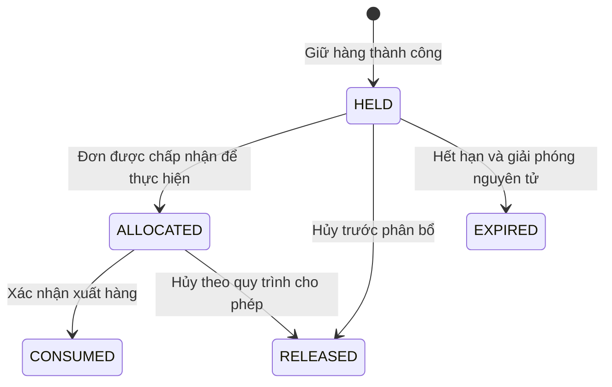

# Inventory ownership — Bảo vệ quyền sở hữu và quyền thao tác trên tồn kho

## 1. Inventory ownership là gì?

**Inventory ownership** trong bài học này là quan hệ nghiệp vụ xác định lượng hàng nào thuộc quyền phân bổ của chủ hàng nào trong hệ thống. Quan hệ đó quyết định một đơn hàng được phép giữ, xuất, hoàn trả hoặc chuyển giao từ phần tồn kho nào.

Kho vật lý có thể lưu hàng của nhiều chủ hàng. Một SKU có thể xuất hiện trong nhiều phần tồn khác nhau. Vì vậy, “còn hàng trong kho” chưa trả lời được câu hỏi “đơn này được phép sử dụng lượng hàng đó không”.

Ví dụ, trong tenant `T1`, kho `W1` lưu cùng SKU `SKU-X` cho hai nhà bán:

| Chủ hàng | Tồn có thể bán đang ghi nhận | Đã giữ cho đơn | Còn có thể giữ thêm |
| --- | ---: | ---: | ---: |
| `MERCHANT-A` | 6 | 2 | 4 |
| `MERCHANT-B` | 20 | 0 | 20 |

Đơn của `MERCHANT-A` cần 5 sản phẩm. Tổng hàng tại kho là 26, nhưng phần có thể giữ thêm của A chỉ là 4. Nếu không có chính sách chuyển giao rõ ràng, hệ thống phải từ chối hoặc chọn một nguồn hợp lệ khác của A. Không được tự lấy 1 sản phẩm từ B để làm cho đơn thành công.

Đây là lỗi logic nghiệp vụ ngay cả khi API đã xác thực người dùng, số lượng dương và tổng tồn kho toàn hệ thống không âm. Bất biến bị vi phạm là **đơn sử dụng hàng ngoài quyền phân bổ của chủ hàng tương ứng**.

Nội dung tập trung vào mô hình quyền trong phần mềm. Thời điểm chuyển quyền sở hữu pháp lý hoặc các điều khoản thương mại cần được ánh xạ từ chính sách của doanh nghiệp, không suy ra chỉ từ một cột `owner_id`.

## 2. Phân biệt những quan hệ thường bị gộp chung

| Quan hệ | Câu hỏi | Điều không thể suy ra tự động |
| --- | --- | --- |
| Tenant | Dữ liệu và thao tác thuộc không gian nghiệp vụ nào? | Cùng tenant không có nghĩa mọi nhà bán dùng chung hàng |
| Chủ hàng | Phần tồn này thuộc quyền phân bổ của ai? | Chủ hàng không nhất thiết trực tiếp vận hành kho |
| Đơn vị giữ hàng vật lý | Ai đang lưu và xử lý hàng? | Quyền vận hành kho không tự cho phép đổi chủ hàng |
| Nhà bán trên dòng đơn | Bên nào chịu trách nhiệm cung cấp mặt hàng đã bán? | Cùng SKU không chứng minh có thể chọn hàng của nhà bán khác |
| Người mua | Ai đặt đơn hoặc nhận hàng? | Có quyền trên đơn không đồng nghĩa được điều chỉnh tồn kho |
| Người thực hiện | Ai hoặc dịch vụ nào đang gửi thao tác? | Có vai trò nhân viên không đồng nghĩa có quyền với mọi owner và kho |
| Chủ thể catalog | Ai tạo hoặc quản lý thông tin sản phẩm? | Quản lý SKU không tự chứng minh sở hữu từng đơn vị tồn |

Trong mô hình minh họa, một tenant có thể chứa nhiều nhà bán. Chủ hàng của lượng tồn là nhà bán tương ứng. Kho được vận hành dùng chung, nhưng sổ tồn được tách theo chủ hàng.

Nếu doanh nghiệp dùng mô hình khác, như tồn kho do chính nền tảng sở hữu hoặc một chủ thể cung ứng riêng, cần ghi rõ quan hệ giữa bên bán và chủ hàng được phép cấp hàng. Không áp đặt điều kiện `seller_id = owner_id` nếu chính sách thực tế khác; thay vào đó cần một quan hệ cung ứng được máy chủ kiểm tra.

### 2.1. Giỏ hàng nhiều nhà bán không có một owner duy nhất

Một đơn có thể chứa dòng của A và dòng của B. Lấy `owner_id` từ dòng đầu rồi áp dụng cho cả đơn sẽ sai.

Máy chủ cần xác định chủ thể cung ứng cho từng dòng đơn hoặc nhóm fulfillment đã được phân tách. Việc gom đơn để thanh toán một lần không xóa ranh giới sở hữu của từng dòng hàng.

### 2.2. Đổi kho không mặc nhiên đổi chủ hàng

Có thể chuyển việc cấp hàng từ kho `W1` sang `W2` khi cả hai đều có phần tồn hợp lệ của A và thao tác được phép. Đổi sang hàng của B là một thay đổi nghiệp vụ khác, cần quan hệ cung ứng hoặc quy trình chuyển giao tương ứng.

Không dùng một hàm “tìm bất kỳ kho còn hàng theo SKU” nếu hàm đó không giữ điều kiện về chủ hàng, tenant và trạng thái hàng.

## 3. Mô hình định danh và các bất biến cần giữ

### 3.1. Một stock bucket cần đủ chiều nghiệp vụ

Có thể gọi một phần tồn có cùng các thuộc tính quan trọng là **stock bucket**. Ví dụ:

```text
StockKey = (
    tenant_id,
    owner_id,
    warehouse_id,
    sku_id,
    stock_status
)
```

`stock_status` phân biệt hàng được bán và hàng cách ly. Hệ thống có quản lý lô, hạn sử dụng, serial hoặc vị trí chi tiết có thể cần thêm các chiều này. Không gom chúng nếu việc gom làm mất quy tắc phân bổ.

Mỗi bucket có một ID nội bộ ổn định. Các reservation và bút toán cần tham chiếu đúng bucket cùng phạm vi sở hữu được bảo vệ. Không xác định lại bucket chỉ từ SKU khi hủy hoặc xuất hàng.

### 3.2. Định nghĩa số lượng trong ví dụ

Với một bucket hàng bán được:

- `on_hand`: lượng hàng ghi nhận trong bucket, gồm cả phần đang giữ.
- `reserved`: phần đã giữ hoặc đã phân bổ cho các đơn nhưng chưa xuất vật lý theo mô hình.
- `available = on_hand - reserved`: phần có thể giữ thêm.

Bất biến số lượng của ví dụ:

```text
on_hand >= 0
0 <= reserved <= on_hand
quantity của một yêu cầu giữ hàng > 0
```

Đây là mô hình không bán vượt tồn. Nếu có backorder, phải mô hình hóa quyền nhận đơn trước khi có hàng bằng chính sách và dữ liệu riêng. Backorder không phải lý do để lấy hàng của chủ khác hoặc để âm tồn một cách không giải thích được.

### 3.3. Bất biến về quyền sở hữu

```text
Mỗi reservation thành công:
    reservation.tenant = orderLine.tenant = stockBucket.tenant
    reservation.owner = authorizedSupplier(orderLine)
    reservation.owner = stockBucket.owner
    reservation.sku = orderLine.sku = stockBucket.sku
    reservation.warehouse là nguồn được định tuyến và cho phép
    actor có quyền cho đúng thao tác trên đúng phạm vi
```

Trong mô hình minh họa, `authorizedSupplier(orderLine)` chính là owner được máy chủ gắn với nhà bán của dòng đơn. Nếu có hợp đồng cấp hàng thay thế, hàm này cần kiểm tra quan hệ đó thay vì nhận kết quả do client khẳng định.

Các bất biến bổ sung:

- Giải phóng reservation chỉ hoàn lại đúng phần đã giữ của reservation đó.
- Xuất hàng chỉ tiêu thụ đúng bucket và quyền phân bổ đã cam kết.
- Một thao tác thông thường không được sửa owner của bucket để biến hàng người khác thành hàng hợp lệ.
- Chuyển giao giữa hai owner phải có nghiệp vụ rõ ràng, đủ quyền và bút toán hai phía.
- Retry không tạo thêm lần giữ, xuất hoặc chuyển giao ngoài ý định ban đầu.

## 4. Kiểm tra quyền trên đúng tổ hợp đối tượng

### 4.1. Vai trò chung không đủ

Quyền `WAREHOUSE_OPERATOR` có thể nói actor làm việc trong kho, nhưng chưa chỉ rõ họ được làm gì với hàng của owner nào. Một mô hình quyền có thể cần bộ:

```text
(tenant, owner, warehouse, action)
```

Các action nên phân biệt ít nhất những thao tác có tác động khác nhau: xem số dư, giữ hàng, giải phóng, xuất hàng, điều chỉnh và chuyển giao chủ hàng.

Ví dụ actor được phép:

```text
(MERCHANT-A, W1, RESERVE)
(MERCHANT-B, W2, RESERVE)
```

Không được tách thành `allowedOwners = {A, B}` và `allowedWarehouses = {W1, W2}` rồi kiểm tra độc lập hai tập. Cách đó vô tình cấp thêm tổ hợp A–W2 và B–W1.

Cần kiểm tra **một grant khớp toàn bộ tổ hợp**, hoặc dùng một chính sách có ngữ nghĩa tương đương. Quyền xem A–W1 cũng không tự cho quyền xuất A–W1.

### 4.2. Actor của dịch vụ và người dùng cuối

Checkout có thể gọi dịch vụ tồn kho bằng service principal. Khi đó cần phân biệt:

1. Người dùng cuối có quyền xác nhận dòng đơn đó hay không.
2. Dịch vụ được phép giữ hàng cho owner và kho đó hay không.
3. Dữ liệu dòng đơn có được tải từ nguồn có thẩm quyền hay chỉ được caller truyền tùy ý.

Một service principal có quyền rộng nhưng nhận `ownerId`, `skuId` và số lượng không được kiểm tra từ client có thể trở thành đường thao tác sai quyền. Quyền của dịch vụ không thay kiểm tra ý định và đối tượng nghiệp vụ mà nó đang đại diện.

### 4.3. Ranh giới tin cậy của dữ liệu

| Dữ liệu | Nguồn dùng để quyết định | Kiểm tra cần có |
| --- | --- | --- |
| Actor và tenant đang làm việc | Ngữ cảnh xác thực phía máy chủ | Đúng danh tính, phạm vi và quyền hiện tại |
| Chủ đơn và dòng đơn | Bản ghi đơn được tải có kiểm soát | Actor có quyền; dòng thuộc đúng đơn |
| Owner cấp hàng | Offer, quan hệ cung ứng và dòng đơn phía máy chủ | Không nhận kết luận sở hữu từ client |
| Kho được chọn | Bộ định tuyến hoặc lựa chọn đã được xác thực | Kho thuộc phạm vi được phép và có bucket đúng owner |
| Số lượng giữ | Dòng đơn và các allocation đã có | Dương, đúng đơn vị, không giữ vượt phần cần cấp |
| Reservation cần hủy hoặc xuất | Bản ghi reservation hiện tại | Đúng tenant, owner, dòng đơn, trạng thái và phiên bản |
| Quyền chuyển giao | Lệnh chuyển giao đã được phê duyệt theo chính sách | Khớp nguồn, đích, số lượng và phiên bản |

Client có thể chọn một offer hoặc gợi ý điểm nhận hàng. Máy chủ vẫn cần chuyển lựa chọn đó thành dữ liệu nghiệp vụ đã xác thực trước khi dùng nó để thay đổi tồn kho.

## 5. API phải biểu đạt ý định thay vì cho sửa số dư tùy ý

Ví dụ một yêu cầu giữ hàng:

```http
POST /orders/order-301/lines/line-2/reservations
Idempotency-Key: reserve-line-2-attempt-7
Content-Type: application/json

{
  "expectedLineVersion": 5,
  "preferredWarehouseId": "warehouse-1"
}
```

Máy chủ tải đơn và dòng đơn, kiểm tra quyền, xác định owner và SKU, tính phần số lượng còn cần giữ rồi xác thực kho được chọn. Nếu API hỗ trợ giữ một phần, số lượng client đề nghị cũng phải được kiểm tra với phần còn cần cấp và trạng thái đơn.

Không cho phép client tự cập nhật một bảng số dư bằng request như:

```json
{
  "ownerId": "merchant-b",
  "skuId": "sku-x",
  "reserved": 0,
  "available": 999
}
```

Đây là các giá trị hoặc đối tượng mà máy chủ phải quản lý bằng nghiệp vụ có kiểm soát. Việc DTO chứa một trường không có nghĩa actor được phép sửa trường đó.

Tương tự, API giải phóng nên nhận định danh reservation và ý định hủy. Số lượng, owner và bucket để hoàn lại phải được lấy từ reservation, không từ một request mới tự khai báo.

## 6. Ví dụ Java: kiểm tra phạm vi sở hữu trước khi giữ hàng

Ví dụ dùng Java 17 để thể hiện kiểm tra trên dữ liệu đã tải phía máy chủ. Các record không phải DTO nhận trực tiếp từ HTTP. Bucket ở đây đại diện phần hàng bán được; trạng thái hàng thực tế vẫn phải được kiểm tra ở lớp truy cập dữ liệu.

```java
import java.util.Objects;
import java.util.Set;
import java.util.UUID;

public final class InventoryOwnership {
    public enum Action {
        RESERVE,
        RELEASE,
        SHIP
    }

    public record Grant(UUID ownerId, UUID warehouseId, Action action) {
        public Grant {
            Objects.requireNonNull(ownerId);
            Objects.requireNonNull(warehouseId);
            Objects.requireNonNull(action);
        }
    }

    public record Principal(UUID tenantId, Set<Grant> grants) {
        public Principal {
            Objects.requireNonNull(tenantId);
            grants = Set.copyOf(grants);
        }
    }

    public record StockKey(
        UUID tenantId,
        UUID ownerId,
        UUID warehouseId,
        UUID skuId
    ) {
        public StockKey {
            Objects.requireNonNull(tenantId);
            Objects.requireNonNull(ownerId);
            Objects.requireNonNull(warehouseId);
            Objects.requireNonNull(skuId);
        }
    }

    public record OrderLine(
        UUID tenantId,
        UUID lineId,
        UUID ownerId,
        UUID skuId,
        long quantityToReserve,
        boolean reservable
    ) {
        public OrderLine {
            Objects.requireNonNull(tenantId);
            Objects.requireNonNull(lineId);
            Objects.requireNonNull(ownerId);
            Objects.requireNonNull(skuId);
        }
    }

    public record Decision(boolean allowed, String reason) {}

    public static Decision authorizeReserve(
        Principal principal, OrderLine line, StockKey key
    ) {
        Objects.requireNonNull(principal);
        Objects.requireNonNull(line);
        Objects.requireNonNull(key);

        if (!principal.tenantId().equals(key.tenantId())
                || !line.tenantId().equals(key.tenantId())) {
            return deny("TENANT_MISMATCH");
        }
        if (!line.ownerId().equals(key.ownerId())) {
            return deny("OWNER_MISMATCH");
        }
        if (!line.skuId().equals(key.skuId())) {
            return deny("SKU_MISMATCH");
        }
        if (!line.reservable() || line.quantityToReserve() <= 0) {
            return deny("LINE_NOT_RESERVABLE");
        }

        Grant required = new Grant(
            key.ownerId(), key.warehouseId(), Action.RESERVE);
        if (!principal.grants().contains(required)) {
            return deny("SCOPE_NOT_GRANTED");
        }
        return new Decision(true, "OWNERSHIP_SCOPE_MATCHED");
    }

    private static Decision deny(String reason) {
        return new Decision(false, reason);
    }
}
```

Một grant giữ hàng cho A–W1 không thỏa A–W2. Grant xuất hàng cũng không tự thỏa action `RESERVE`. Dòng đơn của A không thể đi qua chỉ vì principal đồng thời có quyền thao tác hàng của B.

Hàm này chưa kiểm tra số dư hiện tại, lượt giữ đã có, quyền người dùng cuối trên đơn hay việc grant vừa bị thu hồi. Lớp ứng dụng phải tải dữ liệu đúng nguồn và thực hiện kiểm tra, ghi reservation trong một giao thức giao dịch phù hợp.

`quantityToReserve` phải được tính từ trạng thái hiện tại của dòng đơn và allocation đã cam kết. Nếu chỉ chép toàn bộ số lượng đơn vào trường này ở mỗi lần gọi, hai ý định khác key vẫn có thể giữ vượt nhu cầu của cùng dòng.

## 7. Giữ hàng nguyên tử trên đúng bucket

### 7.1. Schema số dư tối thiểu

Ví dụ PostgreSQL 17 dưới đây chỉ thể hiện bảng số dư. Bản triển khai cần thêm quan hệ tới owner, kho, SKU và các đối tượng nghiệp vụ tương ứng.

```sql
CREATE TABLE inventory_balance (
    bucket_id uuid PRIMARY KEY,
    tenant_id uuid NOT NULL,
    owner_id uuid NOT NULL,
    warehouse_id uuid NOT NULL,
    sku_id uuid NOT NULL,
    stock_status text NOT NULL,
    on_hand bigint NOT NULL,
    reserved bigint NOT NULL DEFAULT 0,
    version bigint NOT NULL DEFAULT 0,

    UNIQUE (tenant_id, owner_id, warehouse_id, sku_id, stock_status),
    CHECK (stock_status IN ('SELLABLE', 'QUARANTINED')),
    CHECK (on_hand >= 0),
    CHECK (reserved >= 0 AND reserved <= on_hand)
);
```

Các constraint kiểm tra giá trị và khóa của một bucket. Chúng chưa chứng minh actor có quyền hoặc reservation khớp chủ hàng của dòng đơn. Những quan hệ giữa bảng có thể được hỗ trợ bằng khóa ngoại có phạm vi phù hợp; điều kiện tổng hợp giữa nhiều dòng cần cơ chế giao dịch riêng. PostgreSQL không dùng `CHECK` như một bảo đảm chung cho dữ liệu của những dòng khác, theo [tài liệu Constraints của PostgreSQL 17](https://www.postgresql.org/docs/17/ddl-constraints.html).

### 7.2. Cập nhật có điều kiện

Sau khi kiểm tra quyền và suy ra các tham số từ dữ liệu nghiệp vụ, có thể giữ hàng bằng câu lệnh:

```sql
UPDATE inventory_balance
SET reserved = reserved + :quantity,
    version = version + 1
WHERE tenant_id = :tenant_id
  AND owner_id = :owner_id
  AND warehouse_id = :warehouse_id
  AND sku_id = :sku_id
  AND stock_status = 'SELLABLE'
  AND :quantity > 0
  AND on_hand - reserved >= :quantity
RETURNING bucket_id, owner_id, reserved, version;
```

Các tham số có dấu `:` minh họa việc binding, không phải cú pháp dùng trực tiếp trong mọi driver. Caller phải kiểm tra số lượng là số nguyên đúng đơn vị và nằm trong miền giá trị cho phép.

Với unique key đã nêu, câu lệnh tác động tối đa một bucket. Có hàng trả về nghĩa là cập nhật thành công trong transaction hiện tại. Không có hàng trả về có thể do thiếu bucket phù hợp hoặc không đủ hàng trong phạm vi đó; không được tự bỏ điều kiện owner để thử lại.

Trong PostgreSQL 17 ở mức `Read Committed`, khi các cập nhật tranh chấp trên cùng một dòng, điều kiện `WHERE` được đánh giá lại trên phiên bản dòng sau cập nhật đã commit trước đó. Cơ chế này hỗ trợ phép giữ hàng có điều kiện trên một bucket, như mô tả trong [tài liệu Transaction Isolation](https://www.postgresql.org/docs/17/transaction-iso.html).

Điều đó không tự bảo vệ điều kiện liên quan nhiều dòng, như tổng allocation của một dòng đơn hay thu hồi quyền actor. Những dữ liệu đó vẫn cần được điều phối riêng trong cùng giao thức.

### 7.3. Ghi reservation và số dư trong cùng giao dịch

```text
reserveForLine(actor, orderId, lineId, expectedVersion, key):
    begin transaction

    load order and line within authorized tenant
    authorize the initiating user on this order and action
    claim idempotency key and compare the intent fingerprint
    if identical intent already committed:
        return stored result after access checks

    lock line and relevant allocation records
    verify current line state and expected version
    derive supplying owner and remaining quantity from server data
    choose an allowed warehouse without changing owner implicitly
    authorize the executing principal on the exact ownership scope

    atomically increase reserved in the matching SELLABLE bucket
    reject if no matching stock was reserved
    create reservation referencing this bucket, owner and line
    persist result and required outbox event
    commit
    return persisted result
```

Nếu tạo reservation thất bại sau cập nhật số dư, transaction phải rollback phần tăng `reserved`. Không trả thành công trước commit.

Reservation cần chứa hoặc tham chiếu đủ tenant, owner, bucket, dòng đơn, số lượng, trạng thái, thời hạn nếu có và phiên bản. Nếu lưu lặp owner trong reservation, phải bảo vệ tính nhất quán với bucket và dòng đơn, chẳng hạn bằng khóa ngoại tổng hợp có khóa đích duy nhất tương ứng cùng kiểm tra giao dịch. Không để cột owner chỉ là dữ liệu trang trí có thể lệch nhau.

## 8. Giữ đúng owner trong toàn bộ vòng đời reservation

Kiểm tra đúng owner lúc tạo chưa đủ nếu những bước sau lại tìm tồn kho chỉ bằng SKU hoặc nhận bucket từ request mới.

### 8.1. State machine minh họa

Mô hình dưới đây giả định mỗi reservation được xử lý nguyên khối. Với giao hàng hoặc hủy một phần, cần các sub-allocation hoặc bộ đếm từng phần có bất biến tương ứng.



Ý nghĩa thay đổi số dư:

| Thao tác | Điều kiện nguồn | Thay đổi `on_hand` | Thay đổi `reserved` |
| --- | --- | ---: | ---: |
| Tạo hold | Dòng đơn hợp lệ, bucket đúng owner và đủ hàng | 0 | `+q` |
| Chấp nhận phân bổ | `HELD`, chưa hết hạn, đúng đơn và quyền | 0 | 0 |
| Giải phóng | `HELD` hoặc `ALLOCATED` theo quy trình hủy | 0 | `-q` |
| Hết hạn | `HELD`, đã đến hạn, chưa chuyển trạng thái khác | 0 | `-q` |
| Xuất hàng | `ALLOCATED`, đúng reservation và fulfillment | `-q` | `-q` |

Trong mô hình này, thanh toán hoặc phân bổ chưa làm giảm hàng vật lý; xuất hàng mới giảm `on_hand`. Doanh nghiệp ghi nhận ở mốc khác cần đổi mô hình một cách nhất quán, không trộn hai mốc giữa các endpoint.

### 8.2. Thời hạn không tự sửa số dư

Một hold đã quá hạn nhưng chưa được transaction hết hạn xử lý vẫn có thể đang chiếm `reserved` trong sổ số dư. Bước phân bổ phải từ chối hold quá hạn, nhưng lượng giữ chỉ được trả lại khi trạng thái và số dư cùng được cập nhật nguyên tử.

Không tính `available` bằng cách bỏ qua hold quá hạn ở một nơi, trong khi nơi khác vẫn dùng cột `reserved` chưa giảm. Cách đó tạo hai con số khả dụng không thống nhất.

Bất biến đối soát trong mô hình:

```text
reserved của bucket
  = tổng số lượng của các reservation HELD hoặc ALLOCATED
    vẫn đang chiếm số dư trong sổ của chính bucket đó.
```

### 8.3. Hủy và callback lặp không được hoàn nhầm hàng

Một yêu cầu hủy cần tải reservation, kiểm tra quyền trên đối tượng, trạng thái hiện tại và quan hệ với đơn. Bucket và số lượng để giải phóng được lấy từ reservation đã lưu.

Nếu client gửi ID reservation của B hoặc thay `owner_id` thành A, máy chủ không được dùng các tham số đó để cộng hàng cho A. Hủy reservation cũng không có nghĩa tăng `on_hand`, vì lúc giữ hàng chưa giảm `on_hand`.

Callback xuất hàng gửi lại chỉ được thấy kết quả đã tiêu thụ; không trừ hàng thêm lần nữa. Job hết hạn chạy lại không được giải phóng reservation đã `CONSUMED`. Khi callback chấp nhận đơn tranh chấp với job hết hạn, chỉ một chuyển trạng thái hợp lệ được commit.

Với reservation được tạo lại sau khi hold cũ hết hạn, định danh hoặc thế hệ mới phải được phân biệt. Callback cũ không được phân bổ hoặc tiêu thụ quyền giữ mới chỉ vì cùng dòng đơn và SKU.

### 8.4. Hàng hoàn trả không đi vào một bucket tùy ý

Hoàn tiền không tự chứng minh hàng đã quay lại kho. Khi có tiếp nhận thực tế, nguồn đối chiếu cần là fulfillment và reservation gốc, cùng quy trình kiểm tra hàng.

Trong mô hình minh họa, hàng trả về được ghi nhận vào bucket cách ly của đúng owner đã cấp hàng, trừ khi có nghiệp vụ chuyển giao đã được phê duyệt. Sau kiểm định mới chuyển sang hàng bán được của cùng owner.

Không chọn owner của người đang xử lý trả hàng làm owner nhận tồn. Không chuyển reservation `CONSUMED` về `HELD` để biểu diễn hàng trả lại; đây là một nghiệp vụ nhập hoặc hoàn tồn mới, cần tham chiếu giao dịch gốc và chống ghi lặp.

## 9. Chuyển giao giữa hai chủ hàng phải là nghiệp vụ riêng

### 9.1. Không đổi owner trực tiếp trên bucket đang có hàng

Giả sử bucket của A có `on_hand = 6`, `reserved = 2`. Sửa `owner_id` từ A thành B sẽ kéo theo cả hàng đang giữ cho đơn của A, hoặc làm reservation và bucket mâu thuẫn nhau.

Thay vào đó, giữ nguyên danh tính bucket và biểu diễn chuyển giao bằng bút toán giảm ở nguồn, tăng ở đích. Với cùng SKU và cùng kho, việc chuyển quyền phân bổ không nhất thiết là dịch chuyển vị trí vật lý, nhưng vẫn cần một cam kết nghiệp vụ có quyền và dấu vết.

Ví dụ chuyển 3 sản phẩm chưa bị giữ từ A sang B:

| Bucket | Trước chuyển | Sau chuyển |
| --- | --- | --- |
| A, `on_hand` | 6 | 3 |
| A, `reserved` | 2 | 2 |
| B, `on_hand` | 20 | 23 |
| B, `reserved` | 0 | 0 |

Tổng `on_hand` vẫn là 26. Phần giữ cho đơn của A không tự chuyển sang B. Chuyển 5 ở thời điểm này phải bị từ chối vì A chỉ có 4 đơn vị chưa giữ.

Nếu muốn chuyển cả hàng đã phân bổ, cần quy trình riêng giải quyết cam kết với đơn trước đó. Không bỏ qua reservation bằng một cờ quản trị chung.

### 9.2. Lệnh chuyển giao cần ràng buộc nội dung phê duyệt

Một lệnh chuyển có thể gồm:

```text
transfer_id
source: tenant, owner, warehouse, sku, stock_status
destination: tenant, owner, warehouse, sku, stock_status
quantity và đơn vị
lý do, người yêu cầu, bằng chứng chấp thuận theo chính sách
phiên bản nội dung và trạng thái lệnh
```

Nếu quy trình yêu cầu hai bên chấp thuận hoặc người duyệt khác người tạo, đó phải là điều kiện cụ thể của state machine. Không coi việc có vai trò quản trị là bằng chứng thay cho mọi phê duyệt.

Phê duyệt phải gắn với nguồn, đích, số lượng và phiên bản đã xem. Nếu sau phê duyệt có người đổi đích từ B sang C hoặc tăng số lượng, lệnh cần quay lại bước phù hợp. Không tái dùng một cờ `approved=true` cho nội dung mới.

### 9.3. Thực hiện chuyển giao nguyên tử

Pseudocode cho trường hợp chuyển owner trong cùng tenant, kho, SKU và trạng thái hàng:

```text
executeOwnershipTransfer(actor, transferId, expectedVersion, key):
    begin transaction

    claim idempotency intent
    load and lock transfer request
    verify version, state and required approvals
    authorize transfer-out for source and transfer-in for destination
    reject unsupported scope changes

    load source and destination buckets
    lock both buckets in the system's consistent lock order
    verify same tenant, warehouse, sku and stock status
    verify different owners and quantity > 0
    verify source.on_hand - source.reserved >= quantity

    decrease source.on_hand by quantity
    increase destination.on_hand by quantity with range checks
    write paired ledger entries linked to the same transfer
    transition transfer to EXECUTED
    persist result and publication event
    commit
```

Bản ghi đích chưa tồn tại cần được tạo dưới unique key của bucket và cơ chế xử lý tranh chấp phù hợp. Không giả định truy vấn rỗng đã khóa được khả năng một transaction khác tạo cùng bucket.

Khóa nhiều đối tượng cần theo thứ tự nhất quán giữa các luồng, đồng thời xử lý deadlock hoặc xung đột bằng retry có giới hạn. PostgreSQL mô tả khóa dòng và khuyến nghị thứ tự lấy khóa nhất quán trong [tài liệu Explicit Locking](https://www.postgresql.org/docs/17/explicit-locking.html).

Chuyển kho vật lý là trường hợp khác. Không tăng ngay hàng bán được tại kho đích chỉ vì đã tạo yêu cầu vận chuyển; có thể cần trạng thái đang vận chuyển và bước tiếp nhận. Chuyển owner và chuyển vị trí có thể cùng xảy ra, nhưng mỗi thay đổi phải có mốc ghi nhận rõ ràng.

### 9.4. Điều chỉnh tồn không phải đường vòng để đổi chủ

Nếu actor không có quyền chuyển giao nhưng được dùng API điều chỉnh để giảm A rồi tăng B không có liên kết, họ vẫn có thể đạt cùng kết quả. Vì vậy quyền điều chỉnh cần phạm vi, lý do, giới hạn và dấu vết phù hợp.

Các thao tác bù trừ liên quan cùng một chuyển giao phải có quan hệ được kiểm soát. Không tách chúng thành hai thay đổi tùy ý chỉ để tránh bước phê duyệt hoặc kiểm tra owner.

## 10. Idempotency, quyền hiện tại và hệ thống nhiều dịch vụ

### 10.1. Key gắn với đúng ý định và đối tượng

Fingerprint của một ý định giữ hàng có thể gồm tenant, đơn, dòng đơn, phiên bản mong đợi và tham số được phép lựa chọn. Fingerprint của chuyển giao cần gắn với lệnh cùng phiên bản đã duyệt.

Key cùng ý định đã commit trả kết quả cũ sau kiểm tra quyền truy cập. Key bị dùng lại với nội dung khác phải bị từ chối. Các request đồng thời cùng key cần được điều phối bằng bản ghi có ràng buộc nguyên tử.

Hai key khác nhau không được phép giữ vượt số lượng còn cần cấp của cùng dòng. Vì vậy cần thêm bất biến allocation và khóa hoặc phiên bản trên dòng đơn; idempotency chỉ ngăn lặp cùng ý định.

Tương tự, event ID mới không cho phép một reservation đã xuất được tiêu thụ thêm lần nữa. State machine vẫn phải bảo vệ tác dụng phụ ngay cả khi người gửi đổi khóa nhận diện request.

### 10.2. Quyền bị thu hồi giữa kiểm tra và ghi

Nếu kiểm tra grant rồi để transaction khác thu hồi grant trước khi ghi, một lần đọc cũ có thể không đáp ứng yêu cầu thu hồi tức thời. Hệ thống cần xác định thời điểm quyền được coi có hiệu lực cho hành động.

Khi chính sách yêu cầu kiểm tra tại điểm cam kết, luồng thao tác và luồng thu hồi cần dùng revision, guard hoặc cơ chế điều phối có bảo đảm tương ứng. JWT hoặc cache quyền dài hạn không tự phản ánh thu hồi hiện tại.

Không thể khắc phục khoảng trống này bằng việc chỉ thêm điều kiện `owner_id` vào SQL. Điều kiện owner bảo vệ quan hệ đối tượng, còn hiệu lực quyền actor là một điều kiện khác.

### 10.3. Không tin mọi nội dung chỉ vì request đến từ dịch vụ nội bộ

Dịch vụ tồn kho cần xác thực dịch vụ gọi, giới hạn action và phạm vi, đồng thời kiểm tra nguồn gốc dữ liệu đơn hoặc lệnh chuyển. Header như `X-Owner-Id` không trở thành dữ liệu có thẩm quyền chỉ vì nằm trong mạng nội bộ.

Một event phục vụ xuất hoặc hoàn tồn cần tham chiếu được fulfillment gốc, owner, bucket và phiên bản cần thiết. Nếu event thiếu owner trong mô hình nhiều chủ hàng, consumer không được chọn tùy ý một bucket cùng SKU để tiếp tục.

### 10.4. Khi đơn hàng và tồn kho ở hai cơ sở dữ liệu

Pseudocode giữ hàng ở trên giả định một ranh giới giao dịch có thể bảo vệ các dữ liệu quan trọng. Nếu dịch vụ đơn và dịch vụ tồn kho tách riêng, không thể coi “đọc dòng đơn rồi gọi giữ hàng” là một transaction cơ sở dữ liệu chung.

Cần một hợp đồng như reservation do dịch vụ tồn kho sở hữu, gắn với đúng tenant, owner, dòng đơn và ý định. Dịch vụ đơn chỉ xác nhận khi nhận được reservation hợp lệ; khi bước sau thất bại, có quy trình giải phóng hoặc bù trừ. Trạng thái chưa rõ do timeout cần được truy vấn lại bằng định danh ổn định.

Sự kiện phải được phát sau commit hoặc qua outbox phù hợp và consumer phải xử lý lặp. Không giữ một transaction đang khóa số dư trong lúc chờ phản hồi mạng kéo dài hoặc chờ thao tác của người dùng.

### 10.5. Cache và danh sách cũng cần giữ ranh giới sở hữu

Cache số dư cần đủ tenant, owner, kho, SKU và trạng thái hàng theo mô hình. Cache chỉ bằng SKU có thể làm đơn của A thấy và sử dụng số dư của B.

Số lượng hiển thị từ cache là gợi ý, không phải quyền giữ chắc chắn. Bước ghi vẫn phải kiểm tra bucket và số dư hiện tại. Khi cache không sẵn sàng, không được đổi sang truy vấn tổng mọi owner để “cứ xử lý trước”.

Các API xem, export và tìm kiếm cũng phải lọc theo quyền. Bảo vệ thao tác ghi nhưng để A xem toàn bộ số dư của B vẫn là vi phạm quyền dữ liệu nghiệp vụ.

## 11. Những tình huống cần kiểm thử

Các kiểm thử nên dùng dữ liệu có cùng SKU ở nhiều owner và nhiều kho. Nếu mọi fixture chỉ có một owner, lỗi thiếu điều kiện sở hữu dễ không xuất hiện.

| Tình huống | Thiết lập hoặc hành động | Kết quả cần có |
| --- | --- | --- |
| Đổi owner trong request | Dòng của A nhưng client chọn bucket B | Không tạo reservation và không đổi số dư B |
| Tổng kho đủ nhưng A thiếu | A khả dụng 4, B khả dụng 20, đơn A cần 5 | Không tự vay phần của B |
| Sai tenant | Dùng ID bucket hoặc dòng đơn ở tenant khác | Chặn trước khi ghi hoặc tiết lộ dữ liệu ngoài quyền |
| Cùng SKU, sai kho | Actor chỉ có quyền A–W1 nhưng yêu cầu A–W2 | Từ chối đúng phạm vi |
| Ghép quyền chéo | Có A–W1 và B–W2, thử A–W2 | Không tạo quyền từ tích hai tập |
| Sai action | Actor có quyền xem nhưng gọi xuất | Từ chối dù owner và kho đúng |
| Giỏ nhiều nhà bán | Hai dòng lần lượt của A và B | Mỗi allocation tham chiếu đúng owner của dòng |
| Sửa dòng sau lần đọc | Đổi nguồn cung hoặc số lượng trước commit | Kiểm tra lại phiên bản và không dùng ý định cũ trái trạng thái |
| Số lượng không hợp lệ | Gửi 0, số âm, sai đơn vị hoặc vượt giới hạn | Không cập nhật số dư |
| Hai lần giữ độc lập | Hai key cùng cố giữ phần còn lại của một dòng | Tổng allocation không vượt nhu cầu đã được phép |
| Hai đơn tranh chấp | Nhiều request giữ cùng bucket gần hết hàng | Không có số dư âm hoặc giữ vượt phần khả dụng |
| Rollback giữa luồng | Lỗi sau tăng `reserved` nhưng trước tạo reservation | Không để số dư giữ mồ côi trong cùng transaction |
| Hủy của người khác | A gửi reservation ID của B | Không giải phóng, chuyển owner hoặc tiết lộ trái quyền |
| Hủy lặp | Gửi lại cùng ý định hủy | `reserved` chỉ giảm một lần |
| Callback xuất lặp | Gửi lại thông báo xuất cho reservation đã tiêu thụ | Không giảm `on_hand` hoặc `reserved` thêm lần nữa |
| Hết hạn tranh chấp phân bổ | Job hết hạn và bước `HELD -> ALLOCATED` cùng chạy | Chỉ một chuyển trạng thái hợp lệ thắng |
| Callback của hold cũ | Tạo hold mới sau khi hold cũ hết hạn | Không dùng callback cũ để thay đổi hold mới |
| Hoàn tiền chưa nhận hàng | Phát sinh hoàn tiền nhưng chưa có tiếp nhận kho | Không tự cộng hàng bán được |
| Nhận hàng trả về | Hàng của A được B hoặc nhân viên kho tiếp nhận | Ghi đúng owner gốc và trạng thái kiểm định |
| Chuyển vượt phần chưa giữ | A có 6, giữ 2, yêu cầu chuyển 5 | Từ chối, giữ nguyên cả hai phía |
| Đổi lệnh sau phê duyệt | Thay owner đích hoặc tăng số lượng | Không dùng phê duyệt của phiên bản cũ |
| Chuyển giao lặp | Retry sau commit nhưng mất phản hồi | Một chuyển giao và một cặp bút toán |
| Quyền vừa bị thu hồi | Điều phối thu hồi trước điểm cam kết | Kết quả đúng chính sách hiệu lực quyền |
| Cache trộn owner | Hai owner hỏi cùng SKU và kho liên tiếp | Không dùng chéo số dư hoặc quyết định |
| Job nội bộ thiếu phạm vi | Event có SKU nhưng thiếu owner bắt buộc | Không chọn một bucket bất kỳ để ghi |

### 11.1. Kiểm thử đồng thời phải quan sát dữ liệu đã commit

Có thể dùng điểm đồng bộ trong môi trường kiểm thử để nhiều transaction cùng tiến đến thao tác giữ hoặc chuyển giao. Gửi hai request tuần tự không chứng minh cơ chế chống tranh chấp hoạt động.

Sau khi chạy, đối chiếu:

```text
Với từng bucket:
  on_hand >= 0
  0 <= reserved <= on_hand
  reserved = tổng allocation đang chiếm số dư của bucket đó

Với từng dòng đơn:
  tổng phần giữ/phân bổ đang còn hiệu lực nghiệp vụ
    không vượt số lượng còn được phép cấp theo trạng thái đơn

Với từng reservation:
  tenant, owner, SKU và bucket khớp nguồn cung của dòng đơn

Với chuyển giao owner cùng kho, cùng SKU:
  tổng thay đổi on_hand của hai phía = 0
  reserved của các đơn không bị chuyển owner ngoài quy trình
```

Khi có giao hàng một phần, số lượng đã xuất và phần còn cần cấp phải được đưa vào bất biến dòng đơn. Không cộng lẫn reservation lịch sử đã hủy hoặc đã tiêu thụ vào “số đang giữ”.

Kiểm thử cần dùng ràng buộc và mức cô lập tương ứng môi trường triển khai. Mock trả số dư cố định thường không tái hiện được xung đột khóa, rollback và cập nhật có điều kiện.

### 11.2. Kiểm thử thuộc tính của chính sách quyền

Với các dữ kiện khác giữ nguyên:

- Đổi owner của bucket sang owner không khớp dòng đơn không được giữ kết quả cho phép.
- Có thêm grant cho B–W2 không tự mở quyền A–W2.
- Grant cho action xem không thỏa action xuất hoặc chuyển giao.
- Request không có quyền không được làm thay đổi bất kỳ bucket nào.
- Giải phóng hoặc tiêu thụ một reservation không được làm đổi số dư bucket khác.
- Retry cùng ý định đã commit không tăng số lần tác động lên sổ tồn.

Các thuộc tính này bổ sung cho kiểm thử tích hợp. Chúng không thay việc kiểm tra đường lấy owner, quyền người dùng trên đơn và giao thức transaction thực tế.

## 12. Đối soát, xử lý chênh lệch và dấu vết vận hành

### 12.1. Đối soát theo owner, không chỉ theo tổng SKU

Tổng hàng toàn kho có thể đúng trong khi A thiếu và B thừa do một lỗi ghi chéo. Vì vậy cần đối soát theo cùng các chiều của bucket, không chỉ so tổng SKU.

Dữ liệu nên hỗ trợ lần theo từ đơn đến reservation, từ reservation đến bucket và từ thay đổi số dư đến bút toán. Chuyển giao có hai phía cần chung định danh nghiệp vụ để phát hiện trường hợp thiếu một phía.

Nếu kiểm kê vật lý cho thấy thiếu hàng làm số thực tế thấp hơn phần đã giữ, đó là một tình huống cần xử lý thiếu hụt và cam kết đơn. Không xóa reservation hoặc đổi owner để ép số liệu vượt qua constraint. Cần quy trình ghi nhận chênh lệch, xác định đơn bị ảnh hưởng và điều chỉnh có kiểm soát.

Nếu quản lý serial, lô hoặc pallet, bước quét và xác nhận xuất cần đối chiếu đúng chủ hàng và thuộc tính nguồn. Một kiểm tra owner đúng trong cơ sở dữ liệu không chứng minh nhân viên đã lấy đúng hàng vật lý nếu quy trình kho không giữ được liên kết đó.

### 12.2. Ghi đủ để giải thích, giới hạn dữ liệu được xem

Một bản ghi thay đổi tồn có thể cần:

- Định danh yêu cầu hoặc sự kiện, actor thực hiện và chủ thể khởi tạo nếu có đại diện.
- Tenant, owner, kho, SKU, bucket và trạng thái hàng.
- Đơn, dòng đơn, reservation, fulfillment hoặc transfer liên quan.
- Action, số lượng, phiên bản trước/sau và kết quả giao dịch.
- Lý do điều chỉnh, tham chiếu phê duyệt và mã lý do từ chối nội bộ.

Không ghi token xác thực hoặc thông tin người mua không cần thiết để đối soát tồn. Quyền xem log, export và lịch sử phải giữ ranh giới tenant và chủ hàng phù hợp.

Có thể theo dõi tỷ lệ `OWNER_MISMATCH`, `SCOPE_NOT_GRANTED`, reservation mồ côi, bút toán thiếu phía và số lần callback bị bỏ qua vì lặp. Cần phân biệt thiếu hàng trong đúng owner với lỗi quyền hoặc lỗi nguồn dữ liệu để xử lý đúng nguyên nhân.

Khi không đọc được dữ liệu quyền hoặc nguồn cung bắt buộc, không đoán owner từ SKU rồi tiếp tục. Có thể trả lỗi tạm thời hoặc giữ luồng ở trạng thái chờ xử lý theo hợp đồng sản phẩm; không âm thầm dùng hàng của chủ khác.

## 13. Những cách triển khai dễ làm mất ranh giới sở hữu

| Cách triển khai | Hệ quả | Hướng thiết kế |
| --- | --- | --- |
| Tìm tồn bằng SKU rồi chọn bản ghi đầu tiên | Có thể lấy hàng của owner khác | Tra đầy đủ namespace và nguồn cung hợp lệ |
| Chỉ kiểm tra tenant | Nhà bán cùng tenant dùng nhầm hàng của nhau | Kiểm tra thêm owner, kho và action |
| Tách tập owner và tập kho rồi ghép tùy ý | Tạo grant chưa từng được cấp | Đánh giá đúng tổ hợp phạm vi |
| Tin `ownerId` hoặc `available` từ client | Client tự chọn quyền và kết quả số dư | Suy ra owner và tính số dư phía máy chủ |
| Đổi owner trên bucket đang có reservation | Cam kết đơn bị chuyển hoặc mất liên kết | Chuyển giao bằng nghiệp vụ và bút toán riêng |
| Hủy bằng cách cộng số lượng client gửi | Hoàn nhầm bucket hoặc tạo thêm hàng | Lấy số lượng và bucket từ reservation đã xác thực |
| Hoàn tiền là cộng hàng bán được | Tăng tồn dù chưa nhận hoặc chưa kiểm định | Tách thanh toán, tiếp nhận và kiểm định |
| API nội bộ bỏ qua quyền vì caller là dịch vụ | Dịch vụ trở thành đường dùng quyền rộng sai mục đích | Xác thực service, scope và đối tượng nghiệp vụ |
| Dùng cache SKU cho mọi owner | Trộn số dư và quyết định phân bổ | Cache theo đủ chiều và ghi có điều kiện |
| Chỉ đối soát tổng hàng toàn kho | Không phát hiện lệch giữa các chủ hàng | Đối soát theo bucket và sổ chuyển giao |

## 14. Áp dụng khi rà soát luồng tồn kho

Trước hết, xác định chủ thể nào được quyền phân bổ hàng cho từng dòng đơn và những chiều nào tạo nên một bucket. Sau đó chỉ ra nguồn dữ liệu đáng tin cậy của tenant, owner, kho, SKU và số lượng ở từng API.

Lần theo toàn bộ vòng đời từ giữ hàng đến xuất, hủy, hết hạn và nhận trả. Với mỗi bước, cần thấy được quyền trên đối tượng, trạng thái nguồn, bucket bị tác động và cơ chế chống ghi lặp. Với chuyển giao chủ hàng, cần thấy được nội dung phê duyệt, quyền hai phía và bút toán bảo toàn lượng hàng theo chính sách.

Một luồng bảo vệ inventory ownership tốt giữ đúng phần hàng của từng chủ thể khi người dùng thay ID, dịch vụ gửi lại sự kiện, nhiều đơn tranh chấp hoặc công cụ vận hành điều chỉnh dữ liệu. Đó là cách kết hợp quyền theo đối tượng, bất biến nghiệp vụ, state machine, transaction và idempotency để bảo vệ tồn kho khỏi lạm dụng logic.
