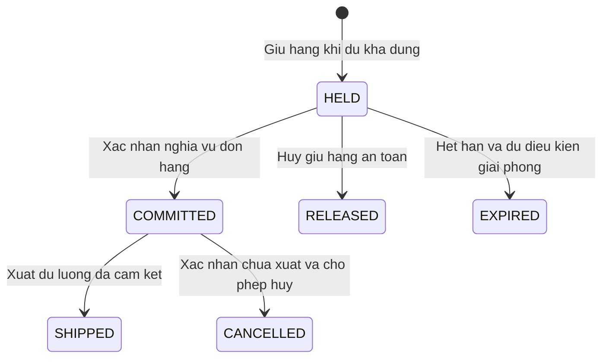

# Số lượng khả dụng (Available quantity)

## 1. Available quantity là số lượng còn được phép cấp thêm

Trong chương Inventory Rules, **available quantity** là số lượng mà hệ thống còn có thể giữ hoặc cam kết thêm cho một yêu cầu mới, trong một phạm vi tồn kho và theo một chính sách xác định. Con số này không nhất thiết bằng số hàng đang nằm trong kho.

Một kho có mười sản phẩm vẫn có thể chỉ còn hai sản phẩm khả dụng nếu phần còn lại đã được giữ cho checkout khác, phân bổ cho đơn đã xác nhận hoặc dành làm tồn an toàn. Ngược lại, số lượng hiển thị trên trang sản phẩm không tạo ra quyền lấy hàng nếu tồn kho có thẩm quyền đã thay đổi.

Đây là bài toán bảo mật logic nghiệp vụ vì người gọi có thể sửa số lượng, tạo nhiều yêu cầu song song, giữ hàng hàng loạt hoặc phát lại lệnh hủy/xuất kho. Nếu hệ thống kiểm tra sai hoặc cộng/trừ nhiều lần, một request đúng cú pháp vẫn có thể gây bán vượt, tạo tồn giả hoặc giải phóng hàng đã thuộc đơn khác.

Bài học tập trung vào các bất biến về lượng khả dụng, state machine của reservation, quyền theo đối tượng, transaction, idempotency và kiểm thử tấn công logic. Các mô hình, ngưỡng và tên trạng thái trong bài là lựa chọn minh họa, không phải định nghĩa bắt buộc của mọi phần mềm kho.

### 1.1. Đừng dùng một từ “stock” cho nhiều đại lượng

| Đại lượng | Ý nghĩa trong mô hình bài học |
| --- | --- |
| Tồn vật lý tổng | Hàng thực tế đang ở địa điểm, có thể gồm hàng lỗi hoặc chờ kiểm tra |
| Tồn có thể bán tại kho | Hàng vật lý đủ điều kiện bán, kể cả phần đã giữ hoặc đã phân bổ nhưng chưa xuất |
| Lượng đang giữ | Hàng được reservation tạm thời chiếm cho checkout hoặc luồng tương đương |
| Lượng đã cam kết | Hàng phân bổ cho đơn đã xác nhận nhưng chưa ghi nhận xuất kho |
| Tồn an toàn | Phần đệm mà chính sách không cho cấp cho yêu cầu mới thông thường |
| Lượng khả dụng hiện tại | Phần còn có thể cấp thêm từ nguồn hàng hiện có theo chính sách |
| Hàng dự kiến về | Nguồn cung trong tương lai, chưa phải hàng hiện có có thể bán ngay |

Nếu một hệ thống gọi “on hand” là toàn bộ tồn vật lý gồm hàng chờ kiểm tra, công thức phải trừ thêm phần không đủ điều kiện. Trong bài, biến H bên dưới đã chỉ gồm hàng đủ điều kiện bán, nên không trừ hàng lỗi lần thứ hai.

## 2. Chốt công thức và các giả định

### 2.1. Mô hình một bucket tồn kho

Với một bucket, đặt:

```text
H = sellable_on_hand: tồn hiện có đủ điều kiện bán, chưa xuất khỏi kho
R = held_qty: lượng đang giữ bởi các reservation còn chiếm hàng
C = allocated_qty: lượng đã cam kết/phân bổ nhưng chưa xuất
S = safety_qty: lượng đệm không cấp thêm theo chính sách thông thường

A_raw = H - R - C - S
```

Trong mô hình này, R và C là hai phần không chồng lấn. Khi xác nhận một reservation, chuyển lượng từ R sang C; không giữ nguyên R rồi cộng thêm C cho cùng một hàng.

Một yêu cầu mới có lượng q chỉ được cấp khi:

```text
q > 0
AND bucket đang được phép cấp hàng
AND A_raw >= q
```

Hệ thống phải kiểm tra điều kiện và ghi nhận việc chiếm q một cách nguyên tử. Một phép tính A đúng nhưng được thực hiện trên dữ liệu cũ vẫn có thể dẫn đến bán vượt.

### 2.2. Ví dụ số để thấy tác động từng bước

Giả sử ban đầu H = 12, R = 3, C = 2, S = 1:

| Thao tác nối tiếp | H | R | C | S | A_raw |
| --- | --- | --- | --- | --- | --- |
| Trạng thái ban đầu | 12 | 3 | 2 | 1 | 6 |
| Checkout mới giữ thêm 4 | 12 | 7 | 2 | 1 | 2 |
| Xác nhận chính reservation 4 đó | 12 | 3 | 6 | 1 | 2 |
| Xuất 4 hàng đã cam kết đó | 8 | 3 | 2 | 1 | 2 |
| Giải phóng reservation cũ 3 | 8 | 0 | 2 | 1 | 5 |

Xác nhận reservation không tạo thêm hàng khả dụng vì chỉ chuyển R sang C. Xuất hàng đã cam kết cũng không làm A giảm lần nữa: H và C cùng giảm. Nếu lúc xuất hàng chỉ giảm H nhưng quên giảm C, hệ thống sẽ giữ thiếu khả dụng so với lịch sử thực tế.

### 2.3. Giá trị âm cần được giải thích, không che mất

Trong trạng thái bình thường của mô hình không cho bán vượt, R + C + S không vượt H. Tuy nhiên, kiểm kê, hư hỏng hoặc thay đổi chính sách có thể khiến A_raw âm sau khi các nghĩa vụ đã tồn tại.

Có thể hiển thị `max(0, A_raw)` cho người mua để không hiện số âm, nhưng phải giữ và theo dõi giá trị gốc. Không sửa dữ liệu bằng cách đặt H bằng R + C + S để làm công thức trở về 0.

Phân biệt:

```text
Thiếu so với đệm/chính sách: max(0, R + C + S - H)
Thiếu so với nghĩa vụ hàng: max(0, R + C - H)
```

Nếu chỉ thiếu phần tồn an toàn, chưa chắc các đơn hiện có đã thiếu hàng. Nếu R + C lớn hơn H, cần xử lý nghĩa vụ giữ/cam kết đang vượt nguồn hàng thực. Cả hai trường hợp đều không được cấp thêm theo điều kiện thông thường của bài.

### 2.4. Phân biệt available hiện tại với available-to-promise tương lai

Nguồn hàng dự kiến về có thể được dùng để hứa giao ở một ngày tương lai theo một mô hình available-to-promise riêng. Mô hình đó cần thời điểm nhận dự kiến, độ chắc chắn nguồn cung, nhu cầu đã hứa và chính sách rủi ro.

Không cộng mọi purchase order đang mở vào H rồi cho khách đặt hàng như hàng đã có sẵn. Backorder hoặc pre-order phải là chính sách tường minh, có quyền và workflow tương ứng; không phải một cờ `ignoreStock=true` do client tự bật.

## 3. Phạm vi tồn kho và đơn vị phải khớp

### 3.1. Khóa định danh bucket

Số khả dụng chỉ có nghĩa khi đi kèm phạm vi. Một khóa có thể gồm:

```text
InventoryKey = (
    tenantId,
    stockOwnerId,
    skuId,
    fulfillmentNodeId,
    lotOrConditionBucket,
    baseUnit
)
```

Tùy sản phẩm có thể gộp hoặc tách một số chiều. Điều quan trọng là thống nhất chiều nào làm nguồn cấp hàng độc lập. Hai màu hoặc kích cỡ khác nhau không được dùng chung tồn chỉ vì cùng mã sản phẩm cha.

Kho A có hàng không có nghĩa đơn chỉ được nhận tại kho B có hàng. Hàng ký gửi của chủ sở hữu X không mặc nhiên được dùng cho người bán Y. Mọi phép cộng giữa bucket phải dựa trên chính sách fulfillment và quyền sử dụng nguồn hàng rõ ràng.

### 3.2. Chuyển đơn vị trên server

Nếu khách mua hai thùng, mỗi thùng gồm sáu đơn vị, nhu cầu cơ sở là mười hai. Tỷ lệ quy đổi phải lấy từ catalog có thẩm quyền và được gắn phiên bản phù hợp, không nhận `unitsPerBox` tùy ý từ client.

Với hàng đếm chiếc, số lượng phải là số nguyên dương trong giới hạn nghiệp vụ. Không ép `1.9` thành một, không chấp nhận số âm như một cách “trả lại hàng”, và không chuyển một số quá lớn sang kiểu hẹp làm tràn.

Với hàng theo cân nặng/thể tích, dùng độ chính xác và bước lượng được quy định. Không sử dụng sai số số thực nhị phân để quyết định có đủ một lượng sát ngưỡng hay không. Phép làm tròn phải theo chính sách hàng hóa, không theo cách có lợi tùy ý cho request.

Kiểm tra phép nhân quy đổi và cộng nhiều dòng bằng phép toán phát hiện tràn hoặc kiểu số đủ khả năng biểu diễn. Giới hạn request riêng chưa đủ nếu tổng nhiều dòng hoặc một bundle có thể vượt miền giá trị.

## 4. Mô hình đe dọa và các bất biến

### 4.1. Những cách lạm dụng thường gặp

| Cách lạm dụng | Hậu quả nếu thiếu kiểm soát |
| --- | --- |
| Gửi số lượng âm, 0, quá lớn hoặc sai đơn vị | Tăng tồn giả, tràn số hoặc bỏ qua kiểm tra |
| Gửi `availableQuantity` hoặc `warehouseId` không được phép | Client tự quyết định nguồn cấp hàng |
| Mở nhiều tab tranh sản phẩm cuối | Nhiều đơn cùng nhận một lượng hàng |
| Lặp SKU ở nhiều dòng để qua giới hạn từng dòng | Nhu cầu tổng lớn hơn lượng được kiểm tra |
| Phát lại cancel/release | Cùng một reservation được giải phóng nhiều lần |
| Gọi xuất kho lặp hoặc giả event kho | Trừ tồn hoặc thay trạng thái không có căn cứ |
| Đổi SKU, kho hoặc lượng sau khi đã giữ | Reservation cũ bị sử dụng cho nhu cầu mới |
| Dùng nhiều key để giữ hàng hàng loạt | Chiếm nguồn hàng, gây từ chối phục vụ người khác |
| Sửa tồn an toàn hoặc kiểm kê trái quyền | Mở thêm khả dụng ngoài chính sách đã duyệt |
| Dùng cache/replica trễ để chốt | Chấp nhận dựa trên lượng đã bị người khác chiếm |

### 4.2. Các bất biến đề xuất

| Mã | Bất biến |
| --- | --- |
| Q1 | Mọi yêu cầu chiếm hàng có lượng dương, đúng đơn vị và đúng bucket |
| Q2 | Quyền actor được kiểm tra trên tenant, checkout/đơn và nguồn hàng liên quan |
| Q3 | Yêu cầu mới chỉ được cấp nếu đủ A_raw tại điểm quyết định nguyên tử |
| Q4 | Cùng một lượng không đồng thời bị tính vào cả R và C |
| Q5 | R và C khớp với lượng chưa giải quyết trong reservation/allocation tương ứng |
| Q6 | Mỗi thay đổi trạng thái chỉ gây tác dụng lượng đúng một lần |
| Q7 | Thay nhu cầu hoặc kế hoạch giao hàng phải điều chỉnh giữ chỗ một cách nhất quán |
| Q8 | Không giải phóng hàng trong khi còn nghĩa vụ thanh toán/xuất hàng chưa được xác định an toàn |
| Q9 | Bucket, reservation, lịch sử và sự kiện cục bộ cùng commit/rollback trong phạm vi transaction |
| Q10 | Điều chỉnh tồn thực tế không được dùng để che thiếu hụt hay tạo nguồn cung không có căn cứ |

Các nguyên tắc kiểm tra giá trị quan trọng trên server, bảo vệ workflow và chống race condition được trình bày trong [OWASP Business Logic Security Cheat Sheet](https://cheatsheetseries.owasp.org/cheatsheets/Business_Logic_Security_Cheat_Sheet.html). Q1–Q10 là cách cụ thể hóa cho mô hình tồn kho của bài.

## 5. State machine và quy tắc cộng/trừ

### 5.1. Vòng đời reservation tối giản



Sơ đồ mô tả một lượng được xử lý toàn phần để dễ theo dõi. Nếu cho phép giao một phần, cần lưu lượng held, committed, shipped và released theo từng dòng hoặc các allocation con. Một nhãn trạng thái duy nhất không đủ diễn đạt tất cả tổ hợp giao một phần.

### 5.2. Tác dụng lượng của từng nghiệp vụ

| Nghiệp vụ với lượng q | Thay đổi H | Thay đổi R | Thay đổi C | Thay đổi A_raw |
| --- | --- | --- | --- | --- |
| Nhận hàng đã được chấp nhận bán | +q | 0 | 0 | +q |
| Giữ hàng mới | 0 | +q | 0 | -q |
| Xác nhận chính lượng đang giữ | 0 | -q | +q | 0 |
| Giải phóng hoặc hết hạn giữ hợp lệ | 0 | -q | 0 | +q |
| Xuất hàng đã cam kết | -q | 0 | -q | 0 |
| Hủy allocation chưa xuất, được phép giải phóng | 0 | 0 | -q | +q |
| Chuyển hàng đủ bán sang chờ kiểm tra/lỗi | -q | 0 | 0 | -q |
| Tăng tồn an toàn thêm q | 0 | 0 | 0 | -q |

Mỗi dòng giả định q thuộc đúng lượng được xử lý và không vượt lượng còn lại của nguồn. Không giảm R theo số lượng client gửi nếu reservation chỉ còn giữ ít hơn.

Xuất hàng đã cam kết không được giảm thêm một cột “available” độc lập lần nữa nếu A đã được suy ra từ H, R, C, S. Nếu lưu A như projection, phải cập nhật theo cùng định nghĩa và có khả năng đối soát.

### 5.3. Hết hạn là một lệnh có điều kiện

`expiresAt` trôi qua không tự làm bộ đếm thay đổi. Job hết hạn hoặc đường dọn đồng bộ phải kiểm tra trạng thái nguồn, thời gian và nghĩa vụ liên quan, rồi giảm R cùng transaction với việc chuyển trạng thái.

Job và request xác nhận có thể tranh nhau. Bên thắng quyết định theo state machine; bên còn lại không được thực hiện tác dụng lượng lần hai. Nếu đang có thanh toán hoặc xử lý kho chưa rõ kết quả, cần trạng thái/giao thức giữ nghĩa vụ riêng thay vì tự coi HELD đã an toàn để giải phóng.

## 6. Hợp đồng API và quyền theo đối tượng

Một API giữ hàng có thể nhận ý định:

```http
POST /checkouts/co_42/inventory-reservations
Authorization: Bearer <access-token>
Idempotency-Key: 95e543d8-71a1-4f33-82a0-0c6bcfe929f0
Content-Type: application/json

{
  "expectedCheckoutRevision": 20
}
```

Các SKU, lượng và lựa chọn giao hàng đã được quản lý trong checkout. Backend tải lại snapshot đó, chuẩn hóa nhu cầu và chọn nguồn hàng theo chính sách. Client không gửi một số `availableQuantity` làm căn cứ cấp hàng.

Nếu API cho phép gửi trực tiếp dòng hàng, vẫn phải kiểm tra SKU thuộc catalog/tenant phù hợp, lượng hợp lệ, quyền sử dụng kho và tính tương thích với đơn. `fulfillmentNodeId` do khách chọn chỉ là yêu cầu lựa chọn, không tự chứng minh node đó phục vụ đơn hoặc có hàng.

Nhân viên có quyền xem tồn chưa chắc có quyền điều chỉnh H, thay S, chuyển chủ sở hữu hoặc hủy allocation. Các lệnh điều chỉnh cần quyền, reason code, tham chiếu nguồn và phê duyệt khi chính sách yêu cầu.

Không bind request chung vào entity bucket. Những trường như `heldQty`, `allocatedQty`, `state`, `ignoreStock`, `forceRelease` hoặc `approvedAdjustment` do server quyết định qua lệnh chuyên biệt.

Khi release, commit hoặc ship, truy vấn reservation/allocation theo tenant và kiểm tra quan hệ với checkout/đơn. Một reservationId khó đoán không thay thế quyền theo đối tượng.

## 7. Kiểm tra và giữ hàng phải nguyên tử

### 7.1. Mẫu check-then-act có race condition

```java
// Ví dụ có lỗ hổng, không dùng làm mẫu triển khai.
Inventory stock = repository.findBySku(skuId);
if (stock.availableQuantity() >= requestedQuantity) {
    repository.increaseHeld(skuId, requestedQuantity);
}
```

Nếu còn một sản phẩm, hai transaction có thể cùng đọc A = 1 rồi cùng giữ một sản phẩm. Việc mỗi request có transaction riêng chưa đủ bảo vệ điều kiện chung.

Khóa trong bộ nhớ một instance không bảo vệ request đi qua instance khác hoặc job ghi kho. Đường cập nhật từ hệ thống quản trị, import và đồng bộ kho cũng phải tuân thủ giao thức bảo vệ dữ liệu.

### 7.2. Cập nhật có điều kiện trên bucket có thẩm quyền

Một schema rút gọn cho bucket:

```sql
CREATE TABLE inventory_balance (
    tenant_id UUID NOT NULL,
    bucket_id UUID NOT NULL,
    sku_id UUID NOT NULL,
    node_id UUID NOT NULL,
    sellable_on_hand BIGINT NOT NULL,
    held_qty BIGINT NOT NULL DEFAULT 0,
    allocated_qty BIGINT NOT NULL DEFAULT 0,
    safety_qty BIGINT NOT NULL DEFAULT 0,
    allocation_enabled BOOLEAN NOT NULL DEFAULT TRUE,
    revision BIGINT NOT NULL DEFAULT 0,
    PRIMARY KEY (tenant_id, bucket_id),
    CHECK (sellable_on_hand BETWEEN 0 AND 1000000000000),
    CHECK (held_qty BETWEEN 0 AND 1000000000000),
    CHECK (allocated_qty BETWEEN 0 AND 1000000000000),
    CHECK (safety_qty BETWEEN 0 AND 1000000000000)
);
```

Đây chỉ là phần schema phục vụ ví dụ. Chủ sở hữu, điều kiện/lô và đơn vị của bucket phải được quản lý bằng metadata và ràng buộc phù hợp. Giới hạn một nghìn tỷ đơn vị cơ sở là miền minh họa để các phép cộng/trừ BIGINT ở đây không tràn; sản phẩm cần chọn miền theo đơn vị thực tế của mình.

Giữ q hàng bằng:

```sql
UPDATE inventory_balance
SET held_qty = held_qty + :quantity,
    revision = revision + 1
WHERE tenant_id = :tenant_id
  AND bucket_id = :bucket_id
  AND allocation_enabled = TRUE
  AND :quantity > 0
  AND :quantity <= 1000000000000
  AND sellable_on_hand - held_qty - allocated_qty - safety_qty >= :quantity
RETURNING held_qty, revision;
```

Chỉ coi đã giữ thành công nếu có đúng một hàng trả về. Không có hàng có thể do không tồn tại, không được cấp hàng hoặc không đủ lượng; service ánh xạ lỗi theo thông tin được phép công bố.

Trong PostgreSQL READ COMMITTED, một UPDATE tranh cùng hàng có thể chờ transaction trước rồi đánh giá lại điều kiện WHERE trên phiên bản đã cập nhật. Đây là cơ sở cho mẫu cập nhật có điều kiện trên một bucket; xem [PostgreSQL 18 — Transaction Isolation](https://www.postgresql.org/docs/18/transaction-iso.html).

Tăng R, ghi reservation, liên kết checkout, ghi lịch sử và outbox phải cùng transaction. Nếu ghi reservation lỗi, rollback phần tăng R. Không trả thành công trước khi commit đã hoàn tất.

### 7.3. Khóa rõ ràng và phạm vi bảo vệ

Có thể dùng `SELECT ... FOR UPDATE` trên những bucket cần cấp hàng rồi kiểm tra/cập nhật. Khóa hàng chỉ bảo vệ các hàng và loại xung đột tương ứng, không tự bảo vệ mọi bucket của cùng SKU hoặc một hàng chưa tồn tại. Xem [PostgreSQL 18 — Explicit Locking](https://www.postgresql.org/docs/18/explicit-locking.html).

Với bucket không tồn tại, không tự khởi tạo H từ request đặt hàng. Tạo nguồn tồn là một nghiệp vụ nhận/khởi tạo kho có quyền riêng. Nếu có luồng khởi tạo hợp lệ đồng thời, dùng khóa duy nhất và xử lý xung đột phù hợp; `ON CONFLICT` được mô tả trong [PostgreSQL 18 — INSERT](https://www.postgresql.org/docs/18/sql-insert.html).

## 8. Reservation, lịch sử lượng và idempotency

### 8.1. Mỗi lượng chiếm phải có chủ

Reservation nên liên kết:

```text
reservationId + tenantId
checkoutId/orderId + applicationSequence
checkoutRevision + fulfillmentPlanVersion
state + revision + expiresAt
lines:
  bucketId + skuId + baseUnit
  held/committed/shipped/released quantities theo mô hình được chọn
sourceCommandReference
```

Mô hình đơn giản có thể dùng các allocation con bất biến theo lượng và chuyển trạng thái toàn phần. Mô hình giao từng phần cần theo dõi lượng còn lại rõ ràng. Không kết hợp một status “đã hủy” với bộ đếm vẫn giữ hàng mà không có lý do nghiệp vụ.

Lịch sử lượng cần tham chiếu nghiệp vụ, chẳng hạn receipt line, reservation transition, shipment line hoặc approved adjustment. Ràng buộc duy nhất của sự kiện nghiệp vụ giúp ngăn một dòng xuất/nhận được áp dụng lại qua hai bản tin khác ID giao nhận.

### 8.2. Phân biệt retry và nhu cầu mới

Key idempotency có thể đặt trong phạm vi `(tenant, actor, operation, key)`. Fingerprint chứa checkout, revision và các tham số ý định đã chuẩn hóa, không chứa đồng hồ hiện tại.

| Tình huống | Xử lý |
| --- | --- |
| Cùng key, cùng fingerprint, đã thành công | Kiểm tra quyền rồi trả kết quả đã lưu, không tăng R |
| Cùng key, khác nội dung | Từ chối xung đột key |
| Request trước đang chạy | Chờ có giới hạn hoặc phản hồi retry theo hợp đồng |
| Key khác cho cùng lần giữ nghiệp vụ | Ràng buộc checkout/application ngăn giữ thêm không được phép |
| Ý định mới thực sự | Vẫn kiểm tra A và giới hạn giữ hàng |
| Key hết hạn lưu | Reservation và lịch sử nghiệp vụ vẫn bảo vệ tác dụng đã thực hiện |

Lưu kết quả thành công cùng transaction với reservation. Replay không tự gia hạn expiresAt và không làm reservation đã hết hạn trở lại có hiệu lực.

Idempotency cũng không ngăn một người dùng tạo nhiều checkout hợp lệ để chiếm hết hàng. Cần thêm chính sách số lượng tối đa mỗi lần giữ, tổng lượng đang giữ theo khách hàng, thời hạn và điều kiện gia hạn. Các hạn mức đó phải được bảo vệ ở phạm vi dùng chung nếu cần bảo đảm cứng.

## 9. Mã giả Java cho lệnh giữ nhiều dòng hàng

Ví dụ dưới đây giả định các bucket liên quan cùng nằm trong một cơ sở dữ liệu. Đây là mã giả định hướng thiết kế, không phải lớp Java có thể biên dịch độc lập. Các helper về planner, khóa, transaction và idempotency phải được hiện thực theo hợp đồng tương ứng.

```java
ReservationResult reserveInventory(Actor actor,
                                    AuthorizedTenant tenant,
                                    UUID checkoutId,
                                    ReserveCommand command,
                                    String idempotencyKey) {
    requireAuthenticated(actor);
    requireTenantMembership(actor, tenant);
    validateRequestShape(command, idempotencyKey);

    Fingerprint fingerprint = fingerprintOf(
        tenant.id(), checkoutId, command);

    // Chỉ trả kết quả cho caller sau khi commit thành công.
    return tx.required(() -> {
        CommandSlot slot = commands.claimOrLoadForUpdate(
            tenant.id(), actor.id(), "RESERVE_INVENTORY",
            idempotencyKey, fingerprint);

        Checkout checkout = checkouts.lockByTenantAndId(
            tenant.id(), checkoutId).orElseThrow(NotFound::new);
        authorization.requireManageCheckout(actor, checkout);

        if (slot.hasCompletedResult()) {
            return slot.savedReservationResult();
        }

        checkout.requireRevision(command.expectedCheckoutRevision());
        checkout.requireCanReserveInventory();
        checkout.requireNoConflictingLiveReservation();

        RoutingPolicy policy = routingPolicies.lockEffectiveFor(checkout);
        Demand demand = quantities.normalizeExpandAndAggregate(
            checkout, policy); // chuyển đơn vị, bundle, dòng SKU trùng
        AllocationPlan plan = planner.proposeAuthorizedPlan(
            tenant, checkout, demand, policy);

        // Khóa theo một thứ tự ổn định dùng chung cho mọi đường ghi.
        List<InventoryBalance> balances = inventory.lockAllInKeyOrder(
            tenant.id(), plan.distinctBucketKeys());

        plan.requireCompleteAndStillValid(checkout, policy, balances);
        HoldLimits limits = holdLimits.lockIfRequired(actor, checkout, demand);
        Instant decisionTime = databaseClock.currentInstant();
        policy.requireReservationAllowedAt(decisionTime);
        limits.requireCanHold(demand);

        for (BucketDemand line : plan.aggregatedBucketDemands()) {
            inventory.reserveConditionallyOrThrow(
                tenant.id(), line.bucketId(), line.baseQuantity());
        }

        InventoryReservation reservation = reservations.insertHeld(
            checkout, plan, policy, decisionTime);
        limits.recordHeld(reservation);
        checkouts.attachReservationConditionally(
            checkout, command.expectedCheckoutRevision(), reservation);

        quantityHistory.appendHeld(reservation, actor.id(), decisionTime);
        outbox.appendInventoryReserved(reservation);
        ReservationResult result = ReservationResult.from(reservation);
        commands.complete(slot, result);
        return result;
    });
}
```

Những điểm bắt buộc khi chuyển mã giả thành hiện thực:

- Plan được đề xuất chưa phải lời hứa có hàng. Sau khi lấy khóa, phải kiểm tra lại đúng bucket, quyền sử dụng, chính sách và lượng đáp ứng.
- Mỗi bucket xuất hiện một lần trong nhu cầu tổng. Nếu plan thay đổi và cần thêm khóa ngoài tập đã lấy, nên rollback rồi lập lại theo giao thức, tránh giữ thêm khóa tùy thứ tự.
- Mọi luồng lấy cả khóa bucket và hạn mức giữ hàng phải dùng cùng thứ tự. Thứ tự minh họa ở đây không tự áp dụng được nếu đường release/confirm làm ngược lại.
- Mỗi cập nhật giữ hàng yêu cầu đúng một hàng thành công. Nếu dòng thứ ba thiếu hàng sau khi hai dòng đầu đã cập nhật, rollback toàn bộ khi chính sách yêu cầu giữ đủ cả đơn.
- `attachReservationConditionally` kiểm tra revision và gắn reservation với đúng nhu cầu/phiên bản kế hoạch. Giá trị `expected...` không thay thế snapshot server.
- Mọi helper ghi dữ liệu dùng cùng transaction. Không gọi WMS, cổng thanh toán hoặc broker trong vòng giữ khóa rồi kỳ vọng rollback cục bộ hoàn tác được tác dụng ngoài.

Nếu có deadlock hoặc serialization failure, retry toàn bộ transaction với giới hạn phù hợp và giữ nguyên idempotency cho cùng ý định. Không lặp riêng câu UPDATE cuối trong một transaction đã lỗi.

## 10. Xác nhận, hết hạn và tác dụng bất đồng bộ

### 10.1. Reservation chỉ bảo vệ đúng nhu cầu đã giữ

Tại bước xác nhận đơn, kiểm tra reservation thuộc đúng tenant, khách hàng/checkout, SKU, lượng, đơn vị, nguồn hàng và phiên bản kế hoạch được phép. Một reservation giữ SKU-A không được dùng để chốt SKU-B vì hai sản phẩm có cùng giá.

Nếu khách tăng lượng từ hai lên ba, cần giữ thêm một theo transaction hoặc thay reservation theo quy trình đã chọn. Không sửa lượng trên order line rồi giữ nguyên reservation cũ. Nếu giảm lượng, phần dư được giải phóng một lần, có lịch sử.

Đổi địa chỉ hoặc phương thức giao có thể làm kế hoạch kho không còn hợp lệ. Cần xác nhận kho cũ vẫn phục vụ được hoặc thực hiện chuyển giữ sang kho mới. Không giải phóng kho cũ trước rồi tuyên bố đã giữ ở kho mới khi bước sau có thể thất bại.

### 10.2. Bổ sung trạng thái cho thanh toán chưa rõ kết quả

Vòng đời tối giản cần được mở rộng nếu có thao tác ngoài hệ thống:

| Trạng thái mở rộng | Lượng thuộc nhóm nào? | Ý nghĩa |
| --- | --- | --- |
| PAYMENT_PENDING | R | Đã bắt đầu payment attempt, chưa xác định nghĩa vụ đơn cuối cùng |
| REVIEW | R hoặc C theo giai đoạn gốc đã lưu | Chờ đối soát; không tự coi đã hết nghĩa vụ |
| SHIPPING_PENDING | C | Đã gửi yêu cầu xuất cho kho, chưa biết chắc kết quả |

Trước khi gọi thanh toán, chuyển HELD sang PAYMENT_PENDING có điều kiện, trong transaction và trước khi phát tác dụng ngoài. Job hết hạn thông thường chỉ được xử lý HELD đủ điều kiện, không quét mọi trạng thái có expiresAt cũ rồi giảm R.

Nếu payment timeout, không suy ra đã thất bại. Có thể tiền đã thu nhưng response bị mất. Giữ nghĩa vụ trong trạng thái thích hợp, truy vấn/đối soát bằng payment attempt ổn định và dùng idempotency với nhà cung cấp.

Khi có kết quả đáng tin, chuyển R sang C hoặc giải phóng theo chính sách. Ghi nhận đơn, reservation và lượng cùng transaction cục bộ; tác dụng ngoài tiếp tục cần giao thức phối hợp riêng.

### 10.3. Hủy đơn không chứng minh hàng chưa xuất

Với COMMITTED hoặc SHIPPING_PENDING, chỉ trả C về khả dụng khi đã xác nhận việc hủy có hiệu lực và hàng không còn nghĩa vụ xuất. Một request hủy từ khách hoặc timeout WMS không đủ làm căn cứ tăng A.

Nếu WMS có thể đã xuất hàng, cần đối soát trước. Không vừa giải phóng allocation vừa cho phép sự kiện xuất tới muộn hoàn tất cùng lượng mà không xử lý xung đột.

Khi xuất q hàng đã cam kết, kiểm tra q không vượt lượng chưa xuất, giảm H và C đúng q, đồng thời ghi shipment line duy nhất. Bản tin xuất lặp không được trừ H/C lần nữa.

### 10.4. Hết hạn không đồng nghĩa đồng hồ ứng dụng tự quyết

Dùng nguồn thời gian tin cậy cho quyết định hết hạn, lấy thời điểm sau các bước chờ khóa có liên quan. Quy định rõ trường hợp bằng expiresAt đã bị coi hết hạn hay chưa; ví dụ `decisionTime >= expiresAt` không còn được xác nhận như một HELD bình thường.

Nếu confirm và expiry cùng tranh một reservation, chỉ một chuyển trạng thái hợp lệ được commit. Không giảm R trước rồi mới kiểm tra confirm đã chuyển nó sang C hay chưa.

## 11. Nhiều SKU, bundle và nhiều kho

### 11.1. Tổng hợp nhu cầu trước khi kiểm tra

Hai dòng cùng SKU, mỗi dòng ba đơn vị, là nhu cầu sáu đơn vị. Nếu A bằng bốn, kiểm tra từng dòng độc lập trên cùng snapshot có thể cho cả hai qua.

Trước cấp hàng, mở rộng bundle, chuyển về đơn vị cơ sở rồi tổng hợp theo tài nguyên thực sự dùng chung. Nếu có điều kiện theo lô, hạn dùng hoặc loại hàng, không gộp mất các ràng buộc đó.

### 11.2. Bundle phụ thuộc thành phần

Giả sử một bộ KIT cần hai A và một B. Khi chỉ xét một loại KIT, lượng có thể lắp từ nguồn chưa bị chiếm là:

```text
available(KIT) = min(floor(available(A) / 2), available(B))
```

Công thức là gợi ý cho plan, không thay việc giữ cả A và B nguyên tử. Nếu cùng đơn mua thêm A lẻ, phải cộng nhu cầu A của KIT và A lẻ trước kiểm tra. Hai bundle dùng chung thành phần cũng không được coi là có nguồn riêng độc lập.

Phiên bản cấu trúc bundle phải được xác định. Đổi định mức thành phần sau khi giữ không được làm reservation tự đại diện cho một cấu trúc mới.

### 11.3. Tổng khả dụng toàn mạng không đảm bảo một kế hoạch giao hợp lệ

Kho A có hai, kho B có ba không có nghĩa đơn cần bốn sẽ được đáp ứng nếu chính sách yêu cầu xuất toàn bộ từ một kho. Ngược lại, nếu cho tách giao, phải giữ đúng phần tại mỗi kho và công bố hành vi tách giao phù hợp.

Một tổng như `sum(max(0, A_raw của từng node))` chỉ hữu ích khi các node thực sự đủ điều kiện phục vụ nhu cầu, không đếm trùng nguồn và chính sách cho phép pooling. Không dùng tổng đó để bỏ qua hạn dùng, chủ sở hữu, kênh bán hoặc ràng buộc vận chuyển.

### 11.4. Chuyển kho không tạo nguồn hàng hai lần

Hàng đang chuyển từ A sang B không được đồng thời được tính là H có thể bán tại cả hai nơi. Khi xuất chuyển, giảm nguồn đủ bán của A theo workflow; phía B chỉ tăng H khi có nghiệp vụ nhận và chấp nhận hàng phù hợp.

Nếu cho phép hứa giao dựa trên hàng đang chuyển, đó là một nguồn cung tương lai được theo dõi riêng, không phải lý do cộng sớm vào available hiện tại ở cả hai kho.

## 12. Kiểm kê, hàng lỗi và hàng trả về

### 12.1. Tồn thực tế phải được ghi nhận dù phát sinh thiếu hụt

Giả sử H = 8, R = 3, C = 4, S = 1 nên A_raw bằng 0. Sau kiểm kê, chỉ còn sáu đơn vị đủ bán. Nếu giữ nguyên các nghĩa vụ thì A_raw bằng -2, và R + C lớn hơn H một đơn vị.

Đó là một sự kiện thiếu hụt cần xử lý, không phải lý do tăng H giả hoặc xóa reservation không có căn cứ. Có thể tạm chặn cấp thêm cho bucket, mở quy trình phân bổ lại, bổ sung hàng, liên hệ xử lý đơn hoặc hủy theo chính sách.

Schema minh họa không đặt CHECK rằng H luôn lớn hơn R + C + S, vì điều đó có thể ngăn ghi nhận sự thật kiểm kê sau khi đã cam kết. Điều kiện cấp mới vẫn chặn bán thêm. Hệ thống cần phân biệt ràng buộc cấp mới với quy trình xử lý thiếu hụt đã phát sinh.

Điều chỉnh H hoặc S cần actor được phép, nguồn chứng từ, reason code và revision/khóa phù hợp. Nếu thay S làm khả dụng giảm, không tự xóa nghĩa vụ cũ để công thức trông hợp lệ.

### 12.2. Hoàn tiền không tự tăng tồn có thể bán

Khách được hoàn tiền chưa có nghĩa hàng đã về kho. Khi nhận lại hàng, có thể phải đưa vào bucket chờ kiểm tra. Chỉ tăng H của bucket đủ bán sau khi quy trình kiểm tra cho phép.

Hàng hỏng, đã mở niêm phong hoặc không còn đủ điều kiện không được đưa thẳng vào sellable_on_hand bằng một sự kiện `refundSucceeded`. Giữ riêng lịch sử hoàn tiền, nhận hàng và kết quả kiểm tra.

Nếu sự kiện nhận hàng trả về bị giao lặp, ràng buộc nghiệp vụ trên return receipt line ngăn tăng H lần nữa. Sửa kết quả kiểm tra cần một điều chỉnh có lịch sử, không xóa giao dịch gốc rồi nhập lại tùy ý.

### 12.3. Đối soát các nguồn lượng

Với phạm vi và thời kỳ xác định, H phải đối soát được từ số dư đầu, các lần nhận đủ bán, xuất, chuyển và điều chỉnh. R/C phải đối soát được từ nghĩa vụ còn mở của các reservation/allocation tương ứng.

Không trộn hai hợp đồng khác nhau của WMS và ứng dụng. Nếu WMS đã trừ hàng khỏi chỉ số “có thể bán” ngay khi picking, còn ứng dụng vẫn trừ C theo mô hình chưa xuất, lấy trực tiếp số đó làm H sẽ trừ hai lần. Adapter cần hiểu rõ ý nghĩa từng trường và thời điểm dịch chuyển lượng.

## 13. Cache, sự kiện và nhiều dịch vụ

### 13.1. Số hiển thị chỉ là thông tin tại một thời điểm

Trang sản phẩm hoặc search index có thể hiển thị số khả dụng từ projection/cache. Chúng có thể cũ sau một lần giữ hàng khác. Tại lệnh reserve, vẫn kiểm tra nguồn tồn có thẩm quyền.

Snapshot/version trong response giúp truy vết nhưng không đóng băng hàng cho khách. Nếu muốn cam kết, cần reservation có định danh và thời hạn, không chỉ một response `available=5`.

Đừng cache theo SKU đơn lẻ nếu kết quả còn phụ thuộc tenant, node, chủ sở hữu, điều kiện hàng, đơn vị, kênh hoặc vùng giao. Cũng không nên công bố chi tiết mọi bucket nội bộ cho actor không có quyền xem.

### 13.2. Delta và snapshot có cách áp dụng khác nhau

Một sự kiện `shipped 2` là delta; một bản tin `onHand = 10 at version 34` là snapshot. Không áp snapshot bằng phép cộng, và không gán delta thành số dư tuyệt đối.

Consumer cần nhận diện giao lặp bằng eventId và khóa nghiệp vụ của nghiệp vụ kho; nhận biết sự kiện cũ hoặc thiếu đoạn bằng revision/sequence có thẩm quyền. Khi có khoảng trống chưa giải thích được, tải lại hoặc đối soát thay vì đoán số dư.

Nếu dùng outbox, ghi sự kiện cùng thay đổi bucket/reservation trong transaction. Phát tin có thể lặp; consumer cần idempotency cho tác dụng của mình. EventId chỉ chống cùng một bản tin, không thay thế ràng buộc shipment/receipt line khi hai bản tin khác nhau phản ánh cùng nghiệp vụ.

### 13.3. Không có transaction chung thì cần giao thức giữ chỗ riêng

Nếu tồn của nhiều kho nằm ở các dịch vụ hoặc shard khác nhau, transaction cục bộ của checkout không làm các thay đổi kia nguyên tử. Có thể cần coordinator, reservation theo từng nguồn, xác nhận/bù trừ và đối soát.

Không trả thành công “đã giữ đủ toàn đơn” trước khi có bằng chứng cho tất cả phần bắt buộc. Nếu một phần thất bại, giải phóng phần đã giữ theo lệnh idempotent; trong lúc bù trừ chưa hoàn tất, không coi nguồn hàng đó đã chắc chắn tự do.

Hai vùng triển khai ghi độc lập vào cùng một lượng tồn logic có thể cùng bán đơn vị cuối. Muốn giữ giới hạn cứng, cần một nguồn cấp quyền nhất quán hoặc phân bổ trước các phần quyền bán không chồng lấn, kèm giao thức chuyển quyền. Đồng bộ sự kiện về sau không tự ngăn bán vượt ở thời điểm quyết định.

## 14. Kiểm thử các tình huống tấn công logic

Đây là ma trận kiểm thử đề xuất cho phần hiện thực. Nội dung không có nghĩa mã giả và SQL trong bài đã được chạy hoặc đã vượt qua kiểm thử.

| Tình huống | Thao tác | Kết quả cần quan sát |
| --- | --- | --- |
| Giữ đúng lượng khả dụng | q bằng A_raw dương | Giữ thành công, A_raw về 0 |
| Vượt lượng một đơn vị | q bằng A_raw + 1 | Không giữ, không có thay đổi từng phần |
| Hai request tranh hàng cuối | Hai transaction cùng giữ một khi A = 1 | Chỉ một lần giữ được commit |
| Nhiều instance | Gửi qua các instance khác nhau | Cùng bảo toàn nguồn tồn có thẩm quyền |
| Lượng âm hoặc 0 | Gửi -1, 0 | Từ chối trước tác dụng lượng |
| Sai miền số | Số quá lớn, tràn quy đổi hoặc số lẻ cho hàng đếm | Không làm tròn/cast thành lượng được chấp nhận |
| Sai đơn vị | Sửa tỷ lệ thùng/chiếc từ client | Quy đổi theo catalog có thẩm quyền |
| Lặp SKU nhiều dòng | Tổng nhu cầu vượt A dù từng dòng không vượt | Kiểm tra sau tổng hợp, không cấp vượt |
| Bundle dùng chung thành phần | Mua KIT và linh kiện lẻ | Thành phần được giữ theo tổng nhu cầu thực |
| Khác tenant/chủ hàng | Dùng bucket hoặc reservation ngoài phạm vi | Từ chối, không chiếm hoặc giải phóng trái quyền |
| Sai variant/kho | Chọn ID khác sau khi đã giữ | Không dùng reservation cũ cho nhu cầu mới |
| Thiếu bucket | Gửi SKU/node chưa có số dư | Không tự tạo nguồn H từ request bán hàng |
| Giữ nhiều SKU | Dòng cuối thiếu sau khi dòng đầu đã cập nhật | Rollback toàn bộ nếu yêu cầu giữ đủ cả đơn |
| Retry sau mất response | Commit reserve rồi gửi lại cùng key | Cùng reservationId, R không tăng |
| Cùng key khác payload | Đổi checkout/revision | Xung đột key |
| Key khác cho cùng lần giữ | Gửi nhiều key cùng application | Không tạo nghĩa vụ trùng trái chính sách |
| Release lặp | Hủy cùng reservation hai lần | R chỉ giảm lượng còn được phép đúng một lần |
| Confirm lặp | Xác nhận lại cùng reservation | R → C một lần, không trừ khả dụng lần hai |
| Ship lặp | Giao lại shipment event hoặc eventId khác cùng shipment line | H/C chỉ giảm một lần |
| Expiry tranh confirm | Hai transaction cùng xử lý HELD | Chỉ một chuyển trạng thái hợp lệ thắng |
| Thanh toán timeout | Kết quả payment chưa rõ | Không giải phóng hàng rồi cấp lại tùy tiện |
| Hủy khi kho chưa rõ đã xuất | WMS timeout, khách yêu cầu cancel | Không trả C về khả dụng khi còn nghĩa vụ chưa xác định |
| Đổi lượng sau giữ | Tăng/giảm order line | Điều chỉnh reservation nhất quán và kiểm tra phần tăng |
| Đổi kế hoạch giao | Chuyển kho/địa chỉ/phương thức | Chỉ chốt khi nguồn giữ còn phù hợp |
| Cache trễ | Cache báo còn hàng sau khi nguồn đã hết | Lệnh reserve vẫn từ chối đúng |
| Snapshot/event đảo thứ tự | Bản tin tồn cũ tới sau bản mới | Không ghi đè số dư mới bằng dữ liệu cũ |
| Kiểm kê thiếu | H giảm xuống dưới nghĩa vụ/đệm | Ghi nhận thiếu hụt, chặn cấp mới, không tạo H giả |
| Hoàn tiền chưa nhận hàng | Refund thành công nhưng hàng chưa về | Không tăng H đủ bán |
| Nhận hàng trả lỗi | Hàng nhận lại không đủ điều kiện | Không đưa vào bucket đủ bán |
| Nhận/chuyển kho bị lặp | Giao lại receipt/transfer event | Không cộng nguồn hai lần |
| Tấn công giữ hàng | Tạo nhiều checkout hoặc gia hạn liên tục | Tuân hạn mức giữ và quy tắc gia hạn đã định nghĩa |

Test đồng thời cần connection/transaction độc lập và barrier/latch để cố định điểm tranh chấp. Một vòng lặp gọi API tuần tự không kiểm tra được cuộc đua giữa hai lần đọc và ghi.

Ngoài status code, kiểm tra số dư H/R/C/S, A_raw, reservation, shipment/receipt line, checkout revision, lịch sử và outbox. Nếu giao từng phần, kiểm tra cả lượng còn lại của từng allocation, không chỉ status tổng của đơn.

Một số thuộc tính có thể kiểm tra theo nhiều chuỗi thao tác:

```text
Sau mỗi lần cấp mới đã commit:
    cấp đúng q dương từ một nguồn đủ khả dụng tại điểm quyết định
    không vượt phạm vi và đơn vị được phép

Với một dòng nhu cầu không thay đổi, trong mô hình giao từng phần:
    lượng yêu cầu = lượng còn giữ
                    + lượng đã cam kết chưa xuất
                    + lượng đã xuất
                    + lượng đã giải phóng/hủy

R = tổng lượng chiếm giữ còn mở trong bucket
C = tổng lượng cam kết chưa xuất trong bucket

Replay một chuyển trạng thái đã hoàn tất:
    không thay đổi lượng thêm lần nữa
```

Thuộc tính A_raw không âm chỉ áp dụng khi giả định nguồn hàng và chính sách không bị điều chỉnh xuống dưới nghĩa vụ/đệm. Với test kiểm kê thiếu, kết quả đúng có thể là A_raw âm kèm quy trình xử lý, chứ không phải từ chối ghi nhận sự thật tồn kho.

## 15. Audit, vận hành và các điểm cần ghi nhớ

Audit nên liên kết actor/service identity, tenant, bucket, SKU, đơn vị, checkout/đơn, reservation, nghiệp vụ kho và revision. Ghi các delta cùng số dư/phiên bản cần thiết để giải thích một lượng đã đi đâu, dựa trên lý do và nguồn chứng từ nào.

Theo dõi A_raw âm, chênh lệch R/C với lịch sử, reservation giữ lâu, thanh toán/kho cần đối soát, lượng release bất thường, sự kiện kho trùng và độ trễ projection. Hạn chế quyền sửa số dư trực tiếp; khi cần sửa do sự cố, dùng thao tác có lý do và audit thay vì cập nhật im lặng.

Available quantity là kết quả của **nguồn hàng đủ điều kiện**, **các nghĩa vụ đang chiếm hàng** và **chính sách cấp mới** trong một phạm vi xác định. Nó không phải một tham số client được phép quyết định, cũng không phải một lời hứa chỉ vì đã từng hiển thị trên màn hình.

Muốn bảo vệ quy tắc này, cần tính đúng lượng, cấp hàng nguyên tử, quản lý reservation bằng state machine và làm mỗi tác dụng cộng/trừ idempotent. Khi dữ liệu thực tế, thanh toán hoặc kho bên ngoài phát sinh bất định, giữ được lịch sử và nghĩa vụ chính xác là điều kiện để phục hồi mà không tạo tồn giả hoặc bán vượt.
