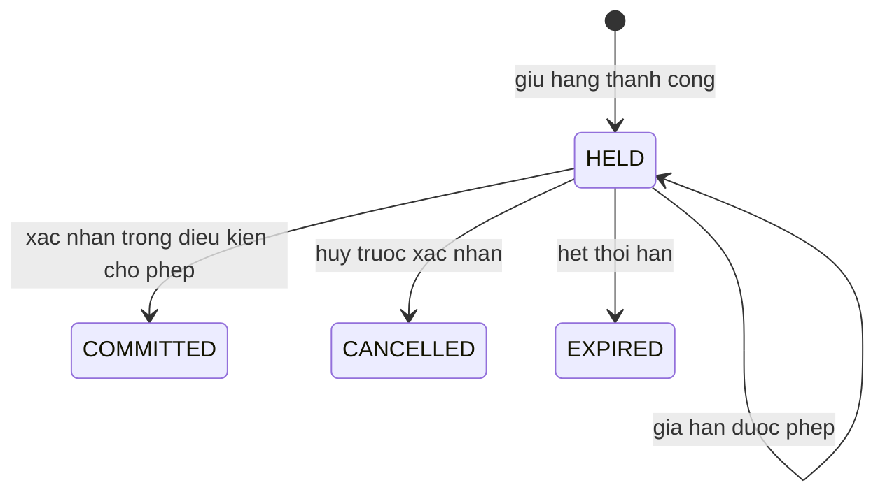

# Hết hạn giữ hàng (Inventory hold expiration)

Giữ hàng cho phép hệ thống tạm dành một lượng tồn kho cho một giao dịch trong khi khách hoàn tất checkout. Hết hạn giữ hàng là quá trình kết thúc quyền tạm giữ đó và trả lại phần tồn kho chưa tiêu dùng theo chính sách.

Trong bảo mật logic nghiệp vụ, đây là một chuyển trạng thái có tác động tài nguyên, không chỉ là thao tác xóa một key sau vài phút. Nếu xử lý sai, người dùng có thể giữ hàng vô hạn, xác nhận một quyền đã hết hạn hoặc làm hệ thống trả cùng một lượng hàng về khả dụng nhiều lần.

## 1. Mục tiêu và giả định của bài

Giả sử một cửa hàng có các quy tắc:

- Chỉ bán lượng hàng thực sự đủ điều kiện bán; không cho bán vượt tồn trong mô hình này.
- Một checkout có thể giữ hàng trong năm phút.
- Số lượng và kho phân bổ được máy chủ xác định, kiểm tra.
- Chỉ hold còn hiệu lực mới được chuyển thành phân bổ cho đơn.
- Hủy hoặc hết hạn trước khi xác nhận trả lại phần đang giữ đúng một lần.
- Hold đã xác nhận không được xử lý bằng đường hết hạn.
- Gia hạn, nếu được phép, có thời gian giữ tối đa riêng.

Đây là chính sách minh họa. Sản phẩm có đặt trước, backorder hoặc phân bổ từ hàng sắp về cần mô hình riêng; không được ngầm bỏ bất biến tồn kho của ví dụ để xử lý những trường hợp đó.

Ba mục tiêu cần đi cùng nhau:

1. **Toàn vẹn:** Không có hai giao dịch cùng chiếm một đơn vị tồn kho ngoài chính sách.
2. **Khả dụng:** Hàng bị giữ do checkout bỏ dở được giải phóng trong thời gian phù hợp.
3. **Khôi phục:** Tiến trình dừng, thông báo lặp hoặc tác vụ chạy trễ không làm sai số lượng.

TTL ngắn không tự bảo đảm toàn vẹn. Worker chạy nhanh cũng không thay thế việc kiểm tra trạng thái tại bước xác nhận.

## 2. Định nghĩa các số lượng trước khi cộng trừ

Trong mô hình của bài, với mỗi khóa `(tenant, warehouse, SKU)`:

- `on_hand`: lượng hàng vật lý đủ điều kiện bán, chưa xuất khỏi kho; có thể gồm cả hàng đã phân bổ cho đơn.
- `reserved`: lượng đang được hold tạm thời.
- `allocated`: lượng đã xác nhận dành cho đơn nhưng chưa xuất kho.

Khi đó:

```text
available = on_hand - reserved - allocated

on_hand >= 0
reserved >= 0
allocated >= 0
reserved + allocated <= on_hand
```

Tên trường ở hệ thống khác có thể khác. Điều quan trọng là hiểu chúng đại diện cho tài nguyên nào và không trừ hai lần cùng một nghĩa vụ.

| Thao tác | on_hand | reserved | allocated |
| --- | --- | --- | --- |
| Tạo hold q đơn vị | Không đổi | +q | Không đổi |
| Xác nhận hold | Không đổi | -q | +q |
| Hủy hoặc hết hạn hold | Không đổi | -q | Không đổi |
| Xuất kho phần đã phân bổ | -q | Không đổi | -q |
| Nhận hàng trả đủ điều kiện nhập lại | +q | Không đổi | Theo quy trình liên quan |

Hết hạn không làm tăng `on_hand`: hàng vốn chưa rời kho. Nó chỉ giảm phần đang giữ để tăng khả dụng.

Tương tự, xác nhận không làm hàng khả dụng tăng lên. Lượng đó chuyển từ giữ tạm sang phân bổ chính thức.

### Những phép cộng trừ nguy hiểm

- Hết hạn rồi vừa giảm reserved vừa tăng on_hand.
- Worker chạy lại và giảm reserved thêm một lần.
- Dùng đường hết hạn để giải phóng một hold đã chuyển sang allocated.
- Hoàn tiền rồi tự cộng hàng vào on_hand dù chưa nhận lại hàng.
- Đặt available về một giá trị từ cache trong lúc giao dịch vẫn đang chạy.

Các sai lệch này có thể tạo ra tồn kho “ảo”, dù giao diện không hiển thị số âm.

Nếu thực tế kiểm kê phát hiện hư hỏng hoặc thiếu hàng khiến nghĩa vụ đã cam kết vượt lượng còn bán được, cần quy trình xử lý thiếu hàng và điều chỉnh có căn cứ. Không đơn giản ép bộ đếm về 0 rồi coi các cam kết cũ đã biến mất.

## 3. Hold là một quyền có thời hạn và phạm vi

Một hold cần liên kết được với:

| Dữ liệu | Ý nghĩa |
| --- | --- |
| hold_id | Định danh lần giữ cụ thể |
| tenant_id | Phạm vi dữ liệu và quyền |
| subject_id | Chủ thể được phép thao tác |
| order_id và order_version | Đơn và nội dung được dùng khi giữ |
| state | Trạng thái hiện tại |
| created_at, expires_at | Mốc tạo và kết thúc quyền giữ |
| max_expires_at nếu có | Giới hạn tuyệt đối cho gia hạn |
| version hoặc generation | Phân biệt lần thay đổi và tác vụ cũ |
| allocations | SKU, kho và lượng đã giữ |
| idempotency reference | Nối với thao tác đã tạo hoặc xác nhận |
| policy_version | Truy nguyên quy tắc TTL và điều kiện liên quan |

Trong mô hình đơn giản của bài, lượng allocation của một hold không bị sửa tùy ý. Khi nội dung đơn thay đổi, hệ thống phải đánh giá lại và dùng một quy trình thay thế hoặc điều chỉnh có transaction phù hợp.

Nếu một hold gồm nhiều SKU, cần chốt hết hạn toàn bộ cùng lúc hay từng phần. Bài này dùng một deadline và một trạng thái cho toàn hold; các allocation của nó được chuyển cùng nhau. Nếu cần thời hạn độc lập, nên mô hình hóa các hold con rõ ràng.

### Quyền theo đối tượng vẫn bắt buộc

Biết hold ID không cấp quyền xác nhận, hủy hoặc gia hạn. API phải kiểm tra người gọi có quyền trên cả hold và đơn liên quan.

Client không được tự chọn kho không được phép, đổi subject ID, tăng lượng đã giữ hoặc gửi một expires_at mới để biến yêu cầu thành hợp lệ.

Worker hết hạn là chủ thể hệ thống có quyền được giới hạn cho tác vụ đó. Không tạo một API công khai cho phép người gửi tùy ý chỉ định hold của người khác rồi giải phóng tài nguyên của họ.

## 4. State machine và ý nghĩa của deadline

Một vòng đời tối thiểu:



Trong mô hình này, các trạng thái cuối không trở lại HELD. Một lần thử giữ mới dùng định danh hoặc thế hệ mới và vẫn chịu kiểm tra tồn kho.

Có thể định nghĩa quyền xác nhận bằng khoảng nửa mở:

```text
checked_at < expires_at
```

Tại đúng `expires_at`, quyền giữ không còn được xác nhận. Thời điểm `checked_at` phải được lấy từ nguồn có thẩm quyền theo cơ chế đồng thời của hệ thống.

### Phân biệt hết quyền và đã giải phóng bộ đếm

Hai điều sau không đồng nghĩa:

- **Hết hạn logic:** Đồng hồ có thẩm quyền đã đến deadline, nên không được xác nhận hold nữa.
- **Đã xử lý hết hạn:** Transaction đã chuyển HELD thành EXPIRED và giảm reserved.

Nếu worker chậm, một hold có thể đã hết quyền nhưng vẫn chiếm reserved trong dữ liệu. Điều này làm giảm khả dụng tạm thời, nhưng vẫn an toàn nếu bước xác nhận luôn kiểm tra deadline.

Không được tiếp tục xác nhận chỉ vì state còn HELD và worker chưa chạy.

Ngược lại, không được tính available bằng cách loại các hold quá hạn ra khỏi nghĩa vụ, rồi sau đó lại giảm cùng bộ đếm khi worker xử lý. Cách tính quyết định và cách cập nhật sổ phải thống nhất.

### Đồng hồ và thời điểm chờ khóa

Dùng thời gian do client gửi sẽ cho phép sửa giờ để kéo dài quyền giữ. Dùng các đồng hồ ứng dụng lệch nhau cũng có thể tạo kết quả không nhất quán.

Nếu dùng cơ sở dữ liệu làm nguồn quyết định, lấy thời điểm sau khi đã giành được quyền xử lý hold. Với PostgreSQL, `CURRENT_TIMESTAMP` biểu diễn thời điểm bắt đầu transaction; nó có thể quá cũ khi transaction chờ khóa lâu. Một lần đọc `clock_timestamp()` sau khi khóa là cách lấy thời gian hiện tại trong ví dụ của bài.

Lưu mốc thời gian với quy ước rõ ràng, thường dùng thời điểm tuyệt đối và hiển thị theo múi giờ phù hợp. UTC giúp biểu diễn nhất quán, nhưng không tự bảo đảm mọi đồng hồ luôn đúng hoặc không bị điều chỉnh.

Hệ thống cần theo dõi sai lệch đồng hồ và có một nguồn thời gian phù hợp với kiến trúc. Không dùng thứ tự nhận log ở các máy khác nhau để phân xử quyền giữ.

## 5. Tạo hold đúng để việc hết hạn có thể khôi phục

Hết hạn chỉ an toàn nếu hệ thống biết chính xác tài nguyên nào đã được giữ.

Một bảng tồn kho minh họa bằng PostgreSQL:

```sql
CREATE TABLE inventory_position (
    tenant_id    TEXT NOT NULL,
    warehouse_id TEXT NOT NULL,
    sku_id       TEXT NOT NULL,

    on_hand      BIGINT NOT NULL CHECK (on_hand >= 0),
    reserved     BIGINT NOT NULL DEFAULT 0 CHECK (reserved >= 0),
    allocated    BIGINT NOT NULL DEFAULT 0 CHECK (allocated >= 0),

    PRIMARY KEY (tenant_id, warehouse_id, sku_id),

    CHECK (reserved <= on_hand),
    CHECK (allocated <= on_hand - reserved)
);
```

Để giữ hàng:

```sql
UPDATE inventory_position
SET reserved = reserved + :quantity
WHERE tenant_id = :tenant_id
  AND warehouse_id = :warehouse_id
  AND sku_id = :sku_id
  AND :quantity > 0
  AND :quantity <= on_hand - reserved - allocated
RETURNING on_hand, reserved, allocated;
```

Các giá trị được bind; quantity phải là số nguyên dương trong giới hạn nghiệp vụ. Kho và SKU phải được tra cứu, kiểm tra từ nội dung đơn và chính sách máy chủ.

Trong cùng transaction:

1. Kiểm tra quyền và trạng thái đơn.
2. Giành quyền xử lý thao tác idempotent và quyền giữ cho đơn.
3. Cập nhật tồn kho các dòng cần giữ.
4. Tạo hold, allocations và deadline.
5. Ghi kết quả cùng outbox nếu cần.
6. Commit trước khi trả thành công.

Nếu một SKU không đủ hàng, rollback toàn bộ trong chính sách giữ trọn giỏ. Không để các SKU khác bị giữ mà client chỉ nhận lỗi chung và không biết hold nào tồn tại.

Gộp các dòng cùng khóa kho và SKU theo đúng chính sách; dùng thứ tự khóa ổn định khi cập nhật nhiều vị trí tồn kho. Mọi luồng ghi liên quan cần tuân thủ quy ước khóa tương thích.

### Idempotency không phải gia hạn

Cùng một request tạo hold được gửi lại phải trả lần giữ đã có, không giữ thêm và không tự đặt lại expires_at.

Một idempotency key khác cũng không được tạo thêm hold đang hoạt động trái quy tắc cho cùng một đơn. Cần một bản ghi quyền giữ nghiệp vụ hoặc ràng buộc phù hợp theo phạm vi đơn, tách biệt với định danh request.

Sau khi hold cũ hết hạn, một thao tác mới có thể thử giữ lại theo chính sách, nhưng phải kiểm tra lại tồn kho. Không được biến retry của thao tác cũ thành quyền giữ mới.

## 6. Thực hiện hết hạn bằng transaction lặp lại an toàn

Tác vụ hết hạn có hai phần:

1. Tìm những hold có khả năng đã đến hạn.
2. Giành quyền chuyển trạng thái và giải phóng đúng allocation trong transaction.

Phần tìm kiếm không phải bằng chứng cuối cùng. Một hold có thể vừa được xác nhận, hủy hoặc gia hạn trước khi worker xử lý.

### Tìm ứng viên từ dữ liệu bền vững

Có thể dùng chỉ mục:

```sql
CREATE INDEX inventory_hold_expiry_idx
ON inventory_hold (expires_at, hold_id)
WHERE state = 'HELD';
```

Ví dụ worker xử lý một hold trong mỗi transaction:

```sql
BEGIN;

-- Đọc scan_cutoff từ đồng hồ cơ sở dữ liệu.
SELECT clock_timestamp() AS scan_cutoff;

-- Bind giá trị vừa đọc cho bước tìm ứng viên.
SELECT tenant_id, hold_id, expires_at, version
FROM inventory_hold
WHERE state = 'HELD'
  AND expires_at <= :scan_cutoff
ORDER BY expires_at, hold_id
LIMIT 1
FOR UPDATE SKIP LOCKED;

-- Nếu có bản ghi, tiếp tục kiểm tra và xử lý trong transaction này.
```

`SKIP LOCKED` cho phép nhiều worker tránh chờ cùng một bản ghi đang bị xử lý. Nó không tự bảo đảm toàn bộ hiệu ứng đúng một lần. Trạng thái, bộ đếm và sổ tác động vẫn phải được cập nhật cùng nhau.

Không tìm được dòng cũng chưa chứng minh mọi hold quá hạn đã được xử lý; một số có thể đang bị khóa. Cần theo dõi backlog và độ trễ riêng.

Trong hệ thống chia theo tenant hoặc phân vùng, bộ lọc và chỉ mục phải phù hợp với phạm vi worker được giao. Worker không được nhận quyền truy cập mọi tenant chỉ vì một tham số đầu vào tự khai báo.

### Quy trình dưới khóa

Sau khi giành được quyền xử lý và khóa các vị trí tồn kho cần thiết theo quy ước chung:

1. Đọc lại trạng thái, version, deadline và allocations hiện tại.
2. Lấy `checked_at` từ nguồn thời gian có thẩm quyền.
3. Chỉ tiếp tục nếu state còn HELD và `expires_at <= checked_at`.
4. Chuyển hold sang EXPIRED bằng điều kiện trạng thái và version.
5. Với từng allocation, giảm reserved đúng lượng đã lưu.
6. Ghi sổ tác động và outbox nếu cần.
7. Commit; sau đó mới xác nhận tác vụ hoàn tất với hàng đợi.

Một UPDATE chuyển trạng thái minh họa:

```sql
UPDATE inventory_hold
SET state = 'EXPIRED',
    expired_at = :checked_at,
    version = version + 1
WHERE tenant_id = :tenant_id
  AND hold_id = :hold_id
  AND state = 'HELD'
  AND version = :locked_version
  AND expires_at <= :checked_at
RETURNING hold_id;
```

Chỉ khi thao tác này giành được chuyển trạng thái mới thực hiện hiệu ứng giải phóng trong cùng transaction.

Với một allocation:

```sql
UPDATE inventory_position
SET reserved = reserved - :quantity
WHERE tenant_id = :tenant_id
  AND warehouse_id = :warehouse_id
  AND sku_id = :sku_id
  AND :quantity > 0
  AND reserved >= :quantity
RETURNING reserved;
```

Lượng quantity lấy từ allocation trong cơ sở dữ liệu, không từ nội dung thông điệp yêu cầu hết hạn. Tenant và kho cũng phải khớp dữ liệu hold.

Nếu thiếu dòng tồn kho hoặc reserved không đủ, phải rollback cả việc chuyển trạng thái và xử lý sai lệch. Không bỏ qua dòng lỗi rồi commit hold đã EXPIRED trong khi một phần hàng vẫn bị giữ.

### Lưu dấu hiệu ứng giải phóng

Có thể có một bản ghi chuyển động tồn kho cho mỗi allocation, tham chiếu hold và loại hiệu ứng `HOLD_RELEASE`, với ràng buộc duy nhất phù hợp.

Lý do giải phóng có thể là hết hạn hoặc hủy, nhưng không nên để hai lý do khác nhau trở thành hai quyền giảm reserved cho cùng allocation. Cơ chế trạng thái vẫn là lớp bảo vệ chính; sổ hiệu ứng giúp kiểm tra và ngăn lặp bổ sung.

Giữ allocations phục vụ đối soát, thay vì xóa chúng ngay khi hết hạn. Việc một hold kết thúc không làm mất lịch sử hàng từng được giữ ở đâu.

### Khi worker dừng giữa chừng

- Dừng trước commit: các thay đổi trong transaction rollback.
- Dừng sau commit nhưng trước khi xác nhận thông điệp: tác vụ có thể đến lại, nhưng state cuối ngăn hiệu ứng lặp.
- Dừng sau commit trước khi phát sự kiện: outbox cho phép phát sau.
- Nhận thông điệp trùng: tra trạng thái hiện tại, không giảm bộ đếm lại.

Không cần giả định hàng đợi luôn giao đúng một lần. Cần thiết kế để việc giao lại không làm sai tồn kho.

## 7. Tranh chấp giữa xác nhận và hết hạn

Một phép kiểm tra trên giao diện không quyết định bên nào thắng. Hai luồng phải cùng bảo vệ trạng thái hold và các tài nguyên liên quan.

Mã giả cho bước xác nhận:

```text
bắt đầu transaction
    giành quyền thao tác idempotent
    kiểm tra quyền truy cập kết quả và tài nguyên
    khóa dữ liệu cần thiết theo thứ tự thống nhất
    đọc hold, đơn và allocations hiện tại

    nếu đây là thao tác đã hoàn tất:
        trả kết quả gốc mà không chạy lại hiệu ứng

    nếu state không phải HELD:
        kết thúc với trạng thái phù hợp

    checked_at = đọc đồng hồ có thẩm quyền sau các khóa cần thiết

    nếu checked_at >= expires_at:
        chuyển HELD -> EXPIRED
        giải phóng reserved của các allocation
        lưu kết quả nghiệp vụ HOLD_EXPIRED
        commit
        trả kết quả không còn quyền xác nhận

    kiểm tra phiên bản đơn và điều kiện còn bắt buộc
    chuyển reserved -> allocated
    chuyển HELD -> COMMITTED
    ghi quyền phân bổ cho đơn, kết quả idempotent và outbox
commit
trả thành công
```

Đây là mô tả ranh giới xử lý, không phải hàm triển khai hoàn chỉnh. Các bước khóa, ràng buộc duy nhất và kiểm tra lỗi phải được thực hiện thật ở tầng lưu trữ.

Nếu nhánh phát hiện hết hạn vừa giải phóng hàng rồi ném một exception khiến framework rollback, việc dọn sẽ không được lưu. Có thể chọn chỉ từ chối và để worker dọn sau, hoặc commit việc hết hạn rồi trả lỗi nghiệp vụ; cần rõ ràng về lựa chọn đó.

### Chuyển số lượng khi xác nhận

Với từng allocation, trong cùng transaction:

```sql
UPDATE inventory_position
SET reserved = reserved - :quantity,
    allocated = allocated + :quantity
WHERE tenant_id = :tenant_id
  AND warehouse_id = :warehouse_id
  AND sku_id = :sku_id
  AND :quantity > 0
  AND reserved >= :quantity
RETURNING reserved, allocated;
```

Số lượng phải khớp hold được khóa. Nếu một dòng không cập nhật được, không được ghi COMMITTED một phần.

Hai kết quả hợp lệ:

- **Hết hạn thắng:** Worker chuyển HELD thành EXPIRED và giải phóng. Xác nhận đến sau không được dùng hold cũ.
- **Xác nhận thắng đúng hạn:** Luồng xác nhận kiểm tra điều kiện thời gian dưới cơ chế bảo vệ, rồi commit chuyển sang allocated. Worker đến sau không được giải phóng nó.

Trong chính sách của bài, thời hạn được xét tại điểm kiểm tra được bảo vệ sau các khóa cần thiết. Một phản hồi HTTP đến khách sau deadline không tự chứng minh quyết định sai. Nếu sản phẩm yêu cầu một mốc khác, phải thiết kế rõ và kiểm thử theo mốc đó.

Không dùng timestamp của request đến đầu tiên làm quyền ưu tiên nếu thực tế request đó chưa giành được quyền xử lý và đến lúc kiểm tra đã hết hạn.

## 8. Gia hạn và tác vụ hết hạn cũ

Gia hạn thường cần cho checkout hợp lệ, nhưng cũng là cách giữ hàng vô hạn nếu không có giới hạn.

Ví dụ có thể cho gia hạn trong khi HELD và chưa hết hạn, với tổng thời gian không vượt mười phút tính từ lúc tạo. Các con số chỉ là giả định; cần chọn dựa trên luồng checkout thực tế.

Một cách tính:

```text
candidate =
    min(database_now + extension_from_policy, max_expires_at)

chỉ gia hạn nếu:
    state = HELD
    database_now < expires_at
    candidate > expires_at
    các điều kiện và giới hạn khác đều đạt
```

Thời lượng do chính sách máy chủ quyết định, không nhận tùy ý từ client.

Gia hạn cần:

- Kiểm tra quyền trên hold và đơn.
- Giành quyền cập nhật cùng bản ghi với luồng hết hạn.
- Kiểm tra deadline bằng thời điểm đủ mới.
- Tăng version và lưu deadline mới.
- Giữ nguyên allocations nếu không có quy trình điều chỉnh riêng.
- Xử lý request lặp mà không cộng thêm thời gian nhiều lần.

Một request gia hạn thất bại vì hold đã hết hạn không được tự đổi EXPIRED thành HELD. Có thể bắt đầu lần giữ mới, nhưng phải kiểm tra lại hàng.

### Thông điệp cũ không phải lệnh vô điều kiện

Giả sử tác vụ được đặt lúc hold có version 3 và hạn 10:05. Sau đó gia hạn hợp lệ lên version 4, hạn 10:07. Thông điệp cũ được giao lúc 10:05 không có quyền giải phóng hàng ngay.

Handler cần đọc lại bản ghi hiện tại. Với tác vụ định danh theo version, có thể bỏ qua tác vụ đã lỗi thời và bảo đảm deadline mới có lịch xử lý. Một lượt quét từ cơ sở dữ liệu vẫn cần làm đường khôi phục khi thông báo bị thiếu.

Ngay cả khi payload chứa expires_at hoặc quantity, chúng chỉ là dữ liệu hỗ trợ tìm kiếm hoặc kiểm tra kỳ vọng. Không dùng chúng thay trạng thái và allocation hiện tại.

### Giảm lạm dụng giữ chỗ

Có thể giới hạn số hold đang hoạt động theo chủ thể, số lần gia hạn, tổng thời gian giữ và tốc độ tạo thao tác mới. Đừng coi retry trả lại kết quả cũ là một yêu cầu gia hạn.

Chỉ giữ hàng ở bước có nhu cầu thực, thay vì mỗi lần xem trang. Kiểm tra điều kiện đơn trước khi chiếm tài nguyên khan hiếm.

IP chung không chứng minh nhiều tài khoản thuộc cùng một người. Các kiểm soát chống chiếm chỗ cần cân bằng người dùng hợp lệ và bằng chứng hành vi, thay vì chặn cả mạng chỉ từ một tín hiệu.

## 9. Thanh toán đến muộn và đơn đã phân bổ

Một chuỗi thường gặp:

```text
giữ hàng
khách bắt đầu thanh toán
hold hết hạn và hàng được khách khác giữ
thông báo thanh toán thành công của khách đầu tiên đến
```

Không được hồi sinh hold cũ chỉ vì thanh toán đã thành công. Hàng có thể đã được phân bổ hoặc xuất cho đơn khác.

Cách xử lý phải được chọn trong thiết kế checkout, chẳng hạn:

1. Giữ quyền đến một mốc thanh toán phù hợp bằng chính sách đã được kiểm soát.
2. Thử giữ lại hàng bằng một thao tác mới có kiểm tra đầy đủ.
3. Chuyển giao dịch sang trạng thái cần xử lý và thực hiện bù hoặc hoàn khi phù hợp với trạng thái thanh toán.

Nếu thử giữ lại, cần bảo đảm đơn chưa có một phân bổ thành công khác. Một callback được gửi nhiều lần không được tạo nhiều hold mới rồi xác nhận tất cả.

Thông báo thanh toán phải được xác minh nguồn, gắn đúng giao dịch và xử lý idempotent. Cờ `paid=true` từ trình duyệt không cấp quyền vượt deadline.

### Không giữ transaction mở trong lúc chờ thanh toán

Gọi dịch vụ ngoài khi đang giữ khóa tồn kho lâu có thể làm các checkout khác bị chặn và khiến kiểm tra thời gian khó kiểm soát.

Cần dùng trạng thái bền vững và một quy trình phối hợp có khả năng khôi phục. Transaction của cơ sở dữ liệu không tự rollback được khoản tiền đã xử lý ở hệ thống khác.

### Sau COMMITTED là quy trình khác

Khi hold đã chuyển thành phân bổ cho đơn, timeout thanh toán hoặc hủy đơn phải đi qua quy trình hủy phân bổ thích hợp.

- Nếu hàng chưa xuất, có thể giải phóng allocated theo điều kiện hủy hợp lệ; on_hand vẫn không tăng.
- Nếu hàng đã xuất, không được cộng lại hàng bán được chỉ vì đã hoàn tiền. Cần xử lý trả hàng và điều kiện nhập lại.
- Nếu đã có một thao tác hủy hoặc trả, thông báo lặp không tạo thêm hiệu ứng.

Không tái sử dụng worker hết hạn HELD để xử lý mọi timeout của vòng đời đơn hàng. Mỗi giai đoạn có trạng thái, quyền và bất biến riêng.

## 10. Timer, hàng đợi, cache và nhiều instance

### Timer trong bộ nhớ không phải dữ liệu có thẩm quyền

Một timer có thể biến mất khi tiến trình dừng, chạy chậm khi máy bận hoặc chạy lại sau khôi phục. Vì vậy deadline phải được lưu bền vững.

Có thể kết hợp:

- Thông điệp trì hoãn để xử lý gần deadline.
- Quét định kỳ các hold HELD đã đến hạn.
- Kiểm tra và xử lý hết hạn tại luồng xác nhận khi cần.

Ba đường này phải dùng cùng cơ chế chuyển trạng thái và hiệu ứng lặp an toàn. Không có đường nào được trực tiếp giảm tồn đang giữ chỉ vì “đã nhận tín hiệu hết giờ”.

### TTL của cache không phải chuyển trạng thái kho

Một key Redis tự hết TTL chỉ cho biết key không còn ở đó. Nó không tự bảo đảm reserved đã giảm đúng một lần hoặc hold đã được ghi EXPIRED.

Nếu dữ liệu hold chỉ tồn tại trong một key bị xóa, hệ thống có thể mất cả allocations cần để giải phóng và đối soát. Nếu dùng một kho dữ liệu khác làm nguồn quyết định, phải thiết kế đầy đủ tính nguyên tử, độ bền, khôi phục và cơ chế giữ lịch sử tương ứng.

Cache số còn hàng có thể phục vụ hiển thị. Quyết định giữ hoặc xác nhận vẫn phải đi qua nguồn bảo vệ tồn kho.

### Nhiều instance phải dùng cùng cơ chế phối hợp

Khóa trong một tiến trình không ngăn instance khác xử lý cùng hold. Các luồng cần dựa vào trạng thái và cơ chế đồng thời có hiệu lực trên phạm vi mọi writer.

Một giao thức phân tán cũng phải xét trường hợp worker cũ tiếp tục chạy sau khi quyền xử lý của nó đã mất. Nếu dùng lease cho worker, cần cơ chế như fencing hoặc kiểm tra phiên bản tại nguồn ghi để từ chối writer đã lỗi thời.

Lease của worker và lease giữ hàng là hai quyền khác nhau. Worker hết lease không có nghĩa hàng được giải phóng; hold hết hạn cũng không cho phép một worker cũ bỏ qua kiểm tra ghi dữ liệu.

### Khi nguồn tồn kho không khả dụng

Với chính sách không bán vượt tồn, không được tự cho phép xác nhận dựa trên một cache cũ. Có thể yêu cầu thử lại hoặc chuyển trạng thái chờ theo chính sách.

Đọc một bản sao trễ có thể phù hợp cho tra cứu gần đúng, nhưng không đủ để bảo vệ việc cấp cùng đơn vị hàng cho nhiều đơn.

## 11. Kiểm thử hết hạn và các tình huống tấn công logic

Kiểm thử cần kiểm tra trạng thái, số lượng và lịch sử hiệu ứng, không chỉ thông báo “hết thời gian”.

| Tình huống | Kết quả mong đợi |
| --- | --- |
| Xác nhận trước deadline dưới cơ chế bảo vệ | Chuyển reserved sang allocated đúng một lần |
| Xác nhận đúng tại expires_at | Không còn quyền xác nhận |
| Worker chưa chạy nhưng deadline đã qua | API vẫn từ chối dùng hold hết hạn |
| Worker chạy hai lần cho cùng hold | Chỉ một lần giải phóng |
| Hai worker đồng thời xử lý cùng hold | Không có hai hiệu ứng giảm reserved |
| Xác nhận và hết hạn cạnh tranh | Chỉ một trạng thái cuối có hiệu ứng, theo điểm kiểm tra đã chốt |
| Hủy và hết hạn cạnh tranh | Chỉ một lần trả phần đang giữ |
| Gia hạn thắng trước deadline | Deadline mới được dùng, tác vụ cũ không giải phóng sớm |
| Gia hạn đến sau khi đã hết hạn | Không hồi sinh quyền cũ |
| Retry tạo hold với cùng khóa | Không giữ thêm và không kéo dài hạn |
| Khóa mới cho cùng đơn đang có hold | Không tạo quyền giữ song song trái chính sách |
| Client sửa thời gian hoặc expires_at | Không thay đổi quyết định của máy chủ |
| Người khác gọi gia hạn hoặc hủy bằng hold ID | Bị từ chối theo quyền đối tượng |
| Hold nhiều SKU, một bước cập nhật thất bại | Không commit trạng thái hoặc giải phóng một phần |
| Transaction chờ khóa đến sau deadline | Không dùng thời điểm đầu transaction đã cũ để cho phép |
| Tiến trình dừng trước commit hết hạn | Dữ liệu rollback, tác vụ sau có thể xử lý lại |
| Tiến trình dừng sau commit trước khi ack | Chạy lại không đổi bộ đếm lần nữa |
| Hàng đã được khách khác giữ, thanh toán cũ đến muộn | Không xác nhận bằng hold cũ |
| Hold đã COMMITTED nhưng nhận thông điệp hết hạn | Không giảm reserved hoặc allocated do thông điệp đó |
| Hold mới thay hold cũ, thông điệp cũ được phát lại | Không chạm nhầm lần giữ mới |
| Quantity âm, quá lớn hoặc gây tràn | Bị từ chối, không tăng khả dụng giả |
| Allocation hoặc bộ đếm không khớp | Không bỏ qua lỗi rồi đánh dấu xử lý thành công |

Để tái hiện cạnh tranh, dùng điểm đồng bộ hoặc điều khiển khóa giữa các phiên xử lý. Kiểm tra cả hai thứ tự thắng quan trọng; gửi tuần tự nhiều request không chứng minh được điều đó.

Nên có phép thử với một đơn vị tồn và nhiều checkout độc lập, không hủy hay hết hạn trong cửa sổ kiểm tra. Không được có nhiều hơn một đơn vị được giữ hoặc phân bổ thành công.

Sau mỗi phép thử, xác minh:

```text
reserved >= 0
allocated >= 0
reserved + allocated <= on_hand

hold cuối trạng thái chỉ có hiệu ứng tương ứng
hold đã hết hạn không được chuyển thành COMMITTED
mỗi allocation chỉ được giải phóng một lần
request lặp không tạo thêm quyền giữ hoặc phân bổ
```

Các phép thử liên quan thời gian cần có cách kiểm soát mốc đánh giá, đặc biệt tại biên deadline. Đồng thời vẫn cần kiểm thử tích hợp với transaction và khóa thật cho các trường hợp cạnh tranh.

## 12. Đối soát và vận hành

### So bộ đếm với sổ nghiệp vụ

Với mô hình của bài:

```text
reserved_expected =
    tổng quantity của allocation thuộc hold đang HELD
```

Hold đã quá deadline nhưng chưa được chuyển trạng thái vẫn nằm trong phép tính này. Có thể đo riêng lượng quá hạn cần dọn; không loại chúng khỏi sổ reserved rồi vẫn chờ worker trừ tiếp.

`allocated` cần đối chiếu với phân bổ còn hiệu lực sau các chuyển động xuất kho, hủy và điều chỉnh. Không chỉ cộng mọi hold từng COMMITTED, vì một phần hàng có thể đã xuất hoặc được hủy hợp lệ.

`on_hand` cần khớp với sổ nhận, xuất, trả và điều chỉnh hàng đủ điều kiện bán.

Đọc các dữ liệu trong ảnh chụp nhất quán hoặc theo một mốc xử lý đã chốt. So số lượng ở hai thời điểm khác nhau giữa lúc giao dịch vẫn chạy có thể tạo chênh lệch giả.

### Các chỉ số hữu ích

| Nhóm | Ví dụ |
| --- | --- |
| Khả dụng | Số hold bị từ chối do hết hàng, lượng hàng đang giữ |
| Hết hạn | Số HELD quá hạn, lượng hàng liên quan, độ trễ xử lý |
| Trạng thái | Xác nhận sau hạn bị chặn, chuyển trạng thái xung đột |
| Cạnh tranh | Thời gian chờ khóa, deadlock, lỗi serialization và retry |
| Khôi phục | Tác vụ lỗi, backlog outbox, độ trễ quét hết hạn |
| Toàn vẹn | Chênh lệch bộ đếm với allocation và sổ chuyển động |
| Trải nghiệm | Tỷ lệ checkout hoàn tất, thanh toán đến sau hạn |

Một sự tăng của hold hết hạn có thể do checkout chậm, lỗi thanh toán hoặc lạm dụng giữ chỗ. Cần xem bối cảnh, không tự kết luận mọi người dùng liên quan có ác ý.

Không dùng hold ID, order ID hoặc subject ID làm nhãn metric có độ đa dạng lớn. Lưu thông tin chi tiết trong nguồn tra cứu được phân quyền.

### Xử lý backlog không bằng cách sửa số lượng tùy tiện

Khi worker chậm:

1. Kiểm tra tiến trình, hàng đợi, truy vấn ứng viên và khóa đang giữ lâu.
2. Xác minh API xác nhận vẫn kiểm tra deadline đúng.
3. Khôi phục hoặc tăng năng lực xử lý trong giới hạn của cơ sở dữ liệu.
4. Retry tác vụ theo cùng cơ chế chuyển trạng thái.
5. Đối soát số lượng sau khôi phục.

Không đặt reserved về 0 để “mở bán lại”. Một phần hàng vẫn có thể được giữ hợp lệ hoặc đang được xác nhận.

Không tự gia hạn mọi hold để làm giảm số lỗi thanh toán mà chưa đánh giá tác động tới tài nguyên. Thay TTL là thay chính sách, cần có quyền, lịch sử và cách xử lý các hold hiện hữu.

Nếu cần sửa dữ liệu do sai lệch thật, thao tác phải dựa trên sổ có thẩm quyền, kiểm soát ghi đồng thời và ghi nhận điều chỉnh. Một ảnh chụp cũ không đủ để sửa bộ đếm trong lúc hệ thống vẫn giao dịch.

## 13. Tình huống xuyên suốt với một sản phẩm cuối cùng

Kho còn một sản phẩm:

```text
on_hand = 1
reserved = 0
allocated = 0
```

1. Khách A giữ một sản phẩm tới 10:05. Reserved thành 1, available thành 0.
2. Đến 10:05, quyền xác nhận của A kết thúc. Worker chưa chạy nên reserved vẫn là 1.
3. Khách B thử giữ hàng và tạm thời bị từ chối. Hệ thống chưa có quyền cấp lại cùng sản phẩm khi sổ giữ chưa được giải quyết.
4. Worker khóa hold A, chuyển HELD thành EXPIRED và giảm reserved về 0 trong một transaction.
5. B giữ thành công; reserved trở lại 1.
6. Thông báo thanh toán của A đến muộn. Nó không thể xác nhận hold đã EXPIRED hoặc chiếm hàng của B.
7. B xác nhận đúng hạn: reserved về 0, allocated thành 1; on_hand vẫn bằng 1.
8. Khi xuất hàng cho B, on_hand và allocated cùng về 0.
9. Tác vụ hết hạn cũ của A đến lại không thay đổi số lượng nào.

Trong khoảng worker chậm, hệ thống có thể bỏ lỡ cơ hội bán tạm thời. Đây là vấn đề khả dụng có thể cải thiện bằng vận hành và thiết kế lịch xử lý; giải pháp không phải cấp lại hàng mà chưa bảo vệ việc giải phóng.

Hết hạn giữ hàng an toàn cần một deadline có thẩm quyền, một chuyển trạng thái được bảo vệ và một hiệu ứng trả tài nguyên đúng một lần. Khi ba phần này gắn với quyền đối tượng, transaction và idempotency, việc đổi thứ tự request hoặc chạy lại tác vụ không thể tự tạo thêm tồn kho.
