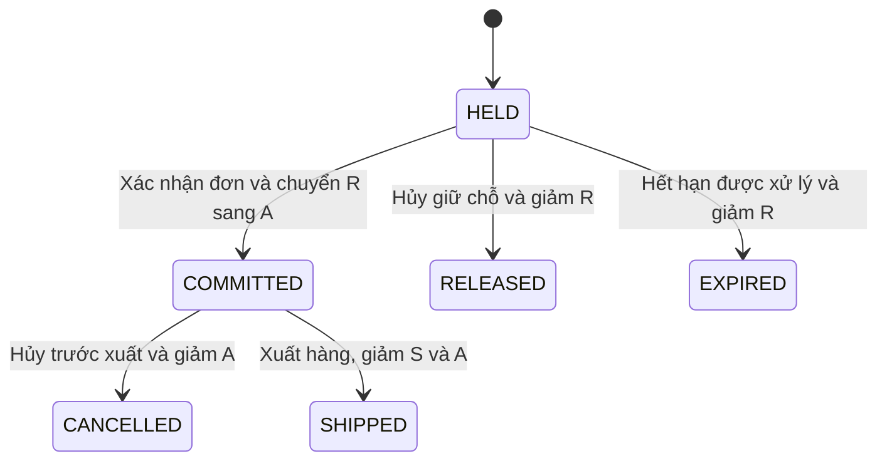

# Oversell prevention — Ngăn cam kết bán vượt tồn kho

## 1. Oversell là vi phạm cam kết giao hàng

Cửa hàng còn một sản phẩm. Hai khách cùng thấy “còn hàng”, cùng thanh toán và cùng nhận xác nhận đặt hàng. Một người sẽ không được giao đúng cam kết. Đây là **oversell**: hệ thống chấp nhận nhiều quyền nhận hàng hơn lượng hàng hoặc năng lực cung ứng mà chính sách cho phép cam kết.

Oversell không chỉ xuất hiện khi có lưu lượng cao. Người dùng có thể chủ động gửi nhiều yêu cầu đồng thời, phát lại lệnh xác nhận, sửa số lượng hoặc lợi dụng luồng hết hạn giữ chỗ để tạo ra các cam kết chồng lên nhau. Các request vẫn có thể hợp lệ về cú pháp và đã xác thực tài khoản.

Trong chương **Inventory Rules** của module bảo mật logic nghiệp vụ, ngăn oversell cần kết hợp bất biến tồn kho, quyền theo đối tượng, state machine, transaction, idempotency và kiểm thử các đường đi lạm dụng. Chỉ kiểm tra số tồn trên giao diện hoặc thêm một khóa trong bộ nhớ ứng dụng không đủ bảo vệ toàn bộ luồng.

Sau bài học, bạn có thể:

- Phân biệt hàng đang có, hàng giữ chỗ, hàng đã phân bổ và hàng còn có thể cam kết.
- Viết thao tác giữ hàng nguyên tử thay cho “đọc rồi kiểm tra”.
- Bảo toàn lượng hàng qua xác nhận, hết hạn, hủy và xuất kho.
- Xử lý retry, thanh toán muộn và luồng nhiều SKU hoặc nhiều dịch vụ.
- Thiết kế kiểm thử chứng minh số cam kết không vượt nguồn hàng.

Các mô hình và SQL trong bài là ví dụ thiết kế. Hệ thống có đặt trước, bán vượt có chủ đích hoặc cung ứng theo lịch cần xác định thêm nguồn năng lực riêng, thay vì ngầm cho số tồn âm.

## 2. Định nghĩa chính xác lượng hàng được phép bán

### 2.1. Chọn một phạm vi tồn kho có chủ sở hữu

Trong ví dụ, mỗi số dư tồn kho thuộc khóa:

```text
(tenant_id, warehouse_id, sku_id)
```

`sku_id` là biến thể thực sự được giao, không chỉ là mã sản phẩm cha. Nếu hàng được tách theo lô, chất lượng, chủ sở hữu hoặc quỹ hàng riêng, khóa phải bao gồm các chiều tương ứng hoặc có mô hình phân bổ rõ ràng.

Không được dùng tồn của kho A để bảo đảm đơn chỉ có thể giao từ kho B. Cũng không cộng tồn của các tenant hoặc nhà bán không chia sẻ quyền sử dụng hàng.

Đặt các đại lượng trong cùng phạm vi:

| Ký hiệu | Trường minh họa | Ý nghĩa |
| --- | --- | --- |
| `S` | `sellable_qty` | Hàng vật lý đủ điều kiện bán hiện còn tại kho, gồm cả phần đã giữ và phân bổ nhưng chưa xuất |
| `R` | `reserved_qty` | Hàng đang giữ tạm cho các giao dịch chưa chốt |
| `A` | `allocated_qty` | Hàng đã cam kết cho đơn xác nhận nhưng chưa xuất khỏi kho |
| `V` | Giá trị tính ra | Hàng còn có thể cam kết mới: `S - R - A` |

`S` không bao gồm hàng hỏng, bị cách ly, chưa nhập kho hoặc chỉ mới dự kiến mua từ nhà cung cấp. Hàng đã phân bổ vẫn nằm trong `S` cho đến lúc xuất; vì vậy không trừ nó khỏi `S` thêm lần nữa khi xác nhận đơn.

### 2.2. Các bất biến cốt lõi

Với mô hình không cho bán vượt:

```text
S >= 0
R >= 0
A >= 0
R + A <= S
V = S - R - A >= 0
```

Mỗi lần giữ thêm `q` đơn vị phải thỏa:

```text
q > 0
q <= V
```

Ngoài số dư, còn có bất biến liên kết:

```text
R = tổng lượng của các giữ chỗ vẫn đang chiếm hàng
A = tổng lượng phân bổ chưa xuất và chưa hủy
Mỗi tác động nghiệp vụ có định danh chống lặp
Mỗi giữ chỗ chỉ được tiêu thụ hoặc giải phóng theo trạng thái hợp lệ
```

Không chỉ dựa vào `V >= 0`. Một hệ thống có thể vẫn giữ số dư không âm nhưng đã tạo hai đơn cùng trỏ vào một giữ chỗ, hoặc đã làm mất một bản ghi giữ chỗ khỏi sổ chi tiết.

Nếu một giữ chỗ đã qua hạn nhưng chưa được giải phóng trong transaction, nó vẫn nằm trong `R` và chưa được phép bán lại. Không tự bỏ qua nó trong truy vấn tính `V` rồi đồng thời để bước xác nhận cũ còn quyền sử dụng.

### 2.3. Phép chuyển lượng phải bảo toàn ý nghĩa

| Thao tác | Thay đổi số dư | Điều kiện chính |
| --- | --- | --- |
| Giữ mới `q` | `R += q` | `q <= S - R - A` |
| Xác nhận giữ chỗ | `R -= q`, `A += q` | Đúng giữ chỗ đang hoạt động, chưa hết hạn và chưa bị tiêu thụ |
| Giải phóng giữ chỗ | `R -= q` | Giữ chỗ chưa được tiêu thụ hoặc giải phóng trước đó |
| Hủy phần đã phân bổ, chưa xuất | `A -= q` | Phần phân bổ còn đủ và chưa xuất kho |
| Xuất hàng đã phân bổ | `S -= q`, `A -= q` | Đúng phần phân bổ được xuất, không xuất trùng |
| Nhập thêm hàng đủ điều kiện | `S += q` | Có nghiệp vụ nhập kho hợp lệ, không nhập trùng |
| Nhận lại hàng hoàn đủ điều kiện | `S += q` | Đã nhận và kiểm định theo chính sách, không chỉ mới hoàn tiền |

Ví dụ ban đầu `S = 10`, `R = 2`, `A = 3`, nên `V = 5`:

1. Giữ thêm 4: `S = 10`, `R = 6`, `A = 3`, `V = 1`.
2. Xác nhận giữ chỗ 4 đó: `S = 10`, `R = 2`, `A = 7`, `V = 1`.
3. Xuất đúng 4 đã phân bổ: `S = 6`, `R = 2`, `A = 3`, `V = 1`.

Bước xác nhận không làm hàng khả dụng giảm lần thứ hai. Bước xuất giảm cả hàng vật lý còn tại kho lẫn phần phân bổ tương ứng. Trộn hai thời điểm này dễ dẫn đến trừ đôi hoặc tăng ảo lượng có thể bán.

## 3. Vì sao kiểm tra thông thường vẫn gây oversell?

### 3.1. Khoảng hở giữa đọc và ghi

Mã giả sau không đủ an toàn:

```text
available = đọc tồn khả dụng
nếu available >= requested:
    tạo đơn
    cập nhật reserved += requested
```

Với một sản phẩm cuối cùng:

```text
A đọc V = 1
B đọc V = 1
A kiểm tra 1 >= 1: đúng
B kiểm tra 1 >= 1: đúng
A tạo giữ chỗ 1
B tạo giữ chỗ 1
```

Cả hai kết quả đọc đều từng đúng, nhưng hai thao tác không được phân xử như một quyết định có cạnh tranh tài nguyên. Đọc tồn ngay trước khi ghi vẫn không loại bỏ khoảng hở đó.

### 3.2. Số tồn không âm vẫn có thể che cam kết sai

Một biến thể khác đọc `stock = 1`, rồi cả hai request đều ghi lại `stock = 0`. Kết quả lưu không âm, nhưng hai đơn đã cùng được xác nhận. Đây là lỗi mất cập nhật: số dư cuối không phản ánh đầy đủ các tác động đã phát sinh.

Do đó cần bảo vệ cả quyết định chiếm hàng và việc ghi đơn, giữ chỗ, số dư, lịch sử trong cùng cơ chế nhất quán. Không thể chứng minh an toàn chỉ bằng việc kiểm tra một cột không nhỏ hơn 0.

### 3.3. Các biện pháp dễ bị hiểu nhầm

| Biện pháp | Giới hạn |
| --- | --- |
| Ẩn nút mua khi hết hàng | Khách có thể gọi API trực tiếp hoặc dùng trang đã mở |
| `synchronized` hoặc khóa trong một JVM | Không phân xử được nhiều instance hoặc đường ghi khác |
| Đọc từ cache hoặc read replica | Có thể cũ so với các cam kết đã ghi |
| Đặt mọi thao tác trong `@Transactional` | Vẫn cần kiểu cập nhật, khóa, ràng buộc và mức cô lập phù hợp |
| Khóa phân tán có TTL | Chủ khóa cũ có thể tiếp tục sau khi lease hết nếu nơi ghi không từ chối nó |
| Chỉ khử trùng message | Không ngăn hai lệnh nghiệp vụ khác ID cùng chiếm lượng hàng cuối |
| Tự động retry mọi lỗi | Có thể nhân tác động nếu không biết transaction trước đã commit hay chưa |

Nguyên tắc là mọi đường tạo cam kết phải đi qua nơi có quyền phân bổ cùng quỹ hàng hoặc qua một cơ chế chia quyền không chồng lấn.

## 4. Kiểm tra đầu vào và quyền trước khi chiếm hàng

Máy chủ cần xác minh khách có quyền với đơn và giữ chỗ trong đúng tenant; SKU được bán ở kênh tương ứng; kế hoạch kho được phép phục vụ đơn. Không tin `available`, `reserved`, `warehouseOverride`, `stockVersion` tự khai hoặc giá trị trạng thái từ client.

Số lượng cần được kiểm tra ở mức lệnh nghiệp vụ:

- Lớn hơn 0, đúng kiểu và đơn vị đếm của SKU.
- Không vượt giới hạn trên mỗi SKU, mỗi đơn hoặc mỗi khách theo chính sách.
- Không bị tràn khi cộng các dòng trùng hoặc khi quy đổi bộ sản phẩm.
- Được gom theo khóa tài nguyên sau khi phân giải SKU và thành phần hàng.
- Không dùng số âm để “giữ hàng” theo chiều tăng tồn.

Ví dụ, giỏ có ba dòng cùng SKU với số lượng 2 không phải ba lần kiểm tra độc lập với hạn mức 5. Máy chủ phải gom thành 6 trước khi áp hạn mức. Một bộ sản phẩm chứa hai đơn vị linh kiện phải chiếm đúng hai đơn vị đó, kể cả khi linh kiện cũng xuất hiện như một dòng bán lẻ trong giỏ.

Quyền điều chỉnh tồn, nhập hàng hoặc giải phóng giữ chỗ của người khác thuộc các luồng riêng. Không để một API mua hàng tự tạo dòng tồn mới khi không tìm thấy khóa, hoặc tự đánh dấu hoàn kho để vượt bước kiểm tra còn hàng.

## 5. Giữ hàng bằng cập nhật nguyên tử

### 5.1. Ràng buộc số dư tại tầng lưu trữ

Schema PostgreSQL minh họa cho một quỹ hàng theo kho và SKU:

```sql
CREATE TABLE inventory_balance (
    tenant_id       text    NOT NULL,
    warehouse_id    text    NOT NULL,
    sku_id          text    NOT NULL,
    sellable_qty    bigint  NOT NULL CHECK (sellable_qty >= 0),
    reserved_qty    bigint  NOT NULL CHECK (reserved_qty >= 0),
    allocated_qty   bigint  NOT NULL CHECK (allocated_qty >= 0),
    sales_enabled   boolean NOT NULL DEFAULT true,
    version         bigint  NOT NULL DEFAULT 0 CHECK (version >= 0),
    PRIMARY KEY (tenant_id, warehouse_id, sku_id),
    CHECK (
        reserved_qty <= sellable_qty
        AND allocated_qty <= sellable_qty - reserved_qty
    )
);
```

Điều kiện cuối biểu diễn `R + A <= S` mà không cộng hai số lượng lớn trước khi kiểm tra. Đơn vị đếm và miền giá trị vẫn phải được thống nhất giữa ứng dụng và database.

`NOT NULL`, khóa duy nhất và `CHECK` hỗ trợ bảo vệ số dư, nhưng không tự bảo đảm tổng các bản ghi giữ chỗ bằng `reserved_qty`. Giới hạn của ràng buộc theo hàng được trình bày trong [tài liệu PostgreSQL 18 về constraints](https://www.postgresql.org/docs/18/ddl-constraints.html); bất biến giữa nhiều bảng cần giao thức ghi và đối soát tương ứng.

### 5.2. Chiếm lượng còn lại trong một lệnh

Thay “đọc rồi kiểm tra”, dùng cập nhật có điều kiện:

```sql
UPDATE inventory_balance
SET reserved_qty = reserved_qty + :quantity,
    version = version + 1
WHERE tenant_id = :tenant_id
  AND warehouse_id = :warehouse_id
  AND sku_id = :sku_id
  AND sales_enabled = true
  AND :quantity > 0
  AND sellable_qty - reserved_qty - allocated_qty >= :quantity
RETURNING reserved_qty, allocated_qty, sellable_qty, version;
```

Chỉ đúng một dòng cập nhật thành công mới cho phép ghi giữ chỗ tương ứng. Không có dòng trả về có thể do thiếu hàng, không tồn tại phạm vi, bị khóa bán hoặc điều kiện khác không đạt; ứng dụng cần phân loại trong phạm vi được phép xem, không tiếp tục tạo đơn đã được bảo đảm hàng.

Với PostgreSQL ở `READ COMMITTED`, các cập nhật tranh chấp cùng hàng được phân xử và điều kiện được đánh giá lại trên phiên bản hàng cập nhật trong trường hợp phù hợp. Cơ chế này được mô tả trong [tài liệu transaction isolation](https://www.postgresql.org/docs/18/transaction-iso.html). Mẫu trên giới hạn quyết định lượng hàng vào một số dư cụ thể; không suy rộng nó thành bảo đảm cho mọi quy tắc nhiều hàng hoặc nhiều database.

Với `S = 1`, `R = 0`, `A = 0`, hai request cùng giữ 1:

1. Một transaction giành được cập nhật và tăng `R` lên 1.
2. Request còn lại phải chờ kết quả tranh chấp nếu transaction đầu chưa kết thúc.
3. Nếu transaction đầu commit, phần còn lại là 0 và request kia không cập nhật được.
4. Nếu transaction đầu rollback, lượng hàng chưa bị chiếm và request kia có thể thành công.

Điểm quyết định thành công không phải lúc đọc số tồn hoặc lúc nhận request, mà là việc chiếm lượng được hoàn tất trong transaction theo giao thức.

### 5.3. Số dư và giữ chỗ phải ghi cùng nhau

Một luồng transaction cục bộ tham khảo:

```text
BEGIN
  Xác minh danh tính, tenant, quyền với đơn và phiên bản giỏ.
  Chuẩn hóa các dòng hàng và dựng kế hoạch cấp hàng phía máy chủ.
  Chiếm khóa idempotency hoặc lấy kết quả đã hoàn tất.
  Kiểm tra ràng buộc giữ chỗ đang tồn tại cho cùng đơn vị nghiệp vụ.
  Giữ lượng của từng tài nguyên bằng cập nhật có điều kiện.
  Nếu bất kỳ tài nguyên bắt buộc nào không đủ: rollback toàn bộ.
  Ghi reservation, các dòng giữ hàng và thời hạn.
  Ghi liên kết với đơn, sổ tác động tồn kho và kết quả idempotency.
  Ghi sự kiện outbox nếu cần đồng bộ sang dịch vụ khác.
COMMIT
```

Nếu tăng `R` rồi lỗi ghi reservation, phải rollback cả phần tăng. Nếu chỉ ghi reservation mà cập nhật số dư thất bại, không được báo giữ hàng thành công. Không đặt hai thao tác trong hai transaction độc lập rồi hy vọng tác vụ đối soát sửa sau.

Thời hạn giữ chỗ nên được xác lập bằng thời gian máy chủ có thẩm quyền sau các bước chờ khóa cần thiết. Giữ transaction ngắn; không chờ khách nhập thông tin hoặc gọi thanh toán trong lúc đang khóa hàng.

### 5.4. Chọn cơ chế đồng thời phù hợp

| Cơ chế | Cách sử dụng | Điểm cần kiểm soát |
| --- | --- | --- |
| Cập nhật có điều kiện | Chiếm lượng nếu số dư đủ trong một lệnh | Kiểm tra số dòng cập nhật và ghi chi tiết cùng transaction |
| Khóa hàng bi quan | Khóa số dư, tính toán rồi ghi | Mọi luồng liên quan phải tuân thủ cùng giao thức khóa |
| Khóa lạc quan bằng version | Chỉ ghi nếu version vẫn đúng | Xung đột phải đọc/tính lại hoặc trả lỗi; không ghi đè bằng snapshot cũ |
| Serializable | Phát hiện lịch sử không thể tuần tự hóa | Xử lý rollback và retry cả transaction theo lỗi thực tế |

Với khóa lạc quan, điều kiện số lượng vẫn nên hiện diện trong phép ghi hoặc được chứng minh từ đúng snapshot và version. Một `version` do client gửi không thay quyền truy cập và không thể ép database chấp nhận phiên bản cũ.

Khi dùng cơ chế retry, phân biệt lỗi chắc chắn rollback với kết quả chưa biết do mất kết nối. Trường hợp chưa biết phải tra cứu thao tác đã ghi bằng idempotency trước khi tạo hiệu ứng mới.

## 6. Nhiều SKU, bộ sản phẩm và nhiều kho

### 6.1. Gom nhu cầu trước khi lấy hàng

Đối với giỏ chỉ gồm SKU đơn vị nguyên, Java có thể gom dòng trùng trước khi kiểm tra hạn mức. Ví dụ dưới dùng Java 17 trở lên và chỉ minh họa chuẩn hóa, không phải bộ giữ hàng nguyên tử:

```java
import java.util.Collections;
import java.util.List;
import java.util.Objects;
import java.util.SortedMap;
import java.util.TreeMap;

public final class InventoryDemand {
    private InventoryDemand() {}

    public record Line(String skuId, long quantity) {}

    public static SortedMap<String, Long> aggregate(
            List<Line> lines, long perSkuLimit) {
        Objects.requireNonNull(lines, "lines");
        if (lines.isEmpty() || perSkuLimit <= 0) {
            throw new IllegalArgumentException("invalid demand policy");
        }

        SortedMap<String, Long> quantities = new TreeMap<>();
        for (Line line : lines) {
            Objects.requireNonNull(line, "line");
            String sku = Objects.requireNonNull(line.skuId(), "skuId");
            if (sku.isBlank() || line.quantity() <= 0) {
                throw new IllegalArgumentException("invalid line");
            }
            long total = Math.addExact(
                    quantities.getOrDefault(sku, 0L), line.quantity());
            if (total > perSkuLimit) {
                throw new IllegalArgumentException("per-SKU limit exceeded");
            }
            quantities.put(sku, total);
        }
        return Collections.unmodifiableSortedMap(quantities);
    }
}
```

Trong hệ thống thực, phân giải mã SKU chuẩn bằng catalog phía máy chủ trước khi gom, tránh hai mã biểu diễn cùng một tài nguyên. Giới hạn số dòng cũng cần có ở biên API. `perSkuLimit` là chính sách mẫu; nếu từng SKU có hạn khác nhau, lấy giới hạn tương ứng từ nguồn tin cậy.

Sau khi mở bộ sản phẩm thành linh kiện, tiếp tục gom nhu cầu của cùng linh kiện từ mọi dòng và kiểm tra tràn ở cả phép nhân lẫn phép cộng. Giữ một bộ hai linh kiện không thể chỉ kiểm tra tồn của mã bộ nếu nguồn hàng thực sự nằm ở các linh kiện.

### 6.2. Cần toàn bộ thì phải giữ toàn bộ

Một đơn cần SKU A và B. Nếu giữ A thành công nhưng B hết hàng, chính sách “đủ bộ mới bán” yêu cầu rollback cả A. Không để giữ A tồn tại mồ côi sau khi đã trả lỗi cho khách.

Nếu cho phép giao một phần, phải mô hình hóa phần nào được chấp nhận, số lượng nào đã giữ, giá và cam kết nào khách đồng ý. Không coi transaction thất bại một phần là tự động đồng nghĩa với đơn giao một phần.

### 6.3. Thứ tự khóa phải thống nhất

Với nhiều tài nguyên, mọi luồng giữ, xác nhận, hủy và xuất nên tuân thủ một thứ tự khóa thống nhất, chẳng hạn theo khóa phạm vi chuẩn đã sắp xếp. Dịch vụ khác khóa theo thứ tự ngược vẫn có thể tạo deadlock dù riêng luồng checkout đã sắp thứ tự.

Tài liệu [PostgreSQL 18 về explicit locking](https://www.postgresql.org/docs/18/explicit-locking.html) giải thích khóa hàng và khuyến nghị lấy nhiều khóa theo thứ tự nhất quán để giảm deadlock. Khi vẫn xảy ra deadlock hoặc lỗi serialization, retry có giới hạn với transaction mới và giữ nguyên định danh thao tác.

### 6.4. Tổng tồn nhiều kho chưa phải một kế hoạch thực hiện được

Kho A có 1 và kho B có 1 không nhất thiết đáp ứng đơn cần 2 nếu hợp đồng không cho tách giao. Hệ thống cần dựng kế hoạch kho hợp lệ rồi chiếm đúng số lượng tại từng kho.

Nếu cho tách, phân bổ các phần sao cho tổng bằng nhu cầu và từng phần được giữ thật. Việc đổi kho hoặc đổi kế hoạch sau đó phải giải phóng và chiếm lượng theo giao thức có kiểm soát; không cập nhật riêng một trường `warehouse_id` trên đơn rồi giữ nguyên bảo đảm cũ.

## 7. Vòng đời giữ hàng và giải phóng đúng một lần

### 7.1. Trạng thái quyết định ai còn quyền với lượng hàng

Một giữ chỗ cần có tối thiểu định danh, tenant, khách hoặc chủ thể được ủy quyền, đơn, phiên bản giỏ, các khóa tồn kho, số lượng, hạn hiệu lực, trạng thái và version.

Sơ đồ tham khảo cho một phần lượng được xử lý trọn vẹn:



Sơ đồ chưa bao gồm giao một phần hoặc hoàn một phần. Những luồng đó cần lượng đã tiêu thụ, đã xuất, đã hủy và đã nhận lại riêng; không chuyển toàn bộ reservation sang trạng thái kết thúc khi mới xử lý một phần.

Theo mô hình minh họa, xác nhận đơn chuyển `R` thành `A` trước khi gửi lệnh thanh toán ra ngoài. Phần đã phân bổ không còn thuộc job hết hạn giữ chỗ. Nếu sản phẩm chọn chốt tồn sau thanh toán, cần giao thức khác bảo vệ giữ chỗ và trạng thái thanh toán đến khi có kết quả.

### 7.2. Chuyển trạng thái và số dư phải nguyên tử

Ví dụ giải phóng một giữ chỗ:

```text
BEGIN
  Xác minh quyền thao tác hoặc danh tính job nội bộ.
  Khóa các bản ghi liên quan theo thứ tự khóa chung.
  Đọc số lượng, khóa tồn kho, trạng thái và version từ nguồn lưu.
  Nếu đã RELEASED/EXPIRED: trả kết quả cũ, không giảm R lần nữa.
  Nếu đã COMMITTED: không đi qua luồng giải phóng giữ chỗ.
  Nếu hết hạn: lấy thời gian có thẩm quyền sau các bước chờ khóa.
  Chuyển HELD sang RELEASED hoặc EXPIRED bằng điều kiện trạng thái/version.
  Giảm R đúng lượng gốc trên các số dư liên quan.
  Ghi sổ tác động và sự kiện cần thiết.
COMMIT
```

Số lượng giải phóng phải lấy từ giữ chỗ đã khóa, không lấy từ `quantity` do khách gửi trong lệnh hủy. Nếu một cập nhật không đạt số dòng hoặc điều kiện mong đợi, rollback và điều tra nguyên nhân; không để trạng thái và số dư lệch nhau.

Một job hết hạn và một request xác nhận cùng tranh chấp giữ chỗ phải chỉ có một chuyển trạng thái thắng. Nếu xác nhận thắng, job không được giảm `R` của nó nữa. Nếu hết hạn thắng, request không được tạo `A` từ lượng đã giải phóng.

Đặc biệt, điều kiện `reserved_qty >= q` trên số dư tổng không chứng minh giữ chỗ cụ thể vẫn có quyền tiêu thụ. `R` có thể đang thuộc người khác. Cần kiểm tra trạng thái của đúng reservation rồi cập nhật số dư liên quan trong cùng transaction.

### 7.3. Hết hạn không phụ thuộc hoàn toàn vào tốc độ job

Một giữ chỗ qua hạn không được xác nhận mới chỉ vì job chưa cập nhật trạng thái. Bước xác nhận phải kiểm tra cả trạng thái và thời gian theo chính sách.

Ở chiều ngược lại, giữ chỗ qua hạn nhưng chưa được giải phóng nguyên tử vẫn chiếm lượng trong `R`. Có thể thu hồi nó theo nhu cầu hoặc bằng job, nhưng không được coi lượng ấy đã rảnh trước khi hoàn tất chuyển trạng thái và cập nhật số dư.

TTL được xác lập khi giữ chỗ thành công. Retry trả giữ chỗ cũ; không đặt lại thời điểm tạo hoặc hạn mỗi lần gọi. Nếu cho gia hạn, kiểm tra lại quyền, điều kiện và giới hạn tổng thời gian giữ.

### 7.4. Thay giỏ không được giữ cả cam kết cũ lẫn mới ngoài ý muốn

Khi giỏ tăng từ 2 lên 3 sản phẩm, có thể chiếm thêm 1 bằng cập nhật có điều kiện trong transaction đồng bộ với thay đổi reservation. Giảm từ 3 xuống 2 giải phóng đúng 1. Đổi SKU hoặc kho cần kế hoạch thay thế có kiểm soát.

Không để mỗi phiên bản giỏ tạo một giữ chỗ mới mà bỏ quên bản cũ. Nếu phải thay cả nhóm giữ chỗ, mô hình hóa quan hệ thay thế và quy tắc thành công/rollback rõ ràng. Với cơ sở dữ liệu khác nhau, cần giao thức bù trừ và bảo đảm không xác nhận đơn khi chưa có đủ cam kết hợp lệ.

## 8. Idempotency, thanh toán và tác động đến muộn

### 8.1. Chống lặp kỹ thuật và chống trùng nghiệp vụ

Một request giữ hàng nên có khóa idempotency trong phạm vi như `(tenant, chủ thể, loại thao tác, key)`. Máy chủ lưu fingerprint của lệnh đã chuẩn hóa, trạng thái xử lý và kết quả:

- Cùng khóa, cùng nội dung: trả kết quả cũ hoặc trạng thái đang xử lý, không tăng `R` lần nữa.
- Cùng khóa, khác SKU, lượng hoặc phiên bản đơn: trả xung đột.
- Hai request cùng khóa đến đồng thời: kho dữ liệu phân xử quyền thực thi bằng ràng buộc bền vững.

Khóa khác nhau không có nghĩa hai lần giữ đều được phép. Cần ràng buộc nghiệp vụ để một đơn vị đặt hàng không có nhiều giữ chỗ hoạt động trái chính sách, chẳng hạn khóa theo đơn, phiên bản dòng và tài nguyên với mô hình thế hệ giữ chỗ rõ ràng.

Khi khóa idempotency hết thời gian lưu, trạng thái và các định danh nghiệp vụ vẫn phải ngăn xác nhận, xuất hoặc hoàn kho trùng. Không phụ thuộc duy nhất vào cache kết quả request.

### 8.2. Xác nhận không chiếm hàng thêm lần nữa

Chuyển `HELD` sang `COMMITTED` hợp lệ dùng lượng đã giữ:

```text
R_mới = R_cũ - q
A_mới = A_cũ + q
S_mới = S_cũ
```

Không thực hiện thêm một lần giữ `q` rồi mới xác nhận. Cũng không giảm `S` ở đây nếu mô hình định nghĩa chỉ giảm `S` lúc xuất.

Các webhook hoặc thông điệp xác nhận lặp phải tham chiếu cùng đơn, reservation và thao tác đã xử lý. Một sự kiện mới có ID khác nhưng vẫn mô tả cùng tác động nghiệp vụ không được tạo phân bổ lần hai.

### 8.3. Thanh toán không rõ kết quả cần trạng thái riêng

Trong mô hình đã phân bổ trước thanh toán, hết TTL của `HELD` không giải phóng phần `A`. Đơn có hạn thanh toán và quy trình hủy riêng. Nếu lệnh thanh toán timeout, chưa thể kết luận khách chưa bị thu tiền; cần xác minh hoặc chờ kết quả có thẩm quyền trước khi quyết định thu hồi cam kết.

Nếu hệ thống đã hủy hợp lệ và phân bổ hàng cho đơn khác, webhook thanh toán thành công đến muộn không được phục hồi phân bổ cũ bằng một lệnh cộng `A` vô điều kiện. Có thể thử cấp hàng lại bằng một thao tác chiếm lượng hiện tại được bảo vệ, hoặc xử lý hủy/hoàn giao dịch theo hợp đồng. Mọi đường đi vẫn phải giữ bất biến tồn kho.

Nếu chọn mô hình giữ hàng cho đến khi thanh toán thành công, tác vụ hết hạn và kết quả thanh toán phải phối hợp qua cùng quyết định trạng thái. Không được vừa giải phóng giữ chỗ để bán lại, vừa cho callback cũ quyền tiêu thụ nó sau đó. Chính sách đối với thanh toán đang xử lý phải được thiết kế trước, không chỉ dựa vào một TTL của key.

### 8.4. Xuất hàng và hoàn kho cũng cần chống lặp

Tác động xuất phải gắn với phiếu xuất, dòng phân bổ và số lượng còn được xuất. Thông điệp xuất lặp không được giảm `S` và `A` lần nữa. Hủy phần đã xuất không được đi qua thao tác giảm `A` của hàng chưa xuất.

Hoàn tiền không đồng nghĩa hàng vật lý đã quay lại quỹ có thể bán. Chỉ tăng `S` khi nghiệp vụ nhận và kiểm định đủ điều kiện đã hoàn tất. Giới hạn lượng nhập lại theo lượng thực nhận hợp lệ và chống lặp theo dòng nhận trả; không lấy số tiền hoàn để suy ra số lượng có thể bán.

## 9. Nhiều dịch vụ, nhiều kênh và quỹ hàng phân tán

### 9.1. Chọn nơi có thẩm quyền cam kết hàng

Web, ứng dụng di động, POS, marketplace và tác vụ nội bộ phải dùng cùng dịch vụ phân bổ quỹ hàng hoặc dùng các quyền phân bổ riêng không chồng lấn. Nếu mỗi kênh chỉ đồng bộ số tồn sau vài giây rồi tự chấp nhận đơn trên toàn bộ số đó, tổng cam kết có thể vượt tồn trước khi đồng bộ.

Cache và read model có thể phục vụ hiển thị. Một thông báo “còn hàng” là thông tin tại thời điểm đọc, không phải giữ chỗ. API xác nhận phải lấy được bằng chứng giữ hoặc phân bổ thành công từ nơi có thẩm quyền.

### 9.2. Transaction cục bộ không bao trùm mọi dịch vụ

Nếu order-service và inventory-service có database riêng, transaction ở order-service không thể tự rollback thay đổi đã commit ở inventory-service. Một giao thức có thể là:

1. Order tạo lệnh giữ với định danh thao tác ổn định.
2. Inventory kiểm tra, chiếm lượng và lưu giữ chỗ bền vững.
3. Order lưu tham chiếu kết quả trước khi công bố bảo đảm hàng.
4. Nếu không thể hoàn tất bước tiếp theo, dùng lệnh giải phóng có idempotency hoặc quy trình hết hạn phù hợp.

Mất phản hồi ở bước 2 không chứng minh giữ thất bại. Tra lại cùng định danh hoặc gửi lại cùng thao tác, thay vì tạo giữ chỗ mới.

Ghi số dư, reservation và outbox trong transaction tại inventory-service giúp phát sự kiện từ dữ liệu đã commit. [AWS Prescriptive Guidance về transactional outbox](https://docs.aws.amazon.com/prescriptive-guidance/latest/cloud-design-patterns/transactional-outbox.html) mô tả cách giải quyết khoảng hở giữa ghi database và thông báo; consumer vẫn phải xử lý giao lại thông điệp. Outbox không tự tạo transaction nguyên tử giữa hai database.

### 9.3. Chia quyền bán phải bảo toàn tổng

Nếu cần bán độc lập ở nhiều vùng hoặc khi mất kết nối, có thể chia lượng có quyền cam kết thành các phần riêng. Ví dụ, với 100 sản phẩm chưa cam kết, vùng A được quyền bán 60 và vùng B được quyền bán 40. Mỗi vùng chỉ cam kết trong phần còn lại của mình, không cùng coi 100 là quyền của riêng nó.

Chuyển quyền từ A sang B cần bảo đảm quyền cũ không thể tiếp tục được tiêu sau khi quyền mới được cấp. Phải tính cả lượng đã cam kết, lượng còn được cấp và quyền đang chuyển; không thu hồi quyền của một vùng rồi cấp lại chỉ vì vùng đó tạm thời mất liên lạc.

Đây là lựa chọn kiến trúc có đánh đổi về khả dụng và sử dụng hết hàng. Không thể bảo đảm tuyệt đối không oversell trên một quỹ chung bằng các quyết định độc lập chỉ dựa trên số tồn đồng bộ sau cùng, nếu không giới hạn quyền cam kết của từng bên.

### 9.4. Lease và fencing khi dùng chủ ghi tạm thời

Nếu dùng lease để chọn chủ phân bổ, cần ngăn tiến trình cũ tiếp tục ghi sau khi lease mất hiệu lực. Một fencing token tăng theo thế hệ chỉ hữu ích khi nơi nhận ghi thực sự kiểm tra và từ chối thế hệ cũ.

Khóa phân tán chỉ có TTL, không được kiểm chứng tại nơi cập nhật tồn, chưa đủ để bảo vệ dữ liệu. Với database là nguồn sự thật, vẫn cần các cập nhật có điều kiện và ràng buộc tại đó; không thay chúng bằng niềm tin rằng “chỉ có một worker đang chạy”.

## 10. Ngăn lạm dụng giữ hàng và xử lý điều chỉnh tồn

### 10.1. Không oversell nhưng vẫn có thể bị chiếm hết hàng

Một hệ thống có thể giữ đúng bất biến `R + A <= S` nhưng cho một người tạo hàng nghìn giữ chỗ không thanh toán, khiến khách khác không mua được. Đây là rủi ro liên quan đến [OWASP OAT-021 — Denial of Inventory](https://owasp.github.io/www-project-automated-threats-to-web-applications/assets/oats/EN/OAT-021_Denial_of_Inventory): chiếm lượng hàng hoặc năng lực hữu hạn mà không hoàn tất giao dịch.

Cần thiết kế thêm các giới hạn phù hợp:

- Số lượng giữ tối đa theo SKU, đơn, khách và phạm vi rủi ro.
- Số giữ chỗ đang hoạt động và tổng thời gian được phép giữ.
- Chỉ giữ ở bước có ý nghĩa nghiệp vụ, thay vì mỗi lần xem hoặc thêm sản phẩm vào giỏ.
- Không gia hạn vô hạn bằng retry, heartbeat hoặc đổi phiên bản giỏ.
- Giới hạn tốc độ tạo/hủy, kết hợp theo dõi việc giữ rồi bỏ lặp lại.
- Giải phóng các giữ chỗ không còn hợp lệ bằng giao thức trạng thái đúng.

Nếu giới hạn theo khách cũng phải chính xác dưới đồng thời, kiểm tra bộ đếm của giới hạn đó trong transaction hoặc cơ chế phân xử phù hợp; một lần đọc “khách hiện có 0 giữ chỗ” rồi ghi độc lập vẫn có cùng khoảng hở.

Giới hạn tài khoản không tự bảo đảm giới hạn theo người thực khi có nhiều tài khoản. Các biện pháp chống lạm dụng cần được lựa chọn theo luồng bán hàng và dữ liệu được phép sử dụng, đồng thời không thay thế lớp cưỡng chế tồn kho.

### 10.2. Điều chỉnh giảm không được bỏ qua hàng đã cam kết

Nếu `S = 10`, `R = 2`, `A = 7`, thao tác thông thường giảm `S` xuống 8 sẽ phá bất biến. Luồng điều chỉnh cần có quyền, lý do, tham chiếu nghiệp vụ và xử lý ảnh hưởng đến các cam kết đang tồn tại.

Nếu kiểm kê phát hiện hàng thực tế đã mất hoặc hỏng, hệ thống không thể làm sự thiếu hàng biến mất bằng một constraint. Phải ghi nhận số kiểm đếm và khoản thiếu, chặn cam kết mới trong phạm vi bị ảnh hưởng, xử lý các phân bổ có rủi ro và điều chỉnh sổ theo quy trình. Nếu mô hình bình thường không còn biểu diễn được thực tế, cần trạng thái thiếu hàng hoặc sổ ngoại lệ rõ ràng.

Không tăng số tồn ảo, xóa reservation hoặc sửa `allocated_qty` để làm bảng số dư trông hợp lệ. Những việc đó có thể che chính các đơn đang thiếu hàng. Bảo đảm chống oversell áp dụng cho cam kết mới dựa trên nguồn hàng được ghi nhận đúng; nó không loại bỏ sai lệch vật lý ngoài hệ thống.

Nhập kho, nhận trả, chuyển kho và kiểm kê đều là đường thay đổi nguồn lực cần chống lặp. Chuyển kho không tạo hàng ở cả hai nơi; bên nhận chỉ có quyền bán theo trạng thái nhận hàng hoặc mô hình hàng đang chuyển đã được xác định rõ.

### 10.3. Đặt trước phải là chính sách riêng

Nếu cho phép backorder hoặc preorder, cần biểu diễn nguồn năng lực tương lai, hạn mức, thời gian giao và cam kết tương ứng. Không bỏ điều kiện còn hàng cho một SKU rồi vẫn hiển thị như hàng sẵn có.

Một cờ `allowOversell=true` do client gửi không phải phê duyệt. Ngoại lệ có chủ đích phải được cấu hình và kiểm tra tại máy chủ, có quyền và phạm vi rõ ràng; các đơn đó cần được phân biệt với đơn được bảo đảm bằng tồn hiện tại.

## 11. Kiểm thử để chứng minh bảo toàn lượng hàng

### 11.1. Ca đồng thời tối thiểu

Thiết lập `S = 1`, `R = 0`, `A = 0` cho một SKU kiểm thử, không có tác vụ nhập/xuất hoặc giải phóng khác. Hai khách dùng hai lệnh độc lập cùng giữ 1. Cho các request tranh chấp ở gần điểm ghi bằng cơ chế đồng bộ kiểm thử.

Kỳ vọng:

```text
Tối đa một lệnh giữ thành công.
S = 1, R = 1, A = 0 nếu có một giữ chỗ thành công chưa xử lý tiếp.
Chỉ một giữ chỗ hợp lệ chiếm đơn vị đó.
Không có đơn nào được thông báo bảo đảm hàng nếu giữ thất bại.
```

Không chỉ kiểm tra database không có số âm. Đối chiếu cả số đơn đã được cam kết, các reservation và các tác động ghi sổ.

Có thể mở rộng với 10 sản phẩm và 100 request giữ một sản phẩm. Khi không có nguồn hàng mới hoặc giải phóng, tổng lượng giữ thành công không được vượt 10. Nếu có lỗi vận hành hoặc request không hoàn tất, số thành công có thể thấp hơn 10; việc bán hết hay không là chỉ tiêu khác với việc không bán vượt.

### 11.2. Ma trận tình huống lạm dụng và lỗi

Các ca dưới dành cho môi trường kiểm thử với kho, đơn và thanh toán giả lập:

| Tình huống | Kết quả cần xác minh |
| --- | --- |
| Đọc tồn trước rồi gửi nhiều checkout đồng thời | Quyết định cuối vẫn phân xử bằng lượng được chiếm thật |
| Số lượng âm, 0, quá lớn hoặc tràn khi cộng | Bị từ chối; không tăng tồn hoặc tạo giữ chỗ |
| Nhiều dòng trùng SKU vượt hạn mức | Gom tổng trước khi kiểm tra |
| Bộ sản phẩm và hàng lẻ dùng cùng linh kiện | Không tiêu hai lần cùng một đơn vị linh kiện |
| Dùng giữ chỗ của khách hoặc tenant khác | Từ chối trước khi thay trạng thái hoặc số dư |
| Sửa kho sang phạm vi không có quyền | Không dùng được tồn ngoài kế hoạch được phép |
| Retry cùng khóa sau mất phản hồi | Cùng kết quả và giữ chỗ, không tăng `R` |
| Khác khóa nhưng cùng đơn vị nghiệp vụ | Không tạo giữ chỗ hoạt động trùng trái chính sách |
| Lỗi sau tăng `R`, trước ghi reservation | Rollback toàn bộ, không giữ mồ côi |
| Giỏ cần A và B nhưng B hết | Không để lại giữ A nếu chính sách đủ bộ mới bán |
| Hai luồng lấy nhiều khóa theo thứ tự đối nghịch | Phát hiện/xử lý deadlock; retry không nhân tác động |
| Xác nhận và hết hạn cùng chạy | Chỉ một chuyển trạng thái hợp lệ, không vừa cấp vừa giải phóng |
| Hết hạn job chạy chậm | Không xác nhận giữ chỗ quá hạn; lượng chỉ được bán lại sau giải phóng nguyên tử |
| Callback cũ sau khi lượng đã cấp cho đơn khác | Không phục hồi phân bổ vô điều kiện |
| Xuất hàng, hủy hoặc nhập trả gửi lặp | Không trừ hoặc cộng lượng nhiều lần |
| Cache báo còn hàng nhưng nguồn đã hết | Không tạo cam kết vượt nguồn có thẩm quyền |
| Điều chỉnh giảm tồn và giữ mới cùng chạy | Tuân thủ cùng bất biến và chính sách xử lý thiếu hàng |
| Tiến trình chủ cũ tiếp tục sau khi mất lease | Nơi nhận ghi từ chối thế hệ không còn quyền |
| Hai kênh bán dùng cùng lượng cuối | Tổng cam kết toàn bộ kênh không vượt quỹ hoặc quyền đã cấp |

Kiểm thử transaction và đồng thời phải dùng cơ chế database thực sự được triển khai; mock repository không thể chứng minh khóa và mức cô lập đúng. Dùng barrier, latch hoặc điểm dừng có kiểm soát để tái hiện tranh chấp, thay vì chỉ tăng số luồng rồi hy vọng tạo được lỗi.

### 11.3. Thuộc tính và chuỗi trạng thái

Với mỗi bước trong chuỗi giữ, xác nhận, hủy và xuất hợp lệ:

```text
S >= 0, R >= 0, A >= 0
R + A <= S
R bằng lượng giữ chỗ còn chiếm hàng trong sổ chi tiết
A bằng lượng phân bổ chưa xuất, chưa hủy
Replay cùng thao tác không đổi số dư lần thứ hai
Reservation đã kết thúc không tự có quyền tiêu thụ lại
```

Sinh các chuỗi sự kiện với thứ tự nhận khác nhau, thao tác lặp, lỗi giữa các bước và nhiều lượng khác nhau. Đối với chuyển lượng, kiểm tra cả trạng thái trước/sau và tác động:

- Giữ làm `V` giảm đúng `q`.
- Xác nhận chuyển `R` sang `A`, không đổi `V`.
- Giải phóng hợp lệ làm `V` tăng đúng `q` một lần.
- Xuất đúng phần phân bổ làm giảm cả `S` và `A`, không tạo thêm `V`.
- Hoàn tiền đơn thuần không làm tăng `S`.

## 12. Sổ tác động, đối soát và phục hồi

### 12.1. Giữ bằng chứng cho mỗi thay đổi

Một bản ghi tác động nên có định danh thao tác, tenant, kho, SKU, reservation hoặc phân bổ, đơn, loại tác động, số lượng, thời điểm, chủ thể thực hiện và tham chiếu phiên bản. Tùy thiết kế, có thể lưu các delta của `S`, `R`, `A` để giải thích chuyển lượng.

Các nguồn như phiếu nhập, phiếu xuất, nhận trả và kiểm kê cần định danh chống trùng riêng. Mã `event_id` của message không luôn là định danh của tác động nghiệp vụ; hai sự kiện khác nhau có thể cùng mô tả một phiếu xuất.

Lịch sử dùng để tái hiện và điều tra, không nên bị sửa ngầm để làm khớp bảng tổng. Truy cập và thao tác điều chỉnh cần giới hạn theo vai trò, tenant và kho. Không để API khách mua ghi trực tiếp các delta tồn kho.

### 12.2. Đối soát theo cùng phạm vi và mốc dữ liệu

Các kiểm tra hữu ích:

```text
reserved_qty = tổng lượng HELD vẫn chiếm hàng
allocated_qty = tổng lượng đã cam kết còn chờ xuất sau các điều chỉnh hợp lệ
sellable_qty = tồn đầu kỳ
               + nhập đủ điều kiện
               + hàng trả đã nhận đủ điều kiện
               - xuất thực tế
               + các điều chỉnh hợp lệ có dấu
```

Công thức cần dùng đủ lịch sử và đúng mô hình đang triển khai. Không tính `R` chỉ từ giữ chỗ có `expires_at > now` nếu các bản ghi quá hạn chưa được giải phóng nguyên tử.

Chụp hoặc đọc dữ liệu theo mốc nhất quán. Đọc bảng tổng rồi đọc chi tiết sau khi một transaction khác vừa chuyển trạng thái có thể tạo chênh lệch giả. Với nhiều dịch vụ, ghi nhận độ đầy đủ và độ trễ của từng nguồn trước khi kết luận thiếu dữ liệu là vi phạm.

Theo dõi chênh lệch sổ, lượng cam kết không có giữ hoặc phân bổ hợp lệ, tác động lặp, giữ chỗ quá hạn, thời gian chờ khóa, deadlock, tỷ lệ thất bại do hết hàng và lượng giữ có hành vi bất thường. Hệ thống không có cảnh báo nhưng ngừng nhận dữ liệu không phải bằng chứng rằng không oversell.

### 12.3. Phục hồi không được tạo nguồn hàng ảo

Nếu phát hiện bảng tổng và chi tiết lệch, xác định nguồn tác động đã commit và trạng thái hiện tại trước khi sửa. Có thể cần tạm dừng cam kết mới trong phạm vi bị ảnh hưởng, điều tra giao dịch và chạy lệnh điều chỉnh có quyền, lý do và idempotency.

Không tự đặt `reserved_qty = 0`, giải phóng mọi đơn đang chờ hoặc tăng `sellable_qty` để làm kiểm tra xanh. Những cách đó có thể cấp lại hàng đã được cam kết cho khách khác. Sau khắc phục, đối soát lại và giữ lịch sử trước/sau cùng tham chiếu hành động.

## 13. Checklist triển khai oversell prevention

- [ ] Xác định đúng khóa quỹ hàng, SKU, kho, tenant và đơn vị đếm.
- [ ] Định nghĩa rõ `S`, `R`, `A`, lượng khả dụng và thời điểm trừ từng loại.
- [ ] Mọi đường cam kết dùng cập nhật nguyên tử hoặc giao thức phân bổ đã được chứng minh.
- [ ] Số dư, reservation, đơn và lịch sử liên quan nhất quán trong transaction hoặc giao thức phân tán.
- [ ] Quyền theo đối tượng và đầu vào số lượng được kiểm tra phía máy chủ.
- [ ] Nhu cầu được gom sau phân giải SKU và bộ sản phẩm; có phát hiện tràn.
- [ ] Nhiều tài nguyên có thứ tự khóa và chính sách toàn bộ/một phần rõ ràng.
- [ ] Xác nhận, hết hạn, hủy, xuất và nhập trả có chuyển trạng thái chống lặp.
- [ ] Retry và kết quả chưa biết được xử lý bằng định danh bền vững.
- [ ] Cache, replica và đồng bộ sau cùng không tự cấp quyền trên cùng toàn bộ tồn.
- [ ] Thanh toán muộn không hồi sinh giữ chỗ hoặc phân bổ đã mất quyền.
- [ ] Có giới hạn chống chiếm hàng, luồng điều chỉnh thiếu hàng và chính sách đặt trước riêng.
- [ ] Có kiểm thử đồng thời, lỗi giữa transaction và đối soát số dư với sổ chi tiết.

Ngăn oversell là bảo đảm rằng mỗi cam kết mới chiếm được một phần nguồn hàng hợp lệ và phần đó không đồng thời được cam kết cho nơi khác. Bất biến cần được giữ trên toàn bộ vòng đời hàng, kể cả các đường đi retry, hết hạn, hủy và sự kiện đến muộn.
