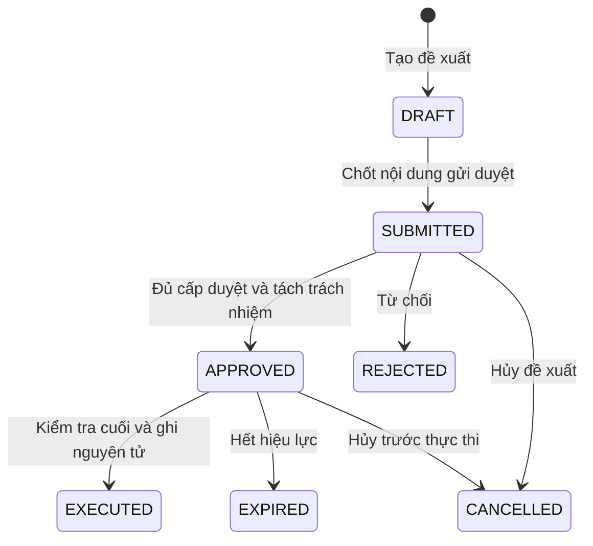

# Inventory adjustment authority — Thẩm quyền điều chỉnh tồn kho

## 1. Điều chỉnh tồn kho là một quyền có tác động nghiệp vụ

**Inventory adjustment authority** là tập quy tắc xác định ai được đề xuất, phê duyệt và thực thi việc thay đổi số lượng tồn kho, trong phạm vi nào và dựa trên bằng chứng nào.

Điều chỉnh có thể cần thiết khi kiểm kê phát hiện chênh lệch, hàng hỏng, thất thoát hoặc sai sót ghi nhận. Tuy nhiên, một API cho phép sửa trực tiếp `on_hand` có thể tạo hoặc xóa lượng hàng mà không đi qua nhập kho, xuất kho hay quy trình xác nhận tương ứng.

Một nhân viên có quyền kiểm kê không mặc nhiên được quyết định mọi chênh lệch. Người có quyền sửa mô tả SKU cũng không mặc nhiên được tăng số lượng hàng bán được. Một dịch vụ có quyền ghi cơ sở dữ liệu không mặc nhiên được thực hiện mọi điều chỉnh mà client yêu cầu.

Bất biến trung tâm của bài học:

```text
Mỗi điều chỉnh đã thực thi
  => đúng actor được phép thực thi
  AND đúng tenant, chủ hàng, kho và đối tượng tồn
  AND đúng nội dung đã được phê duyệt theo chính sách
  AND đủ cấp phê duyệt và còn hiệu lực tại điểm cam kết
  AND không phá các cam kết tồn kho đang tồn tại
  AND có bút toán và dấu vết đối soát tương ứng.
```

Kiểm tra vai trò trên một màn hình quản trị chưa đủ. Bất biến phải đúng khi gọi thẳng API, chạy batch, gửi lại request hoặc có nhiều giao dịch cùng cập nhật tồn kho.

## 2. Phân biệt ghi nhận thực tế với quyền sửa sổ tồn

| Hành động | Ý nghĩa | Quyền không được suy ra tự động |
| --- | --- | --- |
| Xem tồn | Đọc số lượng trong phạm vi được cấp | Không cho phép sửa số lượng |
| Ghi nhận kiểm kê | Lưu quan sát về hàng thực tế tại một mốc | Không tự biến quan sát thành điều chỉnh đã duyệt |
| Đề xuất điều chỉnh | Nêu số lượng chênh lệch, lý do và bằng chứng | Không tự cho phép thực thi |
| Phê duyệt | Chấp nhận một nội dung cụ thể trong hạn mức | Không cho phép sửa nội dung đó rồi giữ phê duyệt cũ |
| Thực thi | Ghi thay đổi số dư và sổ nghiệp vụ | Không cho phép tạo quyết định tùy ý ngoài lệnh đã duyệt |
| Đảo điều chỉnh | Tạo bút toán bù cho điều chỉnh trước | Không cho phép xóa lịch sử hoặc bỏ qua hạn mức |
| Chuyển giao chủ hàng | Chuyển quyền phân bổ từ chủ này sang chủ khác | Không nên giả thành hai điều chỉnh độc lập |

Nhập hàng, xuất hàng, trả hàng và giải phóng reservation có ngữ nghĩa riêng. Không gom tất cả vào một endpoint `adjustStock(delta)` rồi kỳ vọng một trường `reason` do caller gửi sẽ bảo vệ được chính sách.

Ví dụ, hủy đơn thường chỉ giảm phần đã giữ. Nếu dùng điều chỉnh tăng `on_hand` để hủy, hệ thống có thể tạo thêm hàng dù lúc giữ chưa từng giảm `on_hand`.

Một lý do nghiệp vụ hợp lệ không thay thế quyền. Chuỗi `reason = "STOCK_COUNT"` không chứng minh actor đã kiểm kê, có quyền với kho hoặc được phép tự duyệt kết quả.

## 3. Chính sách minh họa và phạm vi quyền

Xét một hệ thống có tenant `T1`, chủ hàng `OWNER-A` và kho `W1`. Một bucket tồn được xác định bằng tenant, chủ hàng, kho, SKU và trạng thái hàng; hệ thống có thể bổ sung lô hoặc serial nếu cần.

Chính sách dưới đây chỉ phục vụ minh họa:

| Thành phần | Quy tắc |
| --- | --- |
| Người kiểm kê | Được ghi nhận số đếm và nộp đề xuất trong đúng phạm vi |
| Người phê duyệt | Có grant phê duyệt cho đúng chủ hàng và kho, với cấp phù hợp |
| Tách trách nhiệm | Người phê duyệt không cùng định danh cá nhân với người đề xuất |
| Cấp thông thường | Chênh lệch tuyệt đối không quá 10 đơn vị, giá trị rủi ro không quá 1.000.000 VND và tổng giá trị rủi ro 24 giờ sau điều chỉnh không quá 3.000.000 VND |
| Cấp cao | Bắt buộc nếu vượt bất kỳ ngưỡng thông thường nào |
| Giá trị rủi ro | Trị tuyệt đối số lượng chênh lệch nhân giá trị một đơn vị từ nguồn định giá nội bộ được chỉ định |
| Phạm vi tổng hợp | Cùng tenant, chủ hàng, kho và tiền tệ; cộng xuyên SKU trong cửa sổ 24 giờ |
| Hiệu lực phê duyệt | Tối đa 30 phút, gắn với đúng phiên bản nội dung và cơ sở tồn |
| Điểm kiểm tra cuối | Ngay trong luồng thực thi trước khi commit số dư và bút toán |
| Giới hạn sổ tồn | Không giảm `on_hand` xuống dưới phần đang giữ; không sửa `reserved` để né điều kiện |

Các ngưỡng là ví dụ chính sách, không phải giá trị khuyến nghị cho mọi doanh nghiệp. Cần dùng cùng đơn vị và tiền tệ khi so sánh. Không cộng trực tiếp VND với một tiền tệ khác.

### 3.1. Cả tăng và giảm đều cần quyền

Giảm tồn có thể che việc xuất ngoài quy trình. Tăng tồn có thể cho phép nhận đơn hoặc xuất hàng không có thật. Vì vậy hạn mức của ví dụ dùng trị tuyệt đối, không chỉ xét chiều giảm.

Nếu tăng 800.000 VND rồi giảm 800.000 VND, mức phơi nhiễm điều chỉnh là 1.600.000 VND trong cửa sổ chính sách, không phải 0. Bù trừ số có dấu có thể che chuỗi thao tác đáng lẽ cần cấp duyệt cao hơn.

Giá trị một đơn vị phải lấy từ nguồn đã được chính sách xác định, có phiên bản hoặc mốc hiệu lực. Không lấy giá bán do client gửi hoặc dùng giá trị 0 khi dịch vụ định giá timeout.

### 3.2. Quyền phải khớp toàn bộ đối tượng và action

Một grant có thể mang ngữ nghĩa:

```text
(tenant, owner, warehouse, action, approvalTier)
```

Không kiểm tra riêng tập chủ hàng và tập kho rồi ghép thành các quyền chưa từng được cấp. Có quyền phê duyệt A–W1 và B–W2 không mặc nhiên cho quyền phê duyệt A–W2.

Quyền thực thi của service principal cũng cần phạm vi. Endpoint nội bộ không được nhận một `ownerId` tùy ý rồi ghi số dư chỉ vì caller có vai trò dịch vụ.

### 3.3. Tách trách nhiệm theo đúng chủ thể

So sánh tài khoản người tạo với tài khoản người duyệt chỉ bảo vệ ở cấp tài khoản. Nếu một người có nhiều tài khoản, chính sách tách trách nhiệm theo người cần một định danh cá nhân được quản lý và nguồn liên kết đáng tin cậy.

Không dùng email giống nhau hoặc tên hiển thị làm bằng chứng đầy đủ về cùng người. Nếu hệ thống chỉ có định danh tài khoản, cần hiểu rõ giới hạn của bảo đảm đó.

## 4. State machine của đề xuất và phê duyệt



Mô hình này không cho sửa trực tiếp nội dung đã gửi. Nếu cần sửa, tạo revision mới ở trạng thái soạn và yêu cầu phê duyệt lại; revision cũ không tự chuyển quyền duyệt sang revision mới.

### 4.1. Nội dung nào phải được phê duyệt cùng nhau?

Một bản nội dung đã chốt có thể gồm:

```text
request_id, revision
đối tượng: tenant, owner, warehouse, SKU, trạng thái hàng, lô nếu có
chế độ: DELTA hoặc kết quả kiểm kê đã được chuyển thành delta
delta và đơn vị
số dư cơ sở, phiên bản bucket cơ sở
lý do và tham chiếu bằng chứng
nguồn định giá, phiên bản định giá, giá trị một đơn vị, tiền tệ
người đề xuất và thời điểm gửi
```

Phê duyệt cần tham chiếu đúng revision hoặc fingerprint của toàn bộ nội dung có ý nghĩa. Nếu dùng fingerprint, phải có cách mã hóa chuẩn với cấu trúc và kiểu dữ liệu rõ ràng, không nối chuỗi mơ hồ.

Fingerprint chỉ giúp phát hiện nội dung không còn khớp. Nó không tự chứng minh ai đã duyệt, người đó có thẩm quyền hay bằng chứng kiểm kê đúng. Bản ghi phê duyệt vẫn cần chủ thể duyệt, cấp duyệt, thời hạn và nguồn quyền tương ứng.

Không coi `approved=true` trong request HTTP hoặc một trường có thể mass assignment là bằng chứng phê duyệt. Trạng thái chỉ được chuyển bởi hành động được máy chủ phân quyền.

### 4.2. Những thay đổi buộc đánh giá lại

- Đổi bucket, owner, kho, SKU, trạng thái hàng hoặc lô.
- Đổi dấu, độ lớn hoặc đơn vị của delta.
- Đổi lý do hay bằng chứng có ảnh hưởng quyết định.
- Thay cơ sở kiểm kê hoặc phiên bản số dư.
- Thay nguồn định giá hoặc dữ liệu định giá theo chính sách.
- Tổng điều chỉnh trong cửa sổ làm cấp phê duyệt cần thiết tăng lên.
- Thu hồi quyền có liên quan hoặc hết hạn phê duyệt.

Không tự sửa nội dung một đề xuất đã được duyệt để “khớp tình hình mới”. Phải xác định lại điều kiện và cấp duyệt cần thiết.

## 5. Kiểm kê tuyệt đối và delta không có cùng ngữ nghĩa

### 5.1. Ví dụ kiểm kê có cơ sở

Giả sử một bucket có:

```text
on_hand = 10
reserved = 4
version = 41
số kiểm kê được chấp nhận tại mốc kiểm kê = 7
```

Đề xuất chênh lệch là `delta = 7 - 10 = -3`, gắn với cơ sở 10 và phiên bản 41. Với giá trị một đơn vị 250.000 VND, giá trị rủi ro là 750.000 VND.

Nếu chưa có thay đổi liên quan, sau điều chỉnh `on_hand = 7`, `reserved = 4`, phần khả dụng còn 3. Đây là thay đổi số dư, không phải thao tác hủy các reservation đã có.

### 5.2. Vì sao không thực hiện `SET on_hand = countedQuantity` tùy thời điểm?

Nếu sau mốc kiểm kê có nhập thêm 2 sản phẩm, số dư thành 12 và version đổi. Ghi đè về 7 sẽ loại bỏ cả 2 đơn vị vừa nhập, trong khi đề xuất ban đầu chỉ giải thích chênh lệch 3.

Áp dụng delta cũ thành 9 có thể phù hợp với một mô hình đối soát đã tính được toàn bộ chuyển động sau kiểm kê, nhưng không tự đúng trong mọi tình huống. Chính sách minh họa chọn cách chặt chẽ: phiên bản cơ sở đã đổi thì dừng thực thi, yêu cầu đối soát và revision phù hợp.

Một hệ thống cho phép đối soát theo mốc cần xác định rõ thời điểm đếm, tập chuyển động được tính, cách tránh tính hai lần và bằng chứng phê duyệt kết quả. Không gọi đó là cùng đề xuất chỉ vì request ID không đổi.

### 5.3. Không phá phần hàng đã cam kết

Nếu đề xuất làm `on_hand` còn 3 trong khi `reserved = 4`, điều kiện số dư bị vi phạm. Không dùng cấp duyệt cao để tự đặt `reserved = 3` hoặc xóa một reservation ngẫu nhiên.

Cần một quy trình thiếu hụt riêng: ghi nhận chênh lệch, xác định cam kết bị ảnh hưởng, phân bổ lại hoặc xử lý đơn theo quyền tương ứng. Việc ghi nhận quan sát rằng kho thiếu hàng không yêu cầu hệ thống nói dối số thực tế; nó yêu cầu phân biệt quan sát, số dư được cam kết và cách xử lý các nghĩa vụ đã có.

## 6. Ví dụ Java: xác định cấp duyệt và kiểm tra người duyệt

Ví dụ dùng Java 17, chỉ xử lý quyết định trên dữ liệu đã chuẩn hóa phía máy chủ. Các record không phải DTO nhận trực tiếp từ client. Phiên bản tồn, thời hạn phê duyệt và transaction thực thi sẽ được kiểm tra ở các bước sau.

```java
import java.math.BigDecimal;
import java.util.Objects;
import java.util.Set;
import java.util.UUID;

public final class AdjustmentApprovalPolicy {
    private static final BigDecimal NORMAL_QUANTITY =
        new BigDecimal("10");
    private static final BigDecimal NORMAL_VALUE =
        new BigDecimal("1000000");
    private static final BigDecimal NORMAL_ROLLING_VALUE =
        new BigDecimal("3000000");

    public enum Tier {
        NORMAL,
        HIGH
    }

    public record Grant(UUID ownerId, UUID warehouseId, Tier tier) {
        public Grant {
            Objects.requireNonNull(ownerId);
            Objects.requireNonNull(warehouseId);
            Objects.requireNonNull(tier);
        }
    }

    public record Approver(
        UUID tenantId, UUID personId, Set<Grant> grants
    ) {
        public Approver {
            Objects.requireNonNull(tenantId);
            Objects.requireNonNull(personId);
            grants = Set.copyOf(grants);
        }
    }

    public record Proposal(
        UUID tenantId,
        UUID ownerId,
        UUID warehouseId,
        UUID proposerPersonId,
        long delta,
        BigDecimal unitValuation,
        String currency,
        boolean submitted
    ) {
        public Proposal {
            Objects.requireNonNull(tenantId);
            Objects.requireNonNull(ownerId);
            Objects.requireNonNull(warehouseId);
            Objects.requireNonNull(proposerPersonId);
            Objects.requireNonNull(unitValuation);
        }
    }

    public record Decision(boolean allowed, Tier required, String reason) {}

    public static Decision evaluate(
        Approver approver,
        Proposal proposal,
        BigDecimal executedAbsoluteValueLast24h
    ) {
        Objects.requireNonNull(approver);
        Objects.requireNonNull(proposal);
        Objects.requireNonNull(executedAbsoluteValueLast24h);

        if (!proposal.submitted() || proposal.delta() == 0
                || !"VND".equals(proposal.currency())
                || proposal.unitValuation().signum() <= 0
                || executedAbsoluteValueLast24h.signum() < 0) {
            return new Decision(false, null, "INVALID_POLICY_CONTEXT");
        }
        if (!approver.tenantId().equals(proposal.tenantId())) {
            return new Decision(false, null, "TENANT_MISMATCH");
        }
        if (approver.personId().equals(proposal.proposerPersonId())) {
            return new Decision(false, null, "SELF_APPROVAL");
        }

        // Convert before abs to avoid long overflow for Long.MIN_VALUE.
        BigDecimal quantity = BigDecimal.valueOf(proposal.delta()).abs();
        BigDecimal absoluteValue =
            quantity.multiply(proposal.unitValuation());
        BigDecimal rollingAfter =
            executedAbsoluteValueLast24h.add(absoluteValue);

        boolean highRequired =
            quantity.compareTo(NORMAL_QUANTITY) > 0
            || absoluteValue.compareTo(NORMAL_VALUE) > 0
            || rollingAfter.compareTo(NORMAL_ROLLING_VALUE) > 0;
        Tier required = highRequired ? Tier.HIGH : Tier.NORMAL;

        Grant highGrant = new Grant(
            proposal.ownerId(), proposal.warehouseId(), Tier.HIGH);
        Grant normalGrant = new Grant(
            proposal.ownerId(), proposal.warehouseId(), Tier.NORMAL);

        boolean authorized = approver.grants().contains(highGrant)
            || (required == Tier.NORMAL
                && approver.grants().contains(normalGrant));

        return new Decision(
            authorized,
            required,
            authorized ? "APPROVAL_AUTHORIZED" : "APPROVAL_SCOPE_REQUIRED"
        );
    }
}
```

Ví dụ dùng `BigDecimal` để nhân và so sánh giá trị, tránh dựa vào `double` hoặc `Math.abs(long)` cho miền giá trị không được kiểm soát. Lớp nhập liệu vẫn cần giới hạn độ lớn số lượng, độ chính xác và thang số theo miền nghiệp vụ; được xếp cấp `HIGH` không có nghĩa mọi số lượng khổng lồ đều hợp lệ.

Đơn vị định giá bằng 0 bị từ chối trong chính sách minh họa. Nếu doanh nghiệp có hàng thực sự không có giá trị ghi nhận, cần quy tắc riêng; không để lỗi thiếu định giá trở thành đường né ngưỡng.

Hàm chưa chứng minh số tổng hợp 24 giờ được đọc nguyên tử, grant còn hiệu lực hay đề xuất có đúng evidence. Nó cũng không ghi phê duyệt. Caller phải tạo bản ghi duyệt gắn với revision cụ thể sau khi kiểm tra đầy đủ.

## 7. Ngăn chia nhỏ yêu cầu để né hạn mức

Xét một đề xuất giảm 3 sản phẩm, mỗi sản phẩm trị giá 250.000 VND. Giá trị riêng là 750.000 VND nên không vượt ngưỡng một đề xuất. Nhưng nếu trước đó cùng phạm vi đã thực thi 2.500.000 VND điều chỉnh trong 24 giờ, tổng sau đề xuất là 3.250.000 VND và cần cấp cao theo chính sách.

Nếu chỉ kiểm tra từng request, người dùng có thể chia một điều chỉnh lớn thành nhiều đề xuất nhỏ. Đổi SKU hoặc đảo chiều tăng/giảm cũng có thể né một bộ đếm quá hẹp.

### 7.1. Định nghĩa cửa sổ và phạm vi tổng hợp

Chính sách ví dụ dùng tổng trị tuyệt đối giá trị các điều chỉnh đã thực thi trong 24 giờ, cùng tenant, owner, kho và tiền tệ. Phạm vi xuyên SKU giúp ngăn việc chia theo mặt hàng trong cùng kho đó.

Nếu rủi ro cần được giới hạn xuyên nhiều kho hoặc nhiều tài khoản thao tác, phạm vi tổng hợp phải được mở rộng tương ứng. Một hạn mức theo kho không tự ngăn chia sang kho khác mà actor cũng có quyền.

Không dùng tổng có dấu hoặc chỉ nhóm theo người đề xuất nếu chính sách cần kiểm soát tổng tác động lên phần hàng của một owner. Nhiều tài khoản có thể cùng tạo ảnh hưởng lên cùng phần hàng.

### 7.2. Kiểm tra lại tại điểm thực thi

Hai đề xuất có thể đều được duyệt cấp thường khi tổng đang thấp. Sau đó, đề xuất thứ nhất thực thi làm đề xuất thứ hai cần cấp cao hơn. Phê duyệt cũ không phải vé bỏ qua hạn mức tại thời điểm cam kết.

Một cách điều phối là dùng bản ghi guard ổn định cho phạm vi tổng hợp. Mọi luồng thực thi điều chỉnh cần khóa guard, lấy mốc thời gian máy chủ theo quy ước, đọc tổng đã thực thi và tính thêm đề xuất hiện tại trước khi ghi.

Nếu cấp cần thiết tăng, dừng thay đổi số dư và yêu cầu phê duyệt phù hợp cho cùng nội dung hoặc revision cần thiết. Không tự đổi cấp trên bản ghi cũ và cũng không thực thi trước rồi gửi yêu cầu duyệt sau trong luồng thông thường.

Có thể chọn mô hình giữ hạn mức ngay khi duyệt, nhưng khi đó phải tính cả phần đã giữ, thời hạn, giải phóng và chống giữ trùng. Cần chọn một giao thức rõ ràng thay vì trộn bộ đếm ở hai thời điểm.

## 8. Thực thi điều chỉnh trong giao dịch có kiểm soát

### 8.1. Dữ liệu cần kiểm tra ở điểm cuối

Một lệnh đã có phê duyệt vẫn cần kiểm tra:

- Request và revision đang được phép thực thi, chưa hủy, chưa hết hạn và chưa thực thi.
- Nội dung hiện tại khớp nội dung được duyệt, gồm đối tượng và cơ sở số dư.
- Actor thực thi có quyền đúng phạm vi và action.
- Các phê duyệt cần thiết hợp lệ, tách trách nhiệm và đủ cấp.
- Theo chính sách minh họa, quyền tương ứng của người duyệt còn hiệu lực khi thực thi; việc thu hồi phải được phản ánh theo giao thức đã chọn.
- Phiên bản chính sách còn tương thích với phê duyệt; thay đổi trọng yếu không được âm thầm dùng phê duyệt cũ.
- Tổng giá trị điều chỉnh tại mốc cam kết chưa làm thiếu cấp duyệt.
- Delta không làm vi phạm số dư, reservation, giới hạn dữ liệu hoặc đơn vị.

Nguồn quyền, lịch sử điều chỉnh hoặc định giá không đọc được thì chưa có đủ bằng chứng để thực thi. Không gán thiếu dữ liệu thành 0 hoặc mặc định có quyền.

### 8.2. Khung giao dịch thực thi

Pseudocode sau giả định request, approval, số dư, sổ điều chỉnh và guard có thể được điều phối trong cùng ranh giới giao dịch.

```text
executeAdjustment(actor, requestId, revision, idempotencyKey):
    begin transaction

    load request in actor's authorized scope
    authorize actor to execute this type of adjustment
    claim idempotency key bound to request and revision
    if same intent already committed:
        return stored result after access checks
    reject conflicting reuse of the key

    acquire request, authority and aggregation guards
        using the system's consistent lock order
    lock request and its approved revision
    verify state, content fingerprint and policy compatibility

    choose server decision time under the coordination protocol
    verify approval validity and separation of duties
    recheck executor and required approver authority
    load complete executed adjustment history for the risk window
    recompute required approval tier for this execution
    reject if the available approval tier is insufficient

    lock the exact inventory bucket
    verify tenant, owner, warehouse, SKU and stock status
    verify base version and base on_hand
    verify resulting on_hand is within allowed bounds and >= reserved

    update on_hand with a conditional statement
    write the immutable business ledger entry
    mark this revision EXECUTED
    persist idempotent result and publication event
    commit
    return persisted result
```

Mọi đường thực thi, kể cả batch và công cụ vận hành, phải tham gia cùng giao thức tổng hợp và quyền. Một guard không có tác dụng nếu một job khác sửa số dư và ghi ledger ngoài giao thức đó.

Quyền bị thu hồi đồng thời cũng cần một điểm điều phối tương ứng nếu yêu cầu thu hồi có hiệu lực ngay cho cam kết mới. Chỉ đọc quyền một lần trước transaction hoặc chờ cache hết TTL không chứng minh yêu cầu đó.

Nếu số dư cơ sở thay đổi, không cập nhật đề xuất trong transaction rồi coi chữ ký phê duyệt cũ vẫn hợp lệ. Dừng thực thi và tạo luồng đối soát, revision hoặc phê duyệt lại theo chính sách.

### 8.3. Ví dụ cập nhật có điều kiện với PostgreSQL 17

Giả sử `inventory_balance` có các cột trong ví dụ và ràng buộc `on_hand >= 0`, `0 <= reserved <= on_hand`, các khóa phạm vi không null. Tham số được lấy từ revision đã duyệt và cấu hình máy chủ, không từ một DTO sửa số dư tùy ý.

```sql
UPDATE inventory_balance
SET on_hand = (
        on_hand::numeric + CAST(:delta AS numeric)
    )::bigint,
    version = version + 1
WHERE bucket_id = :bucket_id
  AND tenant_id = :tenant_id
  AND owner_id = :owner_id
  AND warehouse_id = :warehouse_id
  AND sku_id = :sku_id
  AND stock_status = :stock_status
  AND version = :base_version
  AND on_hand = :base_on_hand
  AND CAST(:delta AS numeric) <> 0
  AND on_hand::numeric + CAST(:delta AS numeric)
      BETWEEN reserved::numeric AND CAST(:max_on_hand AS numeric)
RETURNING bucket_id, on_hand, reserved, version;
```

Các dấu `:` biểu thị tham số binding minh họa. `delta` phải là số nguyên đã được kiểm tra. `max_on_hand` là giới hạn đáng tin cậy, không vượt miền `bigint` của cột. Phép cộng trung gian dùng `numeric` để không dựa vào một phép cộng số nguyên có thể tràn trước khi so sánh.

Có đúng một hàng trả về mới cho thấy số dư được cập nhật trong transaction hiện tại. Chưa commit thì chưa được công bố thành công. Không có hàng trả về không phải lý do để bỏ điều kiện owner, version hoặc `reserved` rồi thử lại.

Câu lệnh không sửa chủ hàng, trạng thái hàng hay lượng reservation. Nó chỉ thực hiện delta đã duyệt trên đúng bucket. Nếu cần đổi các thuộc tính khác, đó là nội dung nghiệp vụ cần được phân quyền và xét duyệt tương ứng.

PostgreSQL 17 mô tả cách cập nhật tranh chấp đánh giá lại điều kiện trên phiên bản dòng mới ở mức `Read Committed` trong [tài liệu Transaction Isolation](https://www.postgresql.org/docs/17/transaction-iso.html). Điều kiện cập nhật số dư chỉ bảo vệ một phần luồng; lịch sử cộng dồn và hiệu lực quyền vẫn cần giao thức riêng.

### 8.4. Ràng buộc dữ liệu là lớp bảo vệ bổ sung

Các quan hệ request, approval, ledger và bucket nên được bảo vệ bằng khóa, khóa ngoại có phạm vi và tính duy nhất thích hợp. Ví dụ, một revision của đề xuất chỉ được tạo một tác động điều chỉnh thành công; có thể dùng khóa duy nhất trên định danh revision trong sổ điều chỉnh theo mô hình.

Không dùng `CHECK` để giả định đã kiểm tra tổng điều chỉnh của các dòng khác hoặc quyền actor. PostgreSQL phân biệt constraint trên dòng và các quan hệ được ràng buộc bằng khóa trong [tài liệu Constraints](https://www.postgresql.org/docs/17/ddl-constraints.html).

Khi cần khóa nhiều đối tượng, mọi luồng phải dùng thứ tự nhất quán và có cách retry xung đột phù hợp. Nguyên tắc về khóa dòng và tránh deadlock bằng thứ tự lấy khóa được trình bày trong [tài liệu Explicit Locking](https://www.postgresql.org/docs/17/explicit-locking.html).

## 9. Idempotency, đảo điều chỉnh và batch

### 9.1. Cùng ý định không tạo hai bút toán

Sau khi transaction commit, phản hồi có thể bị mất. Retry với cùng key và fingerprint cần trả kết quả cũ, không áp dụng delta lần nữa.

Ngoài key, trạng thái `EXECUTED` và ràng buộc trên revision phải ngăn việc dùng key mới để thực thi lại cùng đề xuất. Idempotency ở cấp request không thay thế state machine ở cấp nghiệp vụ.

Khi timeout khiến chưa rõ commit thành công hay chưa, cần tìm kết quả bằng định danh ổn định. Không mặc định rollback rồi tạo một proposal khác có cùng delta để “thử lại nhanh”.

Các kiểm tra truy cập vẫn cần thực hiện khi trả kết quả đã lưu. Biết idempotency key không trao quyền đọc một điều chỉnh của owner khác.

### 9.2. Đảo là một hành động mới có thẩm quyền

Nếu điều chỉnh `-3` đã thực thi sai, việc sửa thường cần một đề xuất bù `+3` tham chiếu bút toán gốc, lý do và bằng chứng. Không xóa dòng ledger hoặc sửa delta cũ thành 0 để làm lịch sử biến mất.

Đề xuất bù vẫn cần kiểm tra quyền, số dư hiện tại và hạn mức. Trong chính sách cộng trị tuyệt đối, cả điều chỉnh gốc và bút toán bù đều góp vào mức hoạt động điều chỉnh của cửa sổ. Không dùng nhãn `REVERSAL` để tự bỏ mọi kiểm tra.

Có thể có quy trình xử lý lỗi riêng với cấp duyệt khác, nhưng phải được mô hình hóa rõ. Việc bù một lỗi không mặc nhiên khôi phục được mọi cam kết đã phát sinh sau lỗi đó.

### 9.3. Batch không được làm mất kiểm tra từng đối tượng

Một file có thể chứa nhiều owner, kho và SKU. Kiểm tra quyền trên dòng đầu hoặc tổng tiền ròng của cả file không đủ.

Cần xác định:

- Mỗi dòng tham chiếu đúng request, revision và phạm vi được duyệt.
- Cấp duyệt áp dụng cho tác động thực tế, gồm tổng hợp theo phạm vi chống chia nhỏ.
- Chọn rõ toàn bộ thành công hoặc thành công từng phần.
- Kết quả từng dòng có định danh ổn định để retry không thực thi lại.
- Không phát thông báo thành công cho các phần chưa commit.

Nếu cho phép từng phần, việc một dòng đã làm tăng mức tổng hợp có thể khiến dòng sau cần cấp duyệt cao hơn. Không lấy một tổng cũ cho toàn bộ batch rồi mặc định từng dòng đều đủ thẩm quyền.

## 10. Ngoại lệ khẩn cấp và ranh giới không được bỏ qua

Hệ thống có thể cần quyền khẩn cấp để xử lý một sự cố đã xác định. Quyền này nên là một capability riêng, có phạm vi tenant, owner, kho, action, thời hạn, giới hạn và tham chiếu sự cố.

Nếu chính sách cho phép đi theo tuyến phê duyệt đặc biệt, cần lưu rõ đã dùng tuyến đó và bằng chứng thẩm quyền. Việc hậu kiểm không thay thế một quyền khẩn cấp phải được cấp trước khi hành động.

Không triển khai bằng cờ client `force=true`, `skipApproval=true` hoặc role chung có tác dụng tắt mọi invariant. Quyền khẩn cấp không tự cho phép:

- Thay owner của bucket ngoài quy trình chuyển giao.
- Làm mất reservation hoặc cam kết đơn mà không xử lý nghiệp vụ.
- Xóa dấu vết hay sửa bút toán lịch sử.
- Dùng phê duyệt của người khác cho nội dung mới.
- Thực thi lại cùng revision nhiều lần.

Với phát hiện hàng hỏng, cần phân biệt chuyển từ hàng bán được sang cách ly với tiêu hủy hoặc mất hàng thực tế. Hai nghiệp vụ có thể tác động khác nhau tới sổ vật lý. Một reason code không được che mất việc hàng vẫn tồn tại nhưng đổi trạng thái.

Nếu cần chuyển quyền sở hữu từ A sang B, dùng nghiệp vụ chuyển giao có hai phía và quyền tương ứng. Giảm A rồi tăng B bằng hai điều chỉnh không liên kết có thể là đường vòng né kiểm soát chuyển giao.

## 11. Khi có nhiều dịch vụ và công cụ quản trị

### 11.1. Lệnh thực thi phải trỏ đến quyết định đã được kiểm tra

Trong kiến trúc tách dịch vụ phê duyệt và tồn kho, một thông báo `approved=true` không đủ. Lệnh cần định danh đề xuất, revision, nội dung được duyệt hoặc fingerprint, đối tượng, cấp duyệt và thời hạn theo hợp đồng.

Consumer phải xác thực nguồn gửi và kiểm tra lệnh chưa bị hủy, hết hiệu lực hoặc thực thi. Nếu trạng thái có thể thay đổi sau khi event được phát, cần cơ chế xác nhận hiệu lực hoặc một grant thực thi có ngữ nghĩa cam kết rõ ràng.

Một event đến muộn không tự khôi phục một phê duyệt đã thu hồi. Event trùng không tạo bút toán mới. Event ID khác cũng không cho phép cùng revision tác động lần hai.

### 11.2. Không giả định transaction xuyên dịch vụ

Nếu approval, số dư và tổng hoạt động 24 giờ ở ba cơ sở dữ liệu khác nhau, một chuỗi lời gọi HTTP không tự bảo vệ chúng nguyên tử.

Cần xác định dịch vụ sở hữu điểm cam kết và bất biến. Có thể dùng grant có điều kiện, giữ hạn mức, xác nhận trạng thái hoặc một giao thức bù trừ phù hợp. Mỗi lựa chọn phải giải thích thứ tự giữa hủy phê duyệt, giữ quyền và cập nhật tồn.

Dữ liệu đồng bộ chậm có thể phù hợp cho dashboard, nhưng không đủ để tuyên bố hạn mức tức thời được cưỡng chế tại mọi vùng ghi. Không để mỗi instance tự cộng một bộ đếm cục bộ cho cùng phạm vi chính sách.

Sự kiện kết quả nên được phát sau commit hoặc qua outbox tương ứng. Không giữ khóa cơ sở dữ liệu trong lúc chờ người duyệt, chờ người dùng hoặc gọi một dịch vụ ngoài kéo dài.

### 11.3. Màn hình và route quản trị không thay kiểm tra máy chủ

Ẩn nút phê duyệt giúp trải nghiệm phù hợp, nhưng API vẫn cần tự kiểm tra actor và đối tượng. Các route dùng nội bộ, import và công cụ hỗ trợ phải giữ cùng quy tắc.

Không bind request HTTP trực tiếp vào entity có các trường `approvedBy`, `approvalTier`, `executedAt` hoặc `state`. DTO cho từng action nên chỉ nhận ý định hợp lệ của action đó; các trường quyết định được máy chủ thiết lập.

Quyền xem đề xuất, bằng chứng và lịch sử cũng cần đúng phạm vi. Một nhân viên của A không được đọc số dư, giá trị định giá hoặc hồ sơ kiểm kê của B chỉ vì đoán được adjustment ID.

## 12. Các tình huống kiểm thử thẩm quyền

Kiểm thử cần quan sát cả phản hồi lẫn số dư, trạng thái request, approval, ledger và sự kiện đã commit. Từ chối trên giao diện không đủ nếu một bút toán vẫn được ghi ở phía sau.

| Tình huống | Thiết lập hoặc hành động | Kết quả cần có |
| --- | --- | --- |
| Gọi thẳng API | Người chỉ được kiểm kê gọi endpoint thực thi | Không đổi số dư hoặc ghi ledger |
| Tự duyệt | Người đề xuất phê duyệt chính revision của mình | Từ chối theo định danh cá nhân được chính sách dùng |
| Hai tài khoản cùng người | Hai tài khoản liên kết cùng person ID tạo và duyệt | Không vượt quy tắc tách trách nhiệm |
| Sai tenant hoặc owner | Thay định danh bucket hoặc request | Không thao tác hoặc tiết lộ dữ liệu ngoài quyền |
| Ghép quyền chéo | Có A–W1 và B–W2, duyệt A–W2 | Không tạo quyền từ hai tập độc lập |
| Mass assignment | Gửi thêm `state=APPROVED`, `approvedBy` hoặc `force` | Không tạo thẩm quyền phía máy chủ |
| Sửa sau duyệt | Đổi delta, bằng chứng hoặc owner đích | Phê duyệt cũ không còn đủ cho nội dung mới |
| Ngưỡng số lượng | Chênh lệch tuyệt đối 10 và 11 đơn vị | 10 có thể cấp thường nếu điều kiện khác đạt; 11 cần cấp cao |
| Ngưỡng giá trị | Giá trị 1.000.000 và 1.000.001 VND | Trường hợp sau cần cấp cao |
| Tăng tồn lớn | Delta dương nhưng vượt ngưỡng | Không bỏ qua duyệt vì không phải giảm tồn |
| Chia nhỏ | Nhiều đề xuất dưới ngưỡng riêng nhưng tổng vượt 24 giờ | Cấp duyệt tăng theo chính sách cộng dồn |
| Đảo chiều liên tiếp | Tăng rồi giảm cùng giá trị | Không triệt tiêu tổng trị tuyệt đối |
| Đổi SKU trong batch | Chia thao tác qua nhiều SKU cùng phạm vi | Tổng rủi ro xuyên SKU vẫn được tính |
| Thiếu định giá | Timeout hoặc unit value không hợp lệ | Không gán 0 để cho qua |
| Giả tiền tệ | Dùng tiền tệ khác để so với ngưỡng VND | Không so sánh trực tiếp hoặc tự quy đổi từ client |
| Tràn trị tuyệt đối | Delta có độ lớn cực hạn của kiểu số | Không biến thành giá trị nhỏ hoặc âm để né ngưỡng |
| Phê duyệt hết hạn | Thực thi đúng hoặc sau thời điểm hết hiệu lực | Không dùng approval hết hạn; biên thời gian theo hợp đồng |
| Quyền người duyệt bị thu hồi | Thu hồi trước điểm cam kết | Dừng theo chính sách yêu cầu quyền còn hiệu lực |
| Số dư cơ sở đổi | Có nhập/xuất/giữ hàng làm version thay đổi | Không ghi đè bằng số kiểm kê cũ |
| Giảm dưới phần giữ | Kết quả `on_hand < reserved` | Không giảm hoặc xóa reservation để ép qua |
| Hai đề xuất đồng thời | Hai cấp thường cùng tranh chấp tổng gần ngưỡng | Không dùng chung tổng cũ để vượt cấp duyệt |
| Hai thực thi cùng revision | Dùng cùng hoặc khác idempotency key | Tối đa một tác động thành công |
| Rollback sau cập nhật | Lỗi khi ghi ledger sau khi đổi số dư | Cùng transaction không để lại điều chỉnh thiếu bút toán |
| Mất phản hồi sau commit | Retry cùng ý định | Trả kết quả cũ, không cộng delta lần hai |
| Đảo điều chỉnh trái quyền | Actor dùng nhãn reversal để né duyệt | Bút toán bù vẫn cần thẩm quyền |
| Batch lẫn phạm vi | Dòng đầu hợp lệ, dòng sau thuộc owner khác | Không lấy quyền dòng đầu cho toàn bộ file |
| Event cũ sau hủy | Approval đã hủy nhưng lệnh thực thi đến muộn | Không phục hồi quyền đã mất hiệu lực |

### 12.1. Kiểm thử đồng thời phải tạo tranh chấp thật

Có thể dùng điểm đồng bộ trong môi trường kiểm thử để hai transaction cùng tiến đến bước đọc mức tổng hợp rồi tranh chấp guard. Cần kiểm tra kết quả đã commit, không chỉ thứ tự log của các request.

Với hai đề xuất cấp thường gần ngưỡng cộng dồn, không được có hai lần thực thi cùng dựa trên một tổng cũ nếu lần thứ hai cần cấp cao. Trường hợp nó bị chặn không được để lại delta, ledger hoặc sự kiện thành công dở dang.

Tương tự, cho thao tác nhập kho tranh chấp với đề xuất dựa trên version cũ. Kết quả phải giữ được chính sách snapshot: một version không còn khớp không được thực thi chỉ vì khóa đã được lấy sau đó.

Dùng cơ sở dữ liệu và mức cô lập tương ứng triển khai để kiểm tra ràng buộc, khóa và rollback. Mock repository trả về một approval cố định không chứng minh được các bảo đảm này.

### 12.2. Các bất biến để đối chiếu sau test

```text
Mỗi revision EXECUTED có đúng một tác động ledger thành công.
Mỗi ledger adjustment tham chiếu revision và approval phù hợp.
Số dư sau = số dư trước + delta đã duyệt, trong giao dịch tương ứng.
Owner, kho, SKU và trạng thái hàng không bị đổi ngầm.
Reservation không bị xóa hoặc giảm bởi điều chỉnh số lượng thông thường.
Cấp phê duyệt đáp ứng mức yêu cầu tại điểm cam kết.
Request bị từ chối không làm thay đổi số dư.
Retry không làm tăng số tác động của cùng revision.
```

Với các cập nhật nhập/xuất hợp lệ khác xen kẽ, đối soát số dư theo toàn bộ ledger và thứ tự cam kết thay vì lấy hai lần đọc tùy thời điểm để kết luận một delta sai.

## 13. Dấu vết và đối soát thẩm quyền

### 13.1. Lưu đủ để giải thích ai cho phép điều gì

Một hồ sơ điều chỉnh cần cho phép lần theo:

- Người đề xuất, người duyệt và actor hoặc dịch vụ thực thi.
- Tenant, owner, kho, bucket, SKU, trạng thái hàng và đơn vị.
- Request, revision, fingerprint và phiên bản chính sách.
- Số dư cơ sở, delta, số dư sau và phiên bản liên quan.
- Bằng chứng, lý do, nguồn định giá và tiền tệ.
- Cấp duyệt được cấp, cấp cần thiết, thời điểm quyết định và thời hạn.
- Tham chiếu idempotency, ledger, sự kiện và bút toán bù nếu có.

Dữ liệu audit giúp giải thích quyết định, nhưng chỉ có log không làm một điều chỉnh trái quyền trở thành hợp lệ. Kiểm soát phải xảy ra trước khi cấp tác dụng phụ.

Ứng dụng thông thường không nên có đường sửa hoặc xóa ledger để che lịch sử. Nếu cần sửa một sai sót, dùng bút toán bổ sung có tham chiếu và quyền. Tính bất biến cần được hỗ trợ bằng quyền ghi và thiết kế lưu trữ; một cột hash đơn lẻ không tự ngăn người có toàn quyền sửa dữ liệu.

Không ghi token truy cập hay thông tin cá nhân không cần thiết vào hồ sơ kiểm kê. Bằng chứng hình ảnh, thông tin định giá và danh sách nhân sự cần quyền đọc phù hợp, không phát toàn bộ cho mọi người dùng kho.

### 13.2. Dấu hiệu cần theo dõi

Các chỉ số hữu ích gồm tỷ lệ từ chối tự duyệt, sửa nội dung sau duyệt, proposal stale, thực thi thiếu cấp và số điều chỉnh gần ngưỡng. Nhiều yêu cầu lặp lại sát dưới hạn mức có thể là dấu hiệu chia nhỏ hoặc chính sách chưa phù hợp với quy trình thực tế.

Đối soát cần phát hiện request `EXECUTED` thiếu ledger, ledger không có thẩm quyền tương ứng và bút toán không khớp bucket. Tổng tồn toàn hệ thống đúng không chứng minh từng owner hoặc kho đã được điều chỉnh đúng quyền.

Nếu một bước thất bại sau khi đã gọi dịch vụ ngoài, cần nhận diện trạng thái chưa rõ và đối soát theo định danh ổn định. Không phát sinh một điều chỉnh bù tùy ý chỉ để làm màn hình trở lại con số mong muốn.

## 14. Những cách triển khai dễ tạo lỗ hổng

| Cách triển khai | Vì sao thiếu bảo đảm | Hướng thiết kế |
| --- | --- | --- |
| Vai trò `STOCK_ADMIN` được sửa mọi số dư | Không giới hạn đối tượng, action hoặc giá trị | Grant theo phạm vi và mức thẩm quyền |
| Ghi kiểm kê là lập tức sửa tồn | Quan sát trở thành quyết định không qua kiểm soát | Tách observation, proposal, approval và execution |
| Chỉ cần `approved=true` | Có thể tái dùng cờ cho nội dung khác | Gắn approval với revision và nội dung đã chốt |
| Chỉ kiểm tra ngưỡng từng request | Chia nhỏ né cấp duyệt | Tổng hợp theo cửa sổ và phạm vi rủi ro |
| Cộng delta có dấu để tính hạn mức | Tăng/giảm bù nhau che hoạt động | Dùng trị tuyệt đối theo chính sách |
| Lấy đơn giá client gửi | Giảm đơn giá để né ngưỡng | Dùng nguồn định giá nội bộ có phiên bản |
| Ghi đè số kiểm kê cũ lên tồn hiện tại | Xóa tác động nhập/xuất sau mốc đếm | Ràng buộc cơ sở hoặc đối soát chuyển động rõ ràng |
| Cấp duyệt cao được bỏ qua `reserved` | Làm mất cam kết đơn | Xử lý thiếu hụt và phân bổ trong quy trình riêng |
| Chỉ idempotency key ngăn ghi lặp | Đổi key vẫn thực thi cùng revision lần nữa | Thêm state machine và ràng buộc revision |
| Reversal không cần quyền | Bút toán bù thành đường sửa tồn tùy ý | Xem đảo là hành động mới được phân quyền |
| Event nội bộ được tin mọi trường | Mở đường thực thi thiếu hoặc hết quyền | Xác thực nguồn, nội dung và hiệu lực lệnh |
| Xóa ledger khi sửa sai | Không còn giải thích được số dư | Bút toán bù và lịch sử có kiểm soát |

## 15. Áp dụng khi rà soát chức năng điều chỉnh tồn

Bắt đầu bằng câu hỏi ai được quan sát, ai được đề xuất, ai được duyệt và ai được thực thi trên từng phần tồn. Sau đó xác định mức tác động cần cấp duyệt nào, cách tính giá trị và cách cộng dồn để ngăn chia nhỏ.

Theo một đề xuất từ lúc tạo đến commit, cần thấy được nội dung đã chốt, quan hệ với bằng chứng kiểm kê, cơ sở số dư, hiệu lực phê duyệt và quyền hiện tại. Theo một lần retry hoặc bút toán bù, cần thấy được định danh ý định và quy tắc ngăn tác động lặp.

Một chức năng bảo vệ inventory adjustment authority tốt vẫn giữ đúng thẩm quyền khi client gọi thẳng API, đổi nội dung sau duyệt, gửi nhiều đề xuất nhỏ, phát lại event hoặc tạo tranh chấp với các chuyển động kho khác. Đó là cách đưa quyền theo đối tượng, phê duyệt, state machine, transaction và idempotency vào một bất biến nghiệp vụ có thể kiểm chứng.
