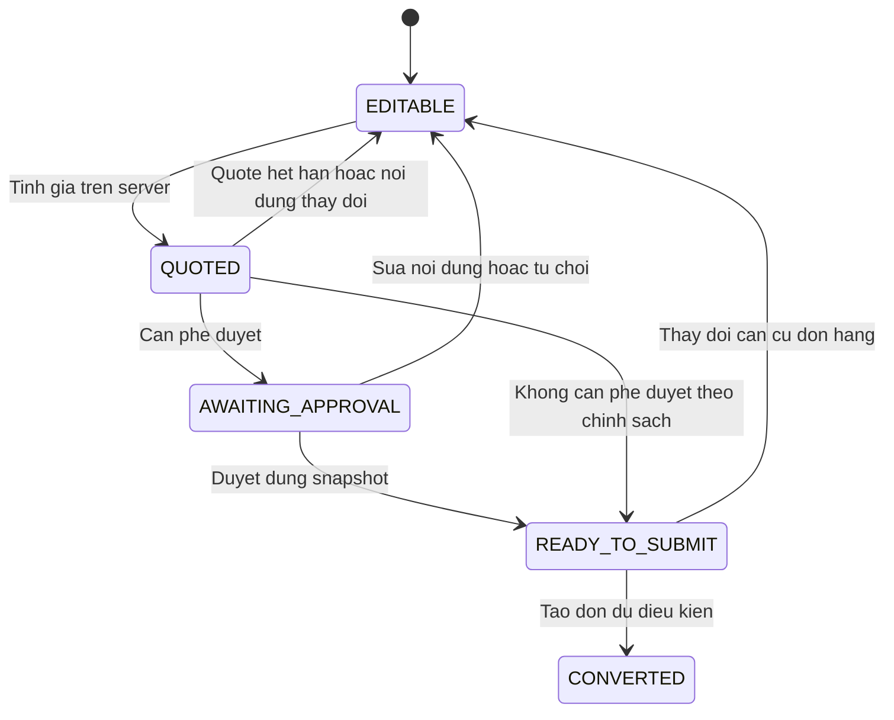

# Phân quyền tạo đơn hàng (Order creation authorization)

## 1. Tạo đơn là một hành động cần quyền theo ngữ cảnh

Trong chương Order Security, **order creation authorization** trả lời câu hỏi: chủ thể đang gọi hệ thống có được tạo đơn này, cho khách hàng này, trong phạm vi này, bằng các tài nguyên và điều kiện đang được chọn hay không?

Đăng nhập thành công chưa đủ. Một tài khoản hợp lệ vẫn có thể cố tạo đơn từ checkout của người khác, dùng giá hợp đồng của doanh nghiệp khác, gắn phương thức thanh toán không được phép hoặc bỏ qua bước duyệt mua hàng.

Điểm khó của thao tác tạo mới là đơn hàng chưa tồn tại để kiểm tra `order.ownerId`. Server phải xác minh quyền trên **nguồn tạo đơn**, các tài nguyên được tham chiếu và quan hệ giữa chúng trước khi ghi một đơn hợp lệ.

Bài học tập trung vào bất biến nghiệp vụ, state machine, quyền theo đối tượng, transaction, idempotency và các tình huống kiểm thử lạm dụng. Các tên quyền, trạng thái và ngưỡng minh họa không phải quy ước bắt buộc cho mọi sản phẩm.

### 1.1. Phân biệt tạo bản nháp, gửi đơn và thực hiện đơn

| Hành động | Quyền hoặc điều kiện cần phân biệt |
| --- | --- |
| Tạo giỏ hoặc bản nháp | Được khởi tạo dữ liệu chưa tạo đầy đủ nghĩa vụ đặt mua |
| Gửi yêu cầu mua để duyệt | Được đề xuất giao dịch, chưa mặc định được chấp thuận |
| Tạo đơn từ checkout đã sẵn sàng | Được đặt đơn với đúng nội dung đã xác định |
| Thu tiền | Được thực hiện thanh toán theo phương thức và quy trình tương ứng |
| Xác nhận hoặc xuất hàng | Đủ điều kiện nhận đơn, tồn kho và fulfillment theo chính sách |

Trong bài, “tạo đơn” là chuyển một checkout đủ điều kiện thành một đơn được ghi nhận chính thức. Với luồng trả trước minh họa, đơn ban đầu ở `PENDING_PAYMENT`; tạo thành công không có nghĩa đã thu tiền hoặc được phép xuất hàng.

Nếu sản phẩm gọi bản nháp cũng là một order, cần dùng tên hành động và trạng thái rõ ràng để quyền tạo bản nháp không vô tình trở thành quyền đặt hàng đã được chấp thuận.

### 1.2. Tình huống xuyên suốt

Khách hàng An có checkout `co_42` tại cửa hàng thuộc tenant A. Checkout có báo giá `qt_7`, địa chỉ giao đã chụp snapshot và lựa chọn thanh toán được quản lý trên server.

Một nhân viên hỗ trợ có thể được phép đặt thay An, nhưng chỉ trong tenant A và nhóm khách hàng được giao. Nhân viên đó không mặc nhiên được dùng hạn mức mua hàng của doanh nghiệp B, bỏ qua phê duyệt hoặc đổi chủ thể hưởng coupon sang tài khoản khác.

Một cấu hình quyền hợp lệ cần phân biệt người thao tác, khách hàng đứng tên đơn, tài khoản chịu chi phí và người nhận hàng. Những vai trò này có thể cùng một người hoặc khác nhau theo chính sách.

## 2. Xác định actor, khách hàng và phạm vi ủy quyền

### 2.1. Actor không phải luôn là người mua đứng tên

| Vai trò | Nguồn xác định đáng tin trong luồng minh họa |
| --- | --- |
| Actor | Phiên/token đã được server xác thực hoặc service identity được quản lý |
| Khách hàng đứng tên | Checkout và quan hệ đặt hàng đã được kiểm tra quyền |
| Tenant/cửa hàng | Ngữ cảnh và lựa chọn được server xác nhận có thể giao dịch |
| Tài khoản thanh toán hoặc công nợ | Tài nguyên có quan hệ sử dụng/ủy quyền được kiểm tra |
| Người nhận hàng | Dữ liệu giao hàng hợp lệ theo chính sách, không tự quyết định quyền thanh toán |
| Người duyệt | Quyết định phê duyệt có nguồn gốc và thẩm quyền được kiểm tra |

Không lấy `createdBy`, `customerId` hoặc `approvedBy` do client khai báo làm danh tính có thẩm quyền.

Ví dụ nhân viên đặt hàng thay:

```text
actorId = nhân viên thực hiện
customerId = khách hàng được đặt thay
delegationReference = căn cứ được phép thao tác thay
billingAccountId = tài khoản chịu chi phí được phép sử dụng
```

Audit cần giữ các vai trò này riêng biệt. Nếu chỉ lưu customerId, không thể biết đơn do khách tự đặt hay do nhân viên thực hiện.

### 2.2. Tenant là một lựa chọn cần được xác nhận

Một header `X-Tenant-Id` hoặc trường storeId có thể giúp caller chọn ngữ cảnh, nhưng không tự cấp quyền. Server phải xác nhận actor và tài nguyên có quan hệ hợp lệ trong ngữ cảnh đó.

Với hệ thống nội bộ nhiều tenant, thành viên tenant A không được tự chuyển header sang B để tạo đơn bằng tài nguyên B. Với marketplace, khách hàng có thể được mua ở nhiều cửa hàng theo chính sách công khai; khi đó quan hệ người mua–cửa hàng phải được đánh giá theo mô hình marketplace, không áp một phép kiểm tra membership nội bộ máy móc.

Điều cần bảo vệ là **quan hệ được phép**, không phải bắt mọi đối tượng trong mọi mô hình đều có cùng ownerId. Hợp đồng, ví, địa chỉ dùng chung hoặc catalog toàn nền tảng có thể có quy tắc sở hữu riêng.

### 2.3. Đặt hàng thay là một hành động riêng

Không suy ra quyền đặt thay chỉ vì tài khoản có vai trò STAFF hoặc được xem hồ sơ khách hàng. Chính sách cần xét quyền hành động, khách hàng được phục vụ, đơn vị/chi nhánh, mức tác động và căn cứ ủy quyền nếu yêu cầu.

Một trường `onBehalfOfCustomerId` chỉ là đối tượng yêu cầu. Server vẫn phải kiểm tra quyền đặt thay và không cho khách hàng tự bật chế độ nhân viên bằng một cờ trong request.

## 3. Kiểm tra quyền trên các tài nguyên nguồn

Đơn mới thường được lắp từ nhiều ID. Kiểm tra được một checkout chưa có nghĩa mọi ID khác gắn vào nó đều hợp lệ.

| Tài nguyên | Câu hỏi cần trả lời trước khi tạo đơn |
| --- | --- |
| Checkout/giỏ hàng | Actor được phép chuyển checkout này thành đơn cho khách hàng hiện tại không? |
| Quote/báo giá | Quote thuộc checkout, khách hàng, tiền tệ và ngữ cảnh hợp lệ, còn hạn theo chính sách không? |
| Dòng hàng | Khách hàng có được mua SKU/dịch vụ này tại kênh và cửa hàng đã chọn không? |
| Giá hợp đồng | Khách hàng/tài khoản mua có thuộc hợp đồng hoặc price book đó không? |
| Địa chỉ đã lưu | Actor có quyền dùng tham chiếu địa chỉ này trong luồng đặt hàng không? |
| Điểm nhận/kho | Node có phục vụ giao dịch này và được dùng theo fulfillment policy không? |
| Phương thức thanh toán | Có quyền gắn/sử dụng theo quan hệ đã xác nhận và workflow thanh toán không? |
| Tài khoản doanh nghiệp | Có quyền đặt đơn cho tài khoản và trong giới hạn được giao không? |
| Coupon/điểm thưởng | Chủ thể hưởng quyền lợi đúng, hạn mức/giữ chỗ có phù hợp không? |
| Reservation hàng hóa | Thuộc đúng checkout/đơn, lượng, SKU, tenant và kế hoạch đang được đặt không? |
| Phê duyệt mua hàng | Người duyệt có thẩm quyền, quyết định gắn đúng nội dung và còn hiệu lực không? |

[OWASP API1:2023 — Broken Object Level Authorization](https://api-security.owasp.org/editions/2023/en/0xa1-broken-object-level-authorization/) mô tả rủi ro khi API tin ID đối tượng mà không kiểm tra quyền tương ứng. ID tuần tự, UUID hay chuỗi khó đoán đều vẫn cần kiểm tra quyền.

### 3.1. Người nhận hàng khác không tự có nghĩa truy cập trái phép

Khách hàng có thể nhập địa chỉ mới để gửi quà nếu chính sách cho phép. Không cần giả định mọi địa chỉ nhận hàng phải có một tài khoản trùng người mua.

Nhưng chọn một `savedAddressId` của người khác để đọc dữ liệu riêng lại là vấn đề quyền theo đối tượng. Cần phân biệt nhập địa chỉ được phép sử dụng với việc truy cập trái phép một bản ghi địa chỉ có sẵn.

Tương tự, tổ chức có thể cho nhân viên dùng phương thức thanh toán chung theo ủy quyền. Không yêu cầu chủ phương thức thanh toán luôn trùng actor, nhưng phải kiểm tra được quan hệ sử dụng thay vì chỉ thấy một ID hợp lệ.

### 3.2. Quyền đọc không suy ra quyền sử dụng

Một nhân viên được xem giá hợp đồng để hỗ trợ chưa chắc được áp giá đó vào mọi đơn. Một người được xem tài khoản doanh nghiệp chưa chắc được tạo nghĩa vụ mua hàng hoặc thu tiền vào tài khoản đó.

Đặt tên hành động theo tác dụng: `view`, `useForOrder`, `submit`, `approve`, `charge`. Một quyền tổng quát như `access=true` dễ làm mất các ranh giới này.

## 4. Mô hình đe dọa và business invariants

### 4.1. Các tình huống lạm dụng chính

| Cách tấn công | Sai sót dẫn đến lỗ hổng |
| --- | --- |
| Thay customerId trong request | Server cho caller chọn chủ thể đứng tên không kiểm tra quyền |
| Trộn checkout của An với quote hoặc payment reference của Bình | Chỉ kiểm tra từng ID tồn tại, không kiểm tra quan hệ |
| Chuyển tenant/store bằng header | Tenant context được tin như quyền |
| Gửi `status=PAID`, `approved=true`, `createdBy=admin` | Mass assignment vào entity đơn |
| Tạo đơn trực tiếp khi chưa duyệt | State machine chỉ tồn tại ở giao diện |
| Sửa lượng/địa chỉ sau duyệt | Phê duyệt không gắn với snapshot nội dung |
| Tạo đơn vượt thẩm quyền nhân viên | Chỉ có kiểm tra role, thiếu điều kiện giá trị/phạm vi |
| Gọi API nội bộ hoặc gửi message giả | Dịch vụ phía sau mặc định tin mọi request nội bộ |
| Retry hoặc dùng nhiều key | Không có unique theo nguồn tạo đơn |
| Gọi trong lúc quyền đang bị thu hồi | Kiểm tra quyền trên dữ liệu cũ, quyết định không có điểm hiệu lực rõ |

### 4.2. Các bất biến đề xuất

| Mã | Bất biến |
| --- | --- |
| O1 | Actor được server xác thực và có quyền cho đúng hành động tạo đơn trong ngữ cảnh hiện tại |
| O2 | Khách hàng, checkout, tài khoản chịu chi phí và các tài nguyên có quan hệ được phép |
| O3 | Đơn chỉ được tạo từ trạng thái nguồn hợp lệ và đáp ứng phê duyệt cần thiết |
| O4 | Đơn phản ánh đúng snapshot đã được tính giá và chấp thuận theo chính sách |
| O5 | Giá, lượng, tiền tệ, quyền lợi và trạng thái ban đầu do server quyết định |
| O6 | Mỗi checkout chỉ chuyển thành một đơn trong mô hình của bài |
| O7 | Retry cùng ý định không tạo thêm đơn hoặc tác dụng tài nguyên |
| O8 | Tạo đơn không tự cấp quyền thu tiền, bỏ qua kiểm soát hoặc xuất hàng |
| O9 | Quyết định quyền và dữ liệu có thể thay đổi được bảo vệ tại điểm tạo đơn đã định nghĩa |
| O10 | Đơn, liên kết checkout, audit thành công và outbox cục bộ cùng commit/rollback |

Đây là các yêu cầu của thiết kế minh họa. Nếu sản phẩm cho một checkout sinh nhiều đơn người bán, O6 phải đổi thành quy tắc duy nhất của từng nhóm tách đơn đã được server xác định; không bỏ ràng buộc mà không có đơn vị nghiệp vụ thay thế.

## 5. Viết chính sách quyền theo hành động, quan hệ và ngữ cảnh

Một biểu thức khái niệm:

```text
canCreateOrder(actor, context) =
    authenticated(actor)
    AND actionAllowed(actor, ORDER_CREATE, context.channel)
    AND tenantRelationshipAllowed(actor, context)
    AND mayPlaceFor(actor, context.customer)
    AND mayUseAllReferencedResources(actor, context)
    AND authorityLimitsSatisfied(actor, context.serverCalculatedTotal)
    AND requiredApprovalValid(context.snapshot)
```

Các trạng thái checkout, thời hạn quote và tính sẵn sàng của reservation vẫn phải được kiểm tra. Một quyết định quyền cho phép không tự chứng minh dữ liệu nghiệp vụ còn đủ điều kiện.

### 5.1. Ma trận quyền minh họa

| Chủ thể | Tạo bản nháp | Tạo đơn cho mình | Tạo đơn thay khách | Duyệt mua | Đánh dấu đã thanh toán |
| --- | --- | --- | --- | --- | --- |
| Khách hàng | Theo chính sách | Với checkout/tài nguyên được phép | Không mặc định | Chỉ nếu được cấp trong mô hình tổ chức | Không |
| Nhân viên hỗ trợ | Trong phạm vi được giao | Không suy ra từ vai trò hỗ trợ | Cần quyền và quan hệ đặt thay | Không mặc định | Không |
| Người mua của tổ chức | Theo đơn vị được giao | Theo tài khoản và thẩm quyền | Theo quan hệ tổ chức được cấp | Không tự duyệt nếu chính sách tách nhiệm vụ | Không |
| Người duyệt | Có thể không cần quyền tạo | Không suy ra từ quyền duyệt | Không suy ra từ quyền duyệt | Trong thẩm quyền và đúng snapshot | Không |
| Dịch vụ đặt hàng | Theo service scope | Theo luồng được ủy quyền | Chỉ với nguồn và ngữ cảnh được xác thực | Không mặc định | Chỉ theo workflow thanh toán có thẩm quyền, không bằng cờ tùy ý |

Ngưỡng tiền nếu có phải dựa trên tổng do server tính và tiền tệ xác định, không dựa trên `total` client gửi. Với hạn mức chi tiêu tích lũy, còn cần bảo vệ cập nhật hạn mức đồng thời; kiểm tra tổng từng đơn riêng không đủ.

[OWASP Authorization Cheat Sheet](https://cheatsheetseries.owasp.org/cheatsheets/Authorization_Cheat_Sheet.html) khuyến nghị đặc quyền tối thiểu, mặc định từ chối và kiểm tra quyền trên từng request. Vai trò có thể là một đầu vào, nhưng quyết định ở đây còn cần quan hệ và thuộc tính của giao dịch.

### 5.2. Không biến lỗi hệ thống quyền thành cho phép

Không lấy exception/timeout của bộ đánh giá quyền làm nhánh “cho khách tiếp tục”. Nếu không có đủ dữ liệu để cho phép hành động, không tạo một đơn như thể đã được phân quyền thành công.

Giao diện có thể báo thử lại hoặc giữ bản nháp theo quyền riêng, nhưng không tự chuyển sang đã duyệt. Cache quyền phải có phạm vi, phiên bản và thời hạn được định nghĩa; không coi kết quả allow cũ là quyền vĩnh viễn.

## 6. Thiết kế DTO để caller không sửa trường nội bộ

### 6.1. Một request tự đặt hàng tối giản

```http
POST /orders
Authorization: Bearer <access-token>
Idempotency-Key: 97b4b0ef-82f4-447e-b54d-72b93e99b56a
Content-Type: application/json

{
  "checkoutId": "co_42",
  "expectedCheckoutRevision": 20,
  "quoteId": "qt_7"
}
```

Đây là luồng đã có checkout được server quản lý. Không cần gửi lại customerId, total, tenantId hoặc các trạng thái đã nằm trong dữ liệu có thẩm quyền. `quoteId` vẫn phải được đối chiếu với checkout và quyền; nó không tự là bằng chứng đủ điều kiện.

Các giá trị server quyết định gồm orderId, khách hàng đứng tên theo quan hệ được phép, actor tạo, trạng thái ban đầu, dòng giá, thuế/phí theo chính sách, tiền tệ, phiên bản snapshot và thời điểm tạo.

Nếu API nhận trực tiếp giỏ hàng thay vì checkoutId, phải xây dựng và kiểm tra cùng ngữ cảnh trên server. Việc không có checkout trước đó không làm mất yêu cầu quyền đối tượng và tính nhất quán.

### 6.2. Không bind payload vào entity Order

Ví dụ có lỗ hổng:

```java
// Không dùng làm mẫu triển khai.
Order order = objectMapper.readValue(requestBody, Order.class);
orderRepository.save(order);
```

Nếu entity có trường nội bộ, caller có thể thử thêm `approved`, `paid`, `ownerId`, `discountOverride` hoặc `fulfillmentStatus`. DTO cần allow-list các trường của lệnh và chuyển sang domain object qua quy tắc tường minh.

Giới hạn trường được bind và dùng DTO là biện pháp được mô tả trong [OWASP Mass Assignment Cheat Sheet](https://cheatsheetseries.owasp.org/cheatsheets/Mass_Assignment_Cheat_Sheet.html). Validation định dạng từng trường không thay việc kiểm tra ai được quyết định giá trị đó.

### 6.3. Luồng đặt thay cần thể hiện rõ ý định

Một endpoint hoặc command riêng có thể nhận customerId đích, nhưng service phải kiểm tra quyền `ORDER_CREATE_ON_BEHALF`, quan hệ phục vụ và các tài nguyên của khách hàng đó. Không dùng một trường `isStaff=true` để chọn nhánh bỏ qua kiểm tra.

Với giao diện dùng cookie phiên, lệnh thay đổi trạng thái cần bảo vệ CSRF theo kiến trúc. Bảo vệ CSRF và xác thực không thay thế kiểm tra quyền tạo đơn cụ thể.

## 7. State machine và phê duyệt gắn với snapshot

### 7.1. Không thể bỏ qua bước bằng cách gọi thẳng endpoint

Một vòng đời checkout minh họa:



Backend chỉ cho lệnh tạo đơn mới đi từ READY_TO_SUBMIT. DRAFT/EDITABLE, AWAITING_APPROVAL và CONVERTED không được vượt qua bằng trường `skipApproval=true` hoặc bằng việc gọi endpoint cuối trước.

Nếu cần lưu một yêu cầu chờ duyệt dưới dạng order, đó là trạng thái và hành động riêng, chưa cho phép tác dụng tài chính/fulfillment của một đơn đã chấp thuận.

### 7.2. Nội dung được duyệt phải là nội dung được đặt

Phê duyệt nên ràng buộc với phiên bản checkout/quote và các dữ liệu có tác động: khách hàng/tài khoản mua, dòng hàng, lượng, tổng tiền/tiền tệ, địa chỉ hoặc kế hoạch giao liên quan, điều khoản và phạm vi quyền lợi.

Nếu đổi địa chỉ làm phí hoặc vùng ưu đãi thay đổi, tăng lượng hoặc đổi billing account sau duyệt, cần đánh giá lại và có thể duyệt lại theo chính sách. Không giữ một boolean `approved=true` trên giỏ rồi cho sửa tự do nội dung phía dưới.

Chữ ký hoặc digest của snapshot giúp phát hiện thay đổi khi được tạo và kiểm tra đúng cách, nhưng không thay thế quyền của người duyệt, hiệu lực quyết định hoặc nguồn dữ liệu server.

Kiểm soát trình tự và ràng buộc quyền cho giao dịch với nội dung có ý nghĩa được nêu trong [OWASP Transaction Authorization Cheat Sheet](https://cheatsheetseries.owasp.org/cheatsheets/Transaction_Authorization_Cheat_Sheet.html). State machine trên là thiết kế áp dụng cho bài toán tạo đơn.

## 8. Chặn cuộc đua giữa kiểm tra quyền và tạo đơn

### 8.1. Thời điểm kiểm tra phải có nghĩa vận hành

Một cuộc đua có thể xảy ra:

```text
T1: Kiểm tra nhân viên còn quyền đặt hàng cho tài khoản doanh nghiệp.
T2: Thu hồi quan hệ ủy quyền hoặc đổi checkout sang tài khoản khác.
T1: Tạo đơn dựa trên kết quả kiểm tra cũ.
```

Cần định nghĩa điểm quyết định và bảo vệ các dữ liệu có thể làm kết quả thay đổi. Với dữ liệu cùng cơ sở dữ liệu, có thể khóa hàng checkout và các bản ghi quyền/ủy quyền liên quan, hoặc dùng kiểm tra phiên bản và giao thức cập nhật tương ứng.

Khóa checkout chỉ ngăn các đường sửa checkout tuân cùng giao thức; nó không tự khóa membership, phê duyệt, billing account hoặc dịch vụ quyền bên ngoài. Các đường thu hồi và sửa đổi phải tham gia cơ chế nhất quán đã chọn.

Trong PostgreSQL, `SELECT ... FOR UPDATE` bảo vệ các hàng được chọn trước cập nhật/khóa xung đột cho tới khi transaction kết thúc. Phải chỉ rõ hàng nào cần khóa và dùng thứ tự thống nhất giữa các đường ghi. Xem [PostgreSQL 18 — Explicit Locking](https://www.postgresql.org/docs/18/explicit-locking.html).

### 8.2. Token hợp lệ chưa chứng minh quyền chưa bị thu hồi

Nếu vai trò/ủy quyền chỉ được đọc từ token sống dài hoặc cache cũ, hiệu lực thu hồi có thể bị trễ. Với yêu cầu nghiêm ngặt, cần kiểm tra phiên bản quyền/phiên hoặc dữ liệu hiện tại tại điểm quyết định theo kiến trúc.

Nếu nguồn quyền ở dịch vụ ngoài, phải xác định độ mới, thời hạn, phiên bản và quy tắc xử lý thu hồi. Không tuyên bố transaction cục bộ của bảng order làm quyết định phân quyền xuyên dịch vụ nguyên tử.

### 8.3. Giữ transaction ngắn và tác dụng ngoài có ranh giới

Chuẩn bị các dữ liệu tốn thời gian ở ngoài vùng giữ khóa khi có thể, rồi kiểm tra lại snapshot/phiên bản trước ghi. Không gọi cổng thanh toán, WMS hoặc gửi email trong transaction rồi kỳ vọng rollback order sẽ hoàn tác các tác dụng đó.

Trong thiết kế minh họa, tạo đơn PENDING_PAYMENT cùng audit/outbox; thu tiền và fulfillment chạy theo workflow riêng. Mỗi bước tiếp theo kiểm tra quyền hệ thống, trạng thái và điều kiện tương ứng, thay vì hiểu `OrderCreated` là “được phép làm mọi việc”.

## 9. Luồng tạo đơn trong application service

### 9.1. Ranh giới thực thi minh họa

```text
Xác thực actor và hình dạng request
  → Bắt đầu transaction
  → Chiếm key idempotency
  → Tải/khóa checkout trong ngữ cảnh tenant được xác nhận
  → Kiểm tra quyền truy cập nguồn
  → Nếu là replay: kiểm tra quyền xem kết quả đã tạo rồi trả kết quả cũ
  → Nếu là lệnh mới: kiểm tra revision, trạng thái và quote
  → Tải/khóa các đầu vào quyền và tài nguyên liên quan
  → Đánh giá quyền tạo đơn, thẩm quyền và phê duyệt cho đúng snapshot
  → Tạo đơn với trạng thái ban đầu do server quyết định
  → Chuyển checkout sang CONVERTED và liên kết tài nguyên cục bộ
  → Ghi audit, outbox và kết quả request
  → Commit rồi trả kết quả
```

Thứ tự khóa phải thống nhất giữa luồng tạo, sửa checkout, thu hồi duyệt và các luồng dùng cùng tài nguyên. Không sao chép trình tự này mà bỏ qua các thứ tự khóa đã được hệ thống chọn.

### 9.2. Mã giả Java

Đây là mã giả, không phải lớp Java có thể biên dịch độc lập. Ví dụ minh họa luồng đã đăng nhập, tạo đơn trả trước và dữ liệu cục bộ cùng cơ sở dữ liệu. Các helper phải thực thi hợp đồng phân quyền và transaction, không chỉ mang tên có vẻ an toàn.

```java
CreateOrderResult createOrder(Actor actor,
                              AuthorizedCommerceContext tenant,
                              CreateOrderCommand command,
                              String idempotencyKey) {
    requireAuthenticated(actor);
    validateRequestShape(command, idempotencyKey);
    requireAuthorizedCommerceContext(actor, tenant);

    Fingerprint fingerprint = fingerprintOf(
        "CREATE_ORDER", tenant.id(), command);

    // Chỉ trả response thành công sau khi commit thành công.
    return tx.required(() -> {
        CommandSlot slot = commandResults.claimOrLoadForUpdate(
            tenant.id(), actor.id(), "CREATE_ORDER",
            idempotencyKey, fingerprint);

        Checkout checkout = checkouts.lockByTenantAndId(
            tenant.id(), command.checkoutId()).orElseThrow(NotFound::new);
        authorization.requireAccessCheckout(actor, tenant, checkout);

        if (slot.hasCompletedResult()) {
            authorization.requireReadOrderResult(
                actor, tenant, slot.savedOrderId());
            return slot.savedCreateOrderResult();
        }

        checkout.requireRevision(command.expectedCheckoutRevision());
        checkout.requireState(READY_TO_SUBMIT);
        checkout.requireCurrentQuote(command.quoteId());

        Quote quote = quotes.loadImmutableByTenantAndId(
            tenant.id(), command.quoteId());
        CreationContext context = authorizationInputs.lockAndBuild(
            actor, tenant, checkout, quote);
        SubmissionResources resources = orderResources.lockForSubmission(
            checkout, quote);

        Instant decisionTime = databaseClock.currentInstant();
        quote.requireBoundTo(checkout, context.customer());
        quote.requireUsableAt(decisionTime);
        context.requireRequiredApprovalFor(quote, decisionTime);

        AuthorizationDecision decision = authorizer.requireCreateOrder(
            context, decisionTime);
        resources.requireValidFor(checkout, quote, decisionTime);

        Order order = Order.pendingPaymentFromTrustedSnapshot(
            checkout, quote, context.customer(), actor.id(),
            decision, decisionTime);
        orders.insertUniqueByCheckout(order);
        resources.attachToOrderWithoutExternalEffects(order);
        checkouts.markConvertedConditionally(
            checkout, command.expectedCheckoutRevision(), order.id());

        audit.appendOrderCreated(actor, context, order, decision);
        outbox.appendOrderCreated(order);
        CreateOrderResult result = CreateOrderResult.from(order);
        commandResults.complete(slot, result);
        return result;
    });
}
```

### 9.3. Những hợp đồng cần hiện thực rõ

- `lockAndBuild` kiểm tra quan hệ actor–khách hàng, tenant, ủy quyền, tài khoản mua và tài nguyên được tham chiếu; không sao chép các cờ allow từ payload.
- Khi quote dùng địa chỉ/giá/hợp đồng có phiên bản, context phải đối chiếu đúng snapshot và hiệu lực theo chính sách. Không chỉ kiểm tra quoteId tồn tại.
- `authorizer.requireCreateOrder` đánh giá đúng hành động, kênh, tổng tiền server, thẩm quyền và chính sách. Annotation role ở controller không thay quyết định này.
- `resources.requireValidFor` kiểm tra các reservation còn phù hợp với dòng hàng, chủ thể, hạn mức và trạng thái. Các tài nguyên đã được phê duyệt để dùng không đồng nghĩa vẫn còn khả dụng.
- Gắn tài nguyên vào đơn phải chuyển tham chiếu/nghĩa vụ theo workflow đã chọn, không tự đánh dấu coupon đã tiêu thụ, hàng đã xuất hoặc tiền đã thu nếu bước đó chưa xảy ra.
- Bất kỳ lỗi nào sau insert order làm rollback phần dữ liệu cục bộ. Lỗi commit không được trả response tạo thành công.

Nếu tài nguyên ở dịch vụ khác, helper không thể giả làm một phần transaction cục bộ. Cần giao thức giữ/xác nhận/bù trừ và trạng thái trung gian như phần hệ thống phân tán bên dưới.

## 10. Ràng buộc dữ liệu chống trộn nguồn và tạo trùng

### 10.1. Một checkout chỉ chuyển đổi một lần

Một schema rút gọn cho mô hình một checkout–một đơn:

```sql
-- Giả định checkout đã có khóa duy nhất (tenant_id, checkout_id).
CREATE TABLE commerce_order (
    tenant_id UUID NOT NULL,
    order_id UUID NOT NULL,
    checkout_id UUID NOT NULL,
    customer_id UUID NOT NULL,
    created_by_actor_id UUID NOT NULL,
    quote_id UUID NOT NULL,
    source_checkout_revision BIGINT NOT NULL,
    status TEXT NOT NULL,
    created_at TIMESTAMPTZ NOT NULL,
    PRIMARY KEY (tenant_id, order_id),
    CONSTRAINT uq_order_source_checkout
        UNIQUE (tenant_id, checkout_id),
    CONSTRAINT fk_order_source_checkout
        FOREIGN KEY (tenant_id, checkout_id)
        REFERENCES checkout (tenant_id, checkout_id)
);
```

Đây chỉ là phần schema minh họa, chưa phải migration đầy đủ cho đơn hàng. Cần định nghĩa thêm các quan hệ quote, dòng hàng, snapshot, tiền và ràng buộc dữ liệu theo mô hình thực tế.

Unique theo nguồn bảo vệ cả trường hợp caller dùng hai idempotency key khác nhau. Nó không cấp quyền: một insert trái quyền vẫn là lỗ hổng dù không tạo được hai đơn.

Khóa ngoại có tenant giúp ngăn tham chiếu checkout thuộc tenant khác. Quyền đặt thay, quyền dùng giá hợp đồng hoặc billing account vẫn cần service kiểm tra theo quan hệ; khóa ngoại chỉ chứng minh tính toàn vẹn mà nó thực sự diễn đạt.

### 10.2. Cập nhật nguồn có điều kiện

```sql
UPDATE checkout
SET state = 'CONVERTED',
    converted_order_id = :order_id,
    revision = revision + 1
WHERE tenant_id = :tenant_id
  AND checkout_id = :checkout_id
  AND revision = :expected_revision
  AND state = 'READY_TO_SUBMIT'
  AND current_quote_id = :quote_id;
```

Phải có đúng một hàng được cập nhật. Nếu bằng 0, rollback lệnh mới, không tiếp tục ghi kết quả thành công. Insert order và cập nhật checkout phải cùng transaction trong ví dụ này.

Nếu gặp xung đột unique do lệnh khác đã tạo đơn, không tiếp tục SQL một cách tùy tiện trên transaction đã lỗi. Xử lý xung đột bằng cơ chế phù hợp hoặc rollback rồi đọc kết quả theo một request có kiểm tra quyền. Không trả orderId của người khác chỉ để “giúp client retry”.

## 11. Idempotency và quyền trên kết quả đã tạo

### 11.1. Hai lớp chống trùng khác nhau

```text
Idempotency scope:
    tenant + actor + operation + idempotencyKey

Fingerprint của ý định:
    checkoutId + expectedCheckoutRevision + quoteId
    + các tham số có nghĩa khác của lệnh/kênh thao tác

Khóa nghiệp vụ:
    một đơn cho mỗi checkout trong mô hình minh họa
```

Không đưa đồng hồ hiện tại vào fingerprint. Với lệnh đặt thay, khách hàng đích và chế độ thao tác đã được xác định phải nằm trong ý nghĩa của request, đồng thời vẫn chịu phân quyền server.

| Tình huống | Hành vi mong đợi |
| --- | --- |
| Cùng key, cùng nội dung, đã commit | Kiểm tra quyền đọc kết quả rồi trả cùng orderId |
| Cùng key, khác quote/checkout/revision | Từ chối xung đột key |
| Request đầu đang chạy | Chờ có giới hạn hoặc phản hồi retry theo hợp đồng |
| Key mới, checkout đã chuyển đổi | Không tạo đơn thứ hai |
| Key hết thời gian lưu | Ràng buộc nguồn và trạng thái checkout vẫn bảo vệ chống trùng |

Bản ghi kết quả thành công cần cùng commit với order. Nếu dùng bảng key có trạng thái đang xử lý, cần giao thức chiếm quyền thực thi và phục hồi rõ ràng; không để hai worker cùng coi mình được phép tiếp quản.

### 11.2. Replay là đọc kết quả cũ, không phải tạo một đơn mới

Lần tạo đầu đã làm checkout chuyển sang CONVERTED và tăng revision. Vì vậy replay đúng ý định không nên bị xử lý như một lệnh tạo mới rồi thất bại vì trạng thái nguồn đã đổi.

Tuy nhiên, idempotency key không phải bearer token cho dữ liệu đơn hàng. Caller vẫn phải được xác thực và có quyền xem kết quả tại thời điểm replay. Tùy mô hình, việc còn quyền truy cập checkout nguồn cũng là điều kiện cần.

Nếu actor bị thu hồi quyền tạo đơn nhưng vẫn được xem đơn đã tạo, hợp đồng có thể cho đọc lại kết quả cũ mà không cho tạo ý định mới. Nếu quyền đọc cũng bị thu hồi, không trả dữ liệu chỉ vì key từng hợp lệ. Cách xử lý này không tạo thêm đơn, thu tiền hoặc khôi phục các quyền đã mất.

Một caller khác sử dụng cùng chuỗi key không được nhận kết quả của actor cũ ngoài phạm vi khóa và quyền. Không dùng kho idempotency chung chỉ theo chuỗi key ngẫu nhiên mà thiếu ngữ cảnh truy cập.

## 12. Các kênh tạo đơn phải giữ cùng ranh giới quyền

### 12.1. Web, mobile và API trực tiếp

Ẩn nút “Đặt hàng” giúp trải nghiệm nhưng không quyết định quyền. Tất cả kênh phải gọi cùng application/domain service hoặc cùng chính sách được thực thi nhất quán ở nơi ghi quyết định.

Kiểm tra ở gateway có thể xác thực và chặn một số hành động, nhưng service tạo đơn vẫn cần quyền theo đối tượng và dữ liệu hiện tại. Gateway thường không biết toàn bộ quan hệ checkout–quote–billing account.

### 12.2. Guest checkout

Nếu cho phép mua không đăng nhập, cần một mô hình quyền riêng: chẳng hạn phiên guest có capability gắn với checkout, hạn chế hành động, thời hạn và cách chống đoán/phát lại. Không đơn giản bỏ `requireAuthenticated` rồi coi ai biết checkoutId cũng được tạo đơn.

Guest không được dùng saved payment method, hợp đồng giá hoặc tài nguyên tài khoản riêng nếu chưa có căn cứ ủy quyền phù hợp. Khi liên kết checkout vào tài khoản sau đăng nhập, cần kiểm tra chuyển quyền và ngăn chiếm checkout của người khác.

Capability hợp lệ cũng không chứng minh quyền thu tiền từ mọi phương thức mà caller cung cấp. Bước thanh toán vẫn có hợp đồng xác nhận riêng.

### 12.3. Import, job và dịch vụ nội bộ

Service identity có quyền gọi API chưa chắc được tạo đơn cho mọi tenant/khách hàng. Message tạo đơn cần nguồn tin cậy, tenant và tham chiếu ngữ cảnh được kiểm tra; một trường `actorId` trong payload không tự là danh tính đã xác thực.

Khi tác vụ chạy thay người dùng, cần lưu căn cứ ủy quyền và quy tắc đánh giá quyền lúc thực thi. Nếu là một nghĩa vụ hệ thống đã được chấp thuận trước đó, phải có loại lệnh và bằng chứng riêng; không giả làm request người dùng bằng cách đặt header `X-User-Id` tùy ý.

Các đường import hoặc backoffice không được dùng `skipAuthorization=true` để đi thẳng vào repository. Chúng có thể có quyền và workflow khác, nhưng vẫn cần kiểm soát tương xứng với tác dụng tạo đơn.

### 12.4. Tạo đơn qua nhiều dịch vụ

Nếu quote, quyền, tồn kho, coupon và order ở nhiều dịch vụ, không có một transaction cục bộ bao phủ tất cả. Cần xác định nguồn có thẩm quyền cho từng quyết định, phiên bản, reservation và giao thức xác nhận/bù trừ.

Một đơn có thể cần trạng thái chờ hoàn tất điều kiện trước khi được coi là đã nhận để fulfillment. Không phát sự kiện cho phép xuất hàng trước khi các bằng chứng bắt buộc đã được xác nhận theo giao thức.

Outbox giúp gắn thay đổi order với việc phát tin bền vững trong phạm vi cục bộ. Nó không tự chứng minh quyền gọi của producer hoặc làm tác dụng ở mọi consumer chỉ xảy ra một lần. Consumer vẫn phải kiểm tra service scope, dữ liệu nguồn, trạng thái và xử lý trùng.

## 13. Hợp đồng lỗi, response và audit

### 13.1. Từ chối đúng mà không lộ dữ liệu ngoài quyền

Một quy ước lỗi minh họa:

| Trường hợp | HTTP có thể chọn | Mã nghiệp vụ |
| --- | --- | --- |
| Chưa xác thực ở luồng yêu cầu đăng nhập | 401 | `AUTHENTICATION_REQUIRED` |
| Không có quyền tạo hoặc dùng tài nguyên | 403, hoặc 404 để che tồn tại theo chính sách | `ORDER_CREATION_FORBIDDEN` / `NOT_FOUND` |
| Revision hoặc trạng thái nguồn đã đổi | 409 | `CHECKOUT_VERSION_CONFLICT` / `INVALID_CHECKOUT_STATE` |
| Key trùng nhưng request khác | 409 | `IDEMPOTENCY_KEY_REUSED` |
| Checkout đã được chuyển thành đơn | 409 hoặc đọc lại có quyền theo hợp đồng | `CHECKOUT_ALREADY_CONVERTED` |
| Quote không còn dùng được hoặc điều kiện nghiệp vụ chưa đạt | 409/422 theo hợp đồng API | `QUOTE_INVALID` / `ORDER_PREREQUISITE_FAILED` |
| Dịch vụ quyền tạm không đánh giá được | 503 theo hợp đồng retry | `AUTHORIZATION_UNAVAILABLE` |

Không phân biệt chi tiết “paymentMethod tồn tại nhưng của khách X” cho actor không được xem thông tin đó. Client có thể nhận lỗi tổng quát; log nội bộ có reason code phù hợp để điều tra.

Response tạo thành công chỉ nên chứa dữ liệu actor được phép đọc, như orderId, trạng thái ban đầu và thông tin tổng tiền phù hợp. Không trả token thanh toán, dữ liệu tài khoản khác hoặc toàn bộ decision input.

### 13.2. Audit quyết định tạo đơn

Audit thành công nên liên kết:

- Actor/service identity, khách hàng đứng tên và căn cứ đặt thay nếu có.
- Tenant/cửa hàng, checkout, quote, order và các revision/snapshot liên quan.
- Tài khoản mua/thanh toán được tham chiếu bằng định danh phù hợp, không chứa bí mật.
- Phiên bản chính sách quyền, quyết định phê duyệt và thời điểm ra quyết định.
- Hành động được cho phép, trạng thái ban đầu và correlation ID.

Audit không thay thế phân quyền, nhưng giúp phân biệt khách tự đặt, nhân viên đặt thay và tác vụ hệ thống. Bản ghi audit xác nhận tạo thành công phải cùng commit với order trong mô hình cục bộ.

Log từ chối hoặc lỗi có thể cần tồn tại dù transaction nghiệp vụ rollback; thiết kế đường ghi đó riêng và phân biệt với audit thành công. Không ghi access token, session cookie, dữ liệu thanh toán nhạy cảm hoặc toàn bộ request vào log dùng chung.

## 14. Kiểm thử các tình huống tấn công logic

Ma trận sau là kế hoạch kiểm thử cho phần hiện thực. Không có nghĩa mã giả và schema trong bài đã được chạy hoặc đã vượt qua kiểm thử.

| Tình huống | Thao tác | Kết quả cần quan sát |
| --- | --- | --- |
| Khách tự đặt hợp lệ | Đúng checkout, quote, tài nguyên và trạng thái | Tạo một đơn PENDING_PAYMENT theo ví dụ |
| Chưa đăng nhập | Gọi endpoint yêu cầu đăng nhập | Không tạo đơn hoặc tác dụng tài nguyên |
| Đổi khách hàng | Thêm customerId của người khác vào request | Không đổi chủ thể trái quyền |
| Checkout người khác | Thay checkoutId nhưng giữ actor | Từ chối theo quyền đối tượng |
| Quote người khác | Trộn checkout của An với quote của Bình | Không tạo đơn dựa trên quote ngoài quan hệ |
| Khác tenant | Đổi header/store context hoặc ID tài nguyên | Kiểm tra đúng quan hệ, không trộn dữ liệu trái quyền |
| Marketplace hợp lệ | Khách được mua tại cửa hàng công khai theo chính sách | Không từ chối sai chỉ vì không là thành viên nội bộ của cửa hàng |
| Đặt thay không có quyền | Actor STAFF chỉ có quyền xem khách hàng | Không suy ra quyền tạo đơn thay |
| Đặt thay hợp lệ | Actor có scope và quan hệ đúng | Đơn đứng tên đúng khách, audit giữ actor riêng |
| Giá hợp đồng ngoài quyền | Chọn quote/price book của doanh nghiệp khác | Không áp giá ngoài quan hệ được phép |
| Phương thức thanh toán ngoài quyền | Gắn payment reference không được dùng | Không tạo đơn với tham chiếu trái quyền theo hợp đồng |
| Thanh toán chung hợp lệ | Dùng tài nguyên doanh nghiệp theo ủy quyền | Cho phép theo quan hệ đã định nghĩa, không ép owner luôn trùng actor |
| Địa chỉ đã lưu ngoài quyền | Đoán savedAddressId của người khác | Không đọc/sử dụng bản ghi trái quyền |
| Gửi quà hợp lệ | Nhập địa chỉ mới được phép | Không từ chối chỉ vì tên người nhận khác người mua |
| Mass assignment | Thêm `status=PAID`, `approved=true`, `createdBy=admin` | Không sửa được trường nội bộ hoặc vượt workflow |
| Bỏ qua phê duyệt | Gọi tạo đơn khi AWAITING_APPROVAL | Không tạo đơn như đã sẵn sàng |
| Duyệt sai nội dung | Duyệt revision cũ rồi đổi lượng/địa chỉ/billing account | Phê duyệt cũ không áp tùy tiện cho snapshot mới |
| Ngoài thẩm quyền | Nhân viên tạo đơn vượt giới hạn server tính | Từ chối hoặc đi workflow duyệt theo chính sách |
| Chia nhỏ để vượt ngân sách chung | Nhiều đơn cùng dùng hạn mức tích lũy | Cập nhật hạn mức nguyên tử theo quy tắc đã chọn |
| Thu hồi quyền đồng thời | Tạo đơn tranh với lệnh thu hồi quan hệ | Kết quả theo điểm hiệu lực/giao thức nhất quán, không dựa cache vô hạn |
| Sửa checkout đồng thời | Đổi khách/tài nguyên trong lúc tạo | Chỉ tạo từ snapshot hợp lệ, không ghép dữ liệu hai revision |
| Retry sau mất response | Commit rồi gửi lại cùng key | Cùng orderId, không tạo tác dụng mới |
| Cùng key khác request | Đổi checkout/quote/revision | Xung đột key |
| Hai key cùng checkout | Hai request đồng thời chuyển cùng nguồn | Chỉ một đơn theo khóa nghiệp vụ |
| Replay sau mất quyền | Thu hồi quyền đọc hoặc quyền tạo theo hợp đồng | Không lộ kết quả khi mất quyền đọc; không tạo đơn mới |
| Quyền hệ thống lỗi | Bộ đánh giá quyền timeout/exception | Không chuyển sang allow mặc định |
| Qua API nội bộ/job | Gửi payload giả actorId hoặc thiếu scope nguồn | Không bỏ qua kiểm tra vì request nội bộ |
| Guest capability sai | Dùng capability checkout khác hoặc đã hết hạn | Không tạo đơn bằng quyền guest ngoài phạm vi |
| Lỗi sau insert | Gây lỗi khi chuyển checkout hoặc ghi outbox | Không có order thành công từng phần trong mô hình transaction cục bộ |
| Consumer nhận trùng | Giao OrderCreated nhiều lần | Không nhân đôi thu tiền/fulfillment hoặc coi sự kiện là quyền vô điều kiện |

Với test phân quyền, dựng ít nhất hai khách hàng, hai phạm vi tenant/cửa hàng, tài nguyên dùng riêng và quan hệ dùng chung được phép. Có cả ca cho phép hợp lệ để tránh “an toàn” bằng cách từ chối mọi request.

Với test đồng thời, dùng connection/transaction độc lập cùng barrier/latch ở các điểm kiểm tra và ghi. Không chỉ gọi API tuần tự rồi kết luận đã kiểm tra TOCTOU.

Ngoài status code, kiểm tra order, customer/actor được lưu, snapshot tiền và giao hàng, checkout revision, reservation, hạn mức, audit và outbox. Với request bị từ chối, không được có đơn, thu tiền hoặc allocation phát sinh trái phép.

Một số thuộc tính hữu ích:

```text
Mọi đơn tạo mới đã commit:
    có actor/source identity được xác thực theo loại luồng
    có quan hệ tạo đơn và dùng tài nguyên được phép tại điểm quyết định
    gắn đúng checkout, quote và snapshot được chấp thuận

Với mô hình một checkout–một đơn:
    số đơn theo (tenant, checkoutId) <= 1

Request/sự kiện lặp:
    không tạo thêm tác dụng cho cùng ý định nghiệp vụ

Tạo đơn thành công:
    không tự đồng nghĩa đã thanh toán hoặc được phép xuất hàng
```

## 15. Các điểm cần ghi nhớ khi thiết kế

Phân quyền tạo đơn bắt đầu từ các tài nguyên nguồn và quan hệ giữa chúng, vì đơn mới chưa có owner để kiểm tra. Cần xác định rõ **ai thao tác**, **đặt cho ai**, **trong phạm vi nào** và **được dùng tài nguyên gì**.

Đăng nhập, vai trò hoặc một ID hợp lệ chỉ là một phần dữ liệu. Quyết định tạo đơn còn phải xét trạng thái, thẩm quyền, phê duyệt và snapshot thực sự được đặt, đồng thời bảo vệ khỏi thay đổi đồng thời tại điểm quyết định.

DTO giới hạn ý định caller, domain service thực thi chính sách, transaction và ràng buộc dữ liệu bảo vệ tính nhất quán, còn idempotency xử lý retry. Tạo đơn chỉ mở bước tiếp theo của workflow; quyền thu tiền, xác nhận và xuất hàng tiếp tục được kiểm tra ở các hành động tương ứng.
