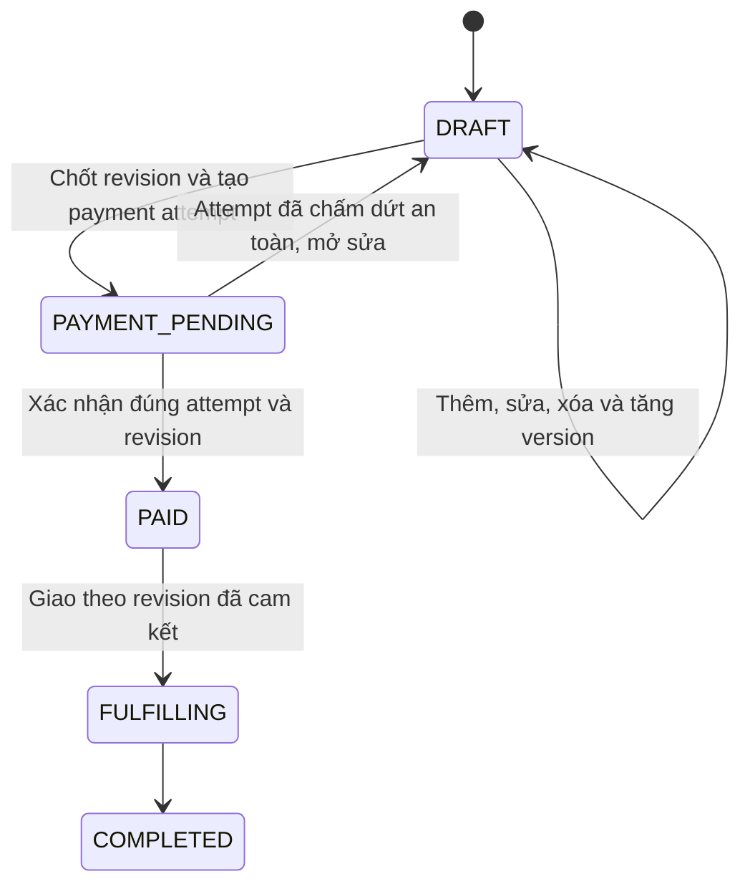

# Order item integrity — Bảo toàn tính toàn vẹn của dòng hàng

Một đơn hàng có thể thuộc đúng người dùng, đã được xác thực và chưa thanh toán nhưng vẫn bị khai thác nếu máy chủ chấp nhận giá, số lượng, thuộc tính hoặc quan hệ dòng hàng do trình duyệt tự quyết định. Người mua không cần chiếm tài khoản quản trị: họ chỉ cần sửa một trường JSON, gọi trực tiếp API cập nhật hoặc gửi đồng thời hai yêu cầu hợp lệ để tạo ra một đơn hàng vi phạm quy tắc nghiệp vụ.

Trong chương **Order Security**, tính toàn vẹn của dòng hàng có nghĩa là mỗi dòng hàng luôn đại diện cho đúng thứ khách được phép mua, với cấu hình, số lượng, giá và điều kiện thương mại hợp lệ; mọi thay đổi phải giữ cho toàn bộ đơn hàng nhất quán. Đây là một phần của bảo mật logic nghiệp vụ: bảo vệ các bất biến bằng quyền theo đối tượng, chuyển trạng thái có kiểm soát, transaction, idempotency và kiểm thử cách kẻ tấn công ghép các thao tác.

## 1. Mục tiêu và phạm vi

Sau bài học, bạn cần có khả năng:

- Xác định dữ liệu nào của dòng hàng là ý định của khách hàng, dữ liệu nào phải được máy chủ xác lập.
- Viết bất biến cho quan hệ đơn hàng–dòng hàng, biến thể, số lượng, giá và tổng tiền.
- Thiết kế luồng thêm, sửa, xóa dòng hàng có kiểm tra quyền và trạng thái.
- Giải thích cách cập nhật đồng thời, yêu cầu lặp và thanh toán có thể phá vỡ một thiết kế tưởng như đúng.
- Xây dựng tình huống kiểm thử chứng minh bất biến vẫn được giữ sau những thao tác bất thường.

Ví dụ xuyên suốt là một cửa hàng bán hàng vật lý theo đơn vị nguyên, sử dụng tiền tệ có số chữ số thập phân đã cấu hình. Với hàng bán theo cân nặng, dịch vụ theo thời lượng hoặc hợp đồng cho phép công nợ, cần định nghĩa lại đơn vị và quy tắc tương ứng; không bê nguyên giới hạn của ví dụ sang mọi mô hình kinh doanh.

## 2. Một cuộc tấn công bắt đầu từ dòng hàng

Giả sử giao diện gửi yêu cầu sau khi khách chọn áo màu xanh, cỡ M:

```http
POST /orders/ord_701/items
Content-Type: application/json

{
  "variantId": "shirt-blue-m",
  "quantity": 2,
  "unitPriceMinor": 500,
  "lineTotalMinor": 1000,
  "currency": "VND",
  "discountPercent": 99,
  "approved": true
}
```

Giá bán thực tế là 250.000 VND mỗi chiếc. Nếu backend ánh xạ toàn bộ JSON vào entity rồi lưu, người mua có thể mua hai chiếc với giá 1.000 VND. Việc các trường đều có kiểu dữ liệu hợp lệ không làm yêu cầu trở nên hợp lệ về nghiệp vụ.

Một DTO nhận lệnh phù hợp hơn cho chức năng này chỉ chứa ý định khách được phép nêu:

```json
{
  "variantId": "shirt-blue-m",
  "quantity": 2
}
```

Máy chủ tự xác định đơn hàng, chủ thể thực hiện, tenant, biến thể được bán, chính sách giá, tiền tệ, ưu đãi và số tiền cuối cùng. Các trường nhạy cảm ngoài hợp đồng API nên bị từ chối rõ ràng để dễ phát hiện tích hợp sai hoặc ý đồ sửa dữ liệu; điều cốt yếu là chúng không được ảnh hưởng đến dữ liệu có thẩm quyền.

Sửa giá chỉ là một khả năng. Những đường tấn công thường gặp còn gồm:

| Thao tác của người tấn công | Sai lệch có thể tạo ra |
| --- | --- |
| Gửi `itemId` của đơn hàng khác | Sửa hàng của người khác hoặc chuyển giá trị giữa các đơn |
| Dùng biến thể rẻ nhưng mô tả hoặc mã giao hàng của biến thể đắt | Thu tiền cho một sản phẩm, giao sản phẩm khác |
| Gửi số lượng âm hoặc quá lớn | Giảm tổng tiền, tạo hoàn tiền sai hoặc làm tràn số |
| Tách cùng một lựa chọn mua thành nhiều dòng | Vượt giới hạn số lượng hoặc nhận ưu đãi nhiều lần |
| Sửa dòng quà tặng thành dòng mua bình thường hoặc ngược lại | Nhận hàng miễn phí ngoài điều kiện chương trình |
| Sửa đơn sau khi được duyệt hoặc khi đang thanh toán | Giá trị được giao khác giá trị đã duyệt hoặc đã thu |
| Gửi lại lệnh thêm hàng do retry hoặc cố ý | Tăng số lượng, tiêu thụ ưu đãi hoặc giữ tồn kho nhiều lần |

## 3. Ranh giới tin cậy và dữ liệu có thẩm quyền

### 3.1. Phân biệt ý định mua với dữ kiện thương mại

Một trường được gửi từ frontend vẫn là dữ liệu không đáng tin cậy dù giao diện không cho sửa. Mobile app, ứng dụng đối tác, trang quản trị và tác vụ nền cũng cần đi qua các quy tắc tương ứng.

| Nhóm dữ liệu | Ví dụ | Nguồn có thẩm quyền |
| --- | --- | --- |
| Ý định mua | `variantId`, số lượng mong muốn, lựa chọn khắc tên | Khách được đề xuất; máy chủ xác thực và chuẩn hóa |
| Danh tính và phạm vi | Người mua, tenant, chủ đơn | Ngữ cảnh xác thực và dữ liệu đơn hàng |
| Danh tính hàng giao | SKU, biến thể, tập tùy chọn, đơn vị bán | Danh mục và quy tắc cấu hình sản phẩm |
| Điều kiện thương mại | Đơn giá, bảng giá, mức giảm, tiền tệ | Chính sách giá và ưu đãi do máy chủ kiểm soát |
| Giá trị dẫn xuất | Thành tiền, thuế, số tiền phải thu | Bộ tính tiền của hệ thống |
| Trạng thái và phê duyệt | Khả năng chỉnh sửa, phiên bản đã duyệt | State machine và quyền của chủ thể |
| Tham chiếu thanh toán, giữ hàng | Payment attempt, reservation | Các dịch vụ và bản ghi nội bộ đã được xác minh |

Người dùng có thể gửi mã coupon hoặc mã báo giá để yêu cầu áp dụng điều kiện thương mại. Máy chủ phải kiểm tra phạm vi, thời hạn, khả năng sử dụng và điều kiện thực tế; bản thân việc có mã không chứng minh người đó được hưởng điều kiện.

### 3.2. Giá hiện tại và giá đã cam kết là hai khái niệm khác nhau

“Giá do máy chủ quyết định” không có nghĩa là mọi lần đọc đơn đều thay bằng giá danh mục hiện tại. Một đơn đã được chấp nhận có thể phải giữ giá đã cam kết, kể cả khi danh mục thay đổi sau đó.

Cần xác định chính sách rõ ràng:

- Đơn nháp có thể dùng giá tạm tính và được định giá lại ở bước xác nhận.
- Báo giá có thời hạn có thể giữ giá trong thời gian hiệu lực và cho một phạm vi sử dụng cụ thể.
- Đơn đã thanh toán hoặc đã cam kết thường lưu snapshot để đối soát, giao hàng và xử lý trả hàng theo lịch sử.

Snapshot cần đủ để giải thích kết quả: danh tính biến thể và cấu hình, đơn vị bán, tiền tệ, đơn giá, quy tắc hoặc phiên bản giá, phần giảm giá được phân bổ và dữ liệu tính thuế phù hợp. Trường nào được giữ nguyên, trường nào phải tính lại khi đổi số lượng là quyết định nghiệp vụ cần được mã hóa.

Nếu dùng báo giá được ký, chữ ký chỉ bảo vệ tính toàn vẹn của dữ liệu được ký. Hệ thống vẫn phải kiểm tra người hoặc đơn được sử dụng, cấu hình hàng, số lượng, tiền tệ, hạn dùng, giới hạn số lần sử dụng và trạng thái thu hồi. Một báo giá hợp lệ không tự trở thành giấy phép phát lại vô hạn.

## 4. Các bất biến cần duy trì

Một bất biến phải đúng ở mọi trạng thái đã commit, không chỉ đúng khi request đi qua controller chính.

### 4.1. Quan hệ và phạm vi đối tượng

1. Mỗi dòng hàng thuộc đúng một đơn hàng; người dùng không được đổi `orderId` hoặc `tenantId` bằng payload cập nhật.
2. Chủ thể được phép thao tác với đơn, và dòng được sửa thực sự thuộc đơn đó.
3. Quyền sửa có thể phụ thuộc vai trò, trạng thái, khu vực, hạn mức hoặc trường dữ liệu; quyền đọc đơn không mặc nhiên bao gồm quyền đổi giá.
4. Người hỗ trợ điều chỉnh đơn phải có quyền riêng và dấu vết giải thích hành động.

Đường dẫn `/orders/{orderId}/items/{itemId}` không tự bảo đảm quan hệ này. Backend phải đối chiếu cả hai định danh với dữ liệu lưu trữ.

### 4.2. Danh tính sản phẩm và cấu hình

1. Biến thể phải thuộc sản phẩm và tập lựa chọn được phép bán.
2. Giá, dữ liệu giao hàng và tồn kho phải nói về cùng một biến thể và cùng một cấu hình đã chuẩn hóa.
3. Những thuộc tính khách không được tự chọn, chẳng hạn cờ “quà tặng hệ thống”, không lấy từ request.
4. Bộ sản phẩm phải giữ đủ thành phần và số lượng theo định nghĩa hợp lệ.

Nếu bán “bộ ba sản phẩm giá 300.000 VND”, không được cho xóa hai dòng thành phần mà vẫn giữ toàn bộ ưu đãi của bộ. Thay đổi thành phần phải bị từ chối hoặc chuyển cấu hình và định giá lại theo chính sách.

### 4.3. Số lượng và giới hạn

Với ví dụ bán theo chiếc:

```text
quantity là số nguyên
1 <= quantity <= giới hạn của một dòng
Tổng quantity của cùng lựa chọn mua <= giới hạn áp dụng cho đơn
Tổng quantity trong phạm vi khách/chương trình <= giới hạn được công bố
```

Quy ước `quantity = 0` cần nhất quán: bài này dùng lệnh xóa riêng và từ chối số lượng 0 ở lệnh đặt số lượng. Không để một endpoint hiểu 0 là xóa trong khi endpoint khác coi đó là một dòng miễn phí còn tồn tại.

Giới hạn phải kiểm tra sau chuẩn hóa và trên tổng phù hợp. Hai dòng cùng biến thể có số lượng 3 và 3 vẫn vượt giới hạn 5 nếu cùng thuộc một lựa chọn mua theo chính sách. Nếu giới hạn áp dụng trên nhiều đơn, kiểm tra riêng đơn hiện tại là chưa đủ; cần một cơ chế ghi nhận quyền sử dụng chung có kiểm soát đồng thời.

### 4.4. Tiền tệ và số tiền

Trong mô hình giá chưa thuế minh họa:

```text
gross_i = unit_price_minor_i * quantity_i
net_i   = gross_i - allocated_discount_minor_i
payable_i = net_i + tax_minor_i

order_payable = sum(payable_i) + shipping_payable + fee_payable
```

Các điều kiện đi kèm:

- Mọi số tiền tham gia phép cộng phải cùng tiền tệ và cùng quy ước đơn vị nhỏ nhất.
- Giá và số lượng phải nằm trong miền giá trị mà hệ thống cho phép.
- Phần giảm giá phân bổ của dòng phải từ 0 đến `gross_i` trong mô hình này.
- Thuế và phí phải do quy tắc phía máy chủ quyết định.
- Phép nhân, cộng và trừ không được âm thầm tràn kiểu số.
- Tổng phần giảm giá phân bổ phải khớp mức giảm được phép áp dụng cho đơn theo quy tắc làm tròn đã định nghĩa.

Công thức trên không phải công thức chung cho mọi hệ thống thuế. Nếu giá đã bao gồm thuế, không được cộng thuế lần nữa. Thứ tự áp dụng ưu đãi, phí, thuế và cách làm tròn phải thống nhất trong toàn bộ luồng.

### 4.5. Vòng đời và phiên bản

1. Chỉ trạng thái được định nghĩa là có thể chỉnh sửa mới nhận lệnh thay đổi dòng hàng thông thường.
2. Kết quả phê duyệt và thanh toán phải gắn với đúng phiên bản đơn hàng.
3. Sửa cấu hình có ảnh hưởng giá phải làm mất hiệu lực hoặc cập nhật dữ liệu giá, phê duyệt và giữ hàng liên quan theo chính sách.
4. Dòng đã giao hoặc đã thu tiền không bị sửa trực tiếp để “điều chỉnh lịch sử”; dùng quy trình sửa đổi, hủy, trả hàng hoặc hoàn tiền có truy vết.

## 5. Mô hình dữ liệu hỗ trợ bất biến

Một mô hình khái niệm có thể gồm:

```text
Order
  id, tenant_id, customer_id, status, currency, version
  pricing_revision, approved_version, payable_minor

OrderItem
  id, order_id, variant_id, configuration_key
  line_kind, quantity, unit_price_minor
  allocated_discount_minor, tax_minor, payable_minor
  price_snapshot_id, version

OrderRevision hoặc PaymentSnapshot
  order_id, order_version, items_snapshot, payable_minor, currency
```

`configuration_key` là định danh cấu hình do máy chủ tạo từ dữ liệu đã chuẩn hóa, không phải chuỗi khách tùy ý gửi. `line_kind` có thể phân biệt dòng mua, quà tặng và thành phần bộ sản phẩm.

Không phải hệ thống nào cũng nên đặt `UNIQUE(order_id, variant_id)`: cùng một biến thể có thể xuất hiện ở hai dòng với hai nội dung khắc tên khác nhau hoặc thuộc hai bộ sản phẩm khác nhau. Trước khi gộp dòng hay đặt ràng buộc duy nhất, phải xác định khóa tương đương về nghiệp vụ, chẳng hạn:

```text
(order_id, variant_id, normalized_configuration, line_kind, bundle_instance)
```

Một ràng buộc duy nhất trên khóa tương đương giúp chống tạo dòng trùng do cạnh tranh. Nếu khóa chứa trường cho phép `NULL`, cần xét kỹ cách hệ quản trị cơ sở dữ liệu xử lý tính duy nhất với `NULL`; không mặc nhiên cho rằng mọi dòng trùng đều bị chặn.

### 5.1. Cơ sở dữ liệu chặn sai lệch cấu trúc

SQL dưới đây minh họa hai ràng buộc quan trọng, không phải lược đồ hoàn chỉnh:

```sql
CREATE TABLE orders (
    id BIGINT PRIMARY KEY,
    tenant_id BIGINT NOT NULL,
    UNIQUE (tenant_id, id)
);

CREATE TABLE order_items (
    id BIGINT PRIMARY KEY,
    tenant_id BIGINT NOT NULL,
    order_id BIGINT NOT NULL,
    quantity INTEGER NOT NULL CHECK (quantity BETWEEN 1 AND 1000),
    unit_price_minor BIGINT NOT NULL CHECK (unit_price_minor >= 0),
    allocated_discount_minor BIGINT NOT NULL
        CHECK (allocated_discount_minor >= 0),
    FOREIGN KEY (tenant_id, order_id)
        REFERENCES orders (tenant_id, id)
);
```

Khóa ngoại ghép ngăn một dòng mang tenant A trỏ vào đơn thuộc tenant B. Nếu thiết kế chỉ lưu tenant trên bảng cha thì không cần sao chép cột này; chọn mô hình phù hợp rồi bảo đảm mọi truy vấn xác định đúng phạm vi.

`CHECK` về số lượng không thay thế việc kiểm tra giới hạn trên toàn đơn. Khóa ngoại cũng không chứng minh người đang gọi API có quyền sửa dữ liệu. Ràng buộc cơ sở dữ liệu là lớp bảo vệ cấu trúc, còn quy tắc liên dòng, quyền truy cập và trạng thái cần được thực thi tại luồng nghiệp vụ thích hợp.

## 6. Thiết kế API theo lệnh nghiệp vụ

Tránh đưa entity lưu trữ trực tiếp vào hợp đồng cập nhật. Thay vì cho phép `PATCH` mọi trường của dòng hàng, có thể dùng các lệnh có ý nghĩa rõ ràng:

```http
POST   /orders/{orderId}/items
PATCH  /orders/{orderId}/items/{itemId}/quantity
DELETE /orders/{orderId}/items/{itemId}
POST   /orders/{orderId}/reprice
```

Ví dụ lệnh đặt số lượng:

```http
PATCH /orders/701/items/9001/quantity
If-Match: "order-701-v12"
Idempotency-Key: qty-c74919
Content-Type: application/json

{ "quantity": 3 }
```

`If-Match` minh họa điều kiện “chỉ thay đổi nếu đơn vẫn ở phiên bản tôi đã nhìn thấy”. Nếu dùng hợp đồng HTTP chuẩn cho điều kiện ETag, trường hợp điều kiện không thỏa phù hợp với `412 Precondition Failed`. Một API dùng trường `expectedVersion` trong body có thể quy định lỗi xung đột phiên bản theo hợp đồng riêng, thường là `409 Conflict`.

Phân biệt hai ngữ nghĩa:

- `setQuantity(3)` đặt trạng thái cuối mong muốn là 3; gọi lại khi dữ liệu không đổi sẽ cho cùng trạng thái số lượng.
- `increaseQuantity(1)` thêm một đơn vị; gọi lại sẽ tiếp tục tăng nếu không có cơ chế chống lặp.

Ngay cả lệnh đặt số lượng cũng có thể phát sinh tác dụng phụ như sự kiện, tính lại ưu đãi hoặc giữ hàng. Vì vậy, ngữ nghĩa đặt giá trị không tự bảo đảm tất cả tác dụng phụ đã an toàn khi retry.

## 7. Luồng cập nhật an toàn trong transaction

Một cách triển khai tương đối dễ lý giải là mọi thao tác làm thay đổi nội dung đơn đều khóa bản ghi đơn cha trước. Luồng khái niệm:

```text
1. Xác thực chủ thể và kiểm tra định dạng yêu cầu.
2. Bắt đầu transaction.
3. Đọc và khóa đơn trong phạm vi tenant/quyền được phép.
4. Kiểm tra hoặc nhận quyền xử lý idempotency cho lệnh.
   - Nếu lệnh đã hoàn tất với cùng nội dung: trả kết quả đã lưu.
   - Nếu cùng khóa nhưng khác nội dung: từ chối.
5. Với lệnh mới: kiểm tra phiên bản, quyền thao tác và trạng thái đơn.
6. Tải dòng bằng cả order_id và item_id; xác thực quan hệ.
7. Chuẩn hóa cấu hình; kiểm tra số lượng và giới hạn sau cập nhật.
8. Lấy giá hoặc giữ snapshot theo chính sách; tính lại toàn đơn.
9. Cập nhật dòng, tổng tiền, phiên bản và dữ liệu liên quan.
10. Ghi kết quả idempotency và sự kiện outbox nếu cần.
11. Commit; trả kết quả cùng phiên bản đơn mới.
```

Bước trả kết quả lệnh đã hoàn tất cần diễn ra trước khi coi phiên bản cũ của chính lần retry là một lệnh mới bị xung đột. Tuy nhiên, việc trả kết quả đã lưu vẫn phải kiểm tra người gọi hiện tại có quyền nhận thông tin đó; idempotency key không phải cơ chế xác thực.

### 7.1. Truy vấn phải thể hiện đúng phạm vi

```sql
SELECT id, status, version, currency
FROM orders
WHERE id = :order_id
  AND tenant_id = :tenant_id
  AND customer_id = :customer_id
FOR UPDATE;

SELECT id, quantity, variant_id
FROM order_items
WHERE id = :item_id
  AND order_id = :order_id
  AND tenant_id = :tenant_id;
```

Đây là ví dụ quyền của người mua. Luồng hỗ trợ khách hàng hoặc quản trị cần chính sách quyền tương ứng, không bỏ điều kiện phạm vi một cách tùy tiện để dùng chung truy vấn.

Không tải dòng chỉ bằng `itemId` rồi tin rằng `orderId` trong URL là đúng. Một UUID khó đoán chỉ giảm khả năng đoán định danh; nó không thay thế kiểm tra quyền theo đối tượng.

### 7.2. Vì sao phải tính lại từ tập dòng hiện hành?

Giả sử một đơn có ba dòng và mã giảm giá chỉ áp dụng khi tổng giá trước giảm đạt 1.000.000 VND. Khi khách xóa một dòng, tổng có thể xuống dưới ngưỡng. Nếu chỉ trừ thành tiền dòng bị xóa mà giữ nguyên giảm giá, đơn còn lại được hưởng ưu đãi không hợp lệ.

Tính lại theo chính sách phải xem xét tập dòng sau thay đổi, ưu đãi liên dòng, quà tặng, phí vận chuyển, thuế và quy tắc làm tròn. Không suy ra tổng đơn mới chỉ bằng một phép cộng hoặc trừ cục bộ trừ khi đã chứng minh mô hình đó không có phụ thuộc liên dòng.

### 7.3. Khóa đơn cha chỉ có hiệu lực nếu mọi đường ghi tuân thủ

Hai request sửa hai dòng khác nhau có thể đồng thời đọc tổng cũ và ghi đè tổng của nhau. Khóa từng dòng riêng lẻ không tự bảo vệ tổng trên đơn cha.

Chiến lược khóa cha yêu cầu mọi thao tác làm thay đổi nội dung, tổng tiền hoặc trạng thái liên quan đều lấy cùng khóa theo thứ tự thống nhất: thêm, sửa, xóa, áp dụng coupon, xác nhận thanh toán và công cụ quản trị. Một job nền bỏ qua giao thức này có thể phá vỡ bảo đảm.

Một phương án khác là khóa lạc quan bằng cột `version`:

```sql
UPDATE orders
SET payable_minor = :new_payable,
    version = version + 1
WHERE id = :order_id
  AND tenant_id = :tenant_id
  AND version = :expected_version
  AND status = 'DRAFT';
```

Phải kiểm tra số hàng bị cập nhật. Nếu bằng 0, transaction chứa các thay đổi dòng trước đó phải rollback. Không được commit dòng mới rồi báo xung đột ở bản ghi đơn. Khi thử lại, đọc dữ liệu mới và tính lại toàn bộ quyết định cần thiết; không lặp mù quáng một tổng tiền đã tính từ dữ liệu cũ.

Khóa một đơn không bảo vệ giới hạn dùng chung giữa nhiều đơn, chẳng hạn “mỗi khách chỉ được mua một sản phẩm trong chương trình”. Giới hạn đó cần khóa, ghi nhận duy nhất hoặc cập nhật có điều kiện trên tài nguyên dùng chung tương ứng.

## 8. Ví dụ Java: kiểm tra số lượng và số tiền ở miền nghiệp vụ

Đoạn mã sau minh họa một phần nhỏ của miền nghiệp vụ bằng các kiểu Java cơ bản. Nó không bao gồm quyền truy cập, transaction, truy vấn giá hoặc bộ phân bổ ưu đãi.

Giả định: hàng bán theo đơn vị nguyên, giá chưa thuế, mọi số tiền là số nguyên theo đơn vị nhỏ nhất đã cấu hình, phần giảm giá và thuế đầu vào đã được máy chủ tính. Chẳng hạn, với VND trong cấu hình không có phần lẻ, `250_000` biểu diễn 250.000 VND; không mặc định rằng mọi tiền tệ đều nhân 100.

```java
public final class OrderItemRules {
    private static final int MAX_QUANTITY = 1_000;
    // Giới hạn minh họa của sản phẩm/hệ thống, cần chốt theo nghiệp vụ.
    private static final long MAX_UNIT_PRICE_MINOR = 1_000_000_000L;
    private static final long MAX_LINE_PAYABLE_MINOR = 2_000_000_000_000L;

    public record LineAmounts(
            long grossMinor,
            long discountMinor,
            long taxMinor,
            long payableMinor) {}

    public static int requireQuantity(long requested) {
        // Kiểm tra trước khi ép kiểu để tránh mất dữ liệu.
        if (requested < 1 || requested > MAX_QUANTITY) {
            throw new IllegalArgumentException("Invalid quantity");
        }
        return Math.toIntExact(requested);
    }

    public static LineAmounts calculate(
            long trustedUnitPriceMinor,
            long requestedQuantity,
            long trustedDiscountMinor,
            long trustedTaxMinor) {

        int quantity = requireQuantity(requestedQuantity);
        if (trustedUnitPriceMinor < 0
                || trustedUnitPriceMinor > MAX_UNIT_PRICE_MINOR) {
            throw new IllegalArgumentException("Invalid unit price");
        }
        if (trustedDiscountMinor < 0 || trustedTaxMinor < 0) {
            throw new IllegalArgumentException("Invalid adjustment");
        }

        long gross = Math.multiplyExact(trustedUnitPriceMinor, quantity);
        if (trustedDiscountMinor > gross) {
            throw new IllegalArgumentException("Discount exceeds gross");
        }

        long net = Math.subtractExact(gross, trustedDiscountMinor);
        long payable = Math.addExact(net, trustedTaxMinor);
        if (payable > MAX_LINE_PAYABLE_MINOR) {
            throw new IllegalArgumentException("Line limit exceeded");
        }

        return new LineAmounts(
                gross, trustedDiscountMinor, trustedTaxMinor, payable);
    }

    private OrderItemRules() {}
}
```

Các tên `trusted...` chỉ diễn đạt hợp đồng của hàm. Đổi tên biến không tạo ra sự tin cậy: service gọi hàm phải thực sự lấy giá, ưu đãi và thuế từ nguồn có thẩm quyền.

Khi tổng hợp nhiều dòng, phép cộng cũng cần kiểm tra tràn số và giới hạn tổng đơn. `Math.*Exact` phát hiện vượt miền của `long`, nhưng không thay thế mức trần nghiệp vụ thấp hơn nhiều. Tầng API cần ánh xạ lỗi miền hoặc lỗi số học sang phản hồi có kiểm soát và rollback khi cần, thay vì để thành lỗi máy chủ không được xử lý.

Không dùng `float` hoặc `double` làm nguồn có thẩm quyền cho tiền. Khi phải tính tỷ lệ bằng số thập phân, cần quy định độ chính xác, thời điểm làm tròn, chế độ làm tròn và cách phân bổ phần dư. Hai phép tính riêng lẻ đều “làm tròn đúng” vẫn có thể tạo tổng chênh lệch nếu không có quy tắc phân bổ nhất quán.

## 9. Dòng trùng, bộ sản phẩm và ưu đãi liên dòng

### 9.1. Chuẩn hóa trước khi áp giới hạn

Giả sử chương trình cho mua tối đa 5 chiếc của một biến thể. Payload có thể cố tách thành:

```json
[
  { "variantId": "shirt-blue-m", "quantity": 3 },
  { "variantId": "shirt-blue-m", "quantity": 3 }
]
```

Nếu hệ thống chỉ kiểm tra từng phần tử `quantity <= 5`, yêu cầu sẽ lọt qua. Hệ thống phải tính tổng trong phạm vi bị giới hạn, gồm cả các dòng đã có trong đơn. Nếu có thêm biến thể, bộ sản phẩm hoặc cấu hình khác nhau, phạm vi giới hạn có thể là sản phẩm gốc thay vì một dòng hay một SKU.

Không tin `configurationKey` từ client để tách các nhóm. Phải chuẩn hóa tập tùy chọn và suy ra khóa phía máy chủ, nếu không hai cách biểu diễn tương đương có thể bị coi thành hai cấu hình độc lập.

### 9.2. Ưu đãi không được tách khỏi điều kiện tạo ra nó

Với chương trình “mua hai tặng một”, dòng quà tặng phải liên kết với quyền lợi được máy chủ tính. Khi dòng mua giảm số lượng, cần tính lại quà được hưởng. Người dùng không được giữ dòng quà bằng cách gọi một endpoint sửa dòng độc lập.

Tương tự, một dòng được giảm nhờ coupon không được mang nguyên mức giảm sang sản phẩm khác sau khi đổi `variantId`. Các lựa chọn thiết kế có thể là cấm đổi sản phẩm trực tiếp trên dòng và yêu cầu xóa–thêm, hoặc xem việc đổi là một lệnh mới phải xác thực và định giá lại đầy đủ.

### 9.3. Đổi số lượng có thể làm đổi đơn giá

Với bảng giá theo bậc, tăng từ 9 lên 10 sản phẩm có thể thay đổi giá cả dòng. Giảm về 1 sản phẩm có thể làm mất giá sỉ. Vì vậy, “chỉ đổi quantity, giữ nguyên mọi trường khác” không phải quy tắc an toàn mặc định.

Nếu báo giá thực sự cam kết đơn giá độc lập với số lượng trong một khoảng, lưu và kiểm tra khoảng đó. Chính sách phải phân biệt giá đã cam kết với giá tạm tính để tránh cả lạm dụng lẫn việc vô tình phá cam kết với khách hàng.

## 10. Idempotency cho lệnh làm thay đổi dòng hàng

Client có thể gửi lại request sau timeout mà không biết request trước đã commit hay chưa. Nếu “thêm một sản phẩm” được thực hiện hai lần, hệ thống có thể giữ hàng, dùng coupon hoặc tăng số lượng hai lần.

Một bản ghi idempotency nên ràng buộc khóa với phạm vi được xác thực và dấu vân tay của lệnh:

```text
scope = tenant + actor + order + command_type
key = khóa client gửi cho một ý định thao tác
fingerprint = biểu diễn ổn định của command + payload + điều kiện phiên bản
result = phiên bản/kết quả và phản hồi đã hoàn tất
```

Dấu vân tay được máy chủ tạo từ dữ liệu chuẩn hóa; không chỉ băm chuỗi JSON thô mà bỏ qua sự khác nhau về ngữ nghĩa hoặc thứ tự trường. Thông tin cần ảnh hưởng đến ý nghĩa lệnh phải được bao phủ.

| Tình huống | Hành vi mong đợi |
| --- | --- |
| Cùng phạm vi, khóa và nội dung; lệnh đã hoàn tất | Trả lại kết quả đã lưu, không chạy lại thay đổi |
| Cùng khóa nhưng khác số lượng hoặc dòng đích | Báo xung đột sử dụng khóa |
| Hai request cùng khóa đến đồng thời | Chỉ một request giành quyền xử lý; request còn lại nhận kết quả hoặc trạng thái đang xử lý theo hợp đồng |
| Request cũ thất bại trước commit | Có thể thử lại theo chính sách; không để trạng thái “đã xong” giả |
| Khóa thuộc người hoặc đơn khác | Không trả nhầm dữ liệu; kiểm tra phạm vi và quyền |

Trong cùng cơ sở dữ liệu, cần ràng buộc duy nhất cho phạm vi và khóa, cùng transaction cho thay đổi đơn và kết quả idempotency. Mẫu “đọc chưa có khóa, sửa đơn, rồi mới ghi khóa” có thể thực hiện thay đổi hai lần khi hai request cạnh tranh.

Thời gian giữ bản ghi cũng là một phần hợp đồng. Nếu khóa đã bị xóa mà khách vẫn phát lại lệnh tăng số lượng, hệ thống có thể xem đó là lệnh mới. Những thao tác chỉ được thực hiện một lần theo nghiệp vụ cần thêm định danh hoặc ràng buộc bền vững cho chính thao tác đó; không dựa hoàn toàn vào một cache chống lặp có thời hạn.

## 11. Giữ tính toàn vẹn qua thanh toán và giao hàng

### 11.1. Không để thanh toán nhìn thấy một phiên bản, giao hàng nhìn thấy phiên bản khác

Một luồng lỗi điển hình:

```text
A. Dịch vụ thanh toán đọc đơn phiên bản 12, tổng 500.000 VND.
B. Khách sửa dòng hàng thành phiên bản 13, tổng 5.000.000 VND.
C. Thanh toán 500.000 VND thành công.
D. Hệ thống đánh dấu đơn hiện tại là đã thanh toán và giao hàng phiên bản 13.
```

Một thiết kế có thể chuyển đơn từ `DRAFT` sang `PAYMENT_PENDING` và tạo snapshot thanh toán trong cùng transaction được bảo vệ khỏi cập nhật đồng thời. Từ đó, lệnh sửa dòng thông thường bị chặn. Payment attempt gắn với `orderId`, phiên bản hoặc revision, tiền tệ và số tiền cụ thể.

Khi nhận kết quả thanh toán, phải đối chiếu với attempt và revision tương ứng, đồng thời xác minh nguồn thông báo theo cơ chế của tích hợp. Không chỉ lấy `orderId` trong callback để đánh dấu mọi phiên bản hiện tại là đã thanh toán.



Sơ đồ được giản lược để tập trung vào dòng hàng. “Attempt đã chấm dứt an toàn” không có nghĩa là chỉ gắn cờ timeout nội bộ: cần chính sách xử lý giao dịch đến muộn hoặc thanh toán còn có thể thành công. Nếu đã mở sửa mà kết quả cũ đến sau, không tự động áp kết quả đó lên revision mới; phải đối soát theo quy trình đã định nghĩa.

### 11.2. Tồn kho và dịch vụ ngoài transaction

Nếu tồn kho và đơn hàng cùng cơ sở dữ liệu, có thể phối hợp cập nhật trong transaction với kiểm tra số lượng khả dụng phù hợp. Nếu nằm ở dịch vụ riêng, transaction của đơn không tự bao phủ việc giữ hàng từ xa.

Trong trường hợp phân tán, cần trạng thái giữ hàng rõ ràng, định danh thao tác ổn định, retry idempotent và quy trình giải phóng hoặc bù trừ. Outbox có thể ghi ý định phát sự kiện cùng transaction của đơn; consumer vẫn cần chống xử lý lặp. Đơn không được coi là đủ điều kiện giao chỉ vì sự kiện đã được ghi vào outbox.

Dữ liệu fulfillment phải xuất phát từ revision được chấp nhận, gồm cả biến thể và cấu hình; không lấy tên sản phẩm hiện tại để suy ra thứ cần giao khi danh mục đã thay đổi.

## 12. Kiểm thử tình huống tấn công logic

Mục tiêu là chứng minh các bất biến sau thao tác, kể cả khi request thất bại, chạy đồng thời hoặc bị gửi lại. Không chỉ kiểm tra mã HTTP; cần kiểm tra dữ liệu đã commit và tác dụng phụ.

| Tình huống kiểm thử | Kết quả và bất biến cần kiểm tra |
| --- | --- |
| Thêm các trường `unitPrice`, `approved`, `tenantId` vào request | Trường không được ghi theo ý client; giá và phạm vi không đổi trái phép |
| Sửa dòng của người khác nhưng dùng `orderId` của mình | Từ chối theo hợp đồng; không dòng hoặc tổng tiền nào bị thay đổi |
| Gửi `itemId` hợp lệ của đơn khác trong cùng tenant | Quan hệ đơn–dòng được kiểm tra, không cập nhật nhầm |
| Gửi biến thể thuộc sản phẩm khác hoặc tập tùy chọn không hợp lệ | Không tạo dòng có giá và hàng giao không tương ứng |
| Số lượng âm, 0, số lẻ, vượt kiểu số hoặc vượt giới hạn | Từ chối tại lớp phù hợp, không cắt cụt hoặc ép kiểu âm thầm |
| Tách một biến thể thành nhiều dòng để vượt giới hạn | Giới hạn trên phạm vi đã chuẩn hóa vẫn được giữ |
| Tăng số lượng ở giá sỉ rồi giảm còn một | Đơn giá và ưu đãi tuân theo chính sách sau thay đổi |
| Xóa dòng làm mất ngưỡng coupon hoặc điều kiện quà tặng | Toàn đơn được tính lại; quyền lợi không hợp lệ bị loại bỏ |
| Phát lại cùng lệnh thêm hàng với cùng idempotency key | Chỉ một thay đổi và một bộ tác dụng phụ hợp lệ |
| Dùng lại cùng khóa với payload khác | Xung đột; không âm thầm dùng một trong hai nội dung |
| Hai lệnh mới cùng sửa khi tổng lượng gần giới hạn | Tối đa lượng hợp lệ được commit; không vượt giới hạn vì kiểm tra trước ghi |
| Hai request sửa hai dòng khác nhau cùng một lúc | Tổng đơn khớp tập dòng cuối, không mất cập nhật |
| Sửa dòng song song với chốt thanh toán | Hoặc sửa thuộc revision được chốt, hoặc bị từ chối; không có revision lai |
| Callback thanh toán cũ đến sau khi đơn đã đổi revision | Không đánh dấu revision mới đã thanh toán bằng attempt cũ |
| Lỗi xảy ra sau khi đổi dòng nhưng trước khi cập nhật tổng | Transaction rollback; không tồn tại trạng thái lưu dở |
| Công cụ quản trị hoặc job nền sửa cùng đơn | Vẫn giữ bất biến, phiên bản và giao thức khóa chung |

Để kiểm thử cạnh tranh có giá trị, đồng bộ hai luồng tại điểm cả hai chuẩn bị kiểm tra hoặc ghi, thay vì chỉ gửi hai request gần nhau rồi hy vọng chúng đụng độ. Sau khi hoàn tất, kiểm tra lại tổng tiền, số lượng, version, số bản ghi idempotency và hiệu ứng giữ hàng hoặc sự kiện tương ứng.

Ví dụ kiểm thử bất biến ở mức miền:

```text
Với mọi dòng hợp lệ trong mô hình giá chưa thuế:
  gross = unitPrice * quantity
  0 <= discount <= gross
  payable = gross - discount + tax
  payable >= 0

Với mọi chuỗi lệnh được chấp nhận:
  mỗi dòng vẫn thuộc đúng đơn
  tổng đơn bằng kết quả bộ tính tiền từ tập dòng hiện hành
  thay đổi nội dung đơn tăng phiên bản theo hợp đồng
  revision đã chốt không bị lệnh sửa nháp làm thay đổi
```

Có thể sinh nhiều chuỗi thao tác thêm–sửa–xóa–retry để tìm những tổ hợp ít xuất hiện trong kiểm thử từng endpoint. Các bất biến phải phù hợp với mô hình đã chọn, đặc biệt nếu có giá bao gồm thuế, hoàn tiền hoặc số lượng theo đơn vị phân số.

## 13. Quan sát, kiểm toán và xử lý sai lệch

Dấu vết hữu ích cho một thay đổi dòng hàng gồm:

- Chủ thể, tenant, đơn và dòng liên quan.
- Loại lệnh, correlation ID, định danh idempotency được ghi theo chính sách an toàn.
- Phiên bản đơn trước và sau, trạng thái tại thời điểm xử lý.
- Thay đổi số lượng, cấu hình, giá và lý do điều chỉnh có thẩm quyền.
- Phiên bản quy tắc giá hoặc snapshot dùng để đưa ra kết quả.
- Kết quả chấp nhận hoặc nhóm lý do từ chối.

Không ghi nguyên token xác thực, dữ liệu thanh toán hoặc thông tin cá nhân không cần thiết. Log không phải nơi lưu lại mọi payload để “phòng khi cần”. Bản ghi kiểm toán cho thay đổi đã commit nên nhất quán với transaction hoặc được phát qua cơ chế tin cậy, tránh ghi thành công cho thao tác sau đó đã rollback.

Các dấu hiệu cần điều tra có thể là liên tục gửi trường giá bị cấm, dò dòng thuộc đơn khác, nhiều xung đột phiên bản bất thường hoặc sử dụng cùng khóa chống lặp với nội dung khác nhau. Tuy nhiên, retry và xung đột cũng có thể do kết nối kém hoặc nhiều tab cùng thao tác; cần ghép ngữ cảnh trước khi kết luận.

Đối soát có thể phát hiện tổng đơn khác tổng tính lại hoặc reservation lệch với revision. Khi gặp sai lệch trên đơn đã thanh toán, không tự động tính theo giá danh mục hiện tại rồi ghi đè lịch sử. Cần giữ bằng chứng, chặn bước tiếp theo nếu chính sách yêu cầu và dùng quy trình sửa sai có truy vết.

## 14. Những cách làm dễ tạo cảm giác an toàn giả

| Cách làm | Vì sao chưa đủ | Cách hoàn thiện |
| --- | --- | --- |
| Khóa ô giá trên giao diện | Client vẫn sửa được request | Giá do máy chủ xác lập và bảo vệ qua hợp đồng lệnh |
| Chỉ kiểm tra đăng nhập | Người đã đăng nhập vẫn có thể nhắm vào dòng khác | Kiểm tra quyền trên đơn và quan hệ của dòng |
| Dùng UUID khó đoán | Định danh có thể lộ qua nhiều đường | Không dựa vào độ khó đoán để thay quyền truy cập |
| Chỉ thêm `@Min(1)` cho quantity | Không kiểm tra tổng lượng, bậc giá hoặc tràn số | Bất biến trong miền và kiểm soát lúc commit |
| Bao mọi thứ bằng transaction | Hai transaction vẫn có thể đọc cùng trạng thái cũ | Dùng khóa hoặc kiểm soát phiên bản phù hợp |
| Định giá lại từ danh mục khi đọc đơn cũ | Có thể phá snapshot và cam kết đã hình thành | Phân biệt giá tạm tính với giá được giữ theo revision |
| Ký dữ liệu giá gửi xuống client | Chưa ngăn dùng sai phạm vi hoặc phát lại | Kiểm tra phạm vi, thời hạn, điều kiện và quyền sử dụng |
| Chỉ chống lặp ở frontend | Nhiều tab, retry mạng và client khác vẫn gửi được | Idempotency có ràng buộc tại máy chủ |
| Cập nhật item rồi cập nhật total ở hai transaction | Có khoảng dữ liệu không nhất quán đã commit | Ghi đồng bộ trong transaction hoặc mô hình trạng thái nhất quán được thiết kế rõ |

## 15. Tự kiểm tra thiết kế trước khi triển khai

Một thiết kế bảo vệ dòng hàng cần trả lời được các câu hỏi cụ thể sau:

1. Khách được quyền đề xuất những trường nào, và mỗi trường nhạy cảm lấy từ nguồn có thẩm quyền nào?
2. Bằng chứng nào cho thấy dòng đích thuộc đơn đích và người gọi được phép thực hiện đúng loại thay đổi đó?
3. Số lượng được kiểm tra ở cấp dòng, cấu hình, sản phẩm hay khách hàng; kiểm tra đó còn đúng khi hai yêu cầu cùng chạy không?
4. Khi thêm, sửa hoặc xóa một dòng, những giá, ưu đãi, thuế, phí và quà tặng nào phải tính lại?
5. Khóa tương đương của dòng là gì; cách biểu diễn cấu hình khác nhau có thể vượt giới hạn hay tạo trùng không?
6. Đơn nào còn được chỉnh sửa; phê duyệt và thanh toán đang tham chiếu phiên bản nào?
7. Nếu request đã commit nhưng response bị mất, lần retry nhận được kết quả gì và có lặp tác dụng phụ không?
8. Nếu dịch vụ tồn kho hoặc thanh toán xử lý chậm, hệ thống ngăn revision sai đi tiếp bằng cơ chế nào?
9. Kiểm thử nào quan sát trạng thái đã commit để chứng minh các câu trả lời trên?

Tính toàn vẹn của dòng hàng được hình thành từ các quy tắc đi cùng nhau: đúng đối tượng, đúng cấu hình, đúng lượng, đúng điều kiện thương mại và đúng revision. Khi mọi đường ghi đều giữ những bất biến này, việc sửa payload, đổi thứ tự gọi API hoặc gửi yêu cầu trùng sẽ không tạo ra một đơn hàng mà nghiệp vụ chưa từng cho phép.
