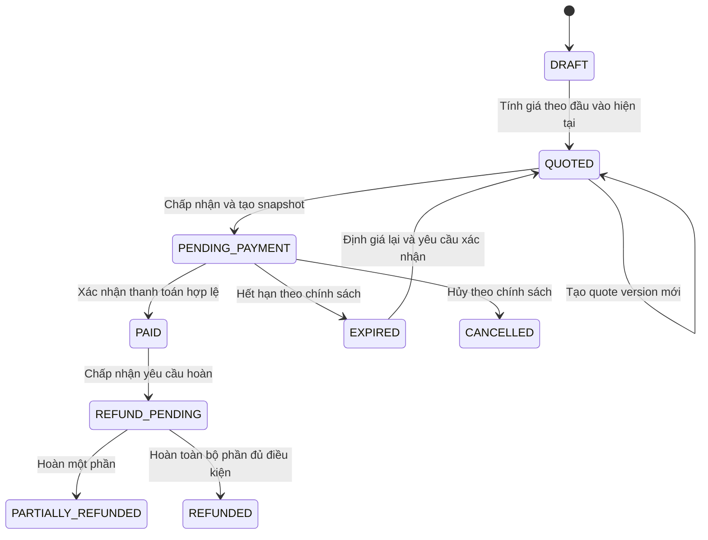

# Order price snapshot: chốt giá đơn hàng và bảo vệ số tiền đã thỏa thuận

## 1. Snapshot giá giải quyết vấn đề gì?

Trong chương Order Security của module bảo vệ logic nghiệp vụ, **order price snapshot** là bản ghi các thành phần giá mà hệ thống đã chấp nhận cho một đơn hàng tại một thời điểm cụ thể. Nó trả lời đồng thời hai câu hỏi:

- Khách hàng đang thanh toán cho những mặt hàng nào, theo quy tắc và điều kiện nào?
- Vì sao số tiền phải trả lại bằng con số đã ghi trên đơn?

Nếu đơn hàng chỉ lưu `productId` và `quantity`, sau đó mỗi lần hiển thị hoặc thanh toán lại lấy giá hiện tại từ catalog, giá trị giao dịch có thể thay đổi sau khi người mua xác nhận. Ngược lại, nếu server lưu thẳng `unitPrice` hoặc `total` từ request, kẻ tấn công có thể biến dữ liệu tùy ý thành giá chính thức của đơn hàng.

Snapshot an toàn cần cả hai tính chất: **được tạo từ phép tính đáng tin cậy trên server** và **được giữ ổn định cho phiên bản giá đã chốt**. Đóng băng một con số do client tự khai không làm con số đó trở nên đáng tin.

Mục tiêu bài học là thiết kế snapshot gắn với business invariants, state machine, quyền theo đối tượng, transaction và idempotency; qua đó ngăn sửa giá, dùng lại ưu đãi sai điều kiện và thanh toán theo dữ liệu đã lỗi thời.

## 2. Phân biệt giỏ hàng, báo giá và snapshot của đơn

| Đối tượng | Vai trò | Khả năng thay đổi | Điều cần kiểm soát |
|---|---|---|---|
| Catalog | Giá và thông tin bán hàng đang có hiệu lực | Thay đổi theo chính sách kinh doanh | Không dùng giá hiện tại để viết lại giao dịch đã chốt |
| Cart | Ý định mua: sản phẩm, biến thể, số lượng | Khách hàng có thể sửa | Mọi thay đổi ảnh hưởng giá phải tạo version mới |
| Quote | Kết quả tính giá đề xuất cho một bộ đầu vào | Có thời hạn và phạm vi áp dụng | Gắn với chủ thể, version giỏ hàng, tiền tệ và điều kiện giá |
| Order price snapshot | Giá được chấp nhận cho một phiên bản đơn | Bất biến sau khi chốt | Lưu đủ dữ liệu để giải thích, thanh toán và đối soát |
| Payment attempt | Một lần yêu cầu thanh toán | Có vòng đời riêng | Gắn cố định với snapshot, số tiền và tiền tệ tương ứng |

Giá catalog không nhất thiết bằng giá trên đơn: một đơn đã chốt có thể được giữ giá cũ trong thời hạn thanh toán. Điều này hợp lệ khi chính sách giữ giá được định nghĩa rõ và được server thực thi.

Báo giá cũng chưa chắc là cam kết giữ giá. Có hai chính sách phổ biến:

1. **Giữ giá đến hạn:** quote còn hiệu lực được chấp nhận theo giá đã tính, dù catalog vừa đổi. Hệ thống phải bảo đảm các quyền lợi đi kèm đã được giữ hoặc vẫn còn khả dụng theo chính sách.
2. **Kiểm tra lại khi chốt:** server xác minh lại điều kiện và version nguồn giá. Nếu kết quả thay đổi, trả báo giá mới để khách xác nhận.

Hai cách đều có thể đúng. Lỗi xuất hiện khi giao diện hứa giữ giá nhưng backend âm thầm tính giá mới, hoặc khi backend chấp nhận quote cũ mà không có quy tắc cho sự thay đổi của giá và ưu đãi.

## 3. Ranh giới tin cậy: client gửi ý định, server quyết định giá

Một request checkout có thể có dạng:

```http
POST /orders
Idempotency-Key: checkout-7af2
Content-Type: application/json

{
  "cartId": "cart-41",
  "cartVersion": 7,
  "quoteId": "quote-92",
  "quoteVersion": 3,
  "shippingOptionId": "standard"
}
```

Danh tính tài khoản và tenant phải lấy từ ngữ cảnh xác thực trên server. Các ID trong request là tham chiếu cần được kiểm tra quyền truy cập, không phải bằng chứng rằng người gọi sở hữu dữ liệu.

Server lấy hoặc kiểm tra:

- Đúng SKU, biến thể, số lượng, đơn vị bán và version của giỏ hàng.
- Bảng giá dành cho tài khoản, tenant, thị trường hoặc hợp đồng tương ứng.
- Điều kiện khuyến mãi, giới hạn sử dụng và khả năng kết hợp ưu đãi.
- Địa chỉ, khu vực giao hàng và lựa chọn vận chuyển ảnh hưởng giá.
- Chính sách thuế, tiền tệ và làm tròn đang áp dụng cho báo giá.
- Thời hạn báo giá và quyền sử dụng báo giá của người gọi.

Các giá trị như `unitPrice`, `discountAmount`, `taxAmount`, `shippingFee`, `grandTotal` trong request không có thẩm quyền quyết định số tiền thu. Nếu API nhận `expectedTotal` để phát hiện chênh lệch giao diện, chỉ dùng nó làm giá trị đối chiếu: server từ chối hoặc yêu cầu xác nhận lại khi khác kết quả chuẩn.

Ẩn trường giá trên giao diện, dùng trường HTML `readonly`, hoặc mã hóa một giá trị bằng Base64 đều không tạo ra ranh giới bảo mật. Client có thể gửi HTTP request trực tiếp.

Một quote có chữ ký cũng cần kiểm tra chủ thể, tenant, thời hạn, version và điều kiện sử dụng. Chữ ký chứng minh payload không bị sửa; nó không tự ngăn phát lại, dùng quote của tài khoản khác hay vượt hạn mức khuyến mãi.

## 4. Các business invariants phải được giữ

Các bất biến sau nên trở thành điều kiện kiểm tra trong luồng nghiệp vụ, ràng buộc lưu trữ thích hợp và tiêu chí kiểm thử.

### 4.1. Bất biến về nguồn giá và phạm vi áp dụng

- Mỗi dòng hàng có giá được tạo hoặc được xác minh bởi bộ định giá phía server.
- Snapshot thuộc đúng đơn, chủ thể và tenant được phép thực hiện giao dịch.
- Tất cả thành phần tiền của snapshot dùng cùng tiền tệ và quy ước đơn vị. Chuyển đổi tiền tệ phải là bước tường minh, có nguồn tỷ giá và quy tắc làm tròn được lưu lại.
- Quote được chấp nhận phải tương ứng với các đầu vào ảnh hưởng giá; thay đổi một đầu vào như số lượng hoặc phương thức giao hàng phải được đánh giá lại.

### 4.2. Bất biến về số học

Với mô hình giá chưa gồm thuế và giảm giá đơn hàng đã được phân bổ xuống từng dòng:

```text
lineGross[i] = unitPrice[i] × quantity[i]
lineNet[i]   = lineGross[i] − allocatedDiscount[i]
lineTotal[i] = lineNet[i] + lineTax[i]

subtotal    = Σ lineGross[i]
discount    = Σ allocatedDiscount[i]
tax         = Σ lineTax[i]
grandTotal  = subtotal − discount + tax + shippingFee
```

Mô hình trên giả định phí vận chuyển là số tiền cuối cùng và không có thuế vận chuyển riêng. Nếu nghiệp vụ có thêm phí hoặc thuế cho vận chuyển, phải lưu các thành phần đó và bổ sung vào công thức. Với giá đã gồm thuế, thuế thường được tách từ giá đã có, vì vậy không được cộng thêm thuế lần nữa.

Các điều kiện tối thiểu gồm số lượng dương, các khoản tiền nằm trong giới hạn được chấp nhận, giảm giá không vượt phần giá được phép giảm và tổng tiền không âm. Nếu có điểm thưởng, ví điện tử hoặc gift card, phải xác định chúng là giảm giá hay phương tiện thanh toán; không trừ cùng một khoản ở cả hai lớp.

### 4.3. Bất biến về vòng đời

- Sau khi chốt, nội dung snapshot đã chấp nhận không được sửa tại chỗ.
- Mỗi payment attempt tham chiếu đúng một snapshot và revision của nó.
- Chuyển đơn sang trạng thái đã thanh toán phải dựa trên giao dịch hợp lệ cho đúng snapshot, đúng tiền tệ và đủ số tiền theo mô hình thanh toán của đơn.
- Retry cùng một ý định checkout không được tạo thêm đơn hoặc tiêu thụ ưu đãi thêm lần nữa.
- Catalog đổi giá không được làm thay đổi snapshot của đơn đã chốt.

Nếu hỗ trợ thanh toán nhiều lần hoặc nhiều phương tiện, bất biến thanh toán cần xét tổng các khoản đã xác nhận và việc phân bổ chúng. Không áp dụng máy móc quy tắc một payment attempt bằng toàn bộ đơn cho mô hình đó.

## 5. Ví dụ chốt giá và lưu dấu vết tính tiền

Giả sử một cửa hàng dùng VND, giá chưa gồm thuế, và quy tắc thuế giả định 8% chỉ nhằm minh họa phép tính. Đây không phải mức thuế áp dụng chung cho mọi giao dịch.

| Thành phần | Giá trị |
|---|---:|
| Giá một sản phẩm | 150.000 VND |
| Số lượng | 2 |
| Thành tiền trước giảm | 300.000 VND |
| Giảm giá cho dòng hàng | 30.000 VND |
| Cơ sở tính thuế sau giảm | 270.000 VND |
| Thuế minh họa: 270.000 × 8% | 21.600 VND |
| Phí vận chuyển cuối cùng | 15.000 VND |
| Tổng phải trả | 306.600 VND |

Snapshot cần giữ cả số tiền kết quả lẫn dữ kiện giải thích: đơn giá, số lượng, khoản giảm, cơ sở tính thuế, thuế suất, tiền thuế và version chính sách. Chỉ lưu `grandTotal = 306600` đủ để biết số tiền, nhưng không đủ để giải thích tranh chấp hoặc phân bổ khi trả một phần hàng.

Sau khi snapshot được chấp nhận, catalog tăng giá lên 170.000 VND không làm tổng tiền của đơn tự thay đổi. Màn hình chi tiết đơn, yêu cầu thanh toán và thông báo xác nhận tiếp tục dùng snapshot 306.600 VND trong phạm vi chính sách giữ giá đã cam kết.

## 6. Mô hình dữ liệu: lưu kết quả và căn cứ, tránh phụ thuộc catalog hiện tại

Một thiết kế có thể tách phần định danh đơn, nội dung snapshot và các lần thanh toán:

| Nhóm dữ liệu | Trường minh họa | Mục đích |
|---|---|---|
| Đơn hàng | `orderId`, `ownerId`, `tenantId`, `state`, `currentSnapshotId`, `version` | Kiểm soát quyền, trạng thái và cạnh tranh cập nhật |
| Đầu snapshot | `snapshotId`, `orderId`, `revision`, `currency`, `currencyScale`, `acceptedAt`, `payBy` | Xác định phiên bản giá và hạn thanh toán |
| Nguồn định giá | `quoteId`, `quoteVersion`, `cartVersion`, `pricingPolicyVersion`, `roundingPolicyVersion` | Giải thích nguồn và chính sách đã dùng |
| Dòng hàng | `skuId`, `variantId`, `displayName`, `unitOfMeasure`, `quantity`, `unitPriceMinor` | Giữ ý nghĩa thương mại tại thời điểm mua |
| Phân rã giá | `grossMinor`, `discountMinor`, `taxBaseMinor`, `taxRate`, `taxMinor`, `lineTotalMinor` | Đối soát và xử lý hoàn trả |
| Phí và tổng | `shippingMinor`, các loại phí liên quan, `grandTotalMinor` | Làm nguồn số tiền cho thanh toán |
| Ưu đãi | `promotionId`, `ruleVersion`, số tiền phân bổ, `reservationId` | Truy vết điều kiện và lượng quyền lợi đã giữ |
| Thanh toán | `attemptId`, `snapshotId`, `amountMinor`, `currency`, `providerReference`, `state` | Đối chiếu kết quả với đúng giá đã chốt |

Không phải hệ thống nào cũng cần mọi trường trên. Nguyên tắc là lưu đủ thông tin để giải thích giao dịch mà không cần chạy lại các quy tắc giá hiện tại. Không lưu dư thông tin cá nhân chỉ để làm dấu vết định giá; địa chỉ hoặc thông tin thuế chỉ nên giữ ở mức cần thiết cho nghiệp vụ và chính sách lưu trữ.

Các ràng buộc lưu trữ có ích gồm:

- Unique cho `(orderId, revision)` và khóa ngoại từ payment attempt tới snapshot.
- Check cho số lượng dương và những trường tiền không âm theo mô hình đã chọn.
- Unique cho khóa idempotency trong phạm vi chủ thể, tenant và loại thao tác.
- Unique cho mã sự kiện hoặc mã giao dịch bên thanh toán theo phạm vi tài khoản nhà cung cấp.

Ràng buộc từng dòng không tự chứng minh tổng đơn bằng tổng các dòng hàng. Phần tổng hợp đó vẫn cần được kiểm tra trong nghiệp vụ, cơ chế lưu trữ phù hợp hoặc quy trình đối soát.

Quyền ghi vào snapshot phải đi qua luồng nghiệp vụ có kiểm soát. Không cho API cập nhật đơn hàng chung ghi đè `unitPriceMinor`, `grandTotalMinor` hoặc `currentSnapshotId` qua cơ chế gán hàng loạt thuộc tính. Nếu dùng trigger hoặc phân quyền database để hạn chế sửa snapshot, cần thiết kế riêng đường ghi revision mới và audit hợp lệ.

## 7. Tiền tệ, làm tròn và phân bổ giảm giá

### 7.1. Không dùng số thực nhị phân cho tiền

`double` và `float` có thể biểu diễn gần đúng các số thập phân, khiến so sánh và cộng dồn sai với kỳ vọng tiền tệ. Hai cách thường dùng trong Java là:

- Lưu số nguyên theo đơn vị tiền nhỏ nhất đã quy định, ví dụ 306600 VND hoặc 1099 cent cho 10,99 USD.
- Dùng `BigDecimal` với scale và chế độ làm tròn được quy định rõ.

Không mặc định mọi tiền tệ đều có hai chữ số thập phân. Một số nhà cung cấp thanh toán còn có quy ước API riêng; lớp tích hợp phải chuyển đổi rõ ràng giữa đơn vị nội bộ và đơn vị mà nhà cung cấp yêu cầu.

Ví dụ dưới đây tính thuế cho một cơ sở tính thuế đã là số nguyên theo đơn vị tiền nhỏ nhất:

```java
long taxMinor = BigDecimal.valueOf(taxBaseMinor)
        .multiply(new BigDecimal("0.08"))
        .setScale(0, RoundingMode.HALF_UP)
        .longValueExact();
```

Đây là một chính sách minh họa, không phải chế độ làm tròn đúng cho mọi thị trường. Cần xác định làm tròn theo đơn vị hàng, theo dòng hay theo toàn bộ đơn; lưu kết quả đã dùng và version chính sách. Tạo `BigDecimal` từ chuỗi thập phân hoặc dữ liệu thập phân chính xác, tránh `new BigDecimal(0.08)`.

### 7.2. Tổng phân bổ phải khớp khoản giảm đã cấp

Một coupon giảm 10.000 VND cho ba đơn vị hàng có thể được phân bổ thành 3.334, 3.333 và 3.333 VND nếu quy tắc phân bổ cho phép. Ba phần đều làm tròn thành 3.333 sẽ làm mất 1 VND.

Quy tắc xử lý phần dư phải xác định, ổn định và được lưu đủ để hoàn trả đúng phần. Với các dòng hàng khác giá, có thể phân bổ theo tỷ trọng rồi cấp phần dư theo quy tắc cố định. Không để client chọn dòng nhận giảm giá lớn nhất sau khi đã biết mặt hàng nào sẽ được trả lại.

Tương tự, nếu thuế và giảm giá được tính ở cấp dòng nhưng nghiệp vụ cho trả từng đơn vị, cần xác định cách phân bổ xuống từng đơn vị hoặc từng phần hoàn trả. Bất biến quan trọng là tổng các phần phân bổ khớp khoản đã chốt, và tổng hoàn trả không vượt phần tiền đủ điều kiện đã được thu sau những lần hoàn trước đó.

## 8. Ví dụ Java: tổng hợp snapshot bằng dữ liệu đã định giá trên server

Đoạn mã dưới đây là phần tính tổng thuần túy. Nó dùng mô hình ví dụ ở trên: mọi giảm giá đã phân bổ vào dòng; thuế dòng đã được bộ định giá xác định; phí vận chuyển là số tiền cuối cùng. Giới hạn 100 dòng và 1.000 sản phẩm mỗi dòng chỉ là giới hạn minh họa.

```java
import java.util.List;
import java.util.Objects;

record ServerPricedLine(
        long unitPriceMinor,
        int quantity,
        long allocatedDiscountMinor,
        long taxMinor) {
}

record SnapshotTotals(
        long subtotalMinor,
        long discountMinor,
        long taxMinor,
        long shippingMinor,
        long grandTotalMinor) {
}

final class SnapshotCalculator {
    static SnapshotTotals calculate(
            List<ServerPricedLine> lines,
            long shippingMinor) {
        Objects.requireNonNull(lines, "lines");
        if (lines.isEmpty() || lines.size() > 100 || shippingMinor < 0) {
            throw new IllegalArgumentException("Invalid order size or shipping");
        }

        long subtotal = 0;
        long discount = 0;
        long tax = 0;

        for (ServerPricedLine line : lines) {
            Objects.requireNonNull(line, "line");
            if (line.quantity() <= 0 || line.quantity() > 1_000
                    || line.unitPriceMinor() < 0
                    || line.allocatedDiscountMinor() < 0
                    || line.taxMinor() < 0) {
                throw new IllegalArgumentException("Invalid priced line");
            }

            long gross = Math.multiplyExact(
                    line.unitPriceMinor(), (long) line.quantity());
            if (line.allocatedDiscountMinor() > gross) {
                throw new IllegalArgumentException("Discount exceeds line gross");
            }

            subtotal = Math.addExact(subtotal, gross);
            discount = Math.addExact(discount, line.allocatedDiscountMinor());
            tax = Math.addExact(tax, line.taxMinor());
        }

        long afterDiscount = Math.subtractExact(subtotal, discount);
        long withTax = Math.addExact(afterDiscount, tax);
        long grandTotal = Math.addExact(withTax, shippingMinor);

        return new SnapshotTotals(
                subtotal, discount, tax, shippingMinor, grandTotal);
    }
}
```

Với một dòng `new ServerPricedLine(150_000, 2, 30_000, 21_600)` và phí vận chuyển `15_000`, kết quả tổng là `306_600`.

`Math.addExact`, `Math.subtractExact` và `Math.multiplyExact` làm phép toán thất bại khi vượt miền `long`, thay vì âm thầm tạo kết quả bị tràn số. Lỗi này phải khiến thao tác tạo đơn thất bại và transaction rollback; không bắt lỗi rồi thay bằng 0. Sản phẩm thực tế cũng cần giới hạn tổng tiền phù hợp với nghiệp vụ và khả năng của nhà cung cấp thanh toán.

Lớp tính tổng không xác minh quyền sở hữu quote, tính hợp lệ của coupon, thuế suất hay nguồn đơn giá. `ServerPricedLine` phải được tạo từ bộ định giá đáng tin cậy; không bind trực tiếp từ JSON của người dùng. Tiền tệ của mọi dòng phải được kiểm tra trước khi gọi lớp này, vì record minh họa chưa mang trường tiền tệ.

## 9. Chốt snapshot trong một ranh giới nhất quán

Sai lầm thường gặp là kiểm tra giỏ hàng trước, đợi một khoảng thời gian, rồi tạo snapshot từ một giỏ hàng đã bị thay đổi. Đây là lỗi kiểm tra ở một thời điểm nhưng sử dụng ở thời điểm khác.

Một luồng có thể tổ chức như sau:

```text
Nhận request và xác thực người gọi
  → Chuẩn hóa đầu vào, tính fingerprint cho ý định checkout
  → Bắt đầu transaction trong database sở hữu order
      → Claim khóa idempotency bằng ràng buộc unique
      → Đọc cart và quote trong phạm vi owner/tenant được phép
      → Khóa hoặc kiểm tra version cart theo cơ chế cạnh tranh đã chọn
      → Kiểm tra quote, version, đầu vào, thời hạn và chính sách giữ giá
      → Giữ/tiêu thụ quyền ưu đãi bằng thao tác nguyên tử thích hợp
      → Tạo order và snapshot bất biến từ giá được chấp nhận
      → Tạo payment attempt tham chiếu snapshot
      → Ghi outbox cho yêu cầu tạo thanh toán
      → Gắn kết quả order vào bản ghi idempotency
  → Commit
  → Worker gửi yêu cầu thanh toán từ outbox
```

Đây là mô tả luồng, không phải mã transaction có thể dùng nguyên trạng. Cần xác định rõ ranh giới nào cùng database và tài nguyên nào thuộc dịch vụ khác.

### 9.1. Khóa và version phải bảo vệ đúng tài nguyên

Có thể khóa giỏ hàng khi chốt, hoặc dùng optimistic locking với `cartVersion` và thao tác cập nhật có điều kiện. Mọi đường sửa dòng hàng cũng phải tuân theo cùng cơ chế; khóa bản ghi cart không giúp ích nếu một API khác vẫn sửa dòng hàng mà không phối hợp.

Nếu việc checkout chỉ được phép chuyển một cart thành một order, cần bất biến riêng cho điều đó, chẳng hạn trạng thái cart được đổi bằng cập nhật có điều kiện hoặc ràng buộc duy nhất tương ứng. Idempotency theo request không ngăn hai request dùng hai khóa khác nhau tạo hai đơn từ cùng cart.

Ưu đãi có hạn mức cần được giữ hoặc tiêu thụ bằng thao tác chống cạnh tranh. Hai transaction cùng đọc “còn một lượt” rồi cùng giảm tiền là lỗi dù mỗi đơn đều có snapshot chính xác về số học.

### 9.2. Không giả định một transaction bao trùm nhiều dịch vụ

Nếu bộ định giá, coupon hoặc thanh toán nằm ở dịch vụ khác, transaction local không làm các lời gọi mạng trở nên nguyên tử. Có thể dùng quote được lưu bền, token giữ quyền ưu đãi, thời hạn reservation và cơ chế bù trừ khi tạo đơn thất bại. Các thao tác giữ và giải phóng cũng cần idempotency.

Với chính sách kiểm tra lại giá, phải có cách ràng buộc version hoặc chấp nhận báo giá nguyên tử tại nơi sở hữu giá. Chỉ gọi API lấy giá rồi so sánh một lần không bảo đảm catalog không đổi ngay sau lần so sánh đó. Với chính sách giữ giá, điều được chấp nhận chính là cam kết quote theo quy tắc đã xác định, nên không cần giả vờ rằng giá catalog sẽ đứng yên.

Không giữ transaction database mở trong suốt lời gọi đến cổng thanh toán. Outbox giúp commit đồng thời trạng thái order và ý định gửi yêu cầu. Worker có thể gửi lặp; phía tích hợp vẫn phải dùng khóa idempotency của payment attempt và có cơ chế đối soát khi không rõ nhà cung cấp đã nhận yêu cầu hay chưa.

## 10. State machine: khi nào được đổi giá?



Sơ đồ là mô hình học tập; hệ thống thật có thể tách trạng thái thương mại và trạng thái thanh toán. Những quy tắc chính cần giữ là:

- **Trước khi chấp nhận:** thay đổi số lượng, địa chỉ, coupon hoặc lựa chọn giao hàng làm quote cũ mất khả năng áp dụng nếu các đầu vào không còn khớp.
- **Đã chấp nhận, đang chờ thanh toán:** giữ nguyên snapshot. Nếu nghiệp vụ cho sửa đơn, phải tạo revision mới, lấy lại xác nhận và xử lý payment attempt cũ theo quy tắc rõ ràng.
- **Hết hạn:** không tự chuyển sang giá mới rồi thu tiền. Khi định giá lại, giữ snapshot cũ để audit và tạo snapshot mới sau khi chấp nhận lại.
- **Đã thanh toán:** dùng nghiệp vụ điều chỉnh, thu thêm hoặc hoàn tiền có audit. Không cập nhật đơn giá của snapshot gốc để che đi lịch sử giao dịch.

Nếu payment attempt cũ chưa chắc đã bị vô hiệu tại nhà cung cấp, không được xem việc đổi `currentSnapshotId` là đủ để bảo đảm an toàn. Webhook cho attempt cũ phải được nhận diện và đối soát theo revision cũ, không tự áp sang snapshot mới.

Tác vụ hết hạn và webhook thanh toán cũng có thể chạy đồng thời. Cần tuần tự hóa quyết định trên order/payment attempt bằng khóa hoặc cập nhật trạng thái có điều kiện, đồng thời quy định cách xử lý thanh toán thực tế đã xảy ra trước hoặc sau hạn. Một đơn local đã `EXPIRED` không chứng minh khách chưa bị trừ tiền.

## 11. Idempotency và xác nhận thanh toán

### 11.1. Retry checkout phải quay về kết quả cũ

Khóa idempotency nên được ràng buộc ít nhất với chủ thể, tenant và loại thao tác. Bản ghi cần gắn fingerprint đầu vào với kết quả đã tạo:

| Tình huống | Hành vi mong muốn |
|---|---|
| Cùng khóa, cùng fingerprint, đã hoàn tất | Trả lại cùng order và snapshot, sau khi kiểm tra quyền truy cập |
| Cùng khóa, cùng fingerprint, đang xử lý | Trả trạng thái chờ hoặc lỗi retry có kiểm soát theo hợp đồng API |
| Cùng khóa, fingerprint khác | Từ chối xung đột, không tái sử dụng kết quả cho ý định khác |
| Hai request cạnh tranh cùng khóa | Ràng buộc unique quyết định một bên sở hữu; bên kia đọc kết quả theo cơ chế retry |
| Hai khóa khác nhau cho cùng cart đã checkout | Bất biến một lần checkout của cart quyết định kết quả |

Fingerprint cần bao quát các đầu vào ảnh hưởng giao dịch như cart/version, quote/version và lựa chọn vận chuyển. Hash của request chỉ hỗ trợ nhận diện ý định; nó không xác nhận số tiền do client khai là đúng.

Khi trả kết quả của một lần checkout đã hoàn tất, không định giá lại chỉ vì quote ban đầu đã hết hạn. Kết quả retry là giao dịch đã được commit, không phải một lần chấp nhận giá mới. Thời hạn giữ bản ghi idempotency và ràng buộc nghiệp vụ phải đủ để retry muộn không tạo hiệu ứng lặp sau khi khóa bị dọn.

### 11.2. Số tiền thanh toán xuất phát từ snapshot

Khi tạo yêu cầu với nhà cung cấp, server lấy `amount` và `currency` từ snapshot mà payment attempt tham chiếu. Không lấy từ request mới nhất của client và cũng không tính lại từ catalog.

Trước khi ghi nhận thanh toán thành công, luồng xử lý cần:

1. Xác thực nguồn sự kiện bằng cơ chế phù hợp với nhà cung cấp; khi cần, truy vấn trạng thái giao dịch qua kênh tin cậy.
2. Đối chiếu tài khoản nhận tiền, mã giao dịch và payment attempt đã tạo.
3. Kiểm tra trạng thái, số tiền, tiền tệ và snapshot/revision tương ứng.
4. Chống xử lý trùng bằng định danh sự kiện và giao dịch ở đúng phạm vi.
5. Ghi nhận sự kiện cùng chuyển trạng thái nghiệp vụ trong ranh giới transaction phù hợp.

Trong mô hình thu một lần toàn bộ đơn ở ví dụ này, thanh toán 1 VND hoặc 306.600 ở một tiền tệ khác không thỏa điều kiện thanh toán snapshot 306.600 VND. Callback từ trình duyệt hoặc trang “thành công” không đủ bằng chứng để chuyển đơn sang `PAID`.

Nếu tiền thực sự đã được thu nhưng không khớp revision hiện hành, cần lưu giao dịch và đưa vào luồng đối soát, hoàn tiền hoặc xử lý ngoại lệ theo chính sách. Không âm thầm sửa tổng đơn cho khớp webhook, cũng không bỏ mất dấu vết dòng tiền vì không thể chuyển trạng thái đơn.

## 12. Các tình huống tấn công logic và điểm chặn

| Tình huống | Hậu quả nếu thiếu kiểm soát | Điểm chặn |
|---|---|---|
| Sửa `unitPrice` thành 1 trong request | Đơn giá giả trở thành snapshot chính thức | Server định giá và không gán trường giá từ client |
| Dùng quote của tài khoản hoặc tenant khác | Hưởng giá hợp đồng hoặc ưu đãi không thuộc quyền | Kiểm tra quyền theo đối tượng và ràng buộc quote với chủ thể |
| Giữ quote cho một sản phẩm rồi đổi SKU hoặc số lượng | Giá áp cho đầu vào không tương ứng | Ràng buộc toàn bộ đầu vào ảnh hưởng giá với quote/version |
| Sửa giỏ đồng thời với checkout | Snapshot và hàng được mua không khớp | Khóa hoặc version được áp dụng cho mọi đường sửa |
| Chạy hai request để dùng coupon còn một lượt | Vượt hạn mức khuyến mãi | Giữ/tiêu thụ quyền lợi nguyên tử, có idempotency |
| Làm tràn phép nhân đơn giá với số lượng | Tổng tiền sai hoặc âm | Giới hạn nghiệp vụ và phép toán kiểm tra tràn |
| Sửa tiền thanh toán sau khi tạo đơn | Thu ít hơn số tiền đã chốt | Payment attempt lấy tiền từ snapshot bất biến |
| Gửi webhook hoặc retry lặp | Giao hàng hoặc tiêu thụ ưu đãi nhiều lần | Deduplication và chuyển trạng thái có điều kiện |
| Đổi revision rồi gửi kết quả thanh toán cũ | Đơn mới được coi là đã trả đủ bằng giao dịch cũ | Ràng buộc payment attempt với snapshot và đối soát revision |
| Gọi API quản trị cập nhật trực tiếp tổng tiền | Đi vòng luồng phê duyệt và audit | Quyền theo thao tác/đối tượng và nghiệp vụ điều chỉnh riêng |

Quyền truy cập đúng không thay thế kiểm tra bất biến: chủ sở hữu hợp lệ của đơn vẫn có thể thử sửa giá, gửi lặp hoặc bỏ qua bước xác nhận lại. Ngược lại, phép tính chính xác không thay thế kiểm tra quyền: quote của người khác vẫn là dữ liệu không được phép dùng.

## 13. Kiểm thử theo kết quả nghiệp vụ

Kiểm thử cần quan sát dữ liệu đơn, snapshot, lượt dùng ưu đãi và tác động thanh toán; chỉ kiểm tra mã HTTP thường bỏ sót hiệu ứng phụ đã xảy ra trước khi trả lỗi.

| Nhóm | Thiết lập và hành động | Kết quả cần chứng minh |
|---|---|---|
| Luồng chuẩn | Dùng dữ liệu ví dụ và chốt đơn | Tổng 306.600 VND; các thành phần khớp và payment attempt trỏ đúng snapshot |
| Giả mạo giá | Chèn giá 1 hoặc tổng 0 vào payload | Dữ liệu giả không quyết định số tiền; API từ chối hoặc dùng giá server theo hợp đồng |
| Kiểm tra quyền | Dùng quote của người khác hoặc tenant khác | Không tạo đơn, không tiêu thụ coupon, không lộ nội dung quote |
| Catalog thay đổi | Đổi catalog sau khi đã chốt | Chi tiết đơn và yêu cầu thanh toán vẫn dùng snapshot đã chấp nhận |
| Quote lỗi thời | Đổi cartVersion, địa chỉ hoặc lựa chọn giao hàng | Không chấp nhận quote không còn khớp; yêu cầu xác nhận giá mới khi cần |
| Hạn báo giá | Thử trước hạn, đúng ranh giới hạn và sau hạn | Tuân theo quy ước thời gian, chẳng hạn `now < expiresAt`, bằng đồng hồ server |
| Cạnh tranh | Cho sửa giỏ và checkout thực sự chạy đồng thời | Một tổ hợp dữ liệu nhất quán được chấp nhận; tổ hợp còn lại bị phát hiện xung đột |
| Hạn mức ưu đãi | Hai checkout cùng tranh lượt cuối | Chỉ số lần hợp lệ được giữ/tiêu thụ; không vượt quota |
| Retry | Gửi đồng thời cùng khóa rồi gửi lại sau commit | Chỉ một order, một snapshot chốt và một hiệu ứng tiêu thụ ưu đãi |
| Xung đột khóa | Dùng lại khóa với quote hoặc cartVersion khác | Bị từ chối, không ghi đè fingerprint hay kết quả cũ |
| Số học | Kiểm tra giới hạn, tràn số, giảm vượt giá và phân bổ phần dư | Thất bại an toàn hoặc cho kết quả theo chính sách; tổng các phần luôn khớp |
| Webhook | Lặp sự kiện, sai tiền tệ, thiếu tiền, sai revision | Không giao hàng thêm lần; không chuyển `PAID` sai; vẫn lưu ngoại lệ dòng tiền cần đối soát |
| Hết hạn cạnh tranh | Chạy tác vụ expire cùng webhook thành công | Kết quả theo chính sách đã chọn, không làm mất giao dịch thực tế |
| Lỗi sau commit | Mô phỏng worker gửi xong nhưng chưa đánh dấu outbox | Retry không tạo yêu cầu thanh toán kinh doanh mới cho cùng attempt |
| Hoàn một phần | Trả từng phần theo nhiều request | Dùng phân bổ từ giao dịch gốc và không hoàn vượt phần đủ điều kiện đã thu |

Kiểm thử cạnh tranh nên có điểm đồng bộ để hai request đi vào vùng có nguy cơ cùng lúc; chạy tuần tự hai request không chứng minh được khả năng chống race condition. Kiểm thử thời hạn nên dùng clock có thể điều khiển thay vì chờ thời gian thực.

## 14. Audit và cách đọc lại một quyết định giá

Một bản ghi audit hữu ích liên kết được request, order, snapshot revision, quote version, chính sách giá, reservation ưu đãi và payment attempt. Khi có điều chỉnh thủ công, ghi thêm người thực hiện, quyền hoặc phê duyệt đã dùng, lý do và giao dịch điều chỉnh.

Các tín hiệu cần theo dõi gồm tỷ lệ quote hết hạn, version xung đột, payload cố sửa giá, idempotency conflict, số tiền thanh toán lệch snapshot và webhook thuộc revision cũ. Log cần đủ định danh để điều tra nhưng không chứa bí mật thanh toán hoặc dữ liệu nhạy cảm không cần thiết.

Checksum hoặc chữ ký snapshot có thể hỗ trợ phát hiện thay đổi nếu được thiết kế với mô hình đe dọa phù hợp. Một hash nằm cùng database, do cùng tài khoản ghi được sửa, không tự chống được người có toàn quyền sửa cả dữ liệu lẫn hash. Nó cũng không thay thế kiểm tra quyền, bất biến, transaction hoặc audit.

Khi đánh giá một thiết kế order price snapshot, hãy lần theo một giao dịch từ đầu đến cuối: ai có quyền dùng giá đó, đầu vào nào đã được chấp nhận, tổng tiền được suy ra thế nào, phiên bản nào đã được thanh toán và lịch sử còn giải thích được ra sao sau khi catalog thay đổi. Nếu mỗi câu hỏi đều có dữ liệu và quy tắc rõ ràng, snapshot mới thực sự bảo vệ thỏa thuận giá của đơn hàng.
