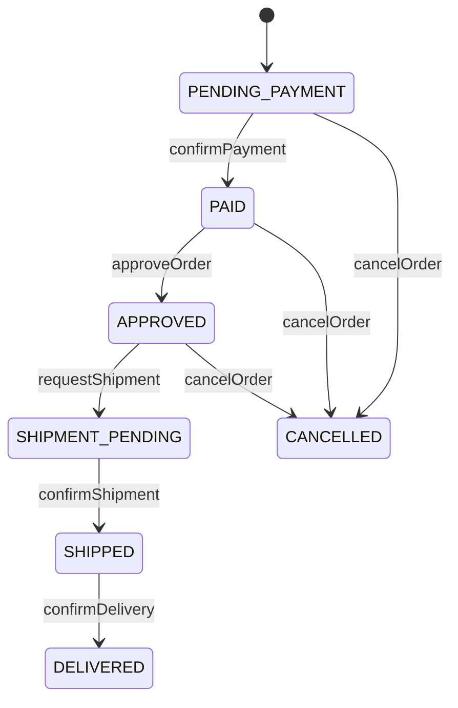

# Chuyển trạng thái đơn hàng an toàn (Order state transitions)

## 1. Vì sao trạng thái đơn hàng là một ranh giới bảo mật?

Trong chương **Order Security**, chuyển trạng thái đơn hàng là nơi quy tắc nghiệp vụ gặp trực tiếp dữ liệu do nhiều bên tác động: khách hàng, nhân viên vận hành, cổng thanh toán, kho và đơn vị vận chuyển. Một hệ thống có thể chặn SQL injection, xác thực người dùng đầy đủ nhưng vẫn bị lạm dụng nếu khách hàng gọi thẳng API để đưa đơn chưa thanh toán sang trạng thái giao hàng.

Ví dụ, giao diện chỉ hiện nút “Duyệt đơn” cho nhân viên không ngăn được việc khách hàng gửi lại request và đổi `status` thành `APPROVED`. Tương tự, kiểm tra “đơn chưa giao” rồi mới hủy sẽ thiếu an toàn khi một request khác đang đưa cùng đơn sang bước giao hàng.

Bảo vệ chuyển trạng thái nghĩa là máy chủ chỉ chấp nhận một **lệnh nghiệp vụ** khi đồng thời thỏa mãn:

- Người thực hiện có quyền đối với đúng đơn hàng trong đúng phạm vi tổ chức.
- Trạng thái hiện tại cho phép thực hiện lệnh đó.
- Các điều kiện nghiệp vụ vẫn đúng tại thời điểm cập nhật.
- Quyết định chuyển trạng thái và những thay đổi dữ liệu cục bộ liên quan được thực hiện nguyên tử.
- Yêu cầu hoặc sự kiện được gửi lại không tạo thêm tác động nghiệp vụ.
- Hệ thống lưu đủ bằng chứng để giải thích ai đã làm gì và vì sao lệnh được chấp nhận.

Bài học tập trung vào những điều kiện này để ngăn bỏ qua phê duyệt, giao hàng khi chưa đủ tiền, hủy đơn sai quyền và tạo tác động trùng.

## 2. Phân biệt trạng thái, lệnh và sự kiện

Ba khái niệm này có vai trò khác nhau:

| Khái niệm | Ý nghĩa | Ví dụ |
| --- | --- | --- |
| Trạng thái | Sự thật nghiệp vụ mà hệ thống đang công nhận | `PAID`: đã ghi nhận thanh toán hợp lệ |
| Lệnh | Yêu cầu thực hiện một hành động, có thể bị từ chối | `approveOrder`, `cancelOrder` |
| Sự kiện | Ghi nhận một sự việc đã xảy ra, cần kiểm chứng nguồn và chống xử lý trùng | `PaymentCaptured`, `ShipmentCreated` |

Khách hàng được yêu cầu hủy đơn nhưng không được tự xác nhận rằng đã hoàn tiền. Webhook báo thanh toán thành công là một đầu vào cần kiểm chứng; nó không được tự động cho phép mọi chuyển trạng thái.

Thiết kế dễ bị lạm dụng:

```http
PATCH /orders/7b52...
Content-Type: application/json

{
  "status": "SHIPPED",
  "paid": true,
  "approvedBy": "manager-01"
}
```

Request này trộn yêu cầu của người gọi với các sự thật chỉ máy chủ mới được quyền xác lập.

Thiết kế thể hiện ý định nghiệp vụ rõ hơn:

```http
POST /orders/7b52.../cancel
Idempotency-Key: 6ff2b413-...

{
  "expectedVersion": 12,
  "reason": "CUSTOMER_REQUEST"
}
```

Máy chủ tự lấy người thực hiện từ ngữ cảnh xác thực, tải đơn hàng, kiểm tra quyền, kiểm tra trạng thái và quyết định kết quả. Các trường như `paidAmount`, `approvedBy`, `tenantId`, `shipmentId` và trạng thái đích không được gán hàng loạt từ payload.

Endpoint theo hành động giúp làm rõ chính sách, nhưng tên endpoint không tạo ra bảo mật. Một endpoint chung vẫn phải thực thi đầy đủ cùng các quy tắc trên máy chủ.

## 3. Xây dựng state machine trước khi viết điều kiện rời rạc

### 3.1. Một mô hình đơn hàng minh họa

Giả sử cửa hàng áp dụng quy trình trả trước và bắt buộc duyệt đơn trước khi yêu cầu giao hàng:

- `PENDING_PAYMENT`: chờ thanh toán, giá trị đơn đã được máy chủ chốt.
- `PAID`: đã xác nhận khoản thanh toán phù hợp với đơn.
- `APPROVED`: đã hoàn tất phê duyệt nghiệp vụ.
- `SHIPMENT_PENDING`: đã chấp nhận yêu cầu tạo vận đơn; đang chờ kết quả từ hệ thống vận chuyển.
- `SHIPPED`: đã có bằng chứng hợp lệ rằng hàng được bàn giao theo quy ước của hệ thống.
- `DELIVERED`: đã xác nhận giao hàng.
- `CANCELLED`: đã hủy nghĩa vụ thực hiện đơn theo quy trình hủy.

Đây là mô hình phục vụ bài học. Đơn trả sau, thanh toán nhiều lần, giao từng phần hoặc bán hàng số cần mô hình và điều kiện riêng.



Các cạnh không xuất hiện trong mô hình bị từ chối mặc định. Ví dụ, `PENDING_PAYMENT → SHIPPED` và `CANCELLED → APPROVED` không được phép.

Trạng thái `SHIPMENT_PENDING` biểu diễn một mốc quan trọng: hệ thống đã chấp nhận ý định giao hàng, nên không tiếp tục cho phép hủy đơn bằng luồng hủy thông thường. Nếu doanh nghiệp hỗ trợ hủy vận đơn hoặc thu hồi hàng, cần định nghĩa một quy trình riêng có xác nhận từ bên vận chuyển.

Không nên suy ra trạng thái nghiệp vụ chỉ từ việc “đã tạo nhãn vận chuyển”. Trong ví dụ này, `confirmShipment` phải có bằng chứng bàn giao phù hợp; việc tạo nhãn có thể xảy ra trước đó.

### 3.2. Bảng chuyển trạng thái là hợp đồng nghiệp vụ

| Lệnh | Từ trạng thái | Đến trạng thái | Chủ thể hợp lệ | Điều kiện bắt buộc |
| --- | --- | --- | --- | --- |
| `confirmPayment` | `PENDING_PAYMENT` | `PAID` | Bộ xử lý thanh toán đáng tin cậy | Đúng giao dịch, đơn, tài khoản nhận tiền, số tiền và tiền tệ; chưa xử lý trùng |
| `approveOrder` | `PAID` | `APPROVED` | Nhân viên có quyền duyệt trong phạm vi đơn | Thanh toán vẫn đáp ứng chính sách; vượt qua kiểm tra rủi ro, tồn kho và phân tách nhiệm vụ nếu áp dụng |
| `requestShipment` | `APPROVED` | `SHIPMENT_PENDING` | Dịch vụ hoặc nhân viên vận hành có quyền | Giữ hàng hợp lệ, dữ liệu giao hàng đã chốt, thanh toán không có cờ chặn |
| `confirmShipment` | `SHIPMENT_PENDING` | `SHIPPED` | Tích hợp kho/vận chuyển đã xác thực | Đúng yêu cầu giao hàng, đúng vận đơn và đủ bằng chứng bàn giao |
| `confirmDelivery` | `SHIPPED` | `DELIVERED` | Nguồn xác nhận giao hàng được tin cậy | Đúng vận đơn; sự kiện không mâu thuẫn hoặc bị phát lại |
| `cancelOrder` | `PENDING_PAYMENT`, `PAID`, `APPROVED` | `CANCELLED` | Chủ đơn hoặc nhân viên có quyền hủy | Trong thời hạn hủy; chưa chấp nhận yêu cầu giao hàng; ghi nhận nghĩa vụ hoàn tiền nếu đã thu |

Trong mô hình này, thanh toán được minh họa bằng một lần thu đủ tiền. Nếu hệ thống hỗ trợ nhiều giao dịch, kiểm tra phải dựa trên tổng các khoản hợp lệ và các khoản hoàn/đảo giao dịch theo chính sách, không dựa vào một cờ `paid = true`.

Bảng chuyển trạng thái phải phản ánh quy tắc thực tế. Việc kiểm tra tồn kho nằm ở bước nào phụ thuộc thời điểm doanh nghiệp giữ hàng; không thể thay một reservation có hiệu lực bằng một lần đọc số tồn đã cũ.

## 4. Viết business invariants để tránh bỏ sót điều kiện

**Business invariant** là điều kiện phải luôn đúng trong phạm vi nghiệp vụ đã xác định. State machine mô tả đường đi; invariant giải thích vì sao một bước chuyển được phép.

Các invariant quan trọng trong ví dụ:

1. Chỉ đơn đã được phê duyệt mới được chấp nhận yêu cầu giao hàng.
2. Việc xác nhận thanh toán phải gắn với giá trị đơn do máy chủ chốt; payload của khách không quyết định số tiền cần thu.
3. Quyền trên một đơn luôn bị giới hạn bởi tổ chức, quan hệ sở hữu hoặc phạm vi vận hành tương ứng.
4. Khi đã ghi nhận `SHIPMENT_PENDING`, luồng hủy thông thường không được chuyển đơn sang `CANCELLED`.
5. Một lần hủy chỉ tạo một nghĩa vụ hoàn tiền tương ứng với khoản đã thu trong phạm vi của ví dụ.
6. Mỗi chuyển trạng thái thành công phải có bản ghi truy vết và sự kiện tích hợp cần thiết được lưu cùng transaction.
7. Không được đổi các dữ liệu nền tảng theo cách làm mất hiệu lực của một phê duyệt đã có mà vẫn giữ quyền giao hàng.

Invariant cuối thường bị bỏ quên. Nếu nhân viên đã duyệt một đơn trị giá 1.000.000 VND, rồi khách đổi địa chỉ, mặt hàng hoặc giá trị đơn, phê duyệt cũ có thể không còn phù hợp. Hệ thống cần cấm sửa ở giai đoạn đó hoặc có quy trình sửa đơn và phê duyệt lại được mô hình hóa rõ ràng.

Một điều kiện chuyển trạng thái có thể được diễn đạt như sau:

```text
Cho phép requestShipment khi:
    actor có quyền giao đúng đơn
    AND order.state = APPROVED
    AND order.version = expectedVersion
    AND phê duyệt còn hiệu lực cho phiên bản dữ liệu hiện tại
    AND thanh toán vẫn đáp ứng chính sách
    AND reservation còn hiệu lực
    AND không có cờ chặn giao hàng
```

Các điều kiện cần nhất quán mạnh phải được kiểm tra cùng cơ chế đồng bộ với dữ liệu mà chúng bảo vệ. Nếu phê duyệt, reservation hoặc thanh toán nằm trong bản ghi khác, khóa hay kiểm tra phiên bản của riêng hàng `orders` chưa chắc bảo vệ được chúng.

Với dữ liệu thuộc dịch vụ khác, một transaction cơ sở dữ liệu cục bộ không thể bảo đảm nguyên tử cho toàn hệ thống. Cần thỏa thuận reservation, phiên bản, lệnh có định danh và quy trình đối soát tương ứng.

## 5. Kiểm tra quyền theo đối tượng ở từng bước

Biết người dùng có role `CUSTOMER` hay `ORDER_OPERATOR` chưa đủ. Cần xác định người đó được làm gì với **đơn hàng cụ thể**.

Ví dụ chính sách hủy:

```text
customer:
    cùng tenant
    AND là chủ đơn
    AND đơn còn được phép hủy
    AND nằm trong thời hạn hủy

operator:
    cùng tenant
    AND có quyền ORDER_CANCEL
    AND đơn thuộc phạm vi cửa hàng/khu vực được giao
    AND đáp ứng chính sách hủy dành cho vận hành
```

Một truy vấn tải đơn theo phạm vi tổ chức có thể là:

```sql
SELECT id, tenant_id, customer_id, state, version
FROM orders
WHERE id = :order_id
  AND tenant_id = :authenticated_tenant_id;
```

`authenticated_tenant_id` phải được xác lập từ ngữ cảnh đáng tin cậy và kiểm tra quyền thành viên; không lấy trực tiếp từ body để quyết định phạm vi truy cập. Sau khi tải đơn, máy chủ vẫn kiểm tra sở hữu hoặc phạm vi vận hành.

Các lưu ý thực hành:

- UUID khó đoán không thay thế kiểm tra quyền.
- Webhook phải được ánh xạ từ tài khoản tích hợp đã xác thực sang đúng tổ chức và giao dịch.
- Nhân viên duyệt không được tự duyệt đơn do chính mình tạo nếu chính sách yêu cầu phân tách nhiệm vụ.
- Job nền và công cụ quản trị cũng phải đi qua quy tắc chuyển trạng thái.
- Lần retry phải kiểm tra lại xác thực và quyền trước khi trả kết quả cũ, tránh lộ kết quả của đơn mà người gọi không còn quyền truy cập.

Cách trả `403` hay `404` tùy chính sách che giấu tài nguyên. Phần cốt lõi là không tiết lộ dữ liệu hoặc cho phép thay đổi chỉ vì người gọi biết mã đơn.

## 6. Chặn race condition bằng cập nhật nguyên tử

### 6.1. Vì sao “đọc rồi kiểm tra rồi cập nhật” chưa đủ?

Giả sử đơn đang ở `APPROVED`:

```text
Request A: đọc APPROVED, kết luận có thể hủy.
Request B: đọc APPROVED, kết luận có thể yêu cầu giao hàng.
Request B: cập nhật SHIPMENT_PENDING.
Request A: cập nhật CANCELLED.
```

Nếu cả hai request cập nhật mà không ràng buộc trạng thái hoặc phiên bản, hệ thống có thể đã tạo yêu cầu giao hàng nhưng cuối cùng hiển thị đơn bị hủy. Tách riêng hai lệnh `SELECT` và `UPDATE` trong cùng transaction cũng chưa tự động ngăn vấn đề này; cần cơ chế kiểm soát đồng thời phù hợp.

### 6.2. Cập nhật có điều kiện bằng state và version

Một phương án là compare-and-set: chỉ cập nhật khi trạng thái và phiên bản vẫn đúng.

```sql
UPDATE orders
SET state = 'CANCELLED',
    version = version + 1,
    cancelled_by = :actor_id,
    cancelled_at = :now
WHERE id = :order_id
  AND tenant_id = :tenant_id
  AND state IN ('PENDING_PAYMENT', 'PAID', 'APPROVED')
  AND version = :expected_version;
```

Lệnh yêu cầu giao hàng cạnh tranh trên cùng bản ghi:

```sql
UPDATE orders
SET state = 'SHIPMENT_PENDING',
    version = version + 1
WHERE id = :order_id
  AND tenant_id = :tenant_id
  AND state = 'APPROVED'
  AND version = :expected_version;
```

Ứng dụng chỉ tiếp tục khi đúng **một hàng** được cập nhật. Khi cả hai dùng cùng phiên bản ban đầu, chỉ một chuyển trạng thái có thể thắng theo cơ chế kiểm soát đồng thời của cơ sở dữ liệu; request còn lại phải xử lý xung đột hoặc lỗi đồng thời do hệ quản trị trả về.

Nếu không có hàng nào được cập nhật, không được xem đây là thành công mặc định. Có thể trạng thái đã đổi, phiên bản đã cũ hoặc đơn không nằm trong phạm vi được phép truy cập. Việc trả lỗi phải tuân theo chính sách tránh tiết lộ tài nguyên.

SQL trên chỉ minh họa phần bảo vệ trạng thái và phiên bản. Nó không thay thế kiểm tra quyền theo chủ đơn, thời hạn hủy, thanh toán và các invariant khác. Những dữ liệu liên quan phải được đọc và bảo vệ trong cùng ranh giới nhất quán thích hợp.

### 6.3. Khóa bi quan và optimistic locking

Có thể dùng khóa hàng, chẳng hạn `SELECT ... FOR UPDATE`, khi cần đọc nhiều điều kiện rồi cập nhật:

```sql
SELECT *
FROM orders
WHERE id = :order_id
  AND tenant_id = :tenant_id
FOR UPDATE;
```

Transaction giữ khóa, kiểm tra quyền và invariant, rồi ghi thay đổi. Luồng cập nhật cạnh tranh phải cùng tuân thủ giao thức khóa/cập nhật đã chọn; một đường ghi tùy tiện vẫn có thể phá quy tắc nghiệp vụ.

| Cơ chế | Tác dụng | Điểm cần chú ý |
| --- | --- | --- |
| Khóa hàng | Tuần tự hóa những thao tác cạnh tranh trên hàng được khóa | Transaction ngắn; khóa dữ liệu liên quan theo thứ tự nhất quán |
| Optimistic locking | Phát hiện dữ liệu đã đổi thông qua version | Phải kiểm tra số hàng cập nhật hoặc xử lý ngoại lệ xung đột |
| Điều kiện state trong `UPDATE` | Không cho phép cập nhật từ trạng thái nguồn sai | Chưa tự bảo vệ invariant nằm ở bản ghi khác |
| Unique constraint | Ngăn trùng bản ghi theo định danh nghiệp vụ | Không tự xác định một chuyển trạng thái có hợp lệ hay không |

Đặc biệt, điều kiện “không tồn tại yêu cầu giao hàng đang hoạt động” có thể liên quan đến một hàng chưa tồn tại. Khóa một hàng có sẵn chưa chắc chặn được việc chèn hàng mới trong bảng khác. Hãy phối hợp bằng khóa trên đơn, cập nhật phiên bản chung, ràng buộc duy nhất hoặc cơ chế cô lập phù hợp với hệ quản trị.

Khi có deadlock hoặc lỗi serialization, chỉ retry có giới hạn đối với thao tác được thiết kế an toàn để chạy lại. Không tự động retry bằng cách đọc phiên bản mới rồi bỏ qua ý định và điều kiện ban đầu của người dùng.

## 7. Minh họa một luồng hủy trong Java

Đoạn sau minh họa ranh giới nghiệp vụ, không phải ứng dụng hoàn chỉnh. Các repository và policy là thành phần giả định cần triển khai theo cơ sở dữ liệu và framework sử dụng.

Giả sử có một khoản thu đủ tiền, refund được xử lý bất đồng bộ và tồn kho nằm trong hệ thống khác:

```java
@Transactional
public CancelResult cancelOrder(
        Actor actor,
        UUID orderId,
        long expectedVersion,
        CancelReason reason) {

    // Tải và khóa theo tenant đáng tin cậy.
    Order order = orders.findForUpdate(actor.tenantId(), orderId)
            .orElseThrow(OrderNotFoundException::new);

    // Kiểm tra quyền trên đơn, không chỉ kiểm tra role.
    policy.requireCanCancel(actor, order);

    if (order.version() != expectedVersion) {
        throw new OrderConflictException("ORDER_VERSION_CONFLICT");
    }

    if (!CANCELLABLE_STATES.contains(order.state())) {
        throw new OrderConflictException("ORDER_TRANSITION_NOT_ALLOWED");
    }

    Instant now = clock.instant();
    cancellationRules.requireAllowed(order, reason, now);

    long previousVersion = order.version();

    // Repository thực hiện UPDATE có điều kiện và kiểm tra affected rows.
    int changed = orders.markCancelled(
            order.id(),
            actor.tenantId(),
            previousVersion,
            actor.id(),
            reason,
            now);

    if (changed != 1) {
        throw new OrderConflictException("ORDER_CONCURRENTLY_CHANGED");
    }

    if (order.hasCapturedPayment()) {
        refundRequests.createOnceForCancellation(
                order.id(),
                order.captureId(),
                order.capturedAmount(),
                order.currency());
    }

    audit.appendTransition(
            order.id(),
            order.state(),
            OrderState.CANCELLED,
            actor.id(),
            previousVersion + 1,
            reason,
            now);

    outbox.appendOrderCancelled(
            order.id(),
            previousVersion + 1,
            order.reservationId(),
            now);

    return new CancelResult(
            order.id(),
            OrderState.CANCELLED,
            previousVersion + 1);
}
```

Hợp đồng triển khai của ví dụ:

- `markCancelled` vẫn kiểm tra tenant, version và tập trạng thái nguồn như SQL ở phần trước.
- `orders`, `refundRequests`, `audit` và `outbox` cùng tham gia một transaction cơ sở dữ liệu; lỗi ghi bất kỳ phần bắt buộc nào phải khiến toàn bộ transaction rollback.
- Các ngoại lệ trong ví dụ được cấu hình để rollback transaction.
- `createOnceForCancellation` được bảo vệ bởi ràng buộc duy nhất phù hợp, chẳng hạn cặp `(order_id, capture_id)` cho nghĩa vụ hoàn toàn bộ do hủy trong mô hình này.
- Consumer giải phóng reservation và worker hoàn tiền đều phải xử lý trùng an toàn.
- Lớp xử lý idempotency của API bao quanh nghiệp vụ này và phối hợp ghi kết quả cục bộ; ví dụ chưa thể hiện lớp đó.

Không gọi trực tiếp cổng hoàn tiền hoặc đơn vị vận chuyển trong khi đang giữ khóa cơ sở dữ liệu rồi kỳ vọng rollback sẽ hoàn tác dịch vụ bên ngoài. Một cuộc gọi bên ngoài có thể đã thành công dù transaction cục bộ thất bại hoặc client bị timeout.

Trong ví dụ, đơn chuyển sang `CANCELLED` cùng với việc tạo nghĩa vụ hoàn tiền. Điều này không có nghĩa tiền đã quay về tài khoản khách.

## 8. Chống gửi lặp bằng idempotency và ràng buộc nghiệp vụ

### 8.1. Phân biệt ba loại trùng lặp

| Loại | Ví dụ | Cách xử lý |
| --- | --- | --- |
| Retry cùng một lệnh | Client timeout rồi gửi lại request hủy | Idempotency key và kết quả đã lưu |
| Sự kiện được phát lại | Cổng thanh toán gửi webhook nhiều lần | Inbox/deduplication theo định danh sự kiện của nguồn |
| Cùng ý định nhưng dùng mã mới | Người gọi đổi idempotency key để hủy hoặc hoàn tiền lần nữa | State machine và ràng buộc nghiệp vụ trong cơ sở dữ liệu |

Idempotency key không thay thế state machine. Nếu người gọi đổi key, hệ thống vẫn phải ngăn phê duyệt lại sai trạng thái, tạo thêm vận đơn hoặc hoàn tiền quá mức.

### 8.2. Phạm vi key và nội dung lệnh

Một bản ghi idempotency thường cần:

```text
scope:
    tenant + caller/client scope + operation + idempotency key

request identity:
    orderId + expectedVersion + nội dung nghiệp vụ đã chuẩn hóa

stored result:
    trạng thái xử lý + kết quả nghiệp vụ + response cần trả lại
```

Cần phân biệt hai lớp dữ liệu:

- **Phạm vi key** có ràng buộc duy nhất để ngăn hai request đồng thời cùng chiếm key.
- **Fingerprint** gắn key đã dùng với đúng tài nguyên và nội dung lệnh.

Nếu key đã được dùng để hủy đơn A, request dùng cùng key nhưng chuyển sang đơn B hoặc đổi lý do hủy phải bị từ chối do nội dung không khớp. Không trả nhầm response đã lưu mà chưa kiểm tra xác thực, phạm vi và tài nguyên.

Luồng xử lý:

1. Xác thực, giới hạn phạm vi key và kiểm tra quyền truy cập tài nguyên.
2. Tính fingerprint ổn định từ lệnh đã chuẩn hóa.
3. Chiếm key bằng thao tác được bảo vệ bởi unique constraint.
4. Nếu key tồn tại, kiểm tra fingerprint và trả kết quả cũ hoặc trạng thái đang xử lý theo hợp đồng API.
5. Nếu là lệnh mới, thực hiện chuyển trạng thái và ghi kết quả idempotency.
6. Với nghiệp vụ thuần cục bộ, commit trạng thái đơn và kết quả thành công trong cùng transaction.

Hai request cùng key không được đều chạy nghiệp vụ rồi mới lưu response. Nếu dùng bản ghi `PROCESSING` được commit ở transaction riêng, phải có cách phát hiện tiến trình chết và khôi phục an toàn; không được để key kẹt vĩnh viễn hoặc tự chạy lại tác động bên ngoài chưa đối soát.

Đối với một lệnh mới gửi vào đơn đã hủy bằng key khác, hợp đồng có thể trả `ORDER_ALREADY_CANCELLED` hoặc trả kết quả “đã hủy” theo quy ước API. Cả hai đều phải bảo đảm không tạo thêm refund, audit chuyển trạng thái hay sự kiện giao hàng. Một bản ghi về lần thử lại bị từ chối có thể được ghi ở luồng nhật ký riêng.

### 8.3. Thời gian lưu key không phải lớp bảo vệ cuối cùng

Sau khi bản ghi idempotency hết hạn, trạng thái đơn và định danh nghiệp vụ bền vững vẫn phải ngăn tác động trùng. Với vận đơn, hoàn tiền hoặc thu tiền, dùng mã tác vụ ổn định và quy tắc duy nhất ở nơi sở hữu tác động đó.

Ví dụ, worker retry hoàn tiền luôn dùng cùng `refundRequestId` đã được tạo trong transaction hủy. Khi gọi cổng thanh toán, truyền định danh này theo cơ chế idempotency của cổng nếu được hỗ trợ. Timeout không phải bằng chứng refund chưa xảy ra; cần truy vấn hoặc đối soát trước khi tạo một yêu cầu nghiệp vụ mới.

## 9. Phối hợp transaction với hệ thống bên ngoài

### 9.1. Transactional outbox

Một transaction cục bộ có thể đồng thời:

```text
APPROVED -> SHIPMENT_PENDING
+ tạo shipmentRequestId ổn định
+ ghi outbox RequestShipment
+ ghi audit chuyển trạng thái
COMMIT
```

Sau commit, worker đọc outbox và gửi yêu cầu đến hệ thống vận chuyển. Khi nhận bằng chứng bàn giao hợp lệ, hệ thống mới thực hiện `SHIPMENT_PENDING → SHIPPED`.

Outbox giúp tránh tình huống trạng thái đã commit nhưng ý định gửi tích hợp bị mất do tiến trình chết. Nó không bảo đảm bên nhận chỉ nhận đúng một lần. Worker có thể gửi thành công rồi chết trước khi đánh dấu đã gửi, nên lần xử lý tiếp theo vẫn có thể gửi lại.

Bên nhận cần deduplication theo `eventId` hoặc định danh tác vụ ổn định. Nếu dịch vụ bên ngoài không hỗ trợ idempotency, cần phương án tra cứu theo mã tham chiếu và đối soát; không thể mặc nhiên cam kết không bao giờ tạo trùng chỉ bằng retry.

### 9.2. Không quay lùi tùy tiện sau timeout

Nếu yêu cầu tạo vận đơn timeout, không được lập tức đưa `SHIPMENT_PENDING` về `APPROVED` rồi tạo một yêu cầu mới. Đơn vị vận chuyển có thể đã nhận yêu cầu đầu tiên.

Giữ lại định danh yêu cầu, kiểm tra kết quả và retry cùng tác vụ theo giao thức của bên tích hợp. Nếu doanh nghiệp cho phép thoát khỏi trạng thái chờ sau một lỗi chắc chắn, phải bổ sung cạnh phục hồi với điều kiện rõ ràng, đặc biệt là bằng chứng chưa có giao hàng đang hoạt động.

Khi phải đảo một tác động đã xảy ra, dùng nghiệp vụ bù trừ như hủy vận đơn, yêu cầu thu hồi hoặc hoàn tiền. Cập nhật một chuỗi trạng thái trong cơ sở dữ liệu không tự hoàn tác thế giới bên ngoài.

### 9.3. Tách vòng đời đơn, thanh toán và fulfillment

Một trường `status` khó biểu diễn đồng thời mọi sự thật:

```text
orderState   = CANCELLED
refundState  = PENDING
shipmentState = NOT_REQUESTED
```

Đây có thể là tổ hợp hợp lệ: đơn đã được chấp nhận hủy nhưng tiền đang chờ hoàn.

Ngược lại, tổ hợp `orderState = CANCELLED` và một yêu cầu giao hàng mới được tạo sau mốc hủy là dấu hiệu cần điều tra. Hệ thống phải xác định invariant xuyên các vòng đời, thay vì cho rằng tách nhiều trường trạng thái sẽ tự giải quyết tính nhất quán.

## 10. Xử lý webhook và sự kiện đến trễ

### 10.1. Không tin trang chuyển hướng thanh toán

URL trả về trình duyệt như `/payment/success?orderId=...` không phải bằng chứng đã thu tiền. Người dùng có thể gọi URL đó trực tiếp hoặc thay tham số.

Trước khi chấp nhận một sự kiện thanh toán, bộ xử lý phải xác minh theo giao thức của nhà cung cấp:

- Nguồn sự kiện và tính toàn vẹn thông điệp, ví dụ bằng chữ ký trên đúng dữ liệu yêu cầu.
- Giao dịch thuộc tài khoản merchant và môi trường tích hợp đã cấu hình.
- Định danh giao dịch khớp với payment attempt được máy chủ tạo cho đúng đơn.
- Số tiền và tiền tệ đáp ứng giá trị đơn đã chốt.
- Trạng thái giao dịch đủ điều kiện để công nhận là đã thu theo chính sách.
- Định danh sự kiện/giao dịch chưa gây ra cùng một tác động nghiệp vụ trước đó.

Một webhook có chữ ký hợp lệ vẫn có thể đến muộn, bị gửi lại hoặc không còn phù hợp với trạng thái đơn hiện tại.

### 10.2. Thanh toán đến sau khi đã hủy

Xét hai thứ tự xử lý:

```text
Trường hợp A:
    Xác nhận thu tiền trước.
    Hủy đơn sau.
    => Luồng hủy nhìn thấy khoản thu và tạo nghĩa vụ hoàn tiền.

Trường hợp B:
    Hủy đơn khi vẫn đang chờ thanh toán.
    Xác nhận thu tiền đến sau.
    => Giữ đơn CANCELLED; ghi nhận khoản thu thực tế và xử lý hoàn tiền/đối soát.
```

Ở trường hợp B, không được chuyển `CANCELLED → PAID` chỉ vì webhook báo thành công. Cũng không được bỏ qua hoàn toàn webhook: tiền có thể đã thực sự bị trừ.

Một giao thức xử lý có thể là:

1. Deduplicate sự kiện và ghi nhận giao dịch theo định danh của nguồn.
2. Đồng bộ trên đơn bằng cơ chế khóa hoặc phiên bản đã chọn.
3. Nếu đơn còn `PENDING_PAYMENT` và điều kiện đúng, chuyển sang `PAID`.
4. Nếu đơn đã `CANCELLED`, giữ nguyên vòng đời đơn và tạo nghĩa vụ hoàn tiền hoặc hồ sơ đối soát theo chính sách.
5. Lưu kết quả xử lý sự kiện và các tác vụ cục bộ trong cùng transaction.

Định danh giao dịch cần ràng buộc duy nhất đúng phạm vi, chẳng hạn tài khoản nhà cung cấp cùng mã giao dịch. Một nguồn có thể phát nhiều loại sự kiện cho cùng giao dịch; chống trùng theo `eventId` và chống tác động trùng theo giao dịch phục vụ hai mục đích khác nhau.

Luồng hủy và luồng xác nhận thu tiền phải dùng chung giao thức đồng bộ với đơn. Nếu một luồng chỉ ghi bảng thanh toán mà bỏ qua cơ chế này, ví dụ vẫn có thể bỏ sót nghĩa vụ hoàn tiền.

### 10.3. Sự kiện vận chuyển sai thứ tự

Sự kiện giao thành công có thể đến trước sự kiện bàn giao vì các hệ thống truyền tin độc lập. Không nên áp dụng quy tắc “sự kiện nhận sau ghi đè trạng thái trước”.

Các lựa chọn cần được định nghĩa trong hợp đồng tích hợp:

- Lưu sự kiện vào inbox và chờ dữ liệu tiền đề.
- Tra cứu trạng thái có thẩm quyền ở bên vận chuyển.
- Đưa trường hợp mâu thuẫn vào luồng đối soát.
- Nếu cần cho phép suy ra một bước trung gian từ bằng chứng giao hàng, phải mô hình hóa quy tắc đó và kiểm thử riêng.

Không lấy timestamp trong payload làm bằng chứng duy nhất để sắp thứ tự. Cần xét nguồn phát, định danh vận đơn, quy tắc của nhà cung cấp và quan hệ nhân quả. Phiên bản nội bộ của đơn cũng không thể so sánh trực tiếp với số thứ tự từ một hệ thống bên ngoài không cùng quy ước.

## 11. Ràng buộc dữ liệu và dấu vết kiểm toán

### 11.1. Cơ sở dữ liệu là một lớp phòng vệ

Các ràng buộc hữu ích tùy mô hình:

- `version` không âm và tăng khi dữ liệu cần bảo vệ thay đổi.
- `state` chỉ nhận những giá trị đã định nghĩa.
- Mã sự kiện inbox là duy nhất trong phạm vi nguồn phát.
- Idempotency key là duy nhất trong phạm vi thao tác và người gọi đã xác định.
- Định danh khoản thu, yêu cầu hoàn tiền và yêu cầu giao hàng có ràng buộc chống trùng phù hợp.

Ràng buộc `CHECK (state IN (...))` chỉ bảo vệ tập giá trị, không chứng minh cạnh chuyển trạng thái hợp lệ. Giá trị `SHIPPED` nằm trong tập hợp lệ nhưng cập nhật trực tiếp từ `PENDING_PAYMENT` vẫn sai nghiệp vụ.

Nếu chọn trigger hoặc stored procedure để kiểm soát chuyển trạng thái, vẫn cần thiết kế cách truyền và kiểm chứng ngữ cảnh quyền. Một trigger kiểm tra trạng thái không tự biết người thao tác có được quyền duyệt đơn của cửa hàng đó hay không.

### 11.2. Audit phải giải thích được quyết định

Với một chuyển trạng thái thành công, nên lưu:

```text
orderId, tenantId
fromState, toState, command
actorId, actorType
orderVersion
occurredAt
reasonCode
correlationId, commandId
eventId hoặc định danh tích hợp liên quan khi có
```

Người thực hiện phải lấy từ ngữ cảnh xác thực hoặc danh tính dịch vụ đã kiểm chứng. Không chấp nhận `actorId` do client tự khai là nguồn sự thật.

Bản ghi audit thành công phải đi cùng transaction cập nhật đơn. Những lần thử sai quyền, giả mạo hoặc chuyển trạng thái không hợp lệ cần được ghi ở cơ chế nhật ký bảo mật phù hợp; nếu ghi chúng trong transaction rồi ném ngoại lệ rollback, dấu vết có thể bị mất.

Hạn chế khả năng sửa/xóa audit, phân quyền truy cập và tránh đưa token, khóa bí mật hoặc dữ liệu thanh toán nhạy cảm vào log. Có thể lưu tham chiếu đến bằng chứng thay cho sao chép toàn bộ payload.

Cảnh báo có thể dựa trên:

- Nhiều lần cố chuyển từ trạng thái nguồn không hợp lệ.
- Một tài khoản thử thao tác trên nhiều đơn ngoài phạm vi.
- Nhiều xung đột đồng thời bất thường ở cùng đơn.
- Đơn kẹt ở `SHIPMENT_PENDING` hoặc nghĩa vụ hoàn tiền chờ quá hạn.
- Sự kiện thanh toán đến sau hủy hoặc vận đơn mâu thuẫn với vòng đời đơn.

Một xung đột đơn lẻ có thể là thao tác đồng thời bình thường. Phân tích cần kết hợp ngữ cảnh thay vì mặc định mọi lỗi `409` là tấn công.

## 12. Thiết kế phản hồi API để client xử lý đúng

Phản hồi nên phân biệt kết quả nghiệp vụ với trạng thái các tác vụ bất đồng bộ. Ví dụ, sau khi hủy một đơn đã thu tiền:

```json
{
  "orderId": "7b52...",
  "orderState": "CANCELLED",
  "version": 13,
  "refundState": "PENDING",
  "commandId": "cancel-91..."
}
```

Đây là thành công của việc chấp nhận hủy, chưa phải xác nhận đã hoàn tiền.

Các nhóm lỗi thường gặp:

| Trường hợp | Phản hồi minh họa | Hành vi client |
| --- | --- | --- |
| Chưa xác thực | `401` | Xác thực lại |
| Không có quyền | `403` hoặc `404` theo chính sách | Không tự retry bằng định danh khác |
| Phiên bản cũ hoặc sai trạng thái nguồn | `409` với mã lỗi nghiệp vụ | Tải lại dữ liệu và đánh giá lại hành động |
| Payload không hợp lệ | `400` hoặc `422` theo hợp đồng | Sửa dữ liệu yêu cầu |
| Tác vụ bên ngoài đang xử lý | `202` nếu API trả kết quả chấp nhận bất đồng bộ | Theo dõi trạng thái bằng định danh đã cấp |

API có thể trả `200` nếu việc hủy đã commit và response nêu rõ refund đang chờ; cũng có thể dùng `202` khi hợp đồng chỉ xác nhận đã tiếp nhận tác vụ. Điều quan trọng là mô tả đúng điều đã hoàn tất.

Khi client nhận timeout, nó nên retry cùng idempotency key hoặc tra cứu kết quả lệnh theo quyền được cấp. Tự sinh key mới và gửi lại liên tục có thể tạo nhiều lệnh độc lập.

## 13. Kiểm thử theo góc nhìn kẻ lạm dụng

Kiểm thử cần quan sát cả trạng thái đơn, dữ liệu tiền/tồn kho, audit và các sự kiện được tạo. Chỉ kiểm tra HTTP status có thể bỏ sót việc API trả lỗi nhưng vẫn tạo một refund hoặc outbox record.

### 13.1. Ma trận tình huống

| Tình huống | Cách thử | Kết quả bắt buộc |
| --- | --- | --- |
| Bỏ qua thanh toán | Gọi lệnh duyệt/giao cho đơn `PENDING_PAYMENT` | Từ chối; không đổi state hoặc tạo tác vụ giao hàng |
| Bỏ qua phê duyệt | Gọi `requestShipment` khi đơn `PAID` | Từ chối vì thiếu bước `APPROVED` |
| Sửa giá trị tin cậy | Gửi thêm `paid=true`, `total=1`, `approvedBy` trong payload | Không thay được sự thật máy chủ; lệnh vẫn chịu đầy đủ kiểm tra |
| Sai chủ đơn | Khách B hủy đơn của khách A | Từ chối; không lộ dữ liệu vượt chính sách |
| Sai tổ chức | Người dùng tenant A thao tác đơn tenant B | Từ chối dù biết đúng orderId |
| Sai phạm vi vận hành | Nhân viên cửa hàng A duyệt đơn cửa hàng B | Từ chối theo quyền đối tượng |
| Tự phê duyệt trái chính sách | Người tạo đơn tự duyệt khi bị cấm | Từ chối |
| Dùng phê duyệt cũ | Sửa dữ liệu quan trọng sau duyệt rồi yêu cầu giao | Bị chặn sửa hoặc phải hoàn tất quy trình phê duyệt lại |
| Request cũ | Gửi `expectedVersion` trước một thay đổi vừa commit | Xung đột; không ghi đè thay đổi mới |
| Retry cùng lệnh | Gửi cùng key và cùng fingerprint | Trả kết quả nhất quán; tác động nghiệp vụ chỉ có một lần |
| Lạm dụng key | Cùng key nhưng đổi orderId hoặc payload | Từ chối nội dung không khớp |
| Đổi key để lặp tác động | Hủy lại hoặc yêu cầu giao lại bằng key mới | Không có thêm nghĩa vụ hoàn tiền hoặc yêu cầu giao hàng trái quy tắc |
| Hủy cạnh tranh với giao | Hai transaction tranh trên đơn `APPROVED` | Chỉ một cạnh được commit; tác vụ phụ tương ứng với bên thắng |
| Thanh toán sau hủy | Webhook hợp lệ đến khi đơn đã `CANCELLED` | Không hồi sinh đơn; khoản thu được ghi nhận và hoàn/đối soát |
| Webhook giả hoặc sai giao dịch | Sai chữ ký, merchant, tiền tệ, số tiền hoặc payment attempt | Không công nhận thanh toán cho đơn |
| Webhook trùng | Gửi cùng sự kiện nhiều lần | Không tăng tiền đã thu hoặc tạo tác vụ lặp |
| Sự kiện sai thứ tự | Gửi thông báo giao xong trước thông báo bàn giao | Áp dụng quy trình inbox/đối soát; không ghi đè tùy tiện |
| Lỗi ghi outbox | Gây lỗi khi ghi sự kiện bắt buộc | Chuyển trạng thái cùng transaction bị rollback |
| Worker chết sau gửi | Gửi tác vụ ra ngoài rồi dừng trước khi đánh dấu hoàn tất | Gửi lại không tạo tác động trùng theo giao thức tích hợp |
| Refund timeout | Giả lập cổng đã hoàn tiền nhưng mất response | Đối soát/retry cùng định danh; không tạo refund mới tùy tiện |

### 13.2. Kiểm thử đồng thời có chủ đích

Để kiểm thử hủy cạnh tranh với giao hàng:

1. Tạo đơn `APPROVED` với cùng phiên bản ban đầu.
2. Mở hai transaction hoặc hai request thực sự độc lập.
3. Dùng cơ chế đồng bộ trong test để hai luồng cùng sẵn sàng tranh chấp.
4. Cho một luồng hủy và một luồng yêu cầu giao hàng chạy đồng thời.
5. Đợi cả hai kết thúc rồi đọc lại dữ liệu sau commit.

Hai kết quả hợp lệ:

```text
Hủy thắng:
    order = CANCELLED
    không tạo yêu cầu giao hàng từ transaction thua
    có nghĩa vụ hoàn tiền nếu đã thu

Yêu cầu giao hàng thắng:
    order = SHIPMENT_PENDING
    có đúng tác vụ giao hàng đã chấp nhận
    luồng hủy bị từ chối; không tạo nghĩa vụ hoàn tiền do lần hủy thất bại
```

Nếu bên thắng rollback, bên còn lại có thể tiếp tục theo quy tắc đồng thời của hệ thống. Điều cần chứng minh là không có hai kết quả commit mâu thuẫn.

Test nên chạy với hệ quản trị mục tiêu hoặc môi trường có hành vi khóa và ràng buộc tương ứng. Mock repository không mô phỏng được đầy đủ tranh chấp transaction. Tránh chỉ dùng `sleep` để “hy vọng” tạo race; điều phối điểm chạy giúp tình huống có thể lặp lại.

### 13.3. Kiểm thử chuỗi lệnh

Bên cạnh từng case, có thể sinh chuỗi lệnh ngẫu nhiên và kiểm tra invariant sau mỗi bước:

```text
confirmPayment -> approve -> cancel -> requestShipment
cancel -> latePayment -> replayLatePayment
approve -> requestShipment -> cancel -> confirmShipment
```

Một chuỗi không hợp lệ phải bị từ chối ở bước vi phạm mà không phá những sự thật đã commit trước đó. Ví dụ, sau khi hủy thành công, lệnh yêu cầu giao hàng không được tạo outbox; webhook thanh toán đến trễ vẫn phải được xử lý về tài chính.

Các invariant dùng cho kiểm thử cần dựa trên lịch sử và dữ liệu nghiệp vụ, không chỉ so sánh tên trạng thái theo thứ tự số. `CANCELLED` không đơn giản là trạng thái “lớn hơn” hoặc “nhỏ hơn” `SHIPPED`.

## 14. Những lỗi thiết kế thường gặp

| Lỗi | Vì sao nguy hiểm | Cách sửa |
| --- | --- | --- |
| Cho client gửi trạng thái đích bất kỳ | Có thể bỏ qua tiền đề và phê duyệt | Nhận lệnh nghiệp vụ; máy chủ quyết định cạnh hợp lệ |
| Chỉ ẩn nút ở giao diện | Người dùng có thể gọi thẳng API | Kiểm tra quyền và invariant ở máy chủ |
| Kiểm tra role nhưng không kiểm tra đơn | Người có role đúng vẫn thao tác sai tài nguyên | Kiểm tra tenant, sở hữu và phạm vi vận hành |
| Đọc state rồi cập nhật không có điều kiện | Hai request có thể dựa trên dữ liệu cũ | Khóa hoặc cập nhật theo state/version |
| Gọi dịch vụ ngoài rồi dựa vào rollback | Transaction cục bộ không hoàn tác tác động bên ngoài | Lưu ý định bền vững, outbox, idempotency và đối soát |
| Dùng cờ `paid` do client truyền | Có thể tự nhận đã trả tiền | Xác nhận giao dịch với nguồn thanh toán có thẩm quyền |
| Xem idempotency là đủ | Key mới vẫn tạo lệnh mới | Kết hợp invariant, state machine và ràng buộc nghiệp vụ |
| Dùng “force update status” để xử lý sự cố | Bỏ qua quy tắc và làm sai các hệ thống liên quan | Tạo lệnh khôi phục có điều kiện, quyền và audit |
| Coi trạng thái hủy là tiền đã hoàn | Che giấu nghĩa vụ tài chính còn tồn tại | Theo dõi vòng đời refund riêng |
| Để mỗi endpoint tự viết quy tắc riêng | API, job và admin có thể cho kết quả khác nhau | Dùng chung lớp nghiệp vụ chuyển trạng thái |

Công cụ quản trị không nên có quyền tùy ý “set status” mà không qua chính sách. Nếu cần quyền xử lý ngoại lệ, thiết kế lệnh cụ thể, yêu cầu lý do, kiểm tra bằng chứng và áp dụng phê duyệt bổ sung theo chính sách của doanh nghiệp.

## 15. Tự đánh giá thiết kế

Trước khi xem một luồng chuyển trạng thái là đủ an toàn, hãy trả lời:

1. Ai có quyền thực hiện lệnh trên đúng đơn này, và quyền đó được xác minh ở đâu?
2. Cạnh chuyển trạng thái nào được cho phép và điều kiện nào bị cấm bỏ qua?
3. Dữ liệu dùng để quyết định có còn đúng khi transaction commit không?
4. Nếu hủy và giao hàng chạy cùng lúc, cơ chế nào ngăn hai kết quả mâu thuẫn?
5. Nếu request, webhook hoặc worker chạy lại, dữ liệu nào ngăn tác động trùng?
6. Nếu dịch vụ bên ngoài đã làm xong nhưng phản hồi bị mất, hệ thống đối soát bằng định danh nào?
7. Nếu thanh toán đến sau khi hủy, ai chịu trách nhiệm ghi nhận và xử lý số tiền?
8. Audit có giải thích được quyết định mà không dựa vào thông tin client tự khai không?

Một state machine an toàn là hợp đồng được thực thi xuyên suốt API, tác vụ nền, webhook và công cụ vận hành. Sơ đồ chỉ có giá trị bảo vệ khi quyền theo đối tượng, invariant, transaction và cơ chế xử lý lặp cùng giữ đúng hợp đồng đó.
