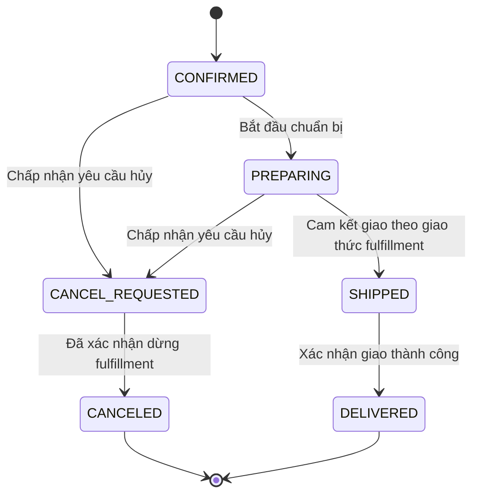

# Chính sách hủy đơn hàng (Order cancellation policy)

Trong chương **Order Security**, hủy đơn hàng là một thao tác bảo mật nghiệp vụ: người gọi yêu cầu hệ thống chấm dứt nghĩa vụ giao hàng, giải phóng tài nguyên và có thể hoàn tiền. Một API được xác thực, dùng HTTPS và không có SQL injection vẫn có thể bị lạm dụng nếu khách hàng hủy đơn của người khác, bỏ qua thời hạn, hủy sau khi đã giao hàng hoặc nhận tiền hoàn nhiều lần.

Bài học tập trung vào việc bảo vệ quy tắc hủy đơn bằng business invariants, state machine, quyền theo đối tượng, transaction và idempotency. Các trạng thái, thời hạn và số tiền dưới đây thuộc một hệ thống thương mại điện tử giả định; chúng là ví dụ thiết kế, không phải chính sách chung áp dụng cho mọi cửa hàng.

## 1. Mục tiêu học tập

Sau bài học, bạn có thể:

- Chuyển yêu cầu “khách hàng được hủy đơn trước khi giao” thành các điều kiện có thể kiểm tra và thực thi.
- Tách quyền yêu cầu hủy, điều kiện chấp nhận hủy, kết quả hủy và kết quả hoàn tiền.
- Thiết kế đường chuyển trạng thái chống tranh chấp giữa hủy đơn, giao hàng và thanh toán.
- Xử lý yêu cầu lặp, retry, callback và sự cố giữa nhiều dịch vụ mà không hoàn tiền hoặc hoàn kho trùng.
- Xây dựng tình huống kiểm thử thể hiện hành vi lạm dụng logic, thay vì chỉ kiểm tra một lần gọi API thành công.

## 2. Vì sao hủy đơn là một ranh giới bảo mật?

Giả sử ứng dụng có endpoint:

```http
POST /orders/ord_1001/cancellations
Authorization: Bearer <access-token>
Idempotency-Key: 01-example-cancel-key
Content-Type: application/json

{
  "reasonCode": "CHANGED_MIND",
  "expectedOrderVersion": 12
}
```

Người dùng hợp lệ vẫn có thể chủ động sửa `orderId`, gửi đồng thời nhiều yêu cầu, gọi endpoint quản trị hoặc phát lại yêu cầu cũ. Các lỗi thường gặp xuất hiện khi backend hiểu rằng “đã đăng nhập” đồng nghĩa với “được hủy đối tượng này”, hoặc hiểu rằng “đã kiểm tra trạng thái” đồng nghĩa với “trạng thái sẽ không đổi trước lúc ghi”.

Ví dụ triển khai không an toàn:

```java
// Ví dụ minh họa lỗi, không dùng làm triển khai.
Order order = orderRepository.findById(request.orderId());
if (!order.status().equals("SHIPPED")) {
    paymentGateway.refund(request.refundAmount());
    inventory.increase(request.quantity());
    orderRepository.setStatus(order.id(), "CANCELED");
}
```

Đoạn mã có nhiều khoảng trống độc lập:

1. Không ràng buộc đơn với khách hàng và tenant của phiên đăng nhập.
2. Cho phép hủy mọi trạng thái khác `SHIPPED`, kể cả `DELIVERED` hoặc `CANCELED`.
3. Tin số tiền và số lượng do client gửi.
4. Không ngăn đơn chuyển sang giao hàng sau bước kiểm tra.
5. Có thể gọi hoàn tiền thành công rồi lỗi trước khi cập nhật đơn; retry sẽ hoàn thêm lần nữa.
6. “Tăng tồn kho” không chứng minh rằng một reservation cụ thể đang được giữ và được phép giải phóng.

Vấn đề nằm ở tính hợp lệ của chuỗi tác động nghiệp vụ, không chỉ ở cú pháp request.

## 3. Biến chính sách thành quyết định rõ ràng

### 3.1. Mô tả một chính sách cụ thể

Với hệ thống giả định trong bài, chọn chính sách cơ sở:

- Khách hàng chỉ được yêu cầu hủy toàn bộ đơn thuộc sở hữu của mình trong tenant hiện tại.
- Đơn đã xác nhận hoặc đang chuẩn bị có thể được xem xét hủy nếu chưa hết hạn và fulfillment chưa cam kết giao không thể thu hồi.
- Đơn đã giao cho đơn vị vận chuyển hoặc đã giao thành công đi theo quy trình trả hàng, không đi qua API hủy thông thường.
- Nếu cần phối hợp với kho hoặc đơn vị vận chuyển, API chỉ ghi nhận yêu cầu; kết quả hủy được xác nhận sau.
- Thanh toán mới được ủy quyền thì xử lý hủy ủy quyền theo khả năng của nhà cung cấp. Thanh toán đã capture thì xét hoàn tiền theo số tiền thực thu và quyền lợi được chốt.
- Hoàn tiền có thể hoàn tất sau khi việc hủy đơn đã được xác nhận. Giao diện phải thể hiện riêng hai kết quả.
- Quyền ngoại lệ của nhân viên, nếu có, phải được định nghĩa riêng và không cho phép vượt các giới hạn tiền hoặc tạo hiệu ứng trùng.

“Trước khi giao” cần được định nghĩa bằng một mốc có nguồn dữ liệu đáng tin cậy, chẳng hạn thời điểm kho cam kết bàn giao. Không dùng nhãn mơ hồ trên giao diện làm điều kiện bảo mật.

### 3.2. Tách các câu hỏi trong quyết định hủy

| Câu hỏi | Nguồn dữ liệu đáng tin cậy | Ví dụ điều kiện |
|---|---|---|
| Ai đang yêu cầu? | Security context do hệ thống xác thực | Khách hàng, nhân viên hỗ trợ, tiến trình nội bộ |
| Họ có quyền với đơn này không? | Tenant, chủ đơn, phạm vi phân công | `order.customerId == actor.customerId` |
| Đơn có còn đủ điều kiện không? | Trạng thái đơn, fulfillment, thời hạn | Đang chuẩn bị, chưa vượt ranh giới giao hàng |
| Chính sách nào áp dụng? | Phiên bản chính sách đã lưu và quy tắc hiệu lực | `cancelPolicyVersion = 3` |
| Phải đảo những nghĩa vụ nào? | Payment ledger, reservation, ưu đãi, điểm | Hủy ủy quyền, hoàn tiền, trả reservation |
| Yêu cầu này đã được xử lý chưa? | Bản ghi idempotency và cancellation | Trả kết quả của lần được chấp nhận trước |

Đừng gộp tất cả thành một biểu thức như `isAdmin || status != SHIPPED`. Biểu thức đó vừa che giấu chính sách vừa khiến quyền nhân viên vô tình bỏ qua invariant tài chính.

### 3.3. Chốt thời gian và phiên bản chính sách

Thời hạn hủy phải được tính hoặc lưu từ dữ liệu backend. Ví dụ:

```text
cancelDeadline = confirmedAt + khoảng_thời_gian_của_chính_sách
cho_phép_khởi_tạo_hủy khi decisionTime < cancelDeadline
```

Quy định rõ dấu `<` hay `<=`, múi giờ hiển thị, độ chính xác thời gian và thời điểm lấy `decisionTime`. Một lựa chọn là lấy thời gian từ database sau khi đã khóa đơn và trước khi quyết định. Nếu chọn cách này, yêu cầu đến trước hạn nhưng chỉ được xử lý sau hạn có thể bị từ chối; sản phẩm phải chấp nhận quy ước đó.

Không dùng giờ trên điện thoại, `requestedAt` do client tự khai hoặc thời điểm server nhận được một request chưa được xác thực làm căn cứ duy nhất. Nếu muốn ưu tiên thời điểm tiếp nhận, cần một cơ chế tiếp nhận bền vững, có xác thực, chống phát lại và có ngữ nghĩa rõ ràng.

Lưu phiên bản chính sách hoặc các điều khoản đã chốt cho đơn. Chính sách hiện tại của cửa hàng không tự động thay thế điều khoản của mọi đơn cũ. Nếu có thay đổi hiệu lực hồi tố, đó phải là quyết định nghiệp vụ có quy tắc và audit riêng.

## 4. Xác định business invariants trước khi viết endpoint

Invariant là điều kiện phải được giữ đúng qua mọi đường thực thi, kể cả endpoint cũ, tác vụ nền, retry và công cụ vận hành.

| Invariant | Cách thực thi điển hình |
|---|---|
| Chỉ chủ thể được phép mới tác động được tới đơn trong đúng tenant | Truy vấn có tenant và kiểm tra quyền theo đối tượng |
| Chỉ trạng thái được liệt kê mới khởi tạo được hủy | State machine theo danh sách cho phép |
| Khi hủy được chấp nhận, không khởi tạo giao hàng mới cho cùng phần hàng | Khóa hoặc cập nhật có điều kiện dùng chung với luồng fulfillment |
| Chỉ xác nhận hủy khi đã giải quyết được các công việc giao hàng đang thực hiện | Giao thức phối hợp với kho và đối soát trạng thái bên ngoài |
| Tổng tiền đã hoàn cộng tiền đang giữ cho hoàn không vượt tiền capture có thể hoàn | Ledger, khóa ngân sách hoàn và ràng buộc dữ liệu |
| Một reservation chỉ được giải phóng hợp lệ một lần | Chuyển trạng thái reservation có điều kiện |
| Request lặp không tạo cancellation hoặc tác động tài chính mới | Idempotency và ràng buộc duy nhất theo nghiệp vụ |
| Mọi quyết định quan trọng có thể truy vết | Audit cùng transaction với thay đổi nghiệp vụ |

Hai lớp bảo vệ bổ sung cho nhau:

- **Kiểm tra ở application** diễn đạt chính sách và trả lỗi dễ hiểu.
- **Ràng buộc và thao tác nguyên tử ở tầng dữ liệu** bảo vệ trước các request đồng thời và các đường gọi khác.

Ví dụ, một `if (remainingRefundable >= amount)` đứng ngoài transaction không bảo vệ được tiền hoàn. Hai tác vụ có thể cùng nhìn thấy một số dư rồi cùng sử dụng nó.

## 5. Thiết kế state machine thay vì sửa cột trạng thái tùy ý

### 5.1. Tách ba vòng đời liên quan

Hủy đơn, giao hàng và thanh toán có liên hệ nhưng không phải một trạng thái duy nhất.

| Miền | Trạng thái minh họa | Điều cần phân biệt |
|---|---|---|
| Order | `CONFIRMED`, `PREPARING`, `CANCEL_REQUESTED`, `CANCELED`, `SHIPPED`, `DELIVERED` | Đơn đang ở đâu trong vòng đời nghiệp vụ |
| Cancellation | `PENDING`, `CONFIRMED`, `REJECTED`, `REVIEW_REQUIRED` | Ý định hủy đã có kết quả chắc chắn chưa |
| Payment | `UNPAID`, `AUTHORIZED`, `CAPTURED` | Tiền đã thực sự được capture hay mới giữ quyền thanh toán |
| Refund | `RESERVED`, `SUBMITTED`, `SUCCEEDED`, `FAILED_FINAL`, `UNKNOWN` | Hoàn tiền có đang tiêu thụ ngân sách hoặc chờ xác minh không |

Một đơn `CANCELED` vẫn có thể có refund `SUBMITTED`. Điều này có thể hợp lệ nếu giao hàng đã dừng chắc chắn và nghĩa vụ hoàn tiền đang được thực hiện. Giao diện không nên diễn đạt “đã hoàn tiền” chỉ vì trạng thái order là `CANCELED`.

Ngược lại, nếu chưa biết kiện hàng đã được bàn giao hay chưa, không đánh dấu `CANCELED` để làm đẹp trải nghiệm. Giữ yêu cầu chờ xử lý hoặc cần kiểm tra, cùng cơ chế đối soát.

### 5.2. Sơ đồ chuyển trạng thái của ví dụ



Sơ đồ thể hiện luồng thuận của chính sách ví dụ. Với trường hợp hệ thống bên ngoài đã giao trước khi nhận lệnh dừng, giữ hồ sơ cancellation để điều tra và đối soát; một hành động khôi phục có thẩm quyền mới được đưa order về trạng thái phản ánh sự thật, chẳng hạn `SHIPPED`. Không cho khách hàng tự chọn trạng thái khôi phục và không âm thầm coi hủy đã thành công.

Các quy tắc đi kèm:

- `CANCEL_REQUESTED` là hàng rào ngăn khởi tạo giao mới trong hệ thống nội bộ.
- Luồng giao hàng phải kiểm tra hàng rào đó bằng cùng giao thức đồng bộ với luồng hủy.
- Những lệnh giao đã phát đi trước hàng rào cần cơ chế dừng, xác nhận hoặc xử lý tranh chấp; đổi trạng thái local không thu hồi được chúng.
- `CANCELED` chỉ được ghi sau khi có đủ bằng chứng đáp ứng điều kiện kết thúc cancellation.
- Request lặp với trạng thái đã hủy trả lại cancellation hiện có; không chạy lại hoàn tiền hay hoàn kho.

### 5.3. Danh sách chuyển trạng thái cho phép

Nên diễn đạt bằng bảng hoặc hàm chuyên biệt:

```text
mayStartCancellation(CONFIRMED) = true
mayStartCancellation(PREPARING) = true
mayStartCancellation(SHIPPED) = false
mayStartCancellation(DELIVERED) = false
```

Đây chỉ là điều kiện trạng thái. Để chấp nhận còn phải kiểm tra quyền, deadline, chính sách và các cam kết fulfillment. Với trạng thái mới chưa có trong bảng, mặc định từ chối khởi tạo cho đến khi được định nghĩa.

Không mở endpoint tổng quát nhận `{ "status": "CANCELED" }` để mọi bên tự sửa vòng đời. Hãy đưa ý định nghiệp vụ qua lệnh `requestCancellation` và `confirmCancellation` có quyền, dữ liệu và điều kiện riêng.

## 6. Kiểm soát quyền theo đối tượng và quyền ngoại lệ

### 6.1. Tách xác thực, quyền và điều kiện nghiệp vụ

Ba kiểm tra sau giải quyết ba câu hỏi khác nhau:

```text
authenticate(actor)
authorizeCancellationRequest(actor, order)
evaluateCancellationPolicy(order, fulfillment, payment, policy, decisionTime)
```

Đối với khách hàng:

```text
actor.tenantId == order.tenantId
actor.customerId == order.customerId
actor được phép thực hiện hành động yêu cầu hủy
```

Lấy danh tính khách hàng và tenant từ ngữ cảnh đã xác thực. Không tin `customerId`, `tenantId`, `isAdmin`, `refundAmount`, `cancelDeadline` hoặc `policyVersion` do body request tự khai.

Truy vấn có tenant giúp giới hạn phạm vi tìm kiếm, nhưng vẫn cần kiểm tra quyền theo đối tượng. Trong cùng tenant có thể có nhiều khách hàng, nhân viên và phạm vi phân công khác nhau.

### 6.2. Nhân viên hỗ trợ không có quyền vô hạn

Nếu hệ thống có ngoại lệ, cần quyền đủ cụ thể:

| Hành động | Quyền minh họa | Điều vẫn phải giữ |
|---|---|---|
| Gửi yêu cầu thay khách hàng | `order.cancel.on_behalf` | Đúng tenant và phạm vi được giao |
| Xin ngoại lệ sau deadline | `order.cancel.request_override` | Ghi lý do và luồng duyệt nếu chính sách yêu cầu |
| Duyệt ngoại lệ | `order.cancel.approve_override` | Đúng đối tượng, đúng yêu cầu, không tự duyệt nếu bị cấm |
| Khởi tạo hoàn tiền | `payment.refund.create` | Không vượt ngân sách và không lặp hiệu ứng |

Quyền vượt deadline không tự động cho phép hủy một kiện hàng đã giao. Nếu trường hợp đó cần trả hàng hoặc bồi hoàn, phải gọi đúng quy trình.

Khi có phê duyệt, bản ghi phê duyệt phải ràng buộc với đơn, phạm vi hủy, phiên bản dữ liệu và điều khoản ngoại lệ. Không nhận một cờ `approved: true` từ client. Nếu đơn đổi trạng thái sau khi được duyệt, backend vẫn phải kiểm tra lại điều kiện thực thi; phê duyệt cũ không phải giấy phép bỏ qua mọi invariant.

### 6.3. Kiểm tra quyền cả khi phát lại kết quả

Một bản ghi idempotency không thay thế authorization. Mọi lần gọi, kể cả request chỉ lấy lại kết quả cũ, phải kiểm tra actor hiện tại còn được phép truy cập đối tượng.

Không cho người dùng đoán idempotency key để đọc phản hồi của người khác. Thiết kế thông báo lỗi để không tiết lộ chi tiết đơn ngoài quyền truy cập; lựa chọn trả `403` hay che sự tồn tại bằng `404` cần thống nhất trong API.

## 7. Transaction và tranh chấp với giao hàng

### 7.1. Lỗi check-then-act

Hai request có thể tạo lịch xen kẽ:

```text
T1 - Hủy: đọc PREPARING, đánh giá có thể hủy
T2 - Giao: đọc PREPARING, đánh giá có thể giao
T2 - Giao: bắt đầu bàn giao và ghi SHIPPED
T1 - Hủy: ghi CANCELED dựa trên dữ liệu đã đọc trước đó
```

Kết quả có thể là một đơn vừa giao vừa hủy. Kiểm tra lần hai trong code vẫn không giải quyết nếu khoảng giữa kiểm tra và ghi còn cho phép request khác chen vào.

### 7.2. Khóa hoặc cập nhật có điều kiện

Trong một database quan hệ, có thể dùng transaction và khóa hàng. SQL sau chỉ minh họa ý tưởng; cần điều chỉnh cho database thực tế:

```sql
BEGIN;

SELECT id, tenant_id, customer_id, status, version, cancel_deadline
FROM orders
WHERE tenant_id = :trusted_tenant_id AND id = :order_id
FOR UPDATE;

-- Application kiểm tra quyền, policy, deadline và cam kết fulfillment.
-- Các tiến trình thay đổi cam kết này phải tham gia cùng giao thức khóa.

UPDATE orders
SET status = 'CANCEL_REQUESTED', version = version + 1
WHERE tenant_id = :trusted_tenant_id
  AND id = :order_id
  AND status IN ('CONFIRMED', 'PREPARING')
  AND version = :expected_version;

-- Phải kiểm tra có đúng một hàng được cập nhật.
-- Ghi cancellation, idempotency, audit và outbox trong transaction này.

COMMIT;
```

Luồng giao hàng cũng phải khóa đối tượng hoặc dùng cập nhật có điều kiện tương thích. Nếu một worker chỉ đọc trạng thái cũ rồi gọi nhà vận chuyển mà không kiểm tra lại quyền giao, khóa ở endpoint hủy không tạo được bảo đảm.

Có thể dùng optimistic locking thay cho khóa bi quan, nhưng khi cập nhật thất bại cần đọc lại và đánh giá lại chính sách trong một lần thử phù hợp. Không dùng cùng một kết luận “được hủy” từ phiên bản dữ liệu cũ.

Nếu deadline hoặc quyền hủy phụ thuộc bảng khác, khóa riêng hàng `orders` chỉ đủ khi mọi bên ghi dữ liệu liên quan cùng tôn trọng giao thức đó. Với nhiều hàng phải khóa, quy định thứ tự khóa nhất quán để giảm deadlock.

### 7.3. Phân biệt cam kết local và tác động bên ngoài

Một giao thức fulfillment có thể hoạt động như sau:

1. Worker khóa đơn, kiểm tra còn được giao và ghi một ý định giao với định danh riêng.
2. Worker gửi yêu cầu ra bên ngoài bằng định danh đó sau commit.
3. Khi hủy đến, hệ thống đọc được ý định giao đang thực hiện và xử lý theo chính sách: từ chối hoặc nhận hủy ở trạng thái chờ xác minh.
4. Chỉ xác nhận hủy khi đã xác định chắc chắn công việc giao liên quan chưa thành công hoặc đã được dừng hợp lệ.

Một lệnh cũ đã tới nhà vận chuyển có thể tiếp tục dù local đã đổi trạng thái. Fencing token chỉ có tác dụng nếu bên thực thi thực sự kiểm tra nó; một số nguyên `version` trong database không tự vô hiệu hóa request ở bên ngoài.

Không giữ transaction database trong suốt một cuộc gọi mạng dài. Nếu provider đã thực hiện nhưng kết nối timeout, rollback database không rollback được thế giới bên ngoài. Hãy dùng ý định bền vững, định danh ổn định, trạng thái chờ và đối soát.

## 8. Idempotency: chống lặp ở cả request lẫn tác động

### 8.1. Phạm vi và dấu vân tay yêu cầu

Idempotency key là định danh cho một ý định gọi API. Một phạm vi hợp lý trong ví dụ là:

```text
(tenantId, actorId, operation, idempotencyKey)
```

Với `operation = REQUEST_ORDER_CANCELLATION`, lưu fingerprint của payload đã chuẩn hóa:

```text
fingerprint = hash(apiVersion, orderId, reasonCode, expectedOrderVersion)
```

Đưa mọi trường làm thay đổi ý nghĩa nghiệp vụ vào fingerprint. Với hủy một phần, cần thêm các dòng hàng, số lượng và cách chuẩn hóa thứ tự dòng. Không đưa access token vào fingerprint hoặc audit log.

| Tình huống | Hành vi mong đợi |
|---|---|
| Cùng key, cùng fingerprint, đã có kết quả | Kiểm tra quyền hiện tại rồi trả lại kết quả đã lưu |
| Cùng key, khác fingerprint | Từ chối do key đã được dùng cho ý định khác |
| Cùng key, request trước đang xử lý | Không khởi tạo thêm; trả trạng thái đang xử lý hoặc hướng dẫn retry |
| Khác key, cùng đơn đã có cancellation được chấp nhận | Trả cancellation hiện có theo chính sách, không tạo tác động mới |
| Mất phản hồi sau commit rồi retry | Tìm lại kết quả bền vững, không khởi tạo lại |

Không chỉ lưu key ở cache trong bộ nhớ của một instance. Quyết định chống trùng cần tồn tại qua restart và hoạt động khi request đến instance khác.

### 8.2. Idempotency cần transaction và unique constraint

Trong phạm vi ví dụ, transaction chấp nhận hủy cần ghi cùng nhau:

- Trạng thái đơn và phiên bản mới.
- Cancellation được chấp nhận.
- Bản ghi idempotency và phản hồi đủ để phát lại.
- Audit và outbox event.

Ràng buộc duy nhất trên scope của idempotency key ngăn hai request cùng tạo bản ghi. Một ràng buộc khác ngăn nhiều cancellation được chấp nhận cho cùng phạm vi hủy. Trong ví dụ hủy toàn bộ với một lần chấp nhận cuối cùng, phạm vi đó là đơn hàng; hệ thống cho phép hủy từng phần hoặc thử lại sau một lần từ chối cần mô hình phạm vi khác.

Nếu hai transaction cạnh tranh cùng key, transaction thua có thể phải rollback rồi đọc kết quả trong transaction mới, tùy cơ chế database. Không bắt lỗi unique constraint rồi tiếp tục dùng một transaction đã hỏng. Lỗi transient trước commit cần cho phép thử lại an toàn, thay vì bị lưu vĩnh viễn thành một kết quả thành công.

### 8.3. Phân biệt phát lại phản hồi và đọc trạng thái hiện tại

Giả sử lần đầu trả `202 Accepted` khi refund chưa chạy. Sau đó order đã hủy và refund đã hoàn tất. Khi retry cùng key, API có thể trả lại phản hồi `202` ban đầu và cùng `cancellationId`; client dùng endpoint đọc trạng thái để biết kết quả mới nhất.

Đây là một hợp đồng hợp lệ nếu được mô tả rõ. Không để một endpoint lúc phát lại kết quả gốc, lúc tự sinh phản hồi mới mà client không phân biệt được.

### 8.4. Chống trùng tác động không phụ thuộc tuổi thọ key

Key có thể hết thời gian lưu. Sau đó, trạng thái nghiệp vụ và ràng buộc dữ liệu vẫn phải ngăn tạo hoàn tiền thứ hai cho cùng nghĩa vụ hoặc giải phóng cùng reservation lần nữa.

Client cũng có thể cố tình đổi key mỗi lần. Vì vậy, cần định danh cho hiệu ứng nghiệp vụ, chẳng hạn:

```text
refundOperationId = định danh duy nhất của nghĩa vụ hoàn thuộc cancellation
reservationReleaseId = định danh thao tác giải phóng reservation cụ thể
```

Không dùng key của mỗi HTTP request làm định danh hoàn tiền mới. Retry cùng nghĩa vụ phải giữ nguyên `refundOperationId` và provider key tương ứng.

## 9. Hoàn tiền, tồn kho và ưu đãi là các nghĩa vụ riêng

### 9.1. Tính số tiền từ dữ liệu do server quản lý

Không hoàn theo `refundAmount` do khách hàng khai hoặc theo giá bán hiện tại trong catalog. Dùng snapshot đơn và payment ledger:

```text
Hàng A:                         300.000 VND
Hàng B:                         200.000 VND
Giảm giá đã phân bổ:             50.000 VND
Phí giao hàng đã thu:            30.000 VND
Tổng tiền đã capture:           480.000 VND
```

Nếu chính sách ví dụ cho hoàn toàn bộ, không có khoản hoàn trước hoặc đang giữ, nghĩa vụ hoàn là `480.000 VND`, không phải `500.000 VND` từ tổng giá niêm yết và không phải giá catalog tại thời điểm hủy.

Biểu diễn tiền theo đơn vị nhỏ nhất và currency phù hợp với hệ thống thanh toán; không dùng số thực nhị phân để cộng trừ tiền. Không cộng các khoản khác currency vào một số dư.

Với một payment và một currency, đặt:

```text
C = tổng tiền capture đã xác nhận có thể dùng để hoàn
S = tổng tiền của các refund đã thành công
R = tổng tiền đã giữ cho refund đang thực hiện hoặc chưa rõ kết quả
B = C - S - R

S + R <= C
refundMới <= B
refundMới <= nghĩa_vụ_hoàn_còn_lại_theo_chính_sách
```

Khi refund thành công, chuyển khoản tiền tương ứng từ phần đang giữ `R` sang phần thành công `S` trong cùng giao dịch dữ liệu. Không vừa giữ trong `R` vừa cộng vào `S` mà không kết thúc reservation, cũng không giải phóng `R` sớm khi kết quả còn `UNKNOWN`.

Mọi luồng hoàn tiền, gồm hỗ trợ khách hàng, trả hàng và hủy đơn, cần dùng chung cơ chế ngân sách. Nếu mỗi endpoint có một bộ đếm riêng, tổng hệ thống vẫn có thể hoàn vượt tiền đã thu.

Nếu thanh toán bằng nhiều phương thức, mỗi phương thức cần ledger và giới hạn riêng. Hoàn điểm hoặc khôi phục voucher không phải là hoàn tiền vào cổng thanh toán.

### 9.2. Giải quyết tranh chấp capture và cancel

Hủy đơn khi payment còn `AUTHORIZED` không có nghĩa là không bao giờ xuất hiện khoản capture sau đó. Capture có thể đã được gửi ra provider nhưng local chưa nhận kết quả.

Luồng thanh toán cần:

- Kiểm tra hàng rào hủy trước khi khởi tạo capture mới.
- Ghi nhận capture đang thực hiện bằng định danh ổn định.
- Xử lý callback xác nhận capture đến muộn như một sự kiện thực tế cần đối soát.
- Tạo nghĩa vụ hoàn duy nhất nếu đơn đã hủy mà capture thực sự thành công.

Không bỏ qua mọi callback đến sau `CANCELED`; làm như vậy có thể che khoản tiền đã bị trừ. Cũng không tự động hoàn mỗi lần nhận callback capture trùng.

### 9.3. Hoàn kho theo reservation

Ví dụ có reservation:

```text
reservationId = res_77
orderId = ord_1001
sku = SKU_A
quantity = 2
status = HELD
```

Chuyển `HELD -> RELEASED` có điều kiện và điều chỉnh lượng khả dụng trong cùng transaction nếu cùng database. Khi hệ thống kho tách riêng, gửi lệnh giải phóng có định danh ổn định; phía kho cũng cần chống trùng.

Lần gọi lại thấy `RELEASED` là một kết quả đã có, không phải lý do cộng thêm hai sản phẩm. Nếu reservation đã được tiêu thụ hoặc hàng đã lấy ra khỏi kho, không chuyển thẳng thành tồn có thể bán chỉ bằng phép cộng; cần quy trình kho xác nhận hàng quay lại trạng thái phù hợp.

### 9.4. Không biến việc hủy thành cách kiếm ưu đãi

Chính sách cần định nghĩa rõ:

- Voucher một lần có được khôi phục sau hủy không và điều kiện nào áp dụng?
- Điểm đã dùng được hoàn vào ví điểm nào; điểm thưởng đã cộng cho đơn phải thu hồi ra sao?
- Hủy một phần có làm mất ngưỡng khuyến mãi hoặc miễn phí vận chuyển không?
- Khoản phí nào hoàn được theo điều khoản đã chốt?

Mỗi nghĩa vụ phải có định danh và cơ chế chống trùng. Không khôi phục lượt dùng voucher hai lần chỉ vì order và payment cùng phát sự kiện hủy.

Theo dõi lạm dụng lặp lại có thể bổ sung hạn mức hoặc cơ chế đánh giá rủi ro. Các biện pháp đó hỗ trợ chính sách, không thay thế kiểm soát quyền và tính nguyên tử của tiền, kho, ưu đãi.

## 10. Hủy một phần cần mô hình riêng

Nếu sản phẩm chỉ hỗ trợ hủy toàn bộ, hãy từ chối rõ request chứa phạm vi hủy một phần. Không âm thầm bỏ qua `items` rồi hủy cả đơn.

Khi cần hỗ trợ từng dòng hàng, mỗi số lượng phải thuộc đúng một nhóm tại thời điểm xét: đã hủy, đang giữ để hủy, đã giao, đang cam kết giao hoặc còn có thể xử lý. Với các nhóm không chồng lấn:

```text
qCanceled + qCancelPending + qShipped + qShipPending <= qOrdered

qCancelable = qOrdered
             - qCanceled
             - qCancelPending
             - qShipped
             - qShipPending

0 < qRequestedCancel <= qCancelable
```

Các công thức là invariant của mô hình minh họa. Hệ thống có trả hàng, thay thế hoặc backorder phải định nghĩa thêm các nhóm và quan hệ phù hợp.

Kiểm tra thêm:

- Line item phải thuộc đúng đơn được cấp quyền.
- Gộp hoặc từ chối line item lặp trước khi tính số lượng.
- Không nhận số lượng âm, bằng không, tràn kiểu số hoặc vượt phần còn lại.
- Giữ số lượng cho cancellation trong transaction để hai request không cùng sử dụng một phần hàng.
- Dùng phần giảm giá đã phân bổ, quy tắc phí và làm tròn nhất quán.
- Ràng buộc phê duyệt và fingerprint với đúng các dòng và số lượng.

Ví dụ, một đơn có hai sản phẩm A và B cùng được phân bổ ưu đãi. Nếu khách hàng hủy B nhưng nhận tiền theo giá chưa giảm, họ có thể giữ A với mức ưu đãi không còn đúng. Đây là vấn đề chính sách giá khi hủy, không thể giải quyết chỉ bằng kiểm tra `quantity > 0`.

## 11. Phối hợp nhiều dịch vụ bằng outbox và trạng thái bền vững

### 11.1. Transactional outbox bảo vệ việc phát ý định

Trong transaction chấp nhận yêu cầu hủy, ghi một outbox event cùng dữ liệu nghiệp vụ:

```text
eventType: OrderCancellationRequested
eventId: evt_9001
tenantId: tenant_1
orderId: ord_1001
cancellationId: cancel_3001
orderVersion: 13
```

Worker đọc outbox sau commit và điều phối dừng fulfillment. Khi đã xác nhận dừng, transaction tiếp theo chuyển cancellation sang `CONFIRMED`, order sang `CANCELED` và ghi các nghĩa vụ giải phóng kho, hoàn tiền hoặc ưu đãi phù hợp.

Outbox tránh tình huống commit trạng thái nhưng quên phát công việc vì tiến trình chết ngay sau đó. Outbox vẫn có thể được giao lặp; consumer phải chống trùng bằng `eventId` và bằng định danh nghĩa vụ nghiệp vụ. Hai event khác ID vẫn có thể nói về cùng một nghĩa vụ.

### 11.2. Xử lý timeout khi gọi provider

Một trình tự an toàn cho refund có thể là:

1. Giữ ngân sách hoàn và ghi `refundOperationId` trong database.
2. Sau commit, worker gọi provider bằng định danh ổn định tương ứng.
3. Nếu có kết quả chắc chắn, cập nhật ledger theo chuyển trạng thái hợp lệ.
4. Nếu timeout và chưa biết provider đã thực hiện hay chưa, giữ trạng thái `UNKNOWN` hoặc trạng thái chờ đối soát phù hợp.
5. Tra cứu provider hoặc xử lý callback đáng tin cậy trước khi kết luận và giải phóng ngân sách.

Nếu provider hỗ trợ idempotency, retry phải dùng lại key, số tiền và currency cũ theo đúng hợp đồng của provider. Không sinh key mới sau timeout. Nếu provider không có cơ chế chống trùng hoặc tra cứu đủ tin cậy, không tự động gửi lại một thao tác tài chính chưa rõ kết quả; cần đối soát hoặc xử lý vận hành.

### 11.3. Callback trùng hoặc đến sai thứ tự

Callback cần được xác thực theo cơ chế tích hợp, ánh xạ tới giao dịch đã biết và kiểm tra các thuộc tính quan trọng như định danh, số tiền, currency, tài khoản nhận.

Không dùng callback chỉ có `orderId` để chấp nhận một khoản hoàn chưa từng được tạo. Không cho callback thất bại cũ ghi đè trạng thái thành công đã được xác nhận. Với thông tin mâu thuẫn, tra cứu và đối soát thay vì áp dụng quy tắc “callback đến sau luôn thắng”.

### 11.4. Lỗi bù trừ cũng cần chính sách

Một saga không tự bảo đảm rằng mọi bước đều đảo được. Nếu order đã hủy nhưng refund lỗi tạm thời, hệ thống giữ nghĩa vụ hoàn và retry hoặc chuyển vận hành; không tự mở lại đơn để che lỗi tiền.

Nếu kho đã giải phóng reservation rồi phát hiện hủy không thể hoàn tất, không tự cho rằng vẫn còn hàng để khôi phục đơn. Cần một quy trình khôi phục được định nghĩa và được cấp quyền, có kiểm tra tồn kho và cam kết fulfillment hiện tại.

## 12. Mã giả cho application service

Đoạn sau mô tả thứ tự xử lý ở mức thiết kế, không phải mã Java có thể biên dịch trực tiếp. Các hàm transaction, khóa và unique constraint phải được hiện thực theo database và framework của dự án.

```java
CancellationReply requestCancellation(
        AuthenticatedActor actor,
        OrderId orderId,
        CancelCommand command,
        String idempotencyKey) {

    validateAllowedFieldsAndLimits(command, idempotencyKey);

    return transactions.execute(() -> {
        Order order = orders.lockByTenantAndId(actor.tenantId(), orderId)
                .orElseThrow(this::notFound);

        // Cần quyền hiện tại kể cả khi chỉ trả kết quả của lần gọi trước.
        authorization.requireCanRequestCancellation(actor, order);

        RequestScope scope = RequestScope.of(
                actor.tenantId(), actor.id(),
                "REQUEST_ORDER_CANCELLATION", idempotencyKey);
        Fingerprint fingerprint = canonicalFingerprint(orderId, command);

        StoredRequest previous = idempotency.find(scope);
        if (previous != null) {
            requireSameFingerprint(previous, fingerprint);
            return previous.originalReplyOrProcessingReply();
        }

        // Việc claim phải có unique constraint. Nếu cạnh tranh thất bại,
        // rollback và đọc kết quả ở transaction mới theo giao thức của DB.
        idempotency.claim(scope, fingerprint);

        Cancellation existing = cancellations.findAcceptedForWholeOrder(order.id());
        if (existing != null) {
            CancellationReply reply = replyForExisting(existing);
            idempotency.complete(scope, reply);
            return reply;
        }

        requireExpectedVersion(order, command.expectedOrderVersion());
        PolicySnapshot policy = policies.forOrder(order);
        FulfillmentCommitments commitments = fulfillment.loadUnderOrderProtocol(order);
        Instant decisionTime = databaseClock.currentDecisionTime();

        policy.requireEligible(actor, order, commitments, decisionTime);

        Cancellation cancellation = cancellations.createPending(
                order, actor, command.reasonCode(), policy.version());

        orders.transitionToCancelRequested(order);
        audit.recordCancellationAccepted(actor, order, cancellation, decisionTime);
        outbox.appendCancellationRequested(order, cancellation);

        CancellationReply reply = accepted(cancellation.id());
        idempotency.complete(scope, reply);
        return reply;
    });
}
```

Những điểm cần hiểu trong đoạn mã:

- `lockByTenantAndId` dùng tenant từ actor, rồi authorization tiếp tục kiểm tra chủ đơn và quyền hành động.
- Phát lại cùng key được giải quyết trước khi kiểm tra lại deadline hoặc expected version. Một yêu cầu đã được chấp nhận không trở thành yêu cầu mới chỉ vì thời gian trôi qua; quyền truy cập hiện tại vẫn phải được kiểm tra.
- Request mới với key khác nhưng đã có cancellation được chấp nhận chỉ nhận về cancellation hiện có. Nó không sửa lý do cũ hoặc thêm tác động.
- Việc xử lý cancellation hiện có là ngữ nghĩa chủ ý của ví dụ. Nếu API coi payload khác là xung đột, cần trả lỗi rõ ràng thay vì âm thầm ghi đè.
- `fulfillment.loadUnderOrderProtocol` đòi hỏi các bên cập nhật cam kết fulfillment cùng tôn trọng cơ chế đồng bộ; tên hàm không tự tạo bảo đảm.
- Không gọi provider thanh toán hoặc kho từ transaction này.
- Audit, outbox, cancellation và phản hồi idempotency cùng commit hoặc cùng rollback.

`@Transactional` chỉ hữu ích khi được áp dụng đúng qua cơ chế của framework và ranh giới dữ liệu thực tế. Nó không tự làm các HTTP call trở thành một transaction phân tán và không thay thế ràng buộc duy nhất.

## 13. Hợp đồng API và trải nghiệm trạng thái

Một phản hồi chấp nhận xử lý có thể là:

```http
HTTP/1.1 202 Accepted
Location: /orders/ord_1001/cancellations/cancel_3001
Content-Type: application/json

{
  "cancellationId": "cancel_3001",
  "cancellationStatus": "PENDING",
  "refundStatus": "NOT_STARTED"
}
```

Endpoint đọc trạng thái cũng phải kiểm tra tenant và quyền đối với order/cancellation. Định danh khó đoán hỗ trợ giảm khả năng dò tìm nhưng không thay thế authorization.

Mã lỗi minh họa cho một hợp đồng API:

| Tình huống | Phản hồi có thể chọn |
|---|---|
| Request chứa trường không hỗ trợ hoặc reason không hợp lệ | `400` với mã lỗi ổn định |
| Chưa xác thực | `401` |
| Không có quyền hoặc cần che sự tồn tại của đơn | `403` hoặc `404` theo quy ước thống nhất |
| Trạng thái không còn cho phép hủy | `409` với mã `ORDER_NOT_CANCELABLE` |
| Cùng key nhưng khác payload | `409` với mã `IDEMPOTENCY_KEY_REUSED` |
| Phiên bản đơn không còn khớp | `409`, hoặc `412` nếu dùng hợp đồng điều kiện HTTP tương ứng |
| Đã tiếp nhận, còn chờ điều phối | `202` cùng định danh để theo dõi |

Đây là lựa chọn thiết kế cho ví dụ, không phải khẳng định mọi hệ thống phải dùng cùng status code. Điều quan trọng là client phân biệt được lỗi cố định, xung đột, đang xử lý và kết quả cuối cùng.

Ẩn nút hủy giúp người dùng hiểu chính sách, nhưng request trực tiếp vẫn phải bị backend kiểm soát. Nếu giao diện hiển thị “có thể hủy” từ dữ liệu cũ, backend có quyền từ chối và trả lý do phù hợp với trạng thái mới.

## 14. Kiểm thử các tình huống tấn công logic

### 14.1. Ma trận tình huống

| Tình huống | Cách thử | Kết quả cần chứng minh |
|---|---|---|
| Hủy đơn của khách khác | Đổi `orderId` sang đơn cùng tenant | Không thay đổi order, tiền, kho; không lộ chi tiết ngoài quyền |
| Hủy chéo tenant | Dùng ID hợp lệ của tenant khác | Không đọc hoặc ghi được đơn đó |
| Giả mạo quyền | Gửi thêm `isAdmin`, `approved`, `customerId` | Không ảnh hưởng authorization hoặc policy |
| Sửa tiền | Thêm `refundAmount` lớn hơn giá trị đã thu | Trường bị từ chối hoặc không có tác dụng theo schema; ledger không đổi sai |
| Hủy sau deadline | Đổi giờ client, phát lại request chưa từng được chấp nhận | Quyết định dựa trên nguồn thời gian server đã chọn |
| Phát lại sau deadline | Retry key của yêu cầu đã được chấp nhận trước hạn | Trả kết quả cũ sau kiểm tra quyền, không tạo hành động mới |
| Hủy đơn đã giao | Gọi thẳng API dù giao diện ẩn nút | Không đi vào luồng hủy thông thường |
| Trạng thái mới chưa định nghĩa | Đặt đơn ở trạng thái không có trong allowlist | Không tự động được hủy |
| Gửi trùng cùng key | Nhiều request cùng payload chạy đồng thời | Một kết quả được chấp nhận và một cancellation nghiệp vụ |
| Đổi payload cùng key | Đổi order hoặc reason sau lần đầu | Xung đột, không tái sử dụng kết quả cho ý định khác |
| Đổi key liên tục | Nhiều key cho cùng đơn | Không tạo thêm refund hoặc giải phóng reservation |
| Mất phản hồi sau commit | Ngắt kết nối rồi retry | Tìm lại kết quả đã lưu |
| Hủy đua với giao hàng | Điều khiển điểm xen kẽ giữa hai transaction | Không đồng thời cam kết hai kết quả mâu thuẫn trong giao thức local |
| Lệnh giao đã phát đi | Provider xử lý chậm trong khi có yêu cầu hủy | Chờ xác minh, không xác nhận hủy khi chưa biết kết quả giao |
| Capture đến muộn | Xác nhận capture sau khi hủy | Ghi nhận khoản thu và tạo nghĩa vụ hoàn duy nhất khi cần |
| Refund timeout | Provider thành công nhưng local chưa nhận phản hồi | Giữ ngân sách, đối soát; không gửi refund mới bằng key mới |
| Callback lặp, đảo thứ tự | Gửi sự kiện nhiều lần và đảo lịch giao | Không hoàn trùng, không ghi đè thành công bằng thông tin cũ |
| Giải phóng kho lặp | Giao cùng lệnh release nhiều lần | Một reservation được giải phóng một lần |
| Hai luồng hoàn tiền | Hỗ trợ và cancellation cùng giữ ngân sách | `S + R <= C` luôn đúng |
| Hủy một phần sai số lượng | Dòng lặp, số âm, vượt số còn có thể hủy | Không vượt số lượng và tiền hợp lệ |
| Phê duyệt cũ | Đơn thay đổi sau khi nhân viên duyệt | Kiểm tra lại điều kiện thực thi, không dùng duyệt để bỏ qua invariant |
| Thu hồi quyền | Actor mất quyền rồi retry key cũ | Không phát lại dữ liệu ngoài quyền hiện tại |
| Tiến trình chết | Dừng worker sau provider success, trước local commit | Khôi phục bằng định danh ổn định và đối soát |

### 14.2. Kiểm thử concurrency phải kiểm soát lịch chạy

Không chỉ dùng `sleep` rồi hy vọng race xuất hiện. Dùng barrier hoặc latch trong bộ kiểm thử để buộc hai luồng đến điểm quyết định mong muốn.

Ví dụ với cancellation và fulfillment cùng dùng giao thức khóa đơn:

```text
Chuẩn bị: order PREPARING, chưa có ý định giao hoặc hủy.

Lịch A:
  1. Luồng hủy giữ khóa, tạo cancellation và hàng rào CANCEL_REQUESTED.
  2. Luồng giao cố khởi tạo ý định giao và phải đợi.
  3. Hủy commit.
  4. Luồng giao đọc trạng thái mới và không được phát lệnh giao.

Lịch B:
  1. Luồng giao ghi cam kết giao theo giao thức đã chọn và commit.
  2. Luồng hủy đọc thấy cam kết đó.
  3. Hủy bị từ chối hoặc chuyển chờ dừng/đối soát theo policy.
  4. Không được kết luận hủy thành công chỉ từ trạng thái cũ.
```

Với tác động bên ngoài, dùng provider giả lập có các điểm dừng trước nhận lệnh, sau thực hiện và trước trả phản hồi. Chạy lại worker, giao lặp outbox và đảo thứ tự callback để kiểm tra khả năng khôi phục.

### 14.3. Assertion dựa trên invariant

Ngoài HTTP status, cần kiểm tra:

- Số cancellation được chấp nhận cho đúng phạm vi.
- Số nghĩa vụ refund và tổng ngân sách đang giữ/đã dùng.
- Số giao dịch refund thực tế ở provider giả lập, cùng định danh provider key.
- Trạng thái reservation và lượng khả dụng sau nhiều lần giao cùng sự kiện.
- Khả năng truy lại audit và ý định outbox sau restart.
- Không có tác động kho hoặc tiền khi authorization thất bại.

Đừng chỉ đếm số lần hàm HTTP tới provider được gọi. Một retry an toàn có thể gọi nhiều lần với cùng định danh nhưng chỉ tạo một giao dịch thực tế; điều phải bảo vệ là hiệu ứng nghiệp vụ.

## 15. Audit, giám sát và xử lý tồn đọng

Audit nên giúp trả lời ai đã yêu cầu, chính sách nào được áp dụng, dữ liệu tại thời điểm quyết định và tác động nào còn chờ.

Các trường hữu ích gồm:

```text
tenantId, orderId, cancellationId
actorId, actorType, action, reasonCode
policyVersion, orderVersionBefore, orderVersionAfter
decisionTime, decision, failureCode
approvalId, refundOperationId, reservationId
correlationId, eventId
```

Giới hạn độ dài phần ghi chú và tránh ghi token, thông tin thẻ hoặc nội dung bí mật. Không mặc định ghi nguyên body request chỉ để có audit.

Theo dõi các tín hiệu vận hành:

- Nhiều yêu cầu hủy vào đơn không thuộc actor hoặc tenant hiện tại.
- Nhiều lần dùng cùng key với payload khác nhau.
- Cancellation chờ lâu, refund `UNKNOWN`, outbox chưa được xử lý.
- Chênh lệch giữa order local và trạng thái kho, vận chuyển hoặc provider.
- Bất thường về số lần khôi phục voucher, điểm và số tiền hoàn.

Nhân viên xử lý tồn đọng cần lệnh nghiệp vụ có quyền và audit tương ứng. Sửa trực tiếp cột `status` có thể bỏ qua ledger, reservation và outbox, khiến hệ thống trông đúng ở một bảng nhưng sai ở các nghĩa vụ còn lại.

## 16. Những ngộ nhận cần tránh

| Ngộ nhận | Cách hiểu đúng |
|---|---|
| Có JWT là được hủy đơn | JWT xác định actor; quyền còn phụ thuộc đơn, tenant và hành động |
| Kiểm tra `status != SHIPPED` là đủ | Cần allowlist chuyển trạng thái và các điều kiện policy cụ thể |
| `@Transactional` giải quyết mọi race | Các bên ghi phải dùng cùng giao thức; HTTP bên ngoài không rollback theo database |
| Có idempotency key là không thể hoàn trùng | Cần chống trùng ở nghĩa vụ tài chính và provider, kể cả khi client đổi key |
| Timeout nghĩa là provider chưa làm gì | Kết quả có thể chưa biết; cần giữ trạng thái và đối soát |
| Đã hủy đơn tức là đã hoàn tiền | Vòng đời hủy và vòng đời hoàn tiền cần được biểu diễn riêng |
| Admin có thể bỏ qua tất cả | Ngoại lệ phải có phạm vi; giới hạn tiền và chống trùng vẫn phải giữ |
| Tăng lại tồn là đã hoàn kho | Chỉ được giải phóng đúng reservation hoặc xác nhận hàng trở lại kho |

## 17. Bài tập vận dụng

### Bài tập 1: Viết chính sách có thể thực thi

Một cửa hàng cho hủy trong 20 phút sau xác nhận nếu kho chưa cam kết bàn giao. Nhân viên hỗ trợ có thể xin ngoại lệ thời gian, nhưng phải được người khác duyệt.

Hãy xác định:

1. Các trạng thái được khởi tạo yêu cầu hủy và ý nghĩa của ranh giới bàn giao.
2. Nguồn `decisionTime`, quy tắc tại đúng phút thứ 20 và cách lưu phiên bản policy.
3. Quyền theo đối tượng của khách hàng, người hỗ trợ và người duyệt.
4. Dữ liệu mà phê duyệt phải ràng buộc và những điều phải kiểm tra lại khi thực thi.

Gợi ý: phê duyệt vượt deadline không đồng nghĩa với quyền đưa kiện hàng đã giao về trạng thái chưa giao.

### Bài tập 2: Phân tích lỗi sau timeout

Provider đã hoàn `480.000 VND` cho `refundOperationId = refund_1`, nhưng worker chết trước khi ghi kết quả local. Một worker mới đọc outbox và tiếp tục.

Hãy mô tả:

- Dữ liệu bền vững cần có trước lần gọi đầu tiên.
- Vì sao không được sinh `refund_2` chỉ vì lần trước timeout.
- Cách giữ ngân sách trong lúc chưa biết kết quả.
- Cách callback hoặc đối soát kết thúc refund và giải phóng reservation ngân sách tương ứng.

Gợi ý: số lần thực thi worker có thể lớn hơn một; số giao dịch hoàn tiền cho cùng nghĩa vụ phải được giới hạn bằng định danh và ledger.

### Bài tập 3: Chứng minh một race đã được chặn

Thiết kế hai lịch kiểm thử có điều khiển: hủy thắng trước giao và giao cam kết trước hủy. Với mỗi lịch, nêu transaction nào giữ khóa, dữ liệu nào được đọc sau khi chờ và lệnh bên ngoài nào được phép phát đi.

Gợi ý: nếu câu trả lời chỉ mô tả khóa ở endpoint hủy mà không chỉ ra hành vi của worker giao, thiết kế chưa chứng minh được invariant.

## 18. Checklist triển khai

- [ ] Request chỉ chứa ý định và dữ liệu được cho phép; tiền, chủ đơn, policy và deadline lấy từ backend.
- [ ] Authorization ràng buộc actor, tenant, order và hành động ở mọi endpoint liên quan.
- [ ] State machine chỉ cho phép các chuyển trạng thái được định nghĩa rõ.
- [ ] Nguồn thời gian, điểm xét deadline và phiên bản policy có ngữ nghĩa nhất quán.
- [ ] Hủy, giao hàng và capture cùng tôn trọng giao thức xử lý cạnh tranh tương ứng.
- [ ] Cancellation được chấp nhận, idempotency, audit và outbox được commit nguyên tử trong phạm vi database của chúng.
- [ ] Refund có ledger, ngân sách, định danh ổn định và cách xử lý kết quả chưa biết.
- [ ] Reservation, voucher và điểm có cơ chế chống trùng riêng.
- [ ] UI phân biệt tiếp nhận yêu cầu, hủy được xác nhận và tiền đã hoàn.
- [ ] Kiểm thử có trường hợp sai quyền, request đồng thời, giao lặp sự kiện, callback đến muộn và tiến trình chết giữa các bước.
- [ ] Có quy trình đối soát và xử lý tồn đọng bằng lệnh được cấp quyền, có audit.

Một chính sách hủy đơn được bảo vệ tốt phải giữ đúng quyền, trạng thái và nghĩa vụ tài chính trong mọi lịch thực thi được hỗ trợ. Thành công của một lần gọi API chỉ là một phần; điều cần chứng minh là hệ thống không thể bị dẫn tới kết quả hủy, giao, hoàn tiền hoặc hoàn kho mâu thuẫn.
