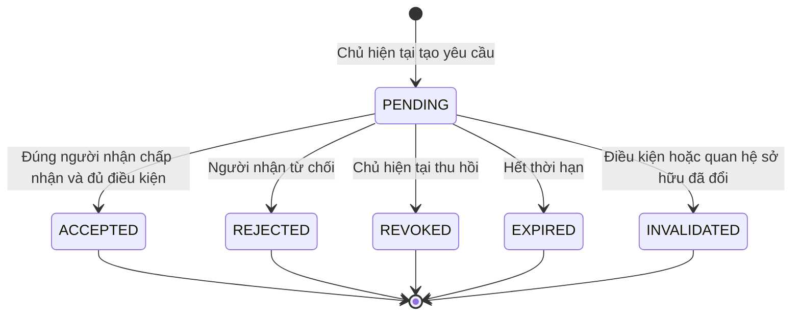

# Order ownership transfer: chuyển quyền sở hữu đơn hàng an toàn

Trong chương **Order Security**, chuyển quyền sở hữu đơn hàng là một thay đổi quyền nghiệp vụ: ai được xem, hủy, sửa hoặc tiếp tục xử lý một đơn hàng. Nếu hệ thống chỉ cập nhật `owner_id` từ dữ liệu người gọi gửi lên, một API tưởng như đơn giản có thể trở thành đường chiếm đoạt đơn hàng, lộ địa chỉ giao hàng, sửa quyền hoàn tiền hoặc chuyển đơn sang tài khoản cùng nhóm để lạm dụng khuyến mãi.

Bài học thuộc phạm vi bảo vệ logic nghiệp vụ của ứng dụng. Trọng tâm là xác định business invariants, mô hình hóa trạng thái chuyển quyền, kiểm tra quyền theo từng đối tượng, thực hiện thay đổi trong transaction, xử lý yêu cầu trùng và kiểm thử các chuỗi thao tác tấn công.

## 1. Mục tiêu và tình huống xuất phát

Sau bài học, bạn có thể:

- Phân biệt người sở hữu nghiệp vụ với người đặt hàng, người thanh toán và người nhận hàng.
- Thiết kế quy trình chuyển quyền có người gửi, người nhận, thời hạn và điều kiện chấp nhận rõ ràng.
- Giữ việc kiểm tra quyền và cập nhật chủ sở hữu nhất quán khi có yêu cầu đồng thời.
- Vô hiệu hóa quyền phát sinh từ quan hệ sở hữu cũ mà vẫn giữ đúng lịch sử tài chính và nghĩa vụ thực hiện đơn hàng.
- Thiết kế idempotency, audit và kiểm thử cho những cách lạm dụng vượt ngoài một request đơn lẻ.

Giả sử An đặt một đơn hàng trong cửa hàng của tenant T. An muốn chuyển quyền quản lý đơn đó cho Bình, một tài khoản đã xác thực trong cùng tenant. Quyền quản lý có thể bao gồm xem trạng thái và yêu cầu hủy khi đơn chưa được thực hiện. Việc Bình chấp nhận không tự động biến Bình thành người đã thanh toán, cũng không tự động thay đổi nơi giao hàng.

Đây là một chính sách mẫu để phân tích. Sản phẩm khác có thể cấm hoàn toàn việc chuyển đơn, yêu cầu nhân viên phê duyệt, hoặc chỉ cho phép chuyển quyền quản lý một nhóm đơn nhất định. Cần định nghĩa chính sách trước khi xây API.

## 2. Xác định chính xác thứ đang được chuyển

Từ “owner” thường che giấu nhiều vai trò khác nhau. Trộn các vai trò vào một cột khiến việc chuyển quyền vô tình thay đổi cả quyền và nghĩa vụ không liên quan.

| Vai trò hoặc dữ liệu | Ý nghĩa | Có tự động đổi khi chuyển quyền quản lý? |
| --- | --- | --- |
| `created_by` | Người khởi tạo đơn để truy vết | Không; giữ nguyên lịch sử |
| `owner_id` | Người có quyền quản lý đơn theo chính sách hiện tại | Có, sau khi chuyển quyền hoàn tất |
| `payer_id` hoặc tham chiếu thanh toán | Chủ thể hoặc phương tiện đã thanh toán | Không |
| Người nhận và địa chỉ giao hàng | Thông tin thực hiện giao nhận | Không; sửa bằng quy trình riêng |
| Đơn vị xuất hóa đơn, bên ký hợp đồng | Chủ thể của chứng từ hoặc nghĩa vụ | Không; cần quy trình chuyên biệt |
| Tenant, cửa hàng hoặc merchant | Ranh giới dữ liệu và giao dịch | Không trong chức năng chuyển quyền này |
| Người được ủy quyền xem đơn | Quyền bổ sung, có phạm vi và thời hạn | Đánh giá riêng; không mặc định giữ hay xóa tất cả |
| `ownership_epoch` | Thế hệ quyền sở hữu để nhận diện quyền cũ | Tăng khi chuyển quyền thành công |

Một số thao tác gần giống nhưng phải được phân biệt:

- **Đổi người nhận hàng:** thay dữ liệu giao nhận, có thể không thay đổi người được quản lý đơn.
- **Tặng hàng:** người trả tiền có thể giữ quyền tài chính, còn người nhận chỉ có một phần quyền sau bán hàng.
- **Ủy quyền:** owner hiện tại giữ nguyên; một người khác có quyền giới hạn.
- **Chuyển quyền sở hữu nghiệp vụ:** quan hệ owner thay đổi và các quyền dựa trên quan hệ đó được đánh giá lại.
- **Chuyển nghĩa vụ thanh toán hoặc hợp đồng:** một nghiệp vụ khác, cần điều kiện và phê duyệt riêng.

Trong toàn bộ ví dụ dưới đây, “chuyển quyền” chỉ thay đổi `owner_id` và những quyền được chính sách gắn với quan hệ này. Mọi quyền hoàn tiền, truy cập chứng từ và xem dữ liệu cá nhân đều phải được quyết định riêng.

## 3. Mô hình đe dọa: người dùng hợp lệ vẫn có thể lạm dụng

Kẻ tấn công có thể có tài khoản thật, session hợp lệ và một vài đơn hàng của chính mình. Vì vậy, kiểm tra đăng nhập, CSRF và tính hợp lệ của JSON là cần thiết nhưng chưa đủ.

| Cách lạm dụng | Sai sót logic bị khai thác | Hậu quả |
| --- | --- | --- |
| Sửa `orderId` sang đơn của người khác | Chỉ kiểm tra vai trò `CUSTOMER` | Chiếm đoạt hoặc làm thay đổi đơn không thuộc quyền |
| Gửi `ownerId` trong API cập nhật thông tin đơn | Mass assignment vào thuộc tính bảo mật | Bỏ qua toàn bộ quy trình chuyển quyền |
| Sửa `targetUserId` khi chấp nhận lời mời | Không ràng buộc lời mời với người nhận cụ thể | Chuyển đơn cho tài khoản do kẻ tấn công chọn |
| Dùng lời mời cũ sau một lần chuyển quyền khác | Không kiểm tra owner và thế hệ quyền gốc | Kích hoạt lại quyền từ quan hệ đã hết hiệu lực |
| Chấp nhận đồng thời hai lời mời | Kiểm tra và ghi ở các transaction khác nhau | Kết quả phụ thuộc cuộc đua, audit mâu thuẫn |
| Chuyển quyền trong lúc xuất kho | Không đồng bộ với điều kiện thực hiện đơn | Đơn được chuyển khi chính sách đã cấm |
| Chuyển sang tài khoản khác tenant | Chỉ kiểm tra tài khoản đích có tồn tại | Phá vỡ ranh giới dữ liệu |
| Dùng liên kết quản lý hoặc tác vụ nền cũ | Quyền cũ nằm trong token, cache hoặc hàng đợi | Chủ cũ tiếp tục thao tác sau khi chuyển |
| Gửi lại yêu cầu do timeout hoặc chủ động spam | Không có idempotency và giới hạn nghiệp vụ | Nhiều lời mời, nhiều thông báo hoặc xử lý lặp |
| Chuyển vòng giữa nhiều tài khoản | Khuyến mãi hoặc hạn mức chỉ bám theo owner hiện tại | Nhận lại lợi ích đã dùng hoặc né kiểm soát |

UUID khó đoán có thể làm giảm việc dò tìm đơn, nhưng không chứng minh quyền trên đơn. Cũng không nên lấy sự hiện diện của nút “Chuyển quyền” trên giao diện làm bằng chứng rằng request được phép.

## 4. Viết business invariants trước khi triển khai

Một bộ bất biến cho chính sách mẫu có thể gồm các điều kiện sau.

### 4.1. Bất biến về danh tính và phạm vi

1. Mỗi đơn có đúng một owner hiện tại trong một tenant xác định.
2. Người tạo yêu cầu chuyển phải là owner hiện tại, hoặc là chủ thể thực hiện một luồng hỗ trợ được cấp quyền riêng và có lý do.
3. Người nhận phải là tài khoản đã được xác định, còn hoạt động và thuộc cùng tenant với đơn.
4. Không được chuyển cho chính owner hiện tại.
5. Người chấp nhận phải đúng là người nhận đã được lưu trong yêu cầu chuyển; request chấp nhận không được tự chọn lại người nhận.
6. Quyền hỗ trợ khách hàng không mặc nhiên cho phép bỏ qua mọi điều kiện. Nếu có ngoại lệ, cần chỉ rõ ngoại lệ nào, ai được duyệt và bằng chứng nào được lưu.

### 4.2. Bất biến về vòng đời

1. Chỉ đơn ở tập trạng thái cho phép mới được chuyển. Trong ví dụ, tập này là `DRAFT` và `CONFIRMED`, đồng thời đơn chưa bị giữ để xuất kho và chưa có yêu cầu hủy hoặc hoàn tiền đang xử lý.
2. Một đơn có nhiều nhất một yêu cầu chuyển còn hiệu lực ở trạng thái `PENDING`.
3. Yêu cầu chuyển phải còn hạn tại thời điểm quyết định chấp nhận trong transaction.
4. `source_owner_id` và `source_ownership_epoch` trong yêu cầu phải khớp với đơn hiện tại khi chấp nhận.
5. Chấp nhận, thu hồi hoặc từ chối chỉ được thực hiện từ `PENDING`; trạng thái kết thúc không quay lại `PENDING`.
6. Trong thời gian có yêu cầu chuyển, hệ thống phải có chính sách rõ ràng về thay đổi đơn. Ví dụ: chặn sửa địa chỉ và các điều kiện quan trọng, hoặc làm lời mời mất hiệu lực khi các điều kiện đó thay đổi.

### 4.3. Bất biến về tính toàn vẹn và tác dụng phụ

1. Đổi owner, tăng `ownership_epoch`, đánh dấu yêu cầu `ACCEPTED` và ghi sự kiện cần xử lý phải cùng thành công hoặc cùng thất bại.
2. Chuyển quyền không thay đổi giá, số lượng, ưu đãi đã tiêu thụ, dữ liệu thanh toán, tenant hoặc người khởi tạo.
3. Đơn đã được chủ cũ hưởng lợi ích một lần không trở thành đơn mới chỉ vì đổi owner. Định danh để ghi nhận lợi ích phải phù hợp với quy tắc chống lạm dụng.
4. Quyền truy cập của chủ cũ dựa trên ownership phải mất hiệu lực khi chuyển xong. Quyền khác, chẳng hạn xem chứng từ thanh toán của chính họ, được đánh giá theo chính sách riêng.
5. Một lệnh được gửi lại không tạo thêm một lần chuyển quyền hoặc thêm tác dụng nghiệp vụ không mong muốn.
6. Mọi lần chuyển thành công đều truy vết được người khởi tạo, người chấp nhận, chủ cũ, chủ mới, thời điểm và căn cứ chính sách.

Các bất biến này phải được kiểm tra ở tầng xử lý nghiệp vụ và được hỗ trợ bằng ràng buộc dữ liệu khi có thể. Chỉ kiểm tra tại controller sẽ để lại đường đi qua tác vụ nền, API nội bộ hoặc công cụ hỗ trợ.

## 5. Tách trạng thái đơn khỏi trạng thái yêu cầu chuyển

Đơn hàng và yêu cầu chuyển quyền là hai đối tượng khác nhau. Một đơn `CONFIRMED` có thể có yêu cầu chuyển `PENDING`; không cần biến trạng thái đơn thành `TRANSFER_PENDING` nếu điều đó làm rối vòng đời thực hiện đơn.



`EXPIRED` có thể được ghi bởi một tác vụ dọn dữ liệu hoặc khi xử lý một lệnh mới. Dù tác vụ dọn chưa chạy, điều kiện `expires_at` vẫn phải được kiểm tra trong thao tác chấp nhận. Một bản ghi còn ghi `PENDING` không đồng nghĩa lời mời còn hiệu lực.

| Thao tác | Chủ thể | Điều kiện cốt lõi | Kết quả |
| --- | --- | --- | --- |
| Tạo yêu cầu | Owner hiện tại | Đơn đủ điều kiện, người nhận hợp lệ, không có yêu cầu còn hiệu lực | Tạo `PENDING`, owner chưa đổi |
| Xem đề nghị | Người nhận được chỉ định | Có quyền xem đúng đề nghị | Chỉ trả phần thông tin cần để quyết định |
| Chấp nhận | Người nhận được chỉ định | Còn hạn, owner và epoch nguồn còn khớp, đơn còn đủ điều kiện | Đổi owner và kết thúc yêu cầu |
| Từ chối | Người nhận được chỉ định | Yêu cầu còn `PENDING` | Kết thúc `REJECTED` |
| Thu hồi | Owner hiện tại | Yêu cầu thuộc quan hệ sở hữu hiện tại | Kết thúc `REVOKED` |
| Vô hiệu hóa | Luồng nghiệp vụ liên quan | Thay đổi làm đề nghị không còn hợp lệ | Kết thúc `INVALIDATED` |

Không thiết kế đường đi từ `REVOKED` hoặc `EXPIRED` sang `ACCEPTED`. Nếu hai bên muốn thử lại, phải tạo một yêu cầu mới từ trạng thái hiện tại của đơn.

## 6. Mô hình dữ liệu phục vụ quyết định bảo mật

Một mô hình tối thiểu có thể như sau. Đây là mô hình minh họa; cách khai báo kiểu và ràng buộc phụ thuộc cơ sở dữ liệu sử dụng.

```text
orders
  id
  tenant_id
  created_by
  owner_id
  payer_id
  state
  fulfillment_state
  financial_operation_state
  ownership_epoch
  version
  transfer_terms_version

order_transfer_requests
  id
  tenant_id
  order_id
  source_owner_id
  source_ownership_epoch
  target_owner_id
  transfer_terms_version
  status
  created_at
  expires_at
  completed_at
  accepted_by
  invitation_secret_hash          # chỉ có nếu thiết kế cần bí mật lời mời
  policy_version
  reason_code

command_idempotency
  tenant_id
  actor_id
  command_type
  idempotency_key
  request_fingerprint
  result_reference
  completed_at

outbox_events
  event_id
  aggregate_id
  event_type
  payload
  created_at
  published_at
```

### 6.1. Tại sao cần cả `version` và `ownership_epoch`?

`version` thường tăng khi bản ghi đơn thay đổi để phát hiện ghi đè dữ liệu. `ownership_epoch` chỉ tăng khi quan hệ sở hữu thay đổi. Một token quản lý được cấp cho An ở epoch 7 phải mất hiệu lực khi đơn chuyển sang Bình ở epoch 8, kể cả sau này đơn quay lại cho An ở epoch 9.

So sánh duy nhất `owner_id` không phát hiện được chuỗi An → Bình → An. Một lời mời cũ từ lần An sở hữu đầu tiên vẫn phải bị từ chối sau chuỗi này.

`transfer_terms_version` đại diện cho phiên bản các điều kiện quan trọng mà người nhận xem trước khi chấp nhận, ví dụ nhóm hàng, tổng tiền hoặc cách giao nhận. Nếu các dữ liệu đó thay đổi, cần vô hiệu hóa lời mời hoặc yêu cầu xác nhận lại. Không dùng phiên bản chính sách để thay thế phiên bản dữ liệu đơn: hai giá trị giải quyết hai loại thay đổi khác nhau.

### 6.2. Ràng buộc dữ liệu nên hỗ trợ điều gì?

- Khóa ngoại hoặc cách kiểm tra tương đương để đảm bảo yêu cầu gắn đúng đơn và tenant. Nếu mô hình cho phép, dùng cặp khóa gồm tenant và định danh đối tượng.
- Ràng buộc `source_owner_id != target_owner_id`.
- Ràng buộc duy nhất cho phạm vi idempotency đã chọn.
- Cơ chế đảm bảo một đơn chỉ có một yêu cầu `PENDING`. Có thể dùng unique index có điều kiện nếu hệ quản trị hỗ trợ, hoặc một bản ghi điều phối duy nhất trên đơn được bảo vệ bằng transaction và khóa.
- Trạng thái và các trường hoàn tất nhất quán, chẳng hạn yêu cầu `ACCEPTED` phải có `accepted_by` và `completed_at`.

Ràng buộc “một `PENDING`” cũng giữ chỗ cho bản ghi đã hết hạn nhưng chưa được cập nhật. Khi tạo yêu cầu mới, transaction cần kết thúc lời mời cũ đã hết hạn trước rồi mới tạo lời mời mới. Không dựa vào lịch chạy tác vụ nền để mở quyền tạo yêu cầu.

Các ràng buộc này bổ sung cho phân quyền, không thay thế việc kiểm tra ai đang thực hiện lệnh.

## 7. Thiết kế API theo lệnh nghiệp vụ

Tránh API chung cho phép client ghi trực tiếp thuộc tính bảo mật:

```http
PATCH /orders/{orderId}
Content-Type: application/json

{"ownerId":"user-B"}
```

Một thiết kế theo lệnh làm rõ ý định và điều kiện hơn:

```http
POST /orders/{orderId}/ownership-transfers
Idempotency-Key: <key>

{"targetUserId":"user-B","reasonCode":"TRANSFER_MANAGEMENT"}
```

```http
POST /orders/{orderId}/ownership-transfers/{transferId}/accept
Idempotency-Key: <key>

{}
```

```http
POST /orders/{orderId}/ownership-transfers/{transferId}/reject
POST /orders/{orderId}/ownership-transfers/{transferId}/revoke
```

`actor_id` lấy từ ngữ cảnh xác thực. `tenant_id` lấy từ ngữ cảnh tenant đã được xác minh, rồi phải đối chiếu với đơn và lời mời. `source_owner_id`, trạng thái, epoch, thời hạn và phiên bản chính sách được xác lập phía máy chủ. Một header tenant do người dùng gửi lên vẫn là dữ liệu cần xác minh.

DTO của API sửa thông tin đơn thông thường chỉ nên có các trường thực sự được phép sửa. Không ánh xạ toàn bộ JSON vào entity rồi mong rằng giao diện sẽ không gửi `ownerId`, `tenantId`, `payerId`, `status` hoặc `ownershipEpoch`.

### 7.1. Giới hạn dữ liệu trước khi người nhận chấp nhận

Người nhận cần biết mình sắp nhận quyền gì, nhưng chưa nhất thiết có quyền đọc toàn bộ đơn. Có thể cung cấp một bản xem trước riêng gồm mã tham chiếu, mô tả hàng hóa đã lược bớt, tổng tiền nếu phù hợp và phạm vi trách nhiệm sẽ nhận.

Không dùng quyền xem lời mời để trả ngay địa chỉ đầy đủ, ghi chú nội bộ, thông tin thanh toán hoặc tài liệu của chủ cũ. Sau khi chuyển thành công, dữ liệu cũ vẫn phải được lọc theo quyền của chủ mới; quyền quản lý đơn không tự động cho phép xem mọi dữ liệu lịch sử.

## 8. Transaction: kiểm tra quyền trên trạng thái sẽ được ghi

Một lỗi điển hình là kiểm tra owner trước transaction, sau đó thực hiện cập nhật bằng ID:

```java
// Ví dụ không an toàn về logic đồng thời.
Order order = repository.findById(orderId);
checkOwner(currentUser, order);
checkTransferable(order);

// Quan hệ sở hữu hoặc trạng thái xuất kho có thể đã đổi tại đây.
repository.updateOwner(orderId, targetUserId);
```

Phân quyền đúng tại thời điểm đọc không đảm bảo cập nhật đúng tại thời điểm ghi. Cần khóa hoặc cập nhật có điều kiện để gắn quyết định với trạng thái còn hợp lệ.

### 8.1. Tạo yêu cầu chuyển

Trong một transaction, luồng tạo yêu cầu nên:

1. Xác thực lệnh và kiểm tra hoặc giữ chỗ idempotency trong phạm vi actor đã xác thực.
2. Đọc và khóa đơn theo cả `tenant_id` và `order_id`.
3. Kiểm tra actor là owner hiện tại và đơn thuộc tập trạng thái cho phép.
4. Kiểm tra người nhận cụ thể: khác owner, đúng tenant, đang hoạt động và đủ điều kiện nhận.
5. Kiểm tra yêu cầu `PENDING` hiện có dưới cùng giao thức khóa; kết thúc yêu cầu đã hết hạn, hoặc trả xung đột nếu vẫn còn hiệu lực.
6. Lưu yêu cầu với owner nguồn, epoch nguồn, điều kiện được đề nghị và thời hạn do máy chủ xác định.
7. Lưu audit, sự kiện outbox để gửi thông báo và kết quả idempotency.
8. Commit rồi mới trả kết quả thành công.

Thông báo có thể gửi chậm hơn transaction, nhưng không được gửi một lời mời chưa từng được commit.

### 8.2. Chấp nhận yêu cầu chuyển

Đoạn Java dưới đây là mã giả để thể hiện ranh giới transaction và thứ tự quyết định, không phải triển khai có thể sao chép trực tiếp. Các hàm `require...`, idempotency và repository phải được hiện thực theo hệ thống sử dụng.

```java
TransferResult accept(Principal principal, AcceptTransferCommand cmd) {
    return transaction.run(() -> {
        // Chủ thể và tenant lấy từ ngữ cảnh đã xác minh.
        Actor actor = authenticatedActor(principal);

        Replay replay = idempotency.claimOrReplay(
            actor.tenantId(), actor.id(), "ACCEPT_ORDER_TRANSFER",
            cmd.idempotencyKey(), fingerprint(cmd.orderId(), cmd.transferId())
        );
        if (replay.isCompleted()) {
            // Chỉ trả biên nhận tối thiểu của đúng lệnh, không trả dữ liệu đơn mới.
            return replay.minimalReceipt();
        }

        // Tất cả luồng sửa quyền hoặc trạng thái xung đột đều khóa theo thứ tự này.
        Order order = orders.lock(actor.tenantId(), cmd.orderId());
        Transfer transfer = transfers.lock(
            actor.tenantId(), cmd.orderId(), cmd.transferId()
        );

        requireRecipient(actor, transfer);

        if (transfer.isAccepted()) {
            // Cho phép xác nhận lại cùng một kết quả đã hoàn tất.
            requireAcceptedBy(actor, transfer);
            TransferResult receipt = receiptOf(transfer);
            idempotency.complete(receipt);
            return receipt;
        }

        requirePending(transfer);
        Instant decisionTime = databaseDecisionTimeAfterLocks();
        requireNotExpired(transfer, decisionTime);
        requireSameOwnerAndEpoch(order, transfer);
        requireTransferableNow(order);
        requireRecipientEligibleNow(actor, order);
        requireUnchangedTransferTerms(order, transfer);
        requirePolicyAllowsAcceptanceNow(order, transfer, actor);

        UserId oldOwner = order.ownerId();
        order.changeOwnerTo(transfer.targetOwnerId());
        order.incrementOwnershipEpoch();
        order.incrementVersion();
        transfer.accept(actor.id(), decisionTime);

        audit.append(ownershipTransferred(order, transfer, actor, oldOwner));
        outbox.append(ownershipTransferredEvent(order, transfer, oldOwner));

        TransferResult receipt = receiptOf(transfer);
        idempotency.complete(receipt);
        return receipt;
    });
}
```

Những chi tiết quyết định độ an toàn của luồng này:

- Tra cứu lời mời phải ràng buộc đồng thời tenant, đơn và ID lời mời. Không ghép một lời mời của đơn A với đường dẫn của đơn B.
- Nhánh trả lại kết quả đã chấp nhận không cấp lại quyền sở hữu. Nếu đơn đã được chuyển tiếp, biên nhận lịch sử vẫn có thể được trả cho người từng chấp nhận, nhưng API lấy dữ liệu hiện tại phải kiểm tra quyền hiện tại.
- Thời điểm xét hết hạn được lấy từ nguồn thời gian thống nhất sau khi đã lấy các khóa cần thiết. Cần hiểu hàm thời gian của cơ sở dữ liệu đang trả thời điểm bắt đầu transaction hay thời điểm thực tế thực thi; một transaction đợi khóa lâu không được dùng mốc cũ để nhận lời mời đã hết hạn.
- Nếu tài khoản đích có thể bị khóa hoặc rời tenant trong lúc chấp nhận, kiểm tra tư cách nhận cũng cần có điểm tuần tự hóa được xác định. Có thể khóa bản ghi thành viên liên quan theo thứ tự nhất quán, hoặc dùng phiên bản và giao thức cập nhật tương ứng. Chỉ đọc một cờ `active` rồi bỏ qua cuộc đua với lệnh thu hồi tư cách là chưa đủ nếu chính sách yêu cầu tư cách còn hiệu lực khi chuyển.
- Chính sách đang có hiệu lực vẫn phải được áp dụng. `policy_version` trong lời mời phục vụ truy vết; nó không phải vé để bỏ qua một điều cấm bảo mật vừa được áp dụng.
- Lỗi giữa lúc cập nhật owner và ghi yêu cầu phải rollback cả hai. Ghi outbox và audit trong cùng transaction giúp tránh trạng thái có thay đổi nhưng mất dấu vết nghiệp vụ.

Nếu muốn lưu `EXPIRED` khi phát hiện hết hạn, cần thiết kế một kết quả từ chối được commit, hoặc dùng luồng kết thúc riêng. Cập nhật `EXPIRED` rồi ném ngoại lệ làm rollback toàn bộ transaction sẽ không lưu được trạng thái hết hạn. Dù chưa lưu được trạng thái đó, việc chấp nhận vẫn phải bị chặn.

### 8.3. Khóa phải được các luồng xung đột cùng tôn trọng

Một transaction chấp nhận khóa đơn sẽ không giải quyết cuộc đua nếu luồng xuất kho đọc điều kiện ở nơi khác rồi tự phát hành lệnh giao hàng mà không tham gia cùng giao thức.

Có hai cách thường dùng:

- **Khóa bi quan:** các lệnh chuyển quyền, giữ đơn để xuất kho, hủy và những thay đổi điều kiện liên quan cùng khóa bản ghi điều phối của đơn, đọc lại trạng thái rồi mới ghi. Luôn dùng một thứ tự lấy khóa để giảm deadlock.
- **Cập nhật có điều kiện:** chỉ cập nhật nếu owner, epoch, trạng thái và phiên bản vẫn như mong đợi; kiểm tra số dòng được cập nhật. Nếu không có dòng nào thay đổi, tải lại và quyết định từ chối hoặc thử lại. Các thay đổi trên yêu cầu chuyển và outbox vẫn cần nằm trong cùng transaction.

Ví dụ ý tưởng cho cập nhật có điều kiện:

```sql
UPDATE orders
SET owner_id = :target_owner,
    ownership_epoch = ownership_epoch + 1,
    version = version + 1
WHERE tenant_id = :tenant
  AND id = :order_id
  AND owner_id = :source_owner
  AND ownership_epoch = :source_epoch
  AND version = :expected_version
  AND state IN ('DRAFT', 'CONFIRMED')
  AND fulfillment_state = 'NOT_RESERVED'
  AND financial_operation_state = 'NONE';
```

SQL này chỉ minh họa điều kiện bảo vệ bản ghi đơn; nó chưa thực hiện toàn bộ nghiệp vụ. Trạng thái lời mời, người nhận, thời hạn, tư cách thành viên và dữ liệu được đề nghị vẫn phải được kiểm tra, bảo vệ và cập nhật nhất quán trong transaction. Số dòng cập nhật bằng một là điều kiện cần của nhánh thành công, không phải toàn bộ bằng chứng phân quyền.

Không dùng cơ chế “request đến sau thắng” cho việc chuyển owner. Nếu gặp deadlock hoặc xung đột phiên bản, việc thử lại phải chạy lại quyết định trên trạng thái mới; không lặp một lệnh ghi đã được phê duyệt từ dữ liệu cũ.

## 9. Đồng bộ với xuất kho và hệ thống bên ngoài

Transaction cơ sở dữ liệu chỉ bảo vệ được các thay đổi tham gia transaction đó. Nó không thể tự rollback một kiện hàng đã bàn giao cho đối tác vận chuyển.

Một chính sách dễ giải thích là **đơn không còn được chuyển quyền khi đã giữ để xuất kho**:

1. Luồng xuất kho khóa đơn, kiểm tra trạng thái và đánh dấu `fulfillment_state = RESERVED` trước khi tạo sự kiện yêu cầu bên ngoài.
2. Luồng chấp nhận kiểm tra điều kiện `NOT_RESERVED` dưới cùng giao thức khóa.
3. Nếu xuất kho thắng cuộc đua, chuyển quyền bị từ chối và lời mời có thể bị vô hiệu hóa.
4. Nếu chuyển quyền thắng, luồng xuất kho phải đọc owner và dữ liệu hiện tại sau đó. Nếu cần hủy lời mời trước khi giữ đơn, hai thay đổi phải cùng transaction.
5. Khi hệ thống ngoài cần dùng thông tin nhạy với quyền sở hữu, sự kiện phải mang phiên bản hoặc epoch liên quan và bên xử lý phải có cách phát hiện lệnh cũ.

Nếu sản phẩm cho phép chuyển quyền sau khi đã gửi lệnh ra ngoài, phải định nghĩa giao thức xác nhận, bù trừ và trạng thái chờ phù hợp. Không thể chỉ ghi lại `owner_id` rồi coi mọi hệ thống đã đồng ý với chủ mới.

## 10. Idempotency cho yêu cầu trùng và kết quả không rõ

Timeout không chứng minh transaction đã thất bại. Client có thể gửi lại lệnh trong lúc lần đầu đã commit nhưng phản hồi bị mất.

### 10.1. Phạm vi khóa và dấu vân tay

Một phạm vi hợp lý cho ví dụ này là:

```text
(tenant_id, actor_id, command_type, idempotency_key)
```

Dấu vân tay được tính từ ý nghĩa của lệnh sau khi chuẩn hóa, gồm ID đơn, ID lời mời hoặc người nhận tùy loại lệnh, cùng các trường làm thay đổi kết quả. Không chỉ băm nguyên chuỗi JSON nếu thứ tự thuộc tính không có ý nghĩa nghiệp vụ.

| Trường hợp | Hành vi mong muốn |
| --- | --- |
| Cùng khóa, cùng actor, cùng nội dung đã hoàn tất | Trả cùng biên nhận tối thiểu |
| Cùng khóa nhưng đổi người nhận hoặc ID lời mời | Từ chối do khóa đã dùng cho lệnh khác |
| Hai request cùng khóa đến đồng thời | Một request giữ chỗ; request còn lại chờ có giới hạn hoặc nhận kết quả đang xử lý |
| Cùng lệnh nhưng dùng khóa mới | State machine và ràng buộc dữ liệu tiếp tục chặn tác dụng lặp |
| Actor khác dùng cùng chuỗi khóa | Không nhận kết quả riêng tư của actor ban đầu |
| Bản ghi idempotency đã hết thời gian lưu | Trạng thái kết thúc và bất biến vẫn chặn chuyển lại trái phép |

Giữ chỗ, thay đổi nghiệp vụ và lưu kết quả cần có thiết kế transaction rõ ràng. Trong thiết kế lưu cùng transaction, request khác có thể chưa thấy bản ghi đang xử lý và phải dựa vào unique constraint cùng cách xử lý chờ hoặc xung đột. Không xem thao tác “đọc chưa thấy khóa rồi insert” là đủ an toàn.

Idempotency không thay thế phân quyền. Một người không phải người nhận không được chấp nhận lời mời dù họ biết khóa đã dùng. Kết quả replay cũng không nên chứa ảnh chụp đầy đủ của đơn, vì quyền đọc dữ liệu có thể đã thay đổi sau khi lệnh hoàn tất.

### 10.2. Tác dụng phụ vẫn cần chống lặp

Outbox bảo đảm sự kiện đã được ghi cùng với thay đổi nghiệp vụ để có thể phát lại. Cơ chế phát và nhận thường cần chịu được cùng một sự kiện được giao nhiều lần.

Dùng `event_id` để bên tiêu thụ nhận diện sự kiện đã xử lý, đồng thời đặt cập nhật của bên tiêu thụ trong ranh giới nhất quán phù hợp. Với dịch vụ email hoặc SMS, cần xem khả năng chống lặp của nhà cung cấp và thiết kế gửi; không khẳng định “gửi đúng một lần” chỉ vì có outbox.

Giới hạn tần suất theo actor, đơn và người nhận giúp giảm spam lời mời. Giới hạn tổng số lần chuyển hoặc thời gian chờ giữa các lần chuyển là quy tắc chống lạm dụng riêng, phải được kiểm tra nhất quán nếu sản phẩm yêu cầu.

## 11. Lời mời, token và quyền cũ sau khi chuyển

### 11.1. Liên kết lời mời không được thay thế danh tính

Nếu lời mời dùng một bí mật trong URL, bí mật phải khó đoán, có thời hạn và gắn với đúng một yêu cầu chuyển. Có thể lưu giá trị băm của bí mật thay vì bản rõ để giảm hậu quả nếu dữ liệu lời mời bị đọc trái phép.

Tuy vậy, trong mô hình bài học này, người chấp nhận vẫn phải đăng nhập bằng đúng tài khoản đích. Biết liên kết không đủ để nhận quyền. Trường hợp mời qua email chưa có tài khoản cần một luồng riêng để xác minh địa chỉ và gắn tài khoản đã xác thực vào lời mời; không cho trình duyệt tự gửi một `targetUserId` bất kỳ ở bước cuối.

Không ghi bí mật lời mời vào log, audit hoặc payload phân tích. Hạn chế đưa bí mật vào URL có thể bị lưu trong lịch sử, referrer hoặc hệ thống theo dõi. Trang mở từ liên kết chỉ nên hiển thị bước xác nhận; không dùng `GET` để chấp nhận chuyển quyền vì liên kết có thể được trình quét email hoặc công cụ xem trước tự mở.

### 11.2. Epoch chỉ hữu ích khi được kiểm tra

Sau khi chuyển quyền, cần rà soát mọi nơi có thể đang giữ kết luận “An là owner”:

- Endpoint quản lý, xem chi tiết, tải tài liệu và các truy vấn danh sách đơn.
- Token hành động như hủy đơn, sửa giao nhận hoặc mở trang quản lý.
- Cache quyền, cache nội dung, đường dẫn tải có chữ ký và URL do email cũ cung cấp.
- WebSocket, thông báo đẩy và subscription theo dõi đơn.
- Tác vụ nền đã xếp hàng nhưng chưa chạy.
- API hỗ trợ và truy cập nội bộ dựa trên quyền đã được tính từ trước.

Một capability có thể chứa `order_id`, `subject_id`, `ownership_epoch`, `action` và thời hạn. Khi sử dụng, máy chủ phải kiểm tra chữ ký, phạm vi hành động và epoch hiện tại hoặc một cơ chế thu hồi tương đương. Tăng epoch trong dữ liệu nhưng không đối chiếu lúc dùng token sẽ không thu hồi được quyền.

Nếu quyền được cache, chỉ gửi sự kiện xóa cache sau commit vẫn để lại khoảng thời gian cache cũ còn được sử dụng. Với thao tác nhạy cảm cần thu hồi ngay, phải kiểm tra trạng thái có thẩm quyền hoặc áp dụng cơ chế phiên bản và tính nhất quán đáp ứng yêu cầu đó. TTL ngắn chỉ giới hạn thời gian rủi ro; nó không tạo ra thu hồi tức thì.

Đối với dữ liệu đã gửi xuống trình duyệt hoặc tập tin đã tải, chuyển quyền không thể làm người dùng quên bản sao đã nhận. Thiết kế cần giảm dữ liệu được chia sẻ ngay từ trước khi chuyển và phân biệt quyền truy cập về sau với dữ liệu đã bị tiết lộ.

## 12. Giữ nguyên quy tắc tài chính và kiểm soát lợi ích

Chuyển owner là điểm dễ bị dùng để làm đứt chuỗi quy tắc vốn gắn sai với tài khoản hiện tại.

### 12.1. Hoàn tiền

Ví dụ An đã thanh toán, sau đó chuyển quyền quản lý cho Bình. Nếu API hoàn tiền mặc định lấy tài khoản ngân hàng từ owner hiện tại, Bình có thể hưởng tiền của An mà không qua một chính sách cho phép.

Cần tách rõ:

- Ai được yêu cầu hủy hoặc yêu cầu hoàn theo trạng thái đơn.
- Giao dịch thanh toán nào được hoàn, còn bao nhiêu giá trị được hoàn và đang có lệnh hoàn nào khác.
- Đích hoàn tiền nào được phép theo chính sách thanh toán.
- Ai được xem dữ liệu của phương tiện thanh toán hoặc chứng từ.

Trong chính sách mẫu, chuyển owner không sửa tham chiếu thanh toán và không cho phép tự chọn lại đích hoàn tiền. Nếu sản phẩm có nghiệp vụ chuyển quyền lợi tài chính, đó phải là một quy trình được thiết kế và phê duyệt riêng.

### 12.2. Khuyến mãi và hạn mức

Nếu một ưu đãi chỉ dùng một lần cho một đơn, hãy ghi nhận theo định danh ổn định của đơn và sự kiện hưởng lợi. Không đặt lại bộ đếm vì owner đổi. Nếu ưu đãi giới hạn theo người mua, hộ gia đình hoặc tổ chức, quan hệ cần giữ để kiểm tra phụ thuộc đúng quy tắc đó, không chỉ `owner_id` mới.

Chuyển vòng nhiều lần, chuyển ngay trước hoàn tiền hoặc nhiều tài khoản cùng nhận đơn từ một nguồn là tín hiệu có thể theo dõi. Chúng cần được diễn giải theo chính sách sản phẩm; tín hiệu rủi ro không tự chứng minh rằng mọi giao dịch đều gian lận.

## 13. Audit và lỗi nghiệp vụ có ích cho vận hành

Một sự kiện chuyển thành công nên ghi đủ thông tin để dựng lại quyết định:

```json
{
  "eventType": "ORDER_OWNERSHIP_TRANSFERRED",
  "eventId": "evt-example",
  "tenantId": "tenant-T",
  "orderId": "order-example",
  "transferId": "transfer-example",
  "initiatedBy": "user-A",
  "acceptedBy": "user-B",
  "previousOwnerId": "user-A",
  "newOwnerId": "user-B",
  "previousOwnershipEpoch": 7,
  "newOwnershipEpoch": 8,
  "policyVersion": "order-transfer-policy-v3",
  "correlationId": "correlation-example"
}
```

Hệ thống bổ sung timestamp từ máy chủ và căn cứ ngoại lệ nếu có. Không ghi token lời mời, cookie, thông tin thẻ hoặc toàn bộ địa chỉ giao hàng vào sự kiện này. Audit cần được bảo vệ khỏi sửa trái phép và có phạm vi truy cập phù hợp vì chính nó chứa dữ liệu về quan hệ giữa tài khoản.

Lỗi nghiệp vụ nên giúp người dùng biết bước tiếp theo mà không trở thành công cụ dò đơn. Có thể phân biệt nội bộ các lý do như `RECIPIENT_MISMATCH`, `TRANSFER_EXPIRED`, `ORDER_NOT_TRANSFERABLE`, `STALE_OWNERSHIP` và `IDEMPOTENCY_CONFLICT`, nhưng API bên ngoài áp dụng chính sách tiết lộ nhất quán. Với actor chưa có quyền, tránh xác nhận đơn hoặc người nhận nào tồn tại.

Theo dõi các chỉ số như số lần bị từ chối do sai người nhận, dùng lời mời cũ, chuyển liên tiếp, xung đột đồng thời và lỗi phát sự kiện. Đây là dữ liệu hỗ trợ phát hiện lạm dụng và lỗi quy trình, không phải lý do để ghi thêm bí mật vào log.

## 14. Kiểm thử các chuỗi tấn công logic

Bài kiểm thử cần xác nhận trạng thái bền vững và quyền sau thao tác, không chỉ mã HTTP. Với các tình huống đồng thời, dùng cơ chế đồng bộ có kiểm soát để hai transaction gặp nhau tại điểm cần kiểm tra; không chỉ gửi hai request rồi hy vọng cuộc đua xảy ra.

| Nhóm | Kịch bản | Điều cần chứng minh |
| --- | --- | --- |
| Luồng hợp lệ | An mời Bình; Bình chấp nhận khi đơn đủ điều kiện | Owner đổi một lần, epoch tăng một, yêu cầu kết thúc, có audit và outbox |
| Quyền theo đối tượng | Cường thay `orderId` bằng đơn của An | Không tạo lời mời, không lộ dữ liệu đơn, owner giữ nguyên |
| Giả mạo dữ liệu | Gửi `sourceOwnerId`, `ownerId` hoặc `tenantId` vào DTO không cho sửa | Bị từ chối hoặc bỏ qua theo hợp đồng đã định; các trường bảo mật không đổi |
| Sai người nhận | Cường có liên kết nhưng không phải Bình | Không thể xem dữ liệu quá phạm vi hoặc chấp nhận |
| Ghép sai đối tượng | Dùng `transferId` của đơn A trên đường dẫn đơn B | Không tìm được đối tượng hợp lệ để thao tác |
| Khác tenant | Người nhận hoặc actor thuộc tenant khác | Không chuyển, không làm lộ tài khoản hoặc đơn ngoài phạm vi |
| Tự chuyển | An chọn chính An | Không tạo yêu cầu, không tăng epoch |
| Hết hạn | Request đến trước hạn nhưng đợi khóa đến sau hạn | Bị từ chối theo thời điểm quyết định được định nghĩa |
| Thu hồi | An thu hồi rồi Bình dùng liên kết cũ | Không thể chấp nhận |
| Chuyển vòng | An → Bình → An, sau đó dùng lời mời ở epoch ban đầu | Bị từ chối do epoch nguồn không còn khớp |
| Điều kiện thay đổi | Dữ liệu quan trọng đổi sau khi gửi lời mời | Lời mời mất hiệu lực hoặc buộc xác nhận lại theo chính sách |
| Tư cách người nhận | Bình bị khóa hoặc rời tenant trong lúc chấp nhận | Kết quả tuân theo điểm tuần tự hóa đã chọn, không dùng kiểm tra cũ |
| Hai yêu cầu tạo | Hai request khác khóa cùng mời trên một đơn | Chỉ một yêu cầu còn hiệu lực; không vượt unique constraint bằng logic ứng dụng |
| Chấp nhận trùng | Hai request cùng hoặc khác khóa nhận cùng một lời mời | Một lần chuyển nghiệp vụ; kết quả lặp nhất quán |
| Nhận và thu hồi | Bình chấp nhận đồng thời An thu hồi | Chỉ một nhánh từ `PENDING` thắng; không có trạng thái nửa nhận nửa thu hồi |
| Nhận và xuất kho | Lệnh nhận đua với lệnh giữ đơn để xuất kho | Hai lệnh tuân theo cùng giao thức; không chuyển sau khi đã bị chặn |
| Khóa idempotency | Tái sử dụng khóa với target hoặc transfer khác | Bị từ chối, không trả kết quả của một lệnh khác |
| Timeout sau commit | Mất phản hồi rồi client gửi lại | Trả biên nhận cũ, không tăng epoch thêm và không ghi thêm sự kiện nghiệp vụ |
| Lỗi trước commit | Lỗi sau đổi owner nhưng trước ghi outbox | Owner, yêu cầu và kết quả idempotency cùng rollback |
| Phát sự kiện lặp | Consumer nhận cùng `event_id` hai lần | Không lặp tác dụng nghiệp vụ được yêu cầu chống trùng |
| Quyền cũ | An dùng token hủy, URL quản lý hoặc cache cũ | Mọi quyền chỉ dựa trên ownership cũ đều bị từ chối theo yêu cầu thu hồi |
| Hoàn tiền | Bình gửi yêu cầu đổi đích nhận tiền sau chuyển | Không được suy ra quyền tài chính từ owner mới |
| Khuyến mãi | Chuyển qua nhiều tài khoản rồi xin lại lợi ích | Không đặt lại lịch sử sử dụng sai quy tắc |
| Lịch sử riêng tư | Bình đọc chứng từ hoặc thông tin thanh toán của An | Chỉ thấy dữ liệu được chính sách cho phép |

Một kiểm thử transaction tốt còn kiểm tra dữ liệu sau thất bại: không còn owner mới nếu yêu cầu chưa `ACCEPTED`, không có thông báo cho lời mời chưa commit và không có kết quả idempotency thành công cho một transaction bị rollback.

## 15. Bài thực hành: từ API dễ lạm dụng đến lệnh có bất biến

Cho thiết kế ban đầu:

```java
void transfer(String orderId, String targetUserId) {
    requireLoggedIn();
    Order order = orders.find(orderId);
    if (order.state() != SHIPPED) {
        orders.setOwner(orderId, targetUserId);
        email.sendTransferNotice(targetUserId, orderId);
    }
}
```

Hãy phân tích thiết kế trên theo các câu hỏi sau:

1. Ai đang được phép gọi? Có bằng chứng người gọi là owner của chính đơn đó không?
2. Tại sao “chưa `SHIPPED`” không đủ để mô tả các trạng thái được phép chuyển?
3. Người nhận có đồng ý và có đủ tư cách trong đúng tenant không?
4. Khi hai request cùng chạy hoặc xuất kho bắt đầu giữa đọc và ghi, điều gì bảo vệ bất biến?
5. Nếu cập nhật thành công nhưng gửi email lỗi, client gửi lại sẽ gây ra điều gì?
6. Sau chuyển, liên kết cũ và quyền hoàn tiền của hai bên được xử lý ở đâu?

Một phương án sửa cần có đủ các thành phần liên quan: lệnh tạo đề nghị, lệnh chấp nhận gắn đúng người nhận, state machine, owner và epoch nguồn, transaction hoặc cập nhật có điều kiện, idempotency, outbox, audit và kiểm tra quyền sau chuyển. Với sản phẩm cấm chuyển quyền, phương án đúng có thể là loại bỏ khả năng ghi `owner_id` qua các API thông thường và chỉ giữ quy trình hỗ trợ ngoại lệ có kiểm soát.

## 16. Những điểm cần nhớ khi triển khai

- Bắt đầu từ định nghĩa quyền sẽ chuyển; người đặt, người trả tiền, người nhận hàng và owner là những vai trò khác nhau.
- Chấp nhận đề nghị chỉ hợp lệ khi đúng người nhận, đúng tenant, còn hạn và quan hệ sở hữu nguồn vẫn còn nguyên hiệu lực.
- Quyết định quyền phải dựa trên trạng thái được bảo vệ cùng với thao tác ghi. Mọi luồng xung đột phải tham gia giao thức đó.
- Đổi owner, tăng epoch, kết thúc đề nghị và ghi dấu vết nghiệp vụ phải nhất quán; thông báo và tích hợp bên ngoài cần xử lý lỗi và trùng riêng.
- Quyền cũ phải mất hiệu lực ở nơi nó được sử dụng, bao gồm token, cache, tác vụ nền và các đường đọc dữ liệu.
- Kiểm thử cả chuỗi thao tác, cuộc đua và tác dụng sau commit để phát hiện những lỗi mà kiểm tra đăng nhập hoặc schema request không thể ngăn chặn.
