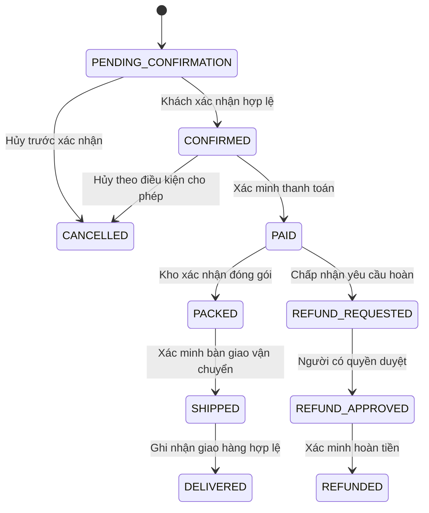

# Order history integrity: bảo vệ tính toàn vẹn lịch sử đơn hàng

## 1. Vì sao lịch sử đơn hàng là một phần của bảo mật nghiệp vụ?

**Order history integrity** là khả năng bảo đảm lịch sử đơn hàng phản ánh đúng những thay đổi nghiệp vụ đã được hệ thống chấp nhận, theo đúng thứ tự và đúng chủ thể thực hiện; các thay đổi không bị âm thầm sửa, xóa, chèn thêm hoặc ghi trùng thành nhiều hiệu ứng.

Trong chương Order Security, lịch sử không chỉ phục vụ màn hình “đơn hàng của tôi”. Nó còn là căn cứ để trả lời các câu hỏi quan trọng:

- Ai đã xác nhận, hủy, giao hoặc điều chỉnh đơn? Người đó có quyền thực hiện ở thời điểm ấy không?
- Đơn đã đi qua những trạng thái nào? Có bỏ qua bước phê duyệt hoặc thanh toán không?
- Tổng tiền, địa chỉ giao hàng hoặc phiên bản giá đã thay đổi ra sao?
- Một lần hoàn tiền xuất phát từ yêu cầu nào, được duyệt thế nào và đã thực sự được xử lý chưa?
- Khi hai thao tác diễn ra đồng thời, thay đổi nào được chấp nhận trước?

Ví dụ, đơn đang `PAID` bị cập nhật trực tiếp thành `CANCELLED`, nhưng lịch sử không ghi nhận ai hủy và không có nghiệp vụ hoàn tiền. Hoặc nhân viên gọi API sửa một dòng lịch sử cũ từ “khách yêu cầu hủy” thành “khách đã nhận hàng”. Cả hai đều phá vỡ căn cứ vận hành, dù database vẫn chạy bình thường và các request đều dùng tài khoản đã đăng nhập.

Module bảo vệ logic nghiệp vụ xem đây là vấn đề kết hợp của business invariants, state machine, quyền theo đối tượng, transaction, idempotency và kiểm thử tình huống lạm dụng. Ghi nhiều log hơn không tự giải quyết được các vấn đề đó.

## 2. Phân biệt trạng thái hiện tại, lịch sử nghiệp vụ và log kỹ thuật

| Loại dữ liệu | Trả lời câu hỏi | Yêu cầu điển hình |
|---|---|---|
| Trạng thái hiện tại của order | Đơn đang ở đâu, version nào, đang dùng snapshot giá nào? | Dùng để ra quyết định nghiệp vụ, kiểm soát cập nhật đồng thời |
| Lịch sử nghiệp vụ đã chấp nhận | Những thay đổi hợp lệ nào đã xảy ra với đơn? | Ghi bền, có thứ tự, gắn với thay đổi đã commit |
| Nhật ký bảo mật | Ai đã thử truy cập, giả mạo hoặc thực hiện thao tác bị từ chối? | Giữ dấu vết cả hành vi thất bại, tránh lộ thông tin nhạy cảm |
| Log kỹ thuật và tracing | Request lỗi ở đâu, mất bao lâu, qua dịch vụ nào? | Hỗ trợ chẩn đoán, có thể có sampling hoặc thời hạn lưu khác |
| Bản chiếu cho giao diện | Người dùng nên thấy timeline nào? | Có thể lọc theo quyền và cập nhật chậm hơn nguồn chuẩn |

Một dòng log “confirm order success” xuất hiện trước khi transaction commit không chứng minh đơn đã được xác nhận. Transaction có thể rollback sau đó. Ngược lại, một request bị từ chối có thể cần ghi nhật ký bảo mật, nhưng không được tạo sự kiện nghiệp vụ mang nghĩa đơn đã chuyển trạng thái.

Cũng cần chọn rõ mô hình thẩm quyền dữ liệu:

1. **Order hiện tại là nguồn trạng thái chuẩn:** bảng order giữ trạng thái quyết định; bảng history ghi lại thay đổi và phải được cập nhật nhất quán với order.
2. **Event sourcing:** chuỗi sự kiện đã chấp nhận là nguồn chuẩn; trạng thái hiện tại là kết quả dựng từ các sự kiện theo hợp đồng đã định nghĩa.

Bài này chủ yếu dùng mô hình thứ nhất. Có bảng history không đồng nghĩa hệ thống đã dùng event sourcing. Một bảng chỉ lưu mô tả “đã cập nhật đơn” thường không đủ dữ liệu để dựng lại toàn bộ order.

## 3. Xác định các bất biến trước khi thiết kế bảng history

### 3.1. Thay đổi trạng thái và lịch sử phải cùng thành công hoặc cùng thất bại

Trong mô hình minh họa, mỗi thay đổi nghiệp vụ được chấp nhận làm `order.version` tăng một đơn vị và tạo đúng một sự kiện history tương ứng. Không được có trạng thái mới mà thiếu sự kiện, hoặc có sự kiện thành công trong khi trạng thái vẫn là cũ.

```text
Trước thay đổi:
    order.version = n
    order.state   = S1

Sau khi commit:
    order.version = n + 1
    order.state   = S2
    history có sự kiện version n + 1, chuyển S1 → S2

Nếu thất bại:
    order vẫn ở version n và state S1
    không có sự kiện nghiệp vụ thành công cho thay đổi đó
```

Nếu một thay đổi cần nhiều sự kiện, phải định nghĩa thêm thứ tự trong version, chẳng hạn `(orderVersion, eventIndex)`, hoặc một sequence sự kiện độc lập. Không dùng cùng một số version cho nhiều sự kiện rồi vẫn giả định version là khóa duy nhất của history.

### 3.2. Thứ tự phải do server kiểm soát

- Version tăng theo thứ tự thay đổi được chấp nhận cho từng order.
- Hai sự kiện khác nhau không được cùng chiếm một version của cùng order.
- `eventId` nhận diện sự kiện; nó không mặc nhiên biểu thị thứ tự.
- Timestamp phục vụ điều tra thời gian, không thay thế sequence hoặc version.
- Thời điểm và danh tính do client gửi không được tự trở thành thời điểm ghi nhận hoặc người thực hiện chuẩn của hệ thống.

Hai request có thể có timestamp bằng nhau. Đồng hồ giữa các dịch vụ cũng có thể lệch. Vì vậy, không quyết định chuỗi trạng thái chỉ bằng `ORDER BY created_at`.

### 3.3. Chỉ ghi những điều hệ thống đã xác minh

Sự kiện phải gắn với đúng order, tenant, người hoặc dịch vụ thực hiện và thao tác đã được phép. Payload được xây từ dữ liệu server chấp nhận, không phải bản sao tùy ý của toàn bộ request.

Chẳng hạn, “khách gửi yêu cầu hoàn tiền” khác với “yêu cầu hoàn tiền được duyệt”, và cả hai khác với “nhà cung cấp đã xác nhận hoàn tiền”. Gộp ba việc thành một sự kiện `REFUNDED` sẽ làm lịch sử khẳng định quá mức những gì thực tế đã xảy ra.

### 3.4. Sự kiện cũ không được sửa để phù hợp với kết quả mong muốn

Sau khi commit, nội dung sự kiện phải được giữ nguyên theo chính sách lưu trữ đã xác định. Sửa sai nghiệp vụ bằng sự kiện điều chỉnh hoặc bù trừ có liên kết tới sự kiện gốc; không ghi đè lịch sử để làm như sai sót chưa từng tồn tại.

## 4. Một bản ghi lịch sử nên chứa gì?

| Trường hoặc nhóm trường | Ý nghĩa và lưu ý |
|---|---|
| `eventId` | Định danh sự kiện, do server tạo; dùng để liên kết và chống xử lý lặp |
| `tenantId`, `orderId` | Phạm vi đối tượng; phải được kiểm tra khi đọc và ghi |
| `orderVersion` | Vị trí của thay đổi trong chuỗi order theo mô hình đã chọn |
| `eventType`, `schemaVersion` | Ý nghĩa sự kiện và version cấu trúc payload |
| `fromState`, `toState` | Chuyển trạng thái đã chấp nhận; không bắt buộc đổi state với mọi loại sự kiện |
| `actorType`, `actorId` | Người dùng, nhân viên, dịch vụ hoặc tác vụ hệ thống thực hiện |
| `recordedAt` | Thời điểm hệ thống ghi nhận, lấy từ đồng hồ hoặc database được chọn làm chuẩn |
| `occurredAt`, `source` | Thời điểm được nguồn bên ngoài báo cáo và nguồn báo; phải phân biệt với thời điểm ghi nhận |
| `commandId`, `correlationId`, `causationId` | Liên kết yêu cầu, quá trình xử lý và nguyên nhân trực tiếp |
| `reasonCode`, ghi chú được giới hạn | Lý do theo nghiệp vụ và giải thích bổ sung; ghi chú người dùng vẫn là dữ liệu đầu vào không đáng tin |
| Payload thay đổi | Các giá trị hoặc tham chiếu cần thiết để hiểu thay đổi, theo danh sách trường cho phép |
| Dấu kiểm tra toàn vẹn nếu có | Version thuật toán, hash trước, digest, chữ ký hoặc định danh khóa tùy mô hình đe dọa |

Ví dụ một sự kiện được tạo sau khi server chấp nhận xác nhận đơn:

```json
{
  "eventId": "evt-2401",
  "tenantId": "tenant-a",
  "orderId": "order-81",
  "orderVersion": 18,
  "eventType": "ORDER_CONFIRMED",
  "schemaVersion": 1,
  "fromState": "PENDING_CONFIRMATION",
  "toState": "CONFIRMED",
  "actorType": "CUSTOMER",
  "actorId": "user-52",
  "recordedAt": "2026-11-22T02:15:00Z",
  "source": "ORDER_API",
  "commandId": "cmd-617",
  "reasonCode": "CUSTOMER_CONFIRMED",
  "payload": {
    "acceptedPriceSnapshotId": "price-81-r2"
  }
}
```

Không cần đưa mọi dữ liệu của order vào mọi sự kiện. Với thay đổi giá, có thể tham chiếu snapshot bất biến và revision tương ứng. Với thay đổi địa chỉ, cần cân nhắc giữ tham chiếu tới bản dữ liệu được quản lý riêng, thay vì nhân bản toàn bộ thông tin cá nhân vào nhiều event và log.

Một thay đổi không chuyển trạng thái, như cập nhật phương thức giao hàng trước khi chốt, vẫn có thể là sự kiện nghiệp vụ cần lưu. Khi đó phải đặt tên sự kiện đúng nghĩa, thay vì giả vờ rằng state đã thay đổi.

## 5. State machine quyết định điều gì được ghi vào lịch sử

Lịch sử không phải lối đi vòng để thực hiện thao tác. API kiểu `POST /orders/{id}/history` nhận tùy ý `toState` rồi sửa order theo nội dung đó là một thiết kế nguy hiểm: người gọi có thể tự khai rằng bước duyệt hoặc thanh toán đã hoàn tất.

API nên nhận **lệnh nghiệp vụ** như xác nhận, yêu cầu hủy, duyệt hủy, ghi nhận giao hàng hoặc yêu cầu hoàn tiền. Server kiểm tra quyền và điều kiện, thực hiện thay đổi, rồi tự tạo sự kiện tương ứng.



Sơ đồ minh họa một quy trình, không bao phủ mọi mô hình bán hàng. Với đơn trả tiền sau, trả một phần hoặc hủy sau khi giao, cần các trạng thái và quy tắc khác. Điều cần giữ là mỗi chuyển trạng thái phải có điều kiện và bằng chứng phù hợp.

Ví dụ, nhân viên chăm sóc khách hàng có thể được tạo `REFUND_REQUESTED` nhưng không được tự tạo `REFUND_APPROVED`. Người duyệt không được ghi `REFUNDED` chỉ vì đã nhấn nút duyệt; trạng thái đó còn phụ thuộc kết quả thực tế của luồng hoàn tiền.

Lịch sử cần giữ được sự phân biệt này để phát hiện bỏ qua bước phê duyệt. Một cột `updatedBy` trên order chỉ cho biết người cập nhật gần nhất và không thể thay thế chuỗi quyết định đó.

## 6. Ghi order, history và outbox trong cùng transaction

### 6.1. Những cách ghi dễ tạo lịch sử sai

```text
Cách A:
    UPDATE order
    COMMIT
    INSERT history

Rủi ro: tiến trình dừng sau commit → trạng thái đổi nhưng thiếu history.

Cách B:
    INSERT history ghi nhận thành công
    COMMIT
    UPDATE order

Rủi ro: cập nhật thất bại → history khẳng định một thay đổi chưa xảy ra.
```

Nếu order và history cùng database, đưa chúng vào cùng transaction là ranh giới trực tiếp nhất. Nếu cần phát sự kiện sang hệ thống khác, thêm outbox trong transaction đó; việc gửi ra ngoài diễn ra sau commit.

### 6.2. Ví dụ luồng Java ở tầng application

Đoạn mã sau là mã mô tả các cổng nghiệp vụ, không phải một lớp có thể biên dịch độc lập. `transactions`, `commands`, `orders`, `history` và `outbox` phải tham gia cùng transaction local. `caller` lấy từ ngữ cảnh xác thực, không bind từ JSON request.

```java
ConfirmResult confirm(ConfirmCommand command, Caller caller) {
    return transactions.required(() -> {
        var commandRecord = commands.claimOrRead(
                caller.tenantId(),
                caller.userId(),
                "CONFIRM_ORDER",
                command.idempotencyKey(),
                fingerprints.forConfirm(command));

        if (commandRecord.isCompleted()) {
            authorization.requireReadOrder(
                    caller, commandRecord.orderId());
            return commandRecord.savedResult();
        }

        var before = orders.requireOwnedOrder(
                caller.tenantId(), caller.userId(), command.orderId());
        authorization.requireConfirm(caller, before);

        if (before.version() != command.expectedVersion()) {
            throw new VersionConflict();
        }
        stateMachine.requireTransition(
                before, OrderState.CONFIRMED);

        long nextVersion = Math.incrementExact(before.version());
        var after = before.confirmed(nextVersion);
        var event = events.orderConfirmed(
                before,
                after,
                caller,
                commandRecord.commandId(),
                clock.instant());

        int changed = orders.updateIfVersionAndStateMatch(
                before, after, caller);
        if (changed != 1) {
            throw new VersionConflict();
        }

        history.append(event);
        outbox.append(event);

        var result = new ConfirmResult(
                after.id(), after.version(), event.eventId());
        commands.complete(commandRecord, result);
        return result;
    });
}
```

Các hợp đồng quan trọng của ví dụ:

- `claimOrRead` dùng ràng buộc unique trong database, kiểm tra fingerprint và xử lý cạnh tranh tại adapter; không chỉ kiểm tra trước bằng một câu `SELECT`.
- Khóa đã dùng với fingerprint khác phải bị từ chối. Khóa đang xử lý cần kết quả chờ hoặc cơ chế retry đã định nghĩa, không được cho cả hai request cùng sở hữu.
- `requireOwnedOrder` áp dụng đúng tenant và chủ sở hữu; các luồng nhân viên hoặc quản trị cần chính sách riêng theo thao tác và đối tượng.
- `events.orderConfirmed` tự xây payload từ dữ liệu được chấp nhận, không lấy `actorId`, `eventType` hoặc state đích tùy ý từ request.
- Thất bại khi ghi history, outbox hoặc kết quả idempotency phải rollback cả thay đổi order. Không bắt lỗi ghi history rồi vẫn commit.
- Bản ghi idempotency, history và outbox trong ví dụ đều cùng database với order. Nếu nằm ở dịch vụ khác, không được giả định transaction local bao trùm chúng.

Phép cập nhật có điều kiện ở adapter có thể dựa trên dạng SQL sau:

```sql
UPDATE orders
SET state = 'CONFIRMED',
    version = :next_version
WHERE tenant_id = :trusted_tenant_id
  AND order_id = :order_id
  AND owner_id = :authenticated_user_id
  AND version = :expected_version
  AND state = 'PENDING_CONFIRMATION';
```

Các dấu `:...` là tham số mô tả, cần được bind bằng cơ chế của thư viện sử dụng. Số dòng bị thay đổi phải đúng một trước khi append history. Khi kết quả là không dòng, service xử lý xung đột hoặc từ chối trong phạm vi được phép, không tự bỏ điều kiện version để thử lại.

### 6.3. Ràng buộc lưu trữ hỗ trợ nghiệp vụ

Các ràng buộc thường hữu ích trong mô hình mỗi version có một sự kiện:

```text
orders:
    PRIMARY KEY (tenant_id, order_id)

order_history:
    PRIMARY KEY (event_id)
    UNIQUE (tenant_id, order_id, order_version)
    FOREIGN KEY (tenant_id, order_id) → orders

command_records:
    UNIQUE (tenant_id, actor_id, operation, idempotency_key)

outbox:
    UNIQUE (event_id)
```

Unique bảo vệ khỏi hai sự kiện cùng version nhưng không tự ngăn mọi khoảng trống version, sự kiện giả hoặc payload sai nghĩa. Khóa ngoại chứng minh order tồn tại, không chứng minh người gọi có quyền hoặc chuyển trạng thái hợp lệ. Các ràng buộc database phải phối hợp với application service và state machine.

## 7. Idempotency: một ý định không trở thành nhiều thay đổi

Retry xảy ra tự nhiên khi client mất mạng hoặc không nhận được response dù server đã commit. Nếu lần retry lại tăng version và append sự kiện xác nhận mới, lịch sử có thể mô tả nhiều quyết định dù chỉ có một ý định.

Idempotency của command cần gắn với phạm vi phù hợp như tenant, chủ thể và loại thao tác; fingerprint bao quát order, expected version và dữ liệu ảnh hưởng nghiệp vụ. Khi đã hoàn tất, trả lại kết quả đã lưu sau khi kiểm tra quyền đọc hiện tại, không chạy lại lệnh.

Phải phân biệt ba định danh:

| Định danh | Đại diện cho | Không tự bảo đảm |
|---|---|---|
| Idempotency key của command | Cùng ý định gửi lại qua API | Ngăn hai ý định khác nhau tạo hiệu ứng trùng nếu chúng dùng hai khóa khác nhau |
| `eventId` | Một sự kiện nghiệp vụ đã được tạo | Nhận ra hai sự kiện khác ID nhưng cùng nói về một giao dịch thanh toán |
| Định danh nghiệp vụ của nguồn | Ví dụ mã giao dịch hoặc mã hoàn tiền từ nhà cung cấp | Chứng minh nguồn đã được xác thực hoặc thao tác được phép |

Ví dụ, nhà cung cấp có thể gửi hai webhook có ID sự kiện khác nhau nhưng cùng tham chiếu một giao dịch thanh toán. Chỉ deduplicate bằng ID webhook có thể vẫn ghi nhận tiền hai lần. Luồng thanh toán còn cần bất biến theo giao dịch nguồn và loại hiệu ứng, bên cạnh kiểm tra trạng thái, số tiền và tiền tệ.

Ngược lại, không nên deduplicate tất cả sự kiện có cùng loại và cùng order: một đơn có thể có nhiều lần thay đổi địa chỉ hợp lệ trước khi chốt. Khóa chống lặp phải biểu diễn đúng ý nghĩa nghiệp vụ của thao tác.

Idempotency không thay thế authorization, kiểm tra version hoặc điều kiện chuyển trạng thái. Hai request dùng hai khóa khác nhau vẫn phải tranh cùng version và tuân theo các bất biến của order.

## 8. Cạnh tranh cập nhật và thứ tự sự kiện

Giả sử order ở version 17, trạng thái `PENDING_CONFIRMATION`:

```text
Request A: xác nhận đơn, expectedVersion = 17
Request B: hủy đơn,       expectedVersion = 17

A cập nhật có điều kiện thành công:
    state = CONFIRMED, version = 18
    append ORDER_CONFIRMED, orderVersion = 18

B cập nhật có điều kiện không thành công:
    không append ORDER_CANCELLED thành công
    trả xung đột để người gọi đọc lại và quyết định
```

Không tự đổi `expectedVersion` của B thành 18 rồi thực hiện hủy mà không đánh giá lại. Điều kiện và ý định ban đầu có thể không còn đúng sau khi đơn đã được xác nhận.

Các phương án như khóa bi quan hoặc optimistic locking đều có thể dùng, nhưng mọi đường ghi phải tuân theo cùng giao thức. Một job nền cập nhật trực tiếp state mà không tăng version và ghi history sẽ phá bất biến của cả hệ thống.

Khi một thao tác liên quan nhiều order, cần quy tắc transaction và thứ tự khóa thích hợp. Không suy ra rằng version của order A có thể so sánh trực tiếp với version của order B để tạo một thứ tự toàn cục.

### Đọc history một cách nhất quán

Để hiển thị timeline, sắp xếp theo version đã xác định và lọc tenant/order trên server. Nếu cần phân trang ổn định khi sự kiện mới tiếp tục được ghi, có thể cố định mốc `maxVersion` của lần đọc và dùng cursor theo version trong phạm vi đó.

Nếu màn hình phải chứng minh trạng thái hiện tại và lịch sử khớp nhau tại cùng một thời điểm, hai lần đọc rời rạc có thể quan sát hai thời điểm khác nhau. Cần transaction đọc với mức nhất quán phù hợp hoặc giao thức đọc dựa trên version. Cache, replica và bản chiếu bất đồng bộ cần công bố độ trễ theo hợp đồng sản phẩm; chúng không nên tự quyết định thao tác nhạy cảm dựa trên timeline chưa cập nhật.

## 9. Quyền đọc, quyền append và chống sửa lịch sử

### 9.1. Bảo vệ theo đối tượng, không chỉ theo vai trò

Người dùng đăng nhập vẫn không được đọc history của order khác bằng cách đổi `orderId`. Mọi truy vấn lịch sử phải đi qua phạm vi tenant và chính sách quyền trên order. Không đọc history trước rồi mới kiểm tra quyền sau khi đã dựng response.

API trả bản chiếu cho khách hàng có thể ẩn lý do nội bộ, danh tính nhân viên hoặc thông tin chống gian lận. Việc lọc response không được sửa nguồn history. Endpoint xuất dữ liệu, tìm kiếm nội bộ và tải file cũng phải áp dụng cùng phạm vi quyền.

### 9.2. Hạn chế đường ghi

- Người dùng gửi command nghiệp vụ, không được gửi trực tiếp bản ghi history hoàn chỉnh.
- Application service chỉ có những đường append được kiểm soát; không cung cấp endpoint sửa hoặc xóa từng sự kiện để “chỉnh timeline”.
- Tài khoản vận hành không nên có quyền cập nhật tùy ý history qua công cụ quản trị thường ngày.
- Nếu dùng phân quyền database, trigger hoặc procedure để giới hạn ghi, cần cấu hình và kiểm chứng đúng quyền thực tế của tài khoản chạy ứng dụng.
- Tác vụ migration, nhập dữ liệu và sửa lỗi phải có quy trình riêng, dấu vết và nguồn thực hiện rõ ràng.

Chỉ chặn `UPDATE` hoặc `DELETE` trên history vẫn chưa đủ. Một tài khoản bị chiếm quyền có thể chèn sự kiện giả hoặc bỏ qua bước ghi nếu nó còn quyền cập nhật order ngoài luồng chuẩn. Cần bảo vệ cả đường thay đổi order và đường ghi history, đồng thời hạn chế phạm vi đặc quyền.

Tài khoản database đặc quyền cao có thể vượt nhiều rào cản. Vì thế “append-only” nên được mô tả theo đúng đối tượng mà nó ngăn chặn, thay vì khẳng định dữ liệu không thể bị sửa trong mọi trường hợp.

### 9.3. Metadata có thẩm quyền và ghi chú người dùng

Danh tính người thực hiện đến từ ngữ cảnh xác thực hoặc danh tính dịch vụ đã được xác minh. Nếu hỗ trợ thao tác thay mặt người khác, cần phân biệt người thao tác thực tế và chủ thể được đại diện, cùng căn cứ cho quyền đại diện.

Một ghi chú như “đã được trưởng bộ phận duyệt” chỉ là nội dung văn bản nếu không có quyết định phê duyệt riêng được xác minh. Không diễn giải ghi chú thành bằng chứng quyền hạn. Khi hiển thị ghi chú phải xử lý an toàn theo ngữ cảnh đầu ra; khi đưa vào log cần tránh ký tự điều khiển làm giả dòng log.

## 10. Phát hiện sửa đổi bằng hash chain, HMAC và điểm neo độc lập

Lưu history bất biến ở tầng ứng dụng giúp ngăn nhiều hành vi lạm dụng thông thường. Nếu mô hình đe dọa còn bao gồm sửa dữ liệu lưu trữ hoặc xóa dấu vết bởi người có đặc quyền, có thể bổ sung cơ chế phát hiện thay đổi.

### 10.1. Hash chain chứng minh được gì?

Một chuỗi kiểm tra có thể được mô tả như sau:

```text
canonicalEvent[n] = serializeCanonical(
    chainId, tenantId, orderId, orderVersion,
    eventId, eventType, schemaVersion,
    actor, recordedAt, payload
)

hash[n] = HASH(domainTag || hash[n-1] || canonicalEvent[n])
```

`serializeCanonical` phải cho cùng một dữ liệu ngữ nghĩa thành cùng một dãy byte theo hợp đồng đã định nghĩa. Cần quy định thứ tự trường, biểu diễn số, thời gian, giá trị null, encoding và cách phân ranh giới các thành phần. Không nối các chuỗi tùy ý theo cách có thể làm hai bộ đầu vào khác nhau tạo cùng dữ liệu trước khi hash.

Khi kiểm tra, cần xét cả nội dung, thứ tự, version và liên kết hash. Tuy nhiên, hash chain không có bí mật: người sửa được toàn bộ dữ liệu và hash có thể tính lại cả chuỗi. Nó phát hiện thay đổi so với một giá trị tham chiếu đáng tin, không tự tạo ra giá trị tham chiếu đó.

### 10.2. HMAC và chữ ký có giới hạn riêng

HMAC dùng khóa bí mật; chữ ký số dùng khóa ký và cơ chế xác minh tương ứng. Chúng có thể làm việc sửa dữ liệu mà vẫn tạo bằng chứng hợp lệ khó hơn đối với người không có khóa. Khóa phải được quản lý tách khỏi dữ liệu cần bảo vệ theo mô hình đe dọa, có định danh khóa và chính sách chuyển khóa.

Nếu ứng dụng bị chiếm quyền và vẫn được phép yêu cầu ký mọi payload, kẻ tấn công có thể lợi dụng đường ký. Bằng chứng mật mã cũng không chứng minh rằng một hành động đã được người có quyền phê duyệt nếu dữ liệu đầu vào lúc ký vốn đã sai.

Chữ ký từng sự kiện không tự chứng minh chuỗi đầy đủ: sự kiện có chữ ký vẫn có thể bị xóa. Cần kiểm tra sequence, liên kết và mốc đầu/cuối đáng tin cậy để phát hiện thiếu hoặc sắp xếp lại dữ liệu.

### 10.3. Phát hiện xóa phần đuôi cần điểm neo

Nếu kẻ tấn công xóa các sự kiện cuối và sửa luôn `order.version` cùng giá trị head trong cùng database, phần chuỗi còn lại có thể vẫn tự khớp. Một điểm neo độc lập có thể lưu:

```text
chainId, highestAcceptedVersion, headDigest, anchoredAt,
algorithmVersion, thông tin xác minh điểm neo
```

Điểm neo cần nằm trong miền kiểm soát độc lập phù hợp, ví dụ kho lưu có cơ chế bất biến được cấu hình đúng hoặc hệ thống audit riêng. Nếu điểm neo cũng sửa được bằng cùng thông tin xác thực, mức bảo vệ tăng thêm rất hạn chế.

Neo theo lô chỉ bảo vệ tới mốc đã neo; phần đuôi mới hơn vẫn có khoảng thời gian chưa được bảo vệ bởi mốc ngoài đó. Thiết kế cần nêu rõ khoảng thời gian và cách phát hiện mất dữ liệu, thay vì quảng bá hash chain là biện pháp thay thế transaction, authorization hoặc backup.

## 11. Outbox, message và bản chiếu lịch sử

Outbox giải quyết việc commit đồng thời thay đổi local và ý định phát sự kiện. Nó không biến việc truyền qua mạng thành giao hàng đúng một lần trong mọi tình huống.

```text
Transaction local:
    cập nhật order
    + append history
    + append outbox
    + lưu kết quả command

Sau commit:
    publisher đọc outbox và gửi message
    consumer nhận, chống lặp và cập nhật bản chiếu
```

Publisher có thể gửi thành công rồi dừng trước khi đánh dấu đã gửi. Vì vậy message có thể lặp. Consumer cần cập nhật bản chiếu và dấu đã áp dụng sự kiện trong cùng transaction của nó, hoặc một cơ chế có bảo đảm tương đương.

Với mỗi order, consumer có thể dựa vào version:

- Nhận version kế tiếp: áp dụng nếu sự kiện hợp lệ và hợp đồng payload đủ dữ liệu.
- Nhận đúng sự kiện đã áp dụng: bỏ qua hiệu ứng lặp.
- Nhận version vượt trước: lưu chờ hoặc yêu cầu bù phần thiếu; không tự bỏ qua khoảng trống rồi coi timeline đã đầy đủ.
- Nhận cùng version nhưng event hoặc nội dung khác: coi là xung đột cần điều tra, không chỉ là duplicate bình thường.

Nếu lưu message trước khi đủ điều kiện áp dụng, phải phân biệt trạng thái “đã nhận” và “đã áp dụng”. Đánh dấu hoàn tất ngay khi nhận một sự kiện vượt trước có thể làm consumer bỏ mất sự kiện đó ở lần xử lý sau.

Một bản chiếu tìm kiếm hoặc timeline cho khách có thể bị xóa và dựng lại nếu hợp đồng sự kiện hỗ trợ. Không dựng lại trạng thái quyết định của order từ một history thiếu dữ liệu rồi mặc nhiên coi kết quả đó là chuẩn. Với mô hình order là nguồn trạng thái chuẩn, quá trình phục hồi cần đối soát cả nguồn trạng thái, history và những hệ thống bên ngoài liên quan.

Webhook từ thanh toán hoặc vận chuyển cũng là dữ liệu từ một ranh giới tin cậy khác. Phải xác thực nguồn, đối chiếu giao dịch/đối tượng và kiểm tra chuyển trạng thái trước khi tạo sự kiện nghiệp vụ nội bộ. Nội dung `status: delivered` trong một request chưa xác thực không đủ căn cứ append `ORDER_DELIVERED`.

## 12. Sửa sai, lưu trữ và dữ liệu nhạy cảm

### 12.1. Điều chỉnh bằng một quyết định mới

Nếu nhân viên ghi nhận giao hàng nhầm, không sửa sự kiện `ORDER_DELIVERED` cũ thành `ORDER_SHIPPED`. Tạo một nghiệp vụ điều chỉnh được phép, ghi lý do, người thực hiện, phê duyệt nếu cần và liên kết tới sự kiện bị điều chỉnh. State machine phải xác định trạng thái sau điều chỉnh, không chỉ thêm một ghi chú mà bỏ mặc trạng thái hiện tại.

Tương tự, sửa địa chỉ đã chốt hoặc điều chỉnh giá phải tham chiếu revision mới và ảnh hưởng tới giao hàng, thanh toán theo quy trình. Một sự kiện “đã sửa dữ liệu” không tự làm các hệ thống liên quan trở nên nhất quán.

### 12.2. Lịch sử bất biến không có nghĩa lưu mọi thứ mãi mãi

Chính sách giữ dữ liệu cần được xác định cho từng loại thông tin và mục đích sử dụng. Hạn chế đưa số điện thoại, địa chỉ chi tiết, token thanh toán hoặc bí mật xác thực vào payload. Có thể tách dữ liệu nhạy cảm ra kho được kiểm soát và dùng tham chiếu trong sự kiện.

Nếu có nghiệp vụ che, xóa hoặc giảm nhận diện dữ liệu theo chính sách, phải thiết kế trước ảnh hưởng tới tính toàn vẹn. Sửa payload đã nằm trong hash chain sẽ làm kiểm tra chuỗi thất bại; không được âm thầm tính lại toàn bộ hash rồi tuyên bố lịch sử chưa từng đổi. Các lựa chọn như lưu tham chiếu, lưu bằng chứng che dữ liệu hoặc lưu phần thông tin tối thiểu cần được đánh giá theo yêu cầu cụ thể.

Backup, bản sao lưu trữ và kho neo cũng cần chính sách truy cập, thời hạn giữ và khả năng phục hồi tương ứng. Một lịch sử chính bị sửa nhưng backup và điểm neo còn độc lập có thể hỗ trợ điều tra; backup nằm cùng phạm vi tài khoản bị chiếm quyền có thể không đủ.

### 12.3. Phát hiện thiếu lịch sử sau sự cố

Khi phát hiện order đã đổi nhưng thiếu history, không tự tạo một sự kiện có timestamp cũ và coi như đó là bằng chứng gốc. Cần giữ dấu vết sự cố, đối chiếu backup/outbox/hệ thống liên quan và ghi rõ bản ghi nào được khôi phục hoặc bổ sung sau này, dựa trên căn cứ nào.

Phân biệt thời điểm nghiệp vụ được suy ra từ bằng chứng với thời điểm khôi phục ghi nhận. Việc làm rõ nguồn gốc phục hồi giúp tránh biến một ước đoán thành lịch sử chắc chắn.

## 13. Tình huống tấn công và kiểm thử theo bất biến

Kiểm thử cần quan sát cả order, history, outbox, bản ghi idempotency và tác động bên ngoài. Chỉ thấy response báo lỗi không chứng minh rằng hệ thống chưa tạo một sự kiện sai hoặc chưa đổi trạng thái trước khi lỗi xảy ra.

| Tình huống | Cách thực hiện | Kết quả cần chứng minh |
|---|---|---|
| Giả danh người thao tác | Gửi `actorId` hoặc `actorType` khác trong payload | Actor chuẩn lấy từ ngữ cảnh xác thực; dữ liệu giả không quyết định history |
| Giả thời gian | Gửi `recordedAt` cũ hoặc tương lai | Thời gian ghi nhận do server kiểm soát; thời gian nguồn nếu lưu được phân biệt rõ |
| Truy cập chéo đối tượng | Đổi orderId sang đơn của người khác hoặc tenant khác | Không đọc hoặc ghi được history; response không làm lộ thông tin đơn |
| Bỏ bước phê duyệt | Gọi trực tiếp thao tác hoàn tất hoàn tiền từ trạng thái chưa duyệt | State machine từ chối; không có sự kiện thành công sai nghĩa |
| Sửa giá qua lịch sử | Gửi payload yêu cầu thêm sự kiện thay tổng tiền | Không có đường ghi history dùng để bỏ qua nghiệp vụ điều chỉnh giá |
| Lỗi ghi history | Gây lỗi sau cập nhật order nhưng trước append hoàn tất | Transaction rollback; order, history, outbox và kết quả command không bị lệch |
| Lỗi ghi outbox | Append history thành công trong transaction rồi làm outbox thất bại | Toàn bộ thay đổi rollback theo thiết kế local |
| Hai thao tác cạnh tranh | Đồng bộ để xác nhận và hủy cùng đọc một version | Chỉ một thao tác thắng version đó; thao tác thua không ghi sự kiện thành công |
| Retry sau mất response | Commit xong nhưng làm client không nhận kết quả, rồi gửi lại cùng khóa | Trả lại kết quả đã lưu; không tăng version hay append thêm sự kiện |
| Cùng khóa, khác ý định | Dùng lại khóa với order hoặc expected version khác | Từ chối xung đột fingerprint, không ghi đè kết quả cũ |
| Khác khóa, cùng hiệu ứng nguồn | Gửi hai webhook khác event ID cho cùng giao dịch thanh toán | Bất biến giao dịch nguồn ngăn ghi nhận tiền thêm lần nữa |
| Ghi lặp message | Publisher hoặc broker giao cùng event nhiều lần | Consumer chỉ áp dụng một hiệu ứng vào bản chiếu |
| Message đảo thứ tự | Gửi version 20 trước 19 | Có cơ chế chờ/bù phần thiếu; không tuyên bố timeline đã đầy đủ |
| Cùng version, khác nội dung | Gửi một event khác với version đã áp dụng | Báo xung đột và giữ căn cứ điều tra, không bỏ qua như duplicate thường |
| Sửa bản ghi cũ | Thử UPDATE/DELETE bằng tài khoản ứng dụng thông thường | Bị chặn theo cơ chế đã cấu hình; không có API thường ngày đi vòng |
| Chèn sự kiện giả | Thử INSERT history mà không chuyển order qua service chuẩn | Quyền ghi và giao thức cập nhật ngăn hoặc cơ chế đối soát phát hiện |
| Xóa phần đuôi | Thử bỏ sự kiện cuối cùng và sửa head local trong môi trường kiểm thử | Điểm neo độc lập phát hiện mất phần đã neo; giới hạn phần chưa neo được xác định |
| Ghi chú độc hại | Nhập HTML hoặc ký tự xuống dòng giả thông báo hệ thống | Không chạy nội dung trên giao diện, không làm giả cấu trúc log |
| Phục hồi dữ liệu | Khôi phục từ backup hoặc tái dựng bản chiếu | Version, chuỗi sự kiện, điểm neo và căn cứ nguồn được đối soát |

Kiểm thử cạnh tranh cần có điểm đồng bộ để hai thao tác thật sự chạm cùng vùng nguy hiểm. Chạy hai request lần lượt không chứng minh khả năng xử lý race condition. Kiểm thử thời gian nên dùng clock điều khiển được, còn kiểm thử rollback cần gây lỗi đúng giữa các bước của transaction.

Với mọi đường thay đổi nghiệp vụ của order trong mô hình đã chọn, có thể kiểm tra hai thuộc tính nền tảng:

```text
Thay đổi được chấp nhận:
    version tăng đúng một
    + có đúng sự kiện tương ứng
    + outbox và kết quả command được commit cùng

Thay đổi bị từ chối hoặc transaction thất bại:
    không thay trạng thái nghiệp vụ
    + không có sự kiện thành công của thay đổi đó
```

Nhật ký bảo mật cho hành vi bị từ chối có thể vẫn được ghi qua cơ chế riêng; nó không được bị hiểu thành bằng chứng order đã thay đổi thành công.

## 14. Điều tra một timeline đáng ngờ

Khi phát hiện khách báo “đơn tự đổi trạng thái”, hãy lần theo các mối liên kết có thẩm quyền:

1. Xác định đúng tenant/order, version hiện tại và nguồn dữ liệu đang được đọc: database chuẩn, replica hay bản chiếu.
2. Kiểm tra dãy version, sự kiện chuyển trạng thái và những thay đổi không chuyển state; tìm thiếu version hoặc trùng version khác nội dung.
3. Đối chiếu actor, command, quyền hoặc phê duyệt, cùng fingerprint của ý định đã được chấp nhận.
4. Theo correlation/causation để đối chiếu outbox, message, giao dịch thanh toán hoặc vận chuyển; phân biệt dữ liệu nguồn đã xác minh với dữ liệu tự khai.
5. Nếu có bằng chứng toàn vẹn, kiểm tra chuỗi với đúng thuật toán, khóa và điểm neo độc lập; không chỉ so hash đang nằm cùng bản ghi.
6. Ghi nhận kết luận và thao tác khắc phục bằng quy trình có dấu vết, giữ rõ phần nào là sự kiện gốc, phần nào là phục hồi hoặc điều chỉnh sau sự cố.

Thiết kế đạt yêu cầu khi có thể giải thích một thay đổi từ lệnh được phép đến trạng thái đã commit và sự kiện tương ứng, đồng thời chỉ ra cách phát hiện các trường hợp sửa, xóa, chèn hoặc xử lý lặp trong phạm vi đe dọa đã chọn. Đó là cơ sở để lịch sử đơn hàng trở thành dữ liệu nghiệp vụ đáng tin cậy.
