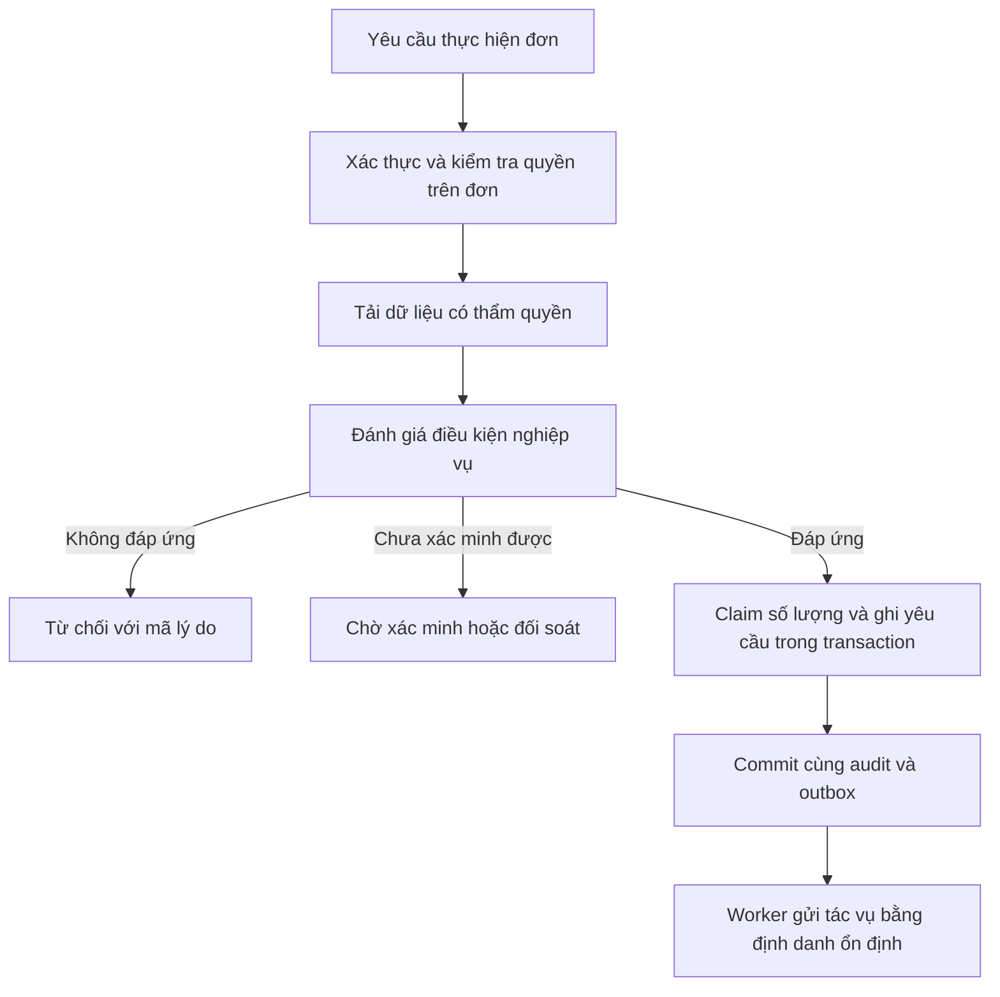

# Điều kiện đủ để thực hiện đơn hàng (Fulfillment eligibility)

## 1. Fulfillment eligibility là quyết định bảo vệ tài sản

**Fulfillment** là quá trình thực hiện nghĩa vụ đã cam kết với khách hàng: xuất kho và giao hàng, cấp giấy phép phần mềm, gửi mã sử dụng hoặc kích hoạt một quyền lợi. **Fulfillment eligibility** trả lời câu hỏi: với dữ liệu và chính sách hiện tại, hệ thống có được phép bắt đầu thực hiện nghĩa vụ cụ thể này hay không?

Đây là một quyết định bảo mật nghiệp vụ. Một API đã xác thực người gọi vẫn có thể làm thất thoát tài sản nếu nó cho phép:

- Xuất hàng khi thanh toán chưa được xác nhận.
- Giao đơn chưa được phê duyệt.
- Xuất nhiều hơn số lượng đã mua hoặc xuất lại phần đã thực hiện.
- Dùng reservation của đơn khác để lấy hàng.
- Thực hiện đơn đã hủy hoặc đang bị chặn.
- Cấp lại mã số, giấy phép hay quyền lợi khi request bị gửi trùng.
- Bỏ qua kiểm tra vì một hệ thống phụ đang chậm hoặc không trả lời.

Trong chương **Fulfillment Rules**, eligibility là cổng kiểm soát trước khi tài sản được chuyển đi. Cổng này phải kết hợp business invariants, state machine, quyền theo đối tượng, transaction và idempotency.

Một nguyên tắc xuyên suốt bài học:

> Kết quả “đủ điều kiện” chỉ hữu ích khi hành động thực hiện được ràng buộc với đúng dữ liệu đã kiểm tra và không thể bị thực hiện vượt quyền, vượt số lượng hoặc lặp lại.

## 2. Tách ba câu hỏi thường bị trộn lẫn

| Câu hỏi | Ví dụ | Cơ chế chính |
| --- | --- | --- |
| Ai được yêu cầu thực hiện? | Nhân viên kho A có được xuất đơn của cửa hàng B không? | Xác thực và quyền theo đối tượng |
| Đơn có đủ điều kiện thực hiện không? | Đã thanh toán, duyệt và giữ hàng đúng quy tắc chưa? | Business invariants và policy |
| Quyền thực hiện đã được giành hoặc dùng chưa? | Request khác có đang xuất cùng số lượng không? | Transaction, claim và chống xử lý trùng |

Có quyền vận hành không đồng nghĩa với việc mọi đơn đều đủ điều kiện. Ngược lại, một đơn đủ điều kiện cũng không cho phép mọi người dùng thực hiện nó.

Ví dụ:

```text
Nhân viên có quyền FULFILLMENT_RELEASE
    nhưng đơn chưa thanh toán
    => từ chối do điều kiện nghiệp vụ.

Đơn đã thanh toán và được duyệt
    nhưng nhân viên thuộc kho khác
    => từ chối do quyền trên đối tượng.

Nhân viên và đơn đều hợp lệ
    nhưng số lượng đã được một request khác claim
    => không được tạo thêm tác vụ thực hiện.
```

Chủ đơn có thể được quyền xem hoặc yêu cầu hủy đơn, nhưng quyền sở hữu đó không tự động cho phép họ xác nhận xuất kho hay cấp giấy phép.

## 3. Xác định phạm vi trước khi viết predicate

### 3.1. Mô hình cơ sở của bài học

Để các điều kiện rõ ràng, trước hết xét một mô hình đơn giản:

- Hàng vật lý, trả trước, một lần thu đủ tiền.
- Có bước phê duyệt trước khi thực hiện.
- Xuất toàn bộ phần hàng còn phải thực hiện trong một lần.
- Đơn, dữ liệu thanh toán đã ghi nhận và reservation trong ví dụ Java nằm trong cùng cơ sở dữ liệu.
- Lệnh gửi kho hoặc đơn vị vận chuyển được phát bất đồng bộ sau commit.
- Trạng thái `FULFILLMENT_REQUESTED` nghĩa là hệ thống đã chấp nhận và ghi nhận yêu cầu thực hiện, chưa phải xác nhận đã giao hàng.

Luồng chính:



Nếu doanh nghiệp hỗ trợ giao từng phần, nhiều lần thu tiền, trả sau hoặc dropshipping, phải mở rộng mô hình tương ứng. Không nên dùng một predicate chung như `paid && inStock` cho mọi hình thức thực hiện.

### 3.2. Eligibility phải gắn với một hành động cụ thể

Câu “đơn đủ điều kiện” còn quá chung. Cần xác định:

```text
Đủ điều kiện để làm gì?
    releasePhysicalItems
    issueLicense
    activateSubscription
    requestCarrierPickup

Cho phạm vi nào?
    orderId
    lineId và quantity
    warehouseId
    fulfillment method

Dựa trên phiên bản nào?
    orderVersion
    policyVersion
    các chứng cứ và claim liên quan
```

Một đơn có thể đủ điều kiện để chuẩn bị hàng nhưng chưa đủ điều kiện bàn giao cho vận chuyển. Việc in nhãn, tạo vận đơn, đóng gói và giao hàng không được xem là một sự kiện duy nhất nếu các bước có điều kiện khác nhau.

## 4. Những dữ liệu nào được phép làm căn cứ?

| Dữ liệu | Nguồn có thẩm quyền | Điều không được tin trực tiếp |
| --- | --- | --- |
| Người gọi, tenant và phạm vi kho | Ngữ cảnh xác thực cùng dữ liệu phân quyền | `actorId`, `tenantId`, `warehouseId` tùy ý trong body |
| Sản phẩm, giá và số lượng đã chốt | Đơn hàng và phiên bản hợp lệ trên máy chủ | Giá hoặc số lượng client tự khai để quyết định xuất |
| Thanh toán | Bản ghi giao dịch đã xác minh với nguồn thanh toán | Redirect thành công hoặc cờ `paid=true` |
| Phê duyệt | Bản ghi phê duyệt gắn với dữ liệu đã duyệt | `approvedBy`, `approvalPassed` do client gửi |
| Hàng được giữ | Reservation của hệ thống sở hữu tồn kho | Một cờ `inStock` trong cache hoặc trên giao diện |
| Phần đã thực hiện | Claim/yêu cầu thực hiện và ledger theo dòng hàng | Số lượng còn lại do client tính |
| Địa chỉ và phương thức giao | Snapshot được máy chủ kiểm tra và chốt | Thay địa chỉ sau khi đã duyệt mà không kiểm tra lại |
| Lệnh chặn | Trạng thái kiểm soát trong nguồn quản lý tương ứng | Tham số `skipChecks` hoặc `force=true` không có chính sách |

Các trường trong request có thể thể hiện **ý định**: đơn nào, số lượng muốn thực hiện, kho mong muốn. Máy chủ vẫn phải kiểm tra và ánh xạ ý định đó sang tài nguyên thuộc đúng phạm vi.

Không phải mọi dữ liệu đọc từ máy chủ đều đủ tin cậy để quyết định cuối cùng. Một read model hoặc cache có thể chậm hơn nguồn sở hữu dữ liệu. Cần xác định nguồn nào chỉ phục vụ hiển thị và nguồn nào được dùng để cấp quyền thực hiện.

## 5. Biểu diễn eligibility bằng invariant và mã lý do

### 5.1. Các nhóm điều kiện

Trong mô hình cơ sở, một yêu cầu chỉ được chấp nhận khi **tất cả** nhóm điều kiện bắt buộc đều đúng:

```text
canRelease =
    actorCanReleaseThisOrder
    AND orderAllowsFulfillment
    AND approvalIsValid
    AND paymentIsSufficient
    AND requestedQuantitiesAreValid
    AND reservationsCanBeConsumed
    AND destinationAndMethodAreValid
    AND noBlockingHold
```

Quyền thực hiện còn phải được claim thành công trong transaction. Predicate trả về `true` không thay thế bước claim.

| Nhóm | Ví dụ điều kiện | Mã lý do minh họa |
| --- | --- | --- |
| Trạng thái | Đơn ở `APPROVED`, chưa hủy, chưa có yêu cầu toàn phần đang hoạt động | `ORDER_NOT_RELEASABLE` |
| Phê duyệt | Phê duyệt áp dụng cho đúng phiên bản dữ liệu nghiệp vụ | `APPROVAL_STALE` |
| Thanh toán | Đã xác nhận thu đủ tiền, đúng tiền tệ, không có nghĩa vụ đảo/hoàn làm mất mức bảo đảm cần thiết | `PAYMENT_NOT_ELIGIBLE` |
| Số lượng | Số lượng dương, không vượt phần còn được thực hiện | `QUANTITY_EXCEEDS_REMAINING` |
| Tồn kho | Reservation đúng đơn, dòng hàng, kho; còn hiệu lực và có thể tiêu thụ | `RESERVATION_NOT_USABLE` |
| Giao nhận | Địa chỉ và phương thức nằm trong chính sách hiện hành áp dụng cho lệnh | `DELIVERY_METHOD_NOT_ALLOWED` |
| Cờ chặn | Không có hold bắt buộc ngăn thực hiện | `FULFILLMENT_ON_HOLD` |

Không dùng phép OR giữa các điều kiện độc lập chỉ vì muốn giảm lỗi vận hành. “Đã duyệt **hoặc** đã thanh toán” thường cho phép giao đơn mới chỉ thỏa một nửa quy trình.

### 5.2. Không có dữ liệu khác với điều kiện không đạt

Nên phân biệt ba kết quả:

- **ALLOW**: đủ căn cứ để tiếp tục sang bước claim trong ranh giới nhất quán đã thiết kế.
- **DENY**: có bằng chứng rằng một điều kiện không đạt.
- **DEFER**: chưa xác minh được điều kiện bắt buộc, cần chờ dữ liệu, thử lại hoặc đối soát.

Ví dụ, nguồn thanh toán không phản hồi không chứng minh đơn đã thanh toán hoặc chưa thanh toán. Với điều kiện thanh toán bắt buộc, kết quả thích hợp có thể là `DEFER`, đồng thời không phát lệnh xuất hàng.

```java
enum EligibilityOutcome {
    ALLOW, DENY, DEFER
}

record EligibilityDecision(
        EligibilityOutcome outcome,
        List<String> reasonCodes,
        long orderVersion,
        String policyVersion) {
}
```

Đây là kiểu dữ liệu minh họa cho quyết định nội bộ. Response cho người dùng cần lọc lý do theo quyền: khách hàng không nhất thiết được xem chi tiết quy tắc chống gian lận hoặc cấu hình kiểm soát nội bộ.

### 5.3. Không dùng tổng điểm để thay thế điều kiện bắt buộc

Một hệ thống có thể có điểm rủi ro, nhưng điểm thấp không được tự xóa điều kiện như “đã thanh toán”, “đúng chủ thể có quyền” hoặc “không xuất vượt số lượng”.

Có thể tổ chức policy thành hai lớp:

```text
Lớp invariant bắt buộc:
    tenant, quyền, trạng thái, số lượng, thanh toán, claim

Lớp quyết định theo chính sách:
    tuyến giao hàng, ngưỡng kiểm tra thủ công, lựa chọn kho
```

Việc phân lớp giúp tránh một cấu hình khuyến khích bán hàng hoặc xử lý ưu tiên vô tình mở đường bỏ qua kiểm soát tài sản.

## 6. Thanh toán và giá trị đơn phải cùng một ngữ cảnh

### 6.1. Không chỉ kiểm tra một cờ paid

Trong ví dụ trả trước, một khoản thu hợp lệ cần được ràng buộc với:

- Đúng đơn và payment attempt do máy chủ tạo.
- Đúng merchant hoặc tài khoản nhận tiền.
- Đúng tiền tệ.
- Giá trị đơn đã chốt trên máy chủ.
- Trạng thái giao dịch mà chính sách công nhận là đủ để thực hiện.
- Các khoản hoàn tiền, nghĩa vụ hoàn tiền đã ghi nhận và cờ chặn liên quan.

Authorization và capture là những mốc khác nhau. Doanh nghiệp có thể chọn mốc phù hợp với phương thức thanh toán và mức rủi ro, nhưng phải nêu rõ trong policy. Trong mô hình cơ sở của bài học, chỉ công nhận khoản đã thu được xác minh.

Nếu đã tạo nghĩa vụ hoàn tiền do hủy hoặc giảm nghĩa vụ thực hiện, không được tiếp tục dùng nguyên số tiền từng thu làm căn cứ cấp thêm hàng. Một bản ghi “đã từng trả đủ” có thể không còn thể hiện khả năng thực hiện hiện tại.

### 6.2. Sửa đơn có thể làm mất điều kiện đã đạt

Ví dụ:

```text
Phiên bản 8:
    tổng tiền cần trả = 800.000 VND
    đã thu = 800.000 VND
    đã duyệt

Khách thêm sản phẩm:
Phiên bản 9:
    tổng tiền cần trả = 1.100.000 VND
    đã thu vẫn là 800.000 VND
```

Kết quả eligibility ở phiên bản 8 không thể cấp quyền thực hiện phiên bản 9. Thay đổi cần bị cấm ở giai đoạn đó hoặc đi qua quy trình sửa đơn, thanh toán bổ sung và phê duyệt lại.

Tiền nên được biểu diễn bằng đơn vị nhỏ nhất theo quy ước tiền tệ hoặc kiểu số thập phân chính xác. Không dùng số thực nhị phân để quyết định “đã trả đủ”. Tổng tiền phải được máy chủ tính từ các thành phần đã xác minh, có quy tắc làm tròn và kiểm tra giới hạn số phù hợp.

Mô hình trả sau hoặc được cấp hạn mức tín dụng cần một điều kiện riêng có thẩm quyền. Không biến trường `paymentMethod=INVOICE` do khách tự truyền thành cách bỏ qua thanh toán.

## 7. Số lượng phải được kiểm soát theo dòng hàng

### 7.1. Không suy số lượng còn lại từ trạng thái tổng

Một đơn có thể gồm nhiều dòng, nhiều kho và nhiều lần giao. Cờ `fulfilled=false` ở cấp đơn không cho biết dòng nào đã bị claim hoặc đã giao.

Với một dòng hàng, định nghĩa:

- `orderedQty`: số lượng đặt mua hợp lệ.
- `cancelledQty`: phần đã hủy trước khi thực hiện.
- `activeClaimQty`: phần đã được một yêu cầu thực hiện giữ quyền, chưa ghi nhận hoàn tất.
- `completedQty`: phần đã hoàn tất theo mốc nghiệp vụ được hệ thống quy định.

Hai đại lượng `activeClaimQty` và `completedQty` phải không đếm trùng cùng đơn vị hàng.

```text
remainingQty =
    orderedQty
    - cancelledQty
    - activeClaimQty
    - completedQty

0 < requestedQty <= remainingQty
```

Khi một claim hoàn tất, số lượng được chuyển từ `activeClaimQty` sang `completedQty`; không cộng vào phần hoàn tất mà quên giảm phần đang giữ.

Ví dụ:

```text
Đặt 5, hủy 1, claim đang chạy 2, đã hoàn tất 1:
    remainingQty = 5 - 1 - 2 - 1 = 1

Request mới đòi xuất 2:
    phải từ chối.
```

Việc claim được tạo trước khi worker gọi kho. Nếu chỉ trừ số lượng sau khi nhận xác nhận giao hàng, khoảng chờ giữa gửi lệnh và xác nhận sẽ cho phép request khác claim lại cùng phần hàng.

### 7.2. Cập nhật số lượng có điều kiện

Một phép claim có thể được bảo vệ như sau:

```sql
UPDATE order_lines
SET active_claim_qty = active_claim_qty + :claim_qty,
    version = version + 1
WHERE id = :line_id
  AND order_id = :order_id
  AND tenant_id = :tenant_id
  AND version = :expected_line_version
  AND :claim_qty > 0
  AND :claim_qty <= (
      ordered_qty
      - cancelled_qty
      - active_claim_qty
      - completed_qty
  );
```

Ứng dụng chỉ chấp nhận claim khi cập nhật đúng một hàng. Nếu một yêu cầu gồm nhiều dòng và mô hình yêu cầu thực hiện toàn bộ, lỗi ở bất kỳ dòng nào phải rollback toàn bộ các claim của yêu cầu.

SQL trên minh họa giới hạn số lượng, không tự kiểm tra thanh toán, phê duyệt, quyền kho hay trạng thái đơn. Nó phải nằm trong giao thức transaction chung.

Cần chuẩn hóa danh sách dòng hàng trước khi kiểm tra:

- Từ chối số lượng bằng không, âm hoặc vượt giới hạn kiểu số.
- Không cho một `lineId` thuộc đơn khác.
- Từ chối hoặc gộp các dòng lặp bằng phép cộng được kiểm tra tràn số.
- Không để cùng một dòng xuất hiện hai lần rồi mỗi lần đều được kiểm tra với cùng `remainingQty` cũ.
- Kiểm tra đơn vị tính; không đồng nhất “hộp” và “cái” nếu chưa có quy tắc quy đổi.

### 7.3. Trả hàng không tự khôi phục quota được giao

Khách trả một sản phẩm không mặc nhiên được xuất thêm một sản phẩm từ đơn cũ. Số lượng đã thực hiện vẫn là sự thật lịch sử.

Nếu có đổi hàng hoặc giao bù, tạo nghĩa vụ thay thế với nguyên nhân, hạn mức và định danh riêng. Nếu đơn giản trừ hàng trả khỏi `completedQty`, kẻ lạm dụng có thể dùng quy trình trả hàng để mở lại quyền nhận hàng nhiều lần.

Tương tự, chỉ giải phóng một claim khi đã xác định tác động bên ngoài chưa xảy ra hoặc đã được hủy an toàn. Timeout của kho không đủ để kết luận claim thất bại.

## 8. Có hàng trong kho chưa đủ: phải có reservation dùng được

### 8.1. Available stock và reservation là hai sự thật khác nhau

`availableStock >= requestedQty` ở một lần đọc chỉ cho biết hàng có vẻ còn tại thời điểm đó. Request khác có thể lấy phần tồn này ngay sau khi kiểm tra.

Reservation cần thể hiện tối thiểu:

```text
reservationId
tenantId
orderId / lineId
sku hoặc biến thể sản phẩm
warehouseId
reservedQuantity
state
expiresAt
version hoặc định danh kiểm soát đồng thời
```

Một reservation hợp lệ phải:

- Thuộc đúng đơn và dòng hàng.
- Đúng sản phẩm, kho và phạm vi tổ chức.
- Có đủ số lượng theo đơn vị tính.
- Chưa hết hạn và chưa bị giải phóng.
- Chưa được gán cho một yêu cầu thực hiện khác.
- Có thể chuyển sang allocation/claim theo giao thức của hệ thống sở hữu tồn kho.

Dùng reservation của đơn A cho đơn B vẫn sai dù hai đơn mua cùng SKU. Nếu cho phép tái phân bổ, phải có lệnh nghiệp vụ được kiểm soát riêng.

### 8.2. Kiểm tra và tiêu thụ reservation phải đi cùng nhau

Trong một cơ sở dữ liệu, transaction có thể khóa reservation rồi chuyển nó từ `HELD` sang `ALLOCATED` cho `fulfillmentRequestId`. Đây là việc dành hàng cho tác vụ, chưa phải bằng chứng hàng đã rời kho.

Tiến trình giải phóng reservation hết hạn phải tuân thủ cùng giao thức:

```text
Luồng release fulfillment:
    nếu reservation HELD và chưa hết hạn:
        chuyển ALLOCATED cho request

Luồng expiry:
    nếu reservation HELD và đã hết hạn:
        chuyển RELEASED
```

Chỉ một luồng được thay đổi cùng reservation theo các điều kiện đó. Không để expiry job đưa reservation đã `ALLOCATED` về tồn khả dụng chỉ vì timestamp giữ hàng ban đầu đã qua.

Cần định nghĩa thời điểm kiểm tra hạn rõ ràng. Không dùng timestamp do client cung cấp; cũng không giữ kết quả kiểm tra từ trước một thời gian chờ dài rồi mới tiêu thụ. Với cơ sở dữ liệu có nhiều hàm thời gian khác nhau, chọn ngữ nghĩa phù hợp cho thời điểm quyết định.

Sau khi allocation commit, hiệu lực giữ hàng chuyển sang quy trình fulfillment. Hết hạn của reservation ban đầu không tự hủy một tác vụ đã được chấp nhận.

### 8.3. Nếu tồn kho thuộc một dịch vụ khác

Khóa hàng `orders` không khóa được reservation ở dịch vụ tồn kho.

Một cách phối hợp là yêu cầu dịch vụ tồn kho **xác nhận hoặc gán reservation cho cùng một định danh tác vụ ổn định**. Hợp đồng phải quy định:

- Ai sở hữu quyền cấp và giải phóng hàng.
- Một mã tác vụ được gọi lại sẽ trả kết quả gì.
- Reservation còn có thể hết hạn hay không sau khi đã được xác nhận.
- Nếu bước sau thất bại, cách đối soát và bù trừ nào được dùng.
- Khi không biết tác vụ đã thành công chưa, ai chịu trách nhiệm truy vấn kết quả.

Không được coi phản hồi `available=true` từ một lần gọi mạng là một reservation đã được bảo đảm. Một transaction cục bộ cũng không thể rollback một allocation đã commit ở dịch vụ khác.

## 9. Kết quả preview không phải giấy phép thực hiện

### 9.1. Khoảng trống giữa check và use

Giao diện có thể gọi:

```http
GET /orders/{orderId}/fulfillment-eligibility
```

và nhận:

```json
{
  "outcome": "ALLOW",
  "orderVersion": 18,
  "policyVersion": "fulfillment-policy-7"
}
```

Ngay sau response, đơn có thể bị hủy, bị thêm hold, đổi địa chỉ hoặc có request khác claim số lượng. Vì vậy response trên là **kết quả kiểm tra phục vụ hiển thị**, không phải quyền xuất hàng vô thời hạn.

Lệnh thực hiện vẫn phải đọc và kiểm tra lại trong ranh giới đồng bộ:

```http
POST /orders/{orderId}/fulfillment-requests
Idempotency-Key: d536a2c1-...

{
  "expectedOrderVersion": 18
}
```

Với mô hình xuất toàn bộ, máy chủ tự lập kế hoạch từ các dòng hàng hợp lệ. Nếu API hỗ trợ lựa chọn số lượng hoặc kho, các lựa chọn này phải được kiểm tra lại theo quyền và phần còn được thực hiện.

### 9.2. Version phải bao phủ dữ liệu ảnh hưởng quyết định

Chỉ tăng `order.version` khi đổi tên trạng thái là chưa đủ. Những thay đổi có thể làm mất eligibility phải được kiểm soát bằng phiên bản hoặc cơ chế khóa tương ứng:

- Sửa giá trị đơn, mặt hàng hoặc số lượng.
- Hủy một phần nghĩa vụ.
- Thay địa chỉ hoặc phương thức giao.
- Thêm hold.
- Thay đổi tính hợp lệ của phê duyệt.
- Tạo claim mới hoặc ghi nhận thay đổi thanh toán có liên quan.

Nếu dùng phiên bản gốc của đơn làm điểm phối hợp, mọi đường ghi liên quan phải tham gia giao thức đó. Nếu dùng phiên bản riêng cho payment, reservation và approval, bước claim phải bảo vệ các phiên bản đó hoặc dùng giao thức của nguồn sở hữu.

Một token có chữ ký chứa `eligible=true` chỉ chứng minh token do bên phát hành tạo và chưa bị sửa. Nó không chứng minh dữ liệu nền chưa đổi, chưa bị thu hồi hoặc quyền trong token chưa được dùng. Nếu thiết kế permit dùng một lần, phải ràng buộc phạm vi, hạn dùng, phiên bản và tiêu thụ permit nguyên tử.

## 10. Minh họa ranh giới transaction trong Java

Đoạn code sau là khung nghiệp vụ minh họa, không phải ứng dụng có thể chạy độc lập. Nó dùng mô hình một cơ sở dữ liệu, xuất toàn bộ và giả định các repository có hợp đồng khóa/cập nhật đúng.

```java
@Transactional
public ReleaseResult requestFulfillment(
        Actor actor,
        ReleaseCommand command) {

    Order order = orders.findForUpdate(
                    actor.tenantId(), command.orderId())
            .orElseThrow(OrderNotFoundException::new);

    access.requireCanRelease(actor, order);

    if (order.version() != command.expectedOrderVersion()) {
        throw new OrderConflictException("ORDER_VERSION_CONFLICT");
    }

    // Khóa theo thứ tự thống nhất trên mọi đường ghi liên quan.
    List<OrderLine> lines = orderLines.lockByOrder(order.id());
    PaymentSnapshot payment = payments.lockForOrder(order.id());
    List<Reservation> heldStock =
            reservations.lockForOrder(order.id());

    FulfillmentPolicy policy = policies.resolveForRelease(order);
    Instant now = trustedClock.instant();

    EligibilityContext context = new EligibilityContext(
            actor, order, lines, payment, heldStock, policy, now);

    EligibilityDecision decision = eligibility.evaluate(context);
    if (decision.outcome() != EligibilityOutcome.ALLOW) {
        throw new FulfillmentNotEligibleException(decision);
    }

    // Kế hoạch do máy chủ xây dựng từ dữ liệu đã kiểm tra.
    ReleasePlan plan = planner.fullRemainingOrder(context);
    UUID requestId = requestIds.newId();

    fulfillmentRequests.insertPending(
            requestId, order.id(), plan, policy.version());

    // Mỗi claim phải kiểm tra số hàng cập nhật;
    // bất kỳ thất bại nào đều làm rollback toàn transaction.
    orderLines.claimAllOrThrow(requestId, plan);
    reservations.allocateAllOrThrow(requestId, plan, now);

    orders.markFulfillmentRequestedOrThrow(
            order.id(), order.version());

    audit.appendReleaseAccepted(
            requestId, order.id(), actor.id(),
            order.version() + 1, policy.version(), now);

    outbox.appendFulfillmentRequested(
            requestId, order.id(), plan, now);

    return new ReleaseResult(
            requestId, order.id(), "RELEASE_PENDING",
            order.version() + 1);
}
```

Những điều kiện bắt buộc của cách triển khai này:

1. `markFulfillmentRequestedOrThrow` chỉ chuyển từ trạng thái cho phép, kiểm tra version và tăng version.
2. `claimAllOrThrow` kiểm tra giới hạn số lượng bằng dữ liệu đang được bảo vệ, không chỉ tin một kế hoạch đã tạo trước đó.
3. `allocateAllOrThrow` kiểm tra đúng reservation, số lượng, trạng thái, thời hạn và định danh tác vụ.
4. Tất cả thay đổi đơn, claim, reservation, request, audit và outbox cùng commit hoặc cùng rollback.
5. Các ngoại lệ vi phạm điều kiện được cấu hình rollback.
6. Các luồng hủy, sửa đơn, thanh toán, hold và reservation phải phối hợp với cùng giao thức đồng bộ tương ứng.
7. Việc thay đổi policy đang áp dụng có quy tắc phiên bản rõ ràng; một cờ chặn mới không được bỏ qua chỉ vì bản preview dùng policy cũ.
8. Lớp idempotency của API được triển khai cùng ranh giới ghi kết quả phù hợp; đoạn code chưa thể hiện lớp đó.
9. Không có cuộc gọi xuất kho hoặc vận chuyển từ xa trong transaction này.

Khóa bản ghi không thay thế các ràng buộc đối với hàng chưa tồn tại. Ví dụ, nếu một luồng có thể chèn hold mới mà không khóa đơn hoặc tham gia giao thức chung, việc transaction fulfillment đang khóa các hàng hold hiện có chưa chắc ngăn được thao tác chèn đó.

Trong môi trường nhiều dịch vụ, không sao chép đoạn code rồi gọi repository qua HTTP trong transaction. Phải thay phần dữ liệu từ xa bằng giao thức claim/reservation có thẩm quyền, định danh ổn định và quy trình đối soát phù hợp.

## 11. Cạnh tranh giữa thực hiện, hủy và hết hạn

Giả sử đơn đang `APPROVED`, chưa có claim và reservation còn `HELD`.

| Bên thắng | Kết quả hợp lệ |
| --- | --- |
| Fulfillment claim thắng | Đơn chuyển sang trạng thái đã nhận yêu cầu; reservation thành allocation; hủy thông thường phải bị chặn |
| Hủy thắng | Phần bị hủy không được claim; không có outbox thực hiện cho phần đó |
| Expiry thắng | Reservation không còn dùng được; fulfillment phải bị từ chối hoặc chờ giữ hàng lại |
| Thêm hold thắng | Lệnh thực hiện phải thấy hold hoặc phát hiện phiên bản đã đổi trước khi commit |

“Thắng” ở đây nói về một quyết định đã commit theo giao thức chung. Nếu transaction thắng khóa nhưng sau đó rollback, transaction khác có thể tiếp tục theo quy tắc cơ sở dữ liệu.

Điểm quan trọng là ghi nhận **ý định thực hiện đã được chấp nhận** trước khi gửi lệnh ra ngoài. Nếu cứ giữ đơn ở trạng thái có thể hủy cho đến khi kho báo giao xong, khách có thể hủy trong khi hàng đã được xuất.

Sau khi yêu cầu thực hiện được chấp nhận, muốn hủy cần một quy trình xác nhận dừng tác vụ ở kho/vận chuyển. Không tự giải phóng claim chỉ bằng việc đổi lại trạng thái đơn.

## 12. Idempotency phải bảo vệ cả API và bên thực hiện

### 12.1. Retry cùng một yêu cầu

Client có thể gửi lại request vì timeout. Cùng một idempotency key và cùng nội dung phải dẫn về cùng kết quả nghiệp vụ đã được chấp nhận.

Phạm vi key có thể được xác định bằng:

```text
tenant + caller/client scope + operation + idempotency key
```

Fingerprint của nội dung cần bao gồm đúng đối tượng và ý định:

```text
orderId
expectedOrderVersion
danh sách line/quantity chuẩn hóa nếu hỗ trợ giao một phần
warehouse hoặc fulfillment method được yêu cầu nếu có
```

Các quy tắc cần có:

- Unique constraint ngăn hai request đồng thời cùng chiếm một key.
- Cùng key nhưng khác order hoặc payload phải bị từ chối.
- Quyền truy cập được kiểm tra trước khi trả kết quả đã lưu.
- `fulfillmentRequestId`, kết quả API thành công và thay đổi cục bộ được ghi nhận nhất quán.
- Request bị retry sau commit phải trả lại request đã tạo; không sinh thêm một request nghiệp vụ mới.
- Nếu dùng key mới, giới hạn số lượng và state machine vẫn ngăn thực hiện trùng.

Trong ví dụ Java, `requestIds.newId()` chỉ được dùng cho một lệnh mới đã được lớp idempotency xác định. Nó không phải định danh được tạo lại tùy ý cho mỗi lần client retry.

Khi bản ghi idempotency hết hạn, state machine, claim và ledger vẫn phải ngăn thực hiện vượt nghĩa vụ. Thời hạn lưu key không được trở thành thời hạn của toàn bộ cơ chế chống giao trùng.

### 12.2. Outbox không tự làm tác động bên ngoài chỉ xảy ra một lần

Worker có thể gửi lệnh đến kho thành công rồi chết trước khi đánh dấu outbox đã gửi. Lần chạy sau nó sẽ gửi lại.

Do đó:

```text
API retry:
    dùng idempotency key của client.

Outbox retry:
    dùng cùng fulfillmentRequestId/commandId đã commit.

Bên kho hoặc bên cấp quyền lợi:
    nhận lại cùng định danh thì trả kết quả cũ
    hoặc xử lý theo cơ chế chống trùng tương đương.
```

Không dùng idempotency key mới cho mỗi lần gửi từ worker. Nếu bên ngoài không hỗ trợ deduplication, cần tra cứu theo mã tham chiếu, đối soát và quy trình giải quyết tác vụ không rõ kết quả.

Không được cam kết “không bao giờ giao trùng” chỉ dựa vào trạng thái `SENT` trong outbox. Tính chất đó phụ thuộc cả giao thức của nơi thực sự xuất hàng hoặc cấp quyền lợi.

### 12.3. Timeout là trạng thái chưa rõ kết quả

Khi không nhận được response từ kho:

- Không tự kết luận tác vụ chưa chạy.
- Không trả claim về số lượng khả dụng để request khác lấy.
- Không tạo tác vụ mới có định danh khác chỉ vì muốn thử lại.
- Giữ liên kết đến tác vụ gốc và truy vấn/đối soát.

Nếu kho xác nhận chắc chắn chưa thực hiện và đã hủy tác vụ, hệ thống mới được giải phóng claim theo cạnh chuyển trạng thái được cho phép. Nếu hàng đã xuất, phải đi theo quy trình thu hồi, hoàn trả hoặc xử lý ngoại lệ tương ứng.

## 13. Quy tắc thay đổi sau khi eligibility đã đạt

### 13.1. Phê duyệt phải gắn với dữ liệu được duyệt

Không chỉ lưu `approved=true`. Có thể cần lưu:

```text
approvalId
approvedBusinessRevision
approvedBy
approvedAt
policyVersion
scope của phê duyệt
```

Phân biệt phiên bản kỹ thuật và phiên bản nội dung nghiệp vụ. Một lần ghi log không nhất thiết làm mất phê duyệt; thay sản phẩm hoặc giá trị đơn thì có thể. Điều kiện vô hiệu hóa phải được định nghĩa rõ, không dựa trên cảm tính ở từng endpoint.

Nếu dữ liệu thuộc phạm vi phê duyệt đổi, cần chặn sửa hoặc vô hiệu hóa phê duyệt và yêu cầu duyệt lại. Không chỉ cập nhật `order.version` rồi vẫn coi phê duyệt cũ hợp lệ.

### 13.2. Phiên bản policy phục vụ tái hiện quyết định

Nên biết quyết định đã dùng bộ quy tắc nào, nhưng không nên hiểu rằng policy cũ luôn được quyền tiếp tục.

Cần phân biệt:

- Điều khoản được chốt theo đơn và được phép bảo lưu theo chính sách.
- Điều kiện bắt buộc phải kiểm tra ở thời điểm thực hiện.
- Lệnh chặn mới cần có hiệu lực với tác vụ chưa được chấp nhận.
- Tác vụ đã chấp nhận nhưng cần dừng theo một quy trình thu hồi riêng.

Ví dụ, một thay đổi cấm xuất từ kho đang bị khóa phải được xử lý theo nguồn kiểm soát có thẩm quyền. Token eligibility được cấp từ hôm trước không đủ để bỏ qua thay đổi đó.

### 13.3. Hold sau commit cần quy trình dừng tác vụ

Có một ranh giới thực tế giữa:

```text
Chưa chấp nhận fulfillment:
    hold tham gia quyết định eligibility và chặn claim.

Đã chấp nhận fulfillment:
    cần lệnh pause/cancel tác vụ và xác nhận từ nơi thực hiện.
```

Sau khi outbox đã được tạo, cập nhật một cờ `hold=true` không tự thu hồi lệnh đang được kho xử lý. Hệ thống phải quản lý vòng đời của yêu cầu thực hiện, phối hợp việc phát lệnh và nhận xác nhận dừng.

Nếu nghiệp vụ yêu cầu kiểm tra thêm ngay trước bàn giao, hãy đặt một cổng kiểm soát tại bước đó với giao thức phù hợp. Một lần đọc cờ mới nhất trước cuộc gọi mạng vẫn có khoảng trống đồng thời; yêu cầu dừng chắc chắn phải dựa vào sự phối hợp của bên có quyền thực hiện.

## 14. Mở rộng sang giao một phần và quyền lợi số

### 14.1. Giao từng phần

Khi cho phép giao từng phần, eligibility chuyển từ cấp đơn sang một **kế hoạch gồm các dòng và số lượng**.

Cần bổ sung:

- Quota theo từng dòng, không chỉ một trạng thái tổng.
- Quy tắc phân bổ thanh toán hoặc bảo đảm thanh toán cho phần được giao.
- Reservation theo kho và từng phần số lượng.
- Quy tắc hủy phần chưa thực hiện.
- Theo dõi nhiều tác vụ có định danh riêng.
- Cách tổng hợp trạng thái từ ledger thực hiện.

Điều kiện tổng tiền đã thu đủ cho một phần phải do máy chủ tính theo chính sách phân bổ. Không để client gắn toàn bộ khoản đã thu cho từng shipment riêng để cùng một số tiền “bảo đảm” nhiều phần hàng ngoài phạm vi được phép.

Nếu API cho phép “chấp nhận các dòng đủ điều kiện”, response phải chỉ rõ dòng nào được claim và dòng nào bị từ chối. Không âm thầm chuyển từ hợp đồng “toàn bộ hoặc không có gì” sang giao một phần khi một dòng hết hàng.

### 14.2. Giấy phép và mã sử dụng

Với sản phẩm số, tài sản cần bảo vệ có thể là entitlement hoặc mã sử dụng:

```text
Đã thanh toán
+ đúng sản phẩm và người nhận
+ còn quota được cấp
+ chưa bị thu hồi hoặc chặn
+ claim/cấp quyền nguyên tử
```

Một ràng buộc duy nhất như `(order_line_id, entitlement_slot)` có thể giúp ngăn cấp hai tài sản cho cùng một suất quyền lợi, tùy mô hình.

Phân biệt **cấp tài sản** và **gửi thông báo**. Gửi lại email chứa cùng giấy phép không nhất thiết là cấp giấy phép mới. Retry thông báo nên tham chiếu tài sản đã được cấp, thay vì sinh mã mới mỗi lần gửi.

Nếu mã do dịch vụ khác phát hành, dùng định danh cấp phát ổn định và đối soát khi timeout, tương tự yêu cầu xuất hàng.

### 14.3. Giao bù hoặc thay thế

Giao bù cần quyền và nghĩa vụ riêng:

```text
replacementRequestId
originalFulfillmentId
reason
approvedQuantity
approvedBy
claim/completion history
```

Không mở lại toàn bộ số lượng của đơn cũ chỉ vì một nhân viên đánh dấu “khách phản ánh thiếu hàng”. Quy trình thay thế cần giới hạn rõ phạm vi và ghi nhận phần đã được cấp bù.

## 15. Audit và vận hành phải nhìn thấy quyết định

### 15.1. Dữ liệu giải thích vì sao đã cho thực hiện

Một bản ghi chấp nhận fulfillment nên có:

```text
fulfillmentRequestId, commandId
tenantId, orderId
actorId, actorType
orderVersion / businessRevision
lineId và quantity đã claim
warehouse hoặc fulfillment method
reservation/allocation references
payment evidence references
approval reference
policyVersion
acceptedAt
correlationId
```

Dùng tham chiếu đến bằng chứng thay vì sao chép token, thông tin thanh toán nhạy cảm hoặc payload đầy đủ vào log.

Audit thành công cần được ghi cùng transaction với việc chấp nhận thực hiện. Nhật ký cho các lần thử bị từ chối phải dùng cơ chế phù hợp để không bị mất do rollback của transaction nghiệp vụ.

Định danh tác vụ trong audit, outbox và hệ thống kho phải liên kết được với nhau. Khi có phản ánh giao trùng, cần lần từ một đơn đến từng claim và tác động bên ngoài.

### 15.2. Những tín hiệu cần theo dõi

- Nhiều lần xin thực hiện đơn chưa trả tiền hoặc chưa duyệt.
- Cùng người gọi thử nhiều đơn ngoài phạm vi.
- Claim bị từ chối do số lượng vượt phần còn lại.
- Tỷ lệ `DEFER` tăng vì dữ liệu nguồn không sẵn sàng.
- Reservation hết hạn trong khi có tác vụ không rõ kết quả.
- Request ở `RELEASE_PENDING` quá thời gian dự kiến.
- Nhiều lần gửi lại cùng tác vụ nhưng bên ngoài trả các định danh kết quả khác nhau.
- Audit, claim và trạng thái tổng không khớp nhau.

Khi xử lý sự cố, không dùng “force eligible” để bỏ qua toàn bộ điều kiện. Nếu có ngoại lệ được doanh nghiệp cho phép, nó phải là lệnh có phạm vi, điều kiện, quyền, lý do và audit cụ thể. Các invariant như đúng tenant và không cấp vượt nghĩa vụ vẫn phải được bảo vệ.

## 16. Ma trận kiểm thử tình huống lạm dụng

Kiểm thử phải đọc dữ liệu sau commit và quan sát tác vụ phụ. Một API trả lỗi nhưng vẫn để lại claim hoặc lệnh xuất hàng chưa được rollback vẫn là lỗi nghiêm trọng.

| Tình huống | Cách thử | Kết quả bắt buộc |
| --- | --- | --- |
| Bỏ qua thanh toán | Gọi fulfillment khi không có giao dịch hợp lệ | Không claim, không allocation, không outbox thực hiện |
| Giả mạo paid | Gửi `paid=true` hoặc tự gọi trang thanh toán thành công | Không được công nhận đã thanh toán |
| Sai số tiền/tiền tệ | Giao dịch không khớp đơn đã chốt | Không cho thực hiện theo policy trả trước |
| Nghĩa vụ hoàn tiền đang tồn tại | Dùng khoản thu đã được dành hoàn để xin giao | Không tính số tiền đó như bảo đảm chưa bị ràng buộc |
| Bỏ qua phê duyệt | Đơn đã thu tiền nhưng chưa duyệt | Bị từ chối |
| Phê duyệt cũ | Sửa nội dung thuộc phạm vi duyệt rồi thực hiện | Bị chặn hoặc phải duyệt lại |
| Sai tenant | Người tenant A gửi orderId của tenant B | Không truy cập hoặc thay đổi tài sản |
| Sai kho | Nhân viên không thuộc phạm vi kho được chọn | Bị từ chối theo quyền đối tượng |
| Đơn đã hủy | Replay request trước khi hủy | Không phát sinh tác vụ thực hiện mới |
| Reservation giả phạm vi | Dùng reservation của đơn, SKU hoặc kho khác | Không allocation |
| Reservation hết hạn | Thực hiện sau thời hạn giữ hàng | Không dùng reservation cũ |
| Preview cũ | Preview ALLOW, thêm hold rồi gửi lệnh | Lệnh cuối bị chặn hoặc phát hiện version đã đổi |
| Số lượng bất hợp lệ | Gửi 0, số âm, quá lớn hoặc sai đơn vị | Bị từ chối trước khi ghi tác động |
| Dòng lặp | Gửi cùng lineId nhiều lần để vượt quota | Chuẩn hóa/từ chối; tổng claim không vượt phần còn lại |
| Claim đồng thời | Hai request khác key cùng lấy phần còn lại | Không có tổng claim vượt nghĩa vụ |
| Một dòng thất bại | Yêu cầu toàn bộ gồm nhiều dòng, một dòng thiếu reservation | Rollback toàn bộ các claim trong yêu cầu |
| Retry cùng key | Gửi lại sau timeout với payload giống nhau | Cùng requestId; không thêm claim |
| Key đổi payload | Cùng key nhưng đổi đơn, kho hoặc số lượng | Bị từ chối do fingerprint khác |
| Đổi key để nhận thêm | Gửi lệnh mới khi phần hàng đã được claim | Không cấp trùng phần đã giữ |
| Worker gửi lại | Gửi thành công rồi chết trước khi đánh dấu outbox | Retry cùng tác vụ; không tạo yêu cầu nghiệp vụ mới |
| Kho timeout | Không rõ kho đã thực hiện chưa | Không tự giải phóng claim; chờ đối soát |
| Hủy/expiry cạnh tranh | Cho hủy, expiry và release tranh cùng tài nguyên | Chỉ có kết quả nhất quán theo giao thức |
| Trả hàng rồi xin lại | Ghi nhận hàng trả và gọi release trên đơn cũ | Không tự khôi phục quota giao ban đầu |
| Gửi lại email mã số | Retry thông báo sau khi đã cấp giấy phép | Tham chiếu giấy phép cũ, không cấp tài sản mới |

### 16.1. Kiểm thử transaction và điểm lỗi

Chủ động tạo lỗi sau từng bước ghi quan trọng:

```text
sau khi tạo fulfillment request
sau khi claim dòng thứ nhất
sau khi allocation reservation
trước khi ghi outbox
trước commit
sau commit nhưng trước response cho client
```

Kỳ vọng:

- Lỗi trước commit không để lại một phần của tác vụ đã được chấp nhận.
- Lỗi sau commit không khiến retry tạo tác vụ thứ hai.
- Không có lệnh ra ngoài từ transaction đã rollback.
- Audit thành công tương ứng với trạng thái thực sự đã commit.

Đây là các tình huống cần kiểm thử trong hệ thống triển khai; bài học không giả định rằng chỉ nhìn vào annotation `@Transactional` là đã chứng minh được chúng.

### 16.2. Kiểm thử cạnh tranh có điều phối

Dùng hai transaction thực sự với cơ chế đồng bộ để tạo các cuộc đua:

```text
release vs release
release vs cancel
release vs reservation expiry
release vs add hold
release vs sửa dữ liệu làm mất phê duyệt
```

Đọc lại dữ liệu sau khi cả hai kết thúc. Với mỗi dòng, kiểm tra invariant:

```text
cancelledQty >= 0
activeClaimQty >= 0
completedQty >= 0

cancelledQty + activeClaimQty + completedQty <= orderedQty
```

Đồng thời kiểm tra request, allocation, audit và outbox có khớp với bên được chấp nhận hay không.

Nên chạy các bài kiểm thử này trên hệ quản trị mục tiêu hoặc môi trường có hành vi đồng thời tương ứng. Mock repository không chứng minh được hiệu quả của khóa, unique constraint hoặc cập nhật có điều kiện.

### 16.3. Kiểm thử chuỗi hành động

Một vài chuỗi cần quan sát:

```text
preview ALLOW -> thêm hold -> release
release -> timeout -> retry cùng key
release -> kho timeout -> retry cùng requestId -> đối soát
claim một phần -> hủy phần còn lại -> request vượt quota
approve -> sửa đơn -> release
cấp license -> gửi email lỗi -> gửi lại email
```

Mục tiêu là chứng minh một điều kiện từng đúng không trở thành quyền vĩnh viễn, và một lần tác động không được biến thành nhiều lần chỉ vì các hệ thống truyền tin lại.

## 17. Câu hỏi tự đánh giá thiết kế

1. Eligibility đang cho phép hành động nào, với dòng hàng và số lượng nào?
2. Dữ liệu nào chỉ phục vụ hiển thị, dữ liệu nào thực sự có thẩm quyền cấp quyền thực hiện?
3. Quyền tenant, cửa hàng và kho được kiểm tra trên đúng đối tượng ở đâu?
4. Điều kiện nào bắt buộc, điều kiện nào có thể hoãn xác minh?
5. Có khoảng trống nào giữa kiểm tra và claim mà hủy, hold hoặc expiry chen vào được không?
6. Claim, reservation, request, audit và outbox có cùng kết quả commit không?
7. Request mới với key khác có lấy lại phần nghĩa vụ đã được claim không?
8. Khi kho đã làm nhưng response bị mất, định danh nào giúp tìm lại kết quả?
9. Thay đổi sau phê duyệt có khiến bằng chứng cũ hết hiệu lực không?
10. Trả hàng, giao bù và gửi lại thông báo có bị trộn với quyền thực hiện ban đầu không?

Thiết kế đủ chặt cần chỉ ra được điểm mà quyền thực hiện được chấp nhận, tài nguyên nào được giữ tại điểm đó và cách theo dõi tác động đến khi hoàn tất. Cổng eligibility bảo vệ tài sản khi quyết định của nó gắn với dữ liệu có thẩm quyền, claim nguyên tử và một vòng đời thực hiện có thể truy vết.
