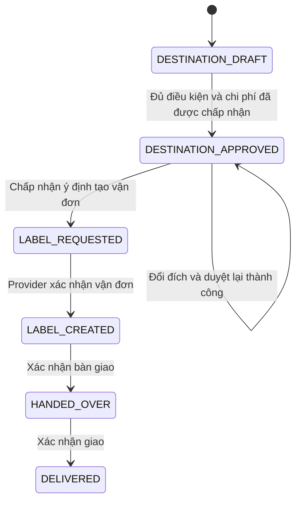

# Quy tắc về địa chỉ và đích giao hàng (Shipping destination rules)

Trong chương **Fulfillment Rules**, đích giao hàng là một đầu vào quyết định đơn có được thực hiện hay không, kho nào được xuất hàng, dịch vụ vận chuyển nào được sử dụng và khách hàng phải trả bao nhiêu. Nếu backend chỉ kiểm tra địa chỉ có đủ trường, người dùng vẫn có thể mua hàng với một địa chỉ được phép rồi đổi sang vùng không phục vụ, dùng báo giá rẻ cho đích giao khác hoặc sửa địa chỉ sau khi đơn đã được duyệt.

Bảo mật nghiệp vụ ở đây là giữ cho **địa chỉ được chấp nhận, chính sách được áp dụng, giá vận chuyển được duyệt và lệnh giao hàng thực tế cùng nói về một đích giao hợp lệ**. Bài học sử dụng hệ thống thương mại điện tử giả định để giải thích business invariants, state machine, quyền theo đối tượng, transaction, idempotency và kiểm thử tấn công logic. Các vùng, hạn chế sản phẩm và điều kiện vận chuyển trong ví dụ là chính sách minh họa, không phải quy định pháp luật hoặc cam kết của một hãng vận chuyển cụ thể.

## 1. Mục tiêu học tập

Sau bài học, bạn có thể:

- Phân biệt địa chỉ đúng định dạng, địa chỉ đã chuẩn hóa, địa chỉ có thể xác minh và đích giao được chính sách cho phép.
- Thiết kế quy tắc kết hợp quốc gia, vùng phục vụ, loại địa chỉ, sản phẩm, kho, dịch vụ và phương thức thanh toán.
- Ràng buộc báo giá, phê duyệt và fulfillment với đúng snapshot địa chỉ và phiên bản ngữ cảnh nghiệp vụ.
- Kiểm soát việc thay đổi địa chỉ để không vượt quyền, bỏ qua bước duyệt hoặc tạo lệnh giao tới đích đã lỗi thời.
- Kiểm thử các chuỗi lạm dụng như đổi địa chỉ sau thanh toán, tái sử dụng quote, tranh chấp với tạo vận đơn và phát lại sự kiện cũ.

## 2. Đích giao hàng là dữ liệu nghiệp vụ có nhiều lớp

Một yêu cầu giao hàng có thể chứa:

```json
{
  "countryCode": "VN",
  "administrativeArea": "Khu vực mẫu A",
  "locality": "Địa phương mẫu 1",
  "postalCode": "",
  "addressLine1": "Số 18, đường Ví Dụ",
  "addressLine2": "Tòa B, căn 302",
  "recipientName": "Người nhận mẫu",
  "recipientPhone": "<số liên hệ>",
  "destinationType": "STREET_ADDRESS"
}
```

Đây chỉ là dữ liệu người dùng khai. Không được suy ra ngay rằng địa chỉ tồn tại, thuộc vùng được giao hoặc được dùng cho đơn hiện tại.

| Lớp kiểm tra | Câu hỏi cần trả lời | Ví dụ |
|---|---|---|
| Schema validation | Dữ liệu có cấu trúc được hỗ trợ không? | Độ dài hợp lệ, kiểu trường đúng, không có trường đặc quyền |
| Normalization | Các biểu diễn tương đương có được xử lý nhất quán không? | Khoảng trắng, biểu diễn mã vùng, cấu trúc địa chỉ theo quốc gia |
| Verification | Có đủ bằng chứng để định vị hoặc xác nhận khả năng giao không? | Địa chỉ khớp một kết quả đủ tin cậy, điểm nhận hàng còn hoạt động |
| Policy evaluation | Đích này có được phép cho chính đơn và dịch vụ này không? | Sản phẩm yêu cầu giao tận nơi; dịch vụ đã chọn không hỗ trợ vùng đó |
| Authorization | Người gọi có được dùng hoặc sửa dữ liệu này trên đơn không? | Địa chỉ lưu sẵn thuộc đúng tài khoản hoặc được chia sẻ hợp lệ |
| Fulfillment binding | Lệnh giao có dùng đúng dữ liệu đã được chấp nhận không? | Snapshot, phiên bản và dịch vụ cùng khớp với approval |

Địa chỉ hợp lệ về cú pháp không chứng minh rằng nó có thể nhận hàng. Địa chỉ có thể giao cũng chưa chứng minh rằng người gọi có quyền đổi đơn sang địa chỉ đó.

### 2.1. Không dùng một chuỗi địa chỉ làm toàn bộ mô hình

Chuỗi `"Số 18, đường Ví Dụ, Khu vực A"` hữu ích cho hiển thị nhưng khó dùng làm cơ sở chính sách. Tách các thành phần cần thiết và giữ ngữ nghĩa theo quốc gia hoặc loại đích mà sản phẩm hỗ trợ.

Một mô hình server có thể gồm:

```text
DestinationSnapshot
  snapshotId
  tenantId
  destinationType
  countryCode
  normalizedAddressComponents
  recipientContact
  pickupPointId, nếu có
  resolvedServiceZoneId
  verificationStatus
  verificationSourceVersion
  verifiedAt, evidenceExpiresAt
```

`resolvedServiceZoneId` là kết quả suy ra bằng dữ liệu được server tin cậy. Không lấy `shippingZoneId` do client tự chọn rồi coi đó là sự thật.

### 2.2. Địa chỉ đường phố và điểm nhận hàng là hai loại đích khác nhau

Nếu giao tại điểm nhận hàng, client nên gửi một `pickupPointId` và server tra danh mục được quản lý. Không cho client vừa gửi ID điểm nhận vừa tùy ý sửa tọa độ hoặc địa chỉ của điểm đó.

Điểm nhận có thể ngừng hoạt động, không hỗ trợ loại hàng hoặc không còn thuộc dịch vụ đã chọn. Việc ID từng hợp lệ không bảo đảm nó vẫn sử dụng được lúc tạo vận đơn. Cần lưu snapshot đã chấp nhận và kiểm tra điều kiện vận hành theo chính sách tại điểm thực thi.

## 3. Xây dựng chính sách đích giao từ điều kiện rõ ràng

### 3.1. Chính sách cơ sở của ví dụ

Giả sử cửa hàng có hai vùng phục vụ nội bộ `ZONE_A` và `ZONE_B`, hai dịch vụ `STANDARD` và `SPECIAL_HANDLING`:

- Sản phẩm thông thường có thể giao tới cả hai vùng bằng dịch vụ phù hợp.
- Sản phẩm cần xử lý đặc biệt chỉ được giao tới địa chỉ đường phố trong `ZONE_A`, bằng `SPECIAL_HANDLING` từ một kho đủ điều kiện.
- Thu tiền khi giao hàng chỉ được hỗ trợ với một số tổ hợp vùng, dịch vụ và giá trị đơn do cửa hàng cấu hình.
- Địa chỉ chưa thể xác minh chắc chắn chuyển sang chờ kiểm tra; không được coi là đã duyệt để tạo vận đơn.
- Được đổi địa chỉ trước khi một ý định tạo vận đơn được chấp nhận, nhưng đích mới phải được xét chính sách và phê duyệt chi phí lại.
- Sau mốc đó, phải dùng quy trình đổi tuyến hoặc thu hồi vận đơn riêng. API sửa địa chỉ thông thường không được thay đổi đích đang thực hiện.

Những quy tắc này cần nằm ở backend. Các lựa chọn bị ẩn trên giao diện vẫn có thể được gửi bằng HTTP request trực tiếp.

### 3.2. Điều kiện được phép là phép kết hợp

Với một nhóm fulfillment, có thể biểu diễn:

```text
allowed = actorMayUseDestination
       AND destinationIsResolvedEnough
       AND destinationMatchesSupportedType
       AND countryAndZoneAreAllowed
       AND everyItemAllowsDestination
       AND selectedOriginCanServeDestination
       AND selectedCarrierServiceCanServeDestination
       AND paymentMethodAllowsDestination
       AND requiredApprovalIsSatisfied
```

Đây là phép **AND**, không phải “chỉ cần một hãng giao được là chấp nhận”. Từng điều kiện trả lời một giới hạn khác nhau.

Ví dụ, `STANDARD` phục vụ `ZONE_A` không có nghĩa nó được vận chuyển sản phẩm cần xử lý đặc biệt. Một kho có hàng cũng không có nghĩa kho đó đủ điều kiện giao loại hàng tới đích này.

Với nhiều mặt hàng, tập đích hợp lệ thường phải thỏa mãn đồng thời các ràng buộc của tất cả mặt hàng trong nhóm giao. Nếu hệ thống hỗ trợ tách nhóm, cần đánh giá lại từng nhóm và những ràng buộc chung của đơn; việc tách không tự loại bỏ điều kiện cấm đối với một sản phẩm.

### 3.3. Phân biệt ALLOW, DENY và REVIEW_REQUIRED

| Kết quả | Ý nghĩa | Hành vi được phép |
|---|---|---|
| `ALLOW` | Các điều kiện bắt buộc đều có bằng chứng phù hợp | Có thể tiến tới phê duyệt chi phí và fulfillment theo trạng thái đơn |
| `DENY` | Có điều kiện rõ ràng không được đáp ứng | Từ chối tổ hợp hiện tại và trả lý do phù hợp |
| `REVIEW_REQUIRED` | Thiếu bằng chứng hoặc dữ liệu mâu thuẫn | Giữ đề xuất chờ xác minh, chưa phát lệnh giao |

Khi dịch vụ tra vùng timeout, không mặc định chọn vùng rẻ nhất. Nếu kết quả có hai địa chỉ ứng viên thuộc hai vùng khác nhau, không chọn ứng viên thuận lợi nhất chỉ để checkout tiếp tục.

Review cần có quyền, bằng chứng và kết quả rõ ràng. Một nhân viên bấm duyệt không được tự động vượt một giới hạn cứng mà chính sách không cho phép ngoại lệ.

## 4. Chuẩn hóa và xác minh mà không tạo đường vòng

### 4.1. Chuẩn hóa nhất quán giữa các bước

Checkout, tính phí và tạo vận đơn cần dùng cùng một dạng địa chỉ chuẩn đã được server chấp nhận. Nếu mỗi dịch vụ tự cắt chuỗi hoặc suy vùng theo cách khác, có thể xuất hiện tình huống:

```text
Dịch vụ báo giá: đọc countryCode và postalCode -> ZONE_A, phí thấp
Dịch vụ giao hàng: đọc addressLine1 -> địa chỉ thực tế ở ZONE_B
```

Chính sách tính phí và lệnh giao lúc này không còn cùng căn cứ.

Các nguyên tắc xử lý đầu vào:

- Giới hạn độ dài, số dòng và kích thước request trước khi gọi hệ thống xác minh.
- Quy định cách xử lý khoảng trắng và biểu diễn Unicode theo nhu cầu dữ liệu thực tế.
- Phát hiện hoặc từ chối ký tự điều khiển và dữ liệu không hỗ trợ thay vì âm thầm xóa đến mức thay đổi ý nghĩa địa chỉ.
- Không bỏ dấu, xóa số căn hộ hoặc đổi cách viết tên riêng chỉ để tăng tỷ lệ khớp.
- Không áp một biểu thức mã bưu chính duy nhất cho mọi quốc gia được hỗ trợ.
- Dùng mã tham chiếu được quản lý khi có; dữ liệu cũ hoặc tên vùng thay đổi phải có cách ánh xạ rõ ràng.

Chuẩn hóa là một bước biến đổi có quy tắc, không phải bằng chứng địa chỉ tồn tại. Nếu provider gợi ý sửa sang địa chỉ khác có ý nghĩa khác, cần một đề xuất mới được người dùng hoặc quy trình có thẩm quyền xác nhận.

### 4.2. Dữ liệu do client khai không được tự quyết vùng

Không nhận các trường sau như kết luận đáng tin cậy:

```json
{
  "isVerified": true,
  "shippingZoneId": "ZONE_A",
  "deliveryAllowed": true,
  "latitude": 0,
  "longitude": 0,
  "shippingFee": 0,
  "requiresReview": false
}
```

Ngay cả khi ứng dụng có chức năng chọn điểm trên bản đồ, tọa độ client vẫn là đầu vào cần đối chiếu. Điểm bản đồ, mã bưu chính và nội dung địa chỉ mâu thuẫn phải dẫn đến một quyết định rõ ràng, không phải ghép vùng rẻ từ trường này với đích thực tế từ trường khác.

Địa chỉ IP có thể là tín hiệu rủi ro nhưng không xác định đích nhận hàng. Người mua có thể đang đi xa, dùng mạng doanh nghiệp hoặc đặt quà cho người khác.

### 4.3. Không đánh đồng người nhận với chủ tài khoản

Chính sách cho phép gửi quà có thể chấp nhận tên người nhận khác chủ tài khoản. Ngược lại, một số loại giao hàng có thể yêu cầu xác minh người nhận riêng. Những điều này phải được diễn đạt thành quy tắc cụ thể thay vì luôn bắt `recipientName == accountName`.

Quyền sửa đơn vẫn dựa trên actor và đối tượng. Tên người nhận hoặc số điện thoại trên địa chỉ không tự cấp quyền truy cập order.

### 4.4. Bảo vệ dữ liệu địa chỉ

Địa chỉ và số liên hệ là dữ liệu cá nhân. Giới hạn người được đọc, kiểm soát việc gửi sang provider và lưu các trường cần thiết theo quy trình của hệ thống.

Audit có thể dùng `snapshotId`, `destinationVersion` và mã quyết định thay vì toàn bộ địa chỉ. Không đặt số điện thoại, địa chỉ hoặc token vào log để tiện tìm kiếm.

Nếu cần fingerprint phục vụ đối chiếu nội bộ, hash thông thường không làm địa chỉ trở thành dữ liệu vô danh: nhiều địa chỉ có thể được đoán rồi hash lại. Có thể dùng HMAC với khóa server cho phạm vi đối chiếu thích hợp, đồng thời vẫn áp dụng kiểm soát truy cập và quản lý khóa. Fingerprint không thay thế việc giữ snapshot gốc được bảo vệ.

## 5. Quyền theo đối tượng: địa chỉ lưu sẵn không phải dữ liệu công khai

### 5.1. Kiểm tra cả order và address book

Request sau có hai đối tượng cần được cấp quyền:

```http
POST /orders/ord_2001/destination-proposals
Authorization: Bearer <access-token>
Content-Type: application/json

{
  "savedAddressId": "addr_71"
}
```

Backend phải kiểm tra:

1. Actor có quyền đề xuất đổi đích cho `ord_2001` trong tenant hiện tại.
2. Actor có quyền sử dụng `addr_71`, theo sở hữu hoặc cơ chế chia sẻ đã định nghĩa.
3. Địa chỉ đó được phép dùng cho mục đích này; quyền xem không nhất thiết bao gồm quyền đưa vào một đơn.
4. Trạng thái đơn và policy có cho phép thay đổi không.

Không tin `tenantId` hoặc `customerId` do body gửi để dựng phạm vi truy vấn. Tenant và danh tính lấy từ ngữ cảnh xác thực đáng tin cậy.

### 5.2. Tạo snapshot thay vì giữ liên kết có thể thay đổi

Giả sử đơn chỉ lưu `saved_address_id = addr_71`. Sau thanh toán, người dùng sửa địa chỉ trong sổ địa chỉ. Worker giao hàng đọc `addr_71` lần nữa và vô tình dùng nội dung mới chưa được duyệt.

Giải pháp là tạo snapshot bất biến từ dữ liệu được chấp nhận:

```text
Address book addr_71, version 4
         |
         v
Destination snapshot dest_snap_91
         |
         v
Order ord_2001, destinationVersion 3
```

Việc chỉnh sổ địa chỉ tạo phiên bản khác nhưng không tự sửa snapshot của đơn. Nếu khách hàng muốn đổi đích cho đơn, họ phải gửi một ý định thay đổi riêng để xét lại quyền, trạng thái, chính sách và chi phí.

### 5.3. Nhân viên và endpoint nội bộ cũng phải giữ invariant

Một quyền như `order.destination.change_on_behalf` có thể cho nhân viên hỗ trợ thao tác thay khách hàng trong phạm vi phân công. Nó không đồng nghĩa với quyền giao mọi sản phẩm tới mọi vùng.

Nếu có ngoại lệ cần duyệt, approval phải ràng buộc với order, snapshot đích, phạm vi mặt hàng, dịch vụ và điều kiện được ngoại lệ. Thay đổi dữ liệu có liên quan làm approval cũ không còn áp dụng.

Không mở một endpoint nội bộ cho phép gửi trực tiếp `destinationApproved = true`. Một endpoint không xuất hiện trên giao diện vẫn là đường thực thi cần authorization và policy tương ứng.

## 6. Business invariants cho đích giao hàng

| Invariant | Ý nghĩa thực thi |
|---|---|
| Mọi địa chỉ được dùng đều thuộc phạm vi actor được phép | Kiểm tra tenant, order và quyền dùng địa chỉ |
| Lệnh giao dùng snapshot đã được phê duyệt | Không đọc địa chỉ hiện tại từ address book để thay thế |
| Báo giá áp dụng cho đúng đích và ngữ cảnh | Gắn quote với proposal, mặt hàng, kho, dịch vụ, thanh toán và thời hạn |
| Không phát lệnh giao từ kết quả `DENY` hoặc `REVIEW_REQUIRED` | Worker kiểm tra approval hợp lệ, không chỉ có dữ liệu địa chỉ |
| Thay đổi liên quan làm vô hiệu binding cũ | Tăng phiên bản và xét lại eligibility, quote hoặc approval |
| Đích đang thực thi không bị sửa bằng API cập nhật thông thường | Hàng rào trạng thái và giao thức đổi tuyến riêng |
| Một ý định tạo vận đơn không sinh nhiều vận đơn có hiệu lực do retry | Định danh nghiệp vụ ổn định, unique constraint và đối soát provider |
| Lệnh cũ không ghi đè đích hoặc vận đơn hiện hành | Kiểm tra phiên bản, operation ID và trạng thái khi nhận event/callback |

Invariant phải có hiệu lực trên mọi đường ghi: khách hàng, nhân viên, batch import, worker, callback và công cụ vận hành.

Rate limit có thể giảm việc dò vùng hoặc lạm dụng dịch vụ xác minh. Nó không sửa được lỗi dùng quote của địa chỉ A để giao tới địa chỉ B.

## 7. Ràng buộc báo giá và phê duyệt với ngữ cảnh

### 7.1. Vì sao một quote ID chưa đủ?

Một kiểu lạm dụng thường gặp:

```text
1. Chọn đích A ở ZONE_A, nhận phí giao thấp.
2. Được chấp nhận quote_A hoặc thanh toán theo quote_A.
3. Đổi nội dung địa chỉ sang đích B ở ZONE_B.
4. Gửi quote_A để tạo vận đơn tới B.
```

Nếu server chỉ kiểm tra “quote tồn tại và chưa hết hạn”, chuỗi trên có thể thành công.

Một quote được quản lý ở server nên ràng buộc ít nhất với các dữ liệu có ảnh hưởng trong hệ thống:

```text
quoteId, tenantId, orderId
proposedDestinationSnapshotId
cartOrOrderContentRevision
fulfillmentPlanRevision
originWarehouseId
carrierServiceId
paymentMethod
policyAndPricingVersion
amount, currency, expiresAt
```

Đối chiếu binding quan trọng hơn việc client không thể đọc giá bên trong token. Một token có chữ ký vẫn có thể bị dùng sai nếu thiếu order, snapshot hoặc phạm vi dịch vụ trong nội dung được ký.

### 7.2. Tách phiên bản đơn và phiên bản ngữ cảnh fulfillment

Có thể dùng:

- `orderVersion` để phát hiện xung đột cập nhật đơn từ API.
- `destinationVersion` để định danh các lần chấp nhận đích giao.
- `fulfillmentRevision` để thay đổi khi địa chỉ, mặt hàng, kho, dịch vụ hoặc dữ liệu liên quan tới giao hàng thay đổi.

Không nhất thiết mọi thay đổi ghi chú nội bộ đều làm mất approval giao hàng. Ngược lại, không chỉ địa chỉ mới ảnh hưởng eligibility: tăng trọng lượng hoặc đổi kho cũng có thể làm dịch vụ cũ không còn dùng được.

Nếu chọn dùng một version chung cho mọi thứ, cách đó có thể bảo thủ và đơn giản hơn, nhưng cần luồng đánh giá lại rõ ràng để đơn không bị kẹt sau các cập nhật hợp lệ.

### 7.3. Ngữ cảnh tuyến đường và địa chỉ chính xác là hai phạm vi

Hai căn hộ trong cùng tòa nhà có thể cùng vùng và phí, nhưng vẫn là hai đích giao khác nhau. Không dùng chỉ `zoneId` hoặc tọa độ để kết luận địa chỉ không thay đổi.

Có thể có một fingerprint cho mục đích tra vùng và một binding chính xác tới snapshot phục vụ giao hàng. Mọi thay đổi trường được provider hoặc quy trình giao sử dụng phải được xử lý theo quy tắc phiên bản tương ứng, kể cả khi không làm đổi giá.

### 7.4. Cache không được bỏ quên phạm vi

Cache eligibility chỉ theo `countryCode` có thể trộn sản phẩm thường với sản phẩm cần xử lý đặc biệt. Cache quote chỉ theo `savedAddressId` có thể dùng dữ liệu cũ sau khi địa chỉ được sửa.

Khóa cache và thời hạn phải phản ánh đủ ngữ cảnh quyết định: dạng đích đã chuẩn hóa, loại sản phẩm, kho, dịch vụ, phương thức thanh toán, phiên bản policy và dữ liệu vùng liên quan. Không đưa dữ liệu cá nhân dạng rõ vào tên khóa hoặc log cache.

Đặc biệt, cache hit không được bỏ qua authorization đối với order và địa chỉ.

## 8. Thay đổi địa chỉ cần state machine

### 8.1. Chọn mốc đóng băng trước khi phát lệnh ra ngoài

Vòng đời chuẩn bị giao minh họa:



Trong ví dụ, API đổi địa chỉ thông thường chỉ hoạt động trước `LABEL_REQUESTED`. Đây là lựa chọn chính sách chủ động: đóng băng trước khi worker có thể gọi provider, thay vì chờ đến khi callback báo vận đơn đã tạo.

Nếu chỉ khóa sau `LABEL_CREATED`, tồn tại khoảng trống khi provider đã nhận đích A nhưng local vẫn cho sửa thành B.

### 8.2. Đề xuất đang chờ không phải đích đang có hiệu lực

Khi người dùng xin đổi địa chỉ, có thể tạo `DestinationChangeProposal` riêng chứa candidate, kết quả xác minh và quote mới. Đề xuất chưa được chấp nhận không tự thay thế snapshot hiện hành.

Nếu thay đổi cần thanh toán thêm, duyệt ngoại lệ hoặc xác minh, giữ nó ở trạng thái pending. Fulfillment không được đọc candidate rồi giao theo nó chỉ vì bản ghi đã tồn tại.

Sau khi hoàn tất mọi điều kiện, một transaction mới đồng thời:

1. Kiểm tra đơn vẫn cho phép đổi và version vẫn khớp.
2. Chấp nhận snapshot mới.
3. Tăng `destinationVersion` và `fulfillmentRevision`.
4. Gắn quote, approval và dữ liệu tài chính tương ứng.
5. Ghi audit, idempotency và outbox.

### 8.3. Sau khi tạo vận đơn, đổi đích là một nghiệp vụ khác

Đổi tuyến có thể cần thu hồi nhãn cũ, xác nhận với provider, tính lại chi phí và phối hợp kho. Không cập nhật mỗi cột `shipping_address` rồi giả định kiện hàng sẽ tự đi đúng đích mới.

Nếu chưa biết provider đã tạo hoặc đổi tuyến thành công hay chưa, giữ trạng thái chờ đối soát. Chỉ tạo nhãn thay thế khi đã xử lý rõ hiệu lực của nhãn cũ theo giao thức được hỗ trợ.

Quyền nhân viên không làm một yêu cầu thu hồi vận đơn trở nên tức thời hoặc chắc chắn. Ngoại lệ vận hành vẫn phải phản ánh trạng thái thực tế bên ngoài.

## 9. Transaction: chặn race giữa đổi đích và tạo vận đơn

### 9.1. Lịch xen kẽ nguy hiểm

```text
T1 - Đổi đích: đọc DESTINATION_APPROVED, cho phép đổi A -> B.
T2 - Tạo nhãn: đọc địa chỉ A và approval cũ.
T2 - Tạo nhãn: gửi A tới provider.
T1 - Đổi đích: lưu B và trả thành công.
Kết quả: đơn hiển thị B nhưng kiện hàng được tạo nhãn tới A.
```

Một annotation transaction ở T1 không đủ nếu T2 không tham gia giao thức đồng bộ tương ứng.

### 9.2. Dùng cùng hàng rào khi ghi ý định

Trong mô hình một database, hai luồng có thể cùng khóa order hoặc fulfillment aggregate theo thứ tự thống nhất:

```text
Luồng đổi đích:
  BEGIN
  khóa order/fulfillment aggregate
  kiểm tra quyền, trạng thái, version, proposal, quote, approval
  cập nhật snapshot và các phiên bản liên quan
  ghi audit + idempotency + outbox
  COMMIT

Luồng tạo nhãn:
  BEGIN
  khóa cùng aggregate theo cùng giao thức
  đọc snapshot và approval hiện hành
  kiểm tra destinationVersion và fulfillmentRevision
  chuyển sang LABEL_REQUESTED, tạo labelOperationId duy nhất
  ghi ý định gọi provider vào outbox
  COMMIT
  gọi provider sau commit bằng nội dung đã gắn với labelOperationId
```

Nếu đổi địa chỉ thắng, luồng tạo nhãn chỉ được dùng đích mới đã được chấp nhận. Nếu tạo nhãn thắng, API đổi đích thông thường thấy hàng rào và từ chối hoặc hướng sang quy trình đổi tuyến.

Cập nhật có điều kiện cũng có thể được sử dụng, nhưng phải kiểm tra số hàng được ghi. Ví dụ SQL mang tính minh họa:

```sql
UPDATE order_fulfillment
SET destination_snapshot_id = :approved_snapshot_id,
    destination_version = destination_version + 1,
    fulfillment_revision = fulfillment_revision + 1,
    version = version + 1
WHERE tenant_id = :trusted_tenant_id
  AND order_id = :order_id
  AND state IN ('DESTINATION_DRAFT', 'DESTINATION_APPROVED')
  AND version = :expected_version;
```

Nếu không có đúng một hàng được cập nhật, không tiếp tục ghi một approval mới dựa trên kết luận cũ. Đọc lại và đánh giá trong giao thức retry phù hợp. Các bản ghi quote, approval, tài chính và outbox liên quan phải được cập nhật nguyên tử trong phạm vi dữ liệu mà transaction quản lý.

### 9.3. Không giữ khóa trong lúc xác minh mạng dài

Có thể xác minh candidate và lấy quote ngoài transaction cập nhật cuối cùng. Kết quả phải được lưu hoặc bảo vệ ở server, có thời hạn và ràng buộc với đúng proposal cùng ngữ cảnh.

Trước khi gửi dữ liệu tới provider, kiểm tra quyền với đơn và địa chỉ cần sử dụng. Trong transaction cuối, kiểm tra lại quyền hiện tại, version, độ mới của bằng chứng và mọi điều kiện có thể đã thay đổi.

Nếu dữ liệu không còn khớp, không “cố dùng” quote cũ để tiết kiệm một cuộc gọi. Trả xung đột hoặc tạo lại đề xuất theo hợp đồng API.

## 10. Kiểm soát tiền và thanh toán khi đổi đích

Đổi địa chỉ có thể làm thay đổi phí giao, phụ phí, mức miễn phí, dịch vụ và tính khả dụng của thu tiền khi giao. Các giá trị này phải do server tính từ dữ liệu đơn và policy phù hợp.

Ví dụ:

```text
Đích A: phí đã được chấp nhận 30.000 VND
Đích B: phí mới được tính    70.000 VND
Chênh lệch cần xử lý         40.000 VND
```

Không được đổi đích sang B nhưng giữ binding tài chính của A chỉ vì đơn đã thanh toán. Cũng không tự trừ thêm tiền chỉ vì có chênh lệch: cần quy trình chấp thuận và thanh toán phù hợp với sản phẩm.

Một thiết kế là giữ đề xuất B ở trạng thái pending cho đến khi việc điều chỉnh được duyệt và hoàn tất theo hợp đồng thanh toán. Chỉ sau đó mới kích hoạt snapshot B và approval fulfillment tương ứng. Nếu quy trình thất bại, A vẫn là đích hiện hành hoặc đơn được tạm giữ theo chính sách đã công bố; không để worker tự chọn giữa A và B.

Với chênh lệch giảm, nghĩa vụ hoàn hoặc ghi có cũng cần ledger và chống trùng. Không phát khoản hoàn mới mỗi lần người dùng gửi lại yêu cầu đổi địa chỉ.

Biểu diễn tiền bằng đơn vị tiền tệ được hệ thống quy định và số nguyên hoặc kiểu thập phân thích hợp. Không cộng các currency khác nhau hoặc dùng giá trị `shippingFee` do client tự khai để điều chỉnh tổng đơn.

## 11. Idempotency ở API và thao tác bên ngoài

### 11.1. Request đổi địa chỉ cần định danh ý định

Một phạm vi idempotency có thể là:

```text
(tenantId, actorId, operation, idempotencyKey)
```

Fingerprint request cần chứa các trường làm thay đổi ý nghĩa:

```text
orderId
destinationProposalId
quoteId
expectedOrderVersion
operationVersion
```

| Trường hợp | Hành vi cần có |
|---|---|
| Cùng key, cùng fingerprint | Sau khi kiểm tra quyền hiện tại, trả kết quả đã lưu hoặc trạng thái đang xử lý |
| Cùng key, khác proposal hoặc quote | Từ chối do key được dùng cho ý định khác |
| Mất phản hồi sau commit | Retry tìm lại kết quả, không tăng phiên bản hoặc thu phí lần nữa |
| Hai request đồng thời cùng key | Unique constraint và transaction ngăn xử lý hai lần |
| Client dùng key khác cho cùng proposal đã được chấp nhận | Nhận kết quả hiện có hoặc xung đột rõ ràng; không kích hoạt lại proposal |

Đừng kiểm tra lại điều kiện “được đổi địa chỉ lúc này” rồi từ chối một replay hợp lệ chỉ vì đơn đã tiến tới tạo nhãn sau lần commit đầu. Quyền truy cập hiện tại vẫn phải được kiểm tra trước khi phát lại dữ liệu; kết quả cũ không phải một thao tác đổi mới.

### 11.2. Chống trùng tạo vận đơn bằng định danh nghiệp vụ

Một `labelOperationId` được tạo khi chấp nhận ý định tạo nhãn. Nó gắn bất biến với:

```text
shipmentId
destinationSnapshotId
destinationVersion
fulfillmentRevision
carrierServiceId
originWarehouseId
```

Worker retry cùng thao tác phải dùng cùng định danh và cùng nội dung. Nếu provider hỗ trợ idempotency, dùng lại key tương ứng theo hợp đồng tích hợp. Nếu timeout khiến kết quả chưa biết, tra cứu hoặc đối soát trước khi gửi một ý định mới.

Chỉ đặt unique constraint theo `(shipmentId, destinationVersion)` chưa chắc đủ nếu hệ thống còn cho nhiều phiên bản cùng tồn tại. Cần invariant giới hạn vận đơn đang có hiệu lực cho phạm vi shipment, cùng quy trình kết thúc hoặc thu hồi vận đơn cũ trước khi kích hoạt cái thay thế.

Hết thời gian lưu idempotency key HTTP không được làm mất cơ chế chống trùng nghĩa vụ hoặc vận đơn. Client đổi key cũng không cấp quyền vượt hàng rào trạng thái.

## 12. Outbox, message cũ và callback đến muộn

### 12.1. Phát ý định bền vững

Transaction chấp nhận đích có thể ghi event:

```text
eventType: ShippingDestinationApproved
eventId: evt_501
tenantId: tenant_1
orderId: ord_2001
destinationSnapshotId: dest_snap_91
destinationVersion: 3
fulfillmentRevision: 8
approvalId: approval_42
```

Event mô tả một phiên bản cụ thể, không phải chỉ là tín hiệu “hãy lấy địa chỉ nào đang có rồi tạo nhãn”. Worker cần đọc trạng thái hiện tại và xác minh event còn áp dụng trước khi claim công việc.

Outbox giúp dữ liệu được commit cùng ý định phát công việc. Nó không bảo đảm chỉ giao message một lần; consumer vẫn cần dedup và kiểm tra chuyển trạng thái.

### 12.2. Không để event cũ quay ngược đích

Giả sử event cho `destinationVersion = 3` được giao chậm sau khi version 4 đã được chấp nhận. Consumer không được lấy payload version 3 ghi lại lên đơn hoặc tạo nhãn mới tới đích cũ.

Tùy hợp đồng, event lỗi thời có thể được ghi nhận đã bỏ qua và ack. Luồng chấp nhận version mới phải có ý định bền vững tương ứng để công việc hợp lệ không bị mất. Không chỉ bỏ mọi event cũ mà thiếu cơ chế đảm bảo version hiện hành sẽ được xử lý.

### 12.3. Callback không tự chọn phiên bản đang hoạt động

Callback tạo nhãn cần được xác thực theo cơ chế tích hợp và ánh xạ tới `labelOperationId` đã biết. Kết quả của thao tác cũ được lưu vào đúng lịch sử thao tác đó, không tự thay `activeLabelId` của shipment hiện tại.

Nếu provider báo thành công muộn cho nhãn đang thu hồi, cần xử lý tranh chấp và đối soát. Không bỏ qua sự thật rằng nhãn đã được tạo, nhưng cũng không kích hoạt lại nó chỉ vì callback tới sau.

Một số nguyên version local không tự thu hồi lệnh provider đã nhận. Cơ chế fencing chỉ bảo vệ bên thực thi nếu bên đó thực sự kiểm tra điều kiện tương ứng.

## 13. Mã giả cho lệnh chấp nhận đích giao

Đoạn dưới mô tả thứ tự xử lý, không phải mã Java có thể biên dịch trực tiếp. Nó giả định proposal và quote đã được tạo bằng các luồng server có kiểm tra quyền, xác minh và ràng buộc ngữ cảnh.

```java
DestinationReply acceptDestination(
        AuthenticatedActor actor,
        OrderId orderId,
        AcceptDestinationCommand command,
        String idempotencyKey) {

    validateAllowedFieldsAndLimits(command, idempotencyKey);

    return transactions.execute(() -> {
        Order order = orders.lockByTenantAndId(actor.tenantId(), orderId)
                .orElseThrow(this::notFound);
        authorization.requireCanChangeDestination(actor, order);

        RequestScope scope = scopeFor(actor, "ACCEPT_DESTINATION", idempotencyKey);
        Fingerprint fingerprint = fingerprintOf(orderId, command);

        StoredRequest previous = idempotency.find(scope);
        if (previous != null) {
            requireSameFingerprint(previous, fingerprint);
            return previous.originalReplyOrProcessingReply();
        }
        idempotency.claimWithUniqueConstraint(scope, fingerprint);

        DestinationProposal proposal = proposals.lockForOrder(
                actor.tenantId(), order.id(), command.proposalId());
        authorization.requireCanUseProposal(actor, proposal);

        if (proposal.isAlreadyAccepted()) {
            DestinationReply reply = replyForAcceptedProposal(proposal);
            idempotency.complete(scope, reply);
            return reply;
        }

        order.requireDestinationMutable();
        order.requireVersion(command.expectedOrderVersion());

        ShippingQuote quote = quotes.loadForOrder(
                actor.tenantId(), order.id(), command.quoteId());
        Instant decisionTime = databaseClock.currentDecisionTime();

        proposal.requireUnchangedAndUsableAt(decisionTime);
        quote.requireMatches(order, proposal, decisionTime);

        // Chỉ đọc bằng chứng/policy local trong transaction này.
        Eligibility decision = destinationPolicy.evaluateCurrentContext(
                order, proposal, quote, decisionTime);
        decision.requireAllow();
        financialApproval.requireSatisfied(order, proposal, quote);

        // Ghi snapshot, quote, approval và tăng các revision liên quan.
        ApprovedDestination approved = orders.applyApprovedDestination(
                order, proposal, quote, decision);
        proposals.markAccepted(proposal, approved);

        audit.recordDestinationAccepted(actor, order, approved);
        outbox.appendDestinationApproved(order, approved);

        DestinationReply reply = accepted(approved);
        idempotency.complete(scope, reply);
        return reply;
    });
}
```

Những điều cần làm rõ khi hiện thực:

- Mọi khóa và truy vấn proposal/quote phải ở đúng tenant và order; việc biết ID không cấp quyền sử dụng.
- `claimWithUniqueConstraint` có giao thức xử lý cạnh tranh. Nếu database buộc rollback sau xung đột, hãy bắt đầu transaction mới để đọc kết quả, không tiếp tục transaction đã lỗi.
- Proposal chỉ được kích hoạt một lần. Phản hồi về proposal đã chấp nhận là kết quả lịch sử; endpoint đọc order cho biết đích hiện hành nếu đơn đã có thay đổi sau đó.
- `quote.requireMatches` phải kiểm tra các binding thực tế, không chỉ thời hạn.
- `evaluateCurrentContext` không nhận cờ `allowed` hoặc `reviewApproved` do client cung cấp.
- Approval mới được gắn với `destinationVersion` và `fulfillmentRevision` sau cập nhật, cùng đúng snapshot và dịch vụ.
- `financialApproval` không được chỉ kiểm tra “order đã trả tiền”. Nó phải chứng minh điều chỉnh hiện tại đã được chấp nhận và xử lý đúng.
- Mọi dữ liệu có thể thay đổi và ảnh hưởng quyết định phải có cơ chế khóa, version hoặc bằng chứng bất biến tương thích. Khóa order không tự khóa một bảng cấu hình được sửa độc lập.
- Không gọi provider địa chỉ hoặc vận chuyển trong transaction này.

## 14. Policy thay đổi giữa checkout và fulfillment

Cần phân biệt hai nhóm dữ liệu:

| Nhóm | Ví dụ | Cách xử lý khi thay đổi |
|---|---|---|
| Điều khoản thương mại đã được chấp nhận | Phí giao đã duyệt, phiên bản khuyến mãi | Không tự thay giá hoặc thu thêm mà thiếu quy trình điều chỉnh |
| Điều kiện vận hành bắt buộc tại thời điểm giao | Tuyến ngừng phục vụ, điểm nhận đóng cửa, giới hạn cứng đang có hiệu lực | Kiểm tra tại ranh giới thực thi; có thể tạm giữ và yêu cầu chọn phương án mới |

Không dùng câu “đã duyệt lúc checkout” để bỏ qua một giới hạn bắt buộc trước khi phát lệnh giao. Cũng không dùng câu “policy mới” để tự sửa giá của mọi đơn đã thanh toán.

Thiết kế phải xác định điều kiện nào được chốt, điều kiện nào phải kiểm tra lại và hành vi khi chúng thay đổi. Nếu không còn phương án hợp lệ, chuyển hold/review hoặc quy trình hủy phù hợp; không tự thay địa chỉ sang một đích gần đó.

Nếu tích hợp có dữ liệu điều kiện bên ngoài cập nhật chậm, mô hình cần thể hiện độ mới và giới hạn bảo đảm. Local `ALLOW` không thể cam kết tuyệt đối về tình trạng thực tế mà hệ thống chưa quan sát được.

## 15. Hợp đồng API và phản hồi có thể hiểu được

Một luồng API có thể tách:

```text
POST /orders/{orderId}/destination-proposals
  -> nhận candidate hoặc savedAddressId, kiểm tra quyền, chuẩn hóa/xác minh

POST /orders/{orderId}/shipping-quotes
  -> tạo quote cho proposal và ngữ cảnh đã xác định

POST /orders/{orderId}/shipping-destination-acceptances
  -> chấp nhận proposal + quote bằng transaction có idempotency

GET /orders/{orderId}/shipping-destination
  -> đọc snapshot đang có hiệu lực và các trạng thái liên quan
```

Đây là một cách phân chia, không phải yêu cầu phải dùng đúng các endpoint đó. Điều quan trọng là không có đường tắt ghi địa chỉ vào đơn mà bỏ qua các invariant.

Một phản hồi chấp nhận có thể gồm:

```json
{
  "orderId": "ord_2001",
  "destinationSnapshotId": "dest_snap_91",
  "destinationVersion": 3,
  "fulfillmentRevision": 8,
  "destinationDecision": "ALLOW",
  "fulfillmentState": "DESTINATION_APPROVED"
}
```

Không diễn đạt “đã giao tới địa chỉ mới” khi mới chỉ chấp nhận đích. Nếu còn đợi review hoặc thanh toán điều chỉnh, phản hồi phải thể hiện trạng thái pending tương ứng và chưa cho phép fulfillment.

Mã lỗi ổn định có thể phân biệt:

- `DESTINATION_NOT_SUPPORTED`: tổ hợp đích và điều kiện hiện tại không được phép.
- `DESTINATION_REVIEW_REQUIRED`: chưa đủ bằng chứng để tiếp tục.
- `SHIPPING_QUOTE_CONTEXT_MISMATCH`: quote không khớp proposal hoặc ngữ cảnh.
- `SHIPPING_QUOTE_EXPIRED`: cần lấy quote mới.
- `DESTINATION_CHANGE_LOCKED`: đã qua mốc đổi thông thường.
- `ORDER_VERSION_CONFLICT`: đơn đã thay đổi.
- `IDEMPOTENCY_KEY_REUSED`: cùng key nhưng khác ý định.

Thông báo phải giúp người có quyền biết bước tiếp theo, nhưng không tiết lộ địa chỉ của người khác, dữ liệu nội bộ nhạy cảm hoặc chi tiết cho phép dò danh sách đối tượng bị hạn chế.

## 16. Ma trận kiểm thử tấn công logic

| Tình huống | Cách thử | Điều cần chứng minh |
|---|---|---|
| Dùng địa chỉ của người khác | Gửi `savedAddressId` không được chia sẻ | Không đọc, xác minh thay hoặc gắn địa chỉ đó vào đơn |
| Truy cập chéo tenant | Dùng order/proposal/quote của tenant khác | Không tạo liên kết chéo tenant và không lộ dữ liệu |
| Giả mạo vùng và trạng thái duyệt | Gửi `shippingZoneId`, `isVerified`, `approved` | Server không dùng chúng làm kết luận policy |
| Địa chỉ mâu thuẫn | Quốc gia, mã vùng, tọa độ chỉ các đích khác nhau | Từ chối hoặc review, không ghép thông tin thuận lợi để giảm phí |
| Hai biểu diễn gây lệch xử lý | Biến thể khoảng trắng, Unicode, trường dài | Quote và fulfillment dùng cùng snapshot chuẩn, không đổi nghĩa âm thầm |
| Địa chỉ không rõ kết quả | Giả lập nhiều ứng viên hoặc provider timeout | Chưa được tạo nhãn từ dữ liệu chưa đủ tin cậy |
| Dùng dịch vụ sai loại hàng | Sản phẩm đặc biệt với dịch vụ thường | Không chỉ dựa trên vùng có hỗ trợ chung |
| Tái sử dụng quote | Quote đích A, xác nhận đích B | Xung đột binding, không giữ phí A để giao B |
| Đổi kho hoặc mặt hàng | Giữ quote sau khi thay ngữ cảnh | Phải xét lại những ràng buộc bị ảnh hưởng |
| Đổi địa chỉ sổ địa chỉ | Sửa `addr_71` sau checkout | Snapshot đang hiệu lực của đơn không bị sửa theo |
| Đổi căn hộ cùng vùng | Giữ zoneId nhưng thay số căn | Binding địa chỉ chính xác được cập nhật và duyệt đúng |
| Đổi đích sau thanh toán | Chuyển sang đích có phụ phí | Không bỏ qua nghĩa vụ điều chỉnh; không thu tự động thiếu chấp thuận |
| Đổi điều kiện COD | Chọn đích không hỗ trợ cách thanh toán hiện tại | Không kế thừa eligibility của đích cũ |
| Giả mạo phê duyệt | Dùng approval của proposal khác | Không chấp nhận ngoài phạm vi đã duyệt |
| Replay cùng key | Gửi đồng thời cùng payload | Một lần kích hoạt proposal, không tăng version hoặc thu phí lặp |
| Cùng key khác payload | Đổi proposalId hoặc quoteId | Trả xung đột, không tái diễn giải key |
| Đổi key liên tục | Gửi lại proposal đã chấp nhận | Không kích hoạt proposal hoặc điều chỉnh tiền lần hai |
| Đổi đích đua tạo nhãn | Điều khiển lịch xen kẽ | Một đích được claim nhất quán hoặc đổi bị chặn theo state machine |
| Event cũ | Giao version 3 sau version 4 | Không phát lệnh tới đích version 3 |
| Callback cũ | Báo nhãn cũ thành công sau thay thế | Không ghi đè nhãn đang hiệu lực; có xử lý đối soát |
| Timeout tạo nhãn | Provider tạo nhãn rồi mất phản hồi | Retry không tạo thêm nhãn đang có hiệu lực |
| Điểm nhận đóng cửa | Thay trạng thái sau quote, trước phát lệnh | Được kiểm tra lại theo điều kiện vận hành đã định nghĩa |
| Thu hồi quyền | Actor mất quyền rồi replay key cũ | Không phát lại dữ liệu order ngoài quyền hiện tại |
| Endpoint quản trị | Thử cập nhật địa chỉ trực tiếp | Không bỏ qua hàng rào fulfillment và policy |

### 16.1. Kiểm thử concurrency bằng lịch chạy có điều khiển

Dùng barrier hoặc latch để đưa các luồng tới điểm quyết định. Không chỉ thêm `sleep` rồi hy vọng bắt được race.

Hai lịch tối thiểu:

```text
Lịch A - Đổi địa chỉ thắng:
  1. Luồng đổi giữ khóa, chấp nhận B, tăng destinationVersion/revision.
  2. Luồng tạo nhãn đợi cùng aggregate.
  3. Đổi commit.
  4. Tạo nhãn đọc binding hiện hành và chỉ claim B nếu đủ điều kiện.

Lịch B - Tạo nhãn thắng:
  1. Luồng tạo nhãn giữ khóa, claim A và chuyển LABEL_REQUESTED.
  2. Luồng đổi đợi.
  3. Tạo nhãn commit.
  4. Luồng đổi thấy state đã đóng băng và không cập nhật B bằng API thường.
```

Thêm provider giả lập có điểm dừng sau khi thực hiện nhưng trước khi trả phản hồi. Restart worker, giao lặp outbox và gửi callback trễ để kiểm tra việc khôi phục.

### 16.2. Assertion phải kiểm tra kết quả nghiệp vụ

Ngoài HTTP status, kiểm tra:

- Snapshot và version đang có hiệu lực của order.
- Proposal, quote, approval và label operation cùng ràng buộc đúng một ngữ cảnh.
- Không có lệnh provider dùng một đích chưa được phê duyệt hoặc đã lỗi thời.
- Số vận đơn có hiệu lực cho shipment và hiệu lực của nhãn thay thế.
- Số lần ghi nghĩa vụ điều chỉnh phí và các bút toán thực tế.
- Không có dữ liệu cá nhân ngoài quyền trong phản hồi, log và event.
- Có audit và ý định công việc bền vững sau tiến trình chết.

Đừng chỉ đếm số lần gọi HTTP tới provider. Retry với cùng định danh có thể hợp lệ; điều phải chứng minh là số hiệu ứng và đích giao thực tế được kiểm soát.

## 17. Audit và vận hành

Audit nên trả lời được ai đã đổi đích, từ snapshot nào sang snapshot nào, dựa trên phiên bản chính sách nào và lệnh giao nào đã được tạo.

Các trường hữu ích:

```text
tenantId, orderId, actorId, actorType
proposalId, oldSnapshotId, newSnapshotId
destinationVersionBefore, destinationVersionAfter
fulfillmentRevision, policyVersion, quoteId, approvalId
decision, reasonCode, decisionTime
labelOperationId, carrierReference, eventId, correlationId
```

Quyền đọc audit có thể khác quyền đọc toàn bộ địa chỉ. Chỉ hiển thị dữ liệu cá nhân cần thiết cho công việc và tránh sao chép địa chỉ nguyên vẹn vào nhiều hệ thống log.

Theo dõi các dấu hiệu:

- Nhiều lần thử dùng quote sai proposal hoặc địa chỉ khác quyền.
- Đổi đích liên tục ngay sau thanh toán hoặc sát thời điểm tạo nhãn.
- Proposal review tồn lâu, label operation chưa biết kết quả, outbox bị chậm.
- Chênh lệch giữa snapshot hiện hành và đích trong dữ liệu provider.
- Tần suất bất thường của ngoại lệ thủ công hoặc điều chỉnh phí.

Các tín hiệu này hỗ trợ phát hiện lạm dụng, không tự chứng minh người dùng có hành vi xấu. Người mua có thể đổi địa chỉ hợp lệ. Hệ thống cần giữ invariant cho mọi người dùng thay vì phụ thuộc vào việc đoán ý định.

Khi xử lý sự cố, dùng lệnh nghiệp vụ có quyền và audit. Sửa trực tiếp địa chỉ trong database có thể để nhãn, quote, approval và phí vẫn trỏ tới phiên bản cũ.

## 18. Những ngộ nhận thường gặp

| Ngộ nhận | Cách hiểu đúng |
|---|---|
| Địa chỉ đủ trường là giao được | Schema, verification và policy là các lớp khác nhau |
| Có tọa độ là đã xác minh | Tọa độ cần nguồn tin cậy, độ chính xác và đối chiếu phù hợp |
| Địa chỉ đã lưu là được dùng | Vẫn cần quyền đối tượng và xét eligibility cho từng đơn |
| Quote có chữ ký thì dùng ở đâu cũng an toàn | Chữ ký chỉ bảo vệ nội dung đã ký; binding thiếu vẫn cho phép dùng sai |
| Đã thanh toán thì được đổi địa chỉ tự do | Đổi đích có thể thay điều kiện phục vụ, chi phí và rủi ro |
| Cùng vùng nghĩa là cùng đích | Số nhà, tòa nhà, căn hộ và điểm nhận cụ thể vẫn có ý nghĩa giao hàng |
| Khóa database làm lệnh provider cũ mất hiệu lực | Tác động bên ngoài cần giao thức thu hồi hoặc đối soát riêng |
| Idempotency key ngăn mọi vận đơn trùng | Cần định danh nghiệp vụ và giới hạn vận đơn có hiệu lực |
| Nhân viên có thể sửa trực tiếp để xử lý nhanh | Mọi đường ghi vẫn phải giữ binding và hàng rào trạng thái |

## 19. Bài tập vận dụng

### Bài tập 1: Thiết kế bảng quyết định

Cửa hàng hỗ trợ `ZONE_A`, `ZONE_B`, sản phẩm thường và sản phẩm cần xử lý đặc biệt. Sản phẩm đặc biệt chỉ được giao tận nơi tại `ZONE_A` bằng dịch vụ riêng. Một điểm nhận ở `ZONE_A` chỉ hỗ trợ hàng thường.

Hãy lập bảng quyết định cho các tổ hợp vùng, loại đích, loại hàng và dịch vụ. Chỉ ra trường hợp nào là `DENY`, trường hợp nào phải `REVIEW_REQUIRED` vì chưa đủ dữ liệu, và bằng chứng nào mới cho phép `ALLOW`.

Gợi ý: một điểm nhận nằm trong đúng vùng vẫn có thể không đáp ứng ràng buộc loại hàng.

### Bài tập 2: Chặn tái sử dụng quote

Khách hàng đã nhận quote `30.000 VND` cho địa chỉ A. Sau đó họ gửi proposal B thuộc vùng có phí `70.000 VND`, kèm quote của A.

Hãy xác định:

1. Những trường quote phải ràng buộc để phát hiện sai ngữ cảnh.
2. Transaction nào chấp nhận đích đang có hiệu lực.
3. Trạng thái của B khi khách hàng chưa chấp nhận điều chỉnh phí.
4. Điều kiện để worker được tạo vận đơn.

Gợi ý: chỉ kiểm tra thời hạn quote hoặc việc order đã thanh toán đều chưa đủ.

### Bài tập 3: Xử lý callback trễ

Provider đã tạo nhãn cho A nhưng local timeout. Nhân viên muốn chuyển sang B và tạo nhãn khác.

Hãy mô tả thông tin cần đối soát, định danh nào phải giữ ổn định, cách xử lý hiệu lực của nhãn A và điều kiện trước khi kích hoạt nhãn B. Nêu hành vi nếu callback A báo thành công sau khi quy trình đổi tuyến đã bắt đầu.

Gợi ý: không thể kết luận nhãn A không tồn tại chỉ vì local chưa nhận phản hồi.

## 20. Checklist triển khai

- [ ] Quyền sử dụng địa chỉ và quyền đổi order được kiểm tra riêng, đúng tenant.
- [ ] Có phân biệt schema, normalization, verification, eligibility và approval.
- [ ] Vùng phục vụ, phí và kết quả duyệt lấy từ dữ liệu server đáng tin cậy.
- [ ] Đơn dùng snapshot đích bất biến thay vì đọc lại nội dung address book có thể sửa.
- [ ] Quote và approval gắn với đúng đích, mặt hàng, kho, dịch vụ, thanh toán và phiên bản liên quan.
- [ ] Đề xuất pending không được dùng làm đích đang có hiệu lực.
- [ ] Đổi đích và tạo nhãn cùng tham gia giao thức xử lý cạnh tranh.
- [ ] Có mốc đóng băng trước khi phát lệnh bên ngoài và quy trình đổi tuyến riêng.
- [ ] Idempotency bảo vệ API; định danh nghiệp vụ và đối soát bảo vệ việc tạo vận đơn, điều chỉnh tiền.
- [ ] Event và callback cũ không ghi đè phiên bản hoặc vận đơn hiện hành.
- [ ] Policy phân biệt điều khoản đã chốt với điều kiện vận hành cần kiểm tra lại.
- [ ] Có kiểm thử dùng sai quote, đổi đích sau thanh toán, race, retry, timeout và thu hồi quyền.
- [ ] Audit và dữ liệu provider cho phép đối soát mà không phát tán địa chỉ vào log.

Quy tắc đích giao được bảo vệ khi hệ thống giữ đúng mối liên hệ giữa người được phép, snapshot địa chỉ, điều kiện phục vụ, chi phí và lệnh vận chuyển. Mọi thay đổi ảnh hưởng mối liên hệ đó phải được xét lại và chấp nhận bằng một chuyển trạng thái rõ ràng trước khi tạo tác động bên ngoài.
