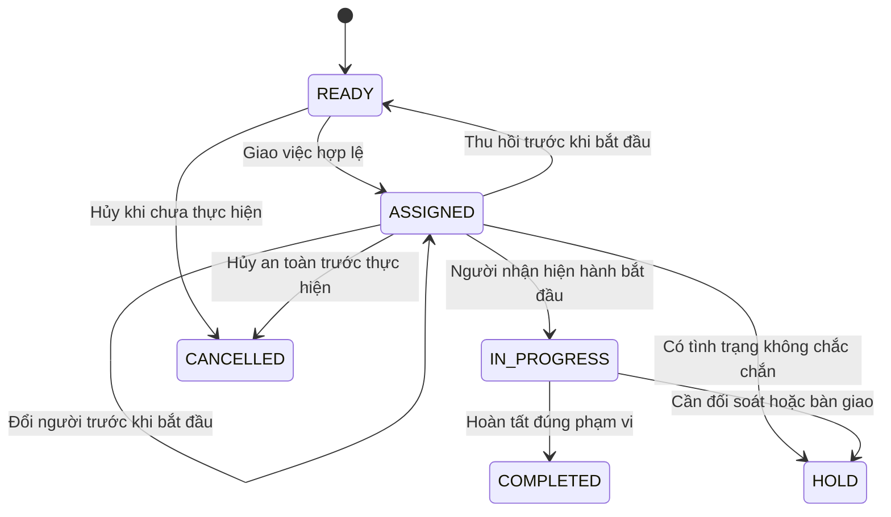

# Fulfillment assignment — Giao nhiệm vụ thực hiện đơn hàng an toàn

Giao nhiệm vụ fulfillment là quyết định ai hoặc hệ thống nào được phép thực hiện một phần công việc của đơn hàng: lấy hàng, đóng gói, bàn giao, giao hàng hoặc cung cấp dịch vụ. Một lỗi ở bước này có thể khiến hai người cùng xử lý một kiện, người không đủ điều kiện nhận hàng, đối tác khác tenant đọc thông tin người nhận hoặc nhân viên đã bị thu hồi nhiệm vụ vẫn xác nhận hoàn thành.

Trong chương **Fulfillment Rules**, bảo vệ việc giao nhiệm vụ là bảo vệ một quyết định nghiệp vụ có tác dụng cấp quyền. Quyết định đó cần giữ đúng các bất biến về đối tượng, phạm vi công việc, điều kiện nhận việc và trạng thái, kể cả khi có yêu cầu đồng thời, retry, đổi người phụ trách hoặc sự cố liên dịch vụ.

## 1. Mục tiêu và mô hình sử dụng trong bài

Sau bài học, bạn cần có khả năng:

- Phân biệt quyền giao việc của người điều phối với quyền thực hiện của người nhận việc.
- Xác định đơn vị công việc cần được giao độc quyền, thay vì mặc định cả đơn hàng luôn chỉ có một người xử lý.
- Thiết kế bất biến cho người nhận, năng lực xử lý, phiên bản nhiệm vụ và quyền đã bị thu hồi.
- Phối hợp transaction, khóa, kiểm soát phiên bản và idempotency để ngăn giao trùng.
- Giải thích giới hạn của timeout, lease, thông báo và transaction khi công việc có tác động vật lý.
- Kiểm thử các cách vượt điều kiện giao việc hoặc lợi dụng thay đổi người phụ trách.

Bài dùng ví dụ một hệ thống giao việc lấy và đóng gói hàng tại kho. Mỗi **nhiệm vụ** đã xác định rõ phạm vi được giao cho tối đa một người thực hiện đang có hiệu lực. Người điều phối có thể giao việc; nhân viên kho có thể tự nhận việc nếu chính sách cho phép.

Đây là lựa chọn mô hình cho ví dụ. Nếu một công việc cần nhiều người đồng thực hiện, cần mô hình thành nhóm có vai trò, số người tối đa và người chịu trách nhiệm, hoặc tách thành các nhiệm vụ con. Không áp dụng máy móc quy tắc một người cho mọi nghiệp vụ fulfillment.

## 2. Vì sao assignment là một ranh giới bảo mật?

Giả sử backend có API sau:

```http
POST /fulfillment-tasks/task_701/assignments
Content-Type: application/json

{
  "assigneeId": "worker_19",
  "warehouseId": "warehouse_other",
  "tenantId": "tenant_other",
  "status": "ASSIGNED",
  "eligibilityChecked": true,
  "capacityOverride": true
}
```

Nếu backend chỉ kiểm tra người gọi đã đăng nhập rồi ánh xạ payload vào entity, người gọi có thể tự đổi phạm vi kho, bỏ qua năng lực xử lý hoặc gán nhiệm vụ của tenant khác.

Một hợp đồng lệnh hẹp hơn cho người điều phối có thể chỉ nhận:

```json
{
  "assigneeId": "worker_19",
  "expectedTaskVersion": 12
}
```

Tenant, kho, phạm vi nhiệm vụ, điều kiện được giao và trạng thái mới phải lấy từ ngữ cảnh xác thực cùng dữ liệu có thẩm quyền. `assigneeId` là người nhận được đề xuất; nó vẫn phải được đối chiếu với phạm vi và chính sách của nhiệm vụ.

Với chức năng tự nhận việc, người nhận nên được suy ra từ danh tính đã xác thực:

```http
POST /fulfillment-tasks/task_701/claim
Content-Type: application/json

{ "expectedTaskVersion": 12 }
```

Không để nhân viên tự nhận việc bằng cách gửi một `assigneeId` bất kỳ rồi mặc nhiên được hành động thay người đó.

Những tình huống lạm dụng tiêu biểu gồm:

| Thao tác | Hậu quả nếu thiếu kiểm soát |
| --- | --- |
| Đổi task ID hoặc assignee ID trong request | Giao việc của người khác hoặc cho người ngoài phạm vi |
| Nhận công việc tại kho không được phân quyền | Tiếp cận hàng hóa, dữ liệu khách hàng hoặc chức năng nội bộ |
| Gửi nhiều yêu cầu claim song song | Hai người cùng có bằng chứng rằng mình đã nhận một việc |
| Giao nhiều task cùng lúc cho một nhân viên | Vượt năng lực xử lý dù từng request riêng lẻ đều hợp lệ |
| Dùng lại assignment cũ sau khi đã bị đổi người | Tiếp tục lấy hàng hoặc xác nhận hoàn tất trái phép |
| Để lease hết hạn rồi tự giao lại | Hai người cùng xử lý nếu người cũ đã bắt đầu làm ngoài hệ thống |
| Giả callback của đối tác là lệnh giao việc | Chuyển người thực hiện ngoài quy trình được cho phép |

## 3. Chọn đúng đơn vị cần bảo vệ

### 3.1. Đơn hàng, nhiệm vụ và lần giao việc là ba đối tượng khác nhau

Một đơn hàng có thể tách thành hai kiện từ hai kho. Mỗi kiện có thể trải qua lấy hàng, đóng gói và giao hàng. Gắn duy nhất một cột `assignee_id` lên đơn hàng thường không diễn đạt đủ những quan hệ này.

Có thể phân biệt:

- **Đơn hàng**: cam kết thương mại, dòng hàng và trạng thái tổng thể.
- **Nhiệm vụ fulfillment**: một phạm vi công việc cụ thể, chẳng hạn lấy hai đơn vị SKU X tại kho A cho kiện P.
- **Lần giao việc**: một lần cấp quyền cho một chủ thể thực hiện nhiệm vụ, có thời điểm bắt đầu, kết thúc và lý do thay đổi.
- **Đề nghị nhận việc**: lời mời có thời hạn, nếu quy trình có bước chấp nhận; chưa chắc đã là quyền thực hiện.

Mô hình có thể cho phép gửi nhiều đề nghị cùng lúc nhưng chỉ một người được chấp nhận nhiệm vụ. Khi đó, bất biến độc quyền phải áp vào lần giao việc có hiệu lực, không phải số thông báo đã gửi.

### 3.2. Tách đơn không được tạo thêm quyền giao hàng

Nếu đơn cho phép giao 5 sản phẩm, việc tạo hai nhiệm vụ số lượng 3 và 3 sẽ tạo khả năng giao vượt. Vì vậy, ngoài độc quyền trên mỗi nhiệm vụ còn có bất biến ở cấp phân bổ:

```text
Tổng lượng còn được cam kết trong các nhiệm vụ hợp lệ
+ lượng đã thực hiện
<= lượng được phép fulfillment theo revision hiện hành
```

Cần định nghĩa rõ những trạng thái nhiệm vụ nào giữ phần phân bổ. Nhiệm vụ đã hủy trước khi thực hiện có thể giải phóng lượng; nhiệm vụ đang đối soát sau khi đã lấy hàng không được coi như chưa từng tồn tại.

Tạo, tách hoặc gộp nhiệm vụ phải kiểm tra tổng này dưới cơ chế đồng thời phù hợp. Khóa riêng từng task không bảo vệ được tổng phân bổ của một dòng hàng chung.

### 3.3. Revision fulfillment xác định “đang giao việc gì”

Một đơn có thể đổi địa chỉ, số lượng, cấu hình hàng hoặc kho thực hiện. Lần giao việc phải tham chiếu phạm vi đã được xác nhận, chẳng hạn `fulfillmentRevision = 7`.

Không phải mọi thay đổi ghi chú đều cần vô hiệu hóa nhiệm vụ. Chính sách cần chỉ ra thay đổi nào ảnh hưởng phạm vi hoặc điều kiện thực hiện và phải tạo revision mới. Khi có thay đổi loại đó, nhiệm vụ và assignment cũ cần được hủy, cập nhật hoặc đưa vào đối soát bằng luồng có kiểm soát.

Nếu đơn hàng và task nằm ở hai dịch vụ khác nhau, một bản sao trạng thái “đơn còn hợp lệ” có thể đã cũ. Hệ thống cần xác định điểm chốt quyền thực hiện và cách xử lý hủy đến muộn; không thể mặc định một sự kiện đã được nhận là bằng chứng vĩnh viễn rằng đơn vẫn được phép giao.

## 4. Các bất biến cốt lõi

### 4.1. Đúng phạm vi và đúng người

1. Nhiệm vụ thuộc đúng tenant, kho và revision fulfillment.
2. Người điều phối có quyền giao đúng loại việc trong phạm vi đó.
3. Người được giao đang hoạt động và được phép nhận việc tại kho hoặc khu vực tương ứng.
4. Người thực hiện các bước tiếp theo phải khớp assignment hiện hành hoặc có quyền đại diện được quy định rõ.
5. Tài khoản dịch vụ, đối tác và công cụ quản trị cũng phải đi qua chính sách tương ứng.

Người mua sở hữu đơn không vì thế có quyền chọn bất kỳ nhân viên kho nào để thực hiện. Ngược lại, một nhân viên có quyền xem danh sách task không mặc nhiên có quyền giao việc cho người khác.

### 4.2. Đủ điều kiện nhận và thực hiện

Điều kiện có thể gồm:

- Chứng nhận hoặc kỹ năng còn hiệu lực cho loại hàng.
- Quyền vào kho, vùng giao hoặc nhóm khách hàng.
- Ca làm việc và trạng thái sẵn sàng theo chính sách.
- Khả năng xử lý hàng lạnh, hàng có yêu cầu đặc biệt hoặc công việc cần thiết bị.
- Năng lực xử lý còn đủ sau khi nhận thêm nhiệm vụ.
- Quy tắc phân tách trách nhiệm, nếu người phê duyệt không được đồng thời thực hiện.

Không phải hệ thống nào cũng cần tất cả điều kiện này. Điều quan trọng là điều kiện đã được nghiệp vụ yêu cầu phải được kiểm tra tại phía máy chủ, với nguồn dữ liệu và thời điểm đánh giá rõ ràng.

### 4.3. Độc quyền trên phạm vi đã chọn

Trong mô hình một người của bài:

```text
Với mỗi task:
  số assignment có hiệu lực <= 1

Nếu task là ASSIGNED hoặc IN_PROGRESS:
  phải có đúng một assignment có hiệu lực

Nếu task là READY, COMPLETED hoặc CANCELLED:
  không có assignment cho phép bắt đầu thao tác mới
```

Một assignment đã kết thúc vẫn tồn tại trong lịch sử nhưng không còn cấp quyền. Không xóa lịch sử chỉ để làm cho truy vấn “không còn assignment trùng” trả về kết quả đẹp.

### 4.4. Năng lực xử lý

Nếu năng lực được đo bằng số đơn vị tải:

```text
0 <= in_use_units <= capacity_units
```

`in_use_units` phải tính cả phần công việc giữ chỗ hoặc đang làm theo định nghĩa của hệ thống. Không dùng “số task đang hiển thị trên giao diện” làm nguồn quyết định.

Nếu mỗi task có tải khác nhau, giới hạn theo số task có thể sai. Công việc 10 đơn vị tải không được nhận vào chỗ trống 1 đơn vị chỉ vì đó là “một task”.

### 4.5. Quyền gắn với lần giao hiện hành

Mỗi lần cấp hoặc thu hồi quyền cần một thế hệ quyền tăng đơn điệu, bài gọi là `assignmentEpoch`:

```text
Yêu cầu thực hiện chỉ được chấp nhận nếu:
  actor được phép hành động
  assignmentId là assignment hiện hành
  assignmentEpoch khớp thế hệ hiện hành
  task ở trạng thái cho phép hành động đó
  revision và điều kiện bắt buộc vẫn hợp lệ
```

Việc một request từng hợp lệ không chứng minh nó còn hợp lệ sau khi đổi người phụ trách.

## 5. Nguồn dữ liệu có thẩm quyền

| Dữ liệu | Nguồn quyết định | Dữ liệu client có thể đề xuất |
| --- | --- | --- |
| Tenant và danh tính actor | Ngữ cảnh xác thực đã kiểm tra | Không tự khai để mở rộng quyền |
| Task, kho, loại việc, lượng phân bổ | Bản ghi task và revision fulfillment | Task ID để chỉ đối tượng mong muốn |
| Người được giao | Hồ sơ nhân sự hoặc đối tác cùng chính sách | Assignee ID nếu actor có quyền điều phối |
| Kỹ năng và giấy phép | Nguồn quản lý năng lực được kiểm soát | Không nhận cờ tự khai “đã đủ điều kiện” |
| Năng lực còn lại | Dữ liệu được cập nhật có kiểm soát đồng thời | Không nhận số chỗ trống do client tính |
| Trạng thái mới | State machine phía máy chủ | Lệnh nghiệp vụ, không phải trạng thái tùy ý |
| Thời điểm và epoch | Đồng hồ, phiên bản do máy chủ quản lý | Thời gian client chỉ có thể là dữ liệu tham khảo |
| Lý do đổi người | Lệnh điều phối và dấu vết kiểm toán | Nội dung lý do trong giới hạn được phép |

Trạng thái “online” hoặc vị trí gần đây là tín hiệu hỗ trợ quyết định, không tự chứng minh người đó đủ quyền và đủ năng lực. Nếu dữ liệu giấy phép hoặc quyền kho có thể bị thu hồi, cần xác định có kiểm tra lại ở thời điểm bắt đầu hoặc trước hành động nhạy cảm hay không.

Không tin một callback chỉ vì có trường `assignedBySystem = true`. Nguồn gửi phải được xác minh, đồng thời loại sự kiện đó phải có quyền thay đổi đúng phần dữ liệu trong mô hình tích hợp.

## 6. State machine: giao việc khác với gửi thông báo

Một state machine giản lược:



Trong ví dụ, chỉ assignment `ACTIVE` của task ở `ASSIGNED` hoặc `IN_PROGRESS` cấp quyền thực hiện tương ứng. Khi vào `HOLD`, hệ thống chặn thao tác thông thường cho đến khi quy trình đối soát quyết định quyền tiếp theo.

| Chuyển trạng thái | Điều kiện chính |
| --- | --- |
| READY → ASSIGNED | Actor được giao việc; người nhận hợp lệ; đủ tải; đúng revision |
| ASSIGNED → IN_PROGRESS | Actor thuộc assignment hiện hành; epoch đúng; điều kiện bắt đầu còn hiệu lực |
| ASSIGNED → ASSIGNED với người mới | Đổi người theo quyền riêng; chưa có thực hiện vật lý cần xử lý; đóng assignment cũ |
| ASSIGNED → READY | Thu hồi quyền và giải phóng phần tải tương ứng một lần |
| IN_PROGRESS → COMPLETED | Đủ bằng chứng và kết quả theo loại nhiệm vụ; chống hoàn tất trùng |
| Trạng thái chưa thực hiện → CANCELLED | Việc hủy không để lại quyền thực hiện hoặc phần tải bị giữ sai |
| Trạng thái có sự cố → HOLD | Lưu nguyên bối cảnh, chặn luồng thông thường, yêu cầu giải quyết có kiểm soát |

Không mặc định cho phép đổi người trực tiếp khi task đã `IN_PROGRESS`. Nếu người cũ đã cầm hàng, thay `assignee_id` trong cơ sở dữ liệu không làm hàng tự chuyển sang người mới. Cần bàn giao, xác nhận quyền giữ hàng hoặc đối soát, rồi mới cấp quyền tiếp theo theo chính sách.

Gửi push notification, email hoặc thông báo tới thiết bị không phải là chuyển trạng thái assignment. Một thông báo có thể đến muộn, bị gửi lặp hoặc không tới; nguồn quyết định vẫn là dữ liệu hiện hành trên máy chủ.

## 7. Mô hình dữ liệu và ràng buộc

Có thể dùng các thực thể sau:

```text
FulfillmentTask
  id, tenant_id, warehouse_id
  fulfillment_revision, task_type, allocation
  status, version, assignment_epoch

FulfillmentAssignment
  id, tenant_id, task_id, assignee_id
  assignment_epoch, status
  assigned_by, started_at, ended_at, reason

AssigneeCapacity
  tenant_id, assignee_id
  capacity_units, in_use_units, version

CommandResult
  scope, idempotency_key, request_fingerprint, response

OutboxEvent
  event_id, aggregate_id, aggregate_version, event_type, payload
```

Task có thể lưu thêm `current_assignment_id` để truy cập nhanh. Nếu vừa lưu con trỏ này vừa lưu trạng thái trên bảng assignment, phải cập nhật nhất quán trong cùng transaction và kiểm tra quan hệ đúng task; không để hai nguồn quyền mâu thuẫn nhau.

### 7.1. Ràng buộc chống hai assignment ACTIVE

Ví dụ với cú pháp chỉ mục có điều kiện của PostgreSQL, giả định bảng assignment đã có các cột không null và khóa ngoại phù hợp:

```sql
CREATE UNIQUE INDEX uq_task_one_active_assignment
ON fulfillment_assignments (tenant_id, task_id)
WHERE status = 'ACTIVE';

CREATE UNIQUE INDEX uq_task_assignment_epoch
ON fulfillment_assignments (tenant_id, task_id, assignment_epoch);
```

Chỉ mục đầu chặn hai assignment `ACTIVE` cho cùng task, kể cả khi một luồng ghi bỏ sót bước kiểm tra ứng dụng. Chỉ mục thứ hai giúp tránh tái sử dụng thế hệ của một lần giao việc.

Cần khóa ngoại kiểm tra task và assignee thuộc đúng phạm vi dữ liệu. Nếu tenant được lưu lặp ở các bảng, khóa ngoại ghép theo tenant có thể bảo vệ quan hệ đó. Một khóa ngoại chỉ theo ID không tự chứng minh quan hệ cùng tenant nếu mô hình ID chưa bảo đảm điều này.

Chỉ mục duy nhất không chứng minh người nhận đủ kỹ năng, chưa quá tải hoặc task còn được phép thực hiện. Đây là các lớp bảo vệ khác nhau.

### 7.2. Không chỉ cập nhật một cột người phụ trách

Một lần đổi người có thể cần:

1. Kết thúc assignment cũ và ghi lý do.
2. Giải phóng tải của người cũ nếu phần tải đó thực sự còn được giữ.
3. Kiểm tra và giữ tải cho người mới.
4. Tạo assignment mới với epoch lớn hơn.
5. Cập nhật task và version.
6. Ghi kết quả lệnh, kiểm toán và sự kiện.

Nếu các bảng cùng cơ sở dữ liệu, chúng cần được phối hợp trong transaction. Nếu có dịch vụ ngoài, phải thể hiện trạng thái chưa hoàn tất và có quy trình xử lý thất bại, không coi một transaction local là đã hoàn tất toàn bộ việc chuyển giao.

## 8. Luồng giao việc an toàn trong một cơ sở dữ liệu

Một luồng khái niệm cho giao việc lần đầu:

```text
1. Xác thực actor; kiểm tra cấu trúc lệnh.
2. Bắt đầu transaction.
3. Tải và khóa task trong tenant/phạm vi được phép.
4. Kiểm tra quyền của actor trên loại lệnh và đối tượng.
5. Nhận quyền xử lý idempotency hoặc trả kết quả đã hoàn tất.
6. Với lệnh mới: kiểm tra expected version, trạng thái và revision.
7. Tải người nhận; xác minh phạm vi, kỹ năng và điều kiện bắt buộc.
8. Giữ năng lực xử lý bằng cập nhật có điều kiện.
9. Tạo assignment ACTIVE với epoch mới; cập nhật task.
10. Ghi kết quả idempotency, kiểm toán và outbox.
11. Commit; trả assignment ID, epoch và task version mới.
```

Một lần retry của lệnh đã thành công có thể mang version cũ. Hệ thống cần nhận ra lệnh đã xử lý trước khi xem version đó như một lệnh mới bị xung đột. Tuy nhiên, việc trả lại kết quả vẫn phải kiểm tra người gọi hiện tại được phép nhận dữ liệu đó.

### 8.1. Khóa task để tuần tự hóa việc nhận cùng một nhiệm vụ

```sql
SELECT id, warehouse_id, status, version,
       fulfillment_revision, assignment_epoch
FROM fulfillment_tasks
WHERE id = :task_id
  AND tenant_id = :tenant_id
FOR UPDATE;
```

Tenant lấy từ ngữ cảnh được xác thực. Sau khi tải task, chính sách vẫn cần kiểm tra kho, loại việc và phạm vi điều phối cụ thể. Nếu không có quyền, không thực hiện thay đổi.

Khi hai người cùng claim một task, người lấy khóa trước có thể chuyển task sang `ASSIGNED`. Người sau phải đọc lại trạng thái dưới khóa và nhận kết quả không còn khả dụng; không tiếp tục dựa trên trạng thái `READY` đã đọc trước transaction.

### 8.2. Khóa task chưa đủ để bảo vệ tải của người nhận

Hai transaction nhận hai task khác nhau có thể cùng thấy người nhận còn một chỗ trống. Vì chúng khóa hai task khác nhau, cả hai vẫn có thể vượt mức nếu kiểm tra tải bằng phép đọc thông thường.

Có thể giữ tải bằng một cập nhật có điều kiện trên bản ghi năng lực chung:

```sql
UPDATE assignee_capacity
SET in_use_units = in_use_units + :load_units,
    version = version + 1
WHERE tenant_id = :tenant_id
  AND assignee_id = :assignee_id
  AND enabled = TRUE
  AND :load_units > 0
  AND in_use_units <= capacity_units - :load_units;
```

Giả định `load_units` đã được giới hạn theo miền giá trị nghiệp vụ, còn capacity và lượng đang dùng có ràng buộc không âm phù hợp. Phải kiểm tra đúng một hàng được cập nhật. Nếu không giữ được tải, rollback thay đổi và phản hồi theo hợp đồng; không vẫn tạo assignment rồi chờ job nền sửa.

Nếu transaction thất bại khi tạo assignment, cập nhật giữ tải trong cùng transaction cũng phải rollback. Khi hoàn tất hoặc thu hồi, việc giảm tải cần gắn với chuyển trạng thái thành công đúng một lần; callback lặp không được làm lượng đang dùng giảm hai lần.

### 8.3. Quy ước khóa phải bao phủ mọi đường ghi

Các luồng giao việc, tự nhận, đổi người, hủy, hoàn tất và tác vụ quản trị phải tuân thủ giao thức khóa chung. Với đổi người, nếu cần khóa năng lực của cả người cũ và mới, khóa các bản ghi đó theo thứ tự ổn định để giảm nguy cơ deadlock.

Khóa một task không tự bảo vệ tổng phân bổ của dòng hàng hay điều kiện ở đơn cha. Khi những dữ liệu đó có thể thay đổi đồng thời, cần xác định cùng ranh giới khóa hoặc cơ chế kiểm soát phiên bản tương ứng. Nếu phải khóa nhiều loại đối tượng, quy định thứ tự chung cho mọi luồng.

Có thể dùng khóa lạc quan thay cho một phần khóa bi quan, nhưng mọi ghi phụ thuộc phải nằm trong transaction có thể rollback khi kiểm tra version thất bại. Không báo xung đột sau khi đã commit giữ tải hoặc tạo assignment.

## 9. Ví dụ Java: kiểm tra điều kiện miền

Đoạn mã sau minh họa kiểm tra cho **lần giao việc từ READY**. Các snapshot phải là dữ liệu nội bộ đã được xác thực về cấu trúc, không phải object ánh xạ trực tiếp từ JSON.

```java
import java.util.Objects;
import java.util.Set;

public final class AssignmentRules {
    public enum TaskState {
        READY, ASSIGNED, IN_PROGRESS, HOLD, COMPLETED, CANCELLED
    }

    public record TaskView(
            String tenantId,
            String warehouseId,
            TaskState state,
            long version,
            int loadUnits,
            Set<String> requiredSkills) {}

    public record AssigneeView(
            String tenantId,
            boolean enabled,
            Set<String> allowedWarehouseIds,
            Set<String> skills,
            int freeUnits) {}

    public static void validateInitialAssignment(
            TaskView task,
            AssigneeView assignee,
            long expectedTaskVersion) {

        Objects.requireNonNull(task);
        Objects.requireNonNull(assignee);

        if (!Objects.equals(task.tenantId(), assignee.tenantId())) {
            throw new IllegalStateException("Tenant mismatch");
        }
        if (task.state() != TaskState.READY) {
            throw new IllegalStateException("Task is not ready");
        }
        if (task.version() != expectedTaskVersion) {
            throw new IllegalStateException("Task version changed");
        }
        if (!assignee.enabled()) {
            throw new IllegalStateException("Assignee is disabled");
        }
        if (!assignee.allowedWarehouseIds().contains(task.warehouseId())) {
            throw new IllegalStateException("Warehouse not allowed");
        }
        if (!assignee.skills().containsAll(task.requiredSkills())) {
            throw new IllegalStateException("Required skills missing");
        }
        if (task.loadUnits() <= 0
                || assignee.freeUnits() < task.loadUnits()) {
            throw new IllegalStateException("Insufficient capacity");
        }
    }

    private AssignmentRules() {}
}
```

Hàm này không kiểm tra quyền của actor, thời hạn chứng nhận, revision của đơn cha, tính duy nhất của assignment hoặc idempotency. Chúng phải được triển khai ở các thành phần thích hợp của luồng nghiệp vụ.

Đặc biệt, `freeUnits` là một snapshot. Việc hàm trả về thành công không bảo đảm còn đủ tải tại thời điểm commit. Cập nhật có điều kiện hoặc cơ chế khóa trên năng lực chung mới quyết định có giữ được tải hay không.

Các tập kỹ năng và quyền kho cần được xây dựng từ nguồn có thẩm quyền, với chính sách cập nhật hoặc thu hồi rõ ràng. Một danh sách được client gửi lên không trở nên đáng tin cậy chỉ vì được truyền vào hàm có tên “Rules”.

## 10. Idempotency: một ý định giao việc chỉ tạo một hiệu ứng

Giao việc có thể đã commit nhưng response bị mất. Nếu client gửi lại và backend tạo assignment mới hoặc giữ tải thêm lần nữa, trạng thái có thể sai dù người nhận vẫn là cùng một người.

Một bản ghi chống lặp nên bao gồm:

```text
scope = tenant + actor + task + command_type
key = định danh của một ý định thao tác
fingerprint = command + assignee + expectedVersion + tham số ảnh hưởng ý nghĩa
result = assignmentId + epoch + taskVersion + kết quả đã hoàn tất
```

Máy chủ tạo fingerprint từ biểu diễn chuẩn hóa của lệnh. Cùng khóa nhưng khác người nhận, task hoặc nội dung có ý nghĩa phải bị từ chối theo hợp đồng, không âm thầm thực hiện nội dung mới.

| Tình huống | Hành vi cần bảo đảm |
| --- | --- |
| Cùng khóa, cùng nội dung, lệnh đã thành công | Trả lại kết quả đã lưu; không giữ tải hoặc phát hiệu ứng mới |
| Hai request cùng khóa đến đồng thời | Chỉ một luồng được xử lý; luồng kia chờ hoặc nhận trạng thái phù hợp |
| Cùng khóa nhưng đổi assignee | Báo xung đột sử dụng khóa |
| Giao việc đã rollback | Không để kết quả “thành công” giả còn tồn tại |
| Hai actor dùng hai khóa khác nhau cùng claim | Bất biến độc quyền của task vẫn chặn nhận trùng |
| Khóa hết thời gian lưu | Quy tắc trạng thái và tính duy nhất vẫn bảo vệ dữ liệu |

Ràng buộc duy nhất cho scope và key cần phối hợp với transaction của assignment. Mẫu “kiểm tra khóa chưa tồn tại, giao việc, rồi mới ghi khóa” có thể chạy hai lần khi request cạnh tranh.

Idempotency chỉ nhận diện lần gửi lại cùng ý định. Nó không ngăn mọi lệnh khác nhau cùng nhắm vào một tài nguyên; transaction và bất biến vẫn cần thiết.

## 11. Đổi người và thu hồi quyền cũ

### 11.1. Một ví dụ về yêu cầu đến muộn

Giả sử nhân viên A nhận task ở epoch 8. Người điều phối đổi sang B và tạo epoch 9. Thiết bị A vẫn đang giữ màn hình cũ rồi gửi lệnh:

```http
POST /fulfillment-tasks/task_701/start
Content-Type: application/json

{
  "assignmentId": "assignment_old",
  "assignmentEpoch": 8
}
```

Backend phải đối chiếu actor A, assignment ID, epoch và trạng thái hiện hành trong thao tác được kiểm soát đồng thời. Request phải bị từ chối vì A không còn quyền hiện hành; chỉ kiểm tra “A từng được giao task” là chưa đủ.

Epoch do client gửi là điều kiện được đề xuất để đối chiếu, không phải sự thật có thẩm quyền. Epoch mới phải do máy chủ sinh và lưu. Epoch cũng không thay thế xác thực: một người đoán đúng epoch vẫn không được hành động thay người nhận hiện tại.

### 11.2. Kiểm tra và thực hiện phải ở cùng ranh giới bảo vệ

Mẫu sau có khoảng đua:

```text
Đọc assignment: A còn quyền
Người điều phối đổi sang B
A ghi nhận bắt đầu dựa trên kết quả đọc cũ
```

Đối với tác động trong cơ sở dữ liệu, kiểm tra quyền hiện hành và ghi chuyển trạng thái phải được khóa hoặc cập nhật có điều kiện trong cùng transaction.

Đối với một dịch vụ kho hoặc thiết bị bên ngoài, cần truyền ngữ cảnh assignment và có cách chặn yêu cầu cũ tại nơi thực hiện tác động. Chỉ lưu epoch ở dịch vụ điều phối mà dịch vụ kho không đối chiếu thì không đủ bảo vệ.

### 11.3. Fencing token và giới hạn của nó

Một epoch tăng đơn điệu có thể làm fencing token: tài nguyên đích từ chối lệnh thuộc thế hệ đã bị thay thế. Tuy nhiên, chỉ so token với “giá trị lớn nhất từng thấy” chưa đủ cho mọi tình huống thu hồi. Nếu tài nguyên đích chưa biết epoch 9, lệnh epoch 8 đến muộn vẫn có thể được chấp nhận.

Thiết kế phải chỉ ra tài nguyên đích biết thế hệ hợp lệ bằng cách nào: kiểm tra nguồn quyền hiện hành, ghi nhận thế hệ mới trước khi cho phép thao tác tiếp hoặc dùng giao thức thu hồi phù hợp. Việc kiểm tra và tác động tại tài nguyên đích cũng phải tránh khoảng đua.

Mã QR, liên kết hoặc token được ký cho assignment cũ vẫn có thể hợp lệ về chữ ký nhưng đã hết quyền về nghiệp vụ. Với thao tác nhạy cảm, cần kiểm tra trạng thái hiện hành hoặc cơ chế thu hồi tương ứng.

## 12. Timeout, lease và tác động vật lý

Lease có thể giới hạn thời gian giữ một đề nghị nhận việc hoặc một quyền đang hoạt động. Cần phân biệt:

- **Hết hạn đề nghị chưa được nhận**: thường có thể giải phóng lời mời nếu chưa cấp quyền thực hiện.
- **Hết hạn assignment đã cấp quyền**: cần biết người cũ đã bắt đầu làm hay chưa và có thể còn tiếp tục ngoài hệ thống hay không.
- **Hết hạn kết nối thiết bị**: chỉ cho biết mất liên lạc, không chứng minh hàng chưa được lấy.

Ví dụ, A đã lấy một kiện nhưng điện thoại mất mạng. Tự động chuyển task về READY rồi giao B có thể tạo hai hành động thực tế xung đột. Một lựa chọn là đưa task vào HOLD, xác minh vị trí hàng và thực hiện bàn giao trước khi mở lại.

Gia hạn lease phải gắn với đúng assignment, actor và epoch hiện hành. Không cho một heartbeat muộn kéo dài quyền đã bị thu hồi. Đồng hồ quyết định hết hạn phải do hệ thống kiểm soát; thời gian do thiết bị tự khai không được kéo dài quyền.

Đối với thao tác offline, hệ thống cần một mô hình chấp nhận rủi ro và đối soát riêng. Không thể bảo đảm thu hồi tức thì trên thiết bị không thể liên lạc nếu thiết bị vẫn được phép tác động vật lý.

## 13. Phối hợp với dịch vụ ngoài và thông báo

### 13.1. Commit assignment và ý định phát sự kiện

Nếu ghi assignment thành công nhưng phát sự kiện thất bại, người nhận có thể không biết mình được giao việc. Nếu phát sự kiện trước commit, người nhận có thể thấy một assignment sau đó đã rollback.

Mẫu outbox lưu assignment và ý định phát sự kiện trong cùng transaction local:

```text
Transaction:
  giữ tải
  tạo assignment
  cập nhật task/version/epoch
  ghi CommandResult
  ghi OutboxEvent
Commit

Publisher:
  gửi sự kiện có eventId, taskId, assignmentId, epoch và version
```

Outbox không tự bảo đảm consumer chỉ xử lý một lần. Consumer cần nhận diện sự kiện lặp và không để sự kiện cũ ghi đè trạng thái mới.

Ví dụ, sự kiện “giao A, epoch 8” đến sau sự kiện “giao B, epoch 9” không được làm màn hình hoặc dịch vụ kho quay lại coi A là người nhận hiện hành. Cache và mô hình đọc cần kiểm tra version/epoch; hành động nhạy cảm vẫn phải kiểm tra nguồn quyền phù hợp.

### 13.2. Đối tác ngoài có thể cần bước chấp nhận

Nếu việc giao cho hãng vận chuyển chưa chắc thành công, có thể dùng trạng thái trung gian biểu thị đang yêu cầu hoặc đang chờ chấp nhận. Chỉ được coi là đã giao theo định nghĩa nghiệp vụ khi các điều kiện cần thiết đã đạt.

Timeout khi gọi đối tác không chứng minh đối tác chưa nhận yêu cầu. Trước khi giao sang đối tác khác, cần dùng định danh ổn định để tra cứu, hủy hoặc đối soát yêu cầu cũ theo khả năng của tích hợp.

Không giữ khóa cơ sở dữ liệu dài trong khi chờ một cuộc gọi mạng không xác định thời gian. Thiết kế trạng thái, retry, idempotency và bù trừ để xử lý phần ngoài transaction. Nếu việc hủy còn chưa được xác nhận, thể hiện sự không chắc chắn đó thay vì cấp song song hai quyền thực hiện độc quyền.

## 14. Quyền truy cập dữ liệu đi cùng assignment

Giao việc có thể mở quyền đọc thông tin người nhận, vị trí kho hoặc hướng dẫn xử lý hàng. Cần xác định thời điểm và mức dữ liệu thực sự cần thiết:

- Danh sách task để lựa chọn có thể chỉ hiện vùng, loại việc và tải ước tính.
- Sau khi nhận hợp lệ, người thực hiện được truy cập phần dữ liệu cần cho công việc.
- Sau khi bị thu hồi, các API thao tác và đọc nhạy cảm phải xét lại quyền hiện hành.
- Người từng thực hiện có thể vẫn được đọc một phần lịch sử nếu chính sách đối soát yêu cầu; quyền đó cần được định nghĩa riêng.

URL tải tài liệu hoặc token dài hạn có thể tiếp tục hoạt động sau thu hồi nếu không có cơ chế kiểm soát phù hợp. Cần cân nhắc thời hạn, phạm vi và yêu cầu kiểm tra trạng thái tại lúc truy cập.

Thu hồi quyền trên máy chủ không xóa được thông tin đã được chụp màn hình hoặc lưu trên thiết bị. Vì vậy, chỉ cấp dữ liệu cần thiết ngay từ đầu và có chính sách xử lý dữ liệu trên ứng dụng phù hợp với mô hình vận hành.

## 15. Kiểm thử các tình huống tấn công logic

Không chỉ kiểm tra API trả thành công hoặc thất bại. Cần kiểm tra assignment có hiệu lực, tải, version, epoch, lịch sử và tác dụng phụ sau khi transaction kết thúc.

| Tình huống | Bất biến cần quan sát |
| --- | --- |
| Actor không có quyền điều phối gửi lệnh giao người khác | Không tạo assignment hoặc giữ tải |
| Thay task ID thành task của tenant hoặc kho khác | Phạm vi đối tượng được bảo vệ, không lộ dữ liệu không được phép |
| Tự nhận việc nhưng chèn assignee ID của người khác | Danh tính người nhận vẫn được suy ra đúng hoặc request bị từ chối |
| Chèn cờ bỏ qua năng lực, trạng thái, tenant vào payload | Không ảnh hưởng dữ liệu có thẩm quyền |
| Giao cho người bị khóa hoặc thiếu kỹ năng | Không cấp quyền thực hiện |
| Hai người cùng claim một task bằng hai khóa khác nhau | Chỉ một assignment ACTIVE; người thua không bị giữ tải |
| Hai task cùng giành phần tải cuối của một người | Không vượt capacity, kể cả hai task có khóa riêng |
| Cùng lệnh được retry sau mất response | Trả cùng kết quả, chỉ giữ tải và tạo hiệu ứng một lần |
| Cùng idempotency key nhưng đổi assignee | Xung đột, không chuyển người âm thầm |
| Đổi A sang B rồi A gửi lệnh start hoặc complete cũ | Epoch và assignment cũ không còn quyền |
| A bắt đầu đồng thời với lệnh đổi sang B | Chỉ một quyết định hợp lệ được commit theo state machine |
| Hủy đơn song song với giao việc | Không cấp quyền trên revision đã bị vô hiệu theo giao thức đã chọn |
| Lỗi sau khi giữ tải nhưng trước khi tạo assignment | Toàn bộ thay đổi local rollback |
| Lặp sự kiện hoàn tất hoặc thu hồi | Không giảm tải hai lần hoặc ghi hoàn thành hai lần |
| Sự kiện giao A đến sau sự kiện giao B | Mô hình đọc và quyền thực hiện không quay lại epoch cũ |
| Lease hết hạn khi người cũ đã cầm hàng | Không tự tạo quyền thực hiện mới trái quy trình đối soát |
| Tách task nhiều lần để vượt lượng của dòng đơn | Tổng lượng phân bổ và đã thực hiện không vượt quyền fulfillment |
| Chứng nhận bị thu hồi giữa giao việc và bắt đầu | Quy tắc tái kiểm tra ở bước nhạy cảm được thực thi |
| Job nền hoặc công cụ quản trị đổi người | Vẫn giữ bất biến và dấu vết như các đường ghi khác |

Để kiểm thử cạnh tranh, dùng điểm đồng bộ để hai luồng cùng tới bước giành task hoặc tải, thay vì dựa vào việc gửi request “gần nhau”. Sau khi cả hai kết thúc, kiểm tra dữ liệu từ nguồn đã commit.

Một số kiểm tra bất biến có thể biểu diễn như sau:

```text
Với mọi task thuộc mô hình một người:
  số assignment ACTIVE <= 1

Với mọi assignee:
  0 <= in_use_units <= capacity_units

Với mọi lệnh có tác động:
  actor và assignment hiện hành phải khớp chính sách
  task state cho phép hành động
  epoch và revision phải còn hợp lệ

Với mọi lần đổi người thành công:
  lịch sử cũ còn tồn tại
  assignment cũ không còn quyền thực hiện
  thế hệ quyền mới lớn hơn thế hệ đã thay thế
```

Nếu tải là tổng dẫn xuất từ nhiều assignment, đối soát tổng đó với bộ đếm đang lưu theo đúng định nghĩa trạng thái. Kiểm tra thêm những chuỗi thao tác như claim → retry → đổi người → heartbeat cũ → hoàn tất cũ, vì lỗi thường xuất hiện ở cách ghép lệnh hơn là ở một endpoint riêng lẻ.

## 16. Kiểm toán, phát hiện sai lệch và tự kiểm tra thiết kế

Một bản ghi kiểm toán nên giúp trả lời:

- Ai yêu cầu, ai được giao và actor có vai trò gì tại thời điểm đó?
- Task thuộc kho, tenant và revision nào?
- Assignment ID, epoch và version trước–sau là gì?
- Chính sách hoặc điều kiện nào cho phép hay từ chối quyết định?
- Có bỏ qua điều kiện theo quyền ngoại lệ không; ai cho phép và lý do là gì?
- Phần tải được giữ hoặc giải phóng bao nhiêu, có tác động bên ngoài nào còn chưa chắc chắn?

Ghi correlation ID và định danh lệnh phù hợp; không ghi token xác thực hoặc dữ liệu người nhận không cần thiết. Bản ghi “đã giao thành công” cần phản ánh quyết định đã commit, tránh log thành công cho transaction sau đó rollback.

Có thể theo dõi các dấu hiệu như nhiều request dùng epoch cũ, một actor cố giao ngoài phạm vi, lặp xung đột năng lực hoặc assignment ACTIVE không khớp trạng thái task. Những tín hiệu này cũng có thể do thiết bị mất mạng hoặc tích hợp lỗi; cần ngữ cảnh để phân biệt.

Trước khi triển khai, hãy trả lời được:

1. Đơn vị nào được giao độc quyền, và tổng lượng giữa các task được bảo vệ ở đâu?
2. Actor có quyền giao việc hay chỉ quyền nhận việc; quyền đó có giới hạn theo kho, tenant hoặc loại công việc không?
3. Điều kiện của người nhận lấy từ nguồn nào và được kiểm tra lại ở bước nào?
4. Hai request cùng task hoặc cùng phần tải cuối được phân xử bằng cơ chế gì?
5. Retry của một lệnh thành công có tạo assignment, giữ tải hoặc thông báo mới không?
6. Khi đổi người, yêu cầu cũ bị chặn ở cả nơi cấp quyền và nơi thực hiện tác động như thế nào?
7. Nếu mất liên lạc sau khi đã lấy hàng, hệ thống biểu diễn và giải quyết tình trạng đó ra sao?
8. Thông báo, callback và cache có thể cũ; nguồn nào quyết định quyền thực hiện cuối cùng?

Một assignment an toàn cần xác định được người có quyền, phạm vi được thực hiện, điều kiện đang có hiệu lực và thế hệ quyền hiện hành. Khi các quyết định đó được bảo vệ lúc ghi và được đối chiếu ở từng hành động nhạy cảm, việc sửa payload, nhận việc đồng thời hay phát lại yêu cầu cũ sẽ không tạo thêm quyền fulfillment ngoài quy tắc nghiệp vụ.
